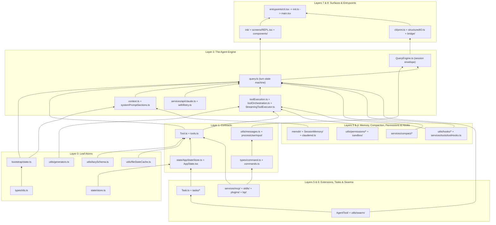

# Architecture Map: The Bottom-Up Layer Cake

At 1,884 TypeScript/TSX files, Claude Code looks intimidating from the outside. From the inside, however, it is built out of **nine clear architectural layers** stacked one on top of the next. Each layer solves one crisp problem and hands a clean contract upward.

This document is the visual compass for the entire book. Keep it open beside you as you read.

---

## 1. The Nine-Layer Stack

```text
+-----------------------------------------------------------------------------+
| LAYER 8: ENTRYPOINTS, STARTUP & WIRE PROTOCOLS                   [Ch 22-24] |
| entrypoints/cli.tsx -> init.ts -> setup.ts -> main.tsx                      |
| Interactive REPL | Headless Print/SDK (cli/structuredIO.ts) | MCP Server    |
| Remote Bridge (bridge/) | Direct Connect (server/) | Upstream Proxy         |
+-----------------------------------------------------------------------------+
| LAYER 7: TERMINAL UI & INPUT ENGINE                              [Ch 20-21] |
| replLauncher.tsx -> App.tsx -> screens/REPL.tsx -> components/ & hooks/     |
| Custom React Terminal Renderer (ink/ + native-ts/yoga-layout/)              |
| Keybindings (keybindings/) | Vim Editor State Machine (vim/)                |
+-----------------------------------------------------------------------------+
| LAYER 6: CONCURRENCY, BACKGROUND TASKS & MULTI-AGENT SWARMS      [Ch 17-19] |
| Task.ts + tasks/* (local_bash, local_agent, remote_agent, teammate, dream)  |
| AgentTool (runAgent, forkSubagent, resumeAgent) | Worktrees | Swarm/Teams   |
+-----------------------------------------------------------------------------+
| LAYER 5: DYNAMIC CAPABILITIES & INTEGRATIONS                     [Ch 15-16] |
| MCP Client & Transports (services/mcp/) | ToolSearch (deferred schemas)     |
| Skills (skills/) | Plugins (plugins/, utils/plugins/) | LSP (services/lsp/) |
+-----------------------------------------------------------------------------+
| LAYER 4: SAFETY, POLICY, SANDBOX & LIFECYCLE HOOKS               [Ch 11-14] |
| Permission Engine (utils/permissions/) | Auto Classifier (yoloClassifier)   |
| Shell & OS Sandbox (BashTool, utils/sandbox/) | Settings & Policy Merging   |
| Lifecycle Hooks (utils/hooks/: shell, HTTP+SSRF guard, prompt, agent hooks) |
+-----------------------------------------------------------------------------+
| LAYER 3: LONG-HORIZON CONTEXT & MEMORY                           [Ch 09-10] |
| 5-Stage Compaction (budget -> snip -> microcompact -> collapse -> compact)  |
| CLAUDE.md hierarchy | memdir/ | SessionMemory | autoDream | teamMemorySync  |
+-----------------------------------------------------------------------------+
| LAYER 2: THE AGENT ENGINE (PROMPT -> STREAM -> TOOLS -> LOOP)    [Ch 04-08] |
| QueryEngine.ts (session envelope) -> query.ts (AsyncGenerator turn loop)    |
| services/api/claude.ts (streaming + retries) | context.ts + prompts.ts      |
| toolOrchestration.ts (batch concurrency) | StreamingToolExecutor.ts         |
+-----------------------------------------------------------------------------+
| LAYER 1: CORE CAPABILITY & INPUT CONTRACTS                       [Ch 02-03] |
| Tool.ts (Tool, buildTool, ToolUseContext) + tools.ts (catalog & cache sort) |
| types/command.ts (prompt | local | local-jsx) + commands.ts                 |
| utils/messages.ts (normalization) + processUserInput/ (input routing)       |
+-----------------------------------------------------------------------------+
| LAYER 0: LEAF ATOMS & ZERO-DEPENDENCY PRIMITIVES                    [Ch 01] |
| types/ids.ts (branded IDs) | state/store.ts (34-line reactive store)        |
| bootstrap/state.ts (process leaf singleton) | utils/lazySchema.ts           |
| utils/generators.ts (bounded async mux) | utils/fileStateCache.ts (LRU)     |
+-----------------------------------------------------------------------------+
```

---

## 2. Dependency Flow Between Subsystems



---

## 3. End-to-End Runtime Dataflow: One User Turn

When a user submits a prompt (whether from the interactive Ink REPL, headless `-p` / SDK mode, or a remote bridge), the turn travels through a remarkably consistent pipeline:

```mermaid
sequenceDiagram
    participant Surface as Surface (REPL / SDK / Bridge)
    participant Input as processUserInput()
    participant QE as QueryEngine / REPL Caller
    participant Loop as query.ts (while true)
    participant Compact as Context Pipeline (5 stages)
    participant API as services/api/claude.ts
    participant Exec as StreamingToolExecutor / runTools
    participant Perm as Hooks + Permissions + Sandbox

    Surface->>Input: raw text / slash command / images
    Input-->>Surface: messages[] + shouldQuery (or local JSX / text)
    Surface->>QE: submitMessage() / start query()
    QE->>Loop: query({ messages, systemPrompt, tools, canUseTool, toolUseContext })

    loop Until Terminal Reason (completed / max_turns / aborted / error)
        Loop->>Compact: toolResultBudget -> snip -> microcompact -> collapse -> autocompact
        Compact-->>Loop: bounded messagesForQuery
        Loop->>API: queryModelWithStreaming(messagesForQuery, fullSystemPrompt, tools)
        loop Streaming SSE chunks
            API-->>Loop: StreamEvent / AssistantMessage
            opt tool_use block arrives & streamingToolExecution enabled
                Loop->>Exec: streamingToolExecutor.addTool(block)
                Exec->>Perm: validateInput -> PreToolUse -> canUseTool
                Perm-->>Exec: allow / deny / updatedInput
                Exec-->>Loop: buffered progress & tool_result
            end
        end
        opt Non-streaming or remaining tools
            Loop->>Exec: runTools() / getRemainingResults()
            Exec-->>Loop: ordered tool_result + contextModifiers
        end
        alt No tool calls
            Loop->>Perm: handleStopHooks() + tokenBudget check
        end
    end

    Loop-->>QE: return Terminal { reason }
    QE-->>Surface: yield SDKMessage / update REPL state + persist JSONL
```

---

## 4. Seven Cross-Cutting Engineering Principles

Seven recurring design principles explain *almost every non-obvious line of code* across all 1,884 files. You will encounter them over and over throughout the book:

### 1. Prompt-Cache Prefix Stability Drives Data Structures
In an agentic loop that makes 10–100 API calls per task, breaking the Anthropic prompt cache turns pennies into dollars and adds seconds per turn. Because prompt caches match exact byte prefixes (`tools` → `system` → `messages`):
- `tools.ts` (`assembleToolPool`) sorts built-in tools and MCP tools into **two separate sorted partitions** so adding an MCP server never interleaves with built-in tools and invalidates the global cache prefix.
- `constants/prompts.ts` splits the system prompt at `SYSTEM_PROMPT_DYNAMIC_BOUNDARY` so the static prefix can use `scope: 'global'`.
- `constants/systemPromptSections.ts` memoizes sections by default and names the opt-out `DANGEROUS_uncachedSystemPromptSection(name, fn, _reason)` to force code reviewers to justify every cache break.
- `context.ts` snapshots `git status` **once** at conversation start and memoizes it.
- `ToolUseContext.renderedSystemPrompt` freezes the parent's system prompt bytes so forked subagents share the parent's KV cache.

### 2. Everything Is an `AsyncGenerator`
From API streaming (`queryModelWithStreaming`) to tool execution (`runToolUse`, `runTools`) to the core agent loop (`query`) to the session wrapper (`QueryEngine.submitMessage`), control flow is modeled as composable `AsyncGenerator<YieldedEvent, ReturnValue>` pipelines. That gives the codebase uniform backpressure, streaming progress events, clean `yield*` delegation, and structured terminal return values (`Terminal`).

### 3. Cold-Start Obsession & Dead-Code Elimination
CLI startup latency is guarded aggressively at every boundary:
- `entrypoints/cli.tsx` resolves `--version` with **zero imports** and dynamically imports fast paths before touching `main.tsx`.
- `utils/lazySchema.ts` defers Zod schema construction behind JS getters until first tool use.
- `entrypoints/init.ts` defers ~400 KB of OpenTelemetry and ~700 KB of gRPC exporters via dynamic `import()`, while firing `preconnectAnthropicApi()` early to hide TCP+TLS handshake latency behind local setup work.
- `bun:bundle`'s `feature('...')` checks stay **inline** at branch sites (never abstracted into helper wrappers or `QueryConfig`) so Bun's bundler tree-shakes internal/experimental modules completely out of external builds.

### 4. Intentional Import-DAG Discipline
In a 1,884-file TypeScript codebase, circular dependencies silently break module initialization. The repo combats cycles systematically:
- Pure type files live in `types/` (`types/ids.ts`, `types/permissions.ts`, `types/command.ts`, `types/hooks.ts`) with zero runtime imports.
- `bootstrap/state.ts` is enforced as a **leaf** via `custom-rules/bootstrap-isolation`, acting as a neutral handoff point (for example, `cachedClaudeMdContent` breaks a 4-hop cycle between `yoloClassifier`, `claudemd`, `filesystem`, and `permissions`).
- Strategic lazy `require()` calls break unavoidable cycles in `tools.ts` (team tools), `QueryEngine.ts` (UI components), and `utils/systemPrompt.ts`.

### 5. Fail-Closed Defaults Everywhere Security or Concurrency Matters
- `buildTool()` defaults every tool to `isConcurrencySafe: () => false` and `isReadOnly: () => false`. A tool must *explicitly opt in* to parallel execution.
- `partitionToolCalls()` wraps `tool.isConcurrencySafe()` in `try/catch` and falls back to `false` (serial) if parsing throws.
- Permission checks layer `validateInput` → blanket deny filtering (`filterToolsByDenyRules`, removing denied tools before the model even sees them) → hooks → rule matching → classifier/sandbox → interactive user prompt.

### 6. Dual Representation: Model View vs. Human View
What the LLM needs and what the human sees in the terminal are intentionally decoupled:
- Every `Tool` separately implements `mapToolResultToToolResultBlockParam()` (compact, model-facing serialization), `renderToolResultMessage()` (React/Ink terminal UI), and `extractSearchText()` (exact rendered text for transcript search highlighting).
- UI-only system notices (`SystemMessage`) are kept in the REPL transcript and stripped at `normalizeMessagesForAPI()`.
- Oversized tool outputs spill to `<persisted-output>` files for the model while keeping structured data for the renderer.

### 7. Explicit Separation of Process Lifetime, Session Lifetime, and Turn Lifetime
Three state containers exist for three distinct lifetimes—never conflate them:
- **`bootstrap/state.ts`** — Process lifetime (PID-scoped, non-reactive, leaf singleton).
- **`AppState` (`state/AppStateStore.ts`)** — Session/UI lifetime (immutable snapshots, reactive via `useSyncExternalStore`).
- **`query.ts` `State` + `ToolUseContext`** — Single turn / subagent execution lifetime (mutable per-iteration loop state, cloned or isolated per child agent).
