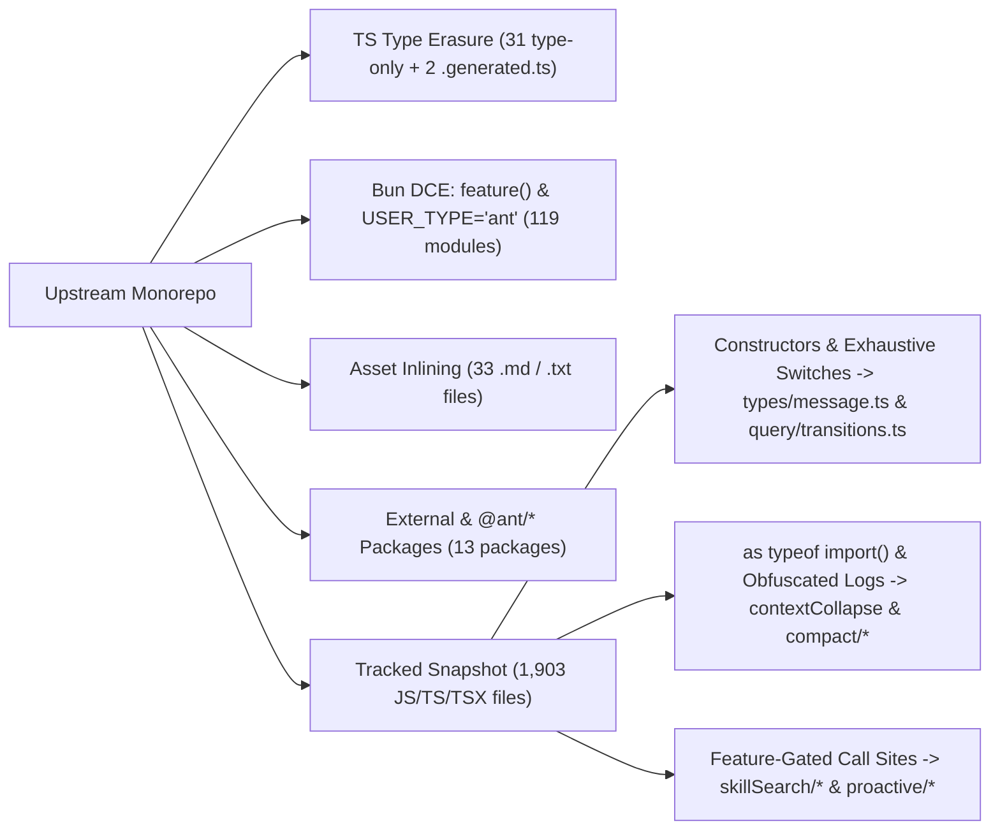

# Appendix B — Reconstructing the Missing Snapshot Boundaries from Call Sites

> **Role:** Forensic Reference & Boundary Catalog (Companion to [Chapter 00](prologue-how-to-read-a-1900-file-agent.md)–[Chapter 24](ch024-across-the-wire-remote-sessions-bridge-and-direct-connect.md))
> **Prerequisites:** [Chapter 00](prologue-how-to-read-a-1900-file-agent.md), [Chapter 03](ch003-command-and-message-contracts.md), [Chapter 07](ch007-the-heartbeat-query-loop.md), [Chapter 09](ch009-five-layer-compaction-pipeline.md)
> **Primary Source Files (Observed Call Sites):**
> - `utils/messages.ts` — message factories, normalization, and snip projection call sites
> - `query.ts` — `query()` turn state machine, `Continue`/`Terminal` transitions, collapse/reactive/snip/skillSearch hooks
> - `QueryEngine.ts` — session envelope, message stream dispatch, `snipReplay` callback
> - `types/logs.ts` & `utils/sessionStorage.ts` — JSONL persistence contracts, tombstone removal, and obfuscated `marble-origami-*` collapse entries
> - `services/compact/microCompact.ts` & `services/api/claude.ts` — cached microcompact state and `cache_edits` wire contract
> - `utils/attachments.ts` & `tools/SkillTool/SkillTool.ts` — skill-search discovery, prefetch, and remote-skill execution seams
> - `screens/REPL.tsx`, `cli/print.ts` & `commands/compact/compact.ts` — proactive loop and reactive-only compaction seams

---

## Why This Snapshot Has Exact, Predictable Holes

When you read a real-world source snapshot rather than a full upstream monorepo, broken imports look alarming at first. In this checkout, scanning all **1,903** `.ts`/`.tsx`/`.js`/`.jsx`/`.mjs`/`.cjs` source files outside `book/` turns up **187 unique unresolved local import targets** (across both relative `./`/`../` specifiers and `src/` root aliases) plus **13 external, internal-scoped (`@ant/*`), or Bun runtime packages** (`bun:bundle`, `bun:ffi`, `@anthropic-ai/*`).

The crucial systems insight is that these 187 holes are **not random corruption**. Every single one falls cleanly into one of four mechanical build-pipeline boundaries:

1. **TypeScript type erasure (31 pure type-only modules + 2 generated SDK type files).**
   Files imported exclusively via `import type` (or ambient `.d.ts` files like `ink/global.d.ts`) compile to **zero bytes of runtime JavaScript**. In any snapshot captured from runtime-emitted sources or post-strip artifacts, pure type modules leave behind their exact import lists in every consumer while contributing nothing to the runtime module graph.
2. **Build-time dead-code elimination (`feature('...')` & `USER_TYPE === 'ant'`) + excluded-strings hygiene (109 dynamic-only targets + 4 mixed type/dynamic targets + 6 tree-shaken static targets).**
   As introduced in [Chapter 00](prologue-how-to-read-a-1900-file-agent.md), Claude Code builds internal (`ant`) and external customer binaries from one tree using `bun:bundle`'s compile-time `feature('...')` predicate. Even when a symbol is imported via a static top-level ES `import`—such as `isConnectorTextBlock` (`types/connectorText.js`), `TungstenTool`, `TungstenLiveMonitor`, or `WORKFLOW_TOOL_NAME` (`tools/WorkflowTool/constants.js`)—every runtime call site is guarded behind `feature('...')` or `process.env.USER_TYPE === 'ant'` (already constant-folded to `"external" === 'ant'` in React-Compiler-transformed `.tsx` files like `components/agents/ToolSelector.tsx:61` and `screens/REPL.tsx:4584`). Once the false branch folds away, Bun's tree-shaker drops the target module completely.

   Even more revealing are the inline comments explaining an upstream **excluded-strings CI check** that rejects external builds if internal codenames or feature strings leak into un-gated files:

```ts
// utils/attachments.ts:88-95
import type { DiscoverySignal } from '../services/skillSearch/signals.js'
// Conditional require for DCE. All skill-search string literals that would
// otherwise leak into external builds live inside these modules. The only
// surfaces in THIS file are: the maybe() call (gated via spread below) and
// the skill_listing suppression check (uses the same skillSearchModules null
// check). The type-only DiscoverySignal import above is erased at compile time.
const skillSearchModules = feature('EXPERIMENTAL_SKILL_SEARCH')
```

   The same invariant forces `QueryEngine.ts:900-905` to inject `snipReplay` as a callback so snip subtype strings never appear in `QueryEngine.ts`, forces `query.ts:868-870` to wrap `cache_deleted_input_tokens` inside `feature('CACHED_MICROCOMPACT')`, and forces `types/logs.ts:249-256` to obfuscate context-collapse transcript discriminators as `'marble-origami-commit'` and `'marble-origami-snapshot'`.
3. **Generated codegen outputs (2 targets).**
   `entrypoints/sdk/coreTypes.ts:19` and `entrypoints/agentSdkTypes.ts:29` re-export `coreTypes.generated.js` and `settingsTypes.generated.js`—build-time generated type declarations that carry no runtime code.
4. **Inlined non-code text and Markdown assets (33 targets).**
   29 Markdown reference files imported by `skills/bundled/claudeApiContent.ts` and `skills/bundled/verifyContent.ts`, plus 4 prompt `.txt` files (`utils/permissions/yolo-classifier-prompts/*.txt` and `utils/ultraplan/prompt.txt`), are loaded as static text blobs rather than JS modules.

### The Archaeology Protocol: Reconstructing Without Guessing

Whenever you cross an absent module boundary in this codebase, apply a four-step verification discipline so you never hallucinate unverified fields:

1. **Harvest the symbol table first.** Scan every `import type { ... }` and `require(...) as typeof import(...)` referencing the absent path. TypeScript's `as typeof import(...)` casts preserve exact method and property names at every call site.
2. **Anchor on constructors and exhaustive switches.** Factory functions (`createUserMessage`, `createSystemMessage`, `createCompactBoundaryMessage`) and exhaustive `switch (x.type)` statements (`utils/messages.ts:750-821`, `QueryEngine.ts:757-965`, `commands/compact/compact.ts:185-194`) prove exact required fields and union discriminators.
3. **Cross-check persistence boundaries.** Disk/wire schemas in `types/logs.ts`, `utils/sessionStorage.ts`, and `services/api/claude.ts` often live *outside* feature gates and therefore preserve verbatim field layouts of missing internal subsystems (e.g., `ContextCollapseCommitEntry` and `CachedMCEditsBlock`).
4. **Label epistemic boundaries explicitly.** Distinguish **directly observed** fields/signatures (backed by file:line citations) from **unobserved internals** (marked with explicit comments rather than invented implementation details).

---

## 1. Master Inventory of Missing Snapshot Boundaries

### 1.1 Core Type, Schema & State-Machine Modules

These 31 pure type-only modules (plus 2 `.d.ts` / type-barrel targets and 2 generated SDK type files) define shared contracts across the repository.

| Missing Target | Importers | Kind | Key Consumers & Role |
| --- | ---: | --- | --- |
| `types/message.ts` | 183 | Type-only | `utils/messages.ts`, `query.ts`, `QueryEngine.ts`, `Tool.ts`, `utils/sessionStorage.ts` (39 symbols; note typo `src//types/message.js` at `cli/structuredIO.ts:7`) |
| `constants/querySource.ts` | 21 | Type-only | `Tool.ts`, `query.ts`, `services/api/claude.ts`, `query/stopHooks.ts` (`QuerySource` union, e.g. `'repl_main_thread'`, `'sdk'`, `'session_memory'`) |
| `entrypoints/sdk/controlTypes.ts` | 19 | Type-only | `cli/structuredIO.ts`, `cli/remoteIO.ts`, `bridge/*`, `cli/transports/*` (SDK bidirectional control-plane request/response types) |
| `keybindings/types.ts` | 17 | Type-only | `keybindings/*`, `components/ConfigurableShortcutHint.tsx`, `hooks/useExitOnCtrlCD.ts` (`KeybindingAction`, `KeybindingContextName`, `ParsedKeystroke`) |
| `types/tools.ts` | 15 | Type-only | `Tool.ts`, `tools/AgentTool/AgentTool.tsx`, `components/BashModeProgress.tsx` (shared tool progress/result helper types) |
| `types/utils.ts` | 15 | Type-only | `Tool.ts`, `state/AppStateStore.ts`, `components/tasks/*`, `utils/messages.ts` (`DeepImmutable`, utility type aliases) |
| `components/agents/new-agent-creation/types.ts` | 13 | Type-only | `CreateAgentWizard.tsx` and 12 wizard step components |
| `components/mcp/types.ts` | 10 | Type-only | `components/mcp/*`, `commands/plugin/ManagePlugins.tsx` |
| `services/oauth/types.ts` | 9 | Type-only | `cli/handlers/auth.ts`, `services/oauth/getOauthProfile.ts`, `services/api/referral.ts` |
| `components/FeedbackSurvey/utils.ts` | 8 | Type-only | `components/FeedbackSurvey/*` |
| `components/Spinner/types.ts` | 8 | Type-only | `components/Spinner/*` |
| `commands/plugin/types.ts` & `unifiedTypes.ts` | 6 / 2 | Type-only | `commands/plugin/*` marketplace and installed-plugin views |
| `utils/secureStorage/types.ts` | 6 | Type-only | `utils/secureStorage/*`, `services/mcp/auth.ts` (`SecureStorage` interface) |
| `services/lsp/types.ts` | 5 | Type-only | `services/lsp/{LSPServerInstance,LSPServerManager,config}.ts` |
| `commands/install-github-app/types.ts` | 5 | Type-only | `commands/install-github-app/*` |
| `cli/transports/Transport.ts` | 4 | Type-only | `cli/remoteIO.ts`, `cli/transports/{SSE,WebSocket}Transport.ts` |
| `components/wizard/types.ts` | 4 | Type-only | `components/wizard/*`, `CreateAgentWizard.tsx` |
| `types/connectorText.ts` | 4 | Static (DCE) | `components/Message.tsx`, `services/api/{claude,logging}.ts`, `utils/messages.ts` (`ConnectorTextBlock`, `ConnectorTextDelta`, `isConnectorTextBlock`, guarded by `feature('CONNECTOR_TEXT')`) |
| `entrypoints/sdk/{sdkUtilityTypes,runtimeTypes,toolTypes}.ts` | 3 / 2 / 1 | Type-only | `entrypoints/agentSdkTypes.ts`, `entrypoints/sdk/coreTypes.ts`, `utils/effort.ts` |
| `entrypoints/sdk/{coreTypes,settingsTypes}.generated.ts` | 1 / 1 | Generated | Re-exported by `entrypoints/sdk/coreTypes.ts:19` and `entrypoints/agentSdkTypes.ts:29` |
| `types/{messageQueueTypes,notebook,fileSuggestion,statusLine}.ts` | 3 / 3 / 2 / 2 | Type-only | `utils/messageQueueManager.ts`, `tools/NotebookEditTool/*`, `utils/hooks.ts`, `components/StatusLine.tsx` |
| `utils/filePersistence/types.ts` & `services/tips/types.ts` | 2 / 2 | Type-only | `utils/filePersistence/*`, `services/tips/*` |
| `ink/{cursor.ts,global.d.ts,events/paste-event.ts,events/resize-event.ts}` | 1–2 | Type-only | `ink/frame.ts`, `ink/components/{Box,ScrollBox}.tsx`, `ink/events/event-handlers.ts` |
| `query/transitions.ts` | 1 | Type-only | `query.ts:104` (`Continue`, `Terminal`) |

### 1.2 Feature-Gated & Internal-Only Subsystems Stripped at Build Time

The remaining **119 missing code targets** (109 dynamic-only, 4 dynamic+type, and 6 statically imported behind constant-folded gates) belong to feature-flagged or `USER_TYPE === 'ant'` subsystems:

| Subsystem | Compile-Time Gate(s) | Absent Targets (Representative Paths) | Observed Entry Points |
| --- | --- | --- | --- |
| **Context Collapse** | `feature('CONTEXT_COLLAPSE')` | `services/contextCollapse/{index,operations,persist}.ts`, `tools/CtxInspectTool/CtxInspectTool.ts` | `query.ts`, `utils/sessionRestore.ts`, `commands/context/*`, `components/{TokenWarning,ContextVisualization}.tsx`, `services/compact/postCompactCleanup.ts`, `tools.ts` |
| **Compaction Extensions** | `feature('HISTORY_SNIP')`, `feature('REACTIVE_COMPACT')`, `feature('CACHED_MICROCOMPACT')` | `services/compact/{snipCompact,snipProjection,reactiveCompact,cachedMicrocompact,cachedMCConfig}.ts`, `tools/SnipTool/{SnipTool,prompt}.ts`, `commands/force-snip.ts`, `components/messages/SnipBoundaryMessage.tsx` | `query.ts`, `QueryEngine.ts`, `services/compact/microCompact.ts`, `services/api/claude.ts`, `commands/compact/compact.ts`, `utils/messages.ts`, `constants/prompts.ts` |
| **Proactive / Kairos & Assistant** | `feature('PROACTIVE')`, `feature('KAIROS')`, `feature('KAIROS_GITHUB_WEBHOOKS')`, `feature('KAIROS_PUSH_NOTIFICATION')` | `proactive/{index,useProactive}.ts`, `assistant/{index,gate,sessionDiscovery,AssistantSessionChooser}.ts`, `tools/SleepTool/SleepTool.ts`, `tools/SendUserFileTool/*`, `tools/PushNotificationTool/*`, `tools/SubscribePRTool/*`, `commands/{proactive,assistant/*,subscribe-pr}.ts`, `bridge/webhookSanitizer.ts` | `screens/REPL.tsx`, `cli/print.ts`, `main.tsx`, `constants/prompts.ts`, `bridge/initReplBridge.ts`, `hooks/useReplBridge.tsx`, `tools.ts`, `commands.ts` |
| **Experimental Skill Search** | `feature('EXPERIMENTAL_SKILL_SEARCH')` | `services/skillSearch/{featureCheck,prefetch,localSearch,remoteSkillState,remoteSkillLoader,signals,telemetry}.ts`, `tools/DiscoverSkillsTool/prompt.ts` | `query.ts`, `utils/attachments.ts`, `tools/SkillTool/SkillTool.ts`, `constants/prompts.ts`, `commands.ts`, `services/mcp/useManageMCPConnections.ts` |
| **Daemon, Server, SSH & Runners** | `feature('DAEMON')`, `feature('BG_SESSIONS')`, `feature('CCR_MIRROR')`, `feature('DIRECT_CONNECT')`, `USER_TYPE === 'ant'` | `daemon/{main,workerRegistry}.ts`, `server/{server,sessionManager,connectHeadless,lockfile,parseConnectUrl,serverBanner,serverLog,backends/dangerousBackend}.ts`, `ssh/{createSSHSession,SSHSessionManager}.ts`, `environment-runner/main.ts`, `self-hosted-runner/main.ts`, `cli/{bg,rollback,up,handlers/ant,handlers/templateJobs}.ts` | `entrypoints/cli.tsx`, `main.tsx`, `hooks/useSSHSession.ts`, `screens/REPL.tsx` |
| **Tasks, Workflows & Coordinator** | `feature('WORKFLOW_SCRIPTS')`, `feature('MONITOR_TOOL')`, `feature('COORDINATOR_MODE')` | `tasks/LocalWorkflowTask/LocalWorkflowTask.ts`, `tasks/MonitorMcpTask/MonitorMcpTask.ts`, `tools/WorkflowTool/*`, `tools/MonitorTool/MonitorTool.ts`, `coordinator/workerAgent.ts`, `components/tasks/{MonitorMcp,Workflow}DetailDialog.tsx` | `tasks.ts`, `tasks/types.ts`, `tools.ts`, `tools/AgentTool/builtInAgents.ts`, `components/tasks/BackgroundTasksDialog.tsx`, `components/permissions/PermissionRequest.tsx` |
| **Peer Messaging & UDS IPC** | `feature('UDS_INBOX')`, `feature('PEERS')` / `USER_TYPE === 'ant'` | `bridge/peerSessions.ts`, `utils/{udsMessaging,udsClient}.ts`, `tools/ListPeersTool/ListPeersTool.ts`, `commands/peers/index.ts`, `components/messages/UserCrossSessionMessage.tsx` | `tools/SendMessageTool/SendMessageTool.ts`, `utils/conversationRecovery.ts`, `cli/print.ts`, `setup.ts`, `utils/messages/systemInit.ts` |
| **Internal Tools, Skills & Diagnostics** | `USER_TYPE === 'ant'`, `feature('COMMIT_ATTRIBUTION')`, `feature('BUDDY')`, `feature('TEMPLATES')`, etc. | `tools/{TungstenTool,REPLTool,TerminalCaptureTool,WebBrowserTool,ReviewArtifactTool,VerifyPlanExecutionTool,SuggestBackgroundPRTool,OverflowTestTool}/*`, `utils/{attributionHooks,attributionTrailer,postCommitAttribution,taskSummary,ccshareResume,eventLoopStallDetector,sdkHeapDumpMonitor,sessionDataUploader,protectedNamespace,systemThemeWatcher}.ts`, `jobs/classifier.ts`, `services/sessionTranscript/sessionTranscript.ts`, `memdir/memoryShapeTelemetry.ts`, `skills/mcpSkills.ts`, `skills/bundled/{dream,hunter,runSkillGenerator}.ts`, `commands/{buddy,fork,torch,workflows,agents-platform,remoteControlServer}/*`, `ink/devtools.ts` | `tools.ts`, `commands.ts`, `main.tsx`, `screens/REPL.tsx`, `setup.ts`, `query.ts`, `skills/bundled/index.ts`, `ink/reconciler.ts` |

### 1.3 Inlined Text & Markdown Assets (33 Targets)

- **29 Markdown files** under `skills/bundled/claude-api/**/*.md` (26 files) and `skills/bundled/verify/**/*.md` (3 files), imported via static asset imports in `skills/bundled/claudeApiContent.ts` and `skills/bundled/verifyContent.ts`.
- **4 prompt `.txt` files**: `utils/permissions/yolo-classifier-prompts/{auto_mode_system_prompt,permissions_anthropic,permissions_external}.txt` (imported in `utils/permissions/yoloClassifier.ts`) and `utils/ultraplan/prompt.txt` (imported in `commands/ultraplan.tsx`).

### 1.4 External, Internal (`@ant/*`), and Bun Runtime Packages

Because no `package.json` or `node_modules/` ships in this checkout, 13 notable Anthropic/Bun package boundaries sit outside the source tree:

| Package | Importers | Role Observed at Call Sites |
| --- | ---: | --- |
| `bun:bundle` | 196 | Compile-time `feature('...')` dead-code elimination predicate |
| `bun:ffi` | 1 | Native dynamic library loading (`utils/computerUse/` / platform bindings) |
| `@anthropic-ai/sdk` | 116 | Anthropic Messages API client, streaming types, `BetaContentBlock`, `MessageParam`, `APIError` |
| `@anthropic-ai/bedrock-sdk`, `vertex-sdk`, `foundry-sdk` | 1 each | 3P cloud provider clients in `services/api/client.ts` |
| `@anthropic-ai/claude-agent-sdk` | 1 | SDK interoperability types in `cli/print.ts` |
| `@anthropic-ai/sandbox-runtime` | 1 | OS-level filesystem/network sandbox wrapper in `utils/sandbox/sandbox-adapter.ts` ([Chapter 12](ch012-shell-execution-sandboxing-and-workspace-tools.md)) |
| `@anthropic-ai/mcpb` | 2 | MCP Bundle (`.mcpb`/DXT) manifest & extraction helpers in `utils/dxt/helpers.ts` and `utils/plugins/mcpbHandler.ts` |
| `@ant/computer-use-mcp` | 7 | Internal GUI computer-use MCP server & approval protocol (`utils/computerUse/*`, `components/permissions/ComputerUseApproval/*`) |
| `@ant/claude-for-chrome-mcp` | 4 | Internal browser-extension MCP bridge (`utils/claudeInChrome/*`, `skills/bundled/claudeInChrome.ts`) |
| `@ant/computer-use-input`, `@ant/computer-use-swift` | 1 each | Native OS input injection and macOS Swift bindings (`utils/computerUse/{inputLoader,swiftLoader}.ts`) |

---

## 2. Reconstructed from Call Sites: `types/message.ts`

> [!NOTE]
> **Reconstructed from Call Sites — Absent from Snapshot.**
> `types/message.ts` is imported by **183 files** for **39 distinct exported symbols**, making it the single most heavily referenced absent file in the checkout. Every type below is reconstructed strictly from verified constructors and switches in `utils/messages.ts`, `utils/attachments.ts`, `query.ts`, `QueryEngine.ts`, `services/api/claude.ts`, `utils/plans.ts`, and `utils/sessionStorage.ts`.

### The Three-Tier Message Hierarchy

The single most important architectural invariant hidden inside `types/message.ts` is that **not every object yielded by `query()` is a `Message`**. Cross-checking `utils/messages.ts:750-821`, `utils/sessionStorage.ts:2456-2472`, `query.ts:221-226`, and `QueryEngine.ts:757-965` proves a strict three-tier split:

1. **Tier 1 — Persisted `Message` (5 variants):** `'user' | 'assistant' | 'attachment' | 'system' | 'progress'`. Only these five enter `mutableMessages`, `normalizeMessages()`, and the JSONL transcript (`SerializedMessage = Message & { ... }` in `types/logs.ts:8-17`).
2. **Tier 2 — `query()` Stream Envelope (adds 4 control/ephemeral signals):** `StreamEvent | RequestStartEvent | Message | TombstoneMessage | ToolUseSummaryMessage` (`query.ts:221-226`). `QueryEngine.ts` handles these in its top-level `switch (message.type)` (`QueryEngine.ts:757-965`) without pushing `stream_event`, `stream_request_start`, `tombstone`, or `tool_use_summary` into `mutableMessages`.
3. **Tier 3 — Normalized & UI-Renderable Views:** `NormalizedMessage` splits multi-block `UserMessage`/`AssistantMessage` instances into single-block records with derived UUIDs (`deriveUUID`, `utils/messages.ts:725-823`), and `RenderableMessage` extends that with UI-only grouping wrappers (`GroupedToolUseMessage`, `CollapsedReadSearchGroup`, `utils/groupToolUses.ts:147-151`, `utils/collapseReadSearch.ts:697-701`).

### Reconstructed Contract (`types/message.ts`)

```ts
// RECONSTRUCTED FROM CALL SITES — ABSENT FROM SNAPSHOT
// Verified against utils/messages.ts, utils/attachments.ts, query.ts,
// QueryEngine.ts, services/api/claude.ts, utils/plans.ts, utils/sessionStorage.ts

export type MessageOrigin =
  | { kind: 'human' } | { kind: 'task-notification' }           // utils/messages.ts:5501, 5506
  | { kind: 'coordinator' } | { kind: 'channel'; server: string } // utils/messages.ts:5503, 5505

export type PartialCompactDirection = 'from' | 'up_to'          // services/compact/prompt.ts:276-279, MessageSelector.tsx:196

export type UserMessage = {                                     // utils/messages.ts:460-522
  type: 'user'
  message: { role: 'user'; content: string | ContentBlockParam[] }
  uuid: UUID; timestamp: string
  isMeta?: true; isVisibleInTranscriptOnly?: true; isVirtual?: true; isCompactSummary?: true
  summarizeMetadata?: { messagesSummarized: number; userContext?: string; direction?: PartialCompactDirection }
  toolUseResult?: unknown
  mcpMeta?: { _meta?: Record<string, unknown>; structuredContent?: Record<string, unknown> }
  imagePasteIds?: number[]; sourceToolAssistantUUID?: UUID
  permissionMode?: PermissionMode; origin?: MessageOrigin
}

export type AssistantMessage = {                                // utils/messages.ts:355-409, 757-772
  type: 'assistant'; uuid: UUID; timestamp: string
  message: BetaMessage                                          // id, model, role:'assistant', content: BetaContentBlock[], usage, stop_reason, context_management
  requestId: string | undefined
  apiError?: unknown                                            // exact APIError/string union unobserved
  error?: SDKAssistantMessageError; errorDetails?: string
  isApiErrorMessage?: boolean; isMeta?: true; isVirtual?: true  // utils/messages.ts:407, 765
  advisorModel?: string                                         // utils/messages.ts:771
}

export type AttachmentMessage = {                               // utils/attachments.ts:3201-3209
  type: 'attachment'; attachment: Attachment; uuid: UUID; timestamp: string
}

export type ProgressMessage<P extends Progress = Progress> = {  // utils/messages.ts:603-620
  type: 'progress'; data: P; toolUseID: string; parentToolUseID: string
  uuid: UUID; timestamp: string
}

export type SystemMessageLevel = 'info' | 'warning' | 'error' | 'suggestion' // utils/messages.ts:4362,4594; processUserInput.ts:203; teleport.tsx:56
export type CompactMetadata = {                                 // utils/messages.ts:4545-4550
  trigger: 'manual' | 'auto'; preTokens: number
  userContext?: string; messagesSummarized?: number
}

// 14 SystemMessage subtypes observed across utils/messages.ts:4335-4603,
// utils/plans.ts:381-385, and components/messages/SystemTextMessage.tsx:19:
export type SystemCompactBoundaryMessage = {                    // utils/messages.ts:4530-4555
  type: 'system'; subtype: 'compact_boundary'; content: string; isMeta: false
  timestamp: string; uuid: UUID; level: 'info'
  compactMetadata: CompactMetadata; logicalParentUuid?: UUID
}
export type SystemMicrocompactBoundaryMessage = {               // utils/messages.ts:4557-4583
  type: 'system'; subtype: 'microcompact_boundary'; content: string; isMeta: false
  timestamp: string; uuid: UUID; level: 'info'
  microcompactMetadata: {
    trigger: 'auto'; preTokens: number; tokensSaved: number
    compactedToolIds: string[]; clearedAttachmentUUIDs: string[]
  }
}
export type SystemAPIErrorMessage = {                           // utils/messages.ts:4585-4603
  type: 'system'; subtype: 'api_error'; level: 'error'
  cause?: Error; error: APIError; retryInMs: number; retryAttempt: number; maxRetries: number
  timestamp: string; uuid: UUID
}
// Other SystemMessage subtypes (utils/messages.ts:4335-4528, utils/plans.ts:381, SystemTextMessage.tsx:19):
// 'informational' (SystemInformationalMessage), 'permission_retry' (SystemPermissionRetryMessage),
// 'bridge_status' (SystemBridgeStatusMessage), 'scheduled_task_fire' (SystemScheduledTaskFireMessage),
// 'stop_hook_summary' (SystemStopHookSummaryMessage, holding StopHookInfo[]),
// 'turn_duration' (SystemTurnDurationMessage), 'away_summary' (SystemAwaySummaryMessage),
// 'memory_saved' (SystemMemorySavedMessage), 'agents_killed' (SystemAgentsKilledMessage),
// 'api_metrics' (SystemApiMetricsMessage), 'local_command' (SystemLocalCommandMessage),
// 'file_snapshot' (SystemFileSnapshotMessage), 'thinking' (SystemThinkingMessage).

export type Message =
  | UserMessage | AssistantMessage | AttachmentMessage | SystemMessage | ProgressMessage

// Tier 2 — query() stream-only signals (query.ts:221-226):
export type RequestStartEvent = { type: 'stream_request_start' }                          // query.ts:337
export type StreamEvent = { type: 'stream_event'; event: BetaRawMessageStreamEvent; ttftMs?: number } // claude.ts:2299-2303
export type TombstoneMessage = { type: 'tombstone'; message: AssistantMessage }           // query.ts:717
export type ToolUseSummaryMessage = {                                                     // utils/messages.ts:5105-5115
  type: 'tool_use_summary'; summary: string; precedingToolUseIds: string[]; uuid: UUID; timestamp: string
}

// Tier 3 — Normalized & UI Renderable unions (utils/messages.ts:731-823):
export type NormalizedUserMessage = Omit<UserMessage, 'message'> & {
  message: { role: 'user'; content: [ContentBlockParam] }
}
export type NormalizedAssistantMessage = Omit<AssistantMessage, 'message'> & {
  message: Omit<BetaMessage, 'content'> & { content: [BetaContentBlock] }
}
export type NormalizedMessage =
  | NormalizedUserMessage | NormalizedAssistantMessage | AttachmentMessage | ProgressMessage | SystemMessage
// Plus HookResultMessage (AttachmentMessage narrowed to hook_* subtypes, utils/hooks.ts:712-725),
// GroupedToolUseMessage ({ type: 'grouped_tool_use', ... }), CollapsedReadSearchGroup ({ type: 'collapsed_read_search', ... }),
// CollapsibleMessage, and RenderableMessage.
```

> [!IMPORTANT]
> **Hidden Invariant — Tombstone Cleanup and the 50 MB Rewrite Guard:**
> When a streaming model retry fails mid-stream after yielding partial assistant blocks, `query.ts:716-718` yields `{ type: 'tombstone', message: msg }` so callers remove orphaned messages before retrying (preventing `"thinking blocks cannot be modified"` API errors). In `utils/sessionStorage.ts:121-123,925-933,1472-1474`, `removeTranscriptMessage(targetUuid)` checks the last 64 KB first and falls back to rewriting the JSONL file—*unless* the session file exceeds `MAX_TOMBSTONE_REWRITE_BYTES` (50 MB, added after `inc-3930` to prevent OOM on multi-GB transcripts).

---

## 3. Reconstructed from Call Sites: `query/transitions.ts`

> [!NOTE]
> **Reconstructed from Call Sites — Absent from Snapshot.**
> Only `query.ts:104` imports `query/transitions.ts` (`import type { Terminal, Continue } from './query/transitions.js'`). Because `queryLoop` carries `transition: Continue | undefined` on its `State` struct (`query.ts:216`) and returns `Terminal` from every exit branch (`query.ts:250`), every variant of both unions is directly visible in `query.ts`.

### Reconstructed Contract (`query/transitions.ts`)

```ts
// RECONSTRUCTED FROM CALL SITES — ABSENT FROM SNAPSHOT
// Exhaustively verified across all 7 state.transition assignments and 12 return sites in query.ts

export type Continue =
  | { reason: 'collapse_drain_retry'; committed: number }      // query.ts:1109-1112
  | { reason: 'reactive_compact_retry' }                       // query.ts:1162
  | { reason: 'max_output_tokens_escalate' }                   // query.ts:1217
  | { reason: 'max_output_tokens_recovery'; attempt: number }  // query.ts:1245-1248
  | { reason: 'stop_hook_blocking' }                           // query.ts:1302
  | { reason: 'token_budget_continuation' }                    // query.ts:1338
  | { reason: 'next_turn' }                                    // query.ts:1725

export type Terminal =
  | { reason: 'blocking_limit' }                               // query.ts:646
  | { reason: 'image_error' }                                  // query.ts:977, 1175
  | { reason: 'model_error'; error: unknown }                  // query.ts:996
  | { reason: 'aborted_streaming' }                            // query.ts:1051
  | { reason: 'prompt_too_long' }                              // query.ts:1175, 1182
  | { reason: 'completed' }                                    // query.ts:1264, 1357
  | { reason: 'stop_hook_prevented' }                          // query.ts:1279
  | { reason: 'aborted_tools' }                                // query.ts:1515
  | { reason: 'hook_stopped' }                                 // query.ts:1520
  | { reason: 'max_turns'; turnCount: number }                 // query.ts:1711
```

### Hidden Invariants Revealed by the Transitions

Three production scars sit directly on these discriminated unions:

1. **One-shot drain loop-breaker (`query.ts:1090-1093`).**
   `state.transition` is not just for tests—it actively drives control flow. On a withheld HTTP 413, `query.ts` only invokes `contextCollapse.recoverFromOverflow(...)` if `state.transition?.reason !== 'collapse_drain_retry'`. If draining staged collapses still overflows on the retry, the loop refuses to drain again and falls through to `reactiveCompact.tryReactiveCompact(...)`.
2. **Preserving `hasAttemptedReactiveCompact` across `stop_hook_blocking` (`query.ts:1292-1297`).**
   Unlike `next_turn` and `token_budget_continuation` (which reset `hasAttemptedReactiveCompact: false`), `stop_hook_blocking` explicitly preserves `hasAttemptedReactiveCompact`. Resetting it previously caused an infinite loop (`compact → still 413 → error → stop hook blocking → compact → ...`) burning thousands of API calls.
3. **Why API errors return `{ reason: 'completed' }` instead of running stop hooks (`query.ts:1262-1265`).**
   When `lastMessage?.isApiErrorMessage` is true and no recovery path claimed it, `queryLoop` fires `executeStopFailureHooks(...)` asynchronously and exits immediately with `{ reason: 'completed' }`—bypassing `handleStopHooks` so a blocking stop hook can never inject more tokens onto a failing turn.

---

## 4. Reconstructed from Call Sites: Context Collapse & Compaction Extensions

> [!NOTE]
> **Reconstructed from Call Sites — Absent from Snapshot.**
> Four compaction/context-management subsystems discussed in [Chapter 09](ch009-five-layer-compaction-pipeline.md) are compiled out of external builds via `feature('CONTEXT_COLLAPSE')`, `feature('REACTIVE_COMPACT')`, `feature('HISTORY_SNIP')`, and `feature('CACHED_MICROCOMPACT')`. Their call sites in `query.ts`, `QueryEngine.ts`, `services/compact/microCompact.ts`, `services/api/claude.ts`, `commands/compact/compact.ts`, `utils/sessionRestore.ts`, and `types/logs.ts` specify almost their entire public contracts.

### 4.1 `services/contextCollapse/{index,operations,persist}.ts` (`feature('CONTEXT_COLLAPSE')`)

Context collapse (internally codenamed `marble-origami` in `types/logs.ts:256,283`) maintains a background-staged queue of message-span summaries and applies them as a **read-time projection** over the REPL's full history before autocompact runs (`query.ts:428-447`). Nothing is yielded to the REPL; instead, commit and snapshot entries are appended to the JSONL transcript via `utils/sessionStorage.ts:1541-1581`.

```ts
// RECONSTRUCTED FROM CALL SITES — ABSENT FROM SNAPSHOT

// --- services/contextCollapse/index.ts ---
export type ContextCollapseStats = {                            // TokenWarning.tsx:40-42, ContextVisualization.tsx:37-56, context-noninteractive.ts:119-145
  collapsedSpans: number; collapsedMessages: number; stagedSpans: number
  health: {
    totalSpawns: number; totalErrors: number; totalEmptySpawns: number
    emptySpawnWarningEmitted: boolean; lastError?: string | null
  }
}
export function isContextCollapseEnabled(): boolean             // query.ts:618, utils/analyzeContext.ts:1121
export function getStats(): ContextCollapseStats                // TokenWarning.tsx:34, ContextVisualization.tsx:30
export function subscribe(cb: () => void): () => void           // TokenWarning.tsx:35, 48 (useSyncExternalStore)
export function resetContextCollapse(): void                    // postCompactCleanup.ts:47, screens/REPL.tsx:3686
export function applyCollapsesIfNeeded(
  messages: Message[], toolUseContext: ToolUseContext, querySource: QuerySource,
): Promise<{ messages: Message[] }>                             // query.ts:441-446
export function isWithheldPromptTooLong(
  message: Message, isPromptTooLongMessage: (m: Message) => boolean, querySource: QuerySource,
): boolean                                                      // query.ts:802-806
export function recoverFromOverflow(
  messages: Message[], querySource: QuerySource,
): { committed: number; messages: Message[] }                   // query.ts:1094-1112

// --- services/contextCollapse/operations.ts & persist.ts ---
export function projectView(messages: Message[]): Message[]     // commands/context/{context.tsx:23-26,context-noninteractive.ts:52-55}
export function restoreFromEntries(                             // utils/sessionRestore.ts:130-134, 497-501; ResumeConversation.tsx:267
  commits: ContextCollapseCommitEntry[],                        // types/logs.ts:255-269 ('marble-origami-commit', replay-all)
  snapshot: ContextCollapseSnapshotEntry | undefined,           // types/logs.ts:282-295 ('marble-origami-snapshot', last-wins)
): void
```

Notice the persistence asymmetry documented in `types/logs.ts:239-295`: commits (`'marble-origami-commit'`) are **append-only and replayed in order** (storing only `firstArchivedUuid`, `lastArchivedUuid`, `collapseId`, `summaryUuid`, `summaryContent`, and `summary`, never the archived messages themselves), while snapshots (`'marble-origami-snapshot'`) are **last-wins** and store the `staged[]` queue plus `armed: boolean` and `lastSpawnTokens: number` so the background spawn timer resumes where it left off.

### 4.2 `services/compact/reactiveCompact.ts` (`feature('REACTIVE_COMPACT')`)

```ts
// RECONSTRUCTED FROM CALL SITES — ABSENT FROM SNAPSHOT
// Verified at query.ts:627, 633, 811, 816, 1084, 1120-1166 and commands/compact/compact.ts:35-37, 87-94, 175-218

export type ReactiveCompactOutcome =
  | { ok: true; result: CompactionResult }
  | { ok: false; reason: 'too_few_groups' | 'aborted' | 'exhausted' | 'error' | 'media_unstrippable' } // compact.ts:185-194

export function isReactiveCompactEnabled(): boolean                   // query.ts:627, 633
export function isReactiveOnlyMode(): boolean                         // commands/compact/compact.ts:87
export function isWithheldPromptTooLong(message: Message): boolean    // query.ts:811
export function isWithheldMediaSizeError(message: Message): boolean   // query.ts:816, 1084
export function tryReactiveCompact(params: {                          // query.ts:1120-1132
  hasAttempted: boolean; querySource: QuerySource; aborted: boolean
  messages: Message[]; cacheSafeParams: CacheSafeParams
}): Promise<CompactionResult | null>
export function reactiveCompactOnPromptTooLong(                       // commands/compact/compact.ts:175-179
  messages: Message[], cacheSafeParams: CacheSafeParams,
  options?: { customInstructions?: string; trigger?: 'manual' | 'auto' },
): Promise<ReactiveCompactOutcome>
```

Note the hook-ordering invariant documented at `commands/compact/compact.ts:205-208`: `reactiveCompactOnPromptTooLong` runs `PostCompact` hooks internally, but leaves `PreCompact` hooks to its callers (`compactViaReactive` and `tryReactiveCompact`) so both callers can merge `PreCompact` and `PostCompact` `userDisplayMessage` strings.

### 4.3 `services/compact/{snipCompact,snipProjection}.ts` (`feature('HISTORY_SNIP')`)

```ts
// RECONSTRUCTED FROM CALL SITES — ABSENT FROM SNAPSHOT
// Verified at query.ts:401-410, QueryEngine.ts:122-128, 906-916, 1277-1283,
// utils/messages.ts:2351-2355, 2422-2425, 4150-4156, 4648-4653, components/Message.tsx:249-277

// --- services/compact/snipCompact.ts ---
export const SNIP_NUDGE_TEXT: string                            // utils/messages.ts:4150-4155
export function isSnipRuntimeEnabled(): boolean                 // utils/messages.ts:2352, 2422
export function isSnipMarkerMessage(message: Message | NormalizedMessage): boolean // components/Message.tsx:254, 276
export function snipCompactIfNeeded(                            // query.ts:403-408, QueryEngine.ts:911-914, 1281
  messages: Message[], options?: { force?: boolean },
): { messages: Message[]; tokensFreed: number; boundaryMessage?: SystemMessage; executed?: boolean }

// --- services/compact/snipProjection.ts ---
export function isSnipBoundaryMessage(message: Message | NormalizedMessage): boolean // QueryEngine.ts:1279, components/Message.tsx:251
export function projectSnippedView(messages: Message[]): Message[]                   // utils/messages.ts:4650-4653
```

### 4.4 `services/compact/{cachedMicrocompact,cachedMCConfig}.ts` (`feature('CACHED_MICROCOMPACT')`)

Unlike disk-persisting microcompact, cached microcompact leaves local message content intact and asks the API server to delete stale tool results out of the cached prefix via `cache_edits` blocks (`services/compact/microCompact.ts:300-399`, `services/api/claude.ts:3052-3165`).

```ts
// RECONSTRUCTED FROM CALL SITES — ABSENT FROM SNAPSHOT
// Verified at services/compact/microCompact.ts:56-135, 305-399,
// services/api/claude.ts:1190-1205, 3052-3162, constants/prompts.ts:66-70, 821-829

// --- services/compact/cachedMCConfig.ts (also re-exported by cachedMicrocompact.ts) ---
export type CachedMCConfig = { triggerThreshold: number; keepRecent: number; supportedModels?: string[] }
export function getCachedMCConfig(): CachedMCConfig             // constants/prompts.ts:68-69, microCompact.ts:311, claude.ts:1194

// --- services/compact/cachedMicrocompact.ts ---
export type CacheEditsBlock = { type: 'cache_edits'; edits: { type: 'delete'; cache_reference: string }[] } // claude.ts:3052-3055
export type PinnedCacheEdits = { userMessageIndex: number; block: CacheEditsBlock }                         // claude.ts:3057-3060
export type CachedMCState = {                                   // microCompact.ts:104, 116, 322, 351
  registeredTools: Set<string>; toolOrder: string[]; deletedRefs: Set<string>; pinnedEdits: PinnedCacheEdits[]
}
export function isCachedMicrocompactEnabled(): boolean          // claude.ts:1192
export function isModelSupportedForCacheEditing(model: string): boolean // claude.ts:1193, 1199
export function createCachedMCState(): CachedMCState            // microCompact.ts:73
export function resetCachedMCState(state: CachedMCState): void  // microCompact.ts:132
export function markToolsSentToAPI(state: CachedMCState): void  // microCompact.ts:126
export function registerToolResult(state: CachedMCState, toolUseId: string): void   // microCompact.ts:324
export function registerToolMessage(state: CachedMCState, groupIds: string[]): void // microCompact.ts:328
export function getToolResultsToDelete(state: CachedMCState): string[]              // microCompact.ts:332
export function createCacheEditsBlock(state: CachedMCState, toolsToDelete: string[]): CacheEditsBlock | null // microCompact.ts:336
```

---

## 5. Reconstructed from Call Sites: `services/skillSearch/` & `proactive/`

> [!NOTE]
> **Reconstructed from Call Sites — Absent from Snapshot.**
> Both subsystems are stripped completely from external builds via `feature('EXPERIMENTAL_SKILL_SEARCH')` and `feature('PROACTIVE') || feature('KAIROS')`. Their call sites across `query.ts`, `utils/attachments.ts`, `tools/SkillTool/SkillTool.ts`, `screens/REPL.tsx`, `cli/print.ts`, `main.tsx`, and `commands.ts` expose every integration hook.

### 5.1 `services/skillSearch/*` (`feature('EXPERIMENTAL_SKILL_SEARCH')`)

Seven files live behind this gate: `featureCheck.ts`, `prefetch.ts`, `localSearch.ts`, `remoteSkillState.ts`, `remoteSkillLoader.ts`, `signals.ts`, and `telemetry.ts`. Turn-0 user-input discovery runs synchronously inside `getAttachmentMessages` (`utils/attachments.ts:801-812`), while inter-turn discovery is launched concurrently at the top of each `queryLoop` iteration (`startSkillDiscoveryPrefetch`, `query.ts:331-335`) and awaited post-tools (`collectSkillDiscoveryPrefetch`, `query.ts:1620-1628`) so its ~250–573 ms latency hides behind the main turn.

```ts
// RECONSTRUCTED FROM CALL SITES — ABSENT FROM SNAPSHOT

// --- services/skillSearch/signals.ts ---
export type DiscoverySignal = string                            // Exact string union unobserved; used on Attachment { type: 'skill_discovery', signal: DiscoverySignal, source: 'native' | 'aki' | 'both' } at utils/attachments.ts:538-541

// --- services/skillSearch/featureCheck.ts ---
export function isSkillSearchEnabled(): boolean                 // constants/prompts.ts:779, utils/attachments.ts:2694, tools/SkillTool/SkillTool.ts:141, 663

// --- services/skillSearch/localSearch.ts ---
// Outer lodash-memoized getSkillIndex cache over getSkillToolCommands/getCommands (commands.ts:527-531)
export function clearSkillIndexCache(): void                    // commands.ts:96-100, 531; services/mcp/useManageMCPConnections.ts:27-31, 694, 738

// --- services/skillSearch/prefetch.ts ---
export type PendingSkillPrefetch = unknown                                            // opaque handle passed from start -> collect
export function getTurnZeroSkillDiscovery(
  input: string | ContentBlockParam[], messages: Message[], context: ToolUseContext,
): Promise<Attachment[]>                                                              // utils/attachments.ts:806-810
export function startSkillDiscoveryPrefetch(
  input: null, messages: Message[], toolUseContext: ToolUseContext,
): PendingSkillPrefetch | null                                                        // query.ts:331-335
export function collectSkillDiscoveryPrefetch(
  pending: PendingSkillPrefetch,
): Promise<Attachment[]>                                                              // query.ts:1621-1623

// --- services/skillSearch/remoteSkillState.ts ---
export type DiscoveredRemoteSkillMeta = { url: string; /* other fields unobserved */ } // SkillTool.ts:981, 988
export function stripCanonicalPrefix(commandName: string): string | null               // SkillTool.ts:381, 496, 609 (strips `_canonical_<slug>`)
export function getDiscoveredRemoteSkill(slug: string): DiscoveredRemoteSkillMeta | undefined // SkillTool.ts:385, 981

// --- services/skillSearch/remoteSkillLoader.ts & telemetry.ts ---
export function loadRemoteSkill(slug: string, url: string): Promise<{                 // SkillTool.ts:991, 1004-1012
  cacheHit: boolean; latencyMs: number; skillPath: string; content: string
  fileCount: number; totalBytes: number; fetchMethod: string
}>
export function logRemoteSkillLoaded(params: {                                        // SkillTool.ts:994-1000, 1014-1022
  slug: string; cacheHit: boolean; latencyMs: number; urlScheme: string
  error?: string; fileCount?: number; totalBytes?: number; fetchMethod?: string
}): void
```

### 5.2 `proactive/index.ts` & `proactive/useProactive.ts` (`feature('PROACTIVE') || feature('KAIROS')`)

`proactive/index.ts` is imported by **11 files** (`constants/prompts.ts`, `cli/print.ts`, `main.tsx`, `services/compact/prompt.ts`, `utils/systemPrompt.ts`, `components/PromptInput/{usePromptInputPlaceholder,PromptInputFooterLeftSide}.tsx`, `components/Messages.tsx`, `screens/REPL.tsx`, `commands/clear/conversation.ts`, `tools/AgentTool/AgentTool.tsx`). Together they reveal a classic external-store state machine wired into React via `useSyncExternalStore` (`screens/REPL.tsx:687`, `components/PromptInput/PromptInputFooterLeftSide.tsx:76,264`):

```ts
// RECONSTRUCTED FROM CALL SITES — ABSENT FROM SNAPSHOT

// --- proactive/index.ts ---
export function isProactiveActive(): boolean                    // 10 callers: prompts.ts:468,854,862; print.ts:541,1839,2478,3884; REPL.tsx:687,2776; main.tsx:4617; AgentTool.tsx:567; etc.
export function isProactivePaused(): boolean                    // cli/print.ts:1840, 2479
export function activateProactive(source: 'command' | string): void // main.tsx:4618, cli/print.ts:544, 3885
export function deactivateProactive(): void                     // cli/print.ts:3889
export function pauseProactive(): void                          // screens/REPL.tsx:2116
export function resumeProactive(): void                         // screens/REPL.tsx:3155
export function setContextBlocked(blocked: boolean): void       // screens/REPL.tsx:2606, 2636, 2638, 2739, 4969; commands/clear/conversation.ts:116
export function subscribeToProactiveChanges(cb: () => void): () => void // screens/REPL.tsx:687; PromptInputFooterLeftSide.tsx:76, 264
export function getNextTickAt(): number | null                  // PromptInputFooterLeftSide.tsx:76, 264

// --- proactive/useProactive.ts ---
export function useProactive(options: {                         // screens/REPL.tsx:4079-4095
  isLoading: boolean
  queuedCommandsLength: number
  hasActiveLocalJsxUI: boolean
  isInPlanMode: boolean
  onSubmitTick: (prompt: string) => void
  onQueueTick: (prompt: string) => void
}): void
```

Notice the subtle cross-subsystem coupling revealed by those 11 call sites: when `isProactiveActive()` is true, `tools/AgentTool/AgentTool.tsx:567` forces subagents to run asynchronously (`shouldRunAsync`), `services/compact/prompt.ts:361-368` injects an autonomous-continuation instruction so compaction does not reset the loop into greeting the user, `components/Messages.tsx:603` disables the terminal progress bar, and `commands/clear/conversation.ts:112-117` calls `setContextBlocked(false)` so proactive ticks resume after `/clear`.

---

## Putting the Boundary Map Together

The diagram below shows how the upstream monorepo passes through four build-time filters to produce the exact 1,903-file snapshot—and which surviving artifacts anchor each forensic reconstruction:



---

## Reading Exercises & Code Checkpoints

1. **Audit every `excluded-strings` boundary in the repo.**
   Run:
   ```sh
   rg -n "excluded-strings|excluded string|would leak into external builds|leak into external" --glob '!book/**'
   ```
   Inspect each match (including `types/logs.ts:249-253`, `QueryEngine.ts:903-904`, `utils/attachments.ts:89-93`, and `query.ts:868-870`) to see how build-time string-leak guards shape module boundaries across the codebase.
2. **Reconstruct `constants/querySource.ts` from its 21 call sites.**
   Run:
   ```sh
   rg -n "querySource\s*[!=]==|querySource:\s*'" --glob '!book/**'
   ```
   Collect every string literal compared against or passed as `querySource` (such as `'repl_main_thread'`, `'sdk'`, `'session_memory'`, and `'compact'`) and verify which prefixes `services/compact/microCompact.ts` treats as main-thread sources.
3. **Trace constant-folded `USER_TYPE` gates in React-Compiler-transformed `.tsx` files.**
   Run:
   ```sh
   rg -n '"external" === .ant.' --glob '!book/**'
   ```
   Compare those matches against raw `process.env.USER_TYPE === 'ant'` checks in `.ts` files (`rg -n "USER_TYPE === 'ant'" --glob '!book/**' | head -n 20`) to observe how the `.tsx` snapshot files were captured post-transform with `USER_TYPE` already folded to `"external"`.
