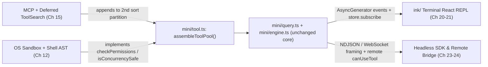

# Appendix C — Mini-Harness Blueprint: Building a 500-Line Working Toy Clone Using the Patterns in This Book

> **Layer:** Capstone Synthesis (Layers 0–8)
> **Prerequisites:** [Chapters 00](prologue-how-to-read-a-1900-file-agent.md)–[24](ch024-across-the-wire-remote-sessions-bridge-and-direct-connect.md), [Appendix A](appendix-a-feature-flags-and-env-knobs.md), and [Appendix B](appendix-b-missing-snapshot-boundaries.md)
> **Scope:** Standalone educational TypeScript blueprint (~440 lines of TypeScript across 12 miniature modules). Because this repository snapshot is source-only with no `package.json` or `tsconfig.json` ([Chapter 00](prologue-how-to-read-a-1900-file-agent.md)), treat this as a self-contained blueprint to drop into a fresh TypeScript project rather than a command to run inside this checkout.
> **Primary Production Counterparts:** `state/store.ts`, `utils/fileStateCache.ts`, `utils/generators.ts`, `Tool.ts`, `tools.ts`, `constants/prompts.ts`, `constants/systemPromptSections.ts`, `utils/api.ts`, `services/tools/toolOrchestration.ts`, `query.ts`, `utils/toolResultStorage.ts`, `services/compact/autoCompact.ts`, `services/compact/compact.ts`, `utils/permissions/permissions.ts`, `services/tools/toolHooks.ts`, `utils/forkedAgent.ts`, `tools/AgentTool/forkSubagent.ts`, `QueryEngine.ts`, `utils/sessionStorage.ts`, `utils/cleanupRegistry.ts`

## Why Build a Mini-Harness?

Across 1,884 TypeScript files, Claude Code layers enterprise policy, build-time `feature()` flags ([Appendix A](appendix-a-feature-flags-and-env-knobs.md)), 60+ tools, a vendored terminal React renderer, and remote bridges. Strip away every product feature and keep only the load-bearing beams, and the entire runtime distills to **eight architectural patterns** in ~440 lines of TypeScript:

1. **Zero-dependency Layer 0 atoms** (`store.ts`, `fileStateCache.ts`, `generators.ts`) — identity-guarded reactivity, path-normalized staleness, bounded async-generator multiplexing.
2. **Fail-closed tool contracts & partitioned sorting** (`tool.ts`) — unsafe concurrency opt-in and cache-stable built-in tool prefixes.
3. **Static/dynamic prompt boundaries** (`prompt.ts`) — isolating globally cacheable system instructions from volatile session context.
4. **Concurrent-read / serial-write batching with ordered context replay** (`orchestration.ts`) — parallelism without non-deterministic `ToolUseContext` races.
5. **An `AsyncGenerator` turn loop** (`query.ts`) — keyed on extracted `tool_use` blocks (never `stop_reason`), with withheld `max_output_tokens` recovery.
6. **Two-stage context survival** (`compact.ts`) — atomic `'wx'` disk spills (`Infinity` opt-out) plus boundary-preserving summarization with a 3-failure circuit breaker.
7. **Bypass-immune permissions & hook arbitration** (`permissions.ts`, `hooks.ts`) — neither `bypassPermissions` nor a `PreToolUse` `allow` overrides explicit deny/ask rules.
8. **Scoped subagent forking & append-only session envelopes** (`subagent.ts`, `engine.ts`) — frozen prompt caches, root-wired `setAppStateForTasks` (no `PPID=1` zombies), and crash-recoverable `parentUuid` JSONL transcripts.

> [!NOTE]
> **Snapshot boundary note:** `types/message.ts` and `query/transitions.ts` are absent from this source checkout (reconstructed from call sites in [Appendix B](appendix-b-missing-snapshot-boundaries.md)). The local `Message`, `Continue`, and `Terminal` types below reflect the exact shapes observed at call sites in `query.ts` and `QueryEngine.ts`.

```text
               ┌────────────────────────────────────────┐
 L8 engine.ts  │ QueryEngine + JSONL parentUuid +       │
               │ registerCleanup() shutdown registry    │
               └───────────────────┬────────────────────┘
                                   │ submitMessage()
               ┌───────────────────▼────────────────────┐
 L2 query.ts   │ AsyncGenerator<QueryEvent, Terminal>   │
               │ (toolUseBlocks exit + recovery loop)   │
               └───┬───────────────┬────────────────┬───┘
       prompt.ts ◄─┘   compact.ts  │                └─► orchestration.ts
 (cache boundary)  (spill + 3x CB) │                    (batch + replay)
                                   │                     │            │
                            subagent.ts           permissions.ts   hooks.ts
                         (clone+taskStore)        (deny > mode)  (no override)
                                   │                     │
               ┌───────────────────▼─────────────────────▼─┐
 L1 tool.ts    │ buildTool() fail-closed + assembleToolPool│
               └───────────────────┬───────────────────────┘
               ┌───────────────────▼───────────────────────┐
 L0 atoms      │ store.ts │ fileStateCache.ts │ generators │
               └───────────────────────────────────────────┘
```

## 1. Layer 0: Zero-Dependency Atoms (`store.ts`, `fileStateCache.ts`, `generators.ts`)

Before calling a model, the harness needs synchronous reactivity that suppresses no-op renders, a bounded path-normalized cache to stop blind stale overwrites, and concurrency-capped multiplexing over async generators ([Chapter 01](ch001-atoms-types-stores-and-primitives.md)).

```ts
// mini/store.ts — mirrors state/store.ts:1-34
export type Store<T> = {
  getState: () => T; setState: (updater: (prev: T) => T) => void; subscribe: (fn: () => void) => () => void
}
export function createStore<T>(initial: T, onChange?: (a: { newState: T; oldState: T }) => void): Store<T> {
  let state = initial
  const listeners = new Set<() => void>()
  return {
    getState: () => state,
    setState(updater) {
      const prev = state, next = updater(prev)
      if (Object.is(next, prev)) return // Identity bailout prevents render storms
      state = next
      onChange?.({ newState: next, oldState: prev })
      for (const fn of listeners) fn()
    },
    subscribe: fn => (listeners.add(fn), () => listeners.delete(fn)),
  }
}

// mini/fileStateCache.ts — mirrors utils/fileStateCache.ts:4-142
import { normalize } from 'path'
export type FileState = { content: string; timestamp: number; isPartialView?: boolean }
export class FileStateCache {
  private map = new Map<string, FileState>()
  private bytes = 0
  constructor(private maxEntries = 100, private maxBytes = 25 * 1024 * 1024) {}
  get(filePath: string): FileState | undefined {
    const key = normalize(filePath), hit = this.map.get(key)
    if (!hit) return undefined
    this.map.delete(key); this.map.set(key, hit) // Refresh LRU recency
    return hit
  }
  set(filePath: string, value: FileState): this {
    const key = normalize(filePath), prev = this.map.get(key)
    if (prev) { this.bytes -= Math.max(1, Buffer.byteLength(prev.content)); this.map.delete(key) }
    this.map.set(key, value); this.bytes += Math.max(1, Buffer.byteLength(value.content))
    while (this.map.size > this.maxEntries || this.bytes > this.maxBytes) {
      const oldest = this.map.keys().next().value
      if (oldest === undefined || oldest === key) break
      this.bytes -= Math.max(1, Buffer.byteLength(this.map.get(oldest)!.content))
      this.map.delete(oldest)
    }
    return this
  }
  isStale(filePath: string, currentMtimeMs: number): boolean {
    const entry = this.get(filePath)
    return !entry || entry.isPartialView === true || currentMtimeMs > entry.timestamp
  }
  clone(): FileStateCache {
    const copy = new FileStateCache(this.maxEntries, this.maxBytes)
    for (const [k, v] of this.map) copy.set(k, { ...v })
    return copy
  }
}

// mini/generators.ts — mirrors utils/generators.ts:32-72
type Queued<A> = { done?: boolean; value?: A; gen: AsyncGenerator<A, void>; p: Promise<Queued<A>> }
export async function* all<A>(gens: AsyncGenerator<A, void>[], cap = Infinity): AsyncGenerator<A, void> {
  const step = (gen: AsyncGenerator<A, void>): Promise<Queued<A>> => {
    const p: Promise<Queued<A>> = gen.next().then(({ done, value }) => ({ done, value, gen, p }))
    return p
  }
  const waiting = [...gens], active = new Set<Promise<Queued<A>>>()
  while (active.size < cap && waiting.length > 0) active.add(step(waiting.shift()!))
  while (active.size > 0) {
    const { done, value, gen, p } = await Promise.race(active)
    active.delete(p)
    if (!done) { active.add(step(gen)); if (value !== undefined) yield value }
    else if (waiting.length > 0) active.add(step(waiting.shift()!))
  }
}
```

**Production invariants preserved:** `Object.is` identity short-circuit (`state/store.ts:23`); path normalization + 25 MB byte-weighted LRU + `isPartialView` edit guard (`utils/fileStateCache.ts:14,41-48`); self-referencing promise handles in `all()` (`utils/generators.ts:37-45`).

## 2. Layer 1: Fail-Closed Tool Contract & Cache-Stable Pool (`tool.ts`)

Omitting a safety flag on a mutating tool must never default to parallel execution, and dynamic MCP tools must never interleave with built-in tools in alphabetical sort order or they shift tool indices and bust server-side global prompt caching ([Chapter 02](ch002-the-tool-contract.md)).

```ts
// mini/tool.ts — mirrors Tool.ts:743-792 and tools.ts:345-367
import type { FileStateCache } from './fileStateCache.js'
import type { Store } from './store.js'

export type PermissionMode = 'default' | 'bypassPermissions'
export type PermissionRule = { toolName: string; pattern?: string }
export type ToolPermissionContext = {
  mode: PermissionMode
  alwaysDenyRules: PermissionRule[]; alwaysAskRules: PermissionRule[]; alwaysAllowRules: PermissionRule[]
}
export type PermissionDecision =
  | { behavior: 'allow'; updatedInput?: Record<string, unknown>; reason: string }
  | { behavior: 'deny'; message: string; reason: string }
  | { behavior: 'ask'; message: string; reason: string }
  | { behavior: 'passthrough' }
export type AppState = { permissionContext: ToolPermissionContext; tasks: Record<string, { status: 'running' | 'stopped' }> }
export type ToolUseContext = {
  tools: Tool[]; readFileState: FileStateCache; abortController: AbortController
  getAppState: () => AppState; setAppState: Store<AppState>['setState']
  setAppStateForTasks: Store<AppState>['setState'] // Root-wired even inside subagents
  renderedSystemPrompt?: string[]; agentId?: string
}
export type Tool<Input = Record<string, unknown>, Output = string> = {
  name: string; description: string; isEnabled: () => boolean
  isConcurrencySafe: (input: Input) => boolean; isReadOnly: (input: Input) => boolean
  maxResultSizeChars: number // Infinity opts out of spill-to-disk (e.g. FileReadTool)
  checkPermissions: (input: Input, ctx: ToolUseContext) => Promise<PermissionDecision>
  call: (input: Input, ctx: ToolUseContext) => Promise<{ data: Output; contextModifier?: (c: ToolUseContext) => ToolUseContext }>
}
const TOOL_DEFAULTS = {
  isEnabled: () => true,
  isConcurrencySafe: () => false, // Fail-closed: assume unsafe unless proven read-only
  isReadOnly: () => false,        // Fail-closed: assume writes
  maxResultSizeChars: 50_000,
  checkPermissions: async (): Promise<PermissionDecision> => ({ behavior: 'passthrough' }),
}
export function buildTool<Input = Record<string, unknown>, Output = string>(
  def: Omit<Tool<Input, Output>, keyof typeof TOOL_DEFAULTS> & Partial<Pick<Tool<Input, Output>, keyof typeof TOOL_DEFAULTS>>,
): Tool<Input, Output> {
  return { ...TOOL_DEFAULTS, ...def }
}
export function assembleToolPool(builtIns: Tool[], mcpTools: Tool[], permCtx: ToolPermissionContext): Tool[] {
  const denied = new Set(permCtx.alwaysDenyRules.filter(r => !r.pattern).map(r => r.toolName))
  const byName = (a: Tool, b: Tool) => a.name.localeCompare(b.name)
  // Partition-sort so built-ins remain a contiguous global-cache prefix; built-ins win collisions
  const sortedBuiltIns = builtIns.filter(t => t.isEnabled() && !denied.has(t.name)).sort(byName)
  const sortedMcp = mcpTools.filter(t => t.isEnabled() && !denied.has(t.name)).sort(byName)
  const seen = new Set<string>()
  return [...sortedBuiltIns, ...sortedMcp].filter(t => (seen.has(t.name) ? false : (seen.add(t.name), true)))
}
```

**Production invariants preserved:** Fail-closed defaults in `buildTool()` (`Tool.ts:748-792`) and two-partition sorting in `assembleToolPool()` (`tools.ts:354-366`).

## 3. Layer 2: Prompt Boundaries, Tool Orchestration, and the `query()` Turn Loop

Layer 2 solves three interlocking hazards: (1) keeping volatile context below `SYSTEM_PROMPT_DYNAMIC_BOUNDARY` so global prompt caching stays hot ([Chapter 04](ch004-prompt-engineering-and-cache-boundaries.md)); (2) running read-only tool batches concurrently while replaying `contextModifier` updates in strict block order ([Chapter 06](ch006-executing-tools.md)); and (3) driving the turn state machine from extracted `tool_use` blocks rather than `stop_reason`, withholding `max_output_tokens` errors until recovery exhausts ([Chapter 05](ch005-talking-to-the-model.md), [Chapter 07](ch007-the-heartbeat-query-loop.md)).

```ts
// mini/prompt.ts — mirrors constants/prompts.ts:114-115, systemPromptSections.ts:20-58, utils/api.ts:362-397
export const SYSTEM_PROMPT_DYNAMIC_BOUNDARY = '__SYSTEM_PROMPT_DYNAMIC_BOUNDARY__'
export type PromptSection = { name: string; compute: () => Promise<string | null>; cacheBreak: boolean }
export type SystemPromptBlock = { text: string; cacheScope: 'global' | null }
export const systemPromptSection = (name: string, compute: () => Promise<string | null>): PromptSection =>
  ({ name, compute, cacheBreak: false })
export const DANGEROUS_uncachedSystemPromptSection = (
  name: string, compute: () => Promise<string | null>, _reason: string,
): PromptSection => ({ name, compute, cacheBreak: true })
export function splitSystemPromptForCache(sections: string[]): SystemPromptBlock[] {
  const idx = sections.indexOf(SYSTEM_PROMPT_DYNAMIC_BOUNDARY)
  if (idx === -1) return [{ text: sections.filter(Boolean).join('\n\n'), cacheScope: null }]
  const staticText = sections.slice(0, idx).filter(Boolean).join('\n\n')
  const dynamicText = sections.slice(idx + 1).filter(Boolean).join('\n\n')
  return [
    ...(staticText ? [{ text: staticText, cacheScope: 'global' as const }] : []),
    ...(dynamicText ? [{ text: dynamicText, cacheScope: null }] : []),
  ]
}

// mini/orchestration.ts — mirrors services/tools/toolOrchestration.ts:19-160
import { all } from './generators.js'
import type { Tool, ToolUseContext } from './tool.js'
export type ToolUseBlock = { type: 'tool_use'; id: string; name: string; input: Record<string, unknown> }
export type ToolResultBlock = { type: 'tool_result'; tool_use_id: string; content: string; is_error?: boolean }
export type ToolRunResult = {
  result: ToolResultBlock; contextModifier?: { toolUseID: string; modify: (ctx: ToolUseContext) => ToolUseContext }
}
type Batch = { isConcurrencySafe: boolean; blocks: ToolUseBlock[] }
export function partitionToolCalls(blocks: ToolUseBlock[], tools: Tool[]): Batch[] {
  return blocks.reduce<Batch[]>((acc, block) => {
    const tool = tools.find(t => t.name === block.name)
    let safe = false
    try { safe = Boolean(tool?.isConcurrencySafe(block.input)) } catch { safe = false }
    if (safe && acc.at(-1)?.isConcurrencySafe) acc.at(-1)!.blocks.push(block)
    else acc.push({ isConcurrencySafe: safe, blocks: [block] })
    return acc
  }, [])
}
export async function* runTools(
  blocks: ToolUseBlock[], ctx: ToolUseContext,
  executeOne: (b: ToolUseBlock, c: ToolUseContext) => AsyncGenerator<ToolRunResult, void>, maxConcurrency = 10,
): AsyncGenerator<{ result?: ToolResultBlock; newContext: ToolUseContext }, void> {
  let current = ctx
  for (const batch of partitionToolCalls(blocks, current.tools)) {
    if (batch.isConcurrencySafe) {
      const queued = new Map<string, ((c: ToolUseContext) => ToolUseContext)[]>()
      for await (const upd of all(batch.blocks.map(b => executeOne(b, current)), maxConcurrency)) {
        if (upd.contextModifier) {
          const list = queued.get(upd.contextModifier.toolUseID) ?? []
          list.push(upd.contextModifier.modify); queued.set(upd.contextModifier.toolUseID, list)
        }
        yield { result: upd.result, newContext: current }
      }
      // Replay contextModifiers deterministically in original assistant block order
      for (const block of batch.blocks) for (const mod of queued.get(block.id) ?? []) current = mod(current)
      yield { newContext: current }
    } else {
      for (const block of batch.blocks) {
        for await (const upd of executeOne(block, current)) {
          if (upd.contextModifier) current = upd.contextModifier.modify(current)
          yield { result: upd.result, newContext: current }
        }
      }
    }
  }
}

// mini/query.ts — mirrors query.ts:204-239, 554-558, 826-835, 1062-1256
import { randomUUID } from 'crypto'
import { autoCompactIfNeeded, type AutoCompactTracking } from './compact.js'
import { runTools, type ToolResultBlock, type ToolUseBlock, type ToolRunResult } from './orchestration.js'
import { splitSystemPromptForCache, type SystemPromptBlock } from './prompt.js'
import type { ToolUseContext } from './tool.js'
export type ContentBlock = { type: 'text'; text: string } | ToolUseBlock | ToolResultBlock
export type Message = {
  uuid: string; role: 'user' | 'assistant' | 'system'; subtype?: 'compact_boundary'
  isMeta?: boolean; stopReason?: string; content: ContentBlock[]
}
export type Continue = { reason: 'next_turn' } | { reason: 'max_output_tokens_recovery'; attempt: number }
export type Terminal = { reason: 'completed' | 'aborted' | 'max_turns' | 'max_output_tokens' }
export type QueryEvent = { type: 'message'; message: Message } | { type: 'transition'; next: Continue }
export type ModelAdapter = (a: {
  system: SystemPromptBlock[]; messages: Message[]; tools: ToolUseContext['tools']; signal: AbortSignal
}) => AsyncGenerator<Message, void>

const MAX_OUTPUT_TOKENS_RECOVERY_LIMIT = 3
export async function* query(params: {
  messages: Message[]; systemPrompt: string[]; toolUseContext: ToolUseContext; maxTurns?: number
  callModel: ModelAdapter; summarize: (msgs: Message[]) => Promise<string>
  executeOne: (b: ToolUseBlock, c: ToolUseContext) => AsyncGenerator<ToolRunResult, void>
}): AsyncGenerator<QueryEvent, Terminal> {
  let state = {
    messages: params.messages, ctx: { ...params.toolUseContext, renderedSystemPrompt: params.systemPrompt },
    compactTracking: { consecutiveFailures: 0 } as AutoCompactTracking,
    maxOutputTokensRecoveryCount: 0, turnCount: 0, transition: undefined as Continue | undefined,
  }
  const systemBlocks = splitSystemPromptForCache(params.systemPrompt)
  while (true) {
    if (state.ctx.abortController.signal.aborted) return { reason: 'aborted' }
    const compacted = await autoCompactIfNeeded(state.messages, state.compactTracking, params.summarize)
    state.compactTracking = compacted.tracking
    if (compacted.wasCompacted) state.messages = compacted.messages

    const assistantMessages: Message[] = [], toolUseBlocks: ToolUseBlock[] = []
    let needsFollowUp = false // Sole continuation signal — NEVER trust stop_reason === 'tool_use'
    let withheldMaxTokens: Message | undefined
    for await (const msg of params.callModel({
      system: systemBlocks, messages: state.messages, tools: state.ctx.tools, signal: state.ctx.abortController.signal,
    })) {
      assistantMessages.push(msg)
      const extracted = msg.content.filter((b): b is ToolUseBlock => b.type === 'tool_use')
      if (extracted.length > 0) { toolUseBlocks.push(...extracted); needsFollowUp = true }
      if (msg.stopReason === 'max_tokens' && !needsFollowUp) { withheldMaxTokens = msg; continue }
      yield { type: 'message', message: msg }
    }
    if (!needsFollowUp) {
      if (withheldMaxTokens && state.maxOutputTokensRecoveryCount < MAX_OUTPUT_TOKENS_RECOVERY_LIMIT) {
        const attempt = state.maxOutputTokensRecoveryCount + 1
        const nudge: Message = {
          uuid: randomUUID(), role: 'user', isMeta: true,
          content: [{ type: 'text', text: 'Output token limit hit. Resume directly without recap.' }],
        }
        state = {
          ...state, messages: [...state.messages, ...assistantMessages, nudge],
          maxOutputTokensRecoveryCount: attempt, transition: { reason: 'max_output_tokens_recovery', attempt },
        }
        yield { type: 'transition', next: state.transition! }; continue
      }
      if (withheldMaxTokens) { yield { type: 'message', message: withheldMaxTokens }; return { reason: 'max_output_tokens' } }
      return { reason: 'completed' }
    }
    const resultBlocks: ToolResultBlock[] = []
    for await (const upd of runTools(toolUseBlocks, state.ctx, params.executeOne)) {
      state.ctx = upd.newContext; if (upd.result) resultBlocks.push(upd.result)
    }
    const toolResultMsg: Message = { uuid: randomUUID(), role: 'user', content: resultBlocks }
    yield { type: 'message', message: toolResultMsg }
    const nextTurn = state.turnCount + 1
    if (params.maxTurns && nextTurn >= params.maxTurns) return { reason: 'max_turns' }
    state = {
      ...state, messages: [...state.messages, ...assistantMessages, toolResultMsg],
      maxOutputTokensRecoveryCount: 0, turnCount: nextTurn, transition: { reason: 'next_turn' },
    }
    yield { type: 'transition', next: state.transition! }
  }
}
```

**Production invariants preserved:** Loudly named `DANGEROUS_uncachedSystemPromptSection(_reason)` and cache split (`constants/systemPromptSections.ts:32-38`, `utils/api.ts:363-396`); block-ordered `contextModifier` replay (`services/tools/toolOrchestration.ts:54-62`); `needsFollowUp` over `stop_reason` plus withheld `max_output_tokens` recovery (`query.ts:554-558,829-835,1188-1255`).

## 4. Layer 3: Two-Stage Context Survival (`compact.ts`)

A single huge command output can blow past the context limit, while multi-hour sessions fill history gradually. Spilling `FileReadTool` outputs would create a circular Read→file→Read loop, and retrying broken compaction calls forever hammers the API ([Chapter 06](ch006-executing-tools.md), [Chapter 09](ch009-five-layer-compaction-pipeline.md)).

```ts
// mini/compact.ts — mirrors utils/toolResultStorage.ts:55-226 and services/compact/autoCompact.ts:70,241-351
import { randomUUID } from 'crypto'
import { mkdir, writeFile } from 'fs/promises'
import { join } from 'path'
import type { ToolResultBlock } from './orchestration.js'
import type { Message } from './query.js'

const PREVIEW_CHARS = 2_000, COMPACT_TOKEN_THRESHOLD = 140_000
export const MAX_CONSECUTIVE_AUTOCOMPACT_FAILURES = 3
export type AutoCompactTracking = { consecutiveFailures: number; compacted?: boolean }

export async function maybePersistLargeToolResult(
  block: ToolResultBlock, maxResultSizeChars: number, spillDir: string,
): Promise<ToolResultBlock> {
  // Infinity = hard opt-out (e.g. FileReadTool); spilling Read output would recurse
  if (!Number.isFinite(maxResultSizeChars) || block.content.length <= maxResultSizeChars) return block
  await mkdir(spillDir, { recursive: true })
  const filepath = join(spillDir, `${block.tool_use_id}.txt`)
  try { await writeFile(filepath, block.content, { flag: 'wx' }) } // Atomic create avoids stat/write race
  catch (err: unknown) { if ((err as NodeJS.ErrnoException).code !== 'EEXIST') return block }
  return {
    ...block,
    content: `<persisted-output>\nSaved (${block.content.length} chars) to ${filepath}\n${block.content.slice(0, PREVIEW_CHARS)}\n...\n</persisted-output>`,
  }
}

export async function autoCompactIfNeeded(
  messages: Message[], tracking: AutoCompactTracking, summarize: (msgs: Message[]) => Promise<string>,
): Promise<{ wasCompacted: boolean; messages: Message[]; tracking: AutoCompactTracking }> {
  if (tracking.consecutiveFailures >= MAX_CONSECUTIVE_AUTOCOMPACT_FAILURES) return { wasCompacted: false, messages, tracking }
  if (Math.ceil(JSON.stringify(messages).length / 4) < COMPACT_TOKEN_THRESHOLD) return { wasCompacted: false, messages, tracking }
  try {
    const summaryText = await summarize(messages)
    const boundary: Message = { uuid: randomUUID(), role: 'system', subtype: 'compact_boundary', content: [{ type: 'text', text: 'Conversation compacted' }] }
    const summary: Message = { uuid: randomUUID(), role: 'user', isMeta: true, content: [{ type: 'text', text: summaryText }] }
    return { wasCompacted: true, messages: [boundary, summary], tracking: { consecutiveFailures: 0, compacted: true } }
  } catch {
    return { wasCompacted: false, messages, tracking: { ...tracking, consecutiveFailures: tracking.consecutiveFailures + 1 } }
  }
}
```

**Production invariants preserved:** `maxResultSizeChars: Infinity` + `'wx'` exclusive create (`utils/toolResultStorage.ts:59-60,157-160`) and `compact_boundary` + 3-failure circuit breaker (`services/compact/autoCompact.ts:70,257-265,338-349`).

## 5. Layer 4: Bypass-Immune Permissions & Hook Arbitration (`permissions.ts`, `hooks.ts`)

Evaluating `bypassPermissions` first silently defeats deny/ask rules and safety checks, while accepting a `PreToolUse` `allow` without re-checking rules lets any permissive plugin smuggle blocked commands past policy ([Chapter 11](ch011-the-permission-engine.md), [Chapter 13](ch013-the-hook-system.md)).

```ts
// mini/permissions.ts — mirrors utils/permissions/permissions.ts:1071-1310
import type { PermissionDecision, PermissionRule, Tool, ToolUseContext } from './tool.js'
const matchesRule = (r: PermissionRule, name: string, input: Record<string, unknown>): boolean =>
  r.toolName === name && (!r.pattern || JSON.stringify(input).includes(r.pattern))

export function checkRuleBasedPermissions(tool: Tool, input: Record<string, unknown>, ctx: ToolUseContext): PermissionDecision | null {
  const perms = ctx.getAppState().permissionContext
  const deny = perms.alwaysDenyRules.find(r => matchesRule(r, tool.name, input))
  if (deny) return { behavior: 'deny', reason: 'deny_rule', message: `Denied by rule: ${deny.toolName}` }
  const ask = perms.alwaysAskRules.find(r => matchesRule(r, tool.name, input))
  if (ask) return { behavior: 'ask', reason: 'ask_rule', message: `Confirmation required for ${tool.name}` }
  return null
}

export async function evaluatePermission(
  tool: Tool, input: Record<string, unknown>, ctx: ToolUseContext,
  promptUser: (t: Tool, i: Record<string, unknown>) => Promise<PermissionDecision>,
): Promise<PermissionDecision> {
  // 1. Bypass-immune deny/ask rules & tool safety checks run BEFORE bypassPermissions mode
  const rule = checkRuleBasedPermissions(tool, input, ctx)
  if (rule?.behavior === 'deny') return rule
  if (rule?.behavior === 'ask') return promptUser(tool, input)
  const toolDec = await tool.checkPermissions(input, ctx)
  if (toolDec.behavior === 'deny') return toolDec
  if (toolDec.behavior === 'ask') return promptUser(tool, input)
  // 2. Mode bypass and allow rules apply only AFTER deny/ask/safety gates clear
  const perms = ctx.getAppState().permissionContext
  if (perms.mode === 'bypassPermissions') return { behavior: 'allow', updatedInput: input, reason: 'mode' }
  if (perms.alwaysAllowRules.some(r => matchesRule(r, tool.name, input))) return { behavior: 'allow', updatedInput: input, reason: 'allow_rule' }
  return promptUser(tool, input)
}

// mini/hooks.ts — mirrors services/tools/toolHooks.ts:332-410
import { checkRuleBasedPermissions, evaluatePermission } from './permissions.js'
import type { PermissionDecision, Tool, ToolUseContext } from './tool.js'
export async function resolveHookPermissionDecision(
  hookResult: PermissionDecision | undefined, tool: Tool, input: Record<string, unknown>, ctx: ToolUseContext,
  promptUser: (t: Tool, i: Record<string, unknown>) => Promise<PermissionDecision>,
): Promise<{ decision: PermissionDecision; input: Record<string, unknown> }> {
  if (hookResult?.behavior === 'deny') return { decision: hookResult, input }
  if (hookResult?.behavior === 'allow') {
    const effectiveInput = hookResult.updatedInput ?? input
    // Critical invariant: hook 'allow' skips the prompt, NEVER a deny or ask rule
    const ruleCheck = checkRuleBasedPermissions(tool, effectiveInput, ctx)
    if (ruleCheck === null) return { decision: hookResult, input: effectiveInput }
    if (ruleCheck.behavior === 'deny') return { decision: ruleCheck, input: effectiveInput }
    return { decision: await promptUser(tool, effectiveInput), input: effectiveInput }
  }
  return { decision: await evaluatePermission(tool, input, ctx, promptUser), input }
}
```

**Production invariants preserved:** Strict step 1a–1g precedence before step 2a `bypassPermissions` (`utils/permissions/permissions.ts:1169-1281`) and post-rewrite rule enforcement in `resolveHookPermissionDecision()` (`services/tools/toolHooks.ts:372-405`).

## 6. Layer 6: Subagent Context Forking (`subagent.ts`)

Sharing raw parent context races on `readFileState` and corrupts parent UI; naively stubbing `setAppState` orphans child background shells (`PPID=1` zombies); rebuilding the child prompt destroys prefix cache sharing ([Chapter 18](ch018-subagents-context-forking-and-worktrees.md)).

```ts
// mini/subagent.ts — mirrors utils/forkedAgent.ts:345-420 and tools/AgentTool/forkSubagent.ts:93-155
import { randomUUID } from 'crypto'
import type { ToolUseBlock } from './orchestration.js'
import type { Message } from './query.js'
import type { ToolUseContext } from './tool.js'

const FORK_PLACEHOLDER = 'Fork started — processing in background'
export function createSubagentContext(parent: ToolUseContext): ToolUseContext {
  const childAbort = new AbortController()
  parent.abortController.signal.addEventListener('abort', () => childAbort.abort(), { once: true })
  return {
    ...parent, agentId: randomUUID(), abortController: childAbort,
    readFileState: parent.readFileState.clone(), // Isolated staleness snapshot
    setAppState: () => {},                       // Block child mutations to parent UI store
    // Keep task registration root-wired so async subagent tasks are tracked and killed on shutdown
    setAppStateForTasks: parent.setAppStateForTasks ?? parent.setAppState,
    renderedSystemPrompt: parent.renderedSystemPrompt, // Frozen parent bytes for cache-sharing forks
  }
}
export function buildForkedMessages(history: Message[], parentAssistant: Message, directive: string): Message[] {
  const placeholders = parentAssistant.content
    .filter((b): b is ToolUseBlock => b.type === 'tool_use')
    .map(b => ({ type: 'tool_result' as const, tool_use_id: b.id, content: FORK_PLACEHOLDER }))
  return [...history, parentAssistant, { uuid: randomUUID(), role: 'user', content: [...placeholders, { type: 'text', text: directive }] }]
}
```

**Production invariants preserved:** Root-wired `setAppStateForTasks` (`utils/forkedAgent.ts:410-417`) and byte-identical fork prefixes via frozen `renderedSystemPrompt` + `FORK_PLACEHOLDER` (`tools/AgentTool/AgentTool.tsx:496-497`, `tools/AgentTool/forkSubagent.ts:93-155`).

## 7. Layer 8: Session Envelope, `parentUuid` Transcript, and Shutdown (`engine.ts`)

`query()` runs one turn; `QueryEngine` owns multi-turn state, appends crash-safe JSONL whose `parentUuid` chain survives compaction boundaries, and coordinates async teardown via a cycle-free leaf registry ([Chapter 08](ch008-session-envelope-query-engine-and-transcripts.md), [Chapter 22](ch022-cold-start-mastery-cli-init-main.md)).

```ts
// mini/engine.ts — mirrors QueryEngine.ts:184-230, utils/sessionStorage.ts:1001-1069, cleanupRegistry.ts:7-25
import { randomUUID } from 'crypto'
import { appendFile } from 'fs/promises'
import { FileStateCache } from './fileStateCache.js'
import type { ToolRunResult, ToolUseBlock } from './orchestration.js'
import { query, type Message, type ModelAdapter, type QueryEvent, type Terminal } from './query.js'
import type { Store } from './store.js'
import type { AppState, Tool, ToolUseContext } from './tool.js'

const cleanupFns = new Set<() => Promise<void>>()
export const registerCleanup = (fn: () => Promise<void>): (() => void) => (cleanupFns.add(fn), () => cleanupFns.delete(fn))
export const runCleanupFunctions = async (): Promise<void> => void (await Promise.all(Array.from(cleanupFns).map(fn => fn())))

export class QueryEngine {
  private mutableMessages: Message[] = []
  private readFileState = new FileStateCache()
  private lastUuid: string | null = null
  constructor(private config: {
    sessionId: string; transcriptPath: string; systemPrompt: string[]; tools: Tool[]
    store: Store<AppState>; callModel: ModelAdapter; summarize: (msgs: Message[]) => Promise<string>
    executeOne: (b: ToolUseBlock, c: ToolUseContext) => AsyncGenerator<ToolRunResult, void>
  }) {}
  private async appendTranscript(msg: Message): Promise<void> {
    const isBoundary = msg.subtype === 'compact_boundary'
    // parentUuid MUST serialize first so fast tail scanners match {"parentUuid": at offset 0
    const record = {
      parentUuid: isBoundary ? null : this.lastUuid,
      logicalParentUuid: isBoundary ? this.lastUuid : undefined,
      ...msg,
      sessionId: this.config.sessionId, // Re-stamped after spread so forked rows keep current sessionId
    }
    await appendFile(this.config.transcriptPath, JSON.stringify(record) + '\n', 'utf8')
    this.lastUuid = msg.uuid
  }
  async *submitMessage(prompt: string, signal?: AbortSignal): AsyncGenerator<QueryEvent, Terminal> {
    const abortController = new AbortController()
    signal?.addEventListener('abort', () => abortController.abort(), { once: true })
    const userMsg: Message = { uuid: randomUUID(), role: 'user', content: [{ type: 'text', text: prompt }] }
    this.mutableMessages.push(userMsg); await this.appendTranscript(userMsg)
    const ctx: ToolUseContext = {
      tools: this.config.tools, readFileState: this.readFileState, abortController,
      getAppState: this.config.store.getState, setAppState: this.config.store.setState, setAppStateForTasks: this.config.store.setState,
    }
    const gen = query({
      messages: this.mutableMessages, systemPrompt: this.config.systemPrompt, toolUseContext: ctx,
      callModel: this.config.callModel, executeOne: this.config.executeOne, summarize: this.config.summarize,
    })
    while (true) {
      const step = await gen.next()
      if (step.done) return step.value
      if (step.value.type === 'message') { this.mutableMessages.push(step.value.message); await this.appendTranscript(step.value.message) }
      yield step.value
    }
  }
}
```

**Production invariants preserved:** `parentUuid` first + `logicalParentUuid` on `compact_boundary` + post-spread `sessionId` re-stamping (`utils/sessionStorage.ts:1039-1064,3244-3310`); cycle-free `registerCleanup()` leaf module (`utils/cleanupRegistry.ts:1-25`).

## Pattern-to-Production Crosswalk

| Blueprint Module | Load-Bearing Pattern / Invariant | Production Claude Code Source | Chapter |
| --- | --- | --- | --- |
| `mini/store.ts` | 25-line reactive store with `Object.is` bailout | `state/store.ts` | [Ch 01](ch001-atoms-types-stores-and-primitives.md) |
| `mini/fileStateCache.ts` | Normalized paths, byte-capped LRU, `mtime` + `isPartialView` | `utils/fileStateCache.ts` | [Ch 01](ch001-atoms-types-stores-and-primitives.md), [Ch 12](ch012-shell-execution-sandboxing-and-workspace-tools.md) |
| `mini/generators.ts` | Bounded `Promise.race` async-generator multiplexer `all()` | `utils/generators.ts` | [Ch 01](ch001-atoms-types-stores-and-primitives.md), [Ch 06](ch006-executing-tools.md) |
| `mini/tool.ts` | Fail-closed `buildTool()` + two-partition `assembleToolPool()` | `Tool.ts`, `tools.ts` | [Ch 02](ch002-the-tool-contract.md) |
| `mini/prompt.ts` | `SYSTEM_PROMPT_DYNAMIC_BOUNDARY` + `DANGEROUS_uncached...` | `constants/prompts.ts`, `constants/systemPromptSections.ts`, `utils/api.ts` | [Ch 04](ch004-prompt-engineering-and-cache-boundaries.md) |
| `mini/orchestration.ts` | Read-batch concurrency + deterministic `contextModifier` replay | `services/tools/toolOrchestration.ts` | [Ch 06](ch006-executing-tools.md) |
| `mini/query.ts` | `AsyncGenerator` turn loop, `toolUseBlocks` exit, withheld recovery | `query.ts`, `query/deps.ts`, `query/config.ts` | [Ch 05](ch005-talking-to-the-model.md), [Ch 07](ch007-the-heartbeat-query-loop.md) |
| `mini/compact.ts` | `'wx'` spill-to-disk (`Infinity` opt-out) + 3x circuit breaker | `utils/toolResultStorage.ts`, `services/compact/autoCompact.ts`, `services/compact/compact.ts` | [Ch 06](ch006-executing-tools.md), [Ch 09](ch009-five-layer-compaction-pipeline.md) |
| `mini/permissions.ts` | Deny/ask/safety checks evaluated strictly before `bypassPermissions` | `utils/permissions/permissions.ts` | [Ch 11](ch011-the-permission-engine.md) |
| `mini/hooks.ts` | `PreToolUse` `allow` re-checked against deny/ask rules | `services/tools/toolHooks.ts`, `utils/hooks.ts` | [Ch 13](ch013-the-hook-system.md) |
| `mini/subagent.ts` | Isolated `readFileState`, root `setAppStateForTasks`, frozen prompt | `utils/forkedAgent.ts`, `tools/AgentTool/forkSubagent.ts`, `tools/AgentTool/runAgent.ts` | [Ch 18](ch018-subagents-context-forking-and-worktrees.md) |
| `mini/engine.ts` | Session `QueryEngine`, `parentUuid` JSONL, `registerCleanup()` | `QueryEngine.ts`, `utils/sessionStorage.ts`, `utils/cleanupRegistry.ts` | [Ch 08](ch008-session-envelope-query-engine-and-transcripts.md), [Ch 22](ch022-cold-start-mastery-cli-init-main.md) |

## Extension Roadmap: Growing Without Rewriting `query()`

Every seam in this ~440-line core aligns with Claude Code's layer boundaries, allowing production subsystems to snap on without editing `mini/query.ts`:



1. **MCP, Deferred Tool Search, Skills, and LSP ([Ch 15](ch015-model-context-protocol-mcp.md), [Ch 16](ch016-skills-plugins-output-styles-and-lsp.md)):** Wrap remote MCP tools (`services/mcp/client.ts`) as `Tool` objects in `assembleToolPool()`'s second partition so built-in cache keys stay frozen; mark cold schemas `shouldDefer: true` and resolve on demand via `tools/ToolSearchTool/ToolSearchTool.ts` and `utils/toolSearch.ts`.
2. **OS Sandboxing, Shell AST Inspection, Memory, and Enterprise Policy ([Ch 10](ch010-memory-systems-claudemd-auto-memory-and-dream.md), [Ch 12](ch012-shell-execution-sandboxing-and-workspace-tools.md), [Ch 14](ch014-configuration-settings-and-enterprise-policy.md)):** Plug read-only shell AST analysis into `BashTool.isConcurrencySafe(input)` and OS isolation (`utils/sandbox/sandbox-adapter.ts`, `tools/BashTool/BashTool.tsx`) into `call()` and `checkPermissions()`, while populating `permissionContext` from enterprise settings and injecting `CLAUDE.md`/memories below `SYSTEM_PROMPT_DYNAMIC_BOUNDARY`.
3. **Streaming Tool Execution, Background Tasks, and Swarms ([Ch 06](ch006-executing-tools.md), [Ch 17](ch017-background-task-runtime.md), [Ch 19](ch019-agent-teams-swarms-and-coordinator-mode.md)):** Swap `runTools()` for a streaming executor (`services/tools/StreamingToolExecutor.ts`) that starts read-only tools mid-stream, and register background shells or teammate loops through `setAppStateForTasks`.
4. **Terminal UI (`ink/`), Headless SDK, and Remote Bridge ([Ch 20](ch020-inside-ink-terminal-react-renderer.md)–[Ch 24](ch024-across-the-wire-remote-sessions-bridge-and-direct-connect.md)):** Bind a terminal React renderer (`ink/ink.tsx`, `ink/screen.ts`, `screens/REPL.tsx`) directly to `store.subscribe()` and `QueryEngine.submitMessage()`. For headless SDK or remote control (`cli/structuredIO.ts`, `cli/print.ts`, `bridge/replBridge.ts`, `bridge/remoteBridgeCore.ts`), frame the identical `QueryEvent` stream over NDJSON/WebSockets and route `promptUser` over the wire.

## Reading Exercises & Code Checkpoints

1. **Trace the two-partition cache invariant:** Run `rg -n "assembleToolPool|SYSTEM_PROMPT_DYNAMIC_BOUNDARY" tools.ts constants/prompts.ts utils/api.ts` and verify how both the tool list and system prompt lock global cache prefixes *before* session-specific entries.
2. **Verify bypass-immune permission ordering:** Inspect `utils/permissions/permissions.ts:1169-1281` alongside `services/tools/toolHooks.ts:347-406` to confirm which rule checks still run under `mode === 'bypassPermissions'` or a `PreToolUse` `allow` decision.
3. **Audit subagent task wiring:** Run `rg -n "setAppStateForTasks" utils/forkedAgent.ts Tool.ts` and trace why stubbing `setAppState` while forwarding `setAppStateForTasks` prevents `PPID=1` orphaned child processes during shutdown.
4. **Compare toy vs. production turn transitions:** Run `rg -n "transition: \{" query.ts` to catalog every `Continue` transition Claude Code adds atop our two-variant loop (`next_turn` and `max_output_tokens_recovery`), including `reactive_compact_retry`, `max_output_tokens_escalate`, and stop-hook continuations.
