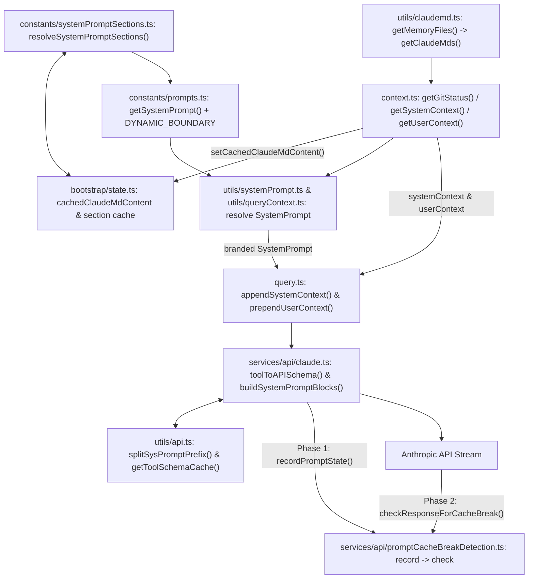

# 4. Prompt Engineering as Systems Engineering: Context & Cache Boundaries

> **Status: written.** Reverse-engineered from the Claude Code 2.1.88 source snapshot (see the Prologue (`prologue-how-to-read-a-1900-file-agent.md`) for snapshot caveats).
>
> **Layer:** Layer 2 (The Agent Engine)
> **Prerequisites:** [Chapter 01](ch001-atoms-types-stores-and-primitives.md), [Chapter 02](ch002-the-tool-contract.md), [Chapter 03](ch003-command-and-message-contracts.md)
> **Primary Source Files:**
> - `context.ts` — conversation-memoized git snapshot (`getGitStatus`), `getSystemContext`, `getUserContext`, and `cachedClaudeMdContent` cycle breaker (189 lines)
> - `utils/claudemd.ts` — `getMemoryFiles` / `filterInjectedMemoryFiles` / `getClaudeMds` injection seam (1,479 lines; scoped here to `getUserContext()` — full discovery in [Chapter 10](ch010-memory-systems-claudemd-auto-memory-and-dream.md))
> - `constants/systemPromptSections.ts` — `systemPromptSection`, `DANGEROUS_uncachedSystemPromptSection`, and `clearSystemPromptSections` (68 lines)
> - `constants/prompts.ts` — `SYSTEM_PROMPT_DYNAMIC_BOUNDARY` and static-vs-dynamic `getSystemPrompt()` assembly (914 lines)
> - `utils/systemPromptType.ts` — zero-dependency branded `SystemPrompt` type leaf (14 lines)
> - `utils/systemPrompt.ts` — five-tier `buildEffectiveSystemPrompt()` priority cascade (123 lines)
> - `utils/api.ts` — `splitSysPromptPrefix`, `appendSystemContext`, `prependUserContext`, `toolToAPISchema`, `logAPIPrefix`, and `normalizeToolInputForAPI` (718 lines)
> - `services/api/promptCacheBreakDetection.ts` — two-phase prompt-cache-break forensics and unified diff writer (727 lines)

---

## Why This Layer Exists

Layer 1 gave us tools (`Tool` and `assembleToolPool` in [Chapter 02](ch002-the-tool-contract.md)), commands and skills (`Command` and `getSkillToolCommands`), and Stage 1 normalized messages (`createUserMessage` and `normalizeMessagesForAPI` in [Chapter 03](ch003-command-and-message-contracts.md)). Layer 2 starts with a physical constraint: before sending a single HTTP request, Claude Code must assemble ~10–30K tokens of tool schemas, instructions, project rules, and repository state **without turning every turn into a cold cache miss**.

Anthropic's prompt cache hashes a request in strict prefix order: `tools[]` first, then `system[]`, then `messages[]`. Mutate a single byte early—a newly edited file in `git status`, a midnight date rollover, a GrowthBook flag flipping mid-session, or a conditional bullet inserted into the static system prompt—and every cached token after it degrades from a cheap read into full-price `cache_creation`.

Worse, on Anthropic's first-party API, Claude Code shares one cross-organization `scope: 'global'` cache across every user's static system prompt; leaking a single session-varying bit before that boundary fractures cross-org hit rates. Prompt engineering in Claude Code is therefore **cache-key systems engineering**.

---

## 1. Conversation-Memoized Context & the `CLAUDE.md` Cycle Breaker (`context.ts`, `utils/claudemd.ts`, `utils/queryContext.ts`)

### The Problem

Ambient repository state (`git status`, `CLAUDE.md`, today's date) is vital on turn 1 but toxic to prefix caching if recomputed. Re-running `git status` per turn would mutate the system prompt after every edit and invalidate the entire conversation cache; refreshing today's date inside `messages[0]` at midnight would wipe an overnight session's prefix.

### The Mechanism: Frozen Promises & Tail Rollovers

`context.ts` freezes ambient state behind zero-argument `lodash-es/memoize` wrappers—caching the **in-flight `Promise`** so both cache stability and startup latency hiding fall out of one primitive.

1. **`getGitStatus()` (`context.ts:36-111`):** Skips when `process.env.NODE_ENV === 'test'` (`context.ts:37-40`) or `!await getIsGit()` (`context.ts:46-57`, a zero-subprocess upward `.git` stat walk in `utils/git.ts:218-229`). Inside a repository, it fans out five lookups in parallel (`context.ts:61-77`):
   - **Two zero-subprocess filesystem reads:** `getBranch()` and `getDefaultBranch()` (`utils/git.ts:261-267` → `computeBranch()` at `utils/git/gitFilesystem.ts:500-510` and `computeDefaultBranch()` at `utils/git/gitFilesystem.ts:544-566`), reading `.git/HEAD` and `refs/remotes/origin/HEAD` directly.
   - **Three `execFileNoThrow` calls:** `status --short` and `log --oneline -n 5` (with `--no-optional-locks` to avoid `.git/index.lock` contention), plus `config user.name`. Passing `{ preserveOutputOnError: false }` bypasses `execFileNoThrow`'s default options object (`utils/execFileNoThrow.ts:26-44` and `utils/execFileNoThrow.ts:94`), leaving `timeout` at its 10-minute inner fallback and `cwd` as `undefined` (inheriting `process.cwd()`), while resolving non-zero exits (e.g., an empty repo) cleanly to empty stdout.
   - **Truncation & snapshot warning:** Output above `MAX_STATUS_CHARS = 2000` (`context.ts:20`) truncates with a hint to call `BashTool`, and `context.ts:97` warns the model explicitly that the status is a point-in-time snapshot:

```ts
// context.ts:61-103
    const [branch, mainBranch, status, log, userName] = await Promise.all([
      getBranch(),
      getDefaultBranch(),
      execFileNoThrow(gitExe(), ['--no-optional-locks', 'status', '--short'], {
        preserveOutputOnError: false,
      }).then(({ stdout }) => stdout.trim()),
      // ... git log --oneline -n 5 (--no-optional-locks) & git config user.name
    ])
    // ...
    const truncatedStatus =
      status.length > MAX_STATUS_CHARS
        ? status.substring(0, MAX_STATUS_CHARS) +
          '\n... (truncated because it exceeds 2k characters. If you need more information, run "git status" using BashTool)'
        : status
    // ...
    return [
      `This is the git status at the start of the conversation. Note that this status is a snapshot in time, and will not update during the conversation.`,
      `Current branch: ${branch}`,
      `Main branch (you will usually use this for PRs): ${mainBranch}`,
      ...(userName ? [`Git user: ${userName}`] : []),
      `Status:\n${truncatedStatus || '(clean)'}`,
      `Recent commits:\n${log}`,
    ].join('\n\n')
```

Startup prefetches overlap these git spawns with command loading, but `prefetchSystemContextIfSafe()` (`main.tsx:360-380`) refuses to run `git` in interactive mode until `checkHasTrustDialogAccepted()` is true (preventing malicious `.git/config` execution before trust), kicking `void getSystemContext()` only after `TrustDialog` finishes (`interactiveHelpers.tsx:152-153`).

2. **`getSystemContext()` (`context.ts:116-150`):** Skips `getGitStatus()` when `isEnvTruthy(process.env.CLAUDE_CODE_REMOTE)` or `!shouldIncludeGitInstructions()` (`utils/gitSettings.ts:14-17`, honoring `CLAUDE_CODE_DISABLE_GIT_INSTRUCTIONS` and `includeGitInstructions`).

   Under build-time `feature('BREAK_CACHE_COMMAND')` (`context.ts:131-147`), it also emits `` cacheBreaker: `[CACHE_BREAKER: ${injection}]` `` from `getSystemPromptInjection()` / `setSystemPromptInjection()` (`context.ts:25-34`). In this checkout, `commands/break-cache/index.js` (`commands/break-cache/index.js:1`) is a stripped one-line stub (`isEnabled: () => false`), so no active caller passes a non-null string—only `setSystemPromptInjection(null)` in `commands/clear/caches.ts:66` remains live.

3. **`getUserContext()` (`context.ts:155-189`) & the Scoped `utils/claudemd.ts` Seam:** Loads `CLAUDE.md` plus a date-only string (`getLocalISODate()`, overridable via `CLAUDE_CODE_OVERRIDE_DATE` at `constants/common.ts:6`—commented as an ant-only override on `constants/common.ts:5`, though unchecked by `USER_TYPE` in code).

   At midnight, `messages[0]` deliberately stays stale while `getDateChangeAttachments()` (`utils/attachments.ts:1402-1444`, tracking `lastEmittedDate` in `bootstrap/state.ts:204-205`) appends a `date_change` attachment at the conversation **tail**—saving `~920K effective tokens per midnight crossing per overnight session` (`utils/attachments.ts:1411`). (`CLAUDE_CODE_SIMPLE` uses separately memoized `getSessionStartDate()` at `constants/common.ts:17-24`.)

```ts
// context.ts:165-187
    const shouldDisableClaudeMd =
      isEnvTruthy(process.env.CLAUDE_CODE_DISABLE_CLAUDE_MDS) ||
      (isBareMode() && getAdditionalDirectoriesForClaudeMd().length === 0)
    // ...
    const claudeMd = shouldDisableClaudeMd
      ? null
      : getClaudeMds(filterInjectedMemoryFiles(await getMemoryFiles()))
    // ... caches claudeMd for yoloClassifier.ts without importing claudemd.ts
    setCachedClaudeMdContent(claudeMd || null)
    // ...
    return {
      ...(claudeMd && { claudeMd }),
      currentDate: `Today's date is ${getLocalISODate()}.`,
    }
```

In Chapter 04, `utils/claudemd.ts` (1,479 lines) stays tightly scoped to this three-stage injection seam:

- **`getMemoryFiles()` (`utils/claudemd.ts:790-1075`):** Inner `memoize` loading Managed, User, Project, Local, `--add-dir` (opt-in via `CLAUDE_CODE_ADDITIONAL_DIRECTORIES_CLAUDE_MD`), `AutoMem`, and `TeamMem` (under `feature('TEAMMEM')` and GrowthBook `'tengu_herring_clock'`).
- **`filterInjectedMemoryFiles()` (`utils/claudemd.ts:1142-1151`):** Strips `AutoMem`/`TeamMem` under GrowthBook `'tengu_moth_copse'` when prefetch attachments replace them.
- **`getClaudeMds()` (`utils/claudemd.ts:1153-1195`):** Skips `Project`/`Local` under GrowthBook `'tengu_paper_halyard'`, wraps `TeamMem` in `<team-memory-content source="shared">` under `feature('TEAMMEM')`, and prepends `MEMORY_INSTRUCTION_PROMPT` (`utils/claudemd.ts:89-90`).

Note that `MAX_MEMORY_CHARACTER_COUNT = 40000` (`utils/claudemd.ts:92`) is an **advisory** UI warning threshold—unlike `AutoMem`/`TeamMem`, `CLAUDE.md` is not hard-truncated here. Hierarchical discovery, nested worktree dedup (`#29599`), `@include` recursion, HTML comment stripping, YAML `paths:` rules, and nested injection live in [Chapter 10](ch010-memory-systems-claudemd-auto-memory-and-dream.md).

### Hidden Invariants & Production Scars

- **The 4-hop `CLAUDE.md` cycle breaker (`context.ts:176`):** `utils/claudemd.ts:77` imports `pathInWorkingPath` from `utils/permissions/filesystem.ts`, which imports `getRuleByContentsForToolName` from `utils/permissions/permissions.ts` (`utils/permissions/filesystem.ts:49`), which imports `classifyYoloAction` from `utils/permissions/yoloClassifier.ts` (`utils/permissions/permissions.ts:102-105`).

  Writing `setCachedClaudeMdContent(claudeMd || null)` into [Chapter 01](ch001-atoms-types-stores-and-primitives.md)'s leaf store (`bootstrap/state.ts:1207-1209`) lets `utils/permissions/yoloClassifier.ts:460-477` read `getCachedClaudeMdContent()` (`bootstrap/state.ts:1211-1213`) without closing the cycle.

- **No `clearContextCaches` export & the nested-memoize trap:** `context.ts` exports no central reset helper; callers invoke `.cache.clear?.()` directly, and each lifecycle event clears a distinct slice:
  - **Full reset (`/clear`):** `clearSessionCaches()` (`commands/clear/caches.ts:52-55`, `commands/clear/caches.ts:66`, `commands/clear/caches.ts:69`, `commands/clear/caches.ts:74`, and `commands/clear/caches.ts:84`) wipes all four memoized caches (`getUserContext`, `getSystemContext`, `getGitStatus`, `getSessionStartDate`), clears `systemPromptInjection` and `lastEmittedDate`, runs `runPostCompactCleanup()`, and re-arms memory hooks with `'session_start'`.
  - **Compaction reset:** `services/compact/postCompactCleanup.ts:36-61` (and manual `/compact` at `commands/compact/compact.ts:63`, `commands/compact/compact.ts:117`, and `commands/compact/compact.ts:203`) clears outer `getUserContext.cache` alongside inner `resetGetMemoryFilesCache('compact')`—leaving `getGitStatus`/`getSystemContext` frozen—and gates both on `isMainThreadCompact` (`services/compact/postCompactCleanup.ts:36-39`) so compacting subagents cannot clobber main-thread caches.
  - **The nested-memoize trap:** Clearing only inner `getMemoryFiles` fails silently because the next turn hits outer `getUserContext.cache` and never fires `InstructionsLoaded`. Correctness-only callers (worktrees, settings sync, `/memory`) call silent `clearMemoryFileCaches()` (`utils/claudemd.ts:1119-1122`) rather than hook-arming `resetGetMemoryFilesCache()` (`utils/claudemd.ts:1124-1130`).

- **Import-DAG isolation via `utils/queryContext.ts` (179 lines):** `constants/prompts.ts:26` imports `getSkillToolCommands` from `commands.ts`, which already reaches `utils/systemPrompt.ts` and `utils/sideQuestion.ts`. Hoisting `fetchSystemPromptParts()` (`utils/queryContext.ts:44-74`) and `buildSideQuestionFallbackParams()` (`utils/queryContext.ts:88-179`) into an entrypoint-only module (imported solely by `QueryEngine.ts:72` and `cli/print.ts:152`) avoids cycles.

  `fetchSystemPromptParts()` returns the three raw parts (skipping `getSystemPrompt()` and `getSystemContext()` when `customSystemPrompt !== undefined`, while still calling `getUserContext()`), and headless/SDK callers (`QueryEngine.ts:321-325` and `utils/queryContext.ts:127-132`) construct `asSystemPrompt([...])` directly instead of calling `buildEffectiveSystemPrompt()`.

  *(Snapshot note: `types/message.ts`, imported at `utils/queryContext.ts:19`, is absent from this checkout and observed via call sites such as `last.message.stop_reason === null` at `utils/queryContext.ts:138`.)*

---

## 2. The Prompt Section Registry & the Scary Function Name (`constants/systemPromptSections.ts`)

### The Problem

Dynamic sections after `SYSTEM_PROMPT_DYNAMIC_BOUNDARY` still sit inside the prefix hashed by org-scoped message cache breakpoints on subsequent turns. Any feature that recomputes prompt text from mutable runtime state silently busts every cached token after it with zero errors.

### The Mechanism: Memoize by Default, Force Review Friction to Opt Out

`constants/systemPromptSections.ts` (68 lines) defaults to `systemPromptSection(name, compute)` (`constants/systemPromptSections.ts:20-25`, setting `cacheBreak: false`) and makes opting out loud and auditable via `DANGEROUS_uncachedSystemPromptSection(name, compute, _reason)`:

```ts
// constants/systemPromptSections.ts:32-68
export function DANGEROUS_uncachedSystemPromptSection(
  name: string,
  compute: ComputeFn,
  _reason: string,
): SystemPromptSection {
  return { name, compute, cacheBreak: true }
}
// ...
export async function resolveSystemPromptSections(
  sections: SystemPromptSection[],
): Promise<(string | null)[]> {
  const cache = getSystemPromptSectionCache()

  return Promise.all(
    sections.map(async s => {
      if (!s.cacheBreak && cache.has(s.name)) {
        return cache.get(s.name) ?? null
      }
      const value = await s.compute()
      setSystemPromptSectionCacheEntry(s.name, value)
      return value
    }),
  )
}
// ...
export function clearSystemPromptSections(): void {
  clearSystemPromptSectionState()
  clearBetaHeaderLatches()
}
```

Three design choices make this 68-line file load-bearing:
1. **`_reason: string` is pure compile-time friction:** The leading underscore tells the whole story—`_reason` is **never logged, stored, or read at runtime**. Contributors must justify cache-breaking directly in code review.
2. **Negative `null` caching:** Checking `cache.has(s.name)` against `STATE.systemPromptSectionCache` (`bootstrap/state.ts:202-203` and `bootstrap/state.ts:1641-1654`) caches `null` results too, preventing a mid-session flag flip from suddenly injecting a new section.
3. **Paired beta-latch invalidation (`clearSystemPromptSections`):** Resetting sections simultaneously calls `clearBetaHeaderLatches()` (`bootstrap/state.ts:1744-1749`), clearing all **four** sticky-on latches pinned by `services/api/claude.ts:1412-1456` (`afkModeHeaderLatched`, `fastModeHeaderLatched`, `cacheEditingHeaderLatched`, `thinkingClearLatched`; note minor comment drift at `constants/systemPromptSections.ts:63`, which names only three).

   Because dropping a beta header mid-session busts ~50–70K cached tokens, both surfaces reset together across six explicit invalidation sites: `services/compact/postCompactCleanup.ts:62` (`/clear`, `/compact`, auto-compact, partial compact), `utils/sessionRestore.ts:364`, `utils/sessionRestore.ts:388`, `tools/EnterWorktreeTool/EnterWorktreeTool.ts:99`, `tools/ExitWorktreeTool/ExitWorktreeTool.ts:143`, and `setup.ts:346` (ant startup check once `isInternalModelRepo()` clears undercover redaction).

> [!WARNING]
> **Two production scars prove the friction works:**
> 1. **Only ONE active call site remains:** `'mcp_instructions'` at `constants/prompts.ts:513-520` (`_reason = 'MCP servers connect/disconnect between turns'`), itself migrating to persisted `mcp_instructions_delta` attachments under `isMcpInstructionsDeltaEnabled()` (`CLAUDE_CODE_MCP_INSTR_DELTA`, else `process.env.USER_TYPE === 'ant'` or GrowthBook `'tengu_basalt_3kr'` in `utils/mcpInstructionsDelta.ts:37-44`).
>
>    Notice `constants/systemPromptSections.ts:54`: `resolveSystemPromptSections()` still calls `setSystemPromptSectionCacheEntry()` even for `cacheBreak: true`! That explains `constants/prompts.ts:511-512`—keeping the gate check *inside* `compute` avoids hitting a stale turn-1 entry if a descriptor switched from `DANGEROUS_uncached` to `systemPromptSection` mid-session.
> 2. **`token_budget` (`constants/prompts.ts:538-551`, `feature('TOKEN_BUDGET')`):** Formerly `DANGEROUS_uncached`, busting ~20K tokens per toggle; refactored into an unconditional cached section phrased as a conditional no-op (`"When the user specifies a token target..."`) because tail attachments weren't visible on first-response/continuation paths (`#21577`).

---

## 3. Static vs. Dynamic Split & the Branded Priority Cascade (`constants/prompts.ts`, `utils/systemPromptType.ts`, `utils/systemPrompt.ts`)

### The Problem

Keeping dynamic sections session-stable still leaves two hazards: runtime booleans before the global cache breakpoint fracture cross-org `scope: 'global'` prefixes across `2^N` variants, and overlapping prompt sources (`--system-prompt`, `--append-system-prompt`, `--agent`, coordinator, proactive, override) need a deterministic, type-safe precedence rule.

### The Mechanism: `SYSTEM_PROMPT_DYNAMIC_BOUNDARY` (`constants/prompts.ts`)

`getSystemPrompt()` (`constants/prompts.ts:444-577`) first checks two boundary-less short-circuits: `isEnvTruthy(process.env.CLAUDE_CODE_SIMPLE)` (`constants/prompts.ts:450-454`) and proactive mode (`(feature('PROACTIVE') || feature('KAIROS')) && proactiveModule?.isProactiveActive()` at `constants/prompts.ts:466-489`). Otherwise, it splits assembly around `SYSTEM_PROMPT_DYNAMIC_BOUNDARY` (`'__SYSTEM_PROMPT_DYNAMIC_BOUNDARY__'`, `constants/prompts.ts:114-115`):

- **7 static cross-org slots (pre-boundary):** `getSimpleIntroSection`, `getSimpleSystemSection`, conditional `getSimpleDoingTasksSection` (four `process.env.USER_TYPE === 'ant'` blocks and `MACRO.ISSUES_EXPLAINER`), and `getActionsSection`, followed by three tool/style slots:
  - `getUsingYourToolsSection` (`constants/prompts.ts:277` and `constants/prompts.ts:289`, branching on `isReplModeEnabled()` and `hasEmbeddedSearchTools()` / `EMBEDDED_SEARCH_TOOLS`), `getSimpleToneAndStyleSection` (`constants/prompts.ts:433`, omitting the conciseness line when `USER_TYPE === 'ant'`), and `getOutputEfficiencySection` (branching on `USER_TYPE === 'ant'`).
- **10 baseline dynamic sections (post-boundary):** `session_guidance`, `memory`, `ant_model_override` (`constants/prompts.ts:136-140`, gated on `USER_TYPE === 'ant'` and `!isUndercover()`), `env_info_simple`, `language`, `output_style`, `mcp_instructions`, `scratchpad` (Statsig `'tengu_scratch'`), `frc` (`feature('CACHED_MICROCOMPACT')`), and `summarize_tool_results`.
- **Up to 3 additional gated dynamic sections:** `numeric_length_anchors` (`USER_TYPE === 'ant'`), `token_budget` (`feature('TOKEN_BUDGET')`), and `brief` (`feature('KAIROS') || feature('KAIROS_BRIEF')`):

```ts
// constants/prompts.ts:513-576
    DANGEROUS_uncachedSystemPromptSection(
      'mcp_instructions',
      () =>
        isMcpInstructionsDeltaEnabled()
          ? null
          : getMcpInstructionsSection(mcpClients),
      'MCP servers connect/disconnect between turns',
    ),
// ...
  return [
    // --- Static content (cacheable) ---
    getSimpleIntroSection(outputStyleConfig),
    getSimpleSystemSection(),
    outputStyleConfig === null ||
    outputStyleConfig.keepCodingInstructions === true
      ? getSimpleDoingTasksSection()
      : null,
    getActionsSection(),
    getUsingYourToolsSection(enabledTools),
    getSimpleToneAndStyleSection(),
    getOutputEfficiencySection(),
    // === BOUNDARY MARKER - DO NOT MOVE OR REMOVE ===
    ...(shouldUseGlobalCacheScope() ? [SYSTEM_PROMPT_DYNAMIC_BOUNDARY] : []),
    // --- Dynamic content (registry-managed) ---
    ...resolvedDynamicSections,
  ].filter(s => s !== null)
```

To stop `2^N` Blake2b prefix-hash fragmentation (citing PR `#24490` and `#24171`), `getSessionSpecificGuidanceSection()` (`constants/prompts.ts:343-400`) quarantines runtime booleans post-boundary:

- **Interactive & subagent toggles:** `AskUserQuestion`, interactive `! <command>`, `isForkSubagentEnabled()` (`feature('FORK_SUBAGENT')`, interactive non-coordinator only — `tools/AgentTool/forkSubagent.ts:32-39`), and `areExplorePlanAgentsEnabled()` (`feature('BUILTIN_EXPLORE_PLAN_AGENTS')` + GrowthBook `'tengu_amber_stoat'`).
- **Skills & verification toggles:** `hasSkills` (from Chapter 03's `getSkillToolCommands()` at `constants/prompts.ts:26` and `constants/prompts.ts:458`), `DiscoverSkills`, and `feature('VERIFICATION_AGENT')` + GrowthBook `'tengu_hive_evidence'`.

> [!IMPORTANT]
> **Gating `constants/prompts.ts:573` on `shouldUseGlobalCacheScope()` is load-bearing:** `shouldUseGlobalCacheScope()` (`utils/betas.ts:227-232`) holds only when `getAPIProvider() === 'firstParty' && !isEnvTruthy(process.env.CLAUDE_CODE_DISABLE_EXPERIMENTAL_BETAS)` (excluding Bedrock, Vertex, and Foundry). Branch 3 of `splitSysPromptPrefix()` (`utils/api.ts:411-435`) does **not** strip the sentinel—emitting it on 3P providers or with betas disabled would leak `'__SYSTEM_PROMPT_DYNAMIC_BOUNDARY__'` straight to the model.

> [!NOTE]
> **Snapshot absences & stripped imports in `constants/prompts.ts`:** Four DCE-gated `require(...)` imports (`constants/prompts.ts:66-97`) are **absent from this snapshot** and observed via call sites only: `services/compact/cachedMCConfig.js` (`feature('CACHED_MICROCOMPACT')`), `proactive/index.js` (`feature('PROACTIVE') || feature('KAIROS')`), `tools/DiscoverSkillsTool/prompt.js`, and `services/skillSearch/featureCheck.js` (`feature('EXPERIMENTAL_SKILL_SEARCH')`).
>
> Separately, `constants/prompts.ts:139` calls `getAntModelOverrideConfig()` without an import line due to stripped `ANT-ONLY` markers (`constants/prompts.ts:1`); its definition is present at `utils/model/antModels.ts` (`utils/model/antModels.ts:34-42`, reading GrowthBook `'tengu_ant_model_override'`).

### Branded Leaf & Five-Tier Cascade (`utils/systemPromptType.ts`, `utils/systemPrompt.ts`)

`utils/systemPromptType.ts` (14 lines) isolates `SystemPrompt = readonly string[] & { readonly __brand: 'SystemPrompt' }` and `asSystemPrompt()` with **zero imports**. **33 modules** import it—including `Tool.ts:61` (`ToolUseContext.renderedSystemPrompt` at `Tool.ts:299`, freezing parent prompt bytes for fork subagents)—while `utils/systemPrompt.ts` imports `ToolUseContext` from `Tool.ts` (`utils/systemPrompt.ts:6`), breaking circular initialization.

`buildEffectiveSystemPrompt()` (`utils/systemPrompt.ts:41-123`) resolves interactive/compaction/agent precedence across five tiers:

```ts
// utils/systemPrompt.ts:56-122
  if (overrideSystemPrompt) {
    return asSystemPrompt([overrideSystemPrompt])
  }
  // ... Coordinator mode (inline env check + lazy require)
  if (
    feature('COORDINATOR_MODE') &&
    isEnvTruthy(process.env.CLAUDE_CODE_COORDINATOR_MODE) &&
    !mainThreadAgentDefinition
  ) {
    // ... returns [getCoordinatorSystemPrompt(), ...append]
  }
  // ... compute agentSystemPrompt via isBuiltInAgent() & log tengu_agent_memory_loaded
  if (
    agentSystemPrompt &&
    (feature('PROACTIVE') || feature('KAIROS')) &&
    isProactiveActive_SAFE_TO_CALL_ANYWHERE()
  ) {
    return asSystemPrompt([
      ...defaultSystemPrompt,
      `\n# Custom Agent Instructions\n${agentSystemPrompt}`,
      ...(appendSystemPrompt ? [appendSystemPrompt] : []),
    ])
  }

  return asSystemPrompt([
    ...(agentSystemPrompt
      ? [agentSystemPrompt]
      : customSystemPrompt
        ? [customSystemPrompt]
        : defaultSystemPrompt),
    ...(appendSystemPrompt ? [appendSystemPrompt] : []),
  ])
```

| Tier | Trigger (`utils/systemPrompt.ts`) | Output Shape | `appendSystemPrompt`? | Global Boundary Kept? |
|---|---|---|---|---|
| **0. Override** | `overrideSystemPrompt` (`utils/systemPrompt.ts:56-58`; no live caller in snapshot—observed via JSDoc/contract) | `[overrideSystemPrompt]` | **No** (dropped) | No |
| **1. Coordinator** | `feature('COORDINATOR_MODE') && CLAUDE_CODE_COORDINATOR_MODE && !mainThreadAgentDefinition` (`utils/systemPrompt.ts:62-75`) | `[getCoordinatorSystemPrompt(), ...append]` | Yes | No |
| **2a. Agent (Proactive)** | `agentSystemPrompt` + `(feature('PROACTIVE') \|\| feature('KAIROS')) && isProactiveActive_SAFE_TO_CALL_ANYWHERE()` (`utils/systemPrompt.ts:103-113`) | `[...defaultSystemPrompt, '\n# Custom Agent Instructions\n' + agentSystemPrompt, ...append]` | Yes | No |
| **2b. Agent (Standard)** | `agentSystemPrompt` non-proactive (`utils/systemPrompt.ts:116-117`) | `[agentSystemPrompt, ...append]` | Yes | No |
| **3. Custom** | `customSystemPrompt` (`--system-prompt`, `utils/systemPrompt.ts:118-119`) | `[customSystemPrompt, ...append]` | Yes | No |
| **4. Default** | Fallback (`utils/systemPrompt.ts:120`) | `[...defaultSystemPrompt, ...append]` | Yes | **Yes** (1P + betas on) |

Three invariants stand out:

1. **`--agent` beats Coordinator mode:** `!mainThreadAgentDefinition` (`utils/systemPrompt.ts:65`) ensures explicit agent selection takes precedence if both are set.
2. **Proactive mode appends rather than replacing:** Custom agents inherit the `<tick>`/`Sleep` autonomous skeleton (`proactive/index.js` is absent from this snapshot and observed via `utils/systemPrompt.ts:18-26` and `utils/systemPrompt.ts:106`).
3. **Built-in vs. markdown agent arity:** `isBuiltInAgent()` (`utils/systemPrompt.ts:77-83`) passes `{ toolUseContext: { options } }` to built-in agents but invokes custom/plugin markdown closures with zero arguments (logging `tengu_agent_memory_loaded` with `USER_TYPE === 'ant'`-gated `agent_type` at `utils/systemPrompt.ts:86-97`).

Whenever Tiers 0, 1, 2b, or 3 replace `defaultSystemPrompt`, `SYSTEM_PROMPT_DYNAMIC_BOUNDARY` disappears and `splitSysPromptPrefix()` automatically drops to org-level caching.

---

## 4. Wire-Prefix Splitting, Context Placement & Tool Schema Stability (`utils/api.ts`, `utils/toolSchemaCache.ts`)

### The Problem

Translating `SystemPrompt` and `Tool[]` onto the wire must preserve two constraints simultaneously: staying within Anthropic's four-breakpoint ceiling (`services/api/claude.ts:3221`) while excluding per-request billing headers (`constants/system.ts:52-91`, behind `CLAUDE_CODE_ATTRIBUTION_HEADER`, GrowthBook `'tengu_attribution_header'`, and `feature('NATIVE_CLIENT_ATTESTATION')`), and locking `tools[]`—which hashes **before** `system[]`—against mid-session GrowthBook flips or per-user MCP divergence.

### The Mechanism: Three Wire Branches, Split Context Injection & Schema Freezing

1. **`splitSysPromptPrefix()` (`utils/api.ts:321-435`):** Matches blocks by content (`x-anthropic-billing-header` and `CLI_SYSPROMPT_PREFIXES` from `constants/system.ts:26-28`) across three mutually exclusive branches:
   - **Branch 2 — Global Active (`utils/api.ts:362-405`):** When `shouldUseGlobalCacheScope()`, `!skipGlobalCacheForSystemPrompt`, and `boundaryIndex !== -1`, emits up to **4 blocks**: `attributionHeader` (`null`), `systemPromptPrefix` (`null`—covered by block 3's breakpoint to save a slot), `staticBlocks` (**`'global'`**), and `dynamicBlocks` (`null`), logging `tengu_sysprompt_boundary_found`.
   - **Branch 1 — MCP Tool-Based Fallback (`utils/api.ts:326-360`):** When `shouldUseGlobalCacheScope()` and `skipGlobalCacheForSystemPrompt` (any non-deferred MCP tool in `services/api/claude.ts:1212-1214` diverges `tools[]` before byte 0 of `system[]`), strips the sentinel (`utils/api.ts:338`), emits up to **3 blocks** (`null`, `'org'`, `'org'`), and logs `tengu_sysprompt_using_tool_based_cache`.
   - **Branch 3 — Default Org Fallback (`utils/api.ts:405-435`):** Reached on 3P providers (`bedrock`, `vertex`, `foundry`), `CLAUDE_CODE_DISABLE_EXPERIMENTAL_BETAS`, or missing boundary (logging `tengu_sysprompt_missing_boundary_marker` only when `shouldUseGlobalCacheScope()` is true); emits up to **3 blocks** (`null`, `'org'`, `'org'`) without stripping the sentinel.

```ts
// utils/api.ts:372-396
      for (let i = 0; i < systemPrompt.length; i++) {
        const block = systemPrompt[i]
        if (!block || block === SYSTEM_PROMPT_DYNAMIC_BOUNDARY) continue

        if (block.startsWith('x-anthropic-billing-header')) {
          attributionHeader = block
        } else if (CLI_SYSPROMPT_PREFIXES.has(block)) {
          systemPromptPrefix = block
        } else if (i < boundaryIndex) {
          staticBlocks.push(block)
        } else {
          dynamicBlocks.push(block)
        }
      }

      const result: SystemPromptBlock[] = []
      if (attributionHeader)
        result.push({ text: attributionHeader, cacheScope: null })
      if (systemPromptPrefix)
        result.push({ text: systemPromptPrefix, cacheScope: null })
      const staticJoined = staticBlocks.join('\n\n')
      if (staticJoined)
        result.push({ text: staticJoined, cacheScope: 'global' })
      const dynamicJoined = dynamicBlocks.join('\n\n')
      if (dynamicJoined) result.push({ text: dynamicJoined, cacheScope: null })
```

2. **Context placement & prefix logging:**
   - **`appendSystemContext()` (`utils/api.ts:437-447`, called at `query.ts:449-451`):** Appends `systemContext` (`gitStatus`, optional `cacheBreaker`) at the post-boundary dynamic tail and re-brands the array via `asSystemPrompt()`.
   - **`prependUserContext()` (`utils/api.ts:449-474`, called at `query.ts:660`; no-op in `NODE_ENV === 'test'` or when empty):** Wraps `userContext` (`claudeMd`, `currentDate`) via Chapter 03's `createUserMessage({ content: '<system-reminder>...', isMeta: true })` at `messages[0]`—keeping repo/date data out of global `system[]` while riding org message caching and hiding from UI.
   - **`logAPIPrefix()` (`utils/api.ts:281-294`, called at `services/api/claude.ts:1372`):** Logs a 20-char snippet, length, and SHA-256 hash of `splitSysPromptPrefix(systemPrompt)[0]` (`tengu_sysprompt_block`).

3. **Session-frozen tool schemas (`toolToAPISchema` at `utils/api.ts:119-266` + `utils/toolSchemaCache.ts`, 26 lines):** Because `tools[]` hashes before `system[]` (`utils/toolSchemaCache.ts:3-8`), `utils/toolSchemaCache.ts` holds a leaf `Map` (avoiding a `utils/auth.ts → utils/api.ts` cycle) caching the base schema (`name`, `description`, `input_schema`, `strict`, `eager_input_streaming`) per session:

```ts
// utils/api.ts:147-209
  const cacheKey =
    'inputJSONSchema' in tool && tool.inputJSONSchema
      ? `${tool.name}:${jsonStringify(tool.inputJSONSchema)}`
      : tool.name
  const cache = getToolSchemaCache()
  let base = cache.get(cacheKey)
  if (!base) {
    // ... build input_schema from inputJSONSchema or zodToJsonSchema, filter swarm fields
    // ... await tool.prompt(...) and attach strict: true under tengu_tool_pear + model support
    // Gated to direct api.anthropic.com: proxies (LiteLLM etc.) and Bedrock/Vertex
    // with Claude 4.5 reject this field with 400. See GH#32742, PR #21729.
    if (
      getAPIProvider() === 'firstParty' &&
      isFirstPartyAnthropicBaseUrl() &&
      (getFeatureValue_CACHED_MAY_BE_STALE('tengu_fgts', false) ||
        isEnvTruthy(process.env.CLAUDE_CODE_ENABLE_FINE_GRAINED_TOOL_STREAMING))
    ) {
      base.eager_input_streaming = true
    }

    cache.set(cacheKey, base)
  }
```

### Hidden Invariants & Production Scars

- **PR `#25424` `StructuredOutput` key collision (`utils/api.ts:142-150`):** Multiple `StructuredOutput` tool instances share one name with different per-workflow `inputJSONSchema` payloads; name-only caching spiked errors from 5.4% to 51%, solved by keying on `${tool.name}:${jsonStringify(tool.inputJSONSchema)}`.
- **Field gates & proxy allowlist:**
  - `strict: true` requires Statsig `'tengu_tool_pear'`, `tool.strict === true`, and `modelSupportsStructuredOutputs(options.model)` (`utils/api.ts:185-192`).
  - `eager_input_streaming: true` is locked to direct 1P `api.anthropic.com` plus GrowthBook `'tengu_fgts'` or `CLAUDE_CODE_ENABLE_FINE_GRAINED_TOOL_STREAMING` (`utils/api.ts:199-206`).
  - When `!isAgentSwarmsEnabled()` (`utils/agentSwarmsEnabled.ts:24-44`: `USER_TYPE === 'ant'` or `CLAUDE_CODE_EXPERIMENTAL_AGENT_TEAMS`/`--agent-teams` with GrowthBook `'tengu_amber_flint'`), `filterSwarmFieldsFromSchema()` strips `launchSwarm`/`teammateCount` (`ExitPlanMode`) and `name`/`team_name`/`mode` (`Agent`).
  - Per-request `defer_loading` and `cache_control` overlay onto a shallow copy (`utils/api.ts:215-230`), and `CLAUDE_CODE_DISABLE_EXPERIMENTAL_BETAS` allowlist-strips all keys outside `['name', 'description', 'input_schema', 'cache_control']` (`utils/api.ts:243-260`, logging once via `logStripOnce`).
- **Reciprocal Ch 03 seam (`normalizeToolInputForAPI`, `utils/api.ts:685-718`):** Called from Chapter 03's `normalizeMessagesForAPI` (`utils/messages.ts:2215`), this strips local fields injected by `normalizeToolInput()` (`utils/api.ts:566-681`: `plan`/`planFilePath` on `ExitPlanMode`, legacy pre-PR `#20357` `old_string`/`new_string`/`replace_all` on `FileEditTool`) before re-sending history.

---

## 5. Cache-Break Forensics in Production (`services/api/promptCacheBreakDetection.ts`)

### The Problem

Cache regressions fail silently—and blaming every drop in `cache_read_input_tokens` on client bugs wastes weeks chasing TTL expirations, intentional compaction, or server-side evictions.

### The Mechanism: Two-Phase State Diffing & Root-Cause Attribution

`services/api/promptCacheBreakDetection.ts` (727 lines) pairs pre-call `recordPromptState()` (`services/api/promptCacheBreakDetection.ts:247-430`) with post-call `checkResponseForCacheBreak()` (`services/api/promptCacheBreakDetection.ts:437-666`).

Active callers are compile-time gated by `feature('PROMPT_CACHE_BREAK_DETECTION')` (`services/api/claude.ts:1460` and `services/api/claude.ts:2383`), except `resetPromptCacheBreakDetection()` (`commands/clear/caches.ts:63`), which runs ungated behind `if (!hasPreserved)` so `/clear` preserves active background agents' baselines.

*(Snapshot note: type-only imports `types/message.ts` at `services/api/promptCacheBreakDetection.ts:7` and `constants/querySource.ts` at `services/api/promptCacheBreakDetection.ts:13` are absent from this checkout; observed `QuerySource` values include `'repl_main_thread'`, `'sdk'`, `'compact'`, `'agent:custom'`, `'agent:default'`, and `'agent:builtin'`.)*

- **Phase 1 (`recordPromptState`):**
  - **12 orthogonal dimensions:** Hashes stripped `systemHash`, stripped `toolsHash`, separate `cacheControlHash` (`system.map(b => b.cache_control)` to catch `global↔org` and `1h↔5m` flips), `model`, `fastMode`, `globalCacheStrategy`, sorted `betas`, `autoModeActive`, `isUsingOverage`, `cachedMCEnabled`, `effortValue`, and `extraBodyHash` using `Bun.hash` (32-bit masked, `djb2Hash` fallback on Node.js at `services/api/promptCacheBreakDetection.ts:170-179`).
  - **Server-accurate inputs:** At `services/api/claude.ts:1465-1485`, `defer_loading` tools are filtered out (omitted from the server's cache key) and latched beta states are passed.
  - **Per-tool schema diffing:** After seeding `perToolHashes` eagerly on call #1 (`services/api/promptCacheBreakDetection.ts:325`), `computePerToolHashes()` (`services/api/promptCacheBreakDetection.ts:187-196`) runs lazily on subsequent turns only when `toolsHash` changes (`services/api/promptCacheBreakDetection.ts:369-378`)—diagnosing the 77% of tool breaks where the tool set itself didn't change.
- **Phase 2 (`checkResponseForCacheBreak`):** Excludes Haiku (`services/api/promptCacheBreakDetection.ts:129-131`), skips call #1, suppresses expected drops from `notifyCacheDeletion()` (`services/compact/microCompact.ts:366` and `services/compact/microCompact.ts:526`), and resets baselines on `notifyCompaction()` (`services/compact/compact.ts:699`, `services/compact/compact.ts:1048`, `services/compact/autoCompact.ts:303`, and `commands/compact/compact.ts:68`).

  Breaks require both a `> 5%` relative drop and `>= MIN_CACHE_MISS_TOKENS` (`2_000`, `services/api/promptCacheBreakDetection.ts:120`):

```ts
// services/api/promptCacheBreakDetection.ts:473-588
    if (state.cacheDeletionsPending) {
      state.cacheDeletionsPending = false
      // ... logs expected drop and clears pendingChanges
      return
    }
    // ... check >5% relative drop AND >= MIN_CACHE_MISS_TOKENS (2_000)
    const tokenDrop = prevCacheRead - cacheReadTokens
    if (
      cacheReadTokens >= prevCacheRead * 0.95 ||
      tokenDrop < MIN_CACHE_MISS_TOKENS
    ) {
      state.pendingChanges = null
      return
    }
    // ... build parts[] across 12 client flags
    let reason: string
    if (parts.length > 0) {
      reason = parts.join(', ')
    } else if (lastAssistantMsgOver1hAgo) {
      reason = 'possible 1h TTL expiry (prompt unchanged)'
    } else if (lastAssistantMsgOver5minAgo) {
      reason = 'possible 5min TTL expiry (prompt unchanged)'
    } else if (timeSinceLastAssistantMsg !== null) {
      reason = 'likely server-side (prompt unchanged, <5min gap)'
    } else {
      reason = 'unknown cause'
    }
```

### Hidden Invariants & Failure Modes

- **5-tier attribution cascade:** Client flags win (suppressing standalone `'cache_control changed (scope or TTL)'` at `services/api/promptCacheBreakDetection.ts:527-535` when `globalCacheStrategyChanged` or `systemPromptChanged` already explains it), then 1h TTL (`CACHE_TTL_1HOUR_MS`), 5m TTL (`CACHE_TTL_5MIN_MS`), server-side `<5min`, and unknown.
- **Telemetry privacy hygiene:** Before logging `tengu_prompt_cache_break` (`services/api/promptCacheBreakDetection.ts:590-644`), `sanitizeToolName()` (`services/api/promptCacheBreakDetection.ts:183-185`) collapses `mcp__*` to `'mcp'` to prevent filepath leaks.
- **Unified diff files:** On client-caused breaks, `writeCacheBreakDiff()` (`services/api/promptCacheBreakDetection.ts:708-727`) writes a unified patch to `<getClaudeTempDir()>/cache-break-xxxx.diff` (`services/api/promptCacheBreakDetection.ts:19-26`) with **no** internal `USER_TYPE`/`--debug` check—caller-side `feature('PROMPT_CACHE_BREAK_DETECTION')` gates it, while the path surfaces via `logForDebugging(..., { level: 'warn' })`.
- **FIFO eviction (not LRU) & crash isolation:** `previousStateBySource` enforces `MAX_TRACKED_SOURCES = 10` (`services/api/promptCacheBreakDetection.ts:107` and `services/api/promptCacheBreakDetection.ts:300-303`) via `Map` insertion-order **FIFO** eviction while retaining a lazy `buildDiffableContent` closure; subagents clean up on exit via `cleanupAgentTracking()` (`tools/AgentTool/runAgent.ts:825`), and both phases catch all errors via `try/catch` (`logError`).

---

## Putting the Layer Together

```text
Anthropic API Request Prefix Order (Cache Key Hashes Top -> Bottom)
+-------------------------------------------------------------------------+
| 1. tools[]          [sorted built-ins] ++ [sorted MCPs]                 |
|                     memoized via getToolSchemaCache() (utils/api.ts)    |
|                     * any non-deferred MCP -> skipGlobalCache = true    |
+-------------------------------------------------------------------------+
| 2. system[] (splitSysPromptPrefix -> buildSystemPromptBlocks)           |
|    [0] x-anthropic-billing-header     cacheScope: null                  |
|    [1] CLI_SYSPROMPT_PREFIX           cacheScope: null (global) / 'org' |
|    [2] Static instructions            cacheScope: 'global'  <-- BP #1   |
|    --- SYSTEM_PROMPT_DYNAMIC_BOUNDARY (stripped on wire) ---            |
|    [3] Dynamic sections + gitStatus   cacheScope: null (uncached tail)  |
+-------------------------------------------------------------------------+
| 3. messages[]                                                           |
|    [0] prependUserContext()           isMeta: true <system-reminder>    |
|        (CLAUDE.md + currentDate)      memoized per conversation         |
|    [1..N] Stage 1 normalized history  (Ch 03 -> Ch 05 wire conversion)  |
+-------------------------------------------------------------------------+
```



---

## How This Snaps Into the Next Layer

Everything in Chapter 04 plugs directly into `services/api/claude.ts` ([Chapter 05: Talking to the Model](ch005-talking-to-the-model.md)):

- `toolToAPISchema()` serializes `filteredTools` in parallel (`services/api/claude.ts:1235-1246`), while `needsToolBasedCacheMarker` (`services/api/claude.ts:1212-1214`) detects non-deferred MCP tools to flip `skipGlobalCacheForSystemPrompt`.
- `services/api/claude.ts:1358-1379` prepends `getAttributionHeader()` and `getCLISyspromptPrefix()`, calls `logAPIPrefix(systemPrompt)` (`services/api/claude.ts:1372`), and computes `enablePromptCaching` (`services/api/claude.ts:1374-1375`) via `getPromptCachingEnabled()` (`services/api/claude.ts:333-356`, honoring `DISABLE_PROMPT_CACHING`, `DISABLE_PROMPT_CACHING_HAIKU`, `DISABLE_PROMPT_CACHING_SONNET`, and `DISABLE_PROMPT_CACHING_OPUS`).
- `buildSystemPromptBlocks()` (`services/api/claude.ts:3213-3237`, carrying the HTTP 400 breakpoint warning at `services/api/claude.ts:3221`) maps `splitSysPromptPrefix()` blocks onto `getCacheControl()` / `should1hCacheTTL()` (`services/api/claude.ts:358-434`).
  - `getCacheControl()` omits `scope` for `'org'`, while `should1hCacheTTL()` attaches 1h TTL via `ENABLE_PROMPT_CACHING_1H_BEDROCK` (`services/api/claude.ts:396-401`) on Bedrock, or via latched `process.env.USER_TYPE === 'ant'` / non-overage subscriber eligibility (`services/api/claude.ts:406-413`) plus the latched GrowthBook `'tengu_prompt_cache_1h_config'` allowlist.
- Right before streaming, `services/api/claude.ts:1412-1486` pins the four sticky beta latches and calls `recordPromptState()` under `feature('PROMPT_CACHE_BREAK_DETECTION')`; right after streaming completes, `services/api/claude.ts:2383-2392` calls `checkResponseForCacheBreak()`.
- Two forward seams connect later layers back here: [Chapter 09](ch009-five-layer-compaction-pipeline.md) drives `runPostCompactCleanup()`, `notifyCacheDeletion()`, and `notifyCompaction()`, while [Chapter 10](ch010-memory-systems-claudemd-auto-memory-and-dream.md) unpacks full `utils/claudemd.ts` discovery, `@include` expansion, conditional rules, and auto-memory prefetch.

---

## Reading Exercises & Code Checkpoints

1. **Trace `SYSTEM_PROMPT_DYNAMIC_BOUNDARY` from producer to wire splitter:**
   Run `rg -n "SYSTEM_PROMPT_DYNAMIC_BOUNDARY" constants/prompts.ts utils/api.ts utils/analyzeContext.ts` and verify why Branch 1 (`utils/api.ts:338`) and Branch 2 (`utils/api.ts:374`) strip the sentinel while Branch 3 (`utils/api.ts:415-425`) relies on `shouldUseGlobalCacheScope()` never emitting it.
2. **Audit every uncached section and section-reset site:**
   Run `rg -n "DANGEROUS_uncachedSystemPromptSection|clearSystemPromptSections" constants/ services/ utils/ tools/ setup.ts` to confirm only `'mcp_instructions'` remains uncached and trace all six `clearSystemPromptSections()` callers.
3. **Verify the `cachedClaudeMdContent` cycle breaker and git-cache reset:**
   Run `rg -n "setCachedClaudeMdContent|getCachedClaudeMdContent|getGitStatus\.cache" context.ts bootstrap/state.ts utils/permissions/yoloClassifier.ts commands/clear/caches.ts` and check why compaction clears `getUserContext.cache` without clearing `getGitStatus.cache`.
4. **Map the full `PROMPT_CACHE_BREAK_DETECTION` lifecycle:**
   Run `rg -n "recordPromptState|checkResponseForCacheBreak|notifyCacheDeletion|notifyCompaction|cleanupAgentTracking|resetPromptCacheBreakDetection" services/ commands/ tools/` and compare which call sites are gated by `feature('PROMPT_CACHE_BREAK_DETECTION')` versus ungated.
