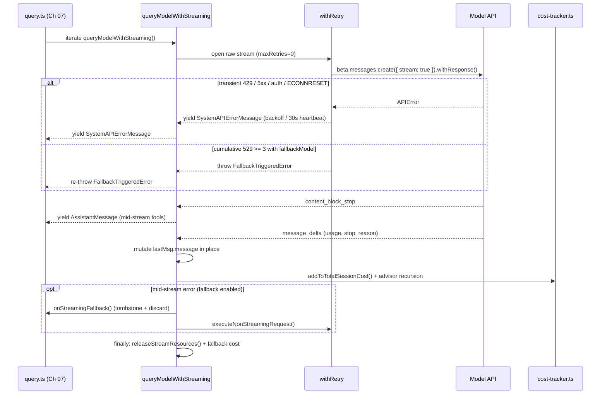

# 5. Talking to the Model: API Client, Streaming, Retries, and Accounting

> **Status: written.** Reverse-engineered from the Claude Code 2.1.88 source snapshot (see the Prologue (`prologue-how-to-read-a-1900-file-agent.md`) for snapshot caveats).
>
> **Layer:** Layer 2 (The Agent Engine)
> **Prerequisites:** [Chapter 01](ch001-atoms-types-stores-and-primitives.md), [Chapter 02](ch002-the-tool-contract.md), [Chapter 03](ch003-command-and-message-contracts.md), [Chapter 04](ch004-prompt-engineering-and-cache-boundaries.md)
> **Primary Source Files:**
> - `services/api/claude.ts` — Stage 2 wire conversion, cache breakpoints, sticky beta latches, raw SSE streaming, dual fallback, usage merging (3,419 lines)
> - `services/api/client.ts` — four-provider SDK factory (1P, Bedrock, Foundry, Vertex), auth refresh, proxy/keepalive wiring, `x-client-request-id` (389 lines)
> - `services/api/withRetry.ts` — `AsyncGenerator` retry loop, backoff/jitter, credential refresh, `UNATTENDED_RETRY`, `FallbackTriggeredError` (822 lines)
> - `services/api/errors.ts` — analytics error taxonomy, SDK retry categorizer, refusal handler, synthetic `AssistantMessage` error factory (1,207 lines)
> - `services/api/usage.ts` — claude.ai `/api/oauth/usage` quota utilization client with 5-second timeout (63 lines)
> - `cost-tracker.ts` — process-wide USD ledger in `bootstrap/state.ts`, OTel counters, recursive advisor billing, single-slot session restore (323 lines)
> - `utils/model/model.ts` — model precedence, canonicalization, 1M merge guard, legacy remap, API string normalization (618 lines)
> - `utils/thinking.ts` — `ThinkingConfig`, provider thinking/adaptive-thinking capabilities, `ULTRATHINK` dual gate, `MAX_THINKING_TOKENS` (162 lines)
> - `utils/effort.ts` — `EFFORT_LEVELS`, ant-only numeric effort, persistence bounds, `resolveAppliedEffort`, `tengu_grey_step2` (329 lines)

---

## Why This Layer Exists

After [Chapter 04](ch004-prompt-engineering-and-cache-boundaries.md), Claude Code holds every turn ingredient in memory—`bootstrap/state.ts`/`returnValue()` (Ch 01), `assembleToolPool()` (Ch 02), Stage 1 `normalizeMessagesForAPI()`/`ensureToolResultPairing()` (Ch 03), and `splitSysPromptPrefix()`/`toolToAPISchema()`/`promptCacheBreakDetection.ts` (Ch 04)—none yet on a socket. Nine files (7,332 lines) bridge memory to wire: model/thinking/effort resolution → four-provider client → request assembly & Stage 2 conversion → generator retries & error taxonomy → raw SSE streaming & fallback → usage, cost, and quota accounting.

---

## 1. Target Configuration: Model Resolution, Thinking Modes, and Effort Levels

### The Problem

Before opening a client, Claude Code settles `model`, `thinking`, and `effort` across four providers, subscription tiers, Plan Mode, skills, and `USER_TYPE === 'ant'` builds—where mismatches degrade reasoning, trigger false autocompact, or return HTTP 400.

### The Real Implementation

**Model resolution (`utils/model/model.ts`):** `getMainLoopModel()` (`utils/model/model.ts:92-98`) evaluates `/model` or `--model` override (`bootstrap/state.ts`) → `ANTHROPIC_MODEL` → `settings.model` → tier default (`getUserSpecifiedModelSetting()` at `utils/model/model.ts:61-78`, `getDefaultMainLoopModelSetting()` at `utils/model/model.ts:178-200`); enterprise-disallowed overrides (`isModelAllowed()`, `utils/model/model.ts:73-75`) silently drop to default. Family defaults (`utils/model/model.ts:105-138`) check `ANTHROPIC_DEFAULT_{OPUS,SONNET,HAIKU}_MODEL` first, keeping 3P separate (`sonnet45` on 3P vs. `sonnet46` on 1P); `getSmallFastModel()` (`utils/model/model.ts:36-38`) reads `ANTHROPIC_SMALL_FAST_MODEL || getDefaultHaikuModel()`.

At turn time, `getRuntimeMainLoopModel()` (`utils/model/model.ts:145-167`) switches `'opusplan'` to Opus (unless `exceeds200kTokens`) and `'haiku'` to Sonnet in `'plan'` mode. `getCanonicalName()` reverses `settings.modelOverrides` ARNs before pure `firstPartyNameToCanonical()` (`utils/model/model.ts:217-283`). `parseUserSpecifiedModel()` (`utils/model/model.ts:445-506`) splits `[1m]`, expands aliases, remaps retired 1P Opus 4.0/4.1 IDs unless `CLAUDE_CODE_DISABLE_LEGACY_MODEL_REMAP` (`utils/model/model.ts:538-554`), and preserves custom Foundry casing; `normalizeModelStringForAPI()` (`utils/model/model.ts:616-618`) strips client-only `[(1|2)m]` (`services/api/claude.ts:1700`). Two scars anchor the file: `resolveSkillModelOverride()` (`utils/model/model.ts:523-536`) propagates `[1m]` onto `model: opus` skills so 230K sessions stay 1M, and `isOpus1mMergeEnabled()` fails closed on `is1mContextDisabled()` (`CLAUDE_CODE_DISABLE_1M_CONTEXT`, `utils/context.ts:32`) and partial VS Code OAuth tokens:

```ts
// utils/model/model.ts:314-332
export function isOpus1mMergeEnabled(): boolean {
  if (
    is1mContextDisabled() ||
    isProSubscriber() ||
    getAPIProvider() !== 'firstParty'
  ) {
    return false
  }
  // Fail closed when a subscriber's subscription type is unknown. The VS Code
  // config-loading subprocess can have OAuth tokens with valid scopes but no
  // subscriptionType field (stale or partial refresh). Without this guard,
  // isProSubscriber() returns false for such users and the merge leaks
  // opus[1m] into the model dropdown — the API then rejects it with a
  // misleading "rate limit reached" error.
  if (isClaudeAISubscriber() && getSubscriptionType() === null) {
    return false
  }
  return true
}
```

**Thinking (`utils/thinking.ts`) & effort (`utils/effort.ts`):** `ThinkingConfig` (`utils/thinking.ts:10-13`) is `{ type: 'adaptive' } | { type: 'enabled'; budgetTokens: number } | { type: 'disabled' }`. `shouldEnableThinkingByDefault()` (`utils/thinking.ts:146-162`) checks `MAX_THINKING_TOKENS` (`"0"` disables), then `settings.alwaysThinkingEnabled === false`, defaulting to `true`. `modelSupportsThinking()` (`utils/thinking.ts:90-110`) checks 3P capability overrides (`ANTHROPIC_DEFAULT_*_MODEL_SUPPORTED_CAPABILITIES`, `utils/model/modelSupportOverrides.ts:13-22`), ant models, then Claude 4+ on 1P/Foundry vs. Sonnet/Opus 4+ on Bedrock/Vertex; `modelSupportsAdaptiveThinking()` (`utils/thinking.ts:113-144`) allowlists 4.6 models and **fails open on 1P/Foundry** for unknown strings. `isUltrathinkEnabled()` (`utils/thinking.ts:19-24`) requires `feature('ULTRATHINK')` + GrowthBook `'tengu_turtle_carbon'`; `findThinkingTriggerPositions()` (`utils/thinking.ts:36-58`) allocates fresh `/\bultrathink\b/gi` per call to avoid `matchAll` `lastIndex` leakage.

`EFFORT_LEVELS` (`utils/effort.ts:13-18`) is `'low' | 'medium' | 'high' | 'max'`; `EffortValue = EffortLevel | number` (`utils/effort.ts:20`) adds internal numeric overrides. `modelSupportsEffort()` (`utils/effort.ts:23-49`) honors `CLAUDE_CODE_ALWAYS_ENABLE_EFFORT`/3P `'effort'` overrides, failing open on `firstParty` only (Foundry excluded per `#30795`). `toPersistableEffort()` (`utils/effort.ts:95-105`) rejects numbers and persists `'max'` only when `process.env.USER_TYPE === 'ant'` (`utils/effort.ts:101`, session-scoped for externals), re-enforced on read by `getInitialEffortSetting()` (`utils/effort.ts:107-111`). `getDefaultEffortForModel()` (`utils/effort.ts:279-329`) defaults external Opus 4.6 to `'medium'` for Pro and Max/Team under GrowthBook `'tengu_grey_step2'` (`utils/effort.ts:268-271`), plus `'medium'` under `isUltrathinkEnabled()`. `resolveAppliedEffort()` (`utils/effort.ts:152-167`) walks `CLAUDE_CODE_EFFORT_LEVEL` (`'unset'`/`'auto'` → `undefined`) → `AppState` → model default, clamping `'max'` to `'high'` whenever `!modelSupportsMaxEffort(model)`.

### Hidden Invariants & Failure Modes

> [!NOTE]
> **Snapshot Absences & Stripped `ANT-ONLY` Imports:**
> 1. `entrypoints/sdk/runtimeTypes.ts` is **absent from this snapshot** (`utils/effort.ts:9` imports `type { EffortLevel }`); its union is observed at `utils/effort.ts:13-18`.
> 2. **Two** internal symbols—`resolveAntModel` (`utils/model/model.ts:402`, `utils/model/model.ts:489`, `utils/thinking.ts:96`, `utils/effort.ts:61`, `utils/effort.ts:290`) and `getAntModelOverrideConfig` (`utils/model/model.ts:182`, `utils/effort.ts:283`)—are called inside `USER_TYPE === 'ant'` guards **without imports**. Both exist in `utils/model/antModels.ts` (`utils/model/antModels.ts:34-64`, GrowthBook `'tengu_ant_model_override'`). Line 1 of all three callers retains `// biome-ignore-all assist/source/organizeImports: ANT-ONLY import markers must not be reordered`, proving a redaction pass stripped the marked import block.

---

## 2. Four Providers Behind One Client (`services/api/client.ts`)

### The Problem

Routing across 1P, Bedrock, Foundry, and Vertex behind one `Promise<Anthropic>` contract must avoid eager SDK imports, stdout log corruption, strict-proxy header rejections, and a 12-second GCP metadata hang outside GCE.

### The Real Implementation

`getAnthropicClient()` (`services/api/client.ts:88-316`) builds shared headers (`x-app: 'cli'`, `User-Agent`, `X-Claude-Code-Session-Id`, `CLAUDE_CODE_CONTAINER_ID`/`CLAUDE_CODE_REMOTE_SESSION_ID`/`CLAUDE_AGENT_SDK_CLIENT_APP` at `services/api/client.ts:101-116`, `CLAUDE_CODE_ADDITIONAL_PROTECTION`, and `ANTHROPIC_CUSTOM_HEADERS` via ReDoS-free `indexOf(':')` in `getCustomHeaders()`, `services/api/client.ts:330-354`), awaits `checkAndRefreshOAuthTokenIfNeeded()` (`services/api/client.ts:132`), calls `configureApiKeyHeaders()` (`ANTHROPIC_AUTH_TOKEN`/`apiKeyHelper`, `services/api/client.ts:318-328`) under `!isClaudeAISubscriber()` (`services/api/client.ts:135-137`), and sets `ARGS` (`services/api/client.ts:141-152`): `API_TIMEOUT_MS` (default **600,000 ms**), `getProxyFetchOptions({ forAnthropicAPI: true })` (`utils/proxy.ts:288-319`, isolating `ANTHROPIC_UNIX_SOCKET` and honoring `disableKeepAlive()`), and `fetch: buildFetch(...)`. Each provider constructor separately attaches `logger: createStderrLogger()` (`services/api/client.ts:73-86`) only when `isDebugToStdErr()` (`--debug-to-stderr`/`-d2e`, `utils/debug.ts:85-89`) is active (`services/api/client.ts:168`, `services/api/client.ts:216`, `services/api/client.ts:294`, `services/api/client.ts:312`).

It then lazily `await import(...)`s one SDK:
- **Bedrock (`services/api/client.ts:153-190`, `CLAUDE_CODE_USE_BEDROCK`):** `@anthropic-ai/bedrock-sdk`, `ANTHROPIC_SMALL_FAST_MODEL_AWS_REGION`, and `AWS_BEARER_TOKEN_BEDROCK` (`skipAuth: true`) or `refreshAndGetAwsCredentials()` (unless `CLAUDE_CODE_SKIP_BEDROCK_AUTH`).
- **Foundry (`services/api/client.ts:191-220`, `CLAUDE_CODE_USE_FOUNDRY`):** `@anthropic-ai/foundry-sdk`, using `ANTHROPIC_FOUNDRY_API_KEY`, a stub under `CLAUDE_CODE_SKIP_FOUNDRY_AUTH`, or lazy `@azure/identity` `DefaultAzureCredential`.
- **Vertex (`services/api/client.ts:221-298`, `CLAUDE_CODE_USE_VERTEX`):** `@anthropic-ai/vertex-sdk` + `google-auth-library` with `getVertexRegionForModel(model)`, skipping GCP refresh with a mock `GoogleAuth` under `CLAUDE_CODE_SKIP_VERTEX_AUTH` (`services/api/client.ts:224`, `services/api/client.ts:266`). **Scar (`services/api/client.ts:241-288`):** Passes `projectId: ANTHROPIC_VERTEX_PROJECT_ID` *only* when `GCLOUD_PROJECT`/`GOOGLE_CLOUD_PROJECT`/`GOOGLE_APPLICATION_CREDENTIALS` (and lowercase variants) are unset, blocking a 12s GCE metadata hang without clobbering billing overrides.
- **1P Anthropic (`services/api/client.ts:300-316`):** Sets `apiKey: null` with OAuth `authToken` for subscribers and honors `USER_TYPE === 'ant' && USE_STAGING_OAUTH`.

`buildFetch()` (`services/api/client.ts:356-389`) injects a correlatable UUID on 1P without tripping strict proxies:

```ts
// services/api/client.ts:356-389
export const CLIENT_REQUEST_ID_HEADER = 'x-client-request-id'

function buildFetch(
  fetchOverride: ClientOptions['fetch'],
  source: string | undefined,
): ClientOptions['fetch'] {
  // eslint-disable-next-line eslint-plugin-n/no-unsupported-features/node-builtins
  const inner = fetchOverride ?? globalThis.fetch
  // Only send to the first-party API — Bedrock/Vertex/Foundry don't log it
  // and unknown headers risk rejection by strict proxies (inc-4029 class).
  const injectClientRequestId =
    getAPIProvider() === 'firstParty' && isFirstPartyAnthropicBaseUrl()
  return (input, init) => {
    // eslint-disable-next-line eslint-plugin-n/no-unsupported-features/node-builtins
    const headers = new Headers(init?.headers)
    // Generate a client-side request ID so timeouts (which return no server
    // request ID) can still be correlated with server logs by the API team.
    // Callers that want to track the ID themselves can pre-set the header.
    if (injectClientRequestId && !headers.has(CLIENT_REQUEST_ID_HEADER)) {
      headers.set(CLIENT_REQUEST_ID_HEADER, randomUUID())
    }
    // ...
    return inner(input, { ...init, headers })
  }
}
```

### Hidden Invariants & Failure Modes

- **Type-cast lie (`services/api/client.ts:188-189`, `services/api/client.ts:218-219`, `services/api/client.ts:296-297`):** Bedrock, Foundry, and Vertex all cast `as unknown as Anthropic`; only `.beta.messages.create` is shared across all four SDKs.
- **Precedence skew:** `services/api/client.ts:153-221` tests `BEDROCK` → `FOUNDRY` → `VERTEX`, whereas `utils/model/providers.ts:6-14` (`getAPIProvider()`) tests `BEDROCK` → `VERTEX` → `FOUNDRY`.

---

## 3. Request Assembly, Stage 2 Wire Conversion, and Sticky Cache Latches (`services/api/claude.ts`)

### The Problem

[Chapter 03](ch003-command-and-message-contracts.md)'s `normalizeMessagesForAPI()` stops at internal messages; [Chapter 04](ch004-prompt-engineering-and-cache-boundaries.md)'s `splitSysPromptPrefix()`/`toolToAPISchema()` emit structured pieces. `services/api/claude.ts` strips incompatible blocks, places one message-level KV breakpoint, stops beta headers and 1h TTL from oscillating (~50–70K token cache busts), and routes Bedrock body-only betas into `anthropic_beta`.

### The Real Implementation

`queryModelWithStreaming()` (`services/api/claude.ts:752-780`) wraps `queryModel()` (`services/api/claude.ts:1017-1062`) in `withStreamingVCR()`, checking GrowthBook `'tengu-off-switch'` (`getDynamicConfig_BLOCKS_ON_INIT`) for non-subscriber Opus, reading `previousRequestId` from local `messages`, and resolving Bedrock `application-inference-profile` ARNs into `resolvedModel` (`services/api/claude.ts:1057-1062`).

Assembly runs in four stages (`services/api/claude.ts:1120-1486`):
1. **Tools & suffix advisor (`services/api/claude.ts:1120-1255`, `services/api/claude.ts:1385-1396`):** Computes `useToolSearch`/`deferredToolNames` once, retains non-deferred tools, `ToolSearchTool`, and `extractDiscoveredToolNames(messages)`, defers unready LSP tools (`shouldDeferLspTool()`), calls Ch 04's `toolToAPISchema()`, disables global system-prompt cache (`shouldUseGlobalCacheScope()`: strictly `firstParty` + `!CLAUDE_CODE_DISABLE_EXPERIMENTAL_BETAS`, `utils/betas.ts:227-232`) when a non-deferred MCP tool renders (`needsToolBasedCacheMarker`), and—when `isAdvisorEnabled()` holds (GrowthBook `'tengu_sage_compass'` defaulting `false`, `!CLAUDE_CODE_DISABLE_ADVISOR_TOOL`, `shouldIncludeFirstPartyOnlyBetas()`, `utils/advisor.ts:53-69`)—appends `{ type: 'advisor_20260301', name: 'advisor', model: advisorModel }` *after* `toolSchemas` so `/advisor` toggles spare the prefix.
2. **Stage 1 hygiene (`services/api/claude.ts:1265-1315`):** Runs Ch 03's `normalizeMessagesForAPI()`, strips `tool_reference`/`caller` when `!useToolSearch`, runs `ensureToolResultPairing()`, strips `advisor` blocks without `ADVISOR_BETA_HEADER`, and drops oldest images/documents above `API_MAX_MEDIA_PER_REQUEST` (`100`, `constants/apiLimits.ts:94`) via `stripExcessMediaItems()` (`services/api/claude.ts:956-1015`).
3. **System blocks & latched 1h TTL (`services/api/claude.ts:333-434`, `services/api/claude.ts:3213-3237`):** Calls `buildSystemPromptBlocks()` → Ch 04's `splitSysPromptPrefix()` + `getCacheControl()` (`DISABLE_PROMPT_CACHING*`). `should1hCacheTTL()` honors `ENABLE_PROMPT_CACHING_1H_BEDROCK` on Bedrock and otherwise **latches** eligibility (`USER_TYPE === 'ant' || (isClaudeAISubscriber() && !currentLimits.isUsingOverage)`) and GrowthBook `'tengu_prompt_cache_1h_config'`'s allowlist in `bootstrap/state.ts`.
4. **Sticky beta latches (`services/api/claude.ts:1405-1456`) & cache snapshot (`services/api/claude.ts:1460-1486`):** Four flags latch `true` in `bootstrap/state.ts:1744-1749` until `/clear` or `/compact` (`clearBetaHeaderLatches()`): `afkModeHeaderLatched` (local `afkHeaderLatched`, `services/api/claude.ts:1412`; `feature('TRANSCRIPT_CLASSIFIER')`), `fastModeHeaderLatched` (fast mode gated by `!CLAUDE_CODE_DISABLE_FAST_MODE` and GrowthBook `'tengu_penguins_off'`/`'tengu_marble_sandcastle'`, `utils/fastMode.ts:38-94`), `cacheEditingHeaderLatched` (`feature('CACHED_MICROCOMPACT')`, importing snapshot-absent `services/compact/cachedMicrocompact.ts` at `services/api/claude.ts:1195` and stripped `CACHE_EDITING_BETA_HEADER` from `constants/betas.ts` at `services/api/claude.ts:1196-1197`), and `thinkingClearLatched`. Under `feature('PROMPT_CACHE_BREAK_DETECTION')`, Ch 04's `recordPromptState()` hashes non-deferred tools, system blocks, and latched headers.

`getMergedBetas()` (`utils/betas.ts:397-428`) runs once up front per `queryModel()` call (`services/api/claude.ts:1071`); per attempt, `paramsFromContext(retryContext)` (`services/api/claude.ts:1538-1729`) clones `[...betas]` (`services/api/claude.ts:1539`), routes Bedrock's `getBedrockExtraBodyParamsBetas()` (`services/api/claude.ts:1553`) + `toolSearchHeader` into `getExtraBodyParams()`'s `anthropic_beta`, applies `configureEffortParams()` (`services/api/claude.ts:440-466`: `output_config.effort` + `EFFORT_BETA_HEADER`, or ant-only `anthropic_internal.effort_override`) and `configureTaskBudgetParams()` (`services/api/claude.ts:479-501`: `output_config.task_budget` + `TASK_BUDGETS_BETA_HEADER` via `shouldIncludeFirstPartyOnlyBetas()`—both `firstParty` and `foundry` when `!CLAUDE_CODE_DISABLE_EXPERIMENTAL_BETAS`, `utils/betas.ts:215-220`), computes `max_tokens` via `getMaxOutputTokensForModel()` (`services/api/claude.ts:3399-3419`, 8,000-token cap under GrowthBook `'tengu_otk_slot_v1'` unless overridden by `CLAUDE_CODE_MAX_OUTPUT_TOKENS`), selects adaptive vs. budgeted thinking (`budget_tokens <= maxOutputTokens - 1`, honoring `CLAUDE_CODE_DISABLE_THINKING`/`CLAUDE_CODE_DISABLE_ADAPTIVE_THINKING`, omitting `temperature`), and runs **Stage 2 conversion** via `addCacheBreakpoints()` (`services/api/claude.ts:3063-3211`):

```ts
// services/api/claude.ts:3078-3110
// Exactly one message-level cache_control marker per request. Mycro's
// turn-to-turn eviction (page_manager/index.rs: Index::insert) frees
// local-attention KV pages at any cached prefix position NOT in
// cache_store_int_token_boundaries. With two markers the second-to-last
// position is protected and its locals survive an extra turn even though
// nothing will ever resume from there — with one marker they're freed
// immediately. For fire-and-forget forks (skipCacheWrite) we shift the
// marker to the second-to-last message: that's the last shared-prefix
// point, so the write is a no-op merge on mycro (entry already exists)
// and the fork doesn't leave its own tail in the KVCC. Dense pages are
// refcounted and survive via the new hash either way.
const markerIndex = skipCacheWrite ? messages.length - 2 : messages.length - 1
const result = messages.map((msg, index) => {
  const addCache = index === markerIndex
  if (msg.type === 'user') {
    return userMessageToMessageParam(
      msg,
      addCache,
      enablePromptCaching,
      querySource,
    )
  }
  return assistantMessageToMessageParam(
    msg,
    addCache,
    enablePromptCaching,
    querySource,
  )
})

if (!useCachedMC) {
  return result
}
```

### Hidden Invariants & Failure Modes

> [!IMPORTANT]
> **Wire-Conversion & Cache Invariants:**
> 1. **Clone even when `addCache` is `false` (`services/api/claude.ts:622-630`):** `userMessageToMessageParam()` shallow-clones array content so cached-microcompact `cache_edits` splices never duplicate across retries.
> 2. **Skip invalid assistant blocks (`services/api/claude.ts:658-665`):** `assistantMessageToMessageParam()` never attaches `cache_control` to `thinking`, `redacted_thinking`, or (`feature('CONNECTOR_TEXT')`) `isConnectorTextBlock(_)` (imported from snapshot-absent `types/connectorText.ts`, observed at `services/api/claude.ts:44`, `services/api/claude.ts:2070-2081`).
> 3. **Clone `CLAUDE_CODE_EXTRA_BODY` (`services/api/claude.ts:283-286`):** `safeParseJSON()` is LRU-cached; cloning stops `anthropic_beta` and 4-way gated `anti_distillation: ['fake_tools']` (`feature('ANTI_DISTILLATION_CC')` + `process.env.CLAUDE_CODE_ENTRYPOINT === 'cli'` + `shouldIncludeFirstPartyOnlyBetas()` (`firstParty`/`foundry`, `!CLAUDE_CODE_DISABLE_EXPERIMENTAL_BETAS`) + GrowthBook `'tengu_anti_distill_fake_tool_injection'`, `services/api/claude.ts:302-313`) from poisoning cached objects.
> 4. **Sticky header, dynamic speed (`services/api/claude.ts:1642-1657`):** `FAST_MODE_BETA_HEADER` stays latched while `speed: 'fast'` drops during cooldown, preserving the cache key. Scalar log fields are pre-computed before `.then()` (`services/api/claude.ts:1731-1759`) so telemetry closures never pin `messagesForAPI` in RAM.

---

## 4. Retries as an `AsyncGenerator`, Overload Fallbacks, and Error Taxonomy (`services/api/withRetry.ts`, `services/api/errors.ts`)

### The Problem

Passing `maxRetries: 0` to `getAnthropicClient()` (`services/api/claude.ts:846`, `services/api/claude.ts:1781`) gives Claude Code sole outage-recovery control: visible countdowns, shedding background 529s, refreshing credentials/sockets, repairing `max_tokens` overflows, escaping 529 storms via fallback, and smuggling raw error text past exact-string UI matchers.

### The Real Implementation

**`withRetry<T>` (`services/api/withRetry.ts:170-517`):** As `AsyncGenerator<SystemAPIErrorMessage, T>`, it yields `createSystemAPIErrorMessage()` before standard `APIError` retry sleeps (`services/api/withRetry.ts:508-511`; fast-mode `<20s` retries at `services/api/withRetry.ts:285-289` and non-`APIError` AWS/GCP credential retries at `services/api/withRetry.ts:375-376`, `services/api/withRetry.ts:508` sleep without yielding)—driving TUI timers and SDK `api_retry` events (`QueryEngine.ts:943-955`)—and returns `T` on success (drained via Ch 01's `returnValue()` in `verifyApiKey()`, `services/api/claude.ts:543`). Defaults: `DEFAULT_MAX_RETRIES = 10` (`CLAUDE_CODE_MAX_RETRIES`, `services/api/withRetry.ts:789-797`), `signal.aborted` checks before each step/sleep, and ant-only `/mock-limits` (`USER_TYPE === 'ant'`, `services/api/withRetry.ts:202-210`).

**Client, auth & socket healing (`services/api/withRetry.ts:218-251`, `services/api/withRetry.ts:375-382`, `services/api/withRetry.ts:623-694`):** On `ECONNRESET`/`EPIPE`, GrowthBook `'tengu_disable_keepalive_on_econnreset'` trips sticky `disableKeepAlive()` (`utils/proxy.ts:27-31`). `withRetry` rebuilds `client = await getClient()` after 401 (`handleOAuth401Error()` + `clearApiKeyHelperCache()`), 403 `"OAuth token has been revoked"`, Bedrock auth (`CLAUDE_CODE_USE_BEDROCK` + `CredentialsProviderError`/403 → `clearAwsCredentialsCache()`), Vertex auth (`CLAUDE_CODE_USE_VERTEX` + string-matched `google-auth-library` `Error`/401 → `clearGcpCredentialsCache()`), or stale sockets. AWS/GCP handlers precede `error instanceof APIError` because cloud auth throws non-`APIError`s.

**Classification, backoff & `UNATTENDED_RETRY` (`services/api/withRetry.ts:57-110`, `services/api/withRetry.ts:261-548`, `services/api/withRetry.ts:696-822`):**
- **Fast-mode & 529 load shedding:** Fast-mode `<20s` `retry-after` sleeps while keeping fast mode; longer/missing `retry-after` on 429/529 enters `Math.max(retryAfterMs ?? 30m, 10m)` cooldown (10m floor, 30m default, unbounded above if `retry-after` exceeds 30m; `services/api/withRetry.ts:293-296`, `services/api/withRetry.ts:799-801`) and sets `retryContext.fastMode = false` (`services/api/withRetry.ts:261-314`). `FOREGROUND_529_RETRY_SOURCES` (`services/api/withRetry.ts:57-89`) allowlists 14 interactive/agent/security `QuerySource`s plus `feature('BASH_CLASSIFIER')`-gated `'bash_classifier'`; background queries drop immediately on 529 (`tengu_api_529_background_dropped`).
- **Overflow repair & `shouldRetry()` (`services/api/withRetry.ts:384-427`, `services/api/withRetry.ts:550-595`, `services/api/withRetry.ts:696-787`):** `parseMaxTokensContextOverflowError()` trims `retryContext.maxTokensOverride` (1k buffer, `FLOOR_OUTPUT_TOKENS = 3000`) and retries without sleep. `shouldRetry()` forces `CLAUDE_CODE_REMOTE` 401/403 retry over `x-should-retry: false`, lets `USER_TYPE === 'ant'` ignore `x-should-retry: false` on `>= 500`, and retries `APIConnectionError`, `408`/`409`/`401`/`403`-revoked/`>= 500`, and non-subscriber/Enterprise `429` (else `CannotRetryError`).
- **Backoff & persistent heartbeats (`services/api/withRetry.ts:433-548`, `services/api/withRetry.ts:814-822`):** `getRetryDelay()` honors integer `retry-after` immediately; else `Math.min(500 * 2^(attempt - 1), 32000)` + `0–25%` jitter. Under `feature('UNATTENDED_RETRY')` + `CLAUDE_CODE_UNATTENDED_RETRY` (`services/api/withRetry.ts:100-104`), HTTP `429` honors `anthropic-ratelimit-unified-reset` (6h cap, `services/api/withRetry.ts:433-447`) while `529` skips it for `getRetryDelay()` (5m backoff cap, 6h `retry-after` cap, `services/api/withRetry.ts:448-460`), sleeping in **30s chunks** with keep-alive `SystemAPIErrorMessage`s and clamping `attempt` at `maxRetries`.

**Overload fallback (`services/api/withRetry.ts:326-365`, `services/api/withRetry.ts:610-621`):** `is529Error()` matches `status === 529` or mid-stream `"type":"overloaded_error"`. At `MAX_529_RETRIES` (`3`), eligible primary models trigger model fallback or external early exit:

```ts
// services/api/withRetry.ts:327-365
if (
  is529Error(error) &&
  // If FALLBACK_FOR_ALL_PRIMARY_MODELS is not set, fall through only if the primary model is a non-custom Opus model.
  // TODO: Revisit if the isNonCustomOpusModel check should still exist, or if isNonCustomOpusModel is a stale artifact of when Claude Code was hardcoded on Opus.
  (process.env.FALLBACK_FOR_ALL_PRIMARY_MODELS ||
    (!isClaudeAISubscriber() && isNonCustomOpusModel(options.model)))
) {
  consecutive529Errors++
  if (consecutive529Errors >= MAX_529_RETRIES) {
    // Check if fallback model is specified
    if (options.fallbackModel) {
      // ...
      // Throw special error to indicate fallback was triggered
      throw new FallbackTriggeredError(
        options.model,
        options.fallbackModel,
      )
    }

    if (
      process.env.USER_TYPE === 'external' &&
      !process.env.IS_SANDBOX &&
      !isPersistentRetryEnabled()
    ) {
      logEvent('tengu_api_custom_529_overloaded_error', {})
      throw new CannotRetryError(
        new Error(REPEATED_529_ERROR_MESSAGE),
        retryContext,
      )
    }
  }
}
```

**Error taxonomy (`services/api/errors.ts`):** Failures project onto three surfaces: (1) `classifyAPIError()` (`services/api/errors.ts:965-1161`) emits **25** distinct Datadog tags across 26 returns (`'image_too_large'` repeats at `services/api/errors.ts:1042`, `services/api/errors.ts:1052`; `services/api/logging.ts:282`); (2) `categorizeRetryableAPIError()` (`services/api/errors.ts:1163-1182`) maps retryables onto the 7-variant `SDKAssistantMessageError` union (`QueryEngine.ts:951`; snapshot-absent `entrypoints/sdk/coreTypes.generated.ts`, live `SDKAssistantMessageErrorSchema` at `entrypoints/sdk/coreSchemas.ts:1256-1266`); and (3) `getAssistantMessageFromError()` (`services/api/errors.ts:425-934`; helper `get3PModelFallbackSuggestion()` at `services/api/errors.ts:940-959`) plus `getErrorMessageIfRefusal()` (`services/api/errors.ts:1184-1207`) synthesize `isApiErrorMessage: true` `AssistantMessage`s (branching on `getIsNonInteractiveSession()`, returning `'invalid_request'` for disabled stale-`ANTHROPIC_API_KEY` orgs at `services/api/errors.ts:785-811` so VS Code avoids `showLogin()` loops, and logging `logToolUseToolResultMismatch()` on 400 pairing errors). Only prompt-too-long (`services/api/errors.ts:562-574`) holds the fixed UI string `'Prompt is too long'` while smuggling raw text in **`msg.errorDetails`**; inside media branches (`services/api/errors.ts:576-639`), PDF-page-limit (`services/api/errors.ts:577-586`), image-size (`services/api/errors.ts:613-623`), and many-image (`services/api/errors.ts:626-639`) pair per-variant UI `content` with raw `error.message` in `errorDetails` (password-protected/invalid PDF at `services/api/errors.ts:589-610` do not), feeding `getPromptTooLongTokenGap()` (`services/api/errors.ts:104-118`, `services/compact/compact.ts:260`) and `isMediaSizeErrorMessage()` (`services/api/errors.ts:147-153`) for withheld recovery in `query.ts:15-20`, `query.ts:799-825` (`feature('REACTIVE_COMPACT')`/`feature('CONTEXT_COLLAPSE')`, importing snapshot-absent `services/compact/reactiveCompact.ts` / `services/contextCollapse/`).

### Hidden Invariants & Failure Modes

- **Forensic Scar — `consecutive529Errors` Is Cumulative:** Despite its name (`services/api/withRetry.ts:326`), `services/api/withRetry.ts` has **no `consecutive529Errors = 0` reset** on non-529 errors; three total 529s in one call (including `initialConsecutive529Errors`) trigger fallback.
- **Snapshot Absences:** `types/message.ts` and `constants/querySource.ts` are absent from this checkout; concrete fields and 15+ literal `QuerySource` values are observed at `services/api/withRetry.ts:62-82` and `utils/messages.ts:435-458`, `utils/messages.ts:4585-4603`.

---

## 5. Raw SSE Streaming, Watchdog, Non-Streaming Fallback, and Socket Hygiene (`services/api/claude.ts`)

### The Problem

`BetaMessageStream` runs `partialParse()` on every `input_json_delta`—**O(n²) CPU** on large writes. Raw SSE restores O(n) accumulation, making Claude Code own half-open hangs, empty HTTP 200 bodies, double tool execution, and native TLS leaks on early abort.

### The Real Implementation

Inside `queryModel()` (`services/api/claude.ts:1777-1857`), `withRetry` generates a 1P `clientRequestId` and calls `anthropic.beta.messages.create({ ...params, stream: true }, { signal, headers }).withResponse()` (`services/api/claude.ts:1810-1836`)—skipping `BetaMessageStream` while capturing raw `Stream`, `streamRequestId`, and `streamResponse` (for `extractQuotaStatusFromHeaders` at `services/api/claude.ts:2400`). Pumping `withRetry` re-yields any `SystemAPIErrorMessage` (`!('controller' in e.value)`, `services/api/claude.ts:1853-1855`).

Next, `queryModel()` arms an opt-in idle watchdog (`CLAUDE_ENABLE_STREAM_WATCHDOG`, `CLAUDE_STREAM_IDLE_TIMEOUT_MS` default 90s, `services/api/claude.ts:1868-1929`) and a 30s passive stall logger (`services/api/claude.ts:1936-1966`), then drives the SSE loop (`services/api/claude.ts:1979-2304`):
- **`message_start` (`services/api/claude.ts:1980-1994`):** Captures `partialMessage`, `ttftMs`, initial `usage`, and ant-only `research`.
- **`content_block_start` / `content_block_delta` (`services/api/claude.ts:1995-2170`):** Clones blocks with empty accumulators (`input: ''`, `text: ''`, `thinking: ''`, `signature: ''`), appends `partial_json`/`text`/`thinking`/`connector_text` (`feature('CONNECTOR_TEXT')`), assigns `signature`, and throws on index/type mismatch.
- **`content_block_stop` (`services/api/claude.ts:2171-2212`):** Parses tool JSON once in O(n) via Ch 03's `normalizeContentFromAPI()`, pushes the single-block `AssistantMessage`, and **immediately `yield m`**—feeding `StreamingToolExecutor` mid-stream.
- **`message_delta` (`services/api/claude.ts:2213-2294`) & `stream_event` (`services/api/claude.ts:2299-2303`):** Updates usage, mutates `lastMsg.message` in place, bills USD cost before yielding, emits synthetic errors on `refusal`/`max_tokens`/`model_context_window_exceeded` (reusing `apiError: 'max_output_tokens'`), and forwards every `part` as `{ type: 'stream_event', event: part }`.

The `message_delta` mutation invariant (`services/api/claude.ts:2229-2256`):

```ts
// services/api/claude.ts:2229-2256
// Write final usage and stop_reason back to the last yielded
// message. Messages are created at content_block_stop from
// partialMessage, which was set at message_start before any tokens
// were generated (output_tokens: 0, stop_reason: null).
// message_delta arrives after content_block_stop with the real
// values.
//
// IMPORTANT: Use direct property mutation, not object replacement.
// The transcript write queue holds a reference to message.message
// and serializes it lazily (100ms flush interval). Object
// replacement ({ ...lastMsg.message, usage }) would disconnect
// the queued reference; direct mutation ensures the transcript
// captures the final values.
stopReason = part.delta.stop_reason

const lastMsg = newMessages.at(-1)
if (lastMsg) {
  lastMsg.message.usage = usage
  lastMsg.message.stop_reason = stopReason
}

// Update cost
const costUSDForPart = calculateUSDCost(resolvedModel, usage)
costUSD += addToTotalSessionCost(
  costUSDForPart,
  usage,
  options.model,
)
```

Post-loop, `services/api/claude.ts:2337-2392` rejects empty HTTP 200 bodies (`!partialMessage || (newMessages.length === 0 && !stopReason)`, preserving empty `end_turn` `StructuredOutput` turns) and calls Ch 04's `checkResponseForCacheBreak()` (`feature('PROMPT_CACHE_BREAK_DETECTION')`). Errors enter two fallback paths (`services/api/claude.ts:2434-2694`):
1. **Mid-stream fallback (`services/api/claude.ts:2434-2594`):** Separates real `signal.aborted` ESC aborts from SDK timeouts (`services/api/claude.ts:2434-2462`), then honors `CLAUDE_CODE_DISABLE_NONSTREAMING_FALLBACK` and GrowthBook `'tengu_disable_streaming_to_non_streaming_fallback'` (**`inc-4258`** double-tool-execution guard). Otherwise calls `options.onStreamingFallback?.()` (telling `query.ts:712-741` to tombstone partials and `streamingToolExecutor.discard()`) and runs `executeNonStreamingRequest()` (`services/api/claude.ts:818-917`) with `initialConsecutive529Errors: is529Error(streamingError) ? 1 : 0`.
2. **Outer 404 stream-creation fallback (`services/api/claude.ts:2598-2694`):** First **unconditionally re-throws `FallbackTriggeredError`** (`services/api/claude.ts:2603-2605`, `services/api/claude.ts:2692-2694`) so `query.ts` switches models; then catches 404 `CannotRetryError` and calls `executeNonStreamingRequest()` (timeout defaults to 120s in `CLAUDE_CODE_REMOTE`/300s locally, overridden by `API_TIMEOUT_MS` at `services/api/claude.ts:807-811`; `adjustParamsForNonStreaming()` at `services/api/claude.ts:3354-3392` caps `max_tokens` at `MAX_NON_STREAMING_TOKENS = 64_000` and `thinking.budget_tokens <= cappedMaxTokens - 1`). Note `queryModelWithoutStreaming()` (`services/api/claude.ts:709-750`, backing `queryHaiku()`/`queryWithModel()`) still streams SSE internally; only `executeNonStreamingRequest()` and `verifyApiKey()` (`services/api/claude.ts:530-586`) omit `stream: true`.

### Hidden Invariants & Failure Modes

> [!WARNING]
> **Early-Exit Socket Leaks (`GH #32920`):**
> Breaking out of `for await` invokes `.return()`, running `finally` and skipping post-`try/finally` code. Placing `releaseStreamResources()` (`cleanupStream()` + `streamResponse.body?.cancel()`, `services/api/claude.ts:1515-1526`, `services/api/claude.ts:2898-2912`) **and** `fallbackMessage` cost accounting in `finally` (`services/api/claude.ts:2808-2831`) prevents off-heap TLS/socket leaks and guarantees fallback billing survives abort.

---

## 6. Token Usage, USD Cost Accounting, and Quota Utilization

### The Problem

Streaming splits usage across `message_start` and `message_delta` (whose `0`s can wipe prompt/cache counts), turns mix models (Bedrock ARNs, 6× fast mode, advisor sub-calls), `/resume` restores spend/wall time, and subscribers need quota windows.

### The Real Implementation

1. **Per-chunk merge (`services/api/emptyUsage.ts`, `services/api/claude.ts:2924-2987`):** Each attempt resets `usage = EMPTY_USAGE` (`services/api/claude.ts:1765`, `services/api/claude.ts:1864`; 22-line `services/api/emptyUsage.ts` stops `bridge/replBridge.ts` pulling `BashTool.tsx` via `logging.ts`). `updateUsage()` guards `input_tokens`, `cache_creation_input_tokens`, and `cache_read_input_tokens` with `!== null && > 0` so `message_delta` zeros never erase `message_start`, casts `partUsage as BetaUsage` for `cache_creation.{ephemeral_1h,ephemeral_5m}_input_tokens` and `speed`, and spreads `cache_deleted_input_tokens` behind `feature('CACHED_MICROCOMPACT')` (`services/api/claude.ts:2970-2982`).
2. **USD pricing (`utils/modelCost.ts:27-180`):** `calculateUSDCost(resolvedModel, usage)` canonicalizes Bedrock's backing model via `getCanonicalName()` across six per-Mtok tiers (`COST_HAIKU_35` $0.80/$4, `COST_HAIKU_45` $1/$5, `COST_TIER_3_15` $3/$15, `COST_TIER_5_25` $5/$25, `COST_TIER_15_75` $15/$75, and **6× Opus 4.6 fast mode** `COST_TIER_30_150` $30/$150 when `isFastModeEnabled() && usage.speed === 'fast'`, `utils/modelCost.ts:94-99`, `utils/modelCost.ts:148-153`) plus `$0.01` per `web_search_requests`; unknown models flip `setHasUnknownModelCost()` (`formatTotalCost()` at `cost-tracker.ts:228-244`) and fall back to default pricing.
3. **Process ledger, OTel & recursive advisor billing (`cost-tracker.ts:250-323`):** `addToTotalSessionCost()` writes per-model `ModelUsage` to `bootstrap/state.ts` (`addToTotalCostState()`), emits OTel counters (tagging `speed: 'fast'`), and recursively bills `advisor_message` iterations via `getAdvisorUsage(usage)` (`utils/advisor.ts:115-128`):

```ts
// cost-tracker.ts:278-323
export function addToTotalSessionCost(
  cost: number,
  usage: Usage,
  model: string,
): number {
  const modelUsage = addToTotalModelUsage(cost, usage, model)
  addToTotalCostState(cost, modelUsage, model)

  const attrs =
    isFastModeEnabled() && usage.speed === 'fast'
      ? { model, speed: 'fast' }
      : { model }

  getCostCounter()?.add(cost, attrs)
  getTokenCounter()?.add(usage.input_tokens, { ...attrs, type: 'input' })
  // ...

  let totalCost = cost
  for (const advisorUsage of getAdvisorUsage(usage)) {
    const advisorCost = calculateUSDCost(advisorUsage.model, advisorUsage)
    // ...
    totalCost += addToTotalSessionCost(
      advisorCost,
      advisorUsage,
      advisorUsage.model,
    )
  }
  return totalCost
}
```

4. **Cross-turn rollup, single-slot restore & utilization (`services/api/claude.ts:2993-3038`, `cost-tracker.ts:87-175`, `services/api/usage.ts:33-63`):** `QueryEngine.ts:789-816` folds turns into `totalUsage` via `accumulateUsage()`. Across `/resume`, `saveCurrentSessionCosts()`/`restoreCostStateForSession()` keep a **single last-session slot** keyed by `projectConfig.lastSessionId` (read before overwrite), with `setCostStateForRestore()` (`bootstrap/state.ts:881-916`) back-dating `STATE.startTime = Date.now() - lastDuration`. Separately, `fetchUtilization()` (`services/api/usage.ts:33-63`) polls `${BASE_API_URL}/api/oauth/usage` (**5,000 ms** timeout), returning `{}` for non-subscribers or tokens lacking profile scope (`!isClaudeAISubscriber() || !hasProfileScope()`, `services/api/usage.ts:34-36`) and `null` *before* network I/O if `isOAuthTokenExpired(tokens.expiresAt)`.

### Hidden Invariants & Failure Modes

- **Flat 1.25× cache-write caveat (`utils/modelCost.ts:131-142`):** Client-side `tokensToUSDCost()` bills all `cache_creation_input_tokens` at `1.25×` input without splitting 1h vs. 5m buckets.
- **Pricing vs. ledger keys (`services/api/claude.ts:2251-2256`, `cost-tracker.ts:181-226`):** `claude.ts` prices via `resolvedModel` while keying `STATE.modelUsage` by `options.model`; `formatModelUsage()` collapses raw provider IDs via `getCanonicalName(model)` before printing `/cost`.

---

## Putting the Layer Together

```text
Config (model/thinking/effort)  -> canonical model, thinking, effort
   ▼
Client Factory (client.ts)      -> 1P|Bedrock|Foundry|Vertex + proxy
   ▼
Request & Stage 2 (claude.ts)   -> sticky betas + 1 cache marker
   ▼
withRetry<T> (withRetry.ts)     -> backoff, auth heal, 3x 529 throw
   ▼
Raw SSE / Fallback (claude.ts)  -> block yield, mutate usage, finally
   ▼
Accounting (cost-tracker/usage) -> bootstrap/state.ts, OTel, /usage
```



---

## How This Snaps Into the Next Layer

`queryModelWithStreaming()` turns Layer 1 tools/messages and Layer 2 prompt boundaries into per-block `AssistantMessage`s (carrying parsed `ToolUseBlock`s) and `StreamEvent`s, signaling resets via `onStreamingFallback()` or `FallbackTriggeredError`. [Chapter 06](ch006-executing-tools.md)'s executors (`services/tools/StreamingToolExecutor.ts`, `services/tools/toolOrchestration.ts`, `services/tools/toolExecution.ts`) never import `services/api/claude.ts` directly; `query.ts` in [Chapter 07](ch007-the-heartbeat-query-loop.md) (`query/deps.ts:35` wiring `deps.callModel = queryModelWithStreaming`) bridges both halves—feeding `ToolUseBlock`s into `StreamingToolExecutor.addTool()` mid-stream (`query.ts:826-862`) or `runTools()` post-stream (`query.ts:1380-1382`), calling `streamingToolExecutor.discard()` on `onStreamingFallback()` (`query.ts:712-741`) and `FallbackTriggeredError` (`query.ts:894-919`), and withholding recoverable `prompt_too_long`/media-size (`feature('CONTEXT_COLLAPSE')`/`feature('REACTIVE_COMPACT')`) and `max_output_tokens` errors (`query.ts:15-20`, `query.ts:799-825`). Next, [Chapter 06](ch006-executing-tools.md) dissects tool validation, hooks, concurrency, and disk spill.

---

## Reading Exercises & Code Checkpoints

1. **Provider dispatch & `inc-4029` client request ID:**
   ```sh
   rg -n "CLAUDE_CODE_USE_|CLIENT_REQUEST_ID_HEADER|getProxyFetchOptions|API_TIMEOUT_MS" services/api/client.ts utils/model/providers.ts
   ```
   Compare check order in `services/api/client.ts` (`BEDROCK`→`FOUNDRY`→`VERTEX`) vs. `utils/model/providers.ts` (`BEDROCK`→`VERTEX`→`FOUNDRY`).
2. **Sticky cache latches, single-marker breakpoints & `finally` socket hygiene:**
   ```sh
   rg -n "HeaderLatched|ThinkingClearLatched|markerIndex|addCacheBreakpoints|releaseStreamResources" services/api/claude.ts
   ```
   Verify why `releaseStreamResources()` and fallback billing both sit in `finally` (`services/api/claude.ts:2808-2831`).
3. **Cumulative 529 counter & `errorDetails` recovery side-channel:**
   ```sh
   rg -n "consecutive529Errors|FallbackTriggeredError|errorDetails|getPromptTooLongTokenGap|isMediaSizeErrorMessage" services/api/withRetry.ts services/api/errors.ts services/api/claude.ts query.ts
   ```
   Confirm `consecutive529Errors` has no non-529 reset and trace `FallbackTriggeredError` into `query.ts:894`.
4. **Recursive advisor billing & stripped `ANT-ONLY` imports:**
   ```sh
   rg -n "addToTotalSessionCost|getAdvisorUsage|resolveAntModel|getAntModelOverrideConfig|ANT-ONLY import markers" cost-tracker.ts services/api/claude.ts utils/model/model.ts utils/model/antModels.ts utils/thinking.ts utils/effort.ts
   ```
   Inspect how `resolveAntModel` and `getAntModelOverrideConfig` live in `utils/model/antModels.ts` while callers omit their import lines.
