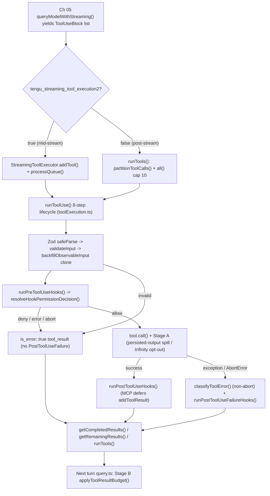

# 6. Executing Tools: Validation, Hooks, Concurrency, and Streaming Execution

> **Status: written.** Reverse-engineered from the Claude Code 2.1.88 source snapshot (see the Prologue (`prologue-how-to-read-a-1900-file-agent.md`) for snapshot caveats).
>
> **Layer:** Layer 2 (The Agent Engine)
> **Prerequisites:** [Chapter 01](ch001-atoms-types-stores-and-primitives.md) (`utils/generators.ts` `all()`), [Chapter 02](ch002-the-tool-contract.md) (`Tool.ts`, `ToolUseContext`, `isConcurrencySafe`, `maxResultSizeChars`), [Chapter 03](ch003-command-and-message-contracts.md) (`utils/messages.ts` `normalizeMessagesForAPI`, `tool_use`/`tool_result` pairing), [Chapter 04](ch004-prompt-engineering-and-cache-boundaries.md) (prompt-cache prefix stability), [Chapter 05](ch005-talking-to-the-model.md) (`queryModelWithStreaming`, `AssistantMessage` / `ToolUseBlock[]`, `FallbackTriggeredError`)
> **Primary Source Files:**
> - `services/tools/toolExecution.ts` — single-tool 8-step lifecycle, streaming progress bridge, error classification, and telemetry (1,745 lines)
> - `services/tools/toolHooks.ts` — `PreToolUse` / `PostToolUse` / `PostToolUseFailure` adapters and hook-vs-rule permission arbitration (650 lines)
> - `services/tools/toolOrchestration.ts` — fail-closed concurrency partitioning, `all()` batching, and block-order `contextModifier` replay (188 lines)
> - `services/tools/StreamingToolExecutor.ts` — mid-stream execution overlapping SSE chunks, 3-level `AbortController` tree, and fallback `discard()` (530 lines)
> - `utils/toolResultStorage.ts` — two-stage `<persisted-output>` spill-to-disk and prompt-cache-safe `ContentReplacementState` budgeting (1,040 lines)

---

## Why This Layer Exists

Once [Chapter 05](ch005-talking-to-the-model.md)'s `queryModelWithStreaming()` yields `AssistantMessage` records containing `ToolUseBlock[]`, executing them looks like a one-liner: `await tool.call(block.input)`. In production, that one-liner breaks in five ways:

1. **Untrusted inputs:** Models invoke deprecated aliases, guess deferred-tool schemas (stringifying arrays and booleans), forge internal fields, or send unexpanded `~` paths that evade hook allowlists.
2. **Policy bypasses:** User `PreToolUse` hooks can approve or rewrite calls, yet hook `allow` must never bypass `settings.json` `deny`/`ask` rules or protected-path safety guards.
3. **Throughput vs. determinism:** Serial reads waste seconds; concurrent edits corrupt files; applying `contextModifier` callbacks in completion order creates timing races.
4. **Streaming overlap & blast radius:** Launching tools mid-stream hides latency, but a failed `Bash` command must cancel sibling commands *without* killing the turn, a user permission rejection *must* abort the turn, and a streaming or model fallback must discard orphaned work.
5. **Context blowup vs. prompt cache:** Giant outputs overflow context, spilling `FileReadTool` creates an infinite `Read` → file → `Read` loop, and recomputing aggregate budgets on older turns mutates wire history and busts the prompt cache.

These five files (`4,153` lines) solve all five problems.

---

## 1. The Single-Tool Lifecycle: From `tool_use` to `tool_result`

### The Problem

One tool invocation spans schema validation, hooks, permissions, and arbitrary I/O while streaming live UI progress and guaranteeing every exit path emits a paired `tool_result` ([Chapter 03](ch003-command-and-message-contracts.md)).

### The Real Implementation (`services/tools/toolExecution.ts`)

Every call enters `runToolUse()` (`services/tools/toolExecution.ts:337-490`) and walks an exact 8-step pipeline:

1. **Lookup & alias-only fallback (`services/tools/toolExecution.ts:343-411`).** Searches `toolUseContext.options.tools` via `findToolByName()` (`Tool.ts:358-360`). If absent, checks `getAllBaseTools()` **only** when `fallbackTool.aliases?.includes(toolName)` (`services/tools/toolExecution.ts:350-356`), rescuing deprecated names like `KillShell` (alias on `TaskStopTool` at `tools/TaskStopTool/TaskStopTool.ts:44`) without bypassing `disallowedTools` for primary tool names. Unknown tools emit an `is_error: true` `<tool_use_error>` and return. Deferred tools remain in `options.tools` and pass Step 1; missing schemas surface in Step 4.
2. **Pre-execution abort check (`services/tools/toolExecution.ts:413-453`).** If `toolUseContext.abortController.signal.aborted` is set, yields `createToolResultStopMessage()` (`utils/messages.ts:622-631`) carrying `withMemoryCorrectionHint(CANCEL_MESSAGE)` (`services/tools/toolExecution.ts:444`, appending a memory hint when auto-memory and GrowthBook `'tengu_amber_prism'` are active at `utils/messages.ts:185-193`) and returns.
3. **Push-to-pull progress bridge (`services/tools/toolExecution.ts:455-570`).** `checkPermissionsAndCallTool()` (`services/tools/toolExecution.ts:599-1745`) returns `Promise<MessageUpdateLazy[]>`, while hooks and `tool.call()` push live progress via `onToolProgress`. `streamedCheckPermissionsAndCallTool()` (`services/tools/toolExecution.ts:492-570`) bridges them with `Stream<MessageUpdateLazy>` (`utils/stream.ts:1-76`), enqueueing each `ProgressMessage` immediately (`services/tools/toolExecution.ts:549-555`) before flushing final results in `.then()` and closing in `.finally()`. An outer `try/catch` (`services/tools/toolExecution.ts:414-489`) catches unexpected escapes into `<tool_use_error>`.
4. **Validation, prefetch & input isolation (`services/tools/toolExecution.ts:614-793`).**
   - **Zod parse + schema hint (`services/tools/toolExecution.ts:615-680`):** `tool.inputSchema.safeParse(input)` formats failures via `formatZodValidationError()` (`utils/toolErrors.ts:66-132`) and calls `buildSchemaNotSentHint()` (`services/tools/toolExecution.ts:578-597`): when `isToolSearchEnabledOptimistic()` (`utils/toolSearch.ts:270-320`; `CLAUDE_CODE_DISABLE_EXPERIMENTAL_BETAS` at `utils/toolSearch.ts:181` inside `getToolSearchMode()` at `utils/toolSearch.ts:172-198`, `ENABLE_TOOL_SEARCH`, and `ANTHROPIC_BASE_URL` parsed in `isFirstPartyAnthropicBaseUrl()` at `utils/model/providers.ts:25-40`), `isToolSearchToolAvailable()`, and `isDeferredTool()` hold and the tool is absent from `extractDiscoveredToolNames(messages)`, it tells the model to call `ToolSearch` with `select:<tool.name>` and retry.
   - **Semantic validation & Bash prefetch (`services/tools/toolExecution.ts:683-752`):** Runs `tool.validateInput?.()` before hooks/permissions, then calls `startSpeculativeClassifierCheck()` (`tools/BashTool/bashPermissions.ts:1497-1527`) for `Bash` commands so allow-classification can overlap `PreToolUse` hooks—gated on `isClassifierPermissionsEnabled()`, an **ANT-ONLY stub hardcoded to `return false`** in this external checkout (`utils/permissions/bashClassifier.ts:1`, `utils/permissions/bashClassifier.ts:24-26`, making the prefetch a no-op here), and explicitly **skipped** when `feature('TRANSCRIPT_CLASSIFIER') && toolPermissionContext.mode === 'auto'` or `toolPermissionContext.mode === 'bypassPermissions'` (`tools/BashTool/bashPermissions.ts:1504-1507`).
   - **`_simulatedSedEdit` strip & `backfillObservableInput` clone (`services/tools/toolExecution.ts:761-793`):** First strips any model-supplied `_simulatedSedEdit` field from `Bash` inputs (`services/tools/toolExecution.ts:761-773`) as defense-in-depth against schema regressions. Then isolates observer normalization on a shallow clone:

```ts
// services/tools/toolExecution.ts:775-793
// Backfill legacy/derived fields on a shallow clone so hooks/canUseTool see
// them without affecting tool.call(). SendMessageTool adds fields; file
// tools overwrite file_path with expandPath — that mutation must not reach
// call() because tool results embed the input path verbatim (e.g. "File
// created successfully at: {path}"), and changing it alters the serialized
// transcript and VCR fixture hashes. If a hook/permission later returns a
// fresh updatedInput, callInput converges on it below — that replacement
// is intentional and should reach call().
let callInput = processedInput
const backfilledClone =
  tool.backfillObservableInput &&
  typeof processedInput === 'object' &&
  processedInput !== null
    ? ({ ...processedInput } as typeof processedInput)
    : null
if (backfilledClone) {
  tool.backfillObservableInput!(backfilledClone as Record<string, unknown>)
  processedInput = backfilledClone
}
```

   File tools expand `~`/relative paths in `backfillObservableInput()` (e.g., `tools/FileReadTool/FileReadTool.ts:388-394`) so hook allowlists see canonical paths, while `callInput` stays pinned to the model's input. Before `tool.call()` (`services/tools/toolExecution.ts:1181-1205`), even if a hook/permission flow returns a fresh object whose `file_path` still matches `backfilledClone.file_path`, Claude Code restores the model's original `file_path` to keep transcript and VCR fixture hashes stable while keeping other hook edits.
5. **`PreToolUse` hooks (`services/tools/toolExecution.ts:795-891`).** Runs `runPreToolUseHooks()` (Section 2), logs debug warnings past `SLOW_PHASE_LOG_THRESHOLD_MS` (`2000` ms at `services/tools/toolExecution.ts:137`), and—gated by `process.env.USER_TYPE === 'ant'`—emits an inline wall-clock timing summary above `HOOK_TIMING_DISPLAY_THRESHOLD_MS` (`500` ms at `services/tools/toolExecution.ts:134`, `services/tools/toolExecution.ts:874-891`) since hooks run in parallel.
6. **Permission reconciliation & `canUseTool` (`services/tools/toolExecution.ts:909-1132`).** Starts OTel spans (attaching `processedInput` JSON only under `isBetaTracingEnabled()`—env vars `ENABLE_BETA_TRACING_DETAILED`, `BETA_TRACING_ENDPOINT`, and for `process.env.USER_TYPE !== 'ant'`, SDK/non-interactive mode via `getIsNonInteractiveSession()` or GrowthBook `'tengu_trace_lantern'` at `utils/telemetry/betaSessionTracing.ts:78-98`), calls `resolveHookPermissionDecision()` (Section 2), and restricts the `>= 2000` ms slow-permission log to `permissionMode === 'auto'` (`services/tools/toolExecution.ts:937-946`) to ignore human think time. On denial (`services/tools/toolExecution.ts:995-1104`), emits a text-only `is_error: true` `tool_result` with any user-pasted rejection images placed as **top-level sibling blocks** (`services/tools/toolExecution.ts:1029-1062`), because the Anthropic API rejects non-text blocks inside `is_error: true` `tool_result`s.
7. **`tool.call()`, single pre-mapping & Stage A spill (`services/tools/toolExecution.ts:1134-1479`).** Guards OTel `toolParameters` behind `isToolDetailsLoggingEnabled()` (`OTEL_LOG_TOOL_DETAILS` at `services/analytics/metadata.ts:86-88`), starts `startSessionActivity('tool_exec')`, runs `tool.call()`, and maps `result.data` **once** via `mapToolResultToToolResultBlockParam()` (`services/tools/toolExecution.ts:1292-1301`) for telemetry size measurement and reuse. Non-MCP tools immediately call `addToolResult(toolOutput, mappedToolResultBlock)` (`services/tools/toolExecution.ts:1403-1479`), invoking Stage A `processPreMappedToolResultBlock()`, appending `acceptFeedback`/images, trimming `toolUseResult` (unless `preserveToolUseResults`) and `mcpMeta` for subagents (`services/tools/toolExecution.ts:1460-1464`), and wrapping `result.contextModifier`.
8. **`PostToolUse` vs. `PostToolUseFailure` hooks (`services/tools/toolExecution.ts:1481-1744`).** Success runs `runPostToolUseHooks()` (with the same `USER_TYPE === 'ant'` `> 500` ms wall-clock summary at `services/tools/toolExecution.ts:1546-1563`), appends `result.newMessages`, and emits `hook_stopped_continuation` if `PreToolUse` set `shouldPreventContinuation` (`services/tools/toolExecution.ts:1572-1582`). Exceptions inside `tool.call()`'s `try` enter `catch (error)` (`services/tools/toolExecution.ts:1589-1737`), transition `McpAuthError` clients to `'needs-auth'`, classify non-abort errors via `classifyToolError()`, and run `runPostToolUseFailureHooks()`. `finally` (`services/tools/toolExecution.ts:1738-1744`) always calls `stopSessionActivity('tool_exec')` and deletes `toolUseContext.toolDecisions?.delete(toolUseID)`.

### Hidden Invariants & Failure Modes

- **Minification-safe error classification (`services/tools/toolExecution.ts:150-171`):** Bundled builds mangle `error.constructor.name` to 3-char tokens (`"nJT"`). `classifyToolError()` checks `TelemetrySafeError`, then Node errno codes (`Error:ENOENT`), and accepts `error.name` only when `error.name.length > 3` (`services/tools/toolExecution.ts:165`), else `'Error'` or `'UnknownError'`.
- **Exact `runPostToolUseFailureHooks` boundary:** Fires **strictly** on `tool.call()`-region exceptions (`services/tools/toolExecution.ts:1589-1737`)—runtime errors (`isInterrupt: false`, including `ShellError` and `McpAuthError`) and mid-execution `AbortError` (`isInterrupt: true`). Never fires on unknown tools (`services/tools/toolExecution.ts:369-411`), pre-execution aborts (`services/tools/toolExecution.ts:415-453`), Zod/`validateInput` failures (`services/tools/toolExecution.ts:615-733`), `PreToolUse` `{ type: 'stop' }` (`services/tools/toolExecution.ts:848-860`), or permission denials (`services/tools/toolExecution.ts:995-1104`). Note that `catch` returns a fresh array `[{ message: createUserMessage(...) }, ...hookMessages]` (`services/tools/toolExecution.ts:1715-1737`), dropping earlier `PreToolUse` attachments in `resultingMessages`.

---

## 2. Hook Arbitration & Permission Handoff

### The Problem

Hooks allow custom linters, secret scanners, and input rewriters, yet an overly permissive `PreToolUse` hook returning `allow` must never become a privilege-escalation vector that overrides `settings.json` `deny` rules, `ask` rules, or sensitive-path guards (`.git/`, `.claude/`, `.vscode/`).

### The Real Implementation (`services/tools/toolHooks.ts`)

`services/tools/toolHooks.ts` bridges `utils/hooks.ts` into four typed lifecycle adapters (containing zero direct `feature()`, `USER_TYPE`, GrowthBook, or env-var gates):

1. **`runPreToolUseHooks()` (`services/tools/toolHooks.ts:435-650`):** Translates `executePreToolHooks()` (`utils/hooks.ts:3394-3436`) results into typed events:
   - `blockingError` (exit code 2 or JSON `decision: "block"`) → `{ type: 'hookPermissionResult', hookPermissionResult: { behavior: 'deny', ... } }` (`services/tools/toolHooks.ts:481-498`).
   - `permissionBehavior` (`'allow' | 'ask' | 'deny'`) → `hookPermissionResult` (with `updatedInput` for `'allow'`/`'ask'`).
   - Passthrough `updatedInput` without `permissionBehavior` → `{ type: 'hookUpdatedInput' }` (`services/tools/toolHooks.ts:558-563`), updating `processedInput` before permission evaluation.
   - `additionalContexts` → `hook_additional_context`; `preventContinuation`/`stopReason` → deferred post-call stop flag; signal abort or thrown hook error → `hook_cancelled`/`hook_error_during_execution` + `{ type: 'stop' }` (`services/tools/toolHooks.ts:582-648`), halting before `canUseTool`.
2. **`resolveHookPermissionDecision()` (`services/tools/toolHooks.ts:332-433`):** Arbitrates hook permission decisions against rule-based permissions and `canUseTool`:

```ts
// services/tools/toolHooks.ts:347-406
if (hookPermissionResult?.behavior === 'allow') {
  const hookInput = hookPermissionResult.updatedInput ?? input
  // ...
  const interactionSatisfied =
    requiresInteraction && hookPermissionResult.updatedInput !== undefined

  if ((requiresInteraction && !interactionSatisfied) || requireCanUseTool) {
    // ...
  }

  // Hook allow skips the interactive prompt, but deny/ask rules still apply.
  const ruleCheck = await checkRuleBasedPermissions(
    tool,
    hookInput,
    toolUseContext,
  )
  if (ruleCheck === null) {
    // ...
    return { decision: hookPermissionResult, input: hookInput }
  }
  if (ruleCheck.behavior === 'deny') {
    // ...
    return { decision: ruleCheck, input: hookInput }
  }
  // ask rule — dialog required despite hook approval
  // ...
}
```

   - **`'allow'`:** Only skips the interactive prompt when `requiresUserInteraction()` is false (or satisfied via `updatedInput`), `requireCanUseTool` is false, **and** `checkRuleBasedPermissions()` (`utils/permissions/permissions.ts:1071-1155`) returns `null`. A `'deny'` rule overrides immediately; an `'ask'` rule or `safetyCheck` sensitive-path guard forces `canUseTool()`.
   - **`'deny'` (`services/tools/toolHooks.ts:408-411`):** Short-circuits `canUseTool()`.
   - **`'ask'` or `undefined` (`services/tools/toolHooks.ts:413-432`):** Passes `forceDecision` on `'ask'` so `canUseTool()` prompts with the hook's message even when allow rules or modes would auto-approve.
3. **Auto-mode `PermissionDenied` hooks (`services/tools/toolExecution.ts:1075-1101`):** Behind compile-time `feature('TRANSCRIPT_CLASSIFIER')`, when the `auto-mode` classifier denies a tool, `executePermissionDeniedHooks()` runs; any `{ retry: true }` appends an `isMeta: true` retry hint.
4. **`runPostToolUseHooks()` & `runPostToolUseFailureHooks()` (`services/tools/toolHooks.ts:39-319`):**
   - Both fix `#31301`: JSON `{ decision: "block" }` hooks yield both `{ blockingError }` and `{ message: hook_blocking_error }`, so both adapters drop `hook_blocking_error` from `result.message` and emit it once from `result.blockingError` (`services/tools/toolHooks.ts:90-115`, `services/tools/toolHooks.ts:245-267`).
   - On `preventContinuation`, `runPostToolUseHooks()` yields `hook_stopped_continuation` and returns early (`services/tools/toolHooks.ts:118-130`).
   - **MCP-only `updatedMCPToolOutput` (`services/tools/toolHooks.ts:146-151`):** Explains the `// TOOD(hackyon)` split at `services/tools/toolExecution.ts:1476`: non-MCP tools run `addToolResult(toolOutput, mappedToolResultBlock)` *before* `PostToolUse` (reusing `processPreMappedToolResultBlock()`), while MCP tools run `PostToolUse` first—buffering hook messages in `hookResults` (`services/tools/toolExecution.ts:1498-1513`)—and then call `addToolResult(toolOutput)` (`services/tools/toolExecution.ts:1540-1542`) so `processToolResultBlock()` maps the possibly rewritten output from scratch before flushing `hookResults` (`services/tools/toolExecution.ts:1585-1587`).

> [!IMPORTANT]
> **The `inc-4788` Security Invariant (`services/tools/toolHooks.ts:324-325`, `services/tools/toolHooks.ts:372-405`):** A `PreToolUse` `allow` hook can **never** bypass settings `deny` rules, `ask` rules, `safetyCheck` sensitive-path guards, `requireCanUseTool`, or unsatisfied `requiresUserInteraction()` tools.

### Explicit Forward Seams

- **[Chapter 11](ch011-the-permission-engine.md):** `CanUseToolFn` (`hooks/useCanUseTool.tsx:27`), `PermissionDecision`/`PermissionResult` (`types/permissions.ts:174-324`), and `checkRuleBasedPermissions()` steps 1a–1d and 1f–1g (`utils/permissions/permissions.ts:1069-1156`; step 1e is pre-checked by `resolveHookPermissionDecision()`).
- **Chapter 13 (The Hook System):** Hook execution backends (`utils/hooks.ts:3394-3562`), multi-hook `deny > ask > allow` aggregation (`utils/hooks.ts:2820-2847`), and `suppressOutput` filtering (`utils/hooks.ts:2557-2596`).

---

## 3. Batch Orchestration: Partitioning Concurrency & Context Modifiers

### The Problem

An assistant turn emitting `[Read1, Read2, Edit1, Read3, Bash1, Bash2]` needs parallel reads without overlapping mutations. Worse, racing concurrent async generators delivers updates in completion order—eagerly applying `contextModifier` callbacks (`Tool.ts:329-330`) as tools finish would make `ToolUseContext` depend on I/O timing.

### The Real Implementation (`services/tools/toolOrchestration.ts`)

1. **Fail-closed partitioning (`partitionToolCalls()`, `services/tools/toolOrchestration.ts:91-116`):**

```ts
// services/tools/toolOrchestration.ts:91-116
function partitionToolCalls(
  toolUseMessages: ToolUseBlock[],
  toolUseContext: ToolUseContext,
): Batch[] {
  return toolUseMessages.reduce((acc: Batch[], toolUse) => {
    const tool = findToolByName(toolUseContext.options.tools, toolUse.name)
    const parsedInput = tool?.inputSchema.safeParse(toolUse.input)
    const isConcurrencySafe = parsedInput?.success
      ? (() => {
          try {
            return Boolean(tool?.isConcurrencySafe(parsedInput.data))
          } catch {
            // If isConcurrencySafe throws (e.g., due to shell-quote parse failure),
            // treat as not concurrency-safe to be conservative
            return false
          }
        })()
      : false
    if (isConcurrencySafe && acc[acc.length - 1]?.isConcurrencySafe) {
      acc[acc.length - 1]!.blocks.push(toolUse)
    } else {
      acc.push({ isConcurrencySafe, blocks: [toolUse] })
    }
    return acc
  }, [])
}
```

   Unknown tools, invalid Zod inputs, and throwing `isConcurrencySafe()` predicates all fail closed to `false`, isolating each unsafe call into a singleton serial batch while coalescing contiguous safe calls and preserving relative order (`[concurrent(Read1, Read2), serial(Edit1), concurrent(Read3), serial(Bash1), serial(Bash2)]`).
2. **Bounded concurrency via `all()` (`services/tools/toolOrchestration.ts:8-12`, `services/tools/toolOrchestration.ts:152-177`):** `runToolsConcurrently()` tracks `setInProgressToolUseIDs` and feeds per-tool `runToolUse()` generators into [Chapter 01](ch001-atoms-types-stores-and-primitives.md)'s `all()` (`utils/generators.ts:32-72`), capped by `getMaxToolUseConcurrency()`: `parseInt(process.env.CLAUDE_CODE_MAX_TOOL_USE_CONCURRENCY || '', 10) || 10`. Note honestly: there is no upper/lower clamp beyond `|| 10`—unset, `0`, or `NaN` fall back to `10`, positive integers pass through unbounded, and a negative integer like `'-1'` is truthy and would starve `all()`'s fill loop (`utils/generators.ts:51`).
3. **Deterministic block-order modifier replay (`services/tools/toolOrchestration.ts:30-80`):** During a concurrent batch (`services/tools/toolOrchestration.ts:31-63`), all tools share the pre-batch `currentContext`; any `update.contextModifier` is buffered in `queuedContextModifiers[toolUseID]` while messages yield with untouched `currentContext`. After the batch finishes, `services/tools/toolOrchestration.ts:54-63` replays `queuedContextModifiers[block.id]` in **original `blocks` order** and yields `{ newContext: currentContext }`. Serial batches (`runToolsSerially()`, `services/tools/toolOrchestration.ts:118-150`) apply each modifier immediately (`services/tools/toolOrchestration.ts:140-142`). Today, `tools/SkillTool/SkillTool.ts:775-839` (`allowedTools`, `mainLoopModel`, and `effortValue`, inheriting fail-closed `isConcurrencySafe: false`) is the sole `contextModifier` producer in this checkout.

---

## 4. Executing While the Model Still Talks: `StreamingToolExecutor`

### The Problem

Waiting for stream completion before launching tools leaves I/O idle while the model streams prose. Executing mid-stream requires three guarantees: serial tools must still block concurrent execution, parallel `Bash` failures must cancel sibling commands *without* killing the turn while permission rejections *must* end the turn, and streaming/model fallbacks must cleanly discard orphaned work.

### The Real Implementation (`services/tools/StreamingToolExecutor.ts`)

Enabled by GrowthBook gate `'tengu_streaming_tool_execution2'` (`query/config.ts:33-35`), `StreamingToolExecutor` (`services/tools/StreamingToolExecutor.ts:40-530`) tracks each tool through `'queued' | 'executing' | 'completed' | 'yielded'` (`services/tools/StreamingToolExecutor.ts:19-32`):

- **Admission & serial barrier (`services/tools/StreamingToolExecutor.ts:76-151`):** `query.ts:842` calls `addTool(block, message)` mid-stream. Unknown tools become `'completed'` immediately with `<tool_use_error>` (`services/tools/StreamingToolExecutor.ts:78-102`). Known tools run fail-closed `safeParse` + `isConcurrencySafe()`, enqueue, and invoke `processQueue()`. `canExecuteTool()` (`services/tools/StreamingToolExecutor.ts:129-135`) enforces exclusive access for unsafe tools; inside `processQueue()`, `if (!tool.isConcurrencySafe) break` (`services/tools/StreamingToolExecutor.ts:148`) prevents later safe tools from leapfrogging a waiting mutator.
- **Progress wake-up & draining (`services/tools/StreamingToolExecutor.ts:412-490`):** Mid-stream `getCompletedResults()` drains synchronously; post-stream `getRemainingResults()` races active tool promises against a `progressPromise` woken by `progressAvailableResolve` (`services/tools/StreamingToolExecutor.ts:371-374`, `services/tools/StreamingToolExecutor.ts:467-484`) so live progress streams immediately.
- **3-level `AbortController` tree (`utils/abortController.ts:68-99`):** `createChildAbortController()` links parent→child via `WeakRef` + `{ once: true }` for **downward-only** cascades:

```text
toolUseContext.abortController            (Level 1: turn-scoped, query.ts)
  │  downward WeakRef cascade               ▲  upward bubble-up ONLY if
  ▼                                         │  reason !== 'sibling_error'
this.siblingAbortController               (Level 2: batch-scoped, Bash cancel)
  │  downward WeakRef cascade               │  && !parent.aborted
  ▼                                         │  && !this.discarded
toolAbortController (per tool) ─────────────┘  (Level 3: passed to runToolUse)
```

`executeTool()` wires Level 3 (`services/tools/StreamingToolExecutor.ts:294-325`):

```ts
// services/tools/StreamingToolExecutor.ts:294-325
// Per-tool child controller. Lets siblingAbortController kill running
// subprocesses (Bash spawns listen to this signal) when a Bash error
// cascades. Permission-dialog rejection also aborts this controller
// (PermissionContext.ts cancelAndAbort) — that abort must bubble up to
// the query controller so the query loop's post-tool abort check ends
// the turn. Without bubble-up, ExitPlanMode "clear context + auto"
// sends REJECT_MESSAGE to the model instead of aborting (#21056 regression).
const toolAbortController = createChildAbortController(
  this.siblingAbortController,
)
toolAbortController.signal.addEventListener(
  'abort',
  () => {
    if (
      toolAbortController.signal.reason !== 'sibling_error' &&
      !this.toolUseContext.abortController.signal.aborted &&
      !this.discarded
    ) {
      this.toolUseContext.abortController.abort(
        toolAbortController.signal.reason,
      )
    }
  },
  { once: true },
)

const generator = runToolUse(
  tool.block,
  tool.assistantMessage,
  this.canUseTool,
  { ...this.toolUseContext, abortController: toolAbortController },
)
```

And handles errors and `contextModifier`s on completion (`services/tools/StreamingToolExecutor.ts:354-395`):

```ts
// services/tools/StreamingToolExecutor.ts:354-395
  if (isErrorResult) {
    thisToolErrored = true
    // Only Bash errors cancel siblings. Bash commands often have implicit
    // dependency chains (e.g. mkdir fails → subsequent commands pointless).
    // Read/WebFetch/etc are independent — one failure shouldn't nuke the rest.
    if (tool.block.name === BASH_TOOL_NAME) {
      this.hasErrored = true
      this.erroredToolDescription = this.getToolDescription(tool)
      this.siblingAbortController.abort('sibling_error')
    }
  }
// ...
// NOTE: we currently don't support context modifiers for concurrent
//       tools. None are actively being used, but if we want to use
//       them in concurrent tools, we need to support that here.
if (!tool.isConcurrencySafe && contextModifiers.length > 0) {
  for (const modifier of contextModifiers) {
    this.toolUseContext = modifier(this.toolUseContext)
  }
}
```

- **Why the asymmetry works:** `siblingAbortController.abort('sibling_error')` kills sibling `Bash` subprocesses without triggering the upward bubble-up, keeping `toolUseContext.abortController` un-aborted so `query.ts:1485` returns the error and synthetic sibling cancellations to the model. Permission-dialog rejection (`hooks/toolPermission/PermissionContext.ts:154-173`, `cancelAndAbort`) aborts `toolAbortController` with a non-`'sibling_error'` reason, bubbling up to Level 1 to end the turn (`#21056 regression`).
- **Interrupts, synthetic pairing & `discard()`:** `getAbortReason()` (`services/tools/StreamingToolExecutor.ts:210-231`) checks `discarded` → `hasErrored` → parent abort; on submit-interrupt (`reason === 'interrupt'`), only tools whose `interruptBehavior()` returns `'cancel'` (`Tool.ts:407-416`, fail-safe `'block'` at `services/tools/StreamingToolExecutor.ts:235`) cancel. `createSyntheticErrorMessage()` (`services/tools/StreamingToolExecutor.ts:153-205`, using `withMemoryCorrectionHint(REJECT_MESSAGE)` transitively behind GrowthBook `'tengu_amber_prism'`) guarantees valid `tool_result` pairing ([Chapter 03](ch003-command-and-message-contracts.md)). On streaming-to-non-streaming fallback (`query.ts:733-740`, triggered from `services/api/claude.ts:2509-2511` and `services/api/claude.ts:2629-2631`) and `FallbackTriggeredError` (`query.ts:912-919`), `query.ts` calls `discard()` (`services/tools/StreamingToolExecutor.ts:69-71`), which drops future yields and blocks orphaned bubble-up via `!this.discarded`.

> [!WARNING]
> **Four Real-Code Caveats in `StreamingToolExecutor.ts`:**
> 1. **Completion order across safe tools (`services/tools/StreamingToolExecutor.ts:436`):** Despite the docstring (`services/tools/StreamingToolExecutor.ts:38`), `getCompletedResults()` only `break`s on `tool.status === 'executing' && !tool.isConcurrencySafe`. Unsafe tools are strict barriers and `pendingProgress` yields immediately, but concurrent safe tools yield in **completion order**.
> 2. **No concurrency cap:** `CLAUDE_CODE_MAX_TOOL_USE_CONCURRENCY` is never consulted here.
> 3. **Passive `discard()` (`services/tools/StreamingToolExecutor.ts:69-71`):** Sets `this.discarded = true` without aborting `siblingAbortController`; running subprocesses stop on their next yield or exit (with output dropped).
> 4. **Serial-only `contextModifier` & uncalled `getUpdatedContext()`:** `services/tools/StreamingToolExecutor.ts:388-395` skips modifiers on safe tools (matching `Tool.ts:329-330` and serial `SkillTool`), and `getUpdatedContext()` (`services/tools/StreamingToolExecutor.ts:516-518`) has zero callers—`query.ts:1402-1407` relies solely on `update.newContext` from `getRemainingResults()`, while mid-stream `query.ts:851-861` does not copy `result.newContext`.

---

## 5. Two-Stage Result Persistence & Cache-Safe Budgeting

### The Problem

Naive output capping breaks in three ways: spilling `FileReadTool` to disk traps the model in an infinite `Read` → file → `Read` cycle; ten parallel 40K tools slip past a 50K per-tool cap to form a 400K wire message (`constants/toolLimits.ts:43-44`); and re-evaluating an aggregate budget on historical turns mutates wire bytes and busts the prompt cache ([Chapter 04](ch004-prompt-engineering-and-cache-boundaries.md)).

### The Real Implementation (`utils/toolResultStorage.ts`)

#### Stage A — Per-Tool Spill at Execution Time (`utils/toolResultStorage.ts:55-365`)

Called from `services/tools/toolExecution.ts:1409-1415` (`processPreMappedToolResultBlock()` for non-MCP; `processToolResultBlock()` for MCP after `PostToolUse`). Both resolve thresholds via `getPersistenceThreshold()` (`utils/toolResultStorage.ts:55-78`):

```ts
// utils/toolResultStorage.ts:55-78
export function getPersistenceThreshold(
  toolName: string,
  declaredMaxResultSizeChars: number,
): number {
  // Infinity = hard opt-out. Read self-bounds via maxTokens; persisting its
  // output to a file the model reads back with Read is circular. Checked
  // before the GB override so tengu_satin_quoll can't force it back on.
  if (!Number.isFinite(declaredMaxResultSizeChars)) {
    return declaredMaxResultSizeChars
  }
  const overrides = getFeatureValue_CACHED_MAY_BE_STALE<Record<
    string,
    number
  > | null>(PERSIST_THRESHOLD_OVERRIDE_FLAG, {})
  const override = overrides?.[toolName]
  if (
    typeof override === 'number' &&
    Number.isFinite(override) &&
    override > 0
  ) {
    return override
  }
  return Math.min(declaredMaxResultSizeChars, DEFAULT_MAX_RESULT_SIZE_CHARS)
}
```

Checking `!Number.isFinite` **before** GrowthBook `'tengu_satin_quoll'` (`utils/toolResultStorage.ts:43`) guarantees a remote flag can never force `FileReadTool`—the sole `maxResultSizeChars: Infinity` tool (`tools/FileReadTool/FileReadTool.ts:342`, self-bounded by `DEFAULT_MAX_OUTPUT_TOKENS = 25000` in `tools/FileReadTool/limits.ts:18`, env var `CLAUDE_CODE_FILE_READ_MAX_OUTPUT_TOKENS` at `tools/FileReadTool/limits.ts:25`)—into a circular spill loop. Finite declarations clamp to `DEFAULT_MAX_RESULT_SIZE_CHARS = 50_000` (`constants/toolLimits.ts:13`) while keeping lower caps (`BashTool`/`PowerShellTool` `30_000`, `GrepTool` `20_000`).

Four scars shape `maybePersistLargeToolResult()` (`utils/toolResultStorage.ts:272-334`) and `persistToolResult()` (`utils/toolResultStorage.ts:137-184`):
- **`inc-4586` empty-result guard (`utils/toolResultStorage.ts:280-295`):** Bare `</function_results>\n\n` at the prompt tail caused `capybara` to emit `\n\nHuman:` and end its turn empty; empty results become `(${toolName} completed with no output)`.
- **Image bypass & non-text fail-open (`utils/toolResultStorage.ts:144-151`, `utils/toolResultStorage.ts:302-319`):** Image blocks pass untouched; arrays with non-`text` blocks fail persistence and fail open.
- **`flag: 'wx'` & `EEXIST` idempotency (`utils/toolResultStorage.ts:153-183`):** Writes `<projectDir>/<sessionId>/tool-results/<toolUseId>.(txt|json)` exclusively with `flag: 'wx'`, avoiding stat-then-write races and treating `EEXIST` as an idempotent hit on microcompact replay.
- **Line-snapped preview (`utils/toolResultStorage.ts:189-199`, `utils/toolResultStorage.ts:339-356`):** `generatePreview()` slices `PREVIEW_SIZE_BYTES = 2000` chars (`utils/toolResultStorage.ts:109`), snapping back to `lastNewline` only if `> maxBytes * 0.5`, then wraps size, path, and preview inside `<persisted-output>` ... `</persisted-output>`.

#### Stage B — Per-Message Aggregate Budget & Cache Invariance (`utils/toolResultStorage.ts:367-1012`)

Invoked at the top of `query.ts` (`query.ts:376-394`) via `applyToolResultBudget()`, gated by GrowthBook master kill-switch `'tengu_hawthorn_steeple'` (default `false` in `provisionContentReplacementState()`, `utils/toolResultStorage.ts:447-463`) and window override `'tengu_hawthorn_window'` (default `MAX_TOOL_RESULTS_PER_MESSAGE_CHARS = 200_000` at `constants/toolLimits.ts:49`, `utils/toolResultStorage.ts:421-434`).

`ContentReplacementState` (`utils/toolResultStorage.ts:390-393`) freezes every decision in `seenIds: Set<string>` and stores exact `<persisted-output>` strings in `replacements: Map<string, string>` for zero-I/O, byte-identical replay. `collectCandidatesByMessage()` (`utils/toolResultStorage.ts:600-639`) mirrors [Chapter 03](ch003-command-and-message-contracts.md)'s `normalizeMessagesForAPI()`—flushing groups only on unseen assistant `message.id` (`seenAsstIds`, `utils/toolResultStorage.ts:623-632`) and matching compacted blocks via `.startsWith('<persisted-output>')` (`utils/toolResultStorage.ts:498-505`) so reading `utils/toolResultStorage.ts` itself is never misclassified. `enforceToolResultBudget()` (`utils/toolResultStorage.ts:769-909`) repeats the `Infinity` skip (`query.ts:389-393`) and enforces atomic state updates:

```ts
// utils/toolResultStorage.ts:816-846
    // Tools with maxResultSizeChars: Infinity (Read) — never persist.
    // Mark as seen (frozen) so the decision sticks across turns. They don't
    // count toward freshSize; if that lets the group slip under budget and
    // the wire message is still large, that's the contract — Read's own
    // maxTokens is the bound, not this wrapper.
    const skipped = fresh.filter(c => shouldSkip(c.toolUseId))
    skipped.forEach(c => state.seenIds.add(c.toolUseId))
    const eligible = fresh.filter(c => !shouldSkip(c.toolUseId))

    const frozenSize = frozen.reduce((sum, c) => sum + c.size, 0)
    const freshSize = eligible.reduce((sum, c) => sum + c.size, 0)

    const selected =
      frozenSize + freshSize > limit
        ? selectFreshToReplace(eligible, frozenSize, limit)
        : []

    // Mark non-persisting candidates as seen NOW (synchronously). IDs
    // selected for persist are marked seen AFTER the await, alongside
    // replacements.set — keeps the pair atomic under observation so no
    // concurrent reader (once subagents share state) ever sees X∈seenIds
    // but X∉replacements, which would misclassify X as frozen and send
    // full content while the main thread sends the preview → cache miss.
    const selectedIds = new Set(selected.map(c => c.toolUseId))
    candidates
      .filter(c => !selectedIds.has(c.toolUseId))
      .forEach(c => state.seenIds.add(c.toolUseId))

    if (selected.length === 0) continue
    messagesOverBudget++
    toPersist.push(...selected)
```

Selected blocks are chosen largest-first (`selectFreshToReplace()`, `utils/toolResultStorage.ts:675-692`), persisted concurrently via `Promise.all()`, and committed to `seenIds` + `replacements` **together post-await** (`utils/toolResultStorage.ts:855-869`). Cache-sharing forks call `cloneContentReplacementState()` (`utils/forkedAgent.ts:399-403`, `utils/toolResultStorage.ts:405-412`); resumable transcripts (`agent:*`, `repl_main_thread*`) persist records via `recordContentReplacement()` (`utils/sessionStorage.ts:1494-1499`) and rebuild state on resume via `reconstructContentReplacementState()` (`screens/REPL.tsx:1924`, `utils/toolResultStorage.ts:960-988`) and `reconstructForSubagentResume()` (`tools/AgentTool/resumeAgent.ts:75-79`, `utils/toolResultStorage.ts:1001-1012`).

---

## Putting the Layer Together



> [!NOTE]
> **Snapshot Absences & Comment-Only Flag Mentions:** All five primary files import message types from `types/message.ts` (`services/tools/toolExecution.ts:53-59`, `services/tools/toolHooks.ts:10-14`, `services/tools/toolOrchestration.ts:4`, `services/tools/StreamingToolExecutor.ts:10`, `utils/toolResultStorage.ts:18`), which is **absent from this snapshot**—all `Message` fields above are observed from call sites only. Likewise, `services/tools/toolHooks.ts:329-330` mentions `REPLTool/toolWrappers.ts` (`tools/REPLTool/toolWrappers.ts`) only in JSDoc; that file is **absent from this snapshot** (`services/tools/toolExecution.ts` is the sole caller present). Finally, `utils/toolResultStorage.ts:997-999` cites `feature('TRANSCRIPT_CLASSIFIER')` strictly inside a comment explaining `AgentTool.tsx`'s DCE complexity cliff—it is **not** an executed gate in `utils/toolResultStorage.ts`.

---

## How This Snaps Into the Next Layer

Every mechanism in this chapter snaps directly into `query.ts` in [Chapter 07](ch007-the-heartbeat-query-loop.md):

1. **Pre-API Stage B budget (`query.ts:379-394`):** Runs `applyToolResultBudget()` with `toolUseContext.contentReplacementState` and the `!Number.isFinite(t.maxResultSizeChars)` opt-out set.
2. **Mid-stream bridge & fallback resets (`query.ts:561-568`, `query.ts:733-740`, `query.ts:826-862`, `query.ts:912-919`):** Under `config.gates.streamingToolExecution` (`query/config.ts:33-35`), `query.ts` feeds `ToolUseBlock`s into `StreamingToolExecutor.addTool()`, drains `getCompletedResults()` mid-stream, and calls `discard()` + swaps in a fresh executor on streaming fallback or `FallbackTriggeredError`.
3. **Post-stream drain, hook stop & next turn (`query.ts:1380-1408`, `query.ts:1485-1521`, `query.ts:1715-1727`):** Drains `getRemainingResults()` or calls `runTools()`, sets `shouldPreventContinuation` on `hook_stopped_continuation` (`query.ts:1388-1393`), carries `update.newContext` into `updatedToolUseContext` (`query.ts:1402-1407`), checks `toolUseContext.abortController.signal.aborted` (`query.ts:1485-1516`), and loops `[...messagesForQuery, ...assistantMessages, ...toolResults]` with `updatedToolUseContext` into the next turn.

Downstream seams continue in [Chapter 09](ch009-five-layer-compaction-pipeline.md) (compaction Stages 2–5 after `applyToolResultBudget()`), [Chapter 11](ch011-the-permission-engine.md) (`canUseTool` and `checkRuleBasedPermissions()`), and **Chapter 13 (The Hook System)** (`utils/hooks.ts`).

---

## Reading Exercises & Code Checkpoints

1. **Audit the `inc-4788` hook-vs-rule permission boundary:**
   ```sh
   rg -n "checkRuleBasedPermissions|requiresUserInteraction|forceDecision" services/tools/toolHooks.ts
   ```
   Trace all three branches in `resolveHookPermissionDecision()` (`services/tools/toolHooks.ts:332-433`) and verify which combinations of hook `allow` + `updatedInput` still invoke `canUseTool()`.
2. **Verify concurrency partitioning and block-order `contextModifier` replay:**
   ```sh
   rg -n "partitionToolCalls|queuedContextModifiers|CLAUDE_CODE_MAX_TOOL_USE_CONCURRENCY" services/tools/toolOrchestration.ts
   ```
   Trace how `runTools()` (`services/tools/toolOrchestration.ts:19-82`) handles `[Read, Read, Skill, Read]`, and explain what happens when `CLAUDE_CODE_MAX_TOOL_USE_CONCURRENCY` is `'0'` versus `'-1'`.
3. **Inspect the 3-level `AbortController` tree and real-code caveats in `StreamingToolExecutor`:**
   ```sh
   rg -n "createChildAbortController|siblingAbortController|BASH_TOOL_NAME|sibling_error|isConcurrencySafe && contextModifiers" services/tools/StreamingToolExecutor.ts
   ```
   Cross-reference `services/tools/StreamingToolExecutor.ts:304-318` and `services/tools/StreamingToolExecutor.ts:359-363` with `query.ts:1485-1516` to see why a failed `Bash` command keeps the turn alive while a permission rejection aborts it.
4. **Trace `maxResultSizeChars: Infinity` and all three GrowthBook gates across Stages A and B:**
   ```sh
   rg -n "Number\.isFinite|maxResultSizeChars: Infinity|tengu_(satin_quoll|hawthorn_)" utils/toolResultStorage.ts tools/FileReadTool/FileReadTool.ts query.ts
   ```
   Verify why `!Number.isFinite` is checked in both `getPersistenceThreshold()` (`utils/toolResultStorage.ts:62`) and `query.ts:391`, and trace what happens when `'tengu_hawthorn_steeple'` is `false`.
