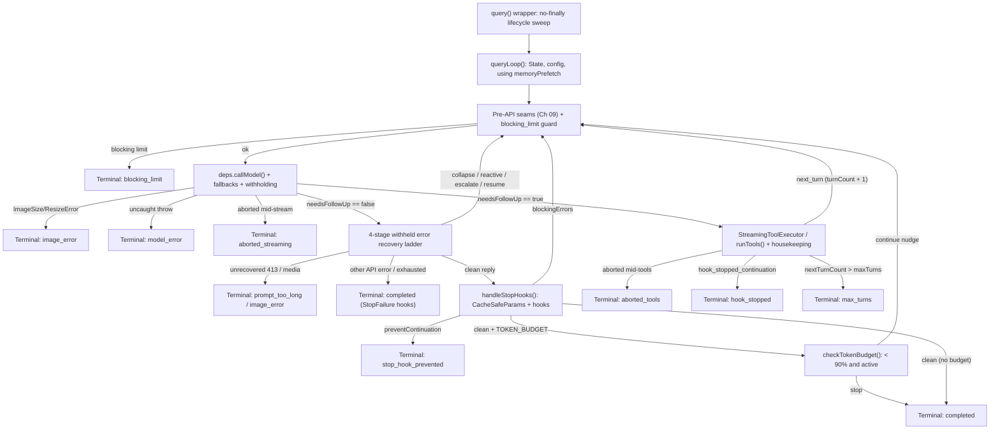

# 7. The Heartbeat: `query.ts` and the Agentic Turn State Machine

> **Status: written.** Reverse-engineered from the Claude Code 2.1.88 source snapshot (see the Prologue (`prologue-how-to-read-a-1900-file-agent.md`) for snapshot caveats).
>
> **Layer:** Layer 2 (The Agent Engine)
> **Prerequisites:** [Chapter 01](ch001-atoms-types-stores-and-primitives.md), [Chapter 02](ch002-the-tool-contract.md), [Chapter 03](ch003-command-and-message-contracts.md), [Chapter 04](ch004-prompt-engineering-and-cache-boundaries.md), [Chapter 05](ch005-talking-to-the-model.md), [Chapter 06](ch006-executing-tools.md)
> **Primary Source Files:**
> - `query.ts` — `query()` wrapper and `queryLoop()` single-turn, multi-step `AsyncGenerator` state machine (1,729 lines)
> - `query/config.ts` — `QueryConfig` and `buildQueryConfig()` immutable per-turn runtime gate snapshot (46 lines)
> - `query/deps.ts` — `QueryDeps` and `productionDeps()` narrow I/O dependency injection seam (40 lines)
> - `query/stopHooks.ts` — `handleStopHooks()` end-of-turn hooks, `CacheSafeParams` snapshot, and background forks (473 lines)
> - `query/tokenBudget.ts` — `BudgetTracker`, `createBudgetTracker()`, and `checkTokenBudget()` auto-continue guard (93 lines)
> - `query/transitions.ts` *(absent from this snapshot — `Continue` and `Terminal` unions are reconstructed verbatim from `query.ts` call sites only)*

---

## Why This Layer Exists

[Chapter 06](ch006-executing-tools.md) delivered the tool primitives: `applyToolResultBudget()`, `StreamingToolExecutor`, and `runTools()`. Earlier chapters built normalized messages ([Chapter 03](ch003-command-and-message-contracts.md)), cache-stable prompts ([Chapter 04](ch004-prompt-engineering-and-cache-boundaries.md)), and streaming model I/O with `FallbackTriggeredError` ([Chapter 05](ch005-talking-to-the-model.md)).

`query.ts` and its four `query/` companions (`2,381` lines total) stitch those pieces into a single-turn, multi-step `AsyncGenerator` state machine. One prompt can span ten model calls, overlapped tools, mid-stream fallbacks, silent overflow or truncation recovery, and stop-hook or budget continuations—driving every REPL turn, SDK request, subagent, fork, background task, and agent hook.

---

## 1. The Wrapper, the Flat State Machine, and Absent `query/transitions.ts`

### The Problem

An early agent loop starts as a recursive `AsyncGenerator`: call the model, run tools, `yield* query(next)`. At scale, recursion retains O(turns) nested frames holding stale `messagesForQuery` arrays, complicates one-time setup, and scatters flag resets across closures.

### The Mechanism: `QueryParams`, No-`finally` `query()`, and Whole-Object `State`

`QueryParams` (`query.ts:181-199`) defines 13 fields: 7 required (`messages`, `systemPrompt`, `userContext`, `systemContext`, `canUseTool`, `toolUseContext`, `querySource`) and 6 optional (`fallbackModel`, `maxOutputTokensOverride`, `maxTurns`, `skipCacheWrite`, `taskBudget`, `deps`). Notably, `abortController` lives on `toolUseContext`, and queued commands live in `utils/messageQueueManager.ts:525-547`.

Cross-iteration state lives in a 10-field `State` record (`query.ts:204-217`), wrapped by the public `query()` entrypoint (`query.ts:219-239`):

```ts
// query.ts:204-217
type State = {
  messages: Message[]
  toolUseContext: ToolUseContext
  autoCompactTracking: AutoCompactTrackingState | undefined
  maxOutputTokensRecoveryCount: number
  hasAttemptedReactiveCompact: boolean
  maxOutputTokensOverride: number | undefined
  pendingToolUseSummary: Promise<ToolUseSummaryMessage | null> | undefined
  stopHookActive: boolean | undefined
  turnCount: number
  // Why the previous iteration continued. Undefined on first iteration.
  // Lets tests assert recovery paths fired without inspecting message contents.
  transition: Continue | undefined
}
```

```ts
// query.ts:219-239
export async function* query(
  params: QueryParams,
): AsyncGenerator<
  | StreamEvent
  | RequestStartEvent
  | Message
  | TombstoneMessage
  | ToolUseSummaryMessage,
  Terminal
> {
  const consumedCommandUuids: string[] = []
  const terminal = yield* queryLoop(params, consumedCommandUuids)
  // Only reached if queryLoop returned normally. Skipped on throw (error
  // propagates through yield*) and on .return() (Return completion closes
  // both generators). This gives the same asymmetric started-without-completed
  // signal as print.ts's drainCommandQueue when the turn fails.
  for (const uuid of consumedCommandUuids) {
    notifyCommandLifecycle(uuid, 'completed')
  }
  return terminal
}
```

At `query.ts:229-238`, there is **deliberately no `finally` block**. Mid-turn consumed commands push their UUIDs into `consumedCommandUuids` and emit `notifyCommandLifecycle(cmd.uuid, 'started')` (`query.ts:1632-1643`). Omitting `finally` fires `'completed'` only on a normal `Terminal` return; throws or `.return()` closes preserve the asymmetric `started`-without-`completed` failure signal from `cli/print.ts:2006-2008` and `cli/print.ts:2248-2250`.

Contrast that with `using pendingMemoryPrefetch = startRelevantMemoryPrefetch(...)` (`query.ts:301-304`): TC39 `using` invokes `[Symbol.dispose]()` (`utils/attachments.ts:2410-2418`) on **every** exit path (`return`, `throw`, `.return()`), aborting prefetches across all 12 `return` sites automatically.

`queryLoop()` (`query.ts:241-1729`) runs a flat `while (true)` loop (`query.ts:307-1728`) retaining recursion fossils (`query.ts:1411`, `query.ts:1678`, `queryCheckpoint('query_recursive_call')` at `query.ts:1714`). Each iteration destructures `State` (`query.ts:311-321`), reassigning only `toolUseContext` mid-iteration (`query.ts:360`, `query.ts:546`) and omitting `transition`.

Every `continue` writes a full `State` literal with no `{ ...state }` spread (`state = next` at six sites; direct literal at `query.ts:1321`), forcing explicit reset choices on all 10 fields. Five bindings stay off `State` (`query.ts:243`, `query.ts:280-304`): `consumedCommandUuids`, `budgetTracker`, `taskBudgetRemaining` (kept loop-local at `query.ts:289-291`), `config`, and `using pendingMemoryPrefetch`.

### Reconstructing Snapshot-Absent `query/transitions.ts` from Call Sites

`query.ts:104` executes `import type { Terminal, Continue } from './query/transitions.js'`, the sole code import in the repo. `query/transitions.ts` is **absent from this snapshot**. Every variant below is observed directly at `query.ts`'s 7 `transition` writes and 12 `return` sites; any unused union members or helper guards in the absent file are unobservable here.

| # | `Continue` literal (`query.ts` lines) | Trigger & key `State` updates |
|---:|---|---|
| 1 | `{ reason: 'collapse_drain_retry', committed }` (`query.ts:1109-1112`) | `feature('CONTEXT_COLLAPSE')` PTL drain (`committed > 0`); `turnCount` unchanged |
| 2 | `{ reason: 'reactive_compact_retry' }` (`query.ts:1162`) | `feature('REACTIVE_COMPACT')` PTL/media compact; latches `hasAttemptedReactiveCompact: true`, resets `autoCompactTracking` |
| 3 | `{ reason: 'max_output_tokens_escalate' }` (`query.ts:1217`) | `'tengu_otk_slot_v1'` 8k-to-64k clean retry; sets `maxOutputTokensOverride: ESCALATED_MAX_TOKENS` |
| 4 | `{ reason: 'max_output_tokens_recovery', attempt }` (`query.ts:1245-1248`) | Truncation nudge (`attempt` 1..3); increments `maxOutputTokensRecoveryCount`, clears `maxOutputTokensOverride` |
| 5 | `{ reason: 'stop_hook_blocking' }` (`query.ts:1302`) | Stop/teammate hook blocking errors; sets `stopHookActive: true`, preserves `hasAttemptedReactiveCompact` |
| 6 | `{ reason: 'token_budget_continuation' }` (`query.ts:1338`) | `feature('TOKEN_BUDGET')` under 90%; resets `hasAttemptedReactiveCompact: false` and `stopHookActive: undefined` |
| 7 | `{ reason: 'next_turn' }` (`query.ts:1725`) | Tools done; **sole site incrementing `turnCount`** (`turnCount + 1`), preserves `stopHookActive` |

All 10 `Terminal` variants appear across 12 `return` sites in `queryLoop()` (line `1175` uses a ternary across two variants, while `'image_error'`, `'prompt_too_long'`, and `'completed'` each have two sites):

| Variant (`Terminal.reason`) | Return line(s) in `query.ts` | Exit condition & payload |
|---|---|---|
| `'blocking_limit'` | `query.ts:646` | Pre-API hard token limit (skipped when compact/collapse/reactive owns recovery) |
| `'image_error'` | `query.ts:977`, `query.ts:1175` | `ImageSizeError`/`ImageResizeError` throw, or unrecovered withheld media error (`query.ts:1175` ternary) |
| `'model_error'` | `query.ts:996` | Uncaught `callModel` throw (carries `error`); pairs missing `tool_result`s first |
| `'aborted_streaming'` | `query.ts:1051` | Signal aborted after stream; drains executor or emits cancelled `tool_result`s |
| `'prompt_too_long'` | `query.ts:1175`, `query.ts:1182` | Unrecovered withheld 413 after `reactiveCompact` (`query.ts:1175` ternary) or `CONTEXT_COLLAPSE`-only fallback |
| `'completed'` | `query.ts:1264`, `query.ts:1357` | Unrecovered API error bailout (`query.ts:1264`) or normal turn end (`query.ts:1357`) |
| `'stop_hook_prevented'` | `query.ts:1279` | `handleStopHooks()` returned `preventContinuation: true` (or aborted mid-hook) |
| `'aborted_tools'` | `query.ts:1515` | Signal aborted after tool drain; mirrors `maxTurns` attachment check |
| `'hook_stopped'` | `query.ts:1520` | Tool update yielded `hook_stopped_continuation` (`query.ts:1388-1393`) |
| `'max_turns'` | `query.ts:1711` | `nextTurnCount > maxTurns` after tools (carries `turnCount: nextTurnCount`) |

### Hidden Invariants

- **Only `next_turn` increments `turnCount`:** Starting at `1` (`query.ts:276`), recoveries, stop hooks, and budget nudges never consume `maxTurns`; only tool rollovers increment `turnCount` (`query.ts:1679`, `query.ts:1719`).
- **One runtime reader of `state.transition`:** Every `Continue` logs provenance for tests, yet `state.transition?.reason !== 'collapse_drain_retry'` (`query.ts:1092`) is the *sole* runtime branch reading it.
- **`Terminal` is an exhaustiveness & test contract:** All six production callers use `for await`, discarding `TReturn`. `Terminal` enforces exhaustive exits in `queryLoop()`, supports `.next()` assertions, and scaffolds `step()` extraction (`query/config.ts:8-11`).

---

## 2. Decoupling I/O and Runtime Gates: `QueryDeps`, `QueryConfig`, and Bun DCE

### The Problem

Unit-testing a 1,700-line loop that imports model streaming, compaction, and global flags directly forced 6–8 test files to duplicate per-module `spyOn` boilerplate (`query/deps.ts:8-11`). Yet bundling *every* gate into a config struct breaks Bun's dead-code elimination (DCE) and risks dragging heavy transitive graphs into isolated test shards.

### The Mechanism: Narrow `QueryDeps` and DCE-Safe `QueryConfig`

`query/deps.ts` (`query/deps.ts:21-31`) exposes four narrow I/O seams, paired with `productionDeps()` (`query/deps.ts:33-40`) and wired via `params.deps ?? productionDeps()` (`query.ts:263`):

```ts
// query/deps.ts:21-31
export type QueryDeps = {
  // -- model
  callModel: typeof queryModelWithStreaming

  // -- compaction
  microcompact: typeof microcompactMessages
  autocompact: typeof autoCompactIfNeeded

  // -- platform
  uuid: () => string
}
```

Typing each field with `typeof fn` keeps fakes synchronized with production signatures automatically (`query/deps.ts:13-17`) with zero added module-graph cost for tests already importing `query.ts`. Paired with `State.transition`, tests drive deterministic `callModel`/`autocompact` sequences without ES-module mocking. The four seams plug in at `query.ts:353`, `query.ts:414-418`, `query.ts:454-467`, `query.ts:523`, and `query.ts:659-708`.

`query/config.ts` (`query/config.ts:13-46`) snapshots `sessionId` and four runtime gates once at `queryLoop()` entry (`query.ts:295`):

```ts
// query/config.ts:13-46
// Intentionally excludes feature() gates — those are tree-shaking boundaries
// and must stay inline at the guarded blocks for dead-code elimination.
export type QueryConfig = {
  sessionId: SessionId

  // Runtime gates (env/statsig). NOT feature() gates — see above.
  gates: {
    // Statsig — CACHED_MAY_BE_STALE already admits staleness, so snapshotting
    // once per query() call stays within the existing contract.
    streamingToolExecution: boolean
    emitToolUseSummaries: boolean
    isAnt: boolean
    fastModeEnabled: boolean
  }
}

export function buildQueryConfig(): QueryConfig {
  return {
    sessionId: getSessionId(),
    gates: {
      streamingToolExecution: checkStatsigFeatureGate_CACHED_MAY_BE_STALE(
        'tengu_streaming_tool_execution2',
      ),
      emitToolUseSummaries: isEnvTruthy(
        process.env.CLAUDE_CODE_EMIT_TOOL_USE_SUMMARIES,
      ),
      isAnt: process.env.USER_TYPE === 'ant',
      // Inlined from fastMode.ts to avoid pulling its heavy module graph
      // (axios, settings, auth, model, oauth, config) into test shards that
      // didn't previously load it — changes init order and breaks unrelated tests.
      fastModeEnabled: !isEnvTruthy(process.env.CLAUDE_CODE_DISABLE_FAST_MODE),
    },
  }
}
```

### Production Scars & Snapshot Absences

Two hard-won scars live inside `query/config.ts`:

1. **Bun DCE exclusion (`query/config.ts:13-14`, `query.ts:796-798`):** Per [Chapter 00](prologue-how-to-read-a-1900-file-agent.md), Bun only tree-shakes `feature('...')` branches when `feature()` sits directly inside an `if` or ternary condition. Moving `feature()` into `QueryConfig` would retain internal code in external builds. Note also that `query.ts:588` reads `config.gates.isAnt`, while `query.ts:927` still checks `process.env.USER_TYPE === 'ant'` inline before `stripSignatureBlocks()`.
2. **Inlining `fastModeEnabled` (`query/config.ts:40-43`):** `utils/fastMode.ts:38-40` exports the identical one-line `isFastModeEnabled()`. Importing `utils/fastMode.ts` (`utils/fastMode.ts:1-36`) pulls `axios`, `oauth.js`, `auth.js`, `config.js`, `model.js`, and `settings.js`, shifting init order and breaking unrelated test shards—so `query/config.ts` inlines the check directly.

> [!NOTE]
> **Snapshot Absences Across Chapter 07's Five Files:** Exactly **9 imported modules are absent** (none in `config.ts`, `deps.ts`, or `tokenBudget.ts`):
> - **3 unconditional `import type` absences:** `query/transitions.js` (`query.ts:104`), `types/message.js` (`query.ts:30-39`, `query/stopHooks.ts:10-18`), `constants/querySource.js` (`query.ts:94`, `query/stopHooks.ts:51`).
> - **6 `feature()`-gated `require()` absences:** `services/compact/reactiveCompact.js` (`REACTIVE_COMPACT`, `query.ts:15-17`), `services/contextCollapse/index.js` (`CONTEXT_COLLAPSE`, `query.ts:18-20`), `services/skillSearch/prefetch.js` (`EXPERIMENTAL_SKILL_SEARCH`, `query.ts:66-68`), `jobs/classifier.js` (`TEMPLATES`, live at `query/stopHooks.ts:45-47`; unused `jobClassifier` leftover at `query.ts:69-71`), `services/compact/snipCompact.js` (`HISTORY_SNIP`, `query.ts:115-117`), `utils/taskSummary.js` (`BG_SESSIONS`, `query.ts:118-120`).
> - **2 `feature()`-gated modules ARE present on disk:** `utils/computerUse/cleanup.ts` (`CHICAGO_MCP`) and `services/extractMemories/extractMemories.ts` (`EXTRACT_MEMORIES`).

---

## 3. Streaming Dispatch, `needsFollowUp`, Dual Fallbacks, and Turn Rollover

### The Problem

Streaming into live tools poses four hazards: `stop_reason === 'tool_use'` is unreliable, SDK field backfills must not mutate prompt-cache bytes, streaming and model fallbacks clean up orphans differently, and queued commands cannot interleave with `tool_result` blocks.

### The Mechanism: `needsFollowUp`, Executor Bridging, and Dual Fallbacks

Before streaming (`query.ts:551-568`), `queryLoop()` defines `needsFollowUp` and instantiates `StreamingToolExecutor` behind `config.gates.streamingToolExecution`:

```ts
// query.ts:551-568
const assistantMessages: AssistantMessage[] = []
const toolResults: (UserMessage | AttachmentMessage)[] = []
// @see https://docs.claude.com/en/docs/build-with-claude/tool-use
// Note: stop_reason === 'tool_use' is unreliable -- it's not always set correctly.
// Set during streaming whenever a tool_use block arrives — the sole
// loop-exit signal. If false after streaming, we're done (modulo stop-hook retry).
const toolUseBlocks: ToolUseBlock[] = []
let needsFollowUp = false

queryCheckpoint('query_setup_start')
const useStreamingToolExecution = config.gates.streamingToolExecution
let streamingToolExecutor = useStreamingToolExecution
  ? new StreamingToolExecutor(
      toolUseContext.options.tools,
      canUseTool,
      toolUseContext,
    )
  : null
```

Three production failure modes disqualify `stop_reason === 'tool_use'`:

1. **Per-block emission with late `message_delta` mutation (`services/api/claude.ts:2229-2248`):** `queryModelWithStreaming()` yields each `AssistantMessage` at `content_block_stop` with `stop_reason: null`, mutating only `newMessages.at(-1).message.stop_reason` when `message_delta` arrives. A mid-stream drop leaves `stop_reason` `null` despite an emitted `tool_use`.
2. **Mixed `tool_use` + `max_tokens` truncation (`services/api/claude.ts:2266-2292`):** If a completed `tool_use` block precedes a `max_tokens` cutoff, `claude.ts` appends a synthetic `apiError: 'max_output_tokens'` message. Because `needsFollowUp` flipped `true` on the `tool_use` block (`query.ts:829-835`), `queryLoop()` runs the tool to keep [Chapter 03](ch003-command-and-message-contracts.md)'s pairing intact while `normalizeMessagesForAPI()` drops `isSyntheticApiErrorMessage` (`utils/messages.ts:2069`) next turn.
3. **3P provider drift:** Bedrock, Vertex, Foundry, and gateways occasionally emit `end_turn` or omit `stop_reason` alongside `tool_use` blocks. Deriving `needsFollowUp` strictly from observed `content.type === 'tool_use'` blocks locks loop continuation to the exact set of `ToolUseBlock`s needing paired `tool_result`s.

Inside the streaming loop (`query.ts:659-863`), three seams connect Ch 05 to Ch 06:

- **Yield-isolated `backfillObservableInput` (`query.ts:742-787`):** `queryLoop()` runs `tool.backfillObservableInput(inputCopy)` on a shallow copy and clones `yieldMessage` **only** when backfill *adds* new keys (`query.ts:771-773`). In-place overwrites (e.g., `~` path expansion) are skipped to keep transcript hashes stable, and unmodified `message` is always pushed into `assistantMessages` (`query.ts:827`) to preserve prompt-cache bytes.
- **`StreamingToolExecutor` vs. `runTools()` (`query.ts:837-862`, `query.ts:1366-1408`):** Mid-stream, `queryLoop()` enqueues blocks via `addTool()` and drains `getCompletedResults()` into `toolResults` (skipping `result.newContext`). On abort (`query.ts:1016-1029`), it drains `getRemainingResults()` or runs `yieldMissingToolResultBlocks()`. Normally, `query.ts:1380-1408` drains `getRemainingResults()` or `runTools()`, flags `hook_stopped_continuation`, and merges `update.newContext`; `getUpdatedContext()` is never called.
- **Dual fallbacks inside `while (attemptWithFallback)` (`query.ts:654-954`):**

| Mechanism | Streaming-to-non-streaming (`query.ts:678-741`) | Model fallback (`query.ts:894-953`) |
|---|---|---|
| Trigger | `onStreamingFallback()` (`query.ts:678-680`) sets `streamingFallbackOccured = true` | `FallbackTriggeredError` caught if `fallbackModel` is set (`query.ts:894`; else rethrows to `model_error`) |
| Orphan cleanup | Yields `{ type: 'tombstone', message }` (`query.ts:716-718`) to drop broken thinking signatures | Calls `yield* yieldMissingToolResultBlocks(assistantMessages, 'Model fallback triggered')` (`query.ts:900-903`) |
| Reset & retry | Clears arrays/`needsFollowUp`, calls `discard()` + fresh executor (`query.ts:725-740`), stays in stream | Same reset (`query.ts:904-919`), swaps `currentModel` & `mainLoopModel` (`query.ts:896`, `query.ts:922`), `USER_TYPE === 'ant'` `stripSignatureBlocks()` (`query.ts:927-929`), yields `'warning'`, `continue`s inner loop (`query.ts:950`) |

### Post-Tool Housekeeping, Exit Guards, and Turn Rollover (`query.ts:1411-1728`)

After tools finish (`query.ts:1409`), `queryLoop()` runs an exact four-part housekeeping pass:

1. **Latency-hidden summaries (`query.ts:1412-1482`, `query.ts:1055-1060`):** When `config.gates.emitToolUseSummaries` is true, `!aborted`, and `!agentId`, fires Haiku `generateToolUseSummary()` without `await`ing into `nextPendingToolUseSummary`, awaiting and yielding it after the *next* iteration's 5–30s stream.
2. **Abort & hook-stop guards (`query.ts:1485-1521`):** Like `aborted_streaming` (`query.ts:1033-1051`), `aborted_tools` runs `feature('CHICAGO_MCP') && !agentId` cleanup (`query.ts:1489-1498`) and skips interruption text when `signal.reason === 'interrupt'`; unlike `aborted_streaming` (`toolUse: false`), `aborted_tools` yields `createUserInterruptionMessage({ toolUse: true })`, mirrors the `maxTurns` attachment check (`query.ts:1507-1514`), and returns `{ reason: 'aborted_tools' }`.
   - Next, `shouldPreventContinuation` returns `{ reason: 'hook_stopped' }` (`query.ts:1519-1521`).
3. **Post-tool queue & attachment drain (`query.ts:1535-1643`):** Delayed after tools so user messages never interleave with `tool_result`s (`query.ts:1535-1536`). `sleepRan` (`SLEEP_TOOL_NAME`, `query.ts:1566`) bumps max priority to `'later'` (`utils/messageQueueManager.ts:525-532`); `isSlashCommand` (`utils/messageQueueManager.ts:541-547`) skips slash commands; main threads drain `agentId === undefined` while subagents drain matching `task-notification`s (`query.ts:1567-1578`). Consumed commands then log `'started'` (`query.ts:1632-1643`).
4. **Tool refresh & 1-indexed `maxTurns` (`query.ts:1660-1727`):** `refreshTools()` exposes newly connected MCP servers mid-turn; `feature('BG_SESSIONS')` with `!toolUseContext.agentId` runs `maybeGenerateTaskSummary()` (`query.ts:1685-1702`, `utils/taskSummary.js` absent); then `nextTurnCount = turnCount + 1 > maxTurns` (`query.ts:1679` and `query.ts:1705-1712`) exits `{ reason: 'max_turns', turnCount: nextTurnCount }` (so `maxTurns: 1` allows one model+tool step) or writes `transition: { reason: 'next_turn' }`.

---

## 4. Withheld Error Recovery: Suppress, Recover, Surface Once

### The Problem

`queryModelWithStreaming()` reports prompt-too-long (`services/api/errors.ts:62-77`), media-size rejections, and `max_tokens` cutoffs (`services/api/claude.ts:2266-2292`) by yielding synthetic `AssistantMessage`s with `isApiErrorMessage: true`. SDK clients like Cowork and Desktop tear down the session on *any* yielded error (`query.ts:167-172`), so forwarding recoverable errors mid-stream disconnects the consumer while recovery retries into a dead pipe.

### The Mechanism: Pre-API Skip, Streaming Withholding, and the 4-Stage Ladder

Pre-API (`query.ts:612-648`), `calculateTokenWarningState(...).isAtBlockingLimit` normally returns `{ reason: 'blocking_limit' }` (`query.ts:646`). `queryLoop()` skips that preempt when compaction just ran, `querySource` is `'compact'` or `'session_memory'`, or `reactiveCompact` or `contextCollapse` owns real-API 413 recovery *while* `isAutoCompactEnabled()` (`services/compact/autoCompact.ts:147-158`) is true—honoring `DISABLE_AUTO_COMPACT`.

Immediately above (`query.ts:621-627`), `queryLoop()` hoists `const mediaRecoveryEnabled = reactiveCompact?.isReactiveCompactEnabled() ?? false` once per turn. Because `CACHED_MAY_BE_STALE` can flip during a 5–30s stream, unhoisted reads could withhold a media error mid-stream and then skip post-stream recovery, silently dropping the error.

During streaming (`query.ts:796-827`), four predicates suppress `yield yieldMessage` while retaining `message` in `assistantMessages`:

```ts
// query.ts:796-827
// feature() only works in if/ternary conditions (bun:bundle
// tree-shaking constraint), so the collapse check is nested
// rather than composed.
let withheld = false
if (feature('CONTEXT_COLLAPSE')) {
  if (
    contextCollapse?.isWithheldPromptTooLong(
      message,
      isPromptTooLongMessage,
      querySource,
    )
  ) {
    withheld = true
  }
}
if (reactiveCompact?.isWithheldPromptTooLong(message)) {
  withheld = true
}
if (
  mediaRecoveryEnabled &&
  reactiveCompact?.isWithheldMediaSizeError(message)
) {
  withheld = true
}
if (isWithheldMaxOutputTokens(message)) {
  withheld = true
}
if (!withheld) {
  yield yieldMessage
}
if (message.type === 'assistant') {
  assistantMessages.push(message)
```

Post-stream inside `if (!needsFollowUp)` (`query.ts:1062`), `queryLoop()` checks `lastMessage = assistantMessages.at(-1)` (`query.ts:1063`) against a strict **4-stage recovery ladder** (`query.ts:1070-1265`):

1. **`collapse_drain_retry` (`query.ts:1085-1118`):** Behind `feature('CONTEXT_COLLAPSE')` (`services/contextCollapse/index.js` absent), handles `isWithheld413` only (media skips collapse because collapse does not strip images, `query.ts:1075-1076`). Guarded one-shot by `state.transition?.reason !== 'collapse_drain_retry'` (`query.ts:1092`); retries when `drained.committed > 0`.
2. **`reactive_compact_retry` (`query.ts:1119-1183`):** Behind `feature('REACTIVE_COMPACT')` (`services/compact/reactiveCompact.js` absent), handles PTL and media errors using `hasAttemptedReactiveCompact` as a one-shot guard. On success, decrements `taskBudgetRemaining` (`query.ts:1138-1146`), yields `postCompactMessages`, sets `hasAttemptedReactiveCompact: true`, clears `autoCompactTracking`, and continues.
3. **`max_output_tokens_escalate` (`query.ts:1188-1221`):** Fires on `isWithheldMaxOutputTokens(lastMessage)` (`query.ts:175-179`) when GrowthBook `'tengu_otk_slot_v1'` (default `false`, `query.ts:1197`, `services/api/claude.ts:3396`) is on, `maxOutputTokensOverride === undefined`, and `CLAUDE_CODE_MAX_OUTPUT_TOKENS` is unset; `services/api/claude.ts:3394-3419` caps defaults to `CAPPED_DEFAULT_MAX_TOKENS = 8_000` (`utils/context.ts:24-25`, p99 4,911), retrying `messages: messagesForQuery` once cleanly at `ESCALATED_MAX_TOKENS = 64_000`.
4. **`max_output_tokens_recovery` (`query.ts:1223-1256`):** Runs up to `MAX_OUTPUT_TOKENS_RECOVERY_LIMIT = 3` (`query.ts:164`) continuations, appending `...assistantMessages` plus an unyielded `isMeta: true` resume nudge and clearing `maxOutputTokensOverride`. `services/api/claude.ts:2279-2292` reuses `apiError: 'max_output_tokens'` for `model_context_window_exceeded`, and [Chapter 03](ch003-command-and-message-contracts.md)'s `normalizeMessagesForAPI()` strips `isSyntheticApiErrorMessage` (`utils/messages.ts:2069`) next call.

> [!IMPORTANT]
> **Three Recovery Invariants:**
> 1. **Exactly-once surfacing:** Withheld errors are either absorbed silently or yielded **once** on failure (`query.ts:1173`, `query.ts:1180`, and `query.ts:1255`).
> 2. **No stop-hook death spirals:** Every unrecovered API error fires `void executeStopFailureHooks(lastMessage, toolUseContext)` and exits **before** `handleStopHooks()` (`query.ts:1168-1183` and `query.ts:1258-1265`), preventing an `error -> hook blocking -> retry -> error` loop.
> 3. **Asymmetric terminals:** Unrecovered PTL/media exit `{ reason: 'prompt_too_long' }` or `{ reason: 'image_error' }` (`query.ts:1175`, `query.ts:1182`), whereas exhausted `max_output_tokens` falls through to `if (lastMessage?.isApiErrorMessage)` and returns `{ reason: 'completed' }` (`query.ts:1262-1265`).

---

## 5. End-of-Turn Orchestration: `handleStopHooks` and `checkTokenBudget`

### The Problem

When `needsFollowUp` is `false` with no API error, three systems still run at turn end: background forks need a byte-identical cache snapshot, stop hooks may block or halt completion, and token budgets must nudge progress without looping when output stalls.

### The Mechanism: Four-Phase `handleStopHooks()` (`query/stopHooks.ts`)

Invoked at `query.ts:1267-1276`, `query/stopHooks.ts` (`query/stopHooks.ts:65-473`) builds `stopHookContext` (`query/stopHooks.ts:84-91`) and runs four ordered phases:

1. **`CacheSafeParams` snapshot (`query/stopHooks.ts:92-98`):** For `repl_main_thread` or `sdk` (never subagents), saves `createCacheSafeParams(stopHookContext)` via `saveCacheSafeParams()` (`utils/forkedAgent.ts:57-81`). Kept outside `!isBareMode()` and `CLAUDE_CODE_ENABLE_PROMPT_SUGGESTION` so `/btw` and SDK `side_question` inherit [Chapter 04](ch004-prompt-engineering-and-cache-boundaries.md)'s prompt prefix and [Chapter 06](ch006-executing-tools.md)'s `cloneContentReplacementState()` (`utils/forkedAgent.ts:399-403`).
2. **`TEMPLATES` job classifier (`query/stopHooks.ts:108-132`):** Under `feature('TEMPLATES') && process.env.CLAUDE_JOB_DIR && querySource.startsWith('repl_main_thread') && !agentId`, runs `classifyAndWriteState()` (`jobs/classifier.js`, absent) over all assistant messages in `stopHookContext.messages`, raced against a 60s `setTimeout(...).unref()` timer so `state.json` flushes without blocking exit.
3. **`!isBareMode()` background fan-out (`query/stopHooks.ts:133-157`):** When neither `CLAUDE_CODE_SIMPLE` nor `--bare` is set (`utils/envUtils.ts:60-65`), fires three background forks: `executePromptSuggestion()` (`!isEnvDefinedFalsy(process.env.CLAUDE_CODE_ENABLE_PROMPT_SUGGESTION)`), `executeExtractMemories()` (`feature('EXTRACT_MEMORIES') && !agentId && isExtractModeActive()`, checking GrowthBook `'tengu_passport_quail'` and `'tengu_slate_thimble'` at `memdir/paths.ts:69-77`), and `executeAutoDream()` (`!agentId`).
   - **Session Memory runs elsewhere:** `extractSessionMemory` registers via `registerPostSamplingHook()` (`services/SessionMemory/sessionMemory.ts:374`) and runs per sampling step in `query.ts:1000-1009` (`executePostSamplingHooks()`), *not* inside `query/stopHooks.ts`.
   - **Computer Use cleanup (`query/stopHooks.ts:164-173`):** Outside `!isBareMode()`, `feature('CHICAGO_MCP') && !agentId` awaits `cleanupComputerUseAfterTurn()` (`utils/computerUse/cleanup.ts`), releasing the process-wide lock on main-thread exit only.
4. **Stop, SubagentStop, and Teammate hooks (`query/stopHooks.ts:175-472`):** Calls `executeStopHooks()` (`utils/hooks.ts:3639-3685`, switching to `'SubagentStop'` when `agentId` is set and passing `stop_hook_active: stopHookActive ?? false`). Blocking errors become yielded `isMeta: true` user messages; `preventContinuation` yields `hook_stopped_continuation` and beats `blockingErrors` (`query/stopHooks.ts:325-332`); mid-hook aborts return `preventContinuation: true` (`query/stopHooks.ts:283-294`).
   - **Teammate pass & fail-open catch:** If Stop hooks pass and `isTeammate()` is true, `TaskCompleted` (for owned `in_progress` tasks) and `TeammateIdle` run sequentially (`query/stopHooks.ts:335-453`), sharing one accumulator with the same precedence. Unexpected throws log `tengu_stop_hook_error`, yield a `'warning'` system message, and fail open (`query/stopHooks.ts:456-472`).

Back in `query.ts:1278-1306`, `preventContinuation` returns `{ reason: 'stop_hook_prevented' }`, while `blockingErrors` transitions via `{ reason: 'stop_hook_blocking' }` with `stopHookActive: true` (`query.ts:1300`). That flag is **preserved across `next_turn`** (`query.ts:1724`) so hooks see `stop_hook_active: true` on re-entry and can self-terminate, since no hardcoded retry cap exists.

> [!WARNING]
> **The `hasAttemptedReactiveCompact` Death-Spiral Scar (`query.ts:1292-1297`):** `stop_hook_blocking` intentionally **preserves** `hasAttemptedReactiveCompact` instead of resetting it to `false`. Resetting it previously caused an infinite loop (`compact -> still too long -> error -> stop hook blocking -> compact -> ...`) burning thousands of API calls.

### The Mechanism: `checkTokenBudget()` vs. API `taskBudget` (`query/tokenBudget.ts`)

After `handleStopHooks()` passes cleanly, `query.ts:1308-1355` runs `checkTokenBudget()` behind `feature('TOKEN_BUDGET')` (`budgetTracker` initialized at `query.ts:280`). Turn target and output deltas come from `bootstrap/state.ts:724-743` (`getCurrentTurnTokenBudget()`, `getTurnOutputTokens()`), populated from user shorthands like `+500k` (`utils/tokenBudget.ts:21-29`).

```ts
// query/tokenBudget.ts:45-76
export function checkTokenBudget(
  tracker: BudgetTracker,
  agentId: string | undefined,
  budget: number | null,
  globalTurnTokens: number,
): TokenBudgetDecision {
  if (agentId || budget === null || budget <= 0) {
    return { action: 'stop', completionEvent: null }
  }

  const turnTokens = globalTurnTokens
  const pct = Math.round((turnTokens / budget) * 100)
  const deltaSinceLastCheck = globalTurnTokens - tracker.lastGlobalTurnTokens

  const isDiminishing =
    tracker.continuationCount >= 3 &&
    deltaSinceLastCheck < DIMINISHING_THRESHOLD &&
    tracker.lastDeltaTokens < DIMINISHING_THRESHOLD

  if (!isDiminishing && turnTokens < budget * COMPLETION_THRESHOLD) {
    tracker.continuationCount++
    tracker.lastDeltaTokens = deltaSinceLastCheck
    tracker.lastGlobalTurnTokens = globalTurnTokens
    return {
      action: 'continue',
      nudgeMessage: getBudgetContinuationMessage(pct, turnTokens, budget),
      continuationCount: tracker.continuationCount,
      pct,
      turnTokens,
      budget,
    }
  }
```

Two constants govern continuation (`query/tokenBudget.ts:3-4`): `COMPLETION_THRESHOLD = 0.9` (90%) and `DIMINISHING_THRESHOLD = 500` output tokens; subagents always no-op. Once `continuationCount >= 3`, two consecutive deltas below `500` trip `isDiminishing`, logging `tengu_token_budget_completed` (`query.ts:1343-1354`) and returning `{ reason: 'completed' }` (`query.ts:1357`).

Otherwise `queryLoop()` calls `incrementBudgetContinuationCount()`, appends the `isMeta: true` nudge (`utils/tokenBudget.ts:66-73`), resets `hasAttemptedReactiveCompact: false` and `stopHookActive: undefined`, and continues with `{ reason: 'token_budget_continuation' }` (`query.ts:1316-1340`).

Keep this client-side `feature('TOKEN_BUDGET')` loop distinct from server-side `params.taskBudget` (`query.ts:193-197`, `query.ts:699-706`): `params.taskBudget` sends `output_config.task_budget` to the API while `query.ts` subtracts pre-compact tokens from loop-local `taskBudgetRemaining` (`query.ts:291`, `query.ts:508-515`, `query.ts:1138-1146`).

---

## 6. Forward Seams Inside `queryLoop()` (Compaction & Memory)

`queryLoop()` delegates Layer 3 compression and memory through two crisp seams without absorbing their internals:

- **Compaction seam ([Chapter 09](ch009-five-layer-compaction-pipeline.md)):** Slices via `getMessagesAfterCompactBoundary()` (`query.ts:365`), then runs `applyToolResultBudget()` (`query.ts:376-394`), `feature('HISTORY_SNIP')` `snipCompactIfNeeded()` (`query.ts:400-410`), `deps.microcompact()` + `feature('CACHED_MICROCOMPACT')` (`query.ts:413-426`, `query.ts:870-892`), `feature('CONTEXT_COLLAPSE')` `applyCollapsesIfNeeded()` (`query.ts:440-447`), `deps.autocompact()` (`query.ts:453-543`), and reactive 413 recovery (`query.ts:1089-1166`).
- **Memory seam ([Chapter 10](ch010-memory-systems-claudemd-auto-memory-and-dream.md)):** Connects via `using pendingMemoryPrefetch` (`query.ts:301-304`, gated on `isAutoMemoryEnabled()` and `'tengu_moth_copse'` at `utils/attachments.ts:2361-2424`, consumed zero-wait at `query.ts:1599-1614`), per-sampling `executePostSamplingHooks()` (`query.ts:1000-1009`) for Session Memory, and end-of-turn forks (`executeExtractMemories`, `executeAutoDream`) in `query/stopHooks.ts:141-156`.

---

## Putting the Layer Together

All 7 `Continue` transitions and all 10 `Terminal` exits (12 `return` sites) compose into one state machine inside `queryLoop()`:



And the exact ownership split across `query()`, loop-local resources, and 10-field `State`:

```text
query(params) [query.ts:219-239]
  | yield* queryLoop(params, consumedCommandUuids)
  | NO finally -> notifyCommandLifecycle(uuid, 'completed') on normal return
  v
queryLoop() [query.ts:241-1729]
  | Once: deps, config (QueryConfig), budgetTracker, taskBudgetRemaining
  | Once: using pendingMemoryPrefetch  <-- Symbol.dispose on ALL exits
  |
  +-> while (true) over 10-field State (whole-object state = next)
      1. Pre-API compaction seams (Ch 09) -> [blocking_limit]
      2. deps.callModel() + fallbacks -> [image_error | model_error]
         - withhold 413/media/max_output_tokens; retain in assistantMessages
         - needsFollowUp = any content.type === 'tool_use'
      3. executePostSamplingHooks() -> [aborted_streaming]
      4a. !needsFollowUp:
          413/media: collapse_drain_retry -> reactive_compact_retry
            -> unrecovered? StopFailure -> [prompt_too_long | image_error]
          max_output_tokens_escalate -> max_output_tokens_recovery
            -> exhausted / API error? StopFailure -> [completed]
          -> handleStopHooks() -> [stop_hook_prevented] | stop_hook_blocking
          -> checkTokenBudget() -> token_budget_continuation | [completed]
      4b. needsFollowUp:
          drain tools -> [aborted_tools | hook_stopped]
          -> attachments/queue/prefetches/refreshTools -> [max_turns]
          -> next_turn (SOLE turnCount + 1 transition)
```

---

## How This Snaps Into the Next Layer

`query()` owns exactly **one user turn**, from accepted input through all intermediate tool calls and recoveries until a `Terminal` exit. Conversation-lifetime state belongs to `QueryEngine.ts` in [Chapter 08](ch008-session-envelope-query-engine-and-transcripts.md):

- **Conversation envelope (`QueryEngine.ts:184-207`):** `class QueryEngine` persists `mutableMessages`, `readFileState`, `permissionDenials`, `totalUsage`, `hasHandledOrphanedPermission`, and `loadedNestedMemoryPaths` across consecutive `submitMessage()` calls (`QueryEngine.ts:209-1156`), while clearing turn-scoped `discoveredSkillNames` at the start of each `submitMessage()` (`QueryEngine.ts:192-197`, `QueryEngine.ts:238`).
- **Consuming `query()` (`QueryEngine.ts:675-1049`):** `submitMessage()` consumes `for await (const message of query({ ..., querySource: 'sdk', maxTurns, taskBudget }))`, writing transcripts via `recordTranscript()` (fire-and-forget for `assistant` messages so `message_delta` mutations land before lazy 100ms JSON serialization, `QueryEngine.ts:717-732`) and framing events into `SDKMessage`s.
- **Post-turn result scan & `ask()` (`QueryEngine.ts:1058-1060`, `QueryEngine.ts:1186-1295`):** Scans `messages.findLast(m => m.type === 'assistant' || m.type === 'user')` so trailing `handleStopHooks()` attachments never blank out `-p` results, and enforces `maxBudgetUsd` and structured-output retry caps outside `query()`. One-shot `ask()` wraps `QueryEngine` and syncs `readFileState` in `finally`.
- **The other five `query()` callers:** Interactive TUI (`screens/REPL.tsx:2793`, Chapter 21), subagents (`tools/AgentTool/runAgent.ts:748`) and cache-sharing forks (`utils/forkedAgent.ts:545`, Chapter 18), background main-session tasks (`tasks/LocalMainSessionTask.ts:383`, Chapter 17), and agent lifecycle hooks (`utils/hooks/execAgentHook.ts:167`, Chapter 13).

---

## Reading Exercises & Code Checkpoints

1. **Reconstruct snapshot-absent `query/transitions.ts` across all 19 state-machine edges:**
   ```sh
   rg -n "return \{ reason:|reason: '" query.ts
   ```
   Verify all 7 `Continue` variants and all 10 `Terminal` variants across 12 `return` sites—noting why `return \{ reason:` is needed to catch `query.ts:1175`'s ternary `isWithheldMedia ? 'image_error' : 'prompt_too_long'`.
2. **Compare snapshotted `QueryConfig` runtime gates and `QueryDeps` against inline `feature()` DCE boundaries:**
   ```sh
   rg -n "feature\('|QueryConfig|buildQueryConfig|QueryDeps|productionDeps" query.ts query/config.ts query/deps.ts
   ```
   Inspect `query/config.ts:13-14` and `query/deps.ts:8-20` to see why `feature('...')` stays inline in `query.ts` while `'tengu_streaming_tool_execution2'` and env gates snapshot into `QueryConfig`, and verify that `query.ts:69` (`jobClassifier`) has zero references in `query.ts`.
3. **Trace `needsFollowUp`, withheld error suppression, and `tengu_otk_slot_v1` 8k-to-64k escalation:**
   ```sh
   rg -n "needsFollowUp|let withheld|isWithheldMaxOutputTokens|tengu_otk_slot_v1|MAX_OUTPUT_TOKENS_RECOVERY_LIMIT" query.ts
   ```
   Follow `withheld` from `query.ts:799-825` to `query.ts:1188-1256` and confirm why `CLAUDE_CODE_MAX_OUTPUT_TOKENS` (`query.ts:1202`) bypasses `max_output_tokens_escalate` even when `'tengu_otk_slot_v1'` is enabled.
4. **Audit turn-end orchestration: `CacheSafeParams`, `!isBareMode()`, `stopHookActive`, and `checkTokenBudget()`:**
   ```sh
   rg -n "saveCacheSafeParams|isBareMode|stopHookActive|COMPLETION_THRESHOLD|DIMINISHING_THRESHOLD|checkTokenBudget" query.ts query/stopHooks.ts query/tokenBudget.ts
   ```
   Compare `stopHookActive` across all 7 `Continue` sites in `query.ts` (identifying the 2 sites that set or preserve it vs. the 5 sites that reset it to `undefined`), and trace `checkTokenBudget()` at `continuationCount === 3` (after three continuations) when `lastDeltaTokens` is `400` and `deltaSinceLastCheck` is `450` output tokens.
