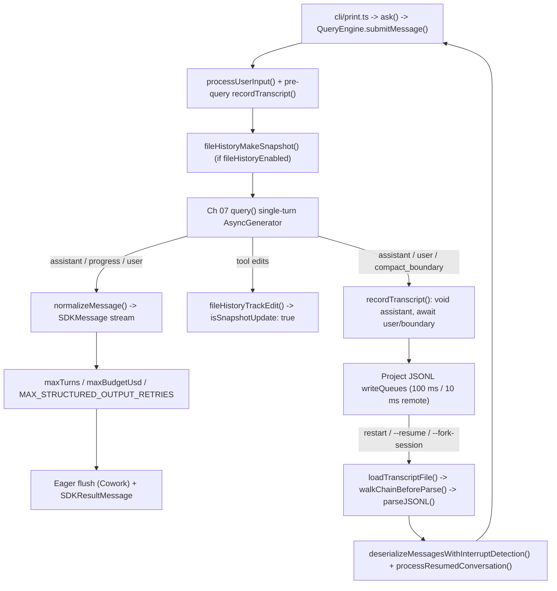

# 8. The Session Envelope: `QueryEngine.ts` and Transcript Persistence

> **Status: written.** Reverse-engineered from the Claude Code 2.1.88 source snapshot (see the Prologue (`prologue-how-to-read-a-1900-file-agent.md`) for snapshot caveats).
>
> **Layer:** Layer 2 (The Agent Engine)
> **Prerequisites:** [Chapter 01](ch001-atoms-types-stores-and-primitives.md) (`bootstrap/state.ts`, `FileStateCache`), [Chapter 02](ch002-the-tool-contract.md) (`ToolUseContext`), [Chapter 03](ch003-command-and-message-contracts.md) (`processUserInput`, `normalizeMessages`), [Chapter 04](ch004-prompt-engineering-and-cache-boundaries.md) (`asSystemPrompt`), [Chapter 05](ch005-talking-to-the-model.md) (`cost-tracker.ts`), [Chapter 06](ch006-executing-tools.md) (`runTools`, `ContentReplacementState`), [Chapter 07](ch007-the-heartbeat-query-loop.md) (`query()`)
> **Primary Source Files:**
> - `QueryEngine.ts` — conversation-lifetime envelope wrapping `query()`, SDK framing, persistence timing, and guardrails (1,295 lines)
> - `utils/queryHelpers.ts` — SDK normalization, `isResultSuccessful`, orphaned-permission replay, and resume cache extraction (552 lines)
> - `utils/sessionStorage.ts` — lazy-materialized `Project` JSONL writer, `parentUuid` DAG, read-side repair, and scale guards (5,105 lines)
> - `utils/sessionRestore.ts` — resume hydration, worktree restoration, and `--fork-session` orchestration (551 lines)
> - `utils/conversationRecovery.ts` — resume loader, turn-interruption repair, and skill-state replay (597 lines)
> - `utils/fileHistory.ts` — three-phase path-hashed file checkpointing and `/rewind` disk rollback (1,115 lines)

---

## Why This Layer Exists

[Chapter 07](ch007-the-heartbeat-query-loop.md)'s `query()` runs one prompt to a `Terminal` exit. Four production problems remain above it:

1. **Cross-turn state & SDK framing:** Retaining `mutableMessages`, `readFileState`, `permissionDenials`, `totalUsage`, guardrails, and `SDKMessage` framing.
2. **Append-only durability:** Persisting JSONL without empty-file leaks, kill-before-flush loss, or 150 MB OOMs.
3. **Crash recovery & forking:** Repairing truncated lines and interrupted turns while isolating `--fork-session` from parent worktrees/caches.
4. **Coherent `/rewind`:** Rolling back conversation history and disk edits together.

These six files (plus `utils/json.ts` and `utils/sessionStoragePortable.ts`) close Layer 2.

---

## 1. The Session Envelope: `QueryEngine` vs. `query()` (`QueryEngine.ts`)

### The Problem

`query()` holds only a turn-local `State.messages` slice and knows nothing about SDK wire types, JSONL flushing, budget caps, or post-compaction GC. Worse, Desktop and Cowork kill the CLI subprocess milliseconds after reading `result`—or seconds after a user hits Stop before the API replies.

### The Real Implementation (`QueryEngine.ts`)

`QueryEngine` (`QueryEngine.ts:184-1177`) owns nine instance fields (`QueryEngine.ts:184-207`):

```ts
// QueryEngine.ts:184-207
export class QueryEngine {
  private config: QueryEngineConfig
  private mutableMessages: Message[]
  private abortController: AbortController
  private permissionDenials: SDKPermissionDenial[]
  private totalUsage: NonNullableUsage
  private hasHandledOrphanedPermission = false
  private readFileState: FileStateCache
  // Turn-scoped skill discovery tracking (feeds was_discovered on
  // tengu_skill_tool_invocation). Must persist across the two
  // processUserInputContext rebuilds inside submitMessage, but is cleared
  // at the start of each submitMessage to avoid unbounded growth across
  // many turns in SDK mode.
  private discoveredSkillNames = new Set<string>()
  private loadedNestedMemoryPaths = new Set<string>()

  constructor(config: QueryEngineConfig) {
    this.config = config
    this.mutableMessages = config.initialMessages ?? []
    this.abortController = config.abortController ?? createAbortController()
    this.permissionDenials = []
    this.readFileState = config.readFileCache
    this.totalUsage = EMPTY_USAGE
  }
```

Two lifetime carve-outs stand out immediately:
- **`discoveredSkillNames` is turn-scoped (`QueryEngine.ts:197`, `QueryEngine.ts:238`):** Cleared at each `submitMessage()` start to cap SDK memory (unlike `screens/REPL.tsx:1958-1963`). `loadedNestedMemoryPaths` (`QueryEngine.ts:198`) stays session-wide because `readFileState` is a bounded LRU that evicts nested `CLAUDE.md` paths.
- **`abortController` never resets (`QueryEngine.ts:187`, `QueryEngine.ts:203`, `QueryEngine.ts:1158-1160`):** Once `interrupt()` aborts an engine instance, it stays aborted across turns.

`submitMessage()` (`QueryEngine.ts:209-1156`) drives each turn in nine phases:

1. **Turn setup & denial capture (`QueryEngine.ts:213-271`):** Clears `discoveredSkillNames`, sets `cwd`, snapshots `persistSession = !isSessionPersistenceDisabled()` (`QueryEngine.ts:240`), and wraps `canUseTool` to record denials under `sdkCompatToolName(tool.name)` (`Agent` → `Task` for `#19647`, `utils/messages/systemInit.ts:19-25`).
2. **Prompt, coordinator & schema hooks (`QueryEngine.ts:273-333`):** Resolves model and thinking, calls `fetchSystemPromptParts()` (`utils/queryContext.ts:44-74`), and merges coordinator context under `feature('COORDINATOR_MODE')` (`QueryEngine.ts:112-117`, `QueryEngine.ts:302-308`, passing `getScratchpadDir()` behind GrowthBook `'tengu_scratch'` via `isScratchpadEnabled()`).

   When `customPrompt !== undefined && hasAutoMemPathOverride()` (`CLAUDE_COWORK_MEMORY_PATH_OVERRIDE` at `memdir/paths.ts:161-166`), it appends Cowork's memory prompt (`QueryEngine.ts:316-319`), brands `asSystemPrompt([...])`, and registers `Stop` schema enforcement when `jsonSchema` and `StructuredOutput` are present (`QueryEngine.ts:328-333`).
3. **Context #1 & orphaned permission (`QueryEngine.ts:335-408`):** Builds `processUserInputContext` with live `setMessages` (`QueryEngine.ts:344-346`) and same-ref `updateFileHistoryState` (`QueryEngine.ts:376-384`), then runs `handleOrphanedPermission()` once via `hasHandledOrphanedPermission`.
4. **User input & pre-query durability (`QueryEngine.ts:410-463`):** Calls `processUserInput({ ..., querySource: 'sdk' })`, pushes returned messages into `this.mutableMessages`, snapshots local `messages`, and persists *before* calling `query()`:

   ```ts
   // QueryEngine.ts:450-463
   if (persistSession && messagesFromUserInput.length > 0) {
     const transcriptPromise = recordTranscript(messages)
     if (isBareMode()) {
       void transcriptPromise
     } else {
       await transcriptPromise
       if (
         isEnvTruthy(process.env.CLAUDE_CODE_EAGER_FLUSH) ||
         isEnvTruthy(process.env.CLAUDE_CODE_IS_COWORK)
       ) {
         await flushSessionStorage()
       }
     }
   }
   ```

   Pre-query persistence plus eager flushing keeps Cowork `--resume` from failing with `"No conversation found"` on early Stop. Under `--bare` / `CLAUDE_CODE_SIMPLE` (`isBareMode()`, `utils/envUtils.ts:60-65`), scripted calls fire-and-forget, saving ~4–30 ms.
5. **Context #2 & `system/init` (`QueryEngine.ts:465-554`):** Selects `messagesToAck` via lazy `messageSelector().selectableUserMessagesFilter` (`QueryEngine.ts:87-89`, `QueryEngine.ts:471`), rebuilds `processUserInputContext` with no-op `setMessages`, loads cache-only skills/plugins, and yields `system/init` (`buildSystemInitMessage()`, `utils/messages/systemInit.ts:53-96`; `SDKSystemMessageSchema`, `entrypoints/sdk/coreSchemas.ts:1457-1494`).
6. **`!shouldQuery` fast path (`QueryEngine.ts:556-639`):** Local slash commands skip `query()`. `system/local_command` output becomes a synthetic `SDKAssistantMessage` (`utils/messages/mappers.ts:196-215`) because Android and `api-go` only parse `init` and `compact_boundary` system subtypes.
7. **Pre-loop snapshots & watermark (`QueryEngine.ts:641-673`):** Fires `void fileHistoryMakeSnapshot(...)` when `fileHistoryEnabled() && persistSession`, and captures reference-based `errorLogWatermark = getInMemoryErrors().at(-1)` (`QueryEngine.ts:669`).
8. **`query()` consumer loop (`QueryEngine.ts:675-1049`):** Iterates `for await (const message of query({...}))` and **discards `query()`'s `Terminal` return value**. Before recording `compact_boundary`, it flushes `this.mutableMessages.slice(0, tailIdx + 1)` up to `preservedSegment.tailUuid` (`QueryEngine.ts:701-715`). Core writes then split sync vs. async:

   ```ts
   // QueryEngine.ts:717-732
   if (persistSession) {
     // Fire-and-forget for assistant messages. claude.ts yields one
     // assistant message per content block, then mutates the last
     // one's message.usage/stop_reason on message_delta — relying on
     // the write queue's 100ms lazy jsonStringify. Awaiting here
     // blocks ask()'s generator, so message_delta can't run until
     // every block is consumed; the drain timer (started at block 1)
     // elapses first. Interactive CC doesn't hit this because
     // useLogMessages.ts fire-and-forgets. enqueueWrite is
     // order-preserving so fire-and-forget here is safe.
     if (message.type === 'assistant') {
       void recordTranscript(messages)
     } else {
       await recordTranscript(messages)
     }
   }
   ```

   In `switch (message.type)` (`QueryEngine.ts:757-969`), `tombstone` is skipped (`QueryEngine.ts:758-760`), `stream_event` accumulates `totalUsage` on `message_stop` (`QueryEngine.ts:810-816`), and `progress`/`attachment` call inline `void recordTranscript` (`QueryEngine.ts:773-781`, `QueryEngine.ts:831-835`) so unrecorded rows never stall prefix dedup.

   On `snipReplay` (`QueryEngine.ts:905-915`) and `compact_boundary` (`QueryEngine.ts:918-942`), `QueryEngine` splices pre-compaction messages out of `this.mutableMessages` in place for GC.
9. **Guardrails & `result` framing (`QueryEngine.ts:842-874`, `QueryEngine.ts:972-1156`):** Enforces `maxTurns` (`error_max_turns`), `maxBudgetUsd` (`getTotalCost()` → `error_max_budget_usd`), and `process.env.MAX_STRUCTURED_OUTPUT_RETRIES || '5'` (`error_max_structured_output_retries`).

   All six exit/pre-query sites eager-flush under `CLAUDE_CODE_EAGER_FLUSH || CLAUDE_CODE_IS_COWORK` (`QueryEngine.ts:457-461`, `QueryEngine.ts:611-615`, `QueryEngine.ts:845-849`, `QueryEngine.ts:975-979`, `QueryEngine.ts:1018-1022`, `QueryEngine.ts:1075-1079`). On failure, `error_during_execution` slices `getInMemoryErrors()` from `all.lastIndexOf(errorLogWatermark) + 1` (`QueryEngine.ts:1106-1115`), staying turn-scoped even when `.shift()` rotates the 100-entry ring buffer (`utils/log.ts:66-77`).

### Hidden Invariants & Architectural Reality Today

- **`ask()` and `HISTORY_SNIP` (`QueryEngine.ts:1186-1295`):** `export async function* ask(...)` creates a fresh `QueryEngine` per call, shares `mutableMessages`, clones `readFileCache` and writes it back in `finally` (`QueryEngine.ts:1292-1294`), and injects `snipReplay` behind `feature('HISTORY_SNIP')` (`QueryEngine.ts:122-127`, `QueryEngine.ts:1276-1284`) using snapshot-absent `services/compact/snipCompact.js` and `services/compact/snipProjection.js`.
- **Unfinished caller migration:** Despite `QueryEngine.ts:176-182`'s docstring, **`cli/print.ts` is the sole production caller** (`cli/print.ts:91`, `cli/print.ts:2147`), hoisting `mutableMessages`, `readFileState` + `pendingSeeds` (`cli/print.ts:1145-1167`, `cli/print.ts:2168-2181`), and a fresh `abortController` per turn (`cli/print.ts:2133`) around `ask()`. Interactive `screens/REPL.tsx` keeps its own refs (`screens/REPL.tsx:1958-1977`) and calls `query()` directly (`screens/REPL.tsx:146`, `screens/REPL.tsx:2793-2803`).

---

## 2. SDK Framing, Orphaned Permissions & Resume Cache Extraction (`utils/queryHelpers.ts`)

### The Problem

Translating internal messages for SDK clients and recovering restarted headless processes introduces four edge cases: subagent attribution, silent `end_turn` completions, out-of-band permission responses after reconnects, and an empty `FileStateCache` on restart.

### The Real Implementation (`utils/queryHelpers.ts`)

1. **`normalizeMessage()` (`utils/queryHelpers.ts:102-222`):** Converts internal `assistant`, `progress`, and `user` messages into `SDKMessage`s via `normalizeMessages()` and `isNotEmptyMessage()`. It unwraps `agent_progress`/`skill_progress` with `parent_tool_use_id: message.parentToolUseID` (`utils/queryHelpers.ts:121-156`) and merges `mcpMeta` into `tool_use_result`.

   For `bash_progress`/`powershell_progress` (`utils/queryHelpers.ts:157-201`), it emits `tool_progress` **only** when `CLAUDE_CODE_REMOTE` or `CLAUDE_CODE_CONTAINER_ID` is set, throttled by `TOOL_PROGRESS_THROTTLE_MS = 30000` (30 s) in a 100-entry `toolProgressLastSentTime` `Map` (`utils/queryHelpers.ts:98-100`). *(Stale comments: `utils/queryHelpers.ts:161` says `"one per minute"` and `utils/queryHelpers.ts:178` says `"LRU eviction"`, but `Map.set()` on an existing key preserves insertion order—making eviction FIFO at 30 s.)*

2. **`isResultSuccessful()` (`utils/queryHelpers.ts:56-94`):** Paired with `QueryEngine.ts:1051-1060`'s `#23537` fix (`messages.findLast(m => m.type === 'assistant' || m.type === 'user')` so trailing stop-hook progress cannot blank `-p`), this check accepts assistant `text`/`thinking`/`redacted_thinking` blocks, all-`tool_result` user messages, or the **zero-block `end_turn` carve-out** (`stopReason === 'end_turn'`, `utils/queryHelpers.ts:83-93`).

   On `task_notification` drain turns or post-`StructuredOutput` turns (`services/api/claude.ts:2346-2350`; comment at `utils/queryHelpers.ts:85` cites stale line 2026 of `services/api/claude.ts`), zero assistant blocks are legitimate; without this carve-out, `QueryEngine` emits `error_during_execution`.

3. **`handleOrphanedPermission()` (`utils/queryHelpers.ts:224-343`) & `PermissionPromptTool` (`utils/queryHelpers.ts:39-42`):** When a remote client sends a late permission response (`cli/print.ts:5241-5304`), `handleOrphanedPermission()` applies `updatedInput` on `'allow'` with a warn fallback (`utils/queryHelpers.ts:262-276`), guards `mutableMessages` before yielding, and replays `[finalToolUseBlock]` via `runTools()` (`utils/queryHelpers.ts:322-342`):

   ```ts
   // utils/queryHelpers.ts:299-319
   const alreadyPresent = mutableMessages.some(
     m =>
       m.type === 'assistant' &&
       Array.isArray(m.message.content) &&
       m.message.content.some(
         b => b.type === 'tool_use' && 'id' in b && b.id === toolUseID,
       ),
   )
   if (!alreadyPresent) {
     mutableMessages.push(assistantMessage)
     if (persistSession) {
       await recordTranscript(mutableMessages)
     }
   }

   const sdkAssistantMessage: SDKMessage = {
     ...assistantMessage,
     session_id: getSessionId(),
     parent_tool_use_id: null,
   } as SDKMessage
   yield sdkAssistantMessage
   ```

   Deduplicating by `tool_use.id`—not `assistantMessage.message.id`—avoids both traps: streaming splits `[text, tool_use]` under one `message.id` and recovery can drop `tool_use`. Checking `message.id` orphans `tool_result`; blind pushes hit HTTP 400 `"tool_use ids must be unique"` after `normalizeMessagesForAPI` merges assistants.

   Companion `PermissionPromptTool` (`utils/queryHelpers.ts:39-42`) wraps `utils/permissions/PermissionPromptToolResultSchema.ts:15-79` (`.catch(...)` → `undefined` for `#29440` at `utils/permissions/PermissionPromptToolResultSchema.ts:48-59`, vs. `decisionClassificationField`'s `.catch(undefined)` at `utils/permissions/PermissionPromptToolResultSchema.ts:37-42`; mobile `{}` `updatedInput` keeps original input at `utils/permissions/PermissionPromptToolResultSchema.ts:107-111`).

4. **Resume cache extractors (`utils/queryHelpers.ts:346-552`):**
   - `extractReadFilesFromMessages()` (`utils/queryHelpers.ts:346-501`, default `ASK_READ_FILE_STATE_CACHE_SIZE = 10`, overridden at `cli/print.ts:1154`, `screens/REPL.tsx:1972`) runs two passes for last-wins `FileStateCache` hydration.

     Pass 1 indexes non-ranged `Read`/`Write`/`Edit` calls; Pass 2 replays `tool_result`s, skips `FILE_UNCHANGED_STUB` (`utils/queryHelpers.ts:428`), strips `<system-reminder>` tags/line prefixes, and re-reads `Edit` targets from live disk via `readFileSyncWithMetadata` (`utils/queryHelpers.ts:477-494`).
   - `extractBashToolsFromMessages()` (`utils/queryHelpers.ts:507-552`) strips `VAR=val` and `'sudo'` (`STRIPPED_COMMANDS`/`extractCliName`) to rebuild used CLI binaries.

---

## 3. JSONL Transcript Persistence, the `parentUuid` DAG & Scale Guards (`utils/sessionStorage.ts`, `utils/sessionStoragePortable.ts`)

### The Problem

Transcripts must survive sudden kills without leaking empty `.jsonl` files on `--version` or `/exit`, avoid syscall thrashing during streaming, represent rewinds and compactions in an append-only log, and stay fast when sessions exceed 150 MB (`inc-3930`).

### The Write Path: Lazy `Project`, Batched Queues & Sidechain Isolation

Singleton `class Project` (`utils/sessionStorage.ts:532-1384`, returned by `getProject()` at `utils/sessionStorage.ts:443-467`) enforces five invariants:

- **Lazy materialization (`utils/sessionStorage.ts:549-552`, `utils/sessionStorage.ts:960-991`):** `sessionFile` starts `null`, buffering early rows in `pendingEntries`. The first `user`/`assistant` message runs `materializeSessionFile()`, checking `shouldSkipPersistence()` (`NODE_ENV === 'test' && !TEST_ENABLE_SESSION_PERSISTENCE`, `cleanupPeriodDays === 0`, `isSessionPersistenceDisabled()`, `CLAUDE_CODE_SKIP_PROMPT_HISTORY`), resolving `getOriginalCwd()` lazily (`utils/sessionStorage.ts:108-112`), and draining `pendingEntries`.
- **Dual async/sync queues (`utils/sessionStorage.ts:530`, `utils/sessionStorage.ts:567-568`, `utils/sessionStorage.ts:606-686`, `utils/sessionStorage.ts:2572-2729`):** Transcript rows batch via `FLUSH_INTERVAL_MS` (`100` ms; `REMOTE_FLUSH_INTERVAL_MS = 10` ms remotely) in `MAX_CHUNK_BYTES` (`100` MB) chunks (`0o600` files, `0o700` dirs). Metadata (`saveCustomTitle`, `saveTag`) writes synchronously via `appendEntryToFile()`.

  On exit, `registerCleanup` (`utils/sessionStorage.ts:449-462`) flushes and calls `reAppendSessionMetadata()` (`utils/sessionStorage.ts:721-839`), tail-reading 64 KiB (`readFileTailSync`) with col-0 `startsWith` so external SDK renames win inside the tail window.
- **In-place 64 KiB tombstoning & 50 MB caps (`inc-3930`):** `removeMessageByUuid()` (`utils/sessionStorage.ts:871-951`) searches the last 64 KiB for `"uuid":"<id>"` (avoiding `parentUuid` hits) and splices via `fh.truncate()`. Its slow-path full rewrite caps at `MAX_TOMBSTONE_REWRITE_BYTES` (`50` MB, `utils/sessionStorage.ts:123`), matching `MAX_TRANSCRIPT_READ_BYTES` (`utils/sessionStorage.ts:229`).
- **Main-file-authoritative `messageSet` (`inc-4718`, `utils/sessionStorage.ts:1224-1262`):** Agent sidechains write to `<sessionId>/subagents/agent-<agentId>.jsonl` and share inherited parent UUIDs. Deduping against main `messageSet` dropped fork context, while adding sidechain UUIDs or posting to Session Ingress (`ENABLE_SESSION_PERSISTENCE`, `utils/sessionStorage.ts:1327`) caused dangling links and 409 shutdowns—so `appendEntry()` bypasses dedup, `messageSet.add`, and `persistToRemote` for sidechains.
- **DAG links & post-spread session re-stamp (`utils/sessionStorage.ts:1031-1068`):** `tool_result`s override `parentUuid` with `sourceToolAssistantUUID`; `compact_boundary` sets `parentUuid: null` and preserves `logicalParentUuid`; only `isChainParticipant` (`m.type !== 'progress'`, `utils/sessionStorage.ts:154-156`) advances `parentUuid`. Session-stamp fields intentionally follow `...message`:

  ```ts
  // utils/sessionStorage.ts:1039-1064
          const transcriptMessage: TranscriptMessage = {
            parentUuid: isCompactBoundary ? null : effectiveParentUuid,
            logicalParentUuid: isCompactBoundary ? parentUuid : undefined,
            isSidechain,
            teamName: teamInfo?.teamName,
            agentName: teamInfo?.agentName,
            promptId:
              message.type === 'user' ? (getPromptId() ?? undefined) : undefined,
            agentId,
            ...message,
            // Session-stamp fields MUST come after the spread. On --fork-session
            // and --resume, messages arrive as SerializedMessage (carries source
            // sessionId/cwd/etc. because removeExtraFields only strips parentUuid
            // and isSidechain). If sessionId isn't re-stamped, FRESH.jsonl ends up
            // with messages stamped sessionId=A but content-replacement entries
            // stamped sessionId=FRESH (from insertContentReplacement), and
            // loadFullLog's sessionId-keyed contentReplacements lookup misses →
            // replacement records lost → FROZEN misclassification.
            userType: getUserType(),
            entrypoint: getEntrypoint(),
            cwd: getCwd(),
            sessionId,
            version: VERSION,
            gitBranch,
            slug,
          }
  ```

`recordTranscript()` (`utils/sessionStorage.ts:1408-1449`) runs `cleanMessagesForLogging()` (`utils/sessionStorage.ts:4450-4461`): `isLoggableMessage()` (`utils/sessionStorage.ts:4351-4367`) drops all `progress` unconditionally (`utils/sessionStorage.ts:4352`), and under `getUserType() !== 'ant'` (`process.env.USER_TYPE`, `utils/sessionStorage.ts:419-421`) drops `attachment`s except `hook_additional_context` when `CLAUDE_CODE_SAVE_HOOK_ADDITIONAL_CONTEXT` is truthy (`utils/sessionStorage.ts:4357-4365`).

That same `getUserType() !== 'ant'` gate calls `transformMessagesForExternalTranscript()` (`utils/sessionStorage.ts:4396-4448`, `utils/sessionStorage.ts:4455-4460`), stripping `REPL_TOOL_NAME` pairs and promoting `isVirtual`; tracking `startingParentUuid` **only over an unbroken prefix** (`!seenNewMessage`) prevents post-compact chain rewiring.

Separately, `EPHEMERAL_PROGRESS_TYPES` / `isEphemeralToolProgress()` (`utils/sessionStorage.ts:186-196`, gating `'sleep_progress'` on `feature('PROACTIVE') || feature('KAIROS')` at `utils/sessionStorage.ts:190-192`) drives UI replace-in-place in `screens/REPL.tsx:2608`, not `cleanMessagesForLogging()`.

### Read-Side Repair Pipeline & Three Scale Guards

On load, `loadTranscriptFile()` (`utils/sessionStorage.ts:3472-3813`) and `buildConversationChain()` (`utils/sessionStorage.ts:2069-2094`) run five deterministic repairs, followed by `checkResumeConsistency()` on resume (`utils/conversationRecovery.ts:553`):

| Stage | Exact Symbol & Citation | What It Repairs |
|---|---|---|
| 1 | `isLegacyProgressEntry()` (`utils/sessionStorage.ts:169-178`), `progressBridge` (`utils/sessionStorage.ts:3616-3645`) | Bridges pre-`#24099` legacy `progress` entries (`#14373`, `#23537`) to the nearest non-progress ancestor. |
| 2 | `applyPreservedSegmentRelinks` (`utils/sessionStorage.ts:1839-1956`) | Rewires compaction-preserved `head→anchor`, zeroes stale pre-compact `usage`, validates `tail→head` (`tengu_relink_walk_broken`), prunes pre-boundary noise. |
| 3 | `applySnipRemovals` (`utils/sessionStorage.ts:1982-2039`) | Structurally inspects `snipMetadata?.removedUuids` (no ant-only string leak), deletes snipped entries, path-compressed relinks surviving children. |
| 4 | Leaf pruning (`utils/sessionStorage.ts:3716-3790`) | Walks terminal nodes to nearest `user`/`assistant` with cycle guard; under GrowthBook `'tengu_pebble_leaf_prune'` (default `false`, `utils/sessionStorage.ts:3731`), prunes ancestors already having a `user`/`assistant` child. |
| 5 | `recoverOrphanedParallelToolResults` (`utils/sessionStorage.ts:2118-2206`) | Re-attaches sibling 1-block `AssistantMessage`s (same `message.id`) and their `tool_result`s orphaned by single-parent walks (`tengu_chain_parallel_tr_recovered`). |
| 6 | `checkResumeConsistency` (`utils/sessionStorage.ts:2224-2243`) | Checks latest `turn_duration` checkpoint's `messageCount` against reconstructed index (`tengu_resume_consistency_delta`, catching `#22453` truncation). |

Three scale guards paired with `utils/sessionStoragePortable.ts` (793 lines) bound latency and RSS:

1. **`> 5 MiB` fd-level pre-compact streaming (`utils/sessionStorage.ts:3536-3556`, `utils/sessionStoragePortable.ts:480`, `utils/sessionStoragePortable.ts:717-793`):** Above `SKIP_PRECOMPACT_THRESHOLD` (`5 * 1024 * 1024`), `readTranscriptForLoad()` streams 1 MB chunks, dropping stale `attribution-snapshot` lines and resetting at non-preserved `compact_boundary` lines (cutting a 151 MB log from ~316 MB to ~155 MB RSS, `utils/sessionStorage.ts:3525-3529`).

   `scanPreBoundaryMetadata()` (`utils/sessionStorage.ts:3157-3224`) recovers pre-boundary metadata via raw `Buffer.includes`.
2. **Byte-level dead-fork pre-filter (`walkChainBeforeParse()`, `utils/sessionStorage.ts:3306-3466`):** Above `5 MiB` (when `!opts?.keepAllLeaves && !hasPreservedSegment`), it indexes `{"parentUuid":` lines and `"uuid":"<36>","timestamp":"` (disambiguating nested hits via brace-depth-1 `pickDepthOneUuidCandidate()` at `utils/sessionStorage.ts:3275-3304`) to walk the live chain in `latin1` before `JSON.parse`:

   ```ts
   // utils/sessionStorage.ts:3419-3444
     const seen = new Set<number>()
     const chain = new Set<number>()
     let chainBytes = 0
     let slot: number | undefined = leafSlot
     while (slot !== undefined) {
       if (seen.has(slot)) break
       seen.add(slot)
       chain.add(msgIdx[slot]!)
       chainBytes += msgIdx[slot + 1]! - msgIdx[slot]!
       const parentStart = msgIdx[slot + 2]!
       if (parentStart < 0) break
       const parent = buf.toString('latin1', parentStart, parentStart + UUID_LEN)
       slot = uuidToSlot.get(parent)
     }

     // parseJSONL cost scales with bytes, not entry count. A session can have
     // thousands of dead entries by count but only single-digit-% of bytes if
     // the dead branches are short turns and the live chain holds the fat
     // assistant responses (measured: 107 MB session, 69% dead entries, 30%
     // dead bytes - index+concat overhead exceeded parse savings). Gate on
     // bytes: only stitch if we would drop at least half the buffer. Metadata
     // is tiny so len - chainBytes approximates dead bytes closely enough.
     // Near break-even the concat memcpy (copying chainBytes into a fresh
     // allocation) dominates, so a conservative 50% gate stays safely on the
     // winning side.
     if (len - chainBytes < len >> 1) return buf
   ```

   Setting `CLAUDE_CODE_DISABLE_PRECOMPACT_SKIP` (`utils/sessionStorage.ts:3536`, `utils/sessionStorage.ts:3575`) disables both the `> 5 MiB` pre-compact skip and `walkChainBeforeParse()`.
3. **Two-phase progressive listing (`utils/sessionStorage.ts:4739-5105`):** `getSessionFilesLite()` (`utils/sessionStorage.ts:4975-5016`) is **strictly `stat`-only** (zero file reads), returning `mtime`-sorted stubs immediately.

   Phase 2 (`enrichLogs()`, `utils/sessionStorage.ts:5077-5105`) accepts caller `count`—defaulting to `INITIAL_ENRICH_COUNT = 50` (`utils/sessionStorage.ts:4577`; callers `utils/sessionStorage.ts:3973`, `utils/sessionStorage.ts:4020`, `utils/sessionStorage.ts:4076`, `utils/sessionStorage.ts:4089`).

   It reuses one `LITE_READ_BUF_SIZE = 65536` (64 KiB, `utils/sessionStoragePortable.ts:17`) buffer via `readLiteMetadata()` (`utils/sessionStorage.ts:4739-4813`) → `readHeadAndTail()` (`utils/sessionStoragePortable.ts:215-242`) for 64 KiB head/tail reads. *(Stale `utils/sessionStorage.ts:2810` and `utils/sessionStorage.ts:5049` comments say `"16KB"`.)*

---

## 4. Crash Recovery, Resume & Session Forking (`utils/json.ts`, `utils/conversationRecovery.ts`, `utils/sessionRestore.ts`)

### The Problem

Hard kills damage two layers: truncated trailing JSONL lines, and turns ending in dangling `tool_use`, orphaned thinking, or unanswered prompts. Resume and `--fork-session` must repair both without corrupting parent state.

### Two-Level Crash Resilience (`utils/json.ts`, `utils/conversationRecovery.ts`)

1. **Syntactic partial-write recovery (`utils/json.ts`, 277 lines):** `parseJSONL()` (`utils/json.ts:182-190`) runs native `Bun.JSONL.parseChunk` (`parseJSONLBun()`, `utils/json.ts:102-127`). On a mid-stream error (`result.error`), it keeps already-parsed `result.values`, skips past the next `\n` (`0x0a`), and resumes `parse(data, offset)`.

   Fallbacks `parseJSONLBuffer()` (`utils/json.ts:129-153`) and `parseJSONLString()` (`utils/json.ts:155-175`) strip UTF-8 BOMs and skip bad lines via per-line `try/catch`, while `readJSONLFile()` (`utils/json.ts:192-226`) bounds raw tail reads at `MAX_JSONL_READ_BYTES` (100 MB).
2. **Semantic interruption repair (`utils/conversationRecovery.ts:164-373`):** `deserializeMessagesWithInterruptDetection()` returns `{ messages, turnInterruptionState }` (`DeserializeResult` / `TurnInterruptionState`, `utils/conversationRecovery.ts:139-146`, `utils/conversationRecovery.ts:247`) across six stages:
   - Migrates legacy attachments (`migrateLegacyAttachmentTypes()`, `utils/conversationRecovery.ts:77-132`), strips unknown `permissionMode` strings, and filters unresolved `tool_use`s, orphaned thinking-only blocks, and whitespace-only assistant messages.
   - Runs `detectTurnInterruption()` (`utils/conversationRecovery.ts:272-333`), skipping trailing `system`, `progress`, and `isApiErrorMessage` assistants. For trailing `tool_result`s, `isTerminalToolResult()` (`utils/conversationRecovery.ts:348-373`) recognizes brief/Kairos terminal tools—present `tools/BriefTool/prompt.ts` (`feature('KAIROS') || feature('KAIROS_BRIEF')`, `utils/conversationRecovery.ts:55-66`) and absent `tools/SendUserFileTool/prompt.js` (`feature('KAIROS')`, `utils/conversationRecovery.ts:67-71`)—fixing `#20467`.
   - Turns `interrupted_turn` into `interrupted_prompt` by appending synthetic `isMeta: true` `'Continue from where you left off.'`, plus a `NO_RESPONSE_REQUESTED` assistant sentinel so history stays API-valid even without auto-continue.

### Resume Loading, Hydration & `--fork-session` (`utils/conversationRecovery.ts`, `utils/sessionRestore.ts`)

`loadConversationForResume()` (`utils/conversationRecovery.ts:456-597`) resolves `--continue` (skipping live `--bg`/daemon sessions via absent `utils/udsClient.js` behind `feature('BG_SESSIONS')`, `utils/conversationRecovery.ts:492-506`), `.jsonl` paths, UUIDs, or `LogOption`s.

It then runs `loadFullLog`, `copyPlanForResume`, `void copyFileHistoryForResume(log)` (`utils/conversationRecovery.ts:550`), `checkResumeConsistency()`, `restoreSkillStateFromMessages()` (`utils/conversationRecovery.ts:382-403`, replaying `invoked_skills` and suppressing duplicate `skill_listing`), `deserializeMessagesWithInterruptDetection()`, and `processSessionStartHooks('resume')`.

`restoreSessionStateFromLog()` (`utils/sessionRestore.ts:99-150`) hydrates `fileHistory` via `fileHistoryRestoreStateFromLog()` (`utils/sessionRestore.ts:104-108`), `attribution` (`feature('COMMIT_ATTRIBUTION')`), and legacy SDK `todos` (`!isTodoV2Enabled()`, `utils/tasks.ts:133-139`, bypassed by `CLAUDE_CODE_ENABLE_TASKS`).

Under `feature('CONTEXT_COLLAPSE')` (`utils/sessionRestore.ts:127-136`), it calls absent `services/contextCollapse/persist.js`'s `restoreFromEntries()` even on empty arrays so `/resume` clears stale collapse state.

`processResumedConversation()` (`utils/sessionRestore.ts:409-551`) runs coordinator sync (`feature('COORDINATOR_MODE')`), `restoreAgentFromSession()`, non-fork worktree `chdir` (`restoreWorktreeForResume()`, `utils/sessionRestore.ts:479`; `exitRestoredWorktree()` at `utils/sessionRestore.ts:380-400` runs only on mid-session `/resume`, `screens/REPL.tsx:1878`), a second `CONTEXT_COLLAPSE` restore (`utils/sessionRestore.ts:494-503`), and the in-place vs. `--fork-session` split:

```ts
// utils/sessionRestore.ts:436-463
  if (!opts.forkSession) {
    const sid = opts.sessionIdOverride ?? result.sessionId
    if (sid) {
      // When resuming from a different project directory (git worktrees,
      // cross-project), transcriptPath points to the actual file; its dirname
      // is the project dir. Otherwise the session lives in the current project.
      switchSession(
        asSessionId(sid),
        opts.transcriptPath ? dirname(opts.transcriptPath) : null,
      )
      // Rename asciicast recording to match the resumed session ID so
      // getSessionRecordingPaths() can discover it during /share
      await renameRecordingForSession()
      await resetSessionFilePointer()
      restoreCostStateForSession(sid)
    }
  } else if (result.contentReplacements?.length) {
    // --fork-session keeps the fresh startup session ID. useLogMessages will
    // copy source messages into the new JSONL via recordTranscript, but
    // content-replacement entries are a separate entry type only written by
    // recordContentReplacement (which query.ts calls for newlyReplaced, never
    // the pre-loaded records). Without this seed, `claude -r {newSessionId}`
    // finds source tool_use_ids in messages but no matching replacement records
    // → they're classified as FROZEN → full content sent (cache miss, permanent
    // overage). insertContentReplacement stamps sessionId = getSessionId() =
    // the fresh ID, so loadTranscriptFile's keyed lookup will match.
    await recordContentReplacement(result.contentReplacements)
  }
```

> [!IMPORTANT]
> **How `--fork-session` Works (No UUID Remapping):** `processResumedConversation()` keeps the fresh startup `sessionId` and does **not** remap message UUIDs. It seeds `recordContentReplacement()` against `FROZEN` cache misses and strips `worktreeSession: undefined` (`utils/sessionRestore.ts:465-472`) so fork `/exit` cannot delete the parent's worktree.
>
> It also skips `restoreWorktreeForResume()` and `adoptResumedSessionFile()` (`utils/sessionStorage.ts:1530-1534`), letting `recordTranscript()` → `insertMessageChain()` (`utils/sessionStorage.ts:993-1083`) re-stamp `sessionId` *after* `...message` (`utils/sessionStorage.ts:1048-1064`).

---

## 5. Rolling Back Conversation & Disk Together: `/rewind` (`utils/fileHistory.ts`)

### The Problem

Rewinding `messages` without disk rollback desyncs files from memory. Naive snapshotting blocks reducers with I/O, OOMs via `readFileSync`+`writeFileSync`, overwrites `v1` backups, and loses backups on session expiry.

### The Real Implementation (`utils/fileHistory.ts`)

`utils/fileHistory.ts` (1,115 lines; zero `feature()`, `USER_TYPE`, or GrowthBook gates) solves all five hazards:

1. **Dual interactive vs. SDK gate (`utils/fileHistory.ts:63-78`):** Interactive mode defaults **on** unless `fileCheckpointingEnabled === false` or `CLAUDE_CODE_DISABLE_FILE_CHECKPOINTING` is truthy. SDK/non-interactive mode defaults **off**, requiring `CLAUDE_CODE_ENABLE_SDK_FILE_CHECKPOINTING` truthy and `CLAUDE_CODE_DISABLE_FILE_CHECKPOINTING` falsy.
2. **Three-phase async protocol (`fileHistoryTrackEdit()` at `utils/fileHistory.ts:86-193`, `fileHistoryMakeSnapshot()` at `utils/fileHistory.ts:198-342`):**
   - **Phase 1 (Same-ref capture):** Calls `updateFileHistoryState(state => { captured = state; return state })`, letting same-ref wrappers (`QueryEngine.ts:376-384`, `screens/REPL.tsx:2442-2454`) skip notifications and no-op stubs (`utils/forkedAgent.ts:432`) bail cleanly. In `fileHistoryTrackEdit()`, Phase 1 guards `mostRecent.trackedFileBackups[trackingPath]` (`utils/fileHistory.ts:99-118`) so repeat edits never corrupt `{hash}@v1`.
   - **Phase 2 (Async disk I/O):** Runs `stat()`, `checkOriginFileChanged()`, and `createBackup()` outside store updaters.
   - **Phase 3 (Fresh re-read commit):** Inherits files tracked during Phase 2's async window (`utils/fileHistory.ts:290-297`), enforces `MAX_SNAPSHOTS = 100` (`utils/fileHistory.ts:54`, `utils/fileHistory.ts:305-313`) with monotonic `snapshotSequence`, and persists via `recordFileHistorySnapshot()`.
3. **Path-hashed backups & stat-first creation sentinels (`utils/fileHistory.ts:725-798`):** `getBackupFileName()` computes `{sha256(filePath).slice(0, 16)}@v{version}` under `{configDir}/file-history/{sessionId}/`—hashing the **path**, not contents *(correcting imprecise `"content hash"` comments in `tools/FileEditTool/FileEditTool.ts:433` and `tools/FileWriteTool/FileWriteTool.ts:257`)*. `createBackup()` keeps source-missing distinct from dir-missing and avoids heap OOMs:

   ```ts
   // utils/fileHistory.ts:759-786
     // Stat first: if the source is missing, record a null backup and skip the
     // copy. Separates "source missing" from "backup dir missing" cleanly —
     // sharing a catch for both meant a file deleted between copyFile-success
     // and stat would leave an orphaned backup with a null state record.
     let srcStats: Stats
     try {
       srcStats = await stat(filePath)
     } catch (e: unknown) {
       if (isENOENT(e)) {
         return { backupFileName: null, version, backupTime: new Date() }
       }
       throw e
     }

     // copyFile preserves content and avoids reading the whole file into the JS
     // heap (which the previous readFileSync+writeFileSync pipeline did, OOMing
     // on large tracked files). Lazy mkdir: 99% of calls hit the fast path
     // (directory already exists); on ENOENT, mkdir then retry.
     try {
       await copyFile(filePath, backupPath)
     } catch (e: unknown) {
       if (!isENOENT(e)) throw e
       await mkdir(dirname(backupPath), { recursive: true })
       await copyFile(filePath, backupPath)
     }

     // Preserve file permissions on the backup.
     await chmod(backupPath, srcStats.mode)
   ```

4. **Dual-keyed DAG-branch replay (`utils/fileHistory.ts:172-175`, `utils/fileHistory.ts:319-322`, `utils/sessionStorage.ts:2248-2272`):** Turn-start `fileHistoryMakeSnapshot()` writes `entry.messageId = userMessage.uuid` with `isSnapshotUpdate: false`. Mid-turn `fileHistoryTrackEdit()` attaches `v1` to `mostRecentSnapshot` (keeping `snapshot.messageId = userMessage.uuid`) while keying the JSONL entry on the **assistant** `parentMessage.uuid` with `isSnapshotUpdate: true`.

   On load, `buildFileHistorySnapshotChain()` replays only entries along the active `parentUuid` branch, updating `snapshots[existingIndex]` in place so abandoned rewind branches never leak into active history.

   Under `fileHistoryEnabled()`, `fileHistoryRestoreStateFromLog()` (`utils/fileHistory.ts:888-917`; callers `utils/sessionRestore.ts:104-108`, `hooks/useFileHistorySnapshotInit.ts:16-24`) hydrates `FileHistoryState`: migrating legacy absolute paths via `maybeShortenFilePath()` (`utils/fileHistory.ts:867-876`), rebuilding `trackedFiles: Set<string>`, and setting `snapshotSequence: snapshots.length`.
5. **Pure-disk rewind + append-only conversation rewind (`utils/fileHistory.ts:347-397`, `utils/fileHistory.ts:537-672`, `utils/fileHistory.ts:847-862`):** `fileHistoryRewind()` never mutates `FileHistoryState` (allowing repeated forward/backward rewinds) and runs `applySnapshot()` across every path in `state.trackedFiles`.

   For targets predating a file's first edit, `getBackupFileNameFirstVersion()` checks `version === 1` (failing safe if `MAX_SNAPSHOTS = 100` evicted it). `null` calls `unlink()`; non-null calls `restoreBackup()` only when `checkOriginFileChanged()` / `compareStatsAndContent()` (`utils/fileHistory.ts:600-672`) detects existence, `mode`/`size`, `mtimeMs` fast-path, or UTF-8 content diffs.

   In parallel, interactive `/rewind` (`screens/REPL.tsx:3661-3707`) slices `messages` and triggers a **same-head shrink** in `useLogMessages` (`hooks/useLogMessages.ts:53-57`, `hooks/useLogMessages.ts:102-114`). JSONL is never truncated—the next prompt chains off the rewound leaf, leaving an abandoned fork that `walkChainBeforeParse()` skips.

   *(Forward seams: pre-edit `fileHistoryTrackEdit()` callers in `FileEditTool`, `FileWriteTool`, `NotebookEditTool`, and `BashTool`'s `applySedEdit()`—not general shell commands—belong to [Chapter 12](ch012-shell-execution-sandboxing-and-workspace-tools.md); `MessageSelector` `/rewind` belongs to UI chapters.)*

> [!WARNING]
> **Fork Backup Isolation & `switchSession` Quirk (`utils/fileHistory.ts:922-1046`):** Because `cleanupOldFileHistoryBackups()` (`utils/cleanup.ts:305-348`) deletes expired `{configDir}/file-history/{sessionId}/` directories wholesale, `copyFileHistoryForResume()` hard-links (`link`, fallback `copyFile`) backups into the new session directory so forks survive parent cleanup.
>
> Ordering quirk: `utils/conversationRecovery.ts:550` (before `utils/sessionRestore.ts:442`) and `screens/REPL.tsx:1802` (before `screens/REPL.tsx:1846`) invoke `copyFileHistoryForResume()` before `switchSession`, so its `previousSessionId === getSessionId()` short-circuit (`utils/fileHistory.ts:942-948`) only fires if the caller switched first.

---

## Putting Layer 2 Together



> [!NOTE]
> **Snapshot-Absent Modules Observed via Call Sites Only (Never Linked):** These imports are **absent from this checkout** and documented strictly from call sites and present schemas:
> - `types/message.js` (`QueryEngine.ts:42`, `utils/queryHelpers.ts:19`, `utils/sessionStorage.ts:57-64`, `utils/sessionRestore.ts:30`, `utils/conversationRecovery.ts:15-19`) and `types/messageQueueTypes.js` (`utils/sessionStorage.ts:65`).
> - `services/compact/snipCompact.js` & `services/compact/snipProjection.js` (`QueryEngine.ts:122-127`, `feature('HISTORY_SNIP')`) — observed via `snipReplay` (`QueryEngine.ts:1278-1282`).
> - `services/contextCollapse/persist.js` (`utils/sessionRestore.ts:127-136`, `utils/sessionRestore.ts:494-503`) & `services/contextCollapse/index.js` (`services/compact/postCompactCleanup.ts:42-50`, `screens/REPL.tsx:3677-3688`, `feature('CONTEXT_COLLAPSE')`) — paired with zero-caller `recordContextCollapseCommit()` / `recordContextCollapseSnapshot()` (`utils/sessionStorage.ts:1541-1581`).
> - `utils/udsClient.js` (`utils/conversationRecovery.ts:492-506`, `feature('BG_SESSIONS')`) & `utils/udsMessaging.js` (`utils/messages/systemInit.ts:88-93`, `feature('UDS_INBOX')`).
> - `tools/SendUserFileTool/prompt.js` (`utils/conversationRecovery.ts:67-71`, `feature('KAIROS')`), paired with present `tools/BriefTool/prompt.ts`.
> - `entrypoints/sdk/controlTypes.ts`, `entrypoints/sdk/runtimeTypes.ts`, `entrypoints/sdk/toolTypes.ts`, `entrypoints/sdk/sdkUtilityTypes.ts`, `entrypoints/sdk/coreTypes.generated.ts`, `entrypoints/sdk/settingsTypes.generated.ts` (re-exported by `entrypoints/agentSdkTypes.ts:19-31`, `entrypoints/sdk/coreTypes.ts:19-22`; live schemas in `entrypoints/sdk/coreSchemas.ts`, `entrypoints/sdk/controlSchemas.ts`), plus comment-only `useGitDiffStats` (`utils/fileHistory.ts:49`).

---

## How This Snaps Into the Next Layer

Chapter 08 closes **Layer 2 (The Agent Engine)**. [Chapter 09](ch009-five-layer-compaction-pipeline.md) opens **Layer 3 (Long-Horizon Context & Memory)** directly on top of Chapter 08's persistence hooks:

- `services/compact/compact.ts:598`, `services/compact/compact.ts:1014`, and `services/compact/sessionMemoryCompact.ts:447` emit `compact_boundary` entries (with `services/compact/compact.ts:711` and `services/compact/compact.ts:1057` calling `reAppendSessionMetadata()`) before `utils/sessionStorage.ts:1040-1041` severs `parentUuid` and saves `logicalParentUuid`.
- `query.ts:376-535` runs five pre-API stages: tool-result budget (`recordContentReplacement`, `query.ts:376-394`), snip (`feature('HISTORY_SNIP')`, `query.ts:401-410`), microcompact (`query.ts:413-426`; post-API `microcompact_boundary` via `feature('CACHED_MICROCOMPACT')`, `query.ts:870-892`), collapse (`feature('CONTEXT_COLLAPSE')` → snapshot-absent `contextCollapse.applyCollapsesIfNeeded()`, `query.ts:440-447`), and autocompact (`query.ts:454-535`).
- Zero-caller `recordContextCollapseCommit()`/`recordContextCollapseSnapshot()` (`utils/sessionStorage.ts:1541-1581`) define the `marble-origami-commit`/`marble-origami-snapshot` writers; `QueryEngine.ts:701-715` flushes `preservedSegment.tailUuid`, and `QueryEngine.ts:918-942` splices pre-boundary history for GC.
- `services/compact/postCompactCleanup.ts:76` calls `clearSessionMessagesCache()` (`utils/sessionStorage.ts:3854-3856`) to clear `getSessionMessages`'s UUID dedup cache.

---

## Reading Exercises & Code Checkpoints

1. **Trace conversation-lifetime state in `QueryEngine` vs. single-turn `query()`:**
   ```sh
   rg -n 'export (class QueryEngine|async function\* ask)|private (mutableMessages|readFileState|permissionDenials|totalUsage|hasHandledOrphanedPermission|discoveredSkillNames|loadedNestedMemoryPaths)|async \*submitMessage\(|for await \(const message of query\(' QueryEngine.ts
   ```
   Verify why `discoveredSkillNames` clears at `QueryEngine.ts:238` while `loadedNestedMemoryPaths` persists, and why `cli/print.ts:2133` creates a fresh `AbortController` before every `ask()` call.
2. **Locate JSONL scale guards and two-level crash-recovery entry points:**
   ```sh
   rg -n 'MAX_TRANSCRIPT_READ_BYTES|SKIP_PRECOMPACT_THRESHOLD|walkChainBeforeParse|CLAUDE_CODE_DISABLE_PRECOMPACT_SKIP|deserializeMessagesWithInterruptDetection|handleOrphanedPermission' utils/sessionStorage.ts utils/sessionStoragePortable.ts utils/conversationRecovery.ts utils/queryHelpers.ts
   ```
   Trace why `walkChainBeforeParse()` gates on 50% dropped bytes (`len - chainBytes < len >> 1`) instead of entry counts, and compare syntactic recovery in `utils/json.ts:102-127` with semantic repair in `utils/conversationRecovery.ts:164-252`.
3. **Audit file-checkpointing gates, pre-edit tracking sites, and `/rewind` callers:**
   ```sh
   rg -n 'fileHistory(TrackEdit|MakeSnapshot|Rewind)|CLAUDE_CODE_(DISABLE|ENABLE_SDK)_FILE_CHECKPOINTING' utils/fileHistory.ts utils/handlePromptSubmit.ts QueryEngine.ts tools/ screens/REPL.tsx cli/print.ts
   ```
   Confirm why SDK mode defaults checkpointing off while interactive mode defaults it on, and verify which tools invoke `fileHistoryTrackEdit()` (noting why general `BashTool` commands stay untracked outside `applySedEdit()`).
4. **Verify the Layer 2 → Layer 3 compaction persistence seam and snapshot-absent restore hook:**
   ```sh
   rg -n 'logicalParentUuid|applyPreservedSegmentRelinks|applySnipRemovals|clearSessionMessagesCache|contextCollapse/persist\.js' utils/sessionStorage.ts utils/sessionRestore.ts services/compact/postCompactCleanup.ts
   ```
   Follow a `compact_boundary` from `utils/sessionStorage.ts:1040-1041` through `applyPreservedSegmentRelinks()` (`utils/sessionStorage.ts:1839-1956`) and `clearSessionMessagesCache()` (`services/compact/postCompactCleanup.ts:76`) to prepare for [Chapter 09](ch009-five-layer-compaction-pipeline.md).
