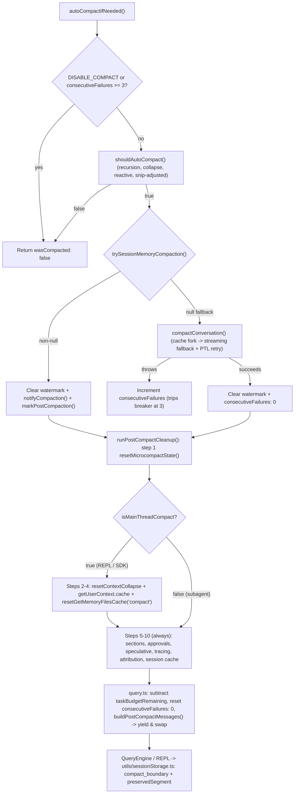

# 9. The Five-Layer Compaction Pipeline

> **Status: written.** Reverse-engineered from the Claude Code 2.1.88 source snapshot (see the Prologue (`prologue-how-to-read-a-1900-file-agent.md`) for snapshot caveats).
>
> **Layer:** Layer 3 (Long-Horizon Context & Memory)
> **Prerequisites:** [Chapter 03](ch003-command-and-message-contracts.md) (`normalizeMessagesForAPI`), [Chapter 04](ch004-prompt-engineering-and-cache-boundaries.md) (prompt cache), [Chapter 05](ch005-talking-to-the-model.md) (`addCacheBreakpoints`, `utils/betas.ts`), [Chapter 06](ch006-executing-tools.md) (`applyToolResultBudget`), [Chapter 07](ch007-the-heartbeat-query-loop.md) (`query.ts`, `QueryDeps`), [Chapter 08](ch008-session-envelope-query-engine-and-transcripts.md) (`QueryEngine.ts`, `utils/sessionStorage.ts`)
> **Primary Source Files:**
> - `query.ts` — five-stage pre-API pipeline, blocking-limit guard, deferred microcompact boundary, overflow recovery, `taskBudgetRemaining` (1,729 lines)
> - `services/compact/microCompact.ts` — cold-cache clearing, warm-cache `CACHED_MICROCOMPACT` dispatch, main-thread isolation (530 lines)
> - `services/compact/apiMicrocompact.ts` — server-side `context_management` edits (`clear_thinking_20251015`, ant-only `clear_tool_uses_20250919`) (153 lines)
> - `services/compact/autoCompact.ts` — window math, thresholds, exclusivity guards, SessionMemory dispatch, 3-failure breaker (351 lines)
> - `services/compact/compact.ts` — full/partial summarization, cache-sharing fork, PTL retries, `compact_boundary`, budgeted restoration (1,705 lines)
> - `services/compact/sessionMemoryCompact.ts` — zero-LLM SessionMemory fast path, boundary-floored tail expansion, invariant repair (630 lines)
> - `services/compact/prompt.ts` — no-tools preamble/trailer, 9-section templates, `<analysis>` stripping, continuation framing (374 lines)
> - `services/compact/postCompactCleanup.ts` — `isMainThreadCompact`-guarded 10-step cache invalidation (77 lines)
> - Sibling helpers: `services/compact/timeBasedMCConfig.ts` (43 lines), `services/compact/grouping.ts` (63 lines), `services/compact/compactWarningState.ts` (18 lines), `services/compact/compactWarningHook.ts` (16 lines)
> - `services/contextCollapse/` (absent from this snapshot — observed via call sites only; likewise absent: `services/compact/snipCompact.js`, `services/compact/snipProjection.js`, `services/compact/cachedMicrocompact.js`, `services/compact/reactiveCompact.js`, `constants/querySource.js`, `proactive/index.js`, `services/sessionTranscript/sessionTranscript.js`, `utils/attributionHooks.js`, and `types/message.js`)

---

## Why This Layer Exists

By the end of Layer 2 ([Chapter 07](ch007-the-heartbeat-query-loop.md) and [Chapter 08](ch008-session-envelope-query-engine-and-transcripts.md)), Claude Code runs multi-step turns and persists JSONL transcripts until a session hits the context ceiling. Naive truncation fails in five ways, which Layer 3 solves via a five-stage pre-API cascade plus two-tier post-API overflow recovery:

1. **Prompt-cache demolition:** Mutating earlier messages busts the prefix cache ([Chapter 04](ch004-prompt-engineering-and-cache-boundaries.md), [Chapter 05](ch005-talking-to-the-model.md)), turning cheap reads into full-prefix writes.
2. **API-contract violations:** Mid-turn cuts sever `tool_use`/`tool_result` pairs ([Chapter 03](ch003-command-and-message-contracts.md)), split streamed `thinking` blocks sharing a `message.id`, or leave an assistant-first payload.
3. **Append-only transcript corruption:** `utils/sessionStorage.ts` never rewrites logged JSONL lines; keeping recent messages across a boundary without relink metadata breaks `--resume` chains and leaves stale `~190K` usage.
4. **Death spirals & cross-thread corruption:** Retrying doomed compactions burns hundreds of thousands of API calls/day, and in-process subagents (`agent:*`) share module-level caches with the main REPL thread.
5. **Task-budget blindness:** Server-side `output_config.task_budget` counts down from visible history; once compaction shrinks history, the server under-counts spend unless `query.ts` subtracts the erased window manually.

---

## 1. The Five-Stage Pre-API Pipeline & Reactive Overflow Recovery

### The Problem

No single compression tactic fits every turn. Large tool outputs spill to disk first; cold-cache idle sessions clear old tool bodies for free; warm sessions trim without busting prefix caches; span collapse preempts full summaries; and HTTP 413 (`prompt_too_long`) or media rejections need post-API recovery.

### The Real Implementation

Each `queryLoop()` iteration builds a post-boundary view (`query.ts:365`) via `getMessagesAfterCompactBoundary()` (`utils/messages.ts:4643-4656`, calling absent `services/compact/snipProjection.js`'s `projectSnippedView()` under `feature('HISTORY_SNIP')`). It then runs five ordered stages before `deps.callModel()` (`query/deps.ts:21-40` binds `microcompact: microcompactMessages` and `autocompact: autoCompactIfNeeded`):

- **Stage 1 — Tool-result budget (`query.ts:376-394`):** Runs `applyToolResultBudget()` ([Chapter 06](ch006-executing-tools.md), `utils/toolResultStorage.ts:924-936`), persisting replacements via `recordContentReplacement()` only for `'agent:*'` and `'repl_main_thread*'` sources (prefix-matched via `.startsWith()`, `query.ts:376-378`) and skipping tools with `!Number.isFinite(t.maxResultSizeChars)`.
- **Stage 2 — History snip (`query.ts:400-410`):** Behind `feature('HISTORY_SNIP')`, calls absent `services/compact/snipCompact.js`'s `snipCompactIfNeeded()`, captures `snipTokensFreed`, and yields any `boundaryMessage` (replayed on `mutableMessages` at `QueryEngine.ts:905-915` / `QueryEngine.ts:1276-1284` and relinked on resume at `utils/sessionStorage.ts:1982-2039`).
- **Stage 3 — Microcompact (`query.ts:413-426`, `query.ts:870-892`):** Runs `deps.microcompact()`. Under `feature('CACHED_MICROCOMPACT')`, holds `pendingCacheEdits` until post-API usage arrives so `createMicrocompactBoundaryMessage()` records server-deleted tokens. Server-side `apiMicrocompact.ts` runs orthogonally in `services/api/claude.ts:1633-1637`.

```ts
// query.ts:400-426
let snipTokensFreed = 0
if (feature('HISTORY_SNIP')) {
  queryCheckpoint('query_snip_start')
  const snipResult = snipModule!.snipCompactIfNeeded(messagesForQuery)
  messagesForQuery = snipResult.messages
  snipTokensFreed = snipResult.tokensFreed
  if (snipResult.boundaryMessage) {
    yield snipResult.boundaryMessage
  }
  queryCheckpoint('query_snip_end')
}

// Apply microcompact before autocompact
queryCheckpoint('query_microcompact_start')
const microcompactResult = await deps.microcompact(
  messagesForQuery,
  toolUseContext,
  querySource,
)
messagesForQuery = microcompactResult.messages
// For cached microcompact (cache editing), defer boundary message until after
// the API response so we can use actual cache_deleted_input_tokens.
// Gated behind feature() so the string is eliminated from external builds.
const pendingCacheEdits = feature('CACHED_MICROCOMPACT')
  ? microcompactResult.compactionInfo?.pendingCacheEdits
  : undefined
queryCheckpoint('query_microcompact_end')
```

- **Stage 4 — Context collapse (`query.ts:440-447`):** Behind `feature('CONTEXT_COLLAPSE')`, calls absent `services/contextCollapse/index.js`'s `applyCollapsesIfNeeded()`. Nothing is yielded: collapse projects a read-time view backed by `marble-origami-commit`/`marble-origami-snapshot` JSONL entries (`utils/sessionStorage.ts:1541-1581`, restored via absent `services/contextCollapse/persist.js` at `utils/sessionRestore.ts:127-136`).
- **Stage 5 — Proactive autocompact (`query.ts:453-543`):** Runs `deps.autocompact(..., tracking, snipTokensFreed)`. On hit, logs `tengu_auto_compact_succeeded`, updates `taskBudgetRemaining` (`query.ts:508-515`), resets `tracking` with `consecutiveFailures: 0` (`query.ts:521-526`), yields `buildPostCompactMessages()`, and swaps `messagesForQuery`. On failure, propagates `consecutiveFailures` (`query.ts:536-543`).
- **Blocking-limit guard & two-tier overflow recovery (`query.ts:615-648`, `query.ts:799-825`, `query.ts:1070-1183`):** Exits with `{ reason: 'blocking_limit' }` (`query.ts:628-648`) unless compaction succeeded, `querySource` is `'compact'`/`'session_memory'`, or reactive compact or context collapse (`collapseOwnsIt`, `query.ts:615-620`) owns real 413 recovery. While streaming, `query.ts:799-825` withholds recoverable 413 and media-size errors:
  1. For `isWithheld413`, `query.ts:1089-1117` calls `contextCollapse.recoverFromOverflow()` once (`state.transition?.reason !== 'collapse_drain_retry'`), retrying with `{ reason: 'collapse_drain_retry', committed }` if `drained.committed > 0`.
  2. For unrecovered `isWithheld413` or `isWithheldMedia` (media skips collapse drain because collapse never strips images, `query.ts:1074-1076`), `query.ts:1119-1166` calls absent `services/compact/reactiveCompact.js`'s `tryReactiveCompact()`, updates `taskBudgetRemaining` (`query.ts:1138-1146`), yields `buildPostCompactMessages()`, sets `hasAttemptedReactiveCompact: true`, and retries with `{ reason: 'reactive_compact_retry' }`.

| Stage | Call Site in `query.ts` | Gate | Snapshot Status & Observed Interface |
|---|---|---|---|
| 1. Tool-result budget | `query.ts:379-394` | `contentReplacementState` present | **Present** (`utils/toolResultStorage.ts:924-936`, Ch 06) |
| 2. History snip | `query.ts:401-410` | `feature('HISTORY_SNIP')` | **Absent** (`services/compact/snipCompact.js`, `snipProjection.js` — `snipCompactIfNeeded`, `tokensFreed`, `boundaryMessage`, `projectSnippedView`) |
| 3. Microcompact | `query.ts:414-425`, `query.ts:870-892` | `tengu_slate_heron` / `feature('CACHED_MICROCOMPACT')` | **Hybrid** (`microCompact.ts` & `apiMicrocompact.ts` present; `services/compact/cachedMicrocompact.js` absent) |
| 4. Context collapse | `query.ts:440-447`, `query.ts:1089-1117` | `feature('CONTEXT_COLLAPSE')` | **Absent** (`services/contextCollapse/index.js`, `operations.js`, `persist.js` — `applyCollapsesIfNeeded`, `isContextCollapseEnabled`, `isWithheldPromptTooLong`, `recoverFromOverflow`, `resetContextCollapse`, `getStats`) |
| 5. Autocompact & reactive | `query.ts:454-543`, `query.ts:1119-1183` | `DISABLE_COMPACT` / `DISABLE_AUTO_COMPACT` / `feature('REACTIVE_COMPACT')` | **Hybrid** (`autoCompact.ts`, `compact.ts`, `sessionMemoryCompact.ts` present; `services/compact/reactiveCompact.js` absent) |

### Hidden Invariants & Failure Modes

- **Stage 1 precedes Stage 3 (`query.ts:369-372`):** Cached microcompact keys solely on `tool_use_id` without inspecting block content, so Stage 1's `<persisted-output>` spills compose ahead of Stage 3 with zero cache-key churn.
- **Stale API usage after snip (`query.ts:396-399`, `query.ts:637-640`, `services/compact/autoCompact.ts:225`):** The protected tail assistant survives snipping unchanged, so `tokenCountWithEstimation()` misses snipped tokens. Subtracting `snipTokensFreed` in `shouldAutoCompact()` and the blocking-limit guard prevents false triggers.
- **`mediaRecoveryEnabled` hoisting scar (`query.ts:621-627`, `query.ts:814-819`, `query.ts:1082-1084`):** Hoisting `reactiveCompact?.isReactiveCompactEnabled() ?? false` before streaming ensures withholding and recovery agree; otherwise a `CACHED_MAY_BE_STALE` refresh mid-stream could withhold and drop a media error.
- **Stop-hook death-spiral guard (`query.ts:1168-1183`, `query.ts:1292-1297`):** Unrecovered overflow yields `lastMessage`, runs `executeStopFailureHooks`, and exits (`'prompt_too_long'` or `'image_error'`) *without* stop hooks (which inject tokens per cycle). `stop_hook_blocking` also preserves `hasAttemptedReactiveCompact`.

> [!NOTE]
> **Snapshot-Absence Discipline:** `services/contextCollapse/`, `services/compact/snipCompact.js`, `services/compact/snipProjection.js`, `services/compact/cachedMicrocompact.js`, and `services/compact/reactiveCompact.js` are absent here. All symbols above are call-site only: `getStats().stagedSpans` (`components/TokenWarning.tsx:40-42`) and `recoverFromOverflow()`'s `{ committed }` (`query.ts:1098`); no `isStaged` symbol exists.
>
> Likewise, `utils/sessionStorage.ts` special-cases `compact_boundary` (`isCompactBoundaryMessage`), **not** `microcompact_boundary`, which persists as a standard system entry (`utils/messages.ts:4557-4583`) and is suppressed from UI rendering (returning `null`) at `components/Message.tsx:246-248`.

---

## 2. Microcompaction: Cold-Cache Clearing, Warm-Cache Edits, and Server-Side Policies

### The Problem

Tool outputs from `Read`, `Bash`, `PowerShell`, `Grep`, `Glob`, `WebSearch`, `WebFetch`, `Edit`, and `Write` (`COMPACTABLE_TOOLS`, `services/compact/microCompact.ts:41-50`) drive most token growth. Naive local clearing mutates earlier user messages and forces full-prefix cache writes, so Claude Code splits microcompaction into three cache-aware paths.

### The Real Implementation

`microcompactMessages()` (`services/compact/microCompact.ts:253-293`) resets UI warning suppression via `clearCompactWarningSuppression()` (`services/compact/compactWarningState.ts:16-18`) and dispatches through two client paths before falling back to a no-op:

```ts
// services/compact/microCompact.ts:267-292
const timeBasedResult = maybeTimeBasedMicrocompact(messages, querySource)
if (timeBasedResult) {
  return timeBasedResult
}

// Only run cached MC for the main thread to prevent forked agents
// (session_memory, prompt_suggestion, etc.) from registering their
// tool_results in the global cachedMCState, which would cause the main
// thread to try deleting tools that don't exist in its own conversation.
if (feature('CACHED_MICROCOMPACT')) {
  const mod = await getCachedMCModule()
  const model = toolUseContext?.options.mainLoopModel ?? getMainLoopModel()
  if (
    mod.isCachedMicrocompactEnabled() &&
    mod.isModelSupportedForCacheEditing(model) &&
    isMainThreadSource(querySource)
  ) {
    return await cachedMicrocompactPath(messages, querySource)
  }
}

// Legacy microcompact path removed — tengu_cache_plum_violet is always true.
// For contexts where cached microcompact is not available (external builds,
// non-ant users, unsupported models, sub-agents), no compaction happens here;
// autocompact handles context pressure instead.
return { messages }
```

- **1. Cold-cache time-based clearing (`services/compact/microCompact.ts:422-530`, `services/compact/timeBasedMCConfig.ts:18-43`):** `evaluateTimeBasedTrigger()` reads GrowthBook `'tengu_slate_heron'` (defaults `{ enabled: false, gapThresholdMinutes: 60, keepRecent: 5 }`) and requires a non-`undefined` main-thread `querySource` so read-only callers (`/context`, `/compact`, `analyzeContext`) never clear history.
  - Once `(Date.now() - new Date(lastAssistant.timestamp).getTime()) / 60_000 >= config.gapThresholdMinutes` (`services/compact/microCompact.ts:438-442`), the 1h cache is cold; older `COMPACTABLE_TOOLS` results become `TIME_BASED_MC_CLEARED_MESSAGE` (`'[Old tool result content cleared]'`). Clamping `keepRecent = Math.max(1, config.keepRecent)` (`services/compact/microCompact.ts:458-462`) avoids `slice(-0)` before `suppressCompactWarning()`, `resetMicrocompactState()`, and `notifyCacheDeletion(querySource)` (`feature('PROMPT_CACHE_BREAK_DETECTION')`).
- **2. Warm-cache `CACHED_MICROCOMPACT` (`services/compact/microCompact.ts:305-399`, `query.ts:870-892`):** Behind `feature('CACHED_MICROCOMPACT')`, `cachedMicrocompactPath()` calls absent `services/compact/cachedMicrocompact.js` (`registerToolResult`, `registerToolMessage`, `getToolResultsToDelete`, `createCacheEditsBlock`), queues `pendingCacheEdits`, calls `suppressCompactWarning()`/`notifyCacheDeletion()`, and returns `messages` **untouched** with `baselineCacheDeletedTokens` (`usage.cache_deleted_input_tokens`).
  - `services/api/claude.ts:1531-1532` consumes `pendingCacheEdits` and fetches pinned edits before param construction (preventing retry double-consumption). `addCacheBreakpoints()` (`services/api/claude.ts:3108-3208`) re-inserts pinned `cache_edits` at each `userMessageIndex`, pins new edits (`pinCacheEdits()`), and tags `tool_result` blocks (`cache_reference: block.tool_use_id`). Post-response, `services/api/claude.ts:2834-2836` calls `markToolsSentToAPIState()`, and `query.ts:870-892` subtracts `baselineCacheDeletedTokens` for `createMicrocompactBoundaryMessage()`.
- **3. Orthogonal server-side `context_management` (`services/compact/apiMicrocompact.ts:64-153`):** Called solely by `services/api/claude.ts:1633-1637` and sent only when `useBetas` and `CONTEXT_MANAGEMENT_BETA_HEADER` (`'context-management-2025-06-27'`, `constants/betas.ts:7`) are active (`services/api/claude.ts:1718-1722`; enabled at `utils/betas.ts:301-312` by first-party betas plus ant-only `USE_API_CONTEXT_MANAGEMENT` requiring `USER_TYPE === 'ant'`, or thinking preservation):

```ts
// services/compact/apiMicrocompact.ts:82-102
if (hasThinking && !isRedactThinkingActive) {
  strategies.push({
    type: 'clear_thinking_20251015',
    keep: clearAllThinking ? { type: 'thinking_turns', value: 1 } : 'all',
  })
}

// Tool clearing strategies are ant-only
if (process.env.USER_TYPE !== 'ant') {
  return strategies.length > 0 ? { edits: strategies } : undefined
}

const useClearToolResults = isEnvTruthy(
  process.env.USE_API_CLEAR_TOOL_RESULTS,
)
const useClearToolUses = isEnvTruthy(process.env.USE_API_CLEAR_TOOL_USES)

// If no tool clearing strategy is enabled, return early
if (!useClearToolResults && !useClearToolUses) {
  return strategies.length > 0 ? { edits: strategies } : undefined
}
```

- **All users (`hasThinking && !isRedactThinkingActive`):** `clear_thinking_20251015` sends `keep: 'all'` normally and switches to `{ type: 'thinking_turns', value: 1 }` when `thinkingClearLatched` latches after >1h idle (`services/api/claude.ts:1446-1456`)—the API requires `value >= 1`, and omitting the edit defaults back to `'all'`.
- **Ant-only (`process.env.USER_TYPE === 'ant'`):** `USE_API_CLEAR_TOOL_RESULTS` sends `clear_tool_uses_20250919` with `clear_tool_inputs: TOOLS_CLEARABLE_RESULTS` (7 tools, `services/compact/apiMicrocompact.ts:19-26`), while `USE_API_CLEAR_TOOL_USES` sets `exclude_tools: TOOLS_CLEARABLE_USES` (`Edit`, `Write`, `NotebookEdit`, `services/compact/apiMicrocompact.ts:28-32`). Both trigger at `API_MAX_INPUT_TOKENS` (default `180_000`) with `clear_at_least = trigger - target` (`API_TARGET_INPUT_TOKENS`, default `40_000`).

### Hidden Invariants & Failure Modes

- **Two circular-dependency scars:** `TIME_BASED_MC_CLEARED_MESSAGE` is inlined (`services/compact/microCompact.ts:32-36`) rather than imported from `utils/toolResultStorage.ts:34` to break a 5-file cycle; time-based clearing calls `notifyCacheDeletion` over `notifyCompaction` (`services/compact/microCompact.ts:520-527`) to avoid tripping circular-deps lint.
- **Cold clear wipes warm state (`services/compact/microCompact.ts:512-517`):** `resetMicrocompactState()` stops cached MC on the next turn from sending `cache_edits` for already-cleared tool IDs.
- **React-free warning store (`services/compact/compactWarningState.ts:8-18`, `services/compact/compactWarningHook.ts:11-16`):** Isolating `useCompactWarningSuppression()` (read by `components/TokenWarning.tsx:107-110`) keeps React off print-mode startup.
- **Latent `querySource` mismatch (`services/compact/microCompact.ts:249-251` vs `services/api/claude.ts:1437`, `services/api/claude.ts:1678`, `services/api/claude.ts:1682`):** `isMainThreadSource()` prefix-matches `repl_main_thread*`, but `claude.ts` checks `=== 'repl_main_thread'`—so custom output styles queue and consume `pendingCacheEdits` without injecting them.

---

## 3. Threshold Math, Exclusivity Guards & the Three-Failure Circuit Breaker

### The Problem

Compaction runs inside the same context window as ordinary turns: firing too late makes the summarizer 413, while firing too early wastes headroom and races Stage 4 context collapse. Worse, retrying doomed compactions on an over-limit session creates an unbounded API burn.

### The Real Implementation

`getEffectiveContextWindowSize(model)` (`services/compact/autoCompact.ts:28-49`) reserves `Math.min(getMaxOutputTokensForModel(model), MAX_OUTPUT_TOKENS_FOR_SUMMARY)` (`20_000`, sized above p99.99 summary output of `17,387` tokens) from `getContextWindowForModel(model, getSdkBetas())` (optionally clamped by `CLAUDE_CODE_AUTO_COMPACT_WINDOW`):

```ts
// services/compact/autoCompact.ts:62-70
export const AUTOCOMPACT_BUFFER_TOKENS = 13_000
export const WARNING_THRESHOLD_BUFFER_TOKENS = 20_000
export const ERROR_THRESHOLD_BUFFER_TOKENS = 20_000
export const MANUAL_COMPACT_BUFFER_TOKENS = 3_000

// Stop trying autocompact after this many consecutive failures.
// BQ 2026-03-10: 1,279 sessions had 50+ consecutive failures (up to 3,272)
// in a single session, wasting ~250K API calls/day globally.
const MAX_CONSECUTIVE_AUTOCOMPACT_FAILURES = 3
```

- **Thresholds (`services/compact/autoCompact.ts:72-145`):** `getAutoCompactThreshold(model)` returns `effectiveContextWindow - 13_000` (optionally tightened via `Math.min` by `CLAUDE_AUTOCOMPACT_PCT_OVERRIDE`). `calculateTokenWarningState()` places `warningThreshold`/`errorThreshold` at `threshold - 20_000` (`autoCompactThreshold` if enabled, else `effectiveContextWindow`) and `defaultBlockingLimit` at `effectiveContextWindow - 3_000` (`CLAUDE_CODE_BLOCKING_LIMIT_OVERRIDE`).
- `isAutoCompactEnabled()` (`services/compact/autoCompact.ts:147-158`) checks `DISABLE_COMPACT`, `DISABLE_AUTO_COMPACT`, and `getGlobalConfig().autoCompactEnabled`.
- `shouldAutoCompact()` (`services/compact/autoCompact.ts:160-239`) runs six ordered gates before testing `tokenCountWithEstimation(messages) - snipTokensFreed`:
  1. **Fork recursion (`services/compact/autoCompact.ts:171-173`):** Blocks `'session_memory'` and `'compact'`.
  2. **Collapse agent (`services/compact/autoCompact.ts:179-183`):** Behind `feature('CONTEXT_COLLAPSE')`, blocks `'marble_origami'` so the codename DCEs from external builds and the ctx-agent cannot wipe collapse state.
  3. **Toggle (`services/compact/autoCompact.ts:185-187`):** Returns `false` if `!isAutoCompactEnabled()`.
  4. **Reactive-only (`services/compact/autoCompact.ts:195-199`):** Behind `feature('REACTIVE_COMPACT')`, GrowthBook `'tengu_cobalt_raccoon'` suppresses proactive autocompact so reactive compact catches real 413s.
  5. **Collapse ownership (`services/compact/autoCompact.ts:215-223`):** Behind `feature('CONTEXT_COLLAPSE')`, inline-requires absent `services/contextCollapse/index.js` (breaking an init cycle with `getEffectiveContextWindowSize`) and suppresses proactive autocompact when `isContextCollapseEnabled()` is true so ~93% autocompact never races collapse's 90%–95% window.
  6. **Threshold (`services/compact/autoCompact.ts:225-238`):** Checks `calculateTokenWarningState(tokenCountWithEstimation(messages) - snipTokensFreed, model).isAboveAutoCompactThreshold`.

`autoCompactIfNeeded()` (`services/compact/autoCompact.ts:241-351`) checks `DISABLE_COMPACT`, bails if `tracking?.consecutiveFailures >= 3` (`services/compact/autoCompact.ts:260-265`), runs `shouldAutoCompact()`, tries `trySessionMemoryCompaction()` (`services/compact/autoCompact.ts:288-310`), and otherwise invokes `compactConversation()`:

```ts
// services/compact/autoCompact.ts:328-350
  return {
    wasCompacted: true,
    compactionResult,
    // Reset failure count on success
    consecutiveFailures: 0,
  }
} catch (error) {
  if (!hasExactErrorMessage(error, ERROR_MESSAGE_USER_ABORT)) {
    logError(error)
  }
  // Increment consecutive failure count for circuit breaker.
  // The caller threads this through autoCompactTracking so the
  // next query loop iteration can skip futile retry attempts.
  const prevFailures = tracking?.consecutiveFailures ?? 0
  const nextFailures = prevFailures + 1
  if (nextFailures >= MAX_CONSECUTIVE_AUTOCOMPACT_FAILURES) {
    logForDebugging(
      `autocompact: circuit breaker tripped after ${nextFailures} consecutive failures — skipping future attempts this session`,
      { level: 'warn' },
    )
  }
  return { wasCompacted: false, consecutiveFailures: nextFailures }
}
```

`query.ts:536-543` threads `consecutiveFailures` back into `tracking`, `query.ts:521-526` resets `consecutiveFailures: 0` on success, and `query.ts:1523-1533` increments `tracking.turnCounter++` (`tengu_post_autocompact_turn`) on later tool turns.

### Hidden Invariants & Failure Modes

- **Why exclusivity lives in `shouldAutoCompact()` (`services/compact/autoCompact.ts:206-209`):** `query.ts:633` and reactive compact call `isAutoCompactEnabled()` directly, so gating proactive triggers inside `shouldAutoCompact()` keeps reactive 413 fallback and `/compact` working under context collapse.
- **User-abort nuance (`services/compact/autoCompact.ts:335-349`):** `ERROR_MESSAGE_USER_ABORT` suppresses `logError(error)`, **yet still increments `consecutiveFailures`**. By contrast, `trySessionMemoryCompaction()` returning `null` falls through to `compactConversation()` without touching the breaker.

---

## 4. Full & Partial LLM Summarization, `compact_boundary`, and Budgeted Restoration

### The Problem

Sending compaction with a custom system prompt and stripped tools causes a ~98% cache miss—an internal January 2026 experiment measured ~0.76% of fleet `cache_creation` (~38B tokens/day), concentrated in ephemeral environments and 3P providers (`services/compact/compact.ts:431-434`). Meanwhile, compaction can hit `prompt_too_long`, adaptive-thinking models may attempt tool calls, and clearing `readFileState` wipes the working set without bounded restoration.

### The Real Implementation

**Prompt-cache-sharing fork vs. streaming fallback (`services/compact/compact.ts:1136-1396`).** Behind GrowthBook kill-switch `'tengu_compact_cache_prefix'` (default `true`, `services/compact/compact.ts:1155-1158`), `streamCompactSummary()` reuses the parent's prompt cache via `runForkedAgent()` (Chapter 18 seam), running a 30s WebSocket keep-alive (`sendSessionActivitySignal` + `setSDKStatus('compacting')`) whenever `isSessionActivityTrackingActive()` (`services/compact/compact.ts:1167-1176`):

```ts
// services/compact/compact.ts:1181-1200
// DO NOT set maxOutputTokens here. The fork piggybacks on the main thread's
// prompt cache by sending identical cache-key params (system, tools, model,
// messages prefix, thinking config). Setting maxOutputTokens would clamp
// budget_tokens via Math.min(budget, maxOutputTokens-1) in claude.ts,
// creating a thinking config mismatch that invalidates the cache.
// The streaming fallback path (below) can safely set maxOutputTokensOverride
// since it doesn't share cache with the main thread.
const result = await runForkedAgent({
  promptMessages: [summaryRequest],
  cacheSafeParams,
  canUseTool: createCompactCanUseTool(),
  querySource: 'compact',
  forkLabel: 'compact',
  maxTurns: 1,
  skipCacheWrite: true,
  // Pass the compact context's abortController so user Esc aborts the
  // fork — same signal the streaming fallback uses at
  // `signal: context.abortController.signal` below.
  overrides: { abortController: context.abortController },
})
```

- `createCompactCanUseTool()` (`services/compact/compact.ts:1125-1134`) denies all tools, and `skipCacheWrite: true` avoids caching the one-shot prompt. On fallback (`services/compact/compact.ts:1250-1392`), `queryModelWithStreaming()` strips top-level/nested `image`/`document` blocks (`stripImagesFromMessages()`, `services/compact/compact.ts:145-200`) and `skill_discovery`/`skill_listing` attachments (`stripReinjectedAttachments()`, `feature('EXPERIMENTAL_SKILL_SEARCH')`, `services/compact/compact.ts:211-223`).
- The fallback disables thinking, caps `maxOutputTokensOverride` at `Math.min(20_000, getMaxOutputTokensForModel(model))`, and retries up to `MAX_COMPACT_STREAMING_RETRIES = 2` under GrowthBook `'tengu_compact_streaming_retry'` (default `false`).

- **Prompt framing (`services/compact/prompt.ts`):** Because the cache-sharing fork keeps tool schemas, Sonnet 4.6+ adaptive thinking called tools at `2.79%` (vs `0.01%` on 4.5) when forbidden only at the bottom (`services/compact/prompt.ts:12-18`). `getCompactPrompt()` (`services/compact/prompt.ts:293-303`) and `getPartialCompactPrompt()` (`services/compact/prompt.ts:274-291`, `'from'` vs `'up_to'`) wrap their 9-section templates in `NO_TOOLS_PREAMBLE` and `NO_TOOLS_TRAILER`.
- **`<analysis>` stripping & continuation:** `formatCompactSummary()` (`services/compact/prompt.ts:311-335`) strips `<analysis>...</analysis>` and formats `<summary>...</summary>` as `Summary:\n...`. `getCompactUserSummaryMessage()` (`services/compact/prompt.ts:337-374`) adds transcript path, optional `"Recent messages are preserved verbatim."`, resume framing, and—behind `(feature('PROACTIVE') || feature('KAIROS')) && proactiveModule?.isProactiveActive()` (absent `proactive/index.js`)—autonomous-loop instructions.
- **PTL head-truncation retries (`services/compact/compact.ts:449-491`, `services/compact/compact.ts:861-899`):** Full and partial compact retry up to `MAX_PTL_RETRIES = 3` on `PROMPT_TOO_LONG_ERROR_MESSAGE`. `truncateHeadForPTLRetry()` (`services/compact/compact.ts:243-291`) strips prior `PTL_RETRY_MARKER` (avoiding retry-2+ stalls) and groups rounds via `groupMessagesByApiRound()` (`services/compact/grouping.ts:22-63`).
  - Splitting on new assistant `message.id` handles single-prompt sessions without dangling `tool_use` locks; `services/compact/grouping.ts` breaks a `compact.ts ↔ compactMessages.ts` cycle (`CC-1180`, racing `ws`; `compactMessages.ts` is absent from this snapshot, referenced only in comments at `services/compact/grouping.ts:18` and `services/compact/compact.ts:239`).
- **Pure helper vs. caller loops:** Returning `Message[] | null`, `truncateHeadForPTLRetry()` drops oldest groups covering `getPromptTooLongTokenGap()` or a `20%` fallback (clamped to `groups.length - 1`) and prepends `PTL_RETRY_MARKER` if dropping group 0 leaves an assistant-first slice. Caller loops then reassign **both** `messagesToSummarize` (`apiMessages` in partial compact) and `retryCacheSafeParams.forkContextMessages` (`services/compact/compact.ts:484-490`, `services/compact/compact.ts:894-898`).

**`compact_boundary`, `preservedSegment` & budgeted restoration (`services/compact/compact.ts:330-367`, `services/compact/compact.ts:518-624`, `services/compact/compact.ts:781-1096`).**
- `buildPostCompactMessages()` (`services/compact/compact.ts:330-338`) fixes one order across all paths: `[boundaryMarker, ...summaryMessages, ...(messagesToKeep ?? []), ...attachments, ...hookResults]`.
- `createCompactBoundaryMessage()` records `logicalParentUuid` (JSONL sets `parentUuid: null` at `utils/sessionStorage.ts:1026-1041`) and sorted `preCompactDiscoveredTools` (`services/compact/compact.ts:606-611`, `services/compact/compact.ts:1023-1028`) so deferred tool schemas survive summarization.
- `partialCompactConversation()` (`services/compact/compact.ts:772-1106`) stamps `{ headUuid, anchorUuid, tailUuid }` via `annotateBoundaryWithPreservedSegment()` (`services/compact/compact.ts:349-367`, `services/compact/compact.ts:1077-1081`, `services/compact/compact.ts:1083-1087`):
  - `'from'` keeps the prefix (`0..pivotIndex`, `services/compact/compact.ts:800`), summarizes the suffix using `allMessages` for prefix cache warmth (`services/compact/compact.ts:852-858`), and sets `anchorUuid = boundaryMarker.uuid` (`services/compact/compact.ts:1081`).
  - `'up_to'` summarizes the prefix (`messagesToSummarize`), keeps the suffix (`pivotIndex..end`, stripping stale `compact_boundary`/`isCompactSummary` entries so `findLastCompactBoundaryIndex` cannot hide the new summary, `services/compact/compact.ts:785-800`), and sets `anchorUuid = summaryMessages.at(-1)?.uuid ?? boundaryMarker.uuid` (`services/compact/compact.ts:1080`, matching SessionMemory compact at `services/compact/sessionMemoryCompact.ts:488-492`).
- On `--resume`, `applyPreservedSegmentRelinks()` (`utils/sessionStorage.ts:1839-1956`) validates `tail → head`, patches `head.parentUuid = anchorUuid` (`utils/sessionStorage.ts:1908-1911`), **splices `anchor`'s other children onto `tailUuid`** (`utils/sessionStorage.ts:1915-1919`), **zeroes stale assistant `usage`** (`utils/sessionStorage.ts:1923-1939`), and prunes non-preserved pre-boundary entries.
- Full and partial compact clear `context.readFileState` and `context.loadedNestedMemoryPaths?.clear()` (`services/compact/compact.ts:518-522`, `services/compact/compact.ts:919-921`), preserve `sentSkillNames` (~4K tok saved), and re-inject bounded context:
  - **Files (`createPostCompactFileAttachments`, `services/compact/compact.ts:1415-1464`):** Max `5` files (`POST_COMPACT_MAX_FILES_TO_RESTORE`), `5_000` tok/file (`POST_COMPACT_MAX_TOKENS_PER_FILE`), `50_000` total (`POST_COMPACT_TOKEN_BUDGET`), excluding plan/memory paths (`shouldExcludeFromPostCompactRestore`, `services/compact/compact.ts:1674-1705`) and preserved reads (`collectReadToolFilePaths`, `services/compact/compact.ts:1610-1655`).
  - **Working state & deltas (`services/compact/compact.ts:532-585`, `services/compact/compact.ts:1470-1599`):** Unretrieved `local_agent` tasks (`task_status`), `plan_file_reference`, `plan_mode` (`reminderType: 'full'`), agent-scoped `invoked_skills` head-truncated at `5_000` tok/skill (`POST_COMPACT_MAX_TOKENS_PER_SKILL`) up to `25_000` tok (`POST_COMPACT_SKILLS_TOKEN_BUDGET`), plus deferred-tool, agent-listing, and MCP-instruction deltas.
  - **Hooks, metadata & `KAIROS` (`services/compact/compact.ts:413-424`, `services/compact/compact.ts:592-594`, `services/compact/compact.ts:698-729`):** Runs `executePreCompactHooks`, `processSessionStartHooks('compact')`, and `executePostCompactHooks` (Ch 13 seam); calls `notifyCompaction` (`feature('PROMPT_CACHE_BREAK_DETECTION')`), `markPostCompaction()`, `reAppendSessionMetadata()` (16KB `--resume` tail-window scar), and—under `feature('KAIROS')`—absent `services/sessionTranscript/sessionTranscript.js`'s `writeSessionTranscriptSegment()`.

### Hidden Invariants & Failure Modes

- **Abort-as-summary guard (`services/compact/compact.ts:1205-1230`):** `query()` turns `APIUserAbortError` on `Esc` into `"Request was aborted."` (no `"API Error"` prefix). Checking `!assistantMsg.isApiErrorMessage` stops an aborted fork from becoming the summary.
- **`FILE_UNCHANGED_STUB` awareness (`services/compact/compact.ts:1606-1655`):** `collectReadToolFilePaths()` ignores preserved `Read` calls whose `tool_result` starts with `FILE_UNCHANGED_STUB` because that stub references a compacted-away read that must be re-injected.
- **Telemetry misnomer & deferral (`services/compact/compact.ts:626-642`, `services/compact/compact.ts:682-694`):** `postCompactTokenCount` logs the compact call's usage (`≈ preCompactTokenCount`) for legacy continuity while `truePostCompactTokenCount` estimates payload size; `analyzeContext(messages)` (~11ms on 4.5K-message sessions) runs after the API `await`.

---

## 5. The Zero-LLM Fast Path: SessionMemory Compaction

### The Problem

Full LLM compaction pays a summarization round-trip and replaces the active tail with prose. When Session Memory ([Chapter 10](ch010-memory-systems-claudemd-auto-memory-and-dream.md)) already maintains a markdown scratchpad on disk, Claude Code compacts instantaneously with zero LLM calls and keeps a verbatim tail.

### The Real Implementation

`shouldUseSessionMemoryCompaction()` (`services/compact/sessionMemoryCompact.ts:403-432`) checks `ENABLE_CLAUDE_CODE_SM_COMPACT` (wins), `DISABLE_CLAUDE_CODE_SM_COMPACT`, then GrowthBook `tengu_session_memory && tengu_sm_compact`. `USER_TYPE === 'ant'` gates `tengu_sm_compact_flag_check` (`services/compact/sessionMemoryCompact.ts:423-429`) and caught-error debug logs (`services/compact/sessionMemoryCompact.ts:625-627`). No `isSessionMemoryEnabled` exists (`services/SessionMemory/sessionMemory.ts:80` defines unexported `isSessionMemoryGateEnabled`).

When `trySessionMemoryCompaction()` (`services/compact/sessionMemoryCompact.ts:514-630`) runs from `autoCompactIfNeeded()` (`services/compact/autoCompact.ts:288-310`) or `/compact` without `customInstructions` (`commands/compact/compact.ts:57-83`):

1. **Config & sync (`services/compact/sessionMemoryCompact.ts:524-543`):** Loads `'tengu_sm_compact_config'` once (`getDynamicConfig_BLOCKS_ON_INIT`) over `DEFAULT_SM_COMPACT_CONFIG = { minTokens: 10_000, minTextBlockMessages: 5, maxTokens: 40_000 }` (`services/compact/sessionMemoryCompact.ts:47-61`, `services/compact/sessionMemoryCompact.ts:102-130`). Awaits `waitForSessionMemoryExtraction()` (15s cap / 60s stale bailout, `services/SessionMemory/sessionMemoryUtils.ts:89-105`), returning `null` if empty (`isSessionMemoryEmpty`).
2. **Watermark & tail sizing (`services/compact/sessionMemoryCompact.ts:324-397`, `services/compact/sessionMemoryCompact.ts:548-574`):** Sets `startIndex = lastSummarizedIndex + 1` (or `null` if a stored UUID is missing). On resumed sessions lacking a watermark, `lastSummarizedIndex` falls back to `messages.length - 1` (`services/compact/sessionMemoryCompact.ts:564`), so `startIndex = messages.length` (0 kept initially) before `calculateMessagesToKeepIndex()` expands backward to meet `minTokens`/`minTextBlockMessages`, floored at the last `compact_boundary`:

```ts
// services/compact/sessionMemoryCompact.ts:370-396
const idx = messages.findLastIndex(m => isCompactBoundaryMessage(m))
const floor = idx === -1 ? 0 : idx + 1
for (let i = startIndex - 1; i >= floor; i--) {
  const msg = messages[i]!
  const msgTokens = estimateMessageTokens([msg])
  totalTokens += msgTokens
  if (hasTextBlocks(msg)) {
    textBlockMessageCount++
  }
  startIndex = i

  // Stop if we hit the max cap
  if (totalTokens >= config.maxTokens) {
    break
  }

  // Stop if we meet both minimums
  if (
    totalTokens >= config.minTokens &&
    textBlockMessageCount >= config.minTextBlockMessages
  ) {
    break
  }
}

// Adjust for tool pairs
return adjustIndexToPreserveAPIInvariants(messages, startIndex)
```

3. **Two-pass invariant repair (`services/compact/sessionMemoryCompact.ts:232-314`):** Step 1 scans `[startIndex..end]` for `tool_result` IDs lacking a kept `tool_use` and expands backward (`services/compact/sessionMemoryCompact.ts:242-286`). Step 2 collects kept assistant `message.id`s and walks back to `0` to re-attach split streaming chunks (`services/compact/sessionMemoryCompact.ts:288-313`), preserving `thinking` blocks for `normalizeMessagesForAPI()`.
4. **Assembly & threshold guard (`services/compact/sessionMemoryCompact.ts:437-503`, `services/compact/sessionMemoryCompact.ts:579-620`):** Strips old `compact_boundary` markers, runs `processSessionStartHooks('compact')`, caps each `# ` section at `8_000` chars (`truncateSessionMemoryForCompact`, `services/SessionMemory/prompts.ts:256-324`), and stamps `preservedSegment`. If `postCompactTokenCount >= autoCompactThreshold` (`services/compact/sessionMemoryCompact.ts:605-614`), returns `null` (`tengu_sm_compact_threshold_exceeded`) so LLM compact runs instead.

### Hidden Invariants & Failure Modes

- **Boundary-floor & old-boundary strip (`services/compact/sessionMemoryCompact.ts:364-371`, `services/compact/sessionMemoryCompact.ts:575-581`):** Walking past a prior `compact_boundary` crosses the on-disk `preservedSegment` discontinuity and breaks `applyPreservedSegmentRelinks()`; filtering old boundaries from `messagesToKeep` stops `QueryEngine.ts:918-942` from firing a second prune that drops the new summary.
- **BQ 2026-03-01 cache-break scar (`services/compact/autoCompact.ts:293-310`):** Because `trySessionMemoryCompaction()` skips `notifyCompaction()` internally, `autoCompactIfNeeded()` must call `setLastSummarizedMessageId(undefined)`, `runPostCompactCleanup(querySource)`, `notifyCompaction` (`feature('PROMPT_CACHE_BREAK_DETECTION')`), and `markPostCompaction()` on hit—omitting `notifyCompaction` previously made **20% of `tengu_prompt_cache_break` events** false positives.

---

## 6. Post-Compact Cleanup & Manual `taskBudgetRemaining` Accounting

### The Problem

Crossing a compaction boundary exposes two system-wide hazards: (1) ten module-level caches must reset without letting an in-process subagent (`agent:*`) clobber main-thread singletons; (2) server-side `output_config.task_budget` (`beta: task-budgets-2026-03-13`, `constants/betas.ts:16`, `services/api/claude.ts:479-501`, plumbed via `QueryParams.taskBudget` at `query.ts:193-197`) counts down from visible history and forgets tokens summarized away unless `query.ts` passes `remaining`.

### The Real Implementation

**Centralized, isolated cleanup (`services/compact/postCompactCleanup.ts:31-77`).** `runPostCompactCleanup(querySource)` is called by `autoCompactIfNeeded()` (`services/compact/autoCompact.ts:297`, `services/compact/autoCompact.ts:326`), manual `/compact` (`commands/compact/compact.ts:64`, `commands/compact/compact.ts:118`, `commands/compact/compact.ts:201`), partial compact (`screens/REPL.tsx:4972`), and `/clear` (`commands/clear/caches.ts:74`)—never directly by `query.ts`. It gates main-thread stores behind `isMainThreadCompact`:

```ts
// services/compact/postCompactCleanup.ts:36-61
const isMainThreadCompact =
  querySource === undefined ||
  querySource.startsWith('repl_main_thread') ||
  querySource === 'sdk'

resetMicrocompactState()
if (feature('CONTEXT_COLLAPSE')) {
  if (isMainThreadCompact) {
    /* eslint-disable @typescript-eslint/no-require-imports */
    ;(
      require('../contextCollapse/index.js') as typeof import('../contextCollapse/index.js')
    ).resetContextCollapse()
    /* eslint-enable @typescript-eslint/no-require-imports */
  }
}
if (isMainThreadCompact) {
  // getUserContext is a memoized outer layer wrapping getClaudeMds() →
  // getMemoryFiles(). If only the inner getMemoryFiles cache is cleared,
  // the next turn hits the getUserContext cache and never reaches
  // getMemoryFiles(), so the armed InstructionsLoaded hook never fires.
  // Manual /compact already clears this explicitly at its call sites;
  // auto-compact and reactive-compact did not — this centralizes the
  // clear so all compaction paths behave consistently.
  getUserContext.cache.clear?.()
  resetGetMemoryFilesCache('compact')
}
```

Unconditional steps then clear system-prompt sections (`constants/systemPromptSections.ts:65`), classifier approvals (`utils/classifierApprovals.ts:84`), speculative bash checks (`tools/BashTool/bashPermissions.ts:1543`), beta tracing (`utils/telemetry/betaSessionTracing.ts:65`), commit-attribution caches behind `feature('COMMIT_ATTRIBUTION')` (absent `utils/attributionHooks.js`'s `sweepFileContentCache()`), and the session-messages cache (`utils/sessionStorage.ts:3854`).

**Manual `taskBudgetRemaining` subtraction (`query.ts:282-291`, `utils/tokens.ts:79-112`).** `queryLoop()` keeps `taskBudgetRemaining` loop-local (`undefined` initially, avoiding all seven `continue` sites on `State`) and omits `remaining` before the first compact (`query.ts:699-706`) so the server runs its native countdown. Immediately *before* swapping `messagesForQuery` on **both** proactive (`query.ts:504-515`) and reactive (`query.ts:1138-1146`) paths, `queryLoop()` subtracts the pre-compact window:

```ts
// query.ts:504-515
// task_budget: capture pre-compact final context window before
// messagesForQuery is replaced with postCompactMessages below.
// iterations[-1] is the authoritative final window (post server tool
// loops); see #304930.
if (params.taskBudget) {
  const preCompactContext =
    finalContextTokensFromLastResponse(messagesForQuery)
  taskBudgetRemaining = Math.max(
    0,
    (taskBudgetRemaining ?? params.taskBudget.total) - preCompactContext,
  )
}
```

`finalContextTokensFromLastResponse()` (`utils/tokens.ts:79-112`) reads `usage.iterations.at(-1)` (`last.input_tokens + last.output_tokens`), falling back to `usage.input_tokens + usage.output_tokens` when absent. Server tool loops inflate cumulative billing tokens across iterations, whereas `iterations[-1]` is the authoritative window erased (excluding cache tokens per `#304930`; `utils/tokens.ts:103-106` notes a fallback parity question). Repeated compactions decrement cumulatively, clamping at `0`.

### Hidden Invariants & Failure Modes

- **Two-layer `CLAUDE.md` cache masking (`services/compact/postCompactCleanup.ts:51-61`):** Clearing only `resetGetMemoryFilesCache('compact')` leaves memoized `getUserContext` (`context.ts:155`) hot so `getMemoryFiles()` never runs and `InstructionsLoaded` never fires.
- **Intentional non-clears & `/clear` override (`services/compact/postCompactCleanup.ts:17-20`, `services/compact/postCompactCleanup.ts:65-69`, `commands/clear/caches.ts:74-84`):** Invoked skills survive repeated compactions, and `resetSentSkillNames()` is skipped (~4K tok `cache_creation` saved). `/clear` runs `runPostCompactCleanup()`, then calls `resetSentSkillNames()` and `resetGetMemoryFilesCache('session_start')`.
- **Context-scoped vs. global state:** `toolUseContext.loadedNestedMemoryPaths` (`Tool.ts:222`) is per-context, so it clears in `services/compact/compact.ts:522` and `services/compact/compact.ts:921` rather than `services/compact/postCompactCleanup.ts`.

> [!IMPORTANT]
> **Two invariants tie Layer 3 together:** (1) `taskBudgetRemaining` subtraction MUST run *before* `messagesForQuery = postCompactMessages` on proactive (`query.ts:508-515`) and reactive (`query.ts:1138-1146`) paths while pre-compact `usage` is readable; (2) `isMainThreadCompact` (`services/compact/postCompactCleanup.ts:36-39`) MUST gate `resetContextCollapse()`, `getUserContext.cache.clear()`, and `resetGetMemoryFilesCache('compact')` so subagents never corrupt main-thread state.

---

## Putting the Layer Together

```text
queryLoop() pre-API cascade & post-API overflow recovery (query.ts)
  │
  ▼ Stage 0: getMessagesAfterCompactBoundary()      [query.ts:365]
  │          (HISTORY_SNIP -> snipProjection [absent])
  ▼ Stage 1: applyToolResultBudget()                [query.ts:379-394]
  ▼ Stage 2: snipCompactIfNeeded() [absent]         [query.ts:401-410]
  │          └── captures snipTokensFreed ───────────────────────┐
  ▼ Stage 3: deps.microcompact()                    [query.ts:414-425]
  │          ├─ cold (>60m): timeBasedMC (tengu_slate_heron)     │
  │          └─ warm: CACHED_MICROCOMPACT [absent] -> edits      │
  ▼ Stage 4: applyCollapsesIfNeeded() [absent]      [query.ts:440-447]
  ▼ Stage 5: deps.autocompact(..., snipTokensFreed) [query.ts:454-543] ◄─┘
  │          ├─ hit: taskBudgetRemaining -= preCompactContext
  │          │       yield buildPostCompactMessages() + swap view
  │          └─ fail: propagate consecutiveFailures (trips at 3)
  ▼ Blocking Limit Guard (skipped if collapse/reactive owns 413)
  ▼ deps.callModel() (+ taskBudget.remaining if defined)
  │          ├─ wire: apiMicrocompact beta [services/api/claude.ts:1633-1637]
  │          ├─ CACHED_MICROCOMPACT: deferred microcompact_boundary
  │          └─ withheld 413 / media error?
  │             ├─ 1. contextCollapse.recoverFromOverflow() [absent]
  │             │     -> collapse_drain_retry (single-shot)
  │             └─ 2. reactiveCompact.tryReactiveCompact() [absent]
  │                   -> taskBudgetRemaining -= preCompactContext
  │                   -> reactive_compact_retry | exit (no stop hooks)
```



---

## How This Snaps Into the Next Layer

Every compression path here depends on—and resets—the memory subsystems dissected in [Chapter 10](ch010-memory-systems-claudemd-auto-memory-and-dream.md):

1. **Session Memory (`services/SessionMemory/`):** `trySessionMemoryCompaction()` (`services/compact/sessionMemoryCompact.ts:514-630`) consumes the scratchpad built by `services/SessionMemory/sessionMemory.ts` (`extractSessionMemory`, `updateLastSummarizedMessageIdIfSafe`), syncs via `services/SessionMemory/sessionMemoryUtils.ts` (`waitForSessionMemoryExtraction`, `getSessionMemoryContent`, `getLastSummarizedMessageId`), and truncates sections via `services/SessionMemory/prompts.ts` (`isSessionMemoryEmpty`, `truncateSessionMemoryForCompact`).
2. **Eager `CLAUDE.md` reload (`utils/claudemd.ts`):** `services/compact/postCompactCleanup.ts:59-60` clears `getUserContext.cache` and calls `resetGetMemoryFilesCache('compact')` (`utils/claudemd.ts:1124-1130`) so Chapter 10 reloads instruction files and fires `InstructionsLoaded` with `load_reason: 'compact'`.
3. **Nested memory re-injection (`utils/attachments.ts`):** `services/compact/compact.ts:522` and `services/compact/compact.ts:921` clear `context.loadedNestedMemoryPaths` (read at `utils/attachments.ts:1719-1732`) so subdirectory `CLAUDE.md` files re-inject post-compact.
4. **Forward seams beyond Layer 3:** Compaction hooks (`executePreCompactHooks`, `processSessionStartHooks('compact')`, `executePostCompactHooks`) connect to **Chapter 13 (The Hook System)**; the cache-sharing fork (`runForkedAgent`, `CacheSafeParams` in `utils/forkedAgent.ts`) connects to **Chapter 18 (Subagents & Forked Agents)**.

---

## Reading Exercises & Code Checkpoints

1. **Trace all five pre-API stages, reactive overflow recovery, and all four snapshot-absent modules:**
   ```sh
   rg -n "applyToolResultBudget|snipCompact|deps\.microcompact|cachedMicrocompact|contextCollapse/index|applyCollapsesIfNeeded|deps\.autocompact|recoverFromOverflow|reactiveCompact\.js|tryReactiveCompact" query.ts services/compact/microCompact.ts
   ```
   Verify order in `query.ts:379-468` and compare the four `feature(...)` imports (`snipCompact.js`, `cachedMicrocompact.js`, `contextCollapse/index.js`, `reactiveCompact.js`) against overflow handlers at `query.ts:1085-1183`. Why does `contextCollapse` run *before* `deps.autocompact` and drain *before* `tryReactiveCompact`?
2. **Audit threshold math and the `MAX_CONSECUTIVE_AUTOCOMPACT_FAILURES` circuit breaker:**
   ```sh
   rg -n "MAX_CONSECUTIVE_AUTOCOMPACT_FAILURES|AUTOCOMPACT_BUFFER_TOKENS|MAX_OUTPUT_TOKENS_FOR_SUMMARY|consecutiveFailures" services/compact/autoCompact.ts query.ts
   ```
   Trace `consecutiveFailures` incrementing on failed `compactConversation()` (`services/compact/autoCompact.ts:341-349`), propagating at `query.ts:536-543`, tripping at `3` (`services/compact/autoCompact.ts:260-265`), and resetting to `0` (`services/compact/autoCompact.ts:332`, `query.ts:525`). Why does `trySessionMemoryCompaction()` returning `null` *not* increment it?
3. **Follow `taskBudgetRemaining` subtraction across both compaction paths:**
   ```sh
   rg -n "taskBudgetRemaining|finalContextTokensFromLastResponse" query.ts utils/tokens.ts
   ```
   Inspect `query.ts:282-291`, `query.ts:508-515`, `query.ts:699-706`, `query.ts:1138-1146`, and `utils/tokens.ts:68-112`. Why does `taskBudgetRemaining` stay `undefined` before the first compact, why must subtraction precede swapping `messagesForQuery`, and why read `usage.iterations[-1]` over `tokenCountFromLastAPIResponse()`?
4. **Verify subagent cleanup isolation (`isMainThreadCompact`) and Chapter 09 → Chapter 10 seams:**
   ```sh
   rg -n "isMainThreadCompact|runPostCompactCleanup|trySessionMemoryCompaction|resetGetMemoryFilesCache|loadedNestedMemoryPaths" services/compact/postCompactCleanup.ts services/compact/sessionMemoryCompact.ts services/compact/autoCompact.ts services/compact/compact.ts utils/claudemd.ts utils/attachments.ts
   ```
   Check which three actions in `services/compact/postCompactCleanup.ts:36-61` are skipped for subagents (`agent:*`), why `getUserContext.cache.clear?.()` accompanies `resetGetMemoryFilesCache('compact')`, and why `loadedNestedMemoryPaths?.clear()` lives in `services/compact/compact.ts` rather than `services/compact/postCompactCleanup.ts`.
