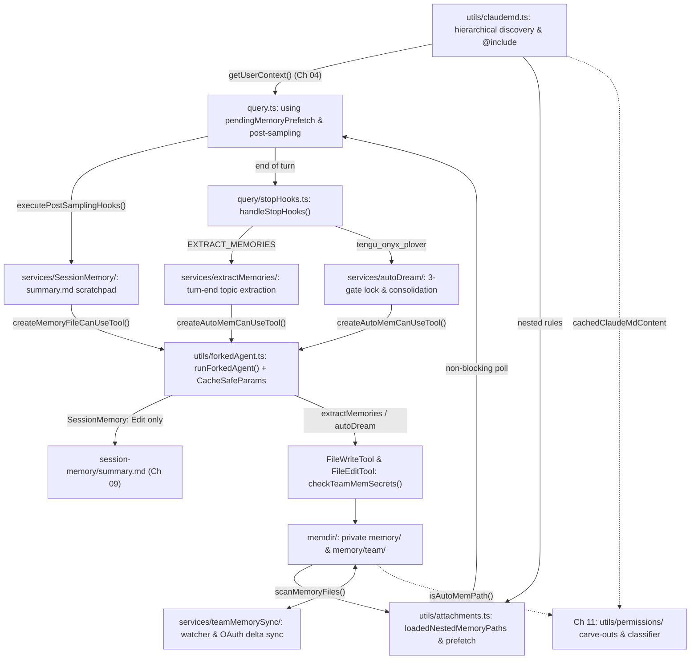

# 10. Memory Systems: `CLAUDE.md`, Auto-Memory, Session Memory, and Auto-Dream

> **Status: written.** Reverse-engineered from the Claude Code 2.1.88 source snapshot (see the Prologue (`prologue-how-to-read-a-1900-file-agent.md`) for snapshot caveats).
>
> **Layer:** Layer 3 (Long-Horizon Context & Memory)
> **Prerequisites:** [Chapter 01](ch001-atoms-types-stores-and-primitives.md), [Chapter 02](ch002-the-tool-contract.md), [Chapter 04](ch004-prompt-engineering-and-cache-boundaries.md), [Chapter 07](ch007-the-heartbeat-query-loop.md), [Chapter 08](ch008-session-envelope-query-engine-and-transcripts.md), [Chapter 09](ch009-five-layer-compaction-pipeline.md)
> **Primary Source Files:**
> - `utils/claudemd.ts` — `CLAUDE.md` discovery, HTML stripping, `@include`, `.claude/rules/`, caches (1,479 lines)
> - `utils/attachments.ts`, `query.ts`, `bootstrap/state.ts` — nested memory injection, `loadedNestedMemoryPaths`, `using`-scoped `startRelevantMemoryPrefetch()`, and `cachedClaudeMdContent`
> - `memdir/memdir.ts`, `memdir/memoryTypes.ts`, `memdir/memoryScan.ts`, `memdir/findRelevantMemories.ts` — `MEMORY.md` truncation, 4-type taxonomy, frontmatter scan, and Sonnet relevance selector
> - `memdir/paths.ts`, `memdir/memoryAge.ts`, `memdir/teamMemPaths.ts`, `memdir/teamMemPrompts.ts` — enablement & path trust, staleness caveats, symlink containment, and team prompts
> - `services/SessionMemory/sessionMemory.ts`, `services/SessionMemory/sessionMemoryUtils.ts`, `services/SessionMemory/prompts.ts` — post-sampling scratchpad feeding [Chapter 09](ch009-five-layer-compaction-pipeline.md)
> - `services/extractMemories/`: `services/extractMemories/extractMemories.ts`, `services/extractMemories/prompts.ts` — turn-end topic extraction, coalescing, and `createAutoMemCanUseTool()`
> - `services/autoDream/autoDream.ts`, `services/autoDream/config.ts`, `services/autoDream/consolidationLock.ts`, `services/autoDream/consolidationPrompt.ts` — 3-gate consolidation, PID+mtime lock, and leaf config
> - `services/teamMemorySync/`: `services/teamMemorySync/index.ts`, `services/teamMemorySync/secretScanner.ts`, `services/teamMemorySync/teamMemSecretGuard.ts`, `services/teamMemorySync/types.ts`, `services/teamMemorySync/watcher.ts` — OAuth delta sync, gitleaks scanning, and circuit-broken watcher
> - `utils/forkedAgent.ts` (Ch 18 seam) and `tasks/DreamTask/DreamTask.ts` (Ch 17 seam)
> - *(Snapshot absences — call sites only, never linked: `memdir/memoryShapeTelemetry.js`, `types/message.js`, `constants/querySource.js`)*

---

## Why This Layer Exists

[Chapter 09](ch009-five-layer-compaction-pipeline.md) showed how Claude Code forgets turns to fit a finite window. Memory solves the symmetric problem across five horizons: `CLAUDE.md`/`.claude/rules/`, persistent `memdir/` with optional relevance prefetch, live `SessionMemory` (`summary.md`), turn-end `extractMemories` plus `autoDream` consolidation, and OAuth `teamMemorySync`.

Every tier upholds three invariants: preserve the prompt cache ([Chapter 04](ch004-prompt-engineering-and-cache-boundaries.md)), keep latency off the critical path, and prevent arbitrary writes or credential leaks.

---

## 1. Hierarchical `CLAUDE.md`, Conditional Rules, and Nested Injection (`utils/claudemd.ts`, `utils/attachments.ts`)

### The Problem

[Chapter 04](ch004-prompt-engineering-and-cache-boundaries.md) covered `getUserContext()` (`context.ts:155-189`), honoring `CLAUDE_CODE_DISABLE_CLAUDE_MDS` and `--bare` before `getMemoryFiles()` → `filterInjectedMemoryFiles()` → `getClaudeMds()`. Beneath it sit six challenges: priority scopes, nested worktrees, HTML comments, recursive `@include`s, path-scoped rules, and [Chapter 01](ch001-atoms-types-stores-and-primitives.md)'s 100-entry LRU `FileStateCache` evicting injected `CLAUDE.md` files.

### The Mechanism: Reverse-Priority Walk, Single-Pass Lexing, and 4-Phase Nested Injection

`getMemoryFiles()` (`utils/claudemd.ts:790-1075`) memoizes an async walker loading scopes in **reverse priority** so local rules sit closest to model attention (docblock at `utils/claudemd.ts:9-10`):

1. **Managed (`utils/claudemd.ts:804-823`):** Always loaded (ungated by `isSettingSourceEnabled`). Reads platform `<managedDir>/CLAUDE.md` (`utils/settings/managedPath.ts:8-25`) and unconditional `.claude/rules/*.md`.
2. **User (`utils/claudemd.ts:826-847`):** Gated on `userSettings`. Loads `~/.claude/CLAUDE.md` and unconditional `~/.claude/rules/*.md` (`conditionalRule: false`, `utils/claudemd.ts:844`) with `includeExternal = true` (trusted outside `originalCwd`).
3. **Root-to-CWD Project & Local (`utils/claudemd.ts:850-934`):** Walks upward from `getOriginalCwd()` stopping before root (`!== parse(currentDir).root`), reverses root → CWD, and loads `CLAUDE.md`, `.claude/CLAUDE.md`, unconditional `.claude/rules/*.md` (`projectSettings`), and `CLAUDE.local.md` (`localSettings`).
4. **Opt-in `--add-dir` (`utils/claudemd.ts:940-977`):** Gated on `CLAUDE_CODE_ADDITIONAL_DIRECTORIES_CLAUDE_MD`; bypasses `projectSettings` (explicit user intent; SDK defaults `settingSources` to `[]`).
5. **`AutoMem` & `TeamMem` entrypoints (`utils/claudemd.ts:980-1007`):** When `isAutoMemoryEnabled()` (and under `feature('TEAMMEM')`, `isTeamMemoryEnabled()`), reads `MEMORY.md` and `team/MEMORY.md` via direct `safelyReadMemoryFileAsync()`—skipping `@include` and `claudeMdExcludes`.

Dedup never inspects `stat.ino`. `processMemoryFile()` (`utils/claudemd.ts:618-685`) tracks `processedPaths: Set<string>` via `normalizePathForComparison()` (`utils/file.ts:565-577`) plus `safeResolvePath()`'s symlink target (`utils/fsOperations.ts:138-178`, blocking UNC paths and FIFOs/sockets before `realpathSync`). `processMdRules()` (`utils/claudemd.ts:697-788`) adds `visitedDirs` to break directory-symlink cycles.

`parseMemoryFileContent()` (`utils/claudemd.ts:343-400`) rejects binary files outside `TEXT_FILE_EXTENSIONS` (`utils/claudemd.ts:96-227`) and parses YAML `paths:` via `parseFrontmatterPaths()` (`utils/claudemd.ts:254-279`, using `quoteProblematicValues()` at `utils/frontmatterParser.ts:85-121` and brace-aware `splitPathInFrontmatter()` at `utils/frontmatterParser.ts:189-232`). It lexes once for `stripHtmlCommentsFromTokens()` (`utils/claudemd.ts:303-334`) and `extractIncludePathsFromTokens()` (`utils/claudemd.ts:451-535`):

```ts
// utils/claudemd.ts:356-388
const { content: withoutFrontmatter, paths } =
  parseFrontmatterPaths(rawContent)

// Lex once so strip and @include-extract share the same tokens. gfm:false
// is required by extract (so ~/path doesn't tokenize as strikethrough) and
// doesn't affect strip (html blocks are a CommonMark rule).
const hasComment = withoutFrontmatter.includes('<!--')
const tokens =
  hasComment || includeBasePath !== undefined
    ? new Lexer({ gfm: false }).lex(withoutFrontmatter)
    : undefined

// Only rebuild via tokens when a comment actually needs stripping —
// marked normalises \r\n during lex, so round-tripping a CRLF file
// through token.raw would spuriously flip contentDiffersFromDisk.
const strippedContent =
  hasComment && tokens
    ? stripHtmlCommentsFromTokens(tokens).content
    : withoutFrontmatter

const includePaths =
  tokens && includeBasePath !== undefined
    ? extractIncludePathsFromTokens(tokens, includeBasePath)
    : []

// Truncate MEMORY.md entrypoints to the line AND byte caps
let finalContent = strippedContent
if (type === 'AutoMem' || type === 'TeamMem') {
  finalContent = truncateEntrypointContent(strippedContent).content
}

// Covers frontmatter strip, HTML comment strip, and MEMORY.md truncation
const contentDiffersFromDisk = finalContent !== rawContent
```

`stripHtmlCommentsFromTokens()` strips closed block `html` tokens (`<!--`..`-->`), preserving code blocks, inline comments, unclosed typos, and trailing type-2 text. `@include` caps depth at `MAX_INCLUDE_DEPTH = 5` (`utils/claudemd.ts:537`) and flags non-`User` includes outside CWD via `getExternalClaudeMdIncludes()` (`utils/claudemd.ts:1404-1414`). Three filters shape injection:

- **`isClaudeMdExcluded()` (`utils/claudemd.ts:547-612`):** Matches `settings.claudeMdExcludes` via `picomatch` on `User`/`Project`/`Local` only, resolving prefixes through `realpathSync` (`resolveExcludePatterns()`) for macOS `/tmp`.
- **`filterInjectedMemoryFiles()` (`utils/claudemd.ts:1142-1151`):** Strips `AutoMem`/`TeamMem` under GrowthBook `tengu_moth_copse`.
- **`getClaudeMds()` (`utils/claudemd.ts:1153-1195`):** Omits `Project`/`Local` under GrowthBook `tengu_paper_halyard`, wraps `TeamMem` in `<team-memory-content source="shared">` (`feature('TEAMMEM')`), and leaves `CLAUDE.md` untruncated (`MAX_MEMORY_CHARACTER_COUNT = 40000` at `utils/claudemd.ts:92`, `getLargeMemoryFiles()` at `utils/claudemd.ts:1132-1134` advisory).

For lazy discovery, `FileReadTool` appends read paths to `nestedMemoryAttachmentTriggers` (`tools/FileReadTool/FileReadTool.ts:848`, `tools/FileReadTool/FileReadTool.ts:870`, `tools/FileReadTool/FileReadTool.ts:1038`). `getAttachments()` awaits `@`-mentions first (`utils/attachments.ts:819`) before draining triggers (`utils/attachments.ts:872`, skipped under `CLAUDE_CODE_DISABLE_ATTACHMENTS`/`CLAUDE_CODE_SIMPLE`, `utils/attachments.ts:753-754`), and `getOpenedFileFromIDE()` calls discovery directly (`utils/attachments.ts:1878`).

`getNestedMemoryAttachmentsForFile()` (`utils/attachments.ts:1792-1862`) checks `pathInAllowedWorkingPath()`, then runs four phases: (1) Managed/User conditional rules (`utils/claudemd.ts:1205-1238`), (2) `getDirectoriesToProcess()` (`utils/attachments.ts:1656-1689`: `nestedDirs` CWD→target, `cwdLevelDirs` root→CWD). Phases (3) nested dirs (`utils/claudemd.ts:1249-1318`) and (4) ancestor rules (`utils/claudemd.ts:1329-1397`, `ignore()`) both honor GrowthBook `tengu_paper_halyard` (`utils/attachments.ts:1823-1826`, `utils/attachments.ts:1834`, `utils/attachments.ts:1851`).

`memoryFilesToAttachments()` (`utils/attachments.ts:1710-1775`) decouples session-wide deduplication from edit-safety caching:

```ts
// utils/attachments.ts:1718-1750
for (const memoryFile of memoryFiles) {
  // Dedup: loadedNestedMemoryPaths is a non-evicting Set; readFileState
  // is a 100-entry LRU that drops entries in busy sessions, so relying
  // on it alone re-injects the same CLAUDE.md on every eviction cycle.
  if (toolUseContext.loadedNestedMemoryPaths?.has(memoryFile.path)) {
    continue
  }
  if (!toolUseContext.readFileState.has(memoryFile.path)) {
    attachments.push({
      type: 'nested_memory',
      path: memoryFile.path,
      content: memoryFile,
      displayPath: relative(getCwd(), memoryFile.path),
    })
    toolUseContext.loadedNestedMemoryPaths?.add(memoryFile.path)

    // Mark as loaded in readFileState — this provides cross-function and
    // cross-turn dedup via the .has() check above.
    //
    // When the injected content doesn't match disk (stripped HTML comments,
    // stripped frontmatter, truncated MEMORY.md), cache the RAW disk bytes
    // with `isPartialView: true`. Edit/Write see the flag and require a real
    // Read first; getChangedFiles sees real content + undefined offset/limit
    // so mid-session change detection still works.
    toolUseContext.readFileState.set(memoryFile.path, {
      content: memoryFile.contentDiffersFromDisk
        ? (memoryFile.rawContent ?? memoryFile.content)
        : memoryFile.content,
      timestamp: Date.now(),
      offset: undefined,
      limit: undefined,
      isPartialView: memoryFile.contentDiffersFromDisk,
    })
```

### Hidden Invariants & Production Scars

- **Non-evicting `Set` vs. 100-entry LRU:** `FileStateCache` caps at `100` entries / `25 MB` (`utils/fileStateCache.ts:18-22`). Storing paths in `loadedNestedMemoryPaths` (`Tool.ts:222`, owned by `QueryEngine.ts:198` and `screens/REPL.tsx:1967`) stops eviction re-injection; compaction (`services/compact/compact.ts:522`, `services/compact/compact.ts:921`) and `/clear` (`commands/clear/conversation.ts:132`) clear it.
- **Silent vs. hook-arming cache resets:** Worktrees, settings sync, and `/memory` call silent `clearMemoryFileCaches()` (`utils/claudemd.ts:1119-1122`). Reloads call `resetGetMemoryFilesCache('compact')` (`utils/claudemd.ts:1124-1130`), arming `shouldFireHook = true` alongside `getUserContext.cache.clear?.()` in [Chapter 09](ch009-five-layer-compaction-pipeline.md)'s `services/compact/postCompactCleanup.ts:59-60`.
- **Nested git worktree dedup (`#29599`, `utils/claudemd.ts:859-934`):** Inside `.claude/worktrees/<name>/`, `skipProject` skips checked-in `Project` files above the worktree while keeping gitignored `CLAUDE.local.md` from main.
- **`unconditionalProcessedPaths` clone scar (`utils/claudemd.ts:1288-1315`):** `processMdRules()` marks every visited `.md` in `processedPaths` before filtering `conditionalRule`; cloning `processedPaths` for the unconditional pass avoids silencing sibling conditional rules.
- **Stale docblock ordering scar (`utils/claudemd.ts:23`, `utils/claudemd.ts:616` vs. `utils/claudemd.ts:663-682`):** Both docblocks claim `@include`d children precede their parent, yet code pushes the parent first (`result.push(memoryFile)`) and appends children after.

---

## 2. Persistent Auto-Memory & Team Memory Layout (`memdir/`)

### The Problem

Writable cross-session memory raises four hazards: hostile repos redirecting writes to `~/.ssh`, unbounded `MEMORY.md` indexes bloating turn-1 context, models saving derivable code or stale `file:line` claims, and symlink traversal in shared team memory.

### The Mechanism: Path Trust, Dual Caps, 4-Type Taxonomy, and Two-Pass Containment

`memdir/paths.ts` resolves enablement via 5-level `isAutoMemoryEnabled()` (`memdir/paths.ts:30-55`): (1) tri-state `CLAUDE_CODE_DISABLE_AUTO_MEMORY` (truthy off, defined-falsy forces on); (2) `CLAUDE_CODE_SIMPLE` (`--bare` off); (3) `CLAUDE_CODE_REMOTE` off unless `CLAUDE_CODE_REMOTE_MEMORY_DIR` is set; (4) `settings.autoMemoryEnabled`; (5) default `true`.

`getAutoMemPath()` (`memdir/paths.ts:223-235`) memoizes per `getProjectRoot()` (skipping four `parseSettingsFile` calls per render) and shares one dir across worktrees via `findCanonicalGitRoot()` (`memdir/paths.ts:203-205`, `#24382`). `getAutoMemPathSetting()` (`memdir/paths.ts:179-186`) reads `autoMemoryDirectory` from policy, flag, local, and user settings—**excluding `projectSettings`**. `validateMemoryPath()` (`memdir/paths.ts:109-150`) rejects relative paths, bare `~`/`~/`, drive roots, UNC prefixes, and null bytes.

> [!WARNING]
> **Path Trust Boundary (Ch 10 → Ch 11):** Because `~/.claude/` sits inside `DANGEROUS_DIRECTORIES`, `utils/permissions/filesystem.ts:1572-1581` grants a silent pre-safety write carve-out when `!hasAutoMemPathOverride() && isAutoMemPath(normalizedPath)`. Excluding `projectSettings` blocks hostile repos from redirecting writes to `~/.ssh`; `CLAUDE_COWORK_MEMORY_PATH_OVERRIDE` (`memdir/paths.ts:161-166`) sets `hasAutoMemPathOverride()` (`memdir/paths.ts:194-196`) `true`, withholding silent writes from SDK mounts.

Both `utils/claudemd.ts:384` and subagent `buildMemoryPrompt()` (`memdir/memdir.ts:272-316`) bound `MEMORY.md` via `truncateEntrypointContent()` (`memdir/memdir.ts:57-103`) at `MAX_ENTRYPOINT_LINES = 200` and `MAX_ENTRYPOINT_BYTES = 25_000` (`memdir/memdir.ts:35-38`). It checks `wasByteTruncated` on original `trimmed.length` (UTF-16 units, unlike `services/teamMemorySync/index.ts:435`'s `Buffer.byteLength`) and slices at `lastIndexOf('\n', MAX_ENTRYPOINT_BYTES)` so links never split mid-line.

`loadMemoryPrompt()` (`memdir/memdir.ts:419-507`) feeds [Chapter 04](ch004-prompt-engineering-and-cache-boundaries.md)'s `systemPromptSection('memory', ...)` (`constants/prompts.ts:495`). In Team and Individual modes (not `KAIROS`), it calls `ensureMemoryDirExists()` (`memdir/memdir.ts:129-147`) so `DIR_EXISTS_GUIDANCE` / `DIRS_EXIST_GUIDANCE` (`memdir/memdir.ts:116-119`) avoids `ls`/`mkdir -p` turns, threading `CLAUDE_COWORK_MEMORY_EXTRA_GUIDELINES` (`memdir/memdir.ts:441-446`) into both builders. Mode precedence:

1. **`feature('KAIROS') && autoEnabled && getKairosActive()` (`memdir/memdir.ts:432-438`):** `buildAssistantDailyLogPrompt()` (`memdir/memdir.ts:327-370`) overrides team memory, skips `ensureMemoryDirExists()` (instructing first-write creation at `memdir/memdir.ts:348`), and emits literal `<autoMemPath>/logs/YYYY/MM/YYYY-MM-DD.md` to survive midnight rollover.
2. **`feature('TEAMMEM') && isTeamMemoryEnabled()` (`memdir/memdir.ts:448-473`):** Requires auto-memory + GrowthBook `tengu_herring_clock` (`memdir/teamMemPaths.ts:73-78`), calls `ensureMemoryDirExists(teamDir)` (`memdir/memdir.ts:459`, creating `autoDir` via recursive `mkdir`), and returns `buildCombinedMemoryPrompt()` (`memdir/teamMemPrompts.ts:22-100`).
3. **Individual auto-memory (`memdir/memdir.ts:475-490`):** Calls `ensureMemoryDirExists(autoDir)` (`memdir/memdir.ts:479`) and returns `buildMemoryLines()` (`memdir/memdir.ts:199-266`).

All three builders append GrowthBook `tengu_coral_fern` search guidance via `buildSearchingPastContextSection()` (`memdir/memdir.ts:375-407`, called at `memdir/memdir.ts:366`, `memdir/teamMemPrompts.ts:96`, `memdir/memdir.ts:263`).

`memdir/memoryTypes.ts` defines the closed 4-type taxonomy (`'user' | 'feedback' | 'project' | 'reference'`, `memdir/memoryTypes.ts:14-21`) and `WHAT_NOT_TO_SAVE_SECTION` (`memdir/memoryTypes.ts:183-195`).

`memdir/memoryAge.ts` formats `"today"`/`"yesterday"`/`"N days ago"` via `memoryAge()` (`memdir/memoryAge.ts:15-20`); `memoryFreshnessText()` (`memdir/memoryAge.ts:33-42`) emits `"This memory is N days old..."` caveats for files `> 1` day old, wrapped in `<system-reminder>` by `memoryFreshnessNote()` (`memdir/memoryAge.ts:49-53`, `tools/FileReadTool/FileReadTool.ts:747-753`).

For `<autoMemPath>/team/`, `memdir/teamMemPaths.ts` enforces PSR M22186/M22187 via `sanitizePathKey()` (`memdir/teamMemPaths.ts:22-64`), blocking null bytes, URL-encoded traversals, NFKC fullwidth `．．／`, backslashes, and leading `/`. `validateTeamMemWritePath()` (`memdir/teamMemPaths.ts:228-256`) and `validateTeamMemKey()` (`memdir/teamMemPaths.ts:265-284`) pair trailing-sep containment with `realpathDeepestExisting()` (`memdir/teamMemPaths.ts:109-171`), trapping dangling symlinks, `ELOOP`, and `EACCES`/`EIO`.

### Hidden Invariants & Production Scars

- **197 KB `MEMORY.md` p100 scar (`memdir/memdir.ts:36-38`):** Long single-line paragraphs hit 197 KB under 200 lines, forcing the dual cap and original-length check.
- **Eval-validated wording (`memdir/memoryTypes.ts:192-194`, `memdir/memoryTypes.ts:204-222`, `memdir/memoryTypes.ts:224-256`):** Tightening save exclusions jumped 0/2 → 3/3; `#22856` added the ignore-memory rule (`memdir/memoryTypes.ts:220`); renaming `"Trusting what you recall"` to `"## Before recommending from memory"` (same body) jumped 0/3 → 3/3 (0/3 gap on slash commands like `/fork`).

---

## 3. Latency-Hidden Relevant Memory Prefetch with `using` (`memdir/memoryScan.ts`, `memdir/findRelevantMemories.ts`, `utils/attachments.ts`, `query.ts`)

### The Problem

Eager `MEMORY.md` injection crowds context as topic files grow, yet synchronous relevance selection adds ~500–1,500 ms to time-to-first-token.

### The Mechanism: Four-Subsystem `tengu_moth_copse` Switch & Disposable Zero-Wait Prefetch

One GrowthBook flag, `tengu_moth_copse` (default `false`), switches four subsystems: `filterInjectedMemoryFiles()` (`utils/claudemd.ts:1142-1151`) strips `AutoMem`/`TeamMem` `MEMORY.md`, both `memdir/memdir.ts:422-425` (inside `loadMemoryPrompt()`) and `services/extractMemories/extractMemories.ts:366-369` set `skipIndex = true`, and `startRelevantMemoryPrefetch()` (`utils/attachments.ts:2361-2424`) activates in `queryLoop`.

`findRelevantMemories()` (`memdir/findRelevantMemories.ts:39-75`) calls `scanMemoryFiles()` (`memdir/memoryScan.ts:35-77`, split for circular import `#25372`), scanning up to `200` newest `.md` files (30 header lines + `mtimeMs` in one `readFileInRange()` call). Pre-filtering `!alreadySurfaced`, `selectRelevantMemories()` (`memdir/findRelevantMemories.ts:77-141`) builds `formatMemoryManifest()` (`memdir/memoryScan.ts:84-94`) and runs Sonnet `sideQuery` (`max_tokens: 256`, `json_schema`, up to 5 files, `recentTools` suppression at `utils/attachments.ts:2465-2503`).

> [!NOTE]
> **Snapshot Absence (`memdir/memoryShapeTelemetry.js`):** Under `feature('MEMORY_SHAPE_TELEMETRY')`, `memdir/findRelevantMemories.ts:66-72` requires `./memoryShapeTelemetry.js` and calls `logMemoryRecallShape(memories, selected)` even when empty; `utils/sessionFileAccessHooks.ts:38-40` and `utils/sessionFileAccessHooks.ts:210-224` call `logMemoryWriteShape()`. Absent from this snapshot (call sites only).

To hide `sideQuery` latency behind streaming and tools, `query.ts:297-304` binds `using pendingMemoryPrefetch = startRelevantMemoryPrefetch(state.messages, state.toolUseContext)` once per turn before `while (true)`. Four cheap guards—`isAutoMemoryEnabled()` + `tengu_moth_copse`, non-meta prompt, `>= 2` words, and `collectSurfacedMemories(messages).totalBytes < 60 * 1024` (`utils/attachments.ts:2383-2386`, `RELEVANT_MEMORIES_CONFIG.MAX_SESSION_BYTES` at `utils/attachments.ts:279-289`)—return `undefined` (`using` no-op); otherwise it returns a handle:

```ts
// utils/attachments.ts:2390-2423
const controller = createChildAbortController(toolUseContext.abortController)
const firedAt = Date.now()
const promise = getRelevantMemoryAttachments(
  input,
  toolUseContext.options.agentDefinitions.activeAgents,
  toolUseContext.readFileState,
  collectRecentSuccessfulTools(messages, lastUserMessage),
  controller.signal,
  surfaced.paths,
).catch(e => {
  if (!isAbortError(e)) {
    logError(e)
  }
  return []
})

const handle: MemoryPrefetch = {
  promise,
  settledAt: null,
  consumedOnIteration: -1,
  [Symbol.dispose]() {
    controller.abort()
    logEvent('tengu_memdir_prefetch_collected', {
      hidden_by_first_iteration:
        handle.settledAt !== null && handle.consumedOnIteration === 0,
      consumed_on_iteration: handle.consumedOnIteration,
      latency_ms: (handle.settledAt ?? Date.now()) - firedAt,
    })
  },
}
void promise.finally(() => {
  handle.settledAt = Date.now()
})
return handle
```

At `queryLoop`'s post-tools stage (`query.ts:1592-1614`), collection **never waits**: it polls `settledAt !== null && consumedOnIteration === -1`, skipping if still running. When ready, `filterDuplicateMemoryAttachments()` (`utils/attachments.ts:2520-2541`) filters survivors, yields `<system-reminder>` attachments (`utils/messages.ts:3708-3722`), and sets `consumedOnIteration = turnCount - 1`.

### Hidden Invariants & Production Scars

- **Deterministic disposal across 12 `queryLoop` exits:** TC39 `using` ensures `[Symbol.dispose]()` runs on all 12 `return { reason: ... }` exits (`query.ts:646` through `query.ts:1711`), throws, and `.return()`, cancelling orphaned side-queries and emitting `tengu_memdir_prefetch_collected`. `createChildAbortController()` (`utils/abortController.ts:68-99`) propagates Escape downward, isolates child abort, and cleans up via `WeakRef`.
- **Precomputed `memoryHeader` cache-bust scar (`utils/attachments.ts:505-514`, `utils/attachments.ts:2327-2332`):** Formatting `"saved N days ago"` at render time (`utils/messages.ts:3715`) flips across midnight and busts cache; freezing `header` at creation stays byte-stable.
- **Mark-after-filter scar (`utils/attachments.ts:2506-2541`):** Writing paths to `readFileState` during `readMemoriesForSurfacing()` (`utils/attachments.ts:2279-2321`, capped at `200` lines / `4096` bytes at `utils/attachments.ts:269-277`) made `filterDuplicateMemoryAttachments()` drop 100% of prefetched memories. Writing survivors *after* filtering breaks the cycle.
- **Self-healing 60 KB budget (`utils/attachments.ts:2251-2266`):** Scanning `messages` in `collectSurfacedMemories()` instead of a mutable counter lets [Chapter 09](ch009-five-layer-compaction-pipeline.md) compaction restore the budget automatically.

---

## 4. Cache-Sharing Background Agents: `SessionMemory` and `extractMemories` (`services/SessionMemory/`, `services/extractMemories/`, `utils/forkedAgent.ts`)

### The Problem

Background memory agents must read live history without cold `cache_creation` penalties or uncontrolled repo edits.

### The Mechanism: `runForkedAgent()` Prefix Reuse, Mid-Turn Scratchpads, and Turn-End Extraction

`SessionMemory`, `extractMemories`, and `autoDream` run via `utils/forkedAgent.ts` (**forward seam to Chapter 18**). `runForkedAgent()` (`utils/forkedAgent.ts:489-626`) takes `createCacheSafeParams(context)` (`utils/forkedAgent.ts:131-141`) to preserve exact `systemPrompt`, `userContext`, `systemContext`, `toolUseContext`, and `forkContextMessages`.

`createSubagentContext()` (`utils/forkedAgent.ts:345-462`) clones `readFileState` and `contentReplacementState`, starts fresh `loadedNestedMemoryPaths` (`utils/forkedAgent.ts:383`), and stubs `setAppState` while keeping `setAppStateForTasks`. *(Both `constants/querySource.js` at `utils/forkedAgent.ts:14` and `types/message.js` at `utils/forkedAgent.ts:26` are absent from this snapshot; call sites only.)*

#### A. Live Session Scratchpad (`services/SessionMemory/`)

`initSessionMemory()` (`services/SessionMemory/sessionMemory.ts:357-375`) runs inside `!isBareMode()` (`setup.ts:293`, calling `initSessionMemory()` at `setup.ts:294`), exits on remote mode (`services/SessionMemory/sessionMemory.ts:358`), logs `tengu_session_memory_init` under `USER_TYPE === 'ant'` (`services/SessionMemory/sessionMemory.ts:363-367`), exits if `!isAutoCompactEnabled()` (`services/SessionMemory/sessionMemory.ts:369-371`), and calls `registerPostSamplingHook()` (`utils/hooks/postSamplingHooks.ts:31-33`, fired at `query.ts:1000-1009`).

- **FIFO queue & thresholds:** `sequential()` (`utils/sequential.ts:19-56`) serializes ticks. After `querySource === 'repl_main_thread'` and lazy GrowthBook `tengu_session_memory` / `tengu_sm_config` (`> 0` overrides), `shouldExtractMemory()` (`services/SessionMemory/sessionMemory.ts:134-181`) triggers at `>= 10000` init tokens, then `+5000` tokens with `>= 3` tool calls or a tool-free break.
- **Atomic init & Edit-only sandbox:** `setupSessionMemoryFile()` (`services/SessionMemory/sessionMemory.ts:183-233`) creates `summary.md` via `flag: 'wx'` (`O_CREAT|O_EXCL`, `0o600`), seeds the 10-section template (`services/SessionMemory/prompts.ts:11-41`), and deletes `memoryPath` from `readFileState` before `FileReadTool.call` to prevent a `file_unchanged` stub. `createMemoryFileCanUseTool(memoryPath)` (`services/SessionMemory/sessionMemory.ts:460-482`) permits **only** `FILE_EDIT_TOOL_NAME` on exact `memoryPath`.
- **Safe cursor:** `updateLastSummarizedMessageIdIfSafe()` (`services/SessionMemory/sessionMemory.ts:488-495`) advances `lastSummarizedMessageId` only when `!hasToolCallsInLastAssistantTurn(messages)` so [Chapter 09](ch009-five-layer-compaction-pipeline.md)'s `trySessionMemoryCompaction()` (`services/compact/sessionMemoryCompact.ts:514-630`, calling `calculateMessagesToKeepIndex()` at `services/compact/sessionMemoryCompact.ts:571-574`) never splits a tool pair.
- **Leaf utils:** `services/SessionMemory/sessionMemoryUtils.ts` isolates `waitForSessionMemoryExtraction()` (`15s` wait / `60s` stale) from `runAgent`, while `services/SessionMemory/prompts.ts` exports `isSessionMemoryEmpty()` and `truncateSessionMemoryForCompact()` (`services/SessionMemory/prompts.ts:256-324`).

#### B. Turn-End Topic Extraction (`services/extractMemories/`)

Because Bun's `feature()` tree-shakes direct `if` checks only (docblock at `memdir/paths.ts:65-67`), `feature('EXTRACT_MEMORIES')` sits at three caller boundaries—never inside `services/extractMemories/extractMemories.ts`: `utils/backgroundHousekeeping.ts:34-36`, `query/stopHooks.ts:141-153`, and `cli/print.ts:967-969`.

At turn end, `query/stopHooks.ts:136` checks `!isBareMode()`, and `query/stopHooks.ts:141-153` checks `!agentId` plus `isExtractModeActive()` (`memdir/paths.ts:69-77`, GrowthBook `tengu_passport_quail` + non-interactive GrowthBook `tengu_slate_thimble`); headless exit calls `drainPendingExtraction()` (`services/extractMemories/extractMemories.ts:611-615`) via its 60s `.unref()` `drainer` closure (`services/extractMemories/extractMemories.ts:579-586`).

`runExtraction()` (`services/extractMemories/extractMemories.ts:329-523`) skips via `hasMemoryWritesSince()` (`services/extractMemories/extractMemories.ts:121-148`) after main-agent writes, throttles via GrowthBook `tengu_bramble_lintel` (`services/extractMemories/extractMemories.ts:377-386`), and coalesces overlapping turns into one trailing `pendingContext` pass (`services/extractMemories/extractMemories.ts:503-522`, `services/extractMemories/extractMemories.ts:557-564`).

The fork runs with `skipTranscript: true`, `maxTurns: 5`, 2-turn batching (`services/extractMemories/prompts.ts:29-154`), compaction-safe cursor fallback (`services/extractMemories/extractMemories.ts:103-108`), and `createAutoMemCanUseTool()` (`services/extractMemories/extractMemories.ts:171-222`):

```ts
// services/extractMemories/extractMemories.ts:171-222
export function createAutoMemCanUseTool(memoryDir: string): CanUseToolFn {
  return async (tool: Tool, input: Record<string, unknown>) => {
    // Allow REPL — when REPL mode is enabled (ant-default), primitive tools
    // are hidden from the tool list so the forked agent calls REPL instead.
    // REPL's VM context re-invokes this canUseTool for each inner primitive
    // (toolWrappers.ts createToolWrapper), so the Read/Bash/Edit/Write checks
    // below still gate the actual file and shell operations. Giving the fork a
    // different tool list would break prompt cache sharing (tools are part of
    // the cache key — see CacheSafeParams in forkedAgent.ts).
    if (tool.name === REPL_TOOL_NAME) {
      return { behavior: 'allow' as const, updatedInput: input }
    }
    // ...
    if (tool.name === BASH_TOOL_NAME) {
      const parsed = tool.inputSchema.safeParse(input)
      if (parsed.success && tool.isReadOnly(parsed.data)) {
        return { behavior: 'allow' as const, updatedInput: input }
      }
      // ...
    }

    if (
      (tool.name === FILE_EDIT_TOOL_NAME ||
        tool.name === FILE_WRITE_TOOL_NAME) &&
      'file_path' in input
    ) {
      const filePath = input.file_path
      if (typeof filePath === 'string' && isAutoMemPath(filePath)) {
        return { behavior: 'allow' as const, updatedInput: input }
      }
    }
    // ...
  }
}
```

### Hidden Invariants & Production Scars

> [!IMPORTANT]
> **The `REPL_TOOL_NAME` Cache-Key Scar (`services/extractMemories/extractMemories.ts:173-182`):** Because `tools[]` hashes first in the prompt cache ([Chapter 04](ch004-prompt-engineering-and-cache-boundaries.md)), forks cannot strip tools without busting cache. Claude Code sends the full tool pool (allowing `REPL_TOOL_NAME` in `ant`-default REPL mode) and enforces least privilege in `canUseTool` as REPL wraps inner `Read`, read-only `Bash`, `Edit`, and `Write`.

- **Missing `try/finally` scar in `extractSessionMemory`:** Manual `/summary` (`services/SessionMemory/sessionMemory.ts:450-452`) calls `markExtractionCompleted()` in `finally`, whereas background `extractSessionMemory` runs unguarded (`services/SessionMemory/sessionMemory.ts:272-350`), calling `markExtractionCompleted()` at `services/SessionMemory/sessionMemory.ts:349`—relying on `EXTRACTION_STALE_THRESHOLD_MS = 60000` (`services/SessionMemory/sessionMemoryUtils.ts:13`, `services/SessionMemory/sessionMemoryUtils.ts:93`) on throws.

---

## 5. Cross-Session Consolidation: `autoDream`'s Three-Gate Lock (`services/autoDream/`, `tasks/DreamTask/DreamTask.ts`)

### The Problem

Per-turn notes accumulate contradictions, relative dates, and index bloat. Consolidating every turn wastes tokens; unlocked consolidation lets concurrent terminals corrupt rewrites.

### The Mechanism: Cheapest-First Funnel, PID+mtime Lock, and Symmetric Rollback

Initialized at `utils/backgroundHousekeeping.ts:37` and fired at `query/stopHooks.ts:154-156` (inside `!isBareMode()`, `query/stopHooks.ts:136`, excluding subagents), `isGateOpen()` (`services/autoDream/autoDream.ts:95-100`) checks `!getKairosActive()`, `!getIsRemoteMode()`, `isAutoMemoryEnabled()`, and `isAutoDreamEnabled()`.

`isAutoDreamEnabled()` lives in 21-line `services/autoDream/config.ts` (`services/autoDream/config.ts:13-21`), where `settings.autoDreamEnabled` overrides GrowthBook `tengu_onyx_plover.enabled`. *(`isForced()` at `services/autoDream/autoDream.ts:105-107` returns `false`.)*

`runAutoDream()` (`services/autoDream/autoDream.ts:125-272`) bounds per-turn cost to at most two cached GrowthBook reads when `settings.autoDreamEnabled` is unset (`getConfig()` at `services/autoDream/autoDream.ts:126` and `isAutoDreamEnabled()` via `isGateOpen()` at `services/autoDream/autoDream.ts:128`) plus one `stat` via a **cheapest-first three-gate funnel** (`services/autoDream/autoDream.ts:126-190`, `DEFAULTS = { minHours: 24, minSessions: 5 }` at `services/autoDream/autoDream.ts:63-66`):

1. **Time gate (1 `stat`):** `readLastConsolidatedAt()` (`services/autoDream/consolidationLock.ts:29-36`) reads `.consolidate-lock`'s `mtime` (`0` if missing); returns unless `hoursSince >= cfg.minHours`.
2. **Scan throttle + Session gate:** Enforces a 10-minute `SESSION_SCAN_INTERVAL_MS` cooldown (`services/autoDream/autoDream.ts:56`, `services/autoDream/autoDream.ts:144-151`) before `listSessionsTouchedSince(lastAt)` (`services/autoDream/consolidationLock.ts:118-124`, using `mtime` since `ext4` `birthtime` is `0` and excluding `agent-*.jsonl`); `runAutoDream()` then excludes `getSessionId()` (`services/autoDream/autoDream.ts:164-165`) and requires `>= cfg.minSessions`.
3. **Cross-process lock:** `tryAcquireConsolidationLock()` (`services/autoDream/consolidationLock.ts:46-84`) writes the holder PID into `.consolidate-lock`, whose `mtime` doubles as `lastConsolidatedAt`:

```ts
// services/autoDream/consolidationLock.ts:60-84
  if (mtimeMs !== undefined && Date.now() - mtimeMs < HOLDER_STALE_MS) {
    if (holderPid !== undefined && isProcessRunning(holderPid)) {
      logForDebugging(
        `[autoDream] lock held by live PID ${holderPid} (mtime ${Math.round((Date.now() - mtimeMs) / 1000)}s ago)`,
      )
      return null
    }
    // Dead PID or unparseable body — reclaim.
  }

  // Memory dir may not exist yet.
  await mkdir(getAutoMemPath(), { recursive: true })
  await writeFile(path, String(process.pid))

  // Two reclaimers both write → last wins the PID. Loser bails on re-read.
  let verify: string
  try {
    verify = await readFile(path, 'utf8')
  } catch {
    return null
  }
  if (parseInt(verify.trim(), 10) !== process.pid) return null

  return mtimeMs ?? 0
}
```

Once locked, `runAutoDream()` calls `registerDreamTask()` in `tasks/DreamTask/DreamTask.ts` (**Ch 17 seam**, `setAppStateForTasks ?? setAppState`, `services/autoDream/autoDream.ts:200-208`). It builds the 4-phase prompt (`services/autoDream/consolidationPrompt.ts:10-65`: Orient → Gather signal → Consolidate → Prune and index) and calls `runForkedAgent()` (`services/autoDream/autoDream.ts:224-233`) with `createAutoMemCanUseTool()`, `skipTranscript: true`, and `makeDreamProgressWatcher()` (`services/autoDream/autoDream.ts:281-313`).

### Hidden Invariants & Production Scars

- **1-hour PID-reuse guard & rollback rewind (`services/autoDream/consolidationLock.ts:19`, `services/autoDream/consolidationLock.ts:91-108`):** `HOLDER_STALE_MS = 60 * 60 * 1000` stops recycled PIDs from deadlocking consolidation. On failure, `rollbackConsolidationLock(priorMtime)` unlinks if `priorMtime === 0` or runs `writeFile(path, '')` *before* `utimes()` so our live PID clears the lock.
- **No double-rollback on user kill (`services/autoDream/autoDream.ts:258-271`, `tasks/DreamTask/DreamTask.ts:136-156`):** `DreamTask.kill` aborts `abortController` and calls `rollbackConsolidationLock(priorMtime)`; `if (abortController.signal.aborted) return` prevents double-rollback or overwriting `'killed'`.
- **21-line leaf config (`services/autoDream/config.ts:1-21`):** Lets UI components query `isAutoDreamEnabled()` without importing `runForkedAgent` or `DreamTask`.

---

## 6. Team Memory Sync, Secret Scanning, and File Watcher (`services/teamMemorySync/`)

### The Problem

Syncing `<autoMemPath>/team/` across collaborators adds three hazards: concurrent edits must not lose local work or hit HTTP 413s, leaked credentials reach the whole org, and naive watchers exhaust fds or spin on permanent auth errors.

### The Mechanism: Asymmetric Delta Sync, Dual-Layer Secret Scanning, and Pull-Before-Watch

`services/teamMemorySync/index.ts` requires first-party OAuth (`isUsingOAuth()`, `services/teamMemorySync/index.ts:151-161`), builds URLs in `getTeamMemorySyncEndpoint()` (`services/teamMemorySync/index.ts:163-167`: `TEAM_MEMORY_SYNC_URL` or `getOauthConfig().BASE_API_URL`), and uses lazy Zod schemas in `services/teamMemorySync/types.ts`.

`SyncState` (`services/teamMemorySync/index.ts:100-119`) tracks `{ lastKnownChecksum, serverChecksums, serverMaxEntries }` (stale "watcher suppression" docblock at `services/teamMemorySync/index.ts:22`). Sync splits conflict policy between pull and push:

- **Server-wins parallel pull (`pullTeamMemory()`, `services/teamMemorySync/index.ts:770-867`):** Sends `If-None-Match` with exponential backoff in `fetchTeamMemory()` (`services/teamMemorySync/index.ts:387-410`, `MAX_RETRIES = 3`). `writeRemoteEntriesToLocal()` (`services/teamMemorySync/index.ts:689-755`) validates keys (`validateTeamMemKey()`), caps at `250_000` bytes, skips unchanged files, and writes in parallel (fixing ~22s p99 pulls). `pullTeamMemory()` calls `clearMemoryFileCaches()` (`services/teamMemorySync/index.ts:851-855`) when `filesWritten > 0`.
- **Local-wins delta push (`pushTeamMemory()` at `services/teamMemorySync/index.ts:889-1146`):** Read-only on disk. Packs `sha256:` deltas into sorted `200_000`-byte `PUT` batches via `batchDeltaByBytes()` (`services/teamMemorySync/index.ts:426-460`, avoiding gateway HTML 413s), advancing `serverChecksums` and `lastKnownChecksum` after each `200`.
- **412 hash probes & dynamic 413 caps:** On `412`, `fetchTeamMemoryHashes()` (`GET ...&view=hashes`, `services/teamMemorySync/index.ts:315-385`) refreshes hashes without bodies (`MAX_CONFLICT_RETRIES = 2`). On structured `413` (`TeamMemoryTooManyEntriesSchema`, `services/teamMemorySync/index.ts:533-542`), `pushTeamMemory()` caches `state.serverMaxEntries` (`services/teamMemorySync/index.ts:1053-1059`) so `readLocalTeamMemory()` truncates sorted keys deterministically (`services/teamMemorySync/index.ts:654-671`).

Credential defense (PSR M22174) uses 36 gitleaks regexes in `services/teamMemorySync/secretScanner.ts` (`ANT_KEY_PFX = ['sk', 'ant', 'api'].join('-')`, `services/teamMemorySync/secretScanner.ts:46`; `SECRET_RULES`, `services/teamMemorySync/secretScanner.ts:48-224`) at two gates:

1. **Upstream fail-closed write guard:** `checkTeamMemSecrets()` (`services/teamMemorySync/teamMemSecretGuard.ts`, `services/teamMemorySync/teamMemSecretGuard.ts:15-44`, `feature('TEAMMEM')`) runs in `validateInput` on `content` (`tools/FileWriteTool/FileWriteTool.ts:157-160`) and `new_string` only (`tools/FileEditTool/FileEditTool.ts:144-147`)—**not** inside `createAutoMemCanUseTool()`—blocking writes pre-disk.
2. **Push-time safety net:** `readLocalTeamMemory()` (`services/teamMemorySync/index.ts:567-673`) runs full-file `scanForSecrets()` (`services/teamMemorySync/index.ts:599-615`), catching Bash, external, and split-edit credentials and returning `skippedSecrets` while pushing clean files. `pushTeamMemory()` logs rule IDs only via `tengu_team_mem_secret_skipped` (`services/teamMemorySync/index.ts:935-944`).

`services/teamMemorySync/watcher.ts` (started inside `!isBareMode()`, `setup.ts:336`, behind `feature('TEAMMEM')`, `setup.ts:365-369`) avoids pull-echo structurally: `startTeamMemoryWatcher()` (`services/teamMemorySync/watcher.ts:252-305`) finishes `pullTeamMemory()` *before* `startFileWatcher()`, watching `404` repos via `fs.watch({ recursive: true })` (O(1) FSEvents vs. 500+ kqueue fds in `chokidar` 4+).

Writes coalesce behind a 2-second `DEBOUNCE_MS` timer (`services/teamMemorySync/watcher.ts:35`), backed by `PostToolUse` `notifyTeamMemoryWrite()` (`utils/sessionFileAccessHooks.ts:201`, `utils/sessionFileAccessHooks.ts:205`) and final flush in `stopTeamMemoryWatcher()` (`services/teamMemorySync/watcher.ts:327-352`).

### Hidden Invariants & Production Scars

- **167K-event `no_oauth` storm & unlink-cleared circuit breaker:** Exponential backoff lives in `fetchTeamMemory()`, not `watcher.ts`. Instead, `watcher.ts` latches `pushSuppressedReason` on permanent failure, clearing it only on unlink (`stat()` → `ENOENT`, `services/teamMemorySync/watcher.ts:187-205`) or restart:

```ts
// services/teamMemorySync/watcher.ts:45-73
// Set after a push fails for a reason that can't self-heal on retry.
// Prevents watch events from other sessions' writes to the shared team
// dir driving an infinite retry loop (BQ Mar 14-16: one no_oauth device
// emitted 167K push events over 2.5 days). Cleared on unlink — file deletion
// is a recovery action for the too-many-entries case, and for no_oauth the
// suppression persisting until session restart is correct.
let pushSuppressedReason: string | null = null

/**
 * Permanent = retry without user action will fail the same way.
 * - no_oauth / no_repo: pre-request client checks, no status code
 * - 4xx except 409/429: client error (404 missing repo, 413 too many
 *   entries, 403 permission). 409 is a transient conflict — server state
 *   changed under us, a fresh push after next pull can succeed. 429 is a
 *   rate limit — watcher-driven backoff is fine.
 */
export function isPermanentFailure(r: TeamMemorySyncPushResult): boolean {
  if (r.errorType === 'no_oauth' || r.errorType === 'no_repo') return true
  if (
    r.httpStatus !== undefined &&
    r.httpStatus >= 400 &&
    r.httpStatus < 500 &&
    r.httpStatus !== 409 &&
    r.httpStatus !== 429
  ) {
    return true
  }
  return false
}
```

---

## Putting Layer 3 Together

```text
Memory Subsystem Horizon, Trigger & Write Boundary Matrix
+-----------------+---------------+----------------------+-------------------+
| Subsystem       | Trigger Seam  | Gate / Throttle      | Write Sandbox     |
+-----------------+---------------+----------------------+-------------------+
| CLAUDE.md/rules | Turn 1 + Read | Always on; Set dedup | RO; isPartialView |
| Memory Prefetch | query() using | tengu_moth_copse     | RO sideQuery <=5  |
| SessionMemory   | Post-sampling | tengu_session_memory | Edit summary.md   |
| extractMemories | Stop hook     | EXTRACT_MEMORIES     | RO/Bash + AutoMem |
| autoDream       | Stop hook     | 24h/5ses + PID lock  | RO/Bash + AutoMem |
| teamMemorySync  | Setup + watch | TEAMMEM + OAuth; 2s  | team/ + 36 rules  |
+-----------------+---------------+----------------------+-------------------+
```



---

## How This Snaps Into the Next Layer

Every memory write boundary and policy signal plugs into **Layer 4** in [Chapter 11](ch011-the-permission-engine.md):

- **Forked-agent callbacks:** `createMemoryFileCanUseTool()` (`services/SessionMemory/sessionMemory.ts:460-482`) and `createAutoMemCanUseTool()` (`services/extractMemories/extractMemories.ts:171-222`) implement `CanUseToolFn` without mutating cached tool schemas.
- **Filesystem helpers & carve-outs:** `utils/permissions/filesystem.ts` owns `getSessionMemoryDir()` / `isSessionMemoryPath()` (`utils/permissions/filesystem.ts:261-278`), the `!hasAutoMemPathOverride() && isAutoMemPath(normalizedPath)` write carve-out (`utils/permissions/filesystem.ts:1572-1581`) withholding silent writes from `CLAUDE_COWORK_MEMORY_PATH_OVERRIDE`, and read carve-outs (`utils/permissions/filesystem.ts:1620-1629`, `utils/permissions/filesystem.ts:1716-1725`).
- **Auto-mode classifier seam:** `cachedClaudeMdContent` (`bootstrap/state.ts:121-123`, `bootstrap/state.ts:1207-1213`) breaks the `claudemd → filesystem → permissions → yoloClassifier` cycle so `buildClaudeMdMessage()` (`utils/permissions/yoloClassifier.ts:460-477`) feeds `CLAUDE.md` into `classifyYoloAction()` (`utils/permissions/permissions.ts:102-105`, `utils/permissions/permissions.ts:693-699`).
- **Layer 6 forward seams:** `tasks/DreamTask/DreamTask.ts` plugs into **Chapter 17**'s background task runtime, and `utils/forkedAgent.ts` opens **Chapter 18**'s subagent runtime.

---

## Reading Exercises & Code Checkpoints

1. **Trace `loadedNestedMemoryPaths` across attachments, compaction, and forks:**
   Run `rg -n "loadedNestedMemoryPaths" utils/attachments.ts services/compact/compact.ts utils/forkedAgent.ts` and verify why a non-evicting `Set` pairs with LRU `readFileState` and clears on compaction.
2. **Trace `tengu_moth_copse` across all four memory subsystems:**
   Run `rg -n "startRelevantMemoryPrefetch|tengu_moth_copse" query.ts utils/attachments.ts utils/claudemd.ts memdir/memdir.ts services/extractMemories/extractMemories.ts` to confirm how one flag swaps static `MEMORY.md` for `using` prefetch and `skipIndex = true`.
3. **Audit background sandboxes and upstream secret scanning:**
   Run `rg -n "createMemoryFileCanUseTool|createAutoMemCanUseTool|checkTeamMemSecrets|isAutoMemPath" services/SessionMemory/sessionMemory.ts services/extractMemories/extractMemories.ts services/autoDream/autoDream.ts services/teamMemorySync/teamMemSecretGuard.ts tools/FileWriteTool/FileWriteTool.ts tools/FileEditTool/FileEditTool.ts utils/permissions/filesystem.ts` and confirm why `checkTeamMemSecrets` runs in `validateInput`.
4. **Verify `autoDream`'s 3-gate lock, symmetric rollback, and leaf config:**
   Run `rg -n "isAutoDreamEnabled|tryAcquireConsolidationLock|rollbackConsolidationLock|registerDreamTask|tengu_onyx_plover" services/autoDream/ tasks/DreamTask/DreamTask.ts` and trace both rollbacks (`services/autoDream/autoDream.ts:270`, `tasks/DreamTask/DreamTask.ts:154`) plus `abortController.signal.aborted`.
