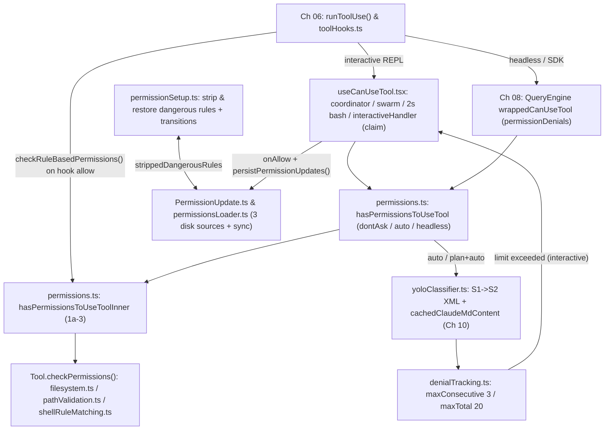

# 11. The Permission Engine: Modes, Rules, Classifiers, and Persistence

> **Status: written.** Reverse-engineered from the Claude Code 2.1.88 source snapshot (see the Prologue (`prologue-how-to-read-a-1900-file-agent.md`) for snapshot caveats).
>
> **Layer:** Layer 4 (Safety, Policy, Sandbox & Lifecycle Hooks)
> **Prerequisites:** [Chapter 01](ch001-atoms-types-stores-and-primitives.md), [Chapter 02](ch002-the-tool-contract.md), [Chapter 06](ch006-executing-tools.md), [Chapter 08](ch008-session-envelope-query-engine-and-transcripts.md), [Chapter 10](ch010-memory-systems-claudemd-auto-memory-and-dream.md)
> **Primary Source Files:**
> - `types/permissions.ts` — mode unions, 8 `PermissionRuleSource`s, `PermissionUpdate`, `PermissionResult`, and `YoloClassifierResult` contracts (441 lines; present in this snapshot)
> - `utils/permissions/PermissionMode.ts` — Zod mode schemas, UI metadata, `toExternalPermissionMode`, and `permissionModeFromString` (141 lines)
> - `utils/permissions/permissions.ts` — two-layer evaluator (`hasPermissionsToUseToolInner`, `hasPermissionsToUseTool`), `checkRuleBasedPermissions`, headless hooks, and `syncPermissionRulesFromDisk` (1,486 lines)
> - `utils/permissions/permissionSetup.ts` — dangerous-permission stripping/restoration, `transitionPermissionMode`, plan/auto coordination, CLI init, and killswitches (1,532 lines)
> - `utils/permissions/permissionsLoader.ts` & `utils/permissions/PermissionUpdate.ts` — disk loader (`allowManagedPermissionRulesOnly`, lenient edit-only JSON), reducer, and 3-source persistence (296 & 389 lines)
> - `utils/permissions/filesystem.ts` & `utils/permissions/pathValidation.ts` — symlink containment, gitignore prefix lattice, protected paths, internal carve-outs, and shell TOCTOU guards (1,777 & 485 lines)
> - `utils/permissions/shellRuleMatching.ts` — `ShellPermissionRule` parser (`prefix`/`wildcard`/`exact`) and regex `matchWildcardPattern` (228 lines)
> - `utils/permissions/yoloClassifier.ts` & `utils/permissions/classifierDecision.ts` — sanitized transcript builder, two-stage XML / `classify_result` classifier, and `isAutoModeAllowlistedTool` (1,495 & 98 lines)
> - `utils/permissions/denialTracking.ts` — immutable `DENIAL_LIMITS` (`maxConsecutive: 3`, `maxTotal: 20`) circuit breaker and `shouldFallbackToPrompting` (45 lines)
> - `hooks/useCanUseTool.tsx`, `hooks/toolPermission/PermissionContext.ts` & `hooks/toolPermission/handlers/interactiveHandler.ts` — compiled `CanUseToolFn` waterfall, two-phase `claim()` lock, and 5-racer modal (204, 388 & 536 lines)

---

## Why This Layer Exists

Layers 1–3 wired every caller into permissions: `Tool.checkPermissions()` ([Chapter 02](ch002-the-tool-contract.md)), `runToolUse()` via `resolveHookPermissionDecision()` (`services/tools/toolExecution.ts:921-929`, [Chapter 06](ch006-executing-tools.md)), and `QueryEngine.ts:244-271` tracking SDK `permissionDenials` ([Chapter 08](ch008-session-envelope-query-engine-and-transcripts.md)).

Memory agents ([Chapter 10](ch010-memory-systems-claudemd-auto-memory-and-dream.md)) supply scoped `CanUseToolFn` wrappers (`createMemoryFileCanUseTool` at `services/SessionMemory/sessionMemory.ts:460-482`, `createAutoMemCanUseTool` at `services/extractMemories/extractMemories.ts:171-222`) while stashing `CLAUDE.md` in `bootstrap/state.ts` (`context.ts:176`).

Giving an LLM shell and filesystem write access demands three guarantees before any tool executes:

1. **Non-bypassable precedence:** Enterprise policy, CLI flags, settings, hooks, modes, and config guards must compose without letting a hook, a broad allow rule, or `bypassPermissions` defeat a deny rule or `.claude/settings.json` edit.
2. **Adversarial path & shell defenses:** Symlink chains, dangling links, case-insensitive filesystems, Windows NTFS short names, UNC paths, and shell expansions (`$VAR`, `~root`) all open parser-vs-OS TOCTOU gaps.
3. **Autonomous safety under untrusted context:** An `auto`-mode classifier must judge risk without prompt injection from `tool_result` outputs or assistant prose, fail closed on outages, and fall back to human prompts before spinning forever.

---

## 1. Permission Contracts, Modes, and the Eight Rule Sources

### The Problem

Permissions sit in a high-fan-in import diamond spanning `Tool.ts`, `utils/claudemd.ts`, hooks, and UI. Rules come from eight origins, while modes must span external SDKs, a feature-gated classifier (`auto`), and an internal subagent mode (`bubble`) users must never pass on the CLI.

### The Mechanism: Leaf Contracts, Mode Projections, and the Source Lattice

Unlike absent `types/message.ts`, `types/permissions.ts` **is present** (441 lines) to break circular imports (`types/permissions.ts:1-7`). Watch one divergence: `types/permissions.ts:427-441` omits `isAutoModeAvailable?: boolean`, whereas runtime evaluators (`utils/permissions/permissions.ts:8`) import the authoritative `DeepImmutable<ToolPermissionContext>` from `Tool.ts:123-138` (`isAutoModeAvailable` at `Tool.ts:130`).

`types/permissions.ts:16-38` defines three concentric mode sets—5 external modes, 6 user-addressable runtime modes (`feature('TRANSCRIPT_CLASSIFIER')`), and 7 type literals including internal `'bubble'`:

```ts
// types/permissions.ts:16-38
export const EXTERNAL_PERMISSION_MODES = [
  'acceptEdits',
  'bypassPermissions',
  'default',
  'dontAsk',
  'plan',
] as const

export type ExternalPermissionMode = (typeof EXTERNAL_PERMISSION_MODES)[number]

// Exhaustive mode union for typechecking. The user-addressable runtime set
// is INTERNAL_PERMISSION_MODES below.
export type InternalPermissionMode = ExternalPermissionMode | 'auto' | 'bubble'
export type PermissionMode = InternalPermissionMode

// Runtime validation set: modes that are user-addressable (settings.json
// defaultMode, --permission-mode CLI flag, conversation recovery).
export const INTERNAL_PERMISSION_MODES = [
  ...EXTERNAL_PERMISSION_MODES,
  ...(feature('TRANSCRIPT_CLASSIFIER') ? (['auto'] as const) : ([] as const)),
] as const satisfies readonly PermissionMode[]

export const PERMISSION_MODES = INTERNAL_PERMISSION_MODES
```

- **Internal `'bubble'` mode:** Excluded from `INTERNAL_PERMISSION_MODES` and assigned only to `FORK_AGENT` (`tools/AgentTool/forkSubagent.ts:67`). When explicit `canShowPermissionPrompts` is undefined (`tools/AgentTool/runAgent.ts:440-463`), `'bubble'` keeps local `shouldAvoidPrompts` `false` so async fork children skip setting `shouldAvoidPermissionPrompts: true` (without overwriting an inherited `true`), bubbling prompts to the parent while setting `awaitAutomatedChecksBeforeDialog = true` when async.
- **Parent-mode floor:** Agent definitions cannot override parent `bypassPermissions`, `acceptEdits`, or `feature('TRANSCRIPT_CLASSIFIER')` `auto` (`tools/AgentTool/runAgent.ts:421-434`).
- **Mode projections (`utils/permissions/PermissionMode.ts:42-121`):** `PERMISSION_MODE_CONFIG` maps modes to UI metadata and an `external` fallback (`auto` gated on `feature('TRANSCRIPT_CLASSIFIER')`). `toExternalPermissionMode` projects `'auto'` and `'bubble'` to `'default'` at SDK edges; `permissionModeFromString` defaults unknown strings to `'default'`.
- **Shift+Tab carousel (`utils/permissions/getNextPermissionMode.ts:17-101`):** Cycles `default -> acceptEdits -> plan -> [bypassPermissions] -> [auto] -> default` (`USER_TYPE === 'ant'` skips `acceptEdits`/`plan` from `default`; `dontAsk`/`auto` return to `'default'`). Under `feature('TRANSCRIPT_CLASSIFIER')`, `canCycleToAuto` checks both cached `isAutoModeAvailable` and live `isAutoModeGateEnabled()` so `cyclePermissionMode` never throws mid-session.

All rules in `alwaysAllowRules`, `alwaysDenyRules`, and `alwaysAskRules` are keyed by `PermissionRuleSource` (`types/permissions.ts:54-62`), ordered by `PERMISSION_RULE_SOURCES` (`utils/permissions/permissions.ts:109-114`):

| # | `PermissionRuleSource` | Origin | Editable? | Update Dest? | Shared? |
|---:|---|---|---|---|---|
| 1 | `userSettings` | `~/.claude/settings.json` | Yes | Yes | Personal |
| 2 | `projectSettings` | `<repo>/.claude/settings.json` | Yes | Yes | **Shared** |
| 3 | `localSettings` | `<repo>/.claude/settings.local.json` | Yes | Yes | Personal |
| 4 | `flagSettings` | `--settings` CLI path/JSON | No | No | Personal |
| 5 | `policySettings` | Enterprise managed policy | No | No | **Shared** |
| 6 | `cliArg` | `--allowed-tools` / `--disallowed-tools` / `--tools` | No | Yes | Personal |
| 7 | `command` | Skill / command frontmatter `allowed-tools` | No | No | **Shared** |
| 8 | `session` | Ephemeral in-session approvals | No | Yes | Personal |

Three utilities parse, load, and audit rules across these sources:

- **Parser & aliases (`utils/permissions/permissionRuleParser.ts:10-198`):** `permissionRuleValueFromString` splits `Tool(ruleContent)` via backslash-parity paren scanning, collapses `Bash()`/`Bash(*)` to blanket `{ toolName: 'Bash' }`, and normalizes `LEGACY_TOOL_NAME_ALIASES` (`Task -> Agent`, `KillShell -> TaskStop`, `AgentOutputTool`/`BashOutputTool -> TaskOutput`, plus `Brief` under `feature('KAIROS') || feature('KAIROS_BRIEF')`).
- **Managed lockdown (`utils/permissions/permissionsLoader.ts:31-242`):** When `policySettings.allowManagedPermissionRulesOnly === true`, `loadAllPermissionRulesFromDisk()` ignores all other sources, `shouldShowAlwaysAllowOptions()` hides permanent allow prompts, and `addPermissionRulesToSettings()` refuses writes.
- **Shadowed-rule audit:** `detectUnreachableRules` (`utils/permissions/shadowedRuleDetection.ts:193-234`) flags content-specific `allow` rules masked by tool-wide `deny`/`ask` rules; `isAllowRuleShadowedByAskRule` (`utils/permissions/shadowedRuleDetection.ts:111-147`) exempts sandboxed `Bash` only for personal `ask` sources (`!isSharedSettingSource`, `utils/permissions/shadowedRuleDetection.ts:61-67`), since teammates sharing `projectSettings`/`policySettings` may run unsandboxed.

### Hidden Invariants & Production Scars

- **Lenient edit-only JSON fallback (`utils/permissions/permissionsLoader.ts:61-83`, `utils/permissions/permissionsLoader.ts:253-256`):** If `settings.json` fails strict Zod validation (e.g., malformed `hooks`), writing `{ permissions: {} }` would wipe existing settings. `getSettingsForSourceLenient_FOR_EDITING_ONLY_NOT_FOR_READING` parses raw JSON without Zod so edits preserve untouched keys.
- **Legacy ant-only drift (`utils/permissions/PermissionMode.ts:97-105`):** `isExternalPermissionMode` returns `true` unconditionally when `process.env.USER_TYPE !== 'ant'`, though `types/permissions.ts:35` gates `'auto'` on `feature('TRANSCRIPT_CLASSIFIER')` in external builds. SDK edges rely on `toExternalPermissionMode`.
- **Within-bucket vs. cross-bucket order (`utils/permissions/permissions.ts:275-302`, `utils/permissions/permissions.ts:362-390`):** Cross-behavior precedence (`deny > ask > allow`) is fixed by pipeline order. Inside one bucket, tool-wide matchers use `.find()` (earliest source wins), while `getRuleByContentsForToolName` fills a `Map` `1 -> 8` (later source overwrites identical `ruleContent`).

---

## 2. Two-Layer Evaluation Precedence, Stripping, Transitions, and Persistence

### The Problem

A flat evaluator with scattered early returns lets one new `'ask'` branch silently bypass `dontAsk`, `auto`-mode classification, or headless hooks. Likewise, letting a `PreToolUse` hook skip deny/ask rules—or leaving `Bash(python:*)` active inside `auto` mode—breaks defense in depth.

### The Mechanism: Inner Precedence, Outer Transforms, and Reversible Stripping

`utils/permissions/permissions.ts` splits evaluation into an inner evaluator, a hook mirror, and an outer mode wrapper:

1. **Inner evaluator — `hasPermissionsToUseToolInner` (`utils/permissions/permissions.ts:1158-1319`):**
   - **Steps 0–1b (`utils/permissions/permissions.ts:1163-1206`):** Throws `AbortError` if aborted; checks blanket `deny` (canonical `getToolNameForPermissionCheck` blocking `CLAUDE_AGENT_SDK_MCP_NO_PREFIX` collisions plus `mcp__server` wildcards, `utils/permissions/permissions.ts:238-269`); checks blanket `ask` (except sandboxed auto-allow `Bash`, which falls through to `1c`).
   - **Steps 1c–1g (`utils/permissions/permissions.ts:1210-1260`):** Parses input and awaits `tool.checkPermissions` (re-throwing aborts; falling through as `passthrough` on other errors); returns immediately on tool `'deny'` (`1d`), `requiresUserInteraction?.()` `'ask'` (`1e`), content-specific `ask` rules (`1f`), and `safetyCheck` asks (`1g`).
   - **Steps 2a–3 (`utils/permissions/permissions.ts:1264-1318`):** Re-reads fresh `context.getAppState()` for `bypassPermissions` (or `plan` with `isBypassPermissionsModeAvailable`), checks blanket `allow` (`toolAlwaysAllowedRule`, `2b`), then promotes `passthrough` to `'ask'` via `createPermissionRequestMessage`.

Steps `1a`–`1g` are **bypass-immune**—even `bypassPermissions` cannot cross the `1g -> 2a` wall:

```ts
// utils/permissions/permissions.ts:1252-1281
// 1g. Safety checks (e.g. .git/, .claude/, .vscode/, shell configs) are
// bypass-immune — they must prompt even in bypassPermissions mode.
// checkPathSafetyForAutoEdit returns {type:'safetyCheck'} for these paths.
if (
  toolPermissionResult?.behavior === 'ask' &&
  toolPermissionResult.decisionReason?.type === 'safetyCheck'
) {
  return toolPermissionResult
}

// 2a. Check if mode allows the tool to run
// IMPORTANT: Call getAppState() to get the latest value
appState = context.getAppState()
// Check if permissions should be bypassed:
// - Direct bypassPermissions mode
// - Plan mode when the user originally started with bypass mode (isBypassPermissionsModeAvailable)
const shouldBypassPermissions =
  appState.toolPermissionContext.mode === 'bypassPermissions' ||
  (appState.toolPermissionContext.mode === 'plan' &&
    appState.toolPermissionContext.isBypassPermissionsModeAvailable)
if (shouldBypassPermissions) {
  return {
    behavior: 'allow',
    updatedInput: getUpdatedInputOrFallback(toolPermissionResult, input),
    decisionReason: {
      type: 'mode',
      mode: appState.toolPermissionContext.mode,
    },
  }
}
```

2. **Hook parity mirror — `checkRuleBasedPermissions` (`utils/permissions/permissions.ts:1071-1156`):** Mirrors **only steps `1a`, `1b`, `1c`, `1d`, `1f`, and `1g`**. Called solely by `resolveHookPermissionDecision` (`services/tools/toolHooks.ts:373-377`), it enforces the `inc-4788 analog` invariant (`services/tools/toolHooks.ts:324-325`): a `PreToolUse` hook's `'allow'` never overrides deny/ask rules or `safetyCheck`s.
3. **Outer wrapper — `hasPermissionsToUseTool` (`utils/permissions/permissions.ts:473-956`):** Ensures inner early returns cannot escape mode transforms (`utils/permissions/permissions.ts:504`). On inner `'allow'` in `auto` mode, it resets consecutive denials (`utils/permissions/permissions.ts:486-501`). On inner `'ask'`:
   - **`dontAsk` (`utils/permissions/permissions.ts:508-517`):** Converts `'ask'` to `'deny'`.
   - **`auto` / `plan`-with-auto (`utils/permissions/permissions.ts:520-927`, `feature('TRANSCRIPT_CLASSIFIER')`):** Runs **before** `shouldAvoidPermissionPrompts` for headless coverage: non-`classifierApprovable` `safetyCheck`, `requiresUserInteraction()`, PowerShell guard unless `feature('POWERSHELL_AUTO_MODE')`, and `acceptEdits` fast-path (excluding `Agent`/`REPL`, `utils/permissions/permissions.ts:596-603`).
     - Remaining actions check `isAutoModeAllowlistedTool`, then call `classifyYoloAction`, honoring `tengu_iron_gate_closed` and denial tracking.
   - **Headless / async (`shouldAvoidPermissionPrompts`, `utils/permissions/permissions.ts:932-952`):** Runs `runPermissionRequestHooksForHeadlessAgent` (`utils/permissions/permissions.ts:400-471`) before auto-denying as `{ type: 'asyncAgent' }`.

Because inner steps `1c` and `2b` return `'allow'` before the outer classifier executes, `utils/permissions/permissionSetup.ts` strips dangerous allow rules on auto-mode entry and restores them on exit:

- **Stripping & restoration (`utils/permissions/permissionSetup.ts:94-579`):** `isDangerousClassifierPermission` (`utils/permissions/permissionSetup.ts:272-285`) matches broad `Bash` (`DANGEROUS_BASH_PATTERNS`, 5 shapes: exact, `:*`, `*`, ` *`, ` -*`), `PowerShell` (`CROSS_PLATFORM_CODE_EXEC` + cmdlets, bare/`.exe`), all `Agent`/`Task` allows, and ant-only `Tmux`.
  - `stripDangerousPermissionsForAutoMode` (`utils/permissions/permissionSetup.ts:510-553`) stashes them in `strippedDangerousRules` (`{}` sentinel if empty); `restoreDangerousPermissions` replays them on exit.
- **Ant broad-shell strip (startup vs. reload):**
  - **Startup:** Under `USER_TYPE === 'ant'` outside `CLAUDE_CODE_REMOTE` and `CLAUDE_CODE_ENTRYPOINT === 'local-agent'`, `utils/permissions/permissionSetup.ts:953-965` detects overly broad `Bash` and `PowerShell` allows in all modes, which caller `main.tsx:1763-1768` strips via `removeDangerousPermissions`.
  - **Live settings reload:** `utils/settings/applySettingsChange.ts:51-59` re-strips overly broad `Bash` allows only, gated on `USER_TYPE === 'ant'` and `CLAUDE_CODE_ENTRYPOINT !== 'local-agent'` (with no `CLAUDE_CODE_REMOTE` check).
- **Centralized transitions (`utils/permissions/permissionSetup.ts:597-646`, `utils/permissions/permissionSetup.ts:1446-1532`):** `transitionPermissionMode` delegates plan entry to `prepareContextForPlanMode` and uses `autoModeStateModule.isAutoModeActive()` as the authoritative classifier signal:

```ts
// utils/permissions/permissionSetup.ts:617-637
// Plan with auto active counts as using the classifier (for the leaving side).
// isAutoModeActive() is the authoritative signal — prePlanMode/strippedDangerousRules
// are unreliable proxies because auto can be deactivated mid-plan (non-opt-in
// entry, transitionPlanAutoMode) while those fields remain set/unset.
const fromUsesClassifier =
  fromMode === 'auto' ||
  (fromMode === 'plan' &&
    (autoModeStateModule?.isAutoModeActive() ?? false))
const toUsesClassifier = toMode === 'auto' // plan entry handled above

if (toUsesClassifier && !fromUsesClassifier) {
  if (!isAutoModeGateEnabled()) {
    throw new Error('Cannot transition to auto mode: gate is not enabled')
  }
  autoModeStateModule?.setAutoModeActive(true)
  context = stripDangerousPermissionsForAutoMode(context)
} else if (fromUsesClassifier && !toUsesClassifier) {
  autoModeStateModule?.setAutoModeActive(false)
  setNeedsAutoModeExitAttachment(true)
  context = restoreDangerousPermissions(context)
}
```

- **CLI init:** `initialPermissionModeFromCLI` (`utils/permissions/permissionSetup.ts:689-811`) orders `--dangerously-skip-permissions` > `--permission-mode` > `defaultMode` (capped in `CLAUDE_CODE_REMOTE`) > `'default'`, using `NO_CACHED_AUTO_MODE_CONFIG` (`Symbol('no-cached-auto-mode-config')` at `utils/permissions/permissionSetup.ts:1335-1352`).
  - `initializeToolPermissionContext` (`utils/permissions/permissionSetup.ts:872-1033`) turns `--tools` exclusions into `cliArg` denies, adds symlinked `PWD` as `'session'`, and validates `--add-dir` in parallel.
- **Bypass killswitch:** GrowthBook `'tengu_disable_bypass_permissions_mode'` downgrades interactive sessions (`utils/permissions/bypassPermissionsKillswitch.ts:19-70`) but calls `gracefulShutdown(1)` headlessly (`utils/permissions/permissionSetup.ts:1411-1431`).
- **Update persistence & deletion:** `PermissionUpdate` (`types/permissions.ts:88-131`, `utils/permissions/PermissionUpdateSchema.ts:27-78`) persists via `persistPermissionUpdate` (`utils/permissions/PermissionUpdate.ts:208-342`) only to editable sources; `deletePermissionRule` (`utils/permissions/permissions.ts:1329-1370`) throws on read-only sources (`utils/permissions/permissions.ts:1334-1340`).

### Hidden Invariants & Production Scars

- **Closure-returning async killswitch (`utils/permissions/permissionSetup.ts:1078-1260`, `utils/permissions/bypassPermissionsKillswitch.ts:74-155`):** Under `feature('TRANSCRIPT_CLASSIFIER')` (`utils/permissions/bypassPermissionsKillswitch.ts:79`), `checkAndDisableAutoModeIfNeeded` awaits `verifyAutoModeGateAccess` (`tengu_auto_mode_config`, `modelSupportsAutoMode` at `utils/betas.ts:160-195`, `disableFastMode`).
  - Applying its returned `updateContext` closure inside `setAppState(prev => ...)` prevents stale awaits from clobbering a Shift+Tab while still evicting auto and defusing `prePlanMode` (`utils/permissions/permissionSetup.ts:1223`).
- **Untrusted `projectSettings` exclusion (`utils/permissions/permissionSetup.ts:1446-1455`, `utils/settings/settings.ts:896-928`):** `hasAutoModeOptIn()` and `getUseAutoModeDuringPlan()` ignore `projectSettings` so cloned repos cannot opt themselves into auto mode.
- **Stale-rule clearing & plan-mode reload re-strip:** `syncPermissionRulesFromDisk` (`utils/permissions/permissions.ts:1448-1470`) pre-clears all 3 behaviors across the 3 editable disk sources (`userSettings`, `projectSettings`, `localSettings` at `utils/permissions/permissions.ts:1453-1457`—not `flagSettings`/`policySettings`—plus `cliArg`/`session` under `allowManagedPermissionRulesOnly`, `utils/permissions/permissions.ts:1426-1446`) before `replaceRules` so deleting a last deny rule never lingers.
  - Next, `transitionPlanAutoMode` (`utils/settings/applySettingsChange.ts:68`, `utils/permissions/permissionSetup.ts:1502-1532`) re-strips dangerous allows during `plan` mode when plan-auto was already active (`utils/permissions/permissionSetup.ts:1516-1521`); guarded by `if (context.mode !== 'plan') return context` (`utils/permissions/permissionSetup.ts:1506`), it is a no-op outside `plan` mode (including direct `mode === 'auto'`).

---

## 3. Filesystem Path Validation, Symlinks, Working Directories, and Protected Paths

### The Problem

Path strings hide traps: `./data` may symlink to `/etc/cron.d/`, `./evil.txt` may be a dangling link targeting `~/.ssh/authorized_keys2`, Windows NTFS 8.3 short names (`GIT~1`) or trailing dots (`.git.`) evade naive checks, and `acceptEdits` must never let the model modify `.claude/settings.json` or `.git/hooks/*`.

### The Mechanism: Multi-Representation Containment and the Write-Safety Lattice

`getPathsForPermissionCheck(inputPath)` (`utils/fsOperations.ts:288-382`) expands each path into all security-relevant forms. `safeResolvePath` (`utils/fsOperations.ts:138-178`) short-circuits `//`/`\\` pre-syscall (stopping Windows NTLM leaks) and checks `lstatSync` so FIFOs/sockets/devices never hang `realpathSync`.

The walk follows symlinks up to `maxDepth = 40` (`visited` guard), appends canonical `realpathSync` (`/etc/passwd -> /private/etc/passwd`), and calls `resolveDeepestExistingAncestorSync` (`utils/fsOperations.ts:215-270`, `utils/fsOperations.ts:325-340`) so new files under live parent symlinks (`./data -> /etc/cron.d/`) and dangling links (`./evil.txt -> ~/.ssh/authorized_keys2`) expose their true target.

Negative checks (`deny`, `ask`, `checkPathSafetyForAutoEdit`) fail closed if **any** representation matches (`some`), whereas working-directory containment requires **every** representation to stay inside **some** symmetrically resolved root (`utils/permissions/filesystem.ts:683-707`):

```ts
// utils/permissions/filesystem.ts:683-707
export function pathInAllowedWorkingPath(
  path: string,
  toolPermissionContext: ToolPermissionContext,
  precomputedPathsToCheck?: readonly string[],
): boolean {
  // Check both the original path and the resolved symlink path
  const pathsToCheck =
    precomputedPathsToCheck ?? getPathsForPermissionCheck(path)

  // Resolve working directories the same way we resolve input paths so
  // comparisons are symmetric. Without this, a resolved input path
  // (e.g. /System/Volumes/Data/home/... on macOS) would not match an
  // unresolved working directory (/home/...), causing false denials.
  const workingPaths = Array.from(
    allWorkingDirectories(toolPermissionContext),
  ).flatMap(wp => getResolvedWorkingDirPaths(wp))

  // All paths must be within allowed working paths
  // If any resolved path is outside, deny access
  return pathsToCheck.every(pathToCheck =>
    workingPaths.some(workingPath =>
      pathInWorkingPath(pathToCheck, workingPath),
    ),
  )
}
```

- **`getOriginalCwd()` anchor & normalization:** `allWorkingDirectories` (`utils/permissions/filesystem.ts:667-674`), `isClaudeConfigFilePath` (`utils/permissions/filesystem.ts:225-242`), `getClaudeSkillScope`, and `rootPathForSource` anchor on startup `getOriginalCwd()`.
  - `pathInWorkingPath` (`utils/permissions/filesystem.ts:709-744`) expands via `expandPath`, normalizes `/private/var/` and `/private/tmp`, lowercases via `normalizeCaseForComparison`, and rejects `..`; `getResolvedWorkingDirPaths` + `precomputedPathsToCheck` avoid ~30 syscalls.
- **Gitignore prefix lattice (`utils/permissions/filesystem.ts:853-1025`):** `patternWithRoot` and `matchingRuleForInput` use `ignore` with tool collapse (`Edit` governs all writes; `Read` governs all reads) and `/**` stripping/back-mapping. Single `/` is **not** filesystem root:

| Rule Prefix | Anchored Root (`patternWithRoot`) | Meaning |
|---|---|---|
| `//path` | `/` (or `${drive}:\\` for Windows `//c/...`) | Absolute filesystem path (`createReadRuleSuggestion` emits `//path/**`, `utils/permissions/PermissionUpdate.ts:361-389`) |
| `~/path` | `homedir().normalize('NFC')` | Relative to user home directory |
| `/path` | `rootPathForSource(source)` (`utils/permissions/filesystem.ts:746-759`, delegating disk sources to `getSettingsRootPathForSource` at `utils/settings/settings.ts:239-253`) | Relative to **settings root** (`getOriginalCwd()`, `~/.claude`, or `dirname(--settings)`) |
| `path` or `./path` | `null` (matched against `getCwd()`) | Relative to current working directory (leading `./` stripped) |

- **Protected paths & auto-edit safety:** `DANGEROUS_FILES` (`utils/permissions/filesystem.ts:57-68`, 10 dotfiles: `.gitconfig`, `.gitmodules`, shell rc/profiles, `.ripgreprc`, `.mcp.json`, `.claude.json`) and `DANGEROUS_DIRECTORIES` (`utils/permissions/filesystem.ts:74-79`: `.git`, `.vscode`, `.idea`, `.claude`—carving out `.claude/worktrees/` at `utils/permissions/filesystem.ts:456-468`).
  - `isClaudeSettingsPath` (`utils/permissions/filesystem.ts:200-222`) matches `.claude/settings.json` and `.claude/settings.local.json` in *any* repo (plus active `getSettingsPaths()`); `isClaudeConfigFilePath` guards `.claude/{commands,agents,skills}`.
  1. `checkPathSafetyForAutoEdit` (`utils/permissions/filesystem.ts:620-665`) step 1 runs `hasSuspiciousWindowsPathPattern` (`utils/permissions/filesystem.ts:537-602`, favoring pattern detection over TOCTOU-prone `GetLongPathNameW`): NTFS ADS (`windows`/`wsl`), 8.3 names (`~\d`), `\\?\`/`//?/` prefixes, trailing dots/spaces, DOS device suffixes, `...` segments (keeping `[...slug]`), and UNC detection, returning `{ safe: false, classifierApprovable: false }`.
     - Its `containsVulnerableUncPath` check (`utils/shell/readOnlyCommandValidation.ts:1562-1638`) is **Windows-only** (`if (getPlatform() !== 'windows') return false` at `utils/shell/readOnlyCommandValidation.ts:1564-1566`).
  2. Steps 2–3 run `isClaudeConfigFilePath` (`utils/permissions/filesystem.ts:642-650`) and `isDangerousFilePathToAutoEdit` (`utils/permissions/filesystem.ts:653-661`), which also carries the explicit non-Windows write-side `//`/`\\` check (`utils/permissions/filesystem.ts:442-444`), returning `{ safe: false, classifierApprovable: true }` (bypass-immune to `bypassPermissions`/`acceptEdits`, reviewable by `auto`).
     - Pre-syscall and read-side non-Windows `//`/`\\` guards sit in `safeResolvePath` (`utils/fsOperations.ts:144-146`), `getPathsForPermissionCheck` (`utils/fsOperations.ts:306-308`), and `checkReadPermissionForTool` (`utils/permissions/filesystem.ts:1053-1064`).
- **Read/Write precedence & internal carve-outs:**
  - `checkReadPermissionForTool` (`utils/permissions/filesystem.ts:1030-1194`): UNC -> suspicious Windows -> Read `deny` -> Read `ask` -> **Edit implies Read** -> `pathInAllowedWorkingPath` -> `checkReadableInternalPath` -> Read `allow` -> `ask` (`getFileReadIgnorePatterns` hides Read-denied paths from `GlobTool`/`GrepTool`).
  - `checkWritePermissionForTool` (`utils/permissions/filesystem.ts:1205-1412`): Edit `deny` -> **1.5** `checkEditableInternalPath` (ahead of safety checks since plans/memory live in `.claude/`) -> **1.6** session-only `.claude/**` / `~/.claude/**` allow rules (`utils/permissions/filesystem.ts:1252-1300`, rejecting `..`, paired with `getClaudeSkillScope`) -> **1.7** `checkPathSafetyForAutoEdit` (beats `acceptEdits` and permanent `Edit` allows) -> Edit `ask` -> `acceptEdits` -> Edit `allow` -> `ask`.
  - **Editable (`utils/permissions/filesystem.ts:1479-1605`, 6 paths):** plans, `tengu_scratch` scratchpad, `feature('TEMPLATES')` `CLAUDE_JOB_DIR` (hijack/symlink guards; `utils/permissions/filesystem.ts:1511-1513` notes absent `jobs/state`), agent memory (`CLAUDE_CODE_REMOTE_MEMORY_DIR`), auto-memory (`!hasAutoMemPathOverride() && isAutoMemPath`, disabled by `CLAUDE_COWORK_MEMORY_PATH_OVERRIDE`; `memdir/paths.ts:172-186` excludes `projectSettings`), and `<origCwd>/.claude/launch.json`.
  - **Readable (`utils/permissions/filesystem.ts:1611-1777`, 11 paths):** session memory, tool results, `CLAUDE_CODE_TMPDIR` temp dirs, tasks/teams, and `getBundledSkillsRoot()` (`utils/permissions/filesystem.ts:350-370`: `{claudeTempDir}/bundled-skills/{MACRO.VERSION}/{128-bit nonce}` stopping `/tmp` squatting).
- **Shell TOCTOU & sandbox allowlist (`utils/permissions/pathValidation.ts:101-485`):** `validatePath` expands only `~`/`~/`/`~\`, rejects UNC, unexpanded `~root`/`~+`, shell expansions (`$`, `%`, leading `=`), and write globs (`GLOB_PATTERN_REGEX`), delegates read globs to `validateGlobPattern`, and passes `isCanonical ? [resolvedPath] : undefined` into `isPathAllowed` (no Step 1.6 `.claude/**`).
  - Step 3.7 (`utils/permissions/pathValidation.ts:233-245`) honors `isPathInSandboxWriteAllowlist` (`utils/permissions/pathValidation.ts:101-123`, symmetrically resolving `allowOnly` and `denyWithinAllow`) **strictly when `!isInWorkingDir`**—otherwise `sandbox-adapter.ts` seeding `'.'` into `allowOnly` would bypass `acceptEdits` inside cwd.
  - `isDangerousRemovalPath` (`utils/permissions/pathValidation.ts:331-367`) blocks `*`, `/*`, `/`, drive roots, `homedir()`, and direct children of `/` or a drive root.

### Hidden Invariants & Production Scars

- **Auto-mode downgrade guard (`utils/permissions/filesystem.ts:1439-1446`):** `generateSuggestions` emits `{ type: 'setMode', mode: 'acceptEdits' }` only in `'default'` or `'plan'`—never `'auto'` or `'bypassPermissions'`—so SDK hosts cannot silently downgrade `'auto'`.
- **Lexical allow vs. expanded deny/ask (`utils/permissions/filesystem.ts:1161`, `utils/permissions/filesystem.ts:1378`, `utils/permissions/filesystem.ts:1428-1463`):** Deny, ask, and safety checks iterate all `pathsToCheck`, whereas `allow` lookups match lexical `path`. Hence `generateSuggestions` emits rules/directories covering **both** the symlink and resolved target.

---

## 4. Shell Wildcard Rule Matching and Dangerous Command Patterns

### The Problem

Users need both legacy prefix rules (`Bash(git:*)`) and modern wildcards (`Bash(git *)`, `Bash(* --version)`), across multiline heredocs and case-insensitive PowerShell. Meanwhile, `auto` mode needs an exact list of interpreter and runner prefixes to strip without touching safe commands.

### The Mechanism: Three-Kind Rule Parsing, Sentinel Escaping, and Dangerous Prefixes

`parsePermissionRule` (`utils/permissions/shellRuleMatching.ts:159-184`) classifies every shell rule into `ShellPermissionRule` (`utils/permissions/shellRuleMatching.ts:25-37`): `prefix` via `permissionRuleExtractPrefix` (`/^(.+):\*$/`), `wildcard` via `hasWildcards` (unescaped `*` by backslash parity), or fallback `exact`.

`matchWildcardPattern(pattern, command, caseInsensitive = false)` (`utils/permissions/shellRuleMatching.ts:90-154`) swaps `\*`/`\\` for null-byte placeholders, escapes regex metacharacters, converts `*` to `.*`, restores placeholders, aligns single trailing ` *` with `:*`, and compiles with `'s'` (dotAll):

```ts
// utils/permissions/shellRuleMatching.ts:142-153
const unescapedStarCount = (processed.match(/\*/g) || []).length
if (regexPattern.endsWith(' .*') && unescapedStarCount === 1) {
  regexPattern = regexPattern.slice(0, -3) + '( .*)?'
}

// Create regex that matches the entire string.
// The 's' (dotAll) flag makes '.' match newlines, so wildcards match
// commands containing embedded newlines (e.g. heredoc content after splitCommand_DEPRECATED).
const flags = 's' + (caseInsensitive ? 'i' : '')
const regex = new RegExp(`^${regexPattern}$`, flags)

return regex.test(command)
```

- **Word boundaries & shell case sensitivity:** `'git *'` compiles to `^git( .*)?$` (rejecting `'gitconfig'`), whereas `'git*'` compiles to `^git.*$`. `BashTool` uses `caseInsensitive = false` (`tools/BashTool/bashPermissions.ts:353-358`); `PowerShellTool` uses `true` (`tools/PowerShellTool/powershellPermissions.ts:243`).
- **Workspace tool reuse:** Five workspace tools reuse `matchWildcardPattern` for `preparePermissionMatcher`: `FileReadTool` (`tools/FileReadTool/FileReadTool.ts:395-397`), `FileEditTool` (`tools/FileEditTool/FileEditTool.ts:122-124`), `FileWriteTool` (`tools/FileWriteTool/FileWriteTool.ts:132-134`), `GlobTool` (`tools/GlobTool/GlobTool.ts:91-93`), and `GrepTool` (`tools/GrepTool/GrepTool.ts:198-200`).
- **Dangerous prefixes (`utils/permissions/dangerousPatterns.ts:18-80`):** Exports `CROSS_PLATFORM_CODE_EXEC` (19 interpreters/runners/shells/`ssh`) and `DANGEROUS_BASH_PATTERNS` (26 external plus 11 `USER_TYPE === 'ant'` entries including `gh`, `gh api`, `curl`, `wget`, `git`, `kubectl`, `aws`, `gcloud`, `gsutil`). Distinct multi-word entries (`'gh'` and `'gh api'`) are needed because `utils/permissions/permissionSetup.ts:117-146` tests fixed 5-shape forms.

### Hidden Invariants & Production Scars

- **The `\*`-only dead-rule scar (`tools/PowerShellTool/powershellPermissions.ts:143-155`):** Escaping a literal `*` to `\*` with no other wildcard makes `hasWildcards()` return `false`, routing it to `{ type: 'exact' }` with the backslash intact—a dead rule that never matches. PowerShell skips exact suggestions containing `*` or `\n`.

---

## 5. The Auto-Mode Security Classifier and Denial Circuit Breaker

### The Problem

In `auto` mode (and auto-backed `plan`), unallowlisted mutations outside `acceptEdits` go to an LLM classifier. Three hazards dominate: prompt injection via `tool_result` data or assistant prose, latency/false-positive tradeoffs, and runaway denial loops during outages or repeated blocks.

### The Mechanism: Sanitized Transcripts, Two-Stage XML, and Bounded Denials

`utils/permissions/yoloClassifier.ts` (1,495 lines) runs auto-mode classification under `feature('TRANSCRIPT_CLASSIFIER')`:

1. **Absent `.txt` templates & `<user_*_to_replace>` (`utils/permissions/yoloClassifier.ts:54-142`):** Module load requires `auto_mode_system_prompt.txt`, `permissions_external.txt`, and ant-only `permissions_anthropic.txt` (`utils/permissions/yoloClassifier.ts:55`, `utils/permissions/yoloClassifier.ts:62`, `utils/permissions/yoloClassifier.ts:67`)—**all three are absent from this snapshot**.
   - `EXTERNAL_PERMISSIONS_TEMPLATE` loads in all `feature('TRANSCRIPT_CLASSIFIER')` builds—**even** in ant builds (`utils/permissions/yoloClassifier.ts:58-63`, consumed by `cli/handlers/autoMode.ts:25`), and `isUsingExternalPermissions()` honors `tengu_auto_mode_config.forceExternalPermissions`.
   - Regexes and comments in `buildYoloSystemPrompt` show `settings.autoMode` (`allow`, `soft_deny`, `environment`) fills `<user_allow_rules_to_replace>`, `<user_deny_rules_to_replace>`, and `<user_environment_to_replace>`: external defaults sit *inside* those tags (user rules **replace** them), while Anthropic defaults sit *outside* empty tags (user rules are **additive**, `utils/permissions/yoloClassifier.ts:511-540`).
   - Ant builds prepend `feature('BASH_CLASSIFIER')` descriptions (stubbed to `[]` in external `utils/permissions/bashClassifier.ts:28-38`) and `feature('POWERSHELL_AUTO_MODE')` `POWERSHELL_DENY_GUIDANCE` (`utils/permissions/yoloClassifier.ts:1402-1411`, guarding `iex`, `Remove-Item -Recurse -Force`, `$PROFILE` persistence, and AMSI bypasses).
2. **Prompt-injection-hardened transcript (`utils/permissions/yoloClassifier.ts:302-477`, `utils/permissions/yoloClassifier.ts:1019-1106`):**
   - `buildClaudeMdMessage()` (`utils/permissions/yoloClassifier.ts:460-477`) reads `getCachedClaudeMdContent()` (`bootstrap/state.ts:1211-1213`) into a cached `<user_claude_md>` prefix, breaking the 4-hop `claudemd -> filesystem -> permissions -> yoloClassifier` cycle ([Chapter 04](ch004-prompt-engineering-and-cache-boundaries.md), [Chapter 10](ch010-memory-systems-claudemd-auto-memory-and-dream.md)).
   - `buildTranscriptEntries` (`utils/permissions/yoloClassifier.ts:302-360`) keeps queued commands, user `text`, and assistant `tool_use` blocks—**stripping all `tool_result` outputs and assistant prose/thinking**. `buildTranscriptForClassifier` (`utils/permissions/yoloClassifier.ts:434-442`) also serves subagent handoffs (`tools/AgentTool/agentToolUtils.ts:407`).
   - `toCompactBlock` projects `tool_use` via `tool.toAutoClassifierInput(input)` inside `try/catch`; empty `''` returns `{ shouldBlock: false }` immediately (`utils/permissions/yoloClassifier.ts:1023-1029`) to prevent API 400s on empty cached blocks. Ant-only `CLAUDE_CODE_JSONL_TRANSCRIPT` or `tengu_auto_mode_config.jsonlTranscript` enables JSONL framing (`{"user":"..."}\n`) against newline turn spoofing.
   - **No local truncation & 3-breakpoint cache (`utils/permissions/yoloClassifier.ts:1068-1106`, `utils/permissions/yoloClassifier.ts:1463-1471`):** Relies on projection shrinkage and [Chapter 09](ch009-five-layer-compaction-pipeline.md) auto-compact (`detectPromptTooLong` catches 400s). Breakpoints on system, optional `CLAUDE.md`, and the action block stay within 3 breakpoints so Stage 2 hits warm cache.
3. **Two-stage XML vs. `classify_result` (`utils/permissions/yoloClassifier.ts:550-996`, `utils/permissions/classifierShared.ts:15-39`):** Controlled by ant-only `CLAUDE_CODE_TWO_STAGE_CLASSIFIER` or `tengu_auto_mode_config.twoStageClassifier`. Off forces `classify_result` `tool_use`; on runs `classifyYoloActionXml` (`'both'` default), escalating `'yes'` or unparseable Stage 1 verdicts (`XML_S1_SUFFIX`, `max_tokens: 64 + thinkingPadding`, `stop_sequences: ['</block>']`) to Stage 2.
   - Stage 2 runs CoT with `XML_S2_SUFFIX` and `max_tokens: 4096 + thinkingPadding` (`utils/permissions/yoloClassifier.ts:868`); `twoStageClassifier` also supports single-stage `'fast'` (`256 + thinkingPadding`, no `stop_sequences`, `utils/permissions/yoloClassifier.ts:781-792`) and `'thinking'` (`utils/permissions/yoloClassifier.ts:703-706`, `utils/permissions/yoloClassifier.ts:1316`). `stripThinking` strips `<thinking>` before matching `<block>`/`<reason>`:

```ts
// utils/permissions/yoloClassifier.ts:567-584
function stripThinking(text: string): string {
  return text
    .replace(/<thinking>[\s\S]*?<\/thinking>/g, '')
    .replace(/<thinking>[\s\S]*$/, '')
}

/**
 * Parse XML block response: <block>yes/no</block>
 * Strips thinking content first to avoid matching tags inside reasoning.
 * Returns true for "yes" (should block), false for "no", null if unparseable.
 */
function parseXmlBlock(text: string): boolean | null {
  const matches = [
    ...stripThinking(text).matchAll(/<block>(yes|no)\b(<\/block>)?/gi),
  ]
  if (matches.length === 0) return null
  return matches[0]![1]!.toLowerCase() === 'yes'
}
```

4. **Allowlist, DCE state & fail-closed denial circuit breaker:** `SAFE_YOLO_ALLOWLISTED_TOOLS` (`utils/permissions/classifierDecision.ts:56-98`) allowlists **22** unconditional tools (7 read/search, 7 task, 3 plan/UI, 3 swarm, `SLEEP_TOOL_NAME`, and `YOLO_CLASSIFIER_TOOL_NAME`) plus **4** gated **snapshot-absent** constants (`= 26` total); `utils/permissions/autoModeState.ts:1-39` isolates `autoModeActive`, `autoModeFlagCli`, and `autoModeCircuitBroken` behind `feature('TRANSCRIPT_CLASSIFIER')`.
   - **Gated snapshot-absent allowlist constants (`utils/permissions/classifierDecision.ts:27-47`):** `TerminalCaptureTool` (`feature('TERMINAL_PANEL')`, `utils/permissions/classifierDecision.ts:27-31`), `OverflowTestTool` (`feature('OVERFLOW_TEST_TOOL')`, `utils/permissions/classifierDecision.ts:32-36`), `VerifyPlanExecutionTool` (`process.env.USER_TYPE === 'ant'`, `utils/permissions/classifierDecision.ts:37-42`), and `WorkflowTool` (`feature('WORKFLOW_SCRIPTS')`, `utils/permissions/classifierDecision.ts:43-47`).
   - **Fail-closed outcomes (`utils/permissions/permissions.ts:818-1058`):** Parse errors always block; Stage-2 throws after Stage-1 escalation keep `unavailable: false` (`utils/permissions/yoloClassifier.ts:977-983`). `transcriptTooLong` aborts headless and asks interactively; `unavailable` checks `tengu_iron_gate_closed` (default `true`, 30 min TTL at `utils/permissions/permissions.ts:107`) to fail closed (`'deny'`) without tripping denial counters.
   - **Denial circuit breaker (`utils/permissions/denialTracking.ts:12-45`):** Caps blocks at `DENIAL_LIMITS` (`maxConsecutive: 3`, `maxTotal: 20`). `recordSuccess` preserves object identity at `0` so React skips redundant renders (`utils/permissions/permissions.ts:974`):

```ts
// utils/permissions/denialTracking.ts:32-45
export function recordSuccess(state: DenialTrackingState): DenialTrackingState {
  if (state.consecutiveDenials === 0) return state // No change needed
  return {
    ...state,
    consecutiveDenials: 0,
  }
}

export function shouldFallbackToPrompting(state: DenialTrackingState): boolean {
  return (
    state.consecutiveDenials >= DENIAL_LIMITS.maxConsecutive ||
    state.totalDenials >= DENIAL_LIMITS.maxTotal
  )
}
```

   When `shouldFallbackToPrompting` trips (`utils/permissions/permissions.ts:984-1058`), headless agents throw `AbortError`, whereas interactive sessions reset counts on `hitTotalLimit` (`utils/permissions/permissions.ts:1034-1040`) and return `'ask'` to open the human dialog.

### Hidden Invariants & Production Scars

- **`alwaysOnThinking` tuple scar (`utils/permissions/yoloClassifier.ts:666-693`, `utils/model/antModels.ts:51-64`):** Models flagged `alwaysOnThinking` in `tengu_ant_model_override` reject `thinking: false` with HTTP 400. `getClassifierThinkingConfig` returns tuple `[undefined, 2048]` (avoiding leaked property names), keeping thinking enabled and padding `max_tokens` by 2,048 above Stage 1's 64-token cap.
- **In-place `localDenialTracking` (`utils/forkedAgent.ts:418-422`, `utils/permissions/permissions.ts:963-1004`):** Forked agents have a no-op `setAppState`; `persistDenialState` mutates `localDenialTracking` via `Object.assign`, so `handleDenialLimitExceeded` snapshots counts *before* resetting.
- **Model selection, `sideQuery` & dumps:** `getClassifierModel` (`utils/permissions/yoloClassifier.ts:1334-1347`) resolves ant-only `CLAUDE_CODE_AUTO_MODE_MODEL` > `tengu_auto_mode_config.model` > `getMainLoopModel()`. `sideQuery` retries 429/5xx without mutating session cost (`utils/permissions/permissions.ts:765-766`); errors dump to `<claudeTempDir>/auto-mode-classifier-errors/<sessionId>.txt`, and ant `CLAUDE_CODE_DUMP_AUTO_MODE` dumps `.req.json`/`.res.json`.

---

## 6. Interactive, Coordinator, and Swarm Permission Handlers

### The Problem

Once `hasPermissionsToUseTool` emits `'ask'`, up to five concurrent sources can answer: the local terminal user, a remote web bridge, an MCP channel, a `PermissionRequest` hook, or a background bash classifier. Because `onAllow` awaits disk persistence and `recheckPermission` awaits re-evaluation, a single `resolved` boolean permits double-resolution races.

### The Mechanism: Four-Tier Waterfall and Two-Phase `claim()` Locking

`hooks/useCanUseTool.tsx` (204 lines; React-Compiler-compiled `.tsx` with `_c(3)` slots and inline source map on line `204`) wraps `hasPermissionsToUseTool` with `createPermissionContext` (`hooks/toolPermission/PermissionContext.ts:96-348`), guarding async boundaries via `ctx.resolveIfAborted(resolve)` (`hooks/useCanUseTool.tsx:34`, `hooks/useCanUseTool.tsx:110`) and clearing `clearClassifierChecking` in `.finally`.

- On `'allow'` (`hooks/useCanUseTool.tsx:39-54`): records `setYoloClassifierApproval` (`hooks/useCanUseTool.tsx:43-45`, `utils/classifierApprovals.ts:41-49`) only under `feature('TRANSCRIPT_CLASSIFIER')` for `auto-mode` classifier allows, logs `accept`/`config`, and resolves.
- On `'deny'` (`hooks/useCanUseTool.tsx:65-92`): logs `reject`/`config`, and—only under `feature('TRANSCRIPT_CLASSIFIER')` for `auto-mode` classifier denies (`hooks/useCanUseTool.tsx:77-89`)—appends to the 20-entry `recordAutoModeDenial` ring buffer (`utils/autoModeDenials.ts:19-22`) and posts an error toast.
- On `'ask'` (`hooks/useCanUseTool.tsx:93-169`), executes a **four-tier waterfall**:
  1. **Coordinator worker (`hooks/toolPermission/handlers/coordinatorHandler.ts:26-62`):** When `awaitAutomatedChecksBeforeDialog` is true, awaits `ctx.runHooks` then `feature('BASH_CLASSIFIER') ? ctx.tryClassifier : null` before interrupting the user.
  2. **Swarm worker (`hooks/toolPermission/handlers/swarmWorkerHandler.ts:40-156`):** Active under `isAgentSwarmsEnabled()` (`utils/agentSwarmsEnabled.ts:24-44`: `USER_TYPE === 'ant'`, or `--agent-teams` / `CLAUDE_CODE_EXPERIMENTAL_AGENT_TEAMS` + `tengu_amber_flint`) and `isSwarmWorker()`.
     - Tries `feature('BASH_CLASSIFIER')` `ctx.tryClassifier` (`hooks/toolPermission/handlers/swarmWorkerHandler.ts:52-57`) before registering `registerPermissionCallback` ahead of `sendPermissionRequestViaMailbox` (`hooks/toolPermission/handlers/swarmWorkerHandler.ts:81-123`) to prevent leader-reply races. *(Forward seam to Chapter 19.)*
  3. **2-second speculative bash grace period (`hooks/useCanUseTool.tsx:126-159`, `feature('BASH_CLASSIFIER')`):** Peeks `peekSpeculativeClassifierCheck(command)` (`tools/BashTool/bashPermissions.ts:1491-1495`) against a 2,000 ms timeout; a high-confidence hit skips the modal. (External `utils/permissions/bashClassifier.ts:1-61` is a stub, though plumbing stays wired.)
  4. **Five-racer modal (`hooks/toolPermission/handlers/interactiveHandler.ts:57-531`):** Races local UI (200 ms `GRACE_PERIOD_MS`, `onAllow` calling `persistPermissionUpdates`, `recheckPermission`), CCR bridge (`feature('BRIDGE_MODE')`, `hooks/useCanUseTool.tsx:165`), KAIROS MCP relay (`feature('KAIROS') || feature('KAIROS_CHANNELS')`), background `PermissionRequest` hooks, and background `BASH_CLASSIFIER`.
     - `checkmarkAbortHandler` (`hooks/toolPermission/handlers/interactiveHandler.ts:498-520`) reconciles [Chapter 06](ch006-executing-tools.md)'s `siblingAbortController` when a sibling aborts while the modal is open.

All five racers coordinate through `createResolveOnce` (`hooks/toolPermission/PermissionContext.ts:75-94`), separating synchronous ownership acquisition (`claim()`) from promise delivery (`resolve()`):

```ts
// hooks/toolPermission/PermissionContext.ts:75-94
function createResolveOnce<T>(resolve: (value: T) => void): ResolveOnce<T> {
  let claimed = false
  let delivered = false
  return {
    resolve(value: T) {
      if (delivered) return
      delivered = true
      claimed = true
      resolve(value)
    },
    isResolved() {
      return claimed
    },
    claim() {
      if (claimed) return false
      claimed = true
      return true
    },
  }
}
```

### Hidden Invariants & Production Scars

- **Telemetry dedup:** `hooks/toolPermission/permissionLogging.ts:181-235` populates `toolUseContext.toolDecisions` so `services/tools/toolExecution.ts:952-966` ([Chapter 06](ch006-executing-tools.md)) skips duplicate OTel logging.
- **`permissionDenials` ownership (interactive vs. headless/SDK):** `hooks/useCanUseTool.tsx` is mounted exclusively in interactive `screens/REPL.tsx:2382` and does **not** track SDK `permissionDenials`; on headless/SDK paths (`cli/print.ts:91`, `QueryEngine.ts:1249`), `QueryEngine.ts:244-271` wraps `canUseTool` in `wrappedCanUseTool` and pushes every `result.behavior !== 'allow'` onto `this.permissionDenials` (`QueryEngine.ts:631`, `QueryEngine.ts:863`, `QueryEngine.ts:1148`).

> [!NOTE]
> **Snapshot Absences & Build Gates in Chapter 11:** `types/permissions.ts` (441 lines) and `utils/model/antModels.ts` (64 lines) are **present**. Five type-only imports reference absent `types/message.ts` (`hooks/useCanUseTool.tsx:13`, `hooks/toolPermission/PermissionContext.ts:16`, `utils/permissions/permissions.ts:14`, `utils/permissions/yoloClassifier.ts:20`, `utils/permissions/permissionExplainer.ts:4`).
>
> Eight other targets are **absent from this snapshot** (call-site/comment evidence only): the 3 `.txt` prompts in `utils/permissions/yolo-classifier-prompts/` (`utils/permissions/yoloClassifier.ts:55`, `utils/permissions/yoloClassifier.ts:62`, `utils/permissions/yoloClassifier.ts:67`), comment-referenced `jobs/state` (`utils/permissions/filesystem.ts:1511-1513`), and 4 gated allowlist constants (`utils/permissions/classifierDecision.ts:27-47`):
> - `TerminalCaptureTool` (`feature('TERMINAL_PANEL')`, `utils/permissions/classifierDecision.ts:27-31`), `OverflowTestTool` (`feature('OVERFLOW_TEST_TOOL')`, `utils/permissions/classifierDecision.ts:32-36`), `VerifyPlanExecutionTool` (`process.env.USER_TYPE === 'ant'`, `utils/permissions/classifierDecision.ts:37-42`), and `WorkflowTool` (`feature('WORKFLOW_SCRIPTS')`, `utils/permissions/classifierDecision.ts:43-47`).

---

## Putting the Layer Together

```text
runToolUse (Ch 06) -> resolveHookPermissionDecision -> canUseTool
   |   [PreToolUse hook allow -> checkRuleBasedPermissions (1a-1d, 1f-1g)]
   v
hasPermissionsToUseToolInner (utils/permissions/permissions.ts:1158-1319)
  1a Blanket deny | 1b Blanket ask (Bash sandbox bypass) | 1c checkPermissions
  1d Tool deny | 1e requiresUserInteraction | 1f Content ask | 1g safetyCheck
  ------------------ BYPASS-IMMUNE BOUNDARY (1a..1g) --------------------------
  2a Fresh getAppState(): bypassPermissions / plan+bypass -> ALLOW
  2b Blanket allow (stripped on auto entry!) -> ALLOW | 3 passthrough -> ASK
   |
   v
hasPermissionsToUseTool outer wrapper (utils/permissions/permissions.ts:473)
  - dontAsk -> DENY | auto / plan+auto -> safetyCheck | PS guard | acceptEdits
    fast-path (no Agent/REPL) | allowlist | yoloClassifier (S1->S2 XML/tool)
    -> tengu_iron_gate_closed (fail-closed) | denialTracking (3 consec / 20)
  - shouldAvoidPermissionPrompts -> headless PermissionRequest hooks -> DENY
   |  (if ASK)
   v
useCanUseTool.tsx 4-tier waterfall -> interactiveHandler (5 racers + claim())
  -> persistPermissionUpdates (user/project/localSettings) + apply to AppState
```



---

## How This Snaps Into the Next Layer

Chapter 11 built the generic policy engine; [Chapter 12: Shell Execution, Sandboxing, and Core Workspace Tools](ch012-shell-execution-sandboxing-and-workspace-tools.md) plugs concrete tools and OS-level isolation directly into these primitives:

- **Shell permission evaluators:** `tools/BashTool/bashPermissions.ts` (called from `tools/BashTool/BashTool.tsx:540`) consumes `getRuleByContentsForTool`, `createPermissionRequestMessage`, `parsePermissionRule`, and `matchWildcardPattern`.
  - It also owns `speculativeChecks` (`tools/BashTool/bashPermissions.ts:1483-1545`) consumed back by `hooks/useCanUseTool.tsx`, and pairs with `tools/BashTool/pathValidation.ts` (`allWorkingDirectories`, `validatePath`, `isDangerousRemovalPath`).
- **PowerShell evaluator:** `tools/PowerShellTool/powershellPermissions.ts` (called from `tools/PowerShellTool/PowerShellTool.tsx:376`) mirrors Bash with case-insensitive `matchWildcardPattern`, `tools/PowerShellTool/pathValidation.ts`, and `utils/powershell/dangerousCmdlets.ts` (`CROSS_PLATFORM_CODE_EXEC`).
- **Workspace file tools (both `checkPermissions()` & `preparePermissionMatcher()`):** `tools/FileReadTool/FileReadTool.ts` (`tools/FileReadTool/FileReadTool.ts:395-405`), `tools/FileEditTool/FileEditTool.ts` (`tools/FileEditTool/FileEditTool.ts:122-132`), and `tools/FileWriteTool/FileWriteTool.ts` (`tools/FileWriteTool/FileWriteTool.ts:132-142`), plus `GlobTool` and `GrepTool`.
  - These five delegate `checkPermissions()` to `checkReadPermissionForTool` / `checkWritePermissionForTool` and `preparePermissionMatcher()` to `matchWildcardPattern`; by contrast, `LSPTool` (`tools/LSPTool/LSPTool.ts:210-217`) and `NotebookEditTool` (`tools/NotebookEditTool/NotebookEditTool.ts:125-132`) delegate `checkPermissions()` only (neither implements `preparePermissionMatcher()`).
- **OS sandbox boundary & cycle breaker (`utils/sandbox/sandbox-adapter.ts`):** `SandboxManager` imports `getClaudeTempDir` (`utils/sandbox/sandbox-adapter.ts:57`) and translates Ch 11 `Edit`/`Read` rules via `resolvePathPatternForSandbox` (`utils/sandbox/sandbox-adapter.ts:99-119`, invoked across the rule-conversion loop at `utils/sandbox/sandbox-adapter.ts:304-349`).
  - It locally duplicates `permissionRuleValueFromString` and `permissionRuleExtractPrefix` (`utils/sandbox/sandbox-adapter.ts:61-81`) to break the `permissions.ts -> SandboxManager -> bashPermissions.ts -> permissions.ts` cycle.

---

## Reading Exercises & Code Checkpoints

1. **Trace mode unions, all 8 rule sources, and auto-mode rule stripping:**
   Run `rg -n "EXTERNAL_PERMISSION_MODES|PERMISSION_RULE_SOURCES|stripDangerousPermissionsForAutoMode" types/permissions.ts utils/permissions/permissions.ts utils/permissions/permissionSetup.ts` and verify why `stripDangerousPermissionsForAutoMode` mirrors `isPermissionUpdateDestination` when populating `strippedDangerousRules`.
2. **Inspect protected dotfiles, auto-edit safety, and shell wildcard compilation:**
   Run `rg -n "DANGEROUS_FILES|DANGEROUS_DIRECTORIES|checkPathSafetyForAutoEdit|matchWildcardPattern" utils/permissions/filesystem.ts utils/permissions/pathValidation.ts utils/permissions/shellRuleMatching.ts` and trace why `checkPathSafetyForAutoEdit` returns `classifierApprovable: false` only for `hasSuspiciousWindowsPathPattern`.
3. **Verify two-stage XML prompts, fail-closed `tengu_iron_gate_closed`, and denial limits:**
   Run `rg -n "DENIAL_LIMITS|shouldFallbackToPrompting|tengu_iron_gate_closed|user_allow_rules_to_replace|XML_S1_SUFFIX|XML_S2_SUFFIX" utils/permissions/yoloClassifier.ts utils/permissions/denialTracking.ts utils/permissions/permissions.ts` and confirm why `transcriptTooLong` bypasses `tengu_iron_gate_closed` while `unavailable` honors it.
4. **Check the two-phase `claim()` racer lock and the Ch 11 -> Ch 12 sandbox cycle breaker:**
   Run `rg -n 'createResolveOnce|if \(!claim\(\)\)|Local copies to avoid circular dependency' hooks/toolPermission/ utils/sandbox/sandbox-adapter.ts` and trace what breaks if `onAllow` checks `isResolved()` without first calling `claim()` synchronously before `await`.
