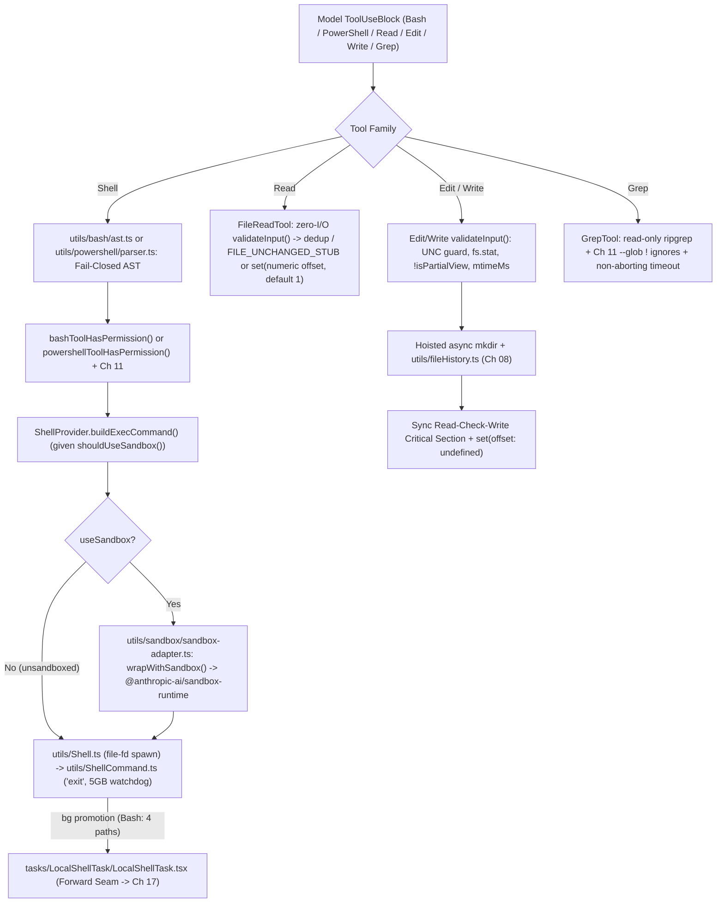

# 12. Shell Execution, Sandboxing, and Core Workspace Tools

> **Status: written.** Reverse-engineered from the Claude Code 2.1.88 source snapshot (see the Prologue (`prologue-how-to-read-a-1900-file-agent.md`) for snapshot caveats).
>
> **Layer:** Layer 4 (Safety, Policy, Sandbox & Lifecycle Hooks)
> **Prerequisites:** [Chapter 01](ch001-atoms-types-stores-and-primitives.md) (`FileStateCache`), [Chapter 02](ch002-the-tool-contract.md) (`Tool`, `ToolUseContext`), [Chapter 04](ch004-prompt-engineering-and-cache-boundaries.md) (prompt-cache stability), [Chapter 06](ch006-executing-tools.md) (`StreamingToolExecutor`), [Chapter 08](ch008-session-envelope-query-engine-and-transcripts.md) (`utils/fileHistory.ts`), and [Chapter 11](ch011-the-permission-engine.md) (modes, rule sources, `useCanUseTool`)
> **Primary Source Files:**
> - `tools/BashTool/` — `BashTool.tsx`, AST/legacy permissions, security, read-only, path, `sed`, mode, exit-code, and sandbox gating (18 files, 12,414 lines)
> - `tools/PowerShellTool/` — comparative PowerShell tool, native AST permissions, 24 security validators, and CLM allowlist (14 files, 8,961 lines)
> - `tools/FileReadTool/` — zero-I/O validation, two-tier byte/token caps, multi-modal dispatch, and `FILE_UNCHANGED_STUB` dedup (5 files, 1,603 lines)
> - `tools/FileEditTool/` — two-phase TOCTOU staleness guard, synchronous write critical section, and curly-quote preservation (6 files, 1,813 lines)
> - `tools/FileWriteTool/` — new-file fast path, overwrite staleness guard, and forced `'LF'` line-ending policy (3 files, 857 lines)
> - `tools/GrepTool/` — unconditionally read-only ripgrep wrapper with Ch 11 ignore globs and non-aborting timeouts (3 files, 796 lines)
> - `utils/bash/` — pure-TS tree-sitter-compatible parser, fail-closed AST walker, salted heredoc masking, legacy splitter, and snapshots (23 files, 12,306 lines)
> - `utils/sandbox/sandbox-adapter.ts` — `@anthropic-ai/sandbox-runtime` adapter, cycle breaker, and bare-git scrubber (985 lines; sibling `utils/sandbox/sandbox-ui-utils.ts`, 12 lines)
> - `utils/shell/` — `ShellProvider` contract, Bash/PowerShell providers, shared flag/UNC read-only validation, and `pwsh` detection (10 files, 3,069 lines)
> - `utils/Shell.ts` and `utils/ShellCommand.ts` — file-fd subprocess runner, sync CWD tracking, timeouts, and backgrounding watchdog (474 and 465 lines)

---

## Why This Layer Exists

[Chapter 11](ch011-the-permission-engine.md) gave Claude Code generic policy machinery: permission modes, eight rule sources, path checks, and `useCanUseTool`. Policy alone cannot spawn a command or patch a file. Spanning 85 primary files (43,743 lines), Chapter 12 builds the concrete enforcement tools that turn untrusted inputs into trustworthy `argv[]` vectors, OS-isolated child processes, bounded timeouts, and staleness-checked workspace writes.

Three production hazards shape every design choice below. First, shell syntax is a parser-differential minefield: any mismatch between Claude Code's static analyzer and the real shell bypasses `Bash(rm:*)` or corrupts [Chapter 06](ch006-executing-tools.md)'s concurrent read batches. Second, once a binary spawns, static analysis goes blind—children can touch arbitrary files, write 768 GB to disk, or hang the REPL. Third, file tools must eliminate redundant reads without allowing blind overwrites when users or linters edit disk mid-turn.

---

## 1. Shell Parsing, Security Analysis, and Read-Only Classification

### The Problem

Both [Chapter 11](ch011-the-permission-engine.md) rules (`Bash(git status:*)`) and [Chapter 06](ch006-executing-tools.md) concurrency (`BashTool.isConcurrencySafe()` at `tools/BashTool/BashTool.tsx:434-436` delegates to `this.isReadOnly`) need trustworthy `argv[]` and redirect targets.

Naive regexes fail on real shells: GNU `getopt_long` abbreviates `--upload-pack=cmd` to `--up=cmd` (`tools/BashTool/readOnlyValidation.ts:1710-1715`), `shell-quote` splits `<<` into two `<` tokens (`utils/bash/heredoc.ts:4-6`), and Zsh expands `=curl` to `/usr/bin/curl`.

### The Mechanism: Fail-Closed AST Gate, Legacy Fallback, and Allowlisted Flags

1. **Pure-TS Parser & Rollout Gates (`utils/bash/bashParser.ts`, `utils/bash/parser.ts`):**
   Despite older WASM/NAPI comments (`utils/bash/parser.ts:47`), `utils/bash/bashParser.ts` (4,436 lines) is a pure-TypeScript recursive-descent parser emitting tree-sitter-bash-compatible `TsNode` trees with UTF-8 byte offsets, verified against a 3,449-input corpus (`utils/bash/bashParser.ts:8-9`). Anti-DoS caps stop parsing at `PARSE_TIMEOUT_MS = 50`, `MAX_NODES = 50_000` (`utils/bash/bashParser.ts:29-32`), and `MAX_COMMAND_LENGTH = 10000` (`utils/bash/parser.ts:19`).

   Two build-time gates govern rollout. `parseCommand()` (`utils/bash/parser.ts:56-84`) runs only under `feature('TREE_SITTER_BASH')` (`utils/bash/parser.ts:65`) so Bun DCE strips the parser in external builds.

   `parseCommandRaw()` (`utils/bash/parser.ts:104-136`) also runs under `feature('TREE_SITTER_BASH_SHADOW')` + GrowthBook `tengu_birch_trellis` (`tools/BashTool/bashPermissions.ts:1683-1739`), logging `tengu_tree_sitter_shadow` before resetting `astResult` to `'parse-unavailable'`.

   When a loaded parser times out or hits `MAX_NODES`, `parseCommandRaw()` returns a dedicated `PARSE_ABORTED` symbol (`utils/bash/parser.ts:93` and `utils/bash/parser.ts:115-133`) rather than `null`, so `utils/bash/ast.ts` fails closed instead of falling back to legacy checks:

```ts
// utils/bash/ast.ts:444-459
if (root === PARSE_ABORTED) {
  // SECURITY: module loaded but parse aborted (timeout / node budget /
  // panic). Adversarially triggerable — `(( a[0][0]... ))` with ~2800
  // subscripts hits PARSE_TIMEOUT_MICROS under the 10K length limit.
  // Previously indistinguishable from module-not-loaded → routed to
  // legacy (parse-unavailable), which lacks EVAL_LIKE_BUILTINS — `trap`,
  // `enable`, `hash` leaked with Bash(*). Fail closed: too-complex → ask.
  return {
    kind: 'too-complex',
    reason:
      'Parser aborted (timeout or resource limit) — possible adversarial input',
    nodeType: 'PARSE_ABORT',
  }
}

return walkProgram(root)
```

2. **Fail-Closed AST Security Walker (`utils/bash/ast.ts`):**
   `parseForSecurity()` (`utils/bash/ast.ts:381-392`) skips `.trim()` so Unicode whitespace reaches `parseForSecurityFromAst()` (`utils/bash/ast.ts:400-460`), returning `'simple' | 'too-complex' | 'parse-unavailable'` (`utils/bash/ast.ts:25-45`).

   Six pre-checks reject tokenization differentials up front (`utils/bash/ast.ts:248-371` and `utils/bash/ast.ts:408-437`): `CONTROL_CHAR_RE` (`\r`), `UNICODE_WHITESPACE_RE`, `BACKSLASH_WHITESPACE_RE`, `ZSH_TILDE_BRACKET_RE`, `ZSH_EQUALS_EXPANSION_RE`, and `BRACE_WITH_QUOTE_RE` over `maskBracesInQuotedContexts()`.

   `walkProgram()` (`utils/bash/ast.ts:462-955`) walks an explicit node allowlist with flow-sensitive `varScope`: `&&`/`;` carry literal bindings forward while `||`, pipes, subshells, loops, and `if` branches fork scope copies (`utils/bash/ast.ts:505-558`). It blocks `IFS`/`PS4` poisoning (`utils/bash/ast.ts:1842-1906`), rejects unquoted heredocs in `walkHeredocRedirect()` (`utils/bash/ast.ts:1130-1193`), and rebuilds `.text` from resolved `argv` (`utils/bash/ast.ts:1316-1358`).

   `checkSemantics()` (`utils/bash/ast.ts:2213-2679`) then rejects unknown wrapper flags, bash array-subscript arithmetic RCE (`arr[$(id)]` evaluated even from single quotes via `SUBSCRIPT_EVAL_FLAGS`, `TEST_ARITH_CMP_OPS`, `BARE_SUBSCRIPT_NAME_BUILTINS`, and `declare`/`local` flags at `utils/bash/ast.ts:609-654` and `utils/bash/ast.ts:2422-2540`), `jq` `system()`, `/proc/*/environ`, 17 `ZSH_DANGEROUS_BUILTINS`, and 20 `EVAL_LIKE_BUILTINS` (`utils/bash/ast.ts:2060-2134`).

3. **Legacy Fallback Pipeline (`utils/bash/heredoc.ts`, `utils/bash/commands.ts`, `tools/BashTool/bashSecurity.ts`):**
   - `extractHeredocs()` (`utils/bash/heredoc.ts:113-687`) replaces heredocs with salted `__HEREDOC_<idx>_<16hex>__` tokens, tracks quote-aware logical newlines (`utils/bash/heredoc.ts:381-435`), and supports `quotedOnly` with `skippedHeredocRanges` (`utils/bash/heredoc.ts:527-598`) so unquoted `<<EOF` expansions stay exposed to security scans.
   - `splitCommandWithOperators()` (`utils/bash/commands.ts:85-249`) and `extractOutputRedirections()` (`utils/bash/commands.ts:634-790`) extract heredocs *before* joining odd-backslash continuations, delegate Zsh force-clobber (`>!`, `>&!`) to `handleRedirection()` (`utils/bash/commands.ts:860-1091`), and fail closed on parse errors.
   - `utils/bash/ParsedCommand.ts` (`utils/bash/ParsedCommand.ts:151-238`) slices UTF-8 `Buffer`s for tree-sitter byte offsets, while `analyzeCommand()` (`utils/bash/treeSitterAnalysis.ts:496-506`) eliminates `find -exec \;` false positives (`hasActualOperatorNodes`).
   - `bashCommandIsSafe_DEPRECATED()` / `Async` (`tools/BashTool/bashSecurity.ts:2257-2592`) run 23 validators (`BASH_SECURITY_CHECK_IDS`, `tools/BashTool/bashSecurity.ts:77-101`), **deferring** non-misparsing asks (`validateNewlines`, `validateRedirections`) until loop end (`tools/BashTool/bashSecurity.ts:2334-2407`) so an early `>` never masks a misparsing failure.

4. **The `bashToolHasPermission()` Cascade & Specialized Guards (`tools/BashTool/bashPermissions.ts`):**
   `BashTool.checkPermissions()` (`tools/BashTool/BashTool.tsx:539-541`) delegates to `bashToolHasPermission()` (`tools/BashTool/bashPermissions.ts:1663-2557`):
   1. **AST / Shadow gate (`tools/BashTool/bashPermissions.ts:1678-1827`):** Unless bypassed by `CLAUDE_CODE_DISABLE_COMMAND_INJECTION_CHECK` (`tools/BashTool/bashPermissions.ts:1678-1680`), parses via AST; on `'too-complex'` or `!checkSemantics.ok`, evaluates `checkEarlyExitDeny` / `checkSemanticsDeny` *first* so explicit deny rules are never downgraded to `'ask'`.
   2. **Sandbox auto-allow (`tools/BashTool/bashPermissions.ts:1831-1843`):** Covered in Section 3.
   3. **Exact deny & prompt classifiers (`tools/BashTool/bashPermissions.ts:1846-1971`):** Checks exact deny rules (`tools/BashTool/bashPermissions.ts:1846-1854`), then awaits parallel prompt `deny`/`ask` `classifyBashCommand()` calls (`tools/BashTool/bashPermissions.ts:1859-1971`, skipped in `auto` mode under `feature('TRANSCRIPT_CLASSIFIER')`).

      On `ask` under `feature('BASH_CLASSIFIER')`, it attaches `pendingClassifierCheck` (`tools/BashTool/bashPermissions.ts:1960-1967`) for the speculative `allow` classifier started upstream in `services/tools/toolExecution.ts:746` (`startSpeculativeClassifierCheck()`, `tools/BashTool/bashPermissions.ts:1497-1527`) and consumed via `consumeSpeculativeClassifierCheck()` (`tools/BashTool/bashPermissions.ts:1533-1541`, `tools/BashTool/bashPermissions.ts:1561`, `tools/BashTool/bashPermissions.ts:1612`, `hooks/useCanUseTool.tsx:136`).

      In this checkout, `utils/permissions/bashClassifier.ts` (61 lines) is an **ANT-ONLY stub** whose `isClassifierPermissionsEnabled()` always returns `false`.
   4. **Compound / pipe recursion (`tools/BashTool/bashPermissions.ts:1976-2076`, `tools/BashTool/bashCommandHelpers.ts:181-265`):** Blocks subshells and cross-segment `cd` + `git`, recursively validates pipe segments, and re-checks original redirections when all segments return `'allow'`.
   5. **Per-subcommand `bashToolCheckPermission()` (`tools/BashTool/bashPermissions.ts:1050-1178`, `tools/BashTool/bashPermissions.ts:2147-2385`):** Caps legacy fanout at `MAX_SUBCOMMANDS_FOR_SECURITY_CHECK = 50` (`tools/BashTool/bashPermissions.ts:103`), blocks compound `cd` + `git`, and runs strict order: exact deny/ask → prefix/wildcard deny/ask **before** `checkPathConstraints()` → allow → `checkSedConstraints()` → `checkPermissionMode()` (`tools/BashTool/modeValidation.ts:7-115`) → `BashTool.isReadOnly()`.
   6. **Compound merge (`tools/BashTool/bashPermissions.ts:2296-2331`, `tools/BashTool/bashPermissions.ts:2492-2526`):** Short-circuits single asks only when `nonAllowCount === 1` (preventing GH#28784 where `cd <outside> && python3 foo.py` surfaced only `Read(<dir>/**)`), capping compound suggestions at `MAX_SUGGESTED_RULES_FOR_COMPOUND = 5`.

   Before matching rules, `stripSafeWrappers()` (`tools/BashTool/bashPermissions.ts:524-615`) splits env stripping (Phase 1: `SAFE_ENV_VARS` plus `ANT_ONLY_SAFE_ENV_VARS` when `USER_TYPE === 'ant'`) from wrapper stripping (Phase 2, HackerOne #3543050):

```ts
// tools/BashTool/bashPermissions.ts:598-614
// Phase 2: Strip wrapper commands and comments only. Do NOT strip env vars.
// Wrapper commands (timeout, time, nice, nohup) use execvp to run their
// arguments, so VAR=val after a wrapper is treated as the COMMAND to execute,
// not as an env var assignment. Stripping env vars here would create a
// mismatch between what the parser sees and what actually executes.
// (HackerOne #3543050)
previousStripped = ''
while (stripped !== previousStripped) {
  previousStripped = stripped
  stripped = stripCommentLines(stripped)

  for (const pattern of SAFE_WRAPPER_PATTERNS) {
    stripped = stripped.replace(pattern, '')
  }
}

return stripped.trim()
```

   Companion `stripAllLeadingEnvVars()` (`tools/BashTool/bashPermissions.ts:733-776`) enforces asymmetry: allow rules strip only `SAFE_ENV_VARS`, deny/ask rules strip *all* leading env vars, and sandbox exclusions strip all except `BINARY_HIJACK_VARS = /^(LD_|DYLD_|PATH$)/` (`tools/BashTool/bashPermissions.ts:708`).

   Three specialized validators complete the cascade:
   - **Read-only flag allowlisting (`tools/BashTool/readOnlyValidation.ts:1246-1408`, `tools/BashTool/readOnlyValidation.ts:1876-1990`, `utils/shell/readOnlyCommandValidation.ts:1562-1893`):** `checkReadOnlyConstraints()` blocks Windows UNC/WebDAV NTLM leaks (`containsVulnerableUncPath()`), enforces a 4-way bare-git guard (`cd` + `git`, bare-repo CWD, git-internal writes + `git`, sandboxed `git` outside `getOriginalCwd()`), and rejects unquoted globs/`$` expansions.
   - **Why flag allowlists beat regexes:** `isCommandSafeViaFlagParsing()` → `validateFlags()` types flag values, gates `--` on `respectsDoubleDash` (`false` for `pyright`, `utils/shell/readOnlyCommandValidation.ts:1506-1507` and `utils/shell/readOnlyCommandValidation.ts:1719-1731`), separates `hasEquals` (`xargs -E= EOF`), and requires bundled short flags (`-nr`) to take `'none'`.
   - **Path validation (`tools/BashTool/pathValidation.ts:190-589`, `tools/BashTool/pathValidation.ts:1013-1150`):** Extracts paths for 36 `PathCommand`s via `PATH_EXTRACTORS` and `COMMAND_OPERATION_TYPE` (honoring POSIX `--` in `filterOutFlags()` at `tools/BashTool/pathValidation.ts:110-139`), keeps symlinks unresolved in `checkDangerousRemovalPaths()` (`tools/BashTool/pathValidation.ts:70-108`, catching `/tmp` on macOS), and prefers AST `argv`/redirects when available.
   - **`sed` guard & hidden preview (`tools/BashTool/sedValidation.ts:247-301`, `tools/BashTool/sedValidation.ts:473-684`, `tools/BashTool/sedEditParser.ts:40-322`):** Allows only strict `-n` line-printing or single `s///` substitutions, denylisting GNU `e`/`w` and non-ASCII homoglyphs. Approved `sed -i` applies `_simulatedSedEdit` directly (`tools/BashTool/BashTool.tsx:360-419`), while **omitting `_simulatedSedEdit` from the model-facing Zod schema** (`tools/BashTool/BashTool.tsx:249-259`) so the model cannot smuggle arbitrary writes.

5. **Comparative `PowerShellTool` & `ShellProvider` (`utils/shell/shellProvider.ts`, `tools/PowerShellTool/`):**
   Both shell tools share `ShellProvider` (`utils/shell/shellProvider.ts:1-33`) and `validateFlags()`, gated on Windows by `isPowerShellToolEnabled()` (`utils/shell/shellToolUtils.ts:17-22`: ON by default for `USER_TYPE === 'ant'`, opt-in via `CLAUDE_CODE_USE_POWERSHELL_TOOL=1` externally):

| Dimension | `BashTool` (`tools/BashTool/`) | `PowerShellTool` (`tools/PowerShellTool/`) |
|---|---|---|
| **AST Parser** | Pure-TS `utils/bash/bashParser.ts` (`TREE_SITTER_BASH`) + legacy fallback | Live `pwsh` `.NET Language.Parser` subprocess (`utils/powershell/parser.ts:1130-1294`, LRU-256) |
| **Security Gate** | Fail-closed `utils/bash/ast.ts` + 23 legacy checks | 24 AST checks (`tools/PowerShellTool/powershellSecurity.ts:1042-1090`) + inverted `CLM_ALLOWED_TYPES` (`tools/PowerShellTool/clmTypes.ts:18-211`, minus `adsi`/`wmi`/`cimsession`) |
| **Sync `isReadOnly()`** | Sync evaluation → unlocks Ch 06 parallel read batches (`isConcurrencySafe`) | Always returns `false` synchronously (`tools/PowerShellTool/PowerShellTool.tsx:300-316`, `tools/PowerShellTool/readOnlyValidation.ts:1178-1180`) → runs serially; AST read-only runs async in `powershellToolHasPermission()` |
| **Windows Sandbox** | Uses Git Bash (`utils/Shell.ts`) | Refuses via `WINDOWS_SANDBOX_POLICY_REFUSAL` (`tools/PowerShellTool/PowerShellTool.tsx:208-222`) when `sandbox.enabled` & `!allowUnsandboxedCommands` |

   `PowerShellTool`'s async read-only classifier rests on `isProvablySafeStatement()` (`tools/PowerShellTool/readOnlyValidation.ts:1072-1082`) plus `Object.create(null)` alias resolution (`utils/powershell/parser.ts:1326`) and degraded-mode backtick/fragment deny scanning (`tools/PowerShellTool/powershellPermissions.ts:764-853`):

```ts
// tools/PowerShellTool/readOnlyValidation.ts:1072-1082
export function isProvablySafeStatement(stmt: ParsedStatement): boolean {
  if (stmt.statementType !== 'PipelineAst') return false
  // Empty commands → vacuously passes the loop below. PowerShell's
  // parser guarantees PipelineAst.PipelineElements ≥ 1 for valid source,
  // but this gate is the linchpin — defend against parser/JSON edge cases.
  if (stmt.commands.length === 0) return false
  for (const cmd of stmt.commands) {
    if (cmd.elementType !== 'CommandAst') return false
  }
  return true
}
```

### Hidden Invariants & Production Scars

- **Bun `feature()` DCE cliff (`tools/BashTool/bashPermissions.ts:81-89`, `tools/BashTool/pathValidation.ts:1152-1164`):** `bashToolHasPermission` sits at Bun's per-function constant-folding budget. Using `import { X as Y }` aliases—or deleting ~80 lines of dead code—caused `feature('BASH_CLASSIFIER')` to fold silently to `false` (causing 22/30 classifier tests to fail from a 30/30 passing baseline, i.e., 8/30 passing). Top-level `const` rebindings preserve DCE.
- **PowerShell symlink/junction guard (`tools/PowerShellTool/modeValidation.ts:56-117`):** `isSymlinkCreatingCommand()` catches `New-Item -ItemType SymbolicLink|Junction|HardLink` across abbreviated flags (`-it`), Unicode dashes, colon bindings, and backtick escapes.

---

## 2. Subprocess Execution, Timeouts, and Foreground-to-Background Promotion

### The Problem

Running a validated command in an ephemeral subprocess must preserve user functions and working directories, avoid buffering gigabytes in JS memory, recognize informational non-zero exits (`grep` exit `1`), and promote long-running commands without stalling the REPL.

### The Mechanism: Snapshots, File-FD Execution, and Four Promotion Paths

1. **Snapshots & `ShellProvider` Wrapping (`utils/bash/ShellSnapshot.ts`, `utils/shell/bashProvider.ts`, `utils/shell/powershellProvider.ts`):**
   `createAndSaveSnapshot()` (`utils/bash/ShellSnapshot.ts:413-582`) runs one login shell capture per session (honoring `CLAUDE_CODE_DONT_INHERIT_ENV`), emits `unalias -a` first (`utils/bash/ShellSnapshot.ts:368-372`), captures functions/aliases, installs `rg` and build-time `EMBEDDED_SEARCH_TOOLS`-gated ant-native `bfs`/`ugrep` `ARGV0` shims (`utils/embeddedTools.ts:15-21`, `utils/bash/ShellSnapshot.ts:65-92`, `utils/bash/ShellSnapshot.ts:153-179`), and registers shutdown deletion.

   `createBashShellProvider()` (`utils/shell/bashProvider.ts:58-255`) disables `extglob`, reorders pipeline stdin (`rearrangePipeCommand()`), wraps execution in `eval ... && pwd -P >| <cwdFilePath>` (`utils/shell/bashProvider.ts:181-187`), and sets `TMPPREFIX` for sandboxed Zsh heredocs (`utils/shell/bashProvider.ts:242-247`).

   It also applies `CLAUDE_CODE_SHELL_PREFIX` via `formatShellPrefixCommand()` (`utils/bash/shellPrefix.ts:15-28`), logs multiline commands under `feature('COMMIT_ATTRIBUTION')` (`utils/shell/bashProvider.ts:134`), and sets an ant tmux socket (`utils/shell/bashProvider.ts:222`).

   `createPowerShellProvider()` (`utils/shell/powershellProvider.ts:27-123`) builds `['-NoProfile', '-NonInteractive', '-Command', cmd]` via `buildPowerShellArgs()` (`utils/shell/powershellProvider.ts:11-13`), prefers `$LASTEXITCODE` over PowerShell 5.1's `$?` (`utils/shell/powershellProvider.ts:55-65`), and Base64 UTF-16LE encodes `-EncodedCommand` under Linux/macOS sandboxing (`utils/shell/powershellProvider.ts:68-94`) to survive `sandbox-runtime`'s `shellquote.quote()`.

   Sibling `utils/shell/powershellDetection.ts:24-107` bypasses hanging Linux `/snap/` launchers via `realpath()`.

2. **Zero-JS-Copy File Mode & Microtask-Sync CWD (`utils/Shell.ts`):**
   `findSuitableShell()` (`utils/Shell.ts:73-137`) resolves `CLAUDE_CODE_SHELL`, `SHELL`, and `zsh`/`bash`. `exec()` (`utils/Shell.ts:181-442`) binds both `stdout` and `stderr` to one file descriptor (`utils/Shell.ts:289-332`): POSIX uses `O_WRONLY | O_CREAT | O_APPEND | O_NOFOLLOW` (atomic interleaving + anti-symlink); Windows uses `'w'` because libuv `'a'` omits `FILE_WRITE_DATA` and MSYS2 silently drops output.

   Inside `shellCommand.result.then(...)`—before any `await`—`utils/Shell.ts:385-421` runs synchronous `SandboxManager.cleanupAfterCommand()`, reads `nativeCwdFilePath` via `readFileSync`/`unlinkSync` (eliminating CWD microtask races), normalizes macOS APFS NFD→NFC, and calls `setCwd()` (`utils/Shell.ts:447-474`).

3. **Timeouts, Semantic Exit Codes, and Watchdogged Promotion (`utils/timeouts.ts`, `utils/ShellCommand.ts`, `tools/BashTool/BashTool.tsx`):**
   `tools/BashTool/prompt.ts:27-33` re-exports `utils/timeouts.ts:1-39`: `DEFAULT_TIMEOUT_MS = 120_000` (`BASH_DEFAULT_TIMEOUT_MS`) and `MAX_TIMEOUT_MS = 600_000` (`BASH_MAX_TIMEOUT_MS`, clamped `>= default`). Under `feature('MONITOR_TOOL')`, `validateInput()` runs `detectBlockedSleepPattern()` (`tools/BashTool/BashTool.tsx:322-337` and `tools/BashTool/BashTool.tsx:524-534`), blocking foreground integer `sleep N >= 2`.

   `interpretCommandResult()` (`tools/BashTool/commandSemantics.ts:124-140`) consults `COMMAND_SEMANTICS` (`tools/BashTool/commandSemantics.ts:31-89`) to treat exit code `1` as non-error for `grep`, `rg`, `find`, `diff`, `test`, and `[`, throwing `ShellError` only for `>= 2` (`tools/BashTool/BashTool.tsx:690` and `tools/BashTool/BashTool.tsx:714-719`).

   `wrapSpawn()` (`utils/ShellCommand.ts:387-403`) listens on `'exit'` rather than `'close'` (so detached grandchildren holding fds do not hang the shell, `utils/ShellCommand.ts:269-272`), ignores `abortSignal.reason === 'interrupt'` (`utils/ShellCommand.ts:186-193`), and kills via `treeKill(pid, 'SIGKILL')`. On background promotion, `background()` arms a 5s `stat()` watchdog (`SIZE_WATCHDOG_INTERVAL_MS = 5_000`, `utils/ShellCommand.ts:54` and `utils/ShellCommand.ts:239-261`) capped at 5 GB (`utils/task/diskOutput.ts:30-31`):

```ts
// utils/ShellCommand.ts:349-366
background(taskId: string): boolean {
  if (this.#status === 'running') {
    this.#backgroundTaskId = taskId
    this.#status = 'backgrounded'
    this.#cleanupListeners()
    if (this.taskOutput.stdoutToFile) {
      // File mode: child writes directly to the fd with no JS involvement.
      // The foreground timeout is gone, so watch file size to prevent
      // a stuck append loop from filling the disk (768GB incident).
      this.#startSizeWatchdog()
    } else {
      // Pipe mode: spill the in-memory buffer so readers can find it on disk.
      this.taskOutput.spillToDisk()
    }
    return true
  }
  return false
}
```

   `runShellCommand()` (`tools/BashTool/BashTool.tsx:826-1143`) unifies all **four promotion paths**:
   1. **Explicit `run_in_background` (`tools/BashTool/BashTool.tsx:989-1001`):** Spawns via `spawnShellTask()` unless `CLAUDE_CODE_DISABLE_BACKGROUND_TASKS` is set (which also strips `run_in_background` from the model schema at `tools/BashTool/BashTool.tsx:224-226` and `tools/BashTool/BashTool.tsx:254-259`).
   2. **Timeout auto-background (`tools/BashTool/BashTool.tsx:880` and `tools/BashTool/BashTool.tsx:967-971`):** Promotes on timeout, excluding `sleep` (`DISALLOWED_AUTO_BACKGROUND_COMMANDS`, `tools/BashTool/BashTool.tsx:220`).
   3. **`KAIROS` 15s budget (`tools/BashTool/BashTool.tsx:57` and `tools/BashTool/BashTool.tsx:976-983`):** Under `feature('KAIROS') && getKairosActive() && isMainThread`, an `.unref()` timer promotes blocking commands after `ASSISTANT_BLOCKING_BUDGET_MS = 15_000`.
   4. **`Ctrl+B` past 2s (`tools/BashTool/BashTool.tsx:55` and `tools/BashTool/BashTool.tsx:1007-1126`):** Fast commands under `PROGRESS_THRESHOLD_MS = 2000` skip task registration; slower ones call `registerForeground()` so user `Ctrl+B` promotes them via `backgroundAll()` → `backgroundTask()` (`tools/BashTool/UI.tsx:49`, `tasks/LocalShellTask/LocalShellTask.tsx:293-410`), observed via `shellCommand.status === 'backgrounded'` (`tools/BashTool/BashTool.tsx:1089-1102`).

      By contrast, timer-driven auto-backgrounding (Paths #2 and #3) promotes an already-registered foreground task **in-place** via `backgroundExistingForegroundTask()` (`tools/BashTool/BashTool.tsx:929-939`, `tasks/LocalShellTask/LocalShellTask.tsx:413-474`).

   If a process exits simultaneously with promotion, `markTaskNotified()` (`tools/BashTool/BashTool.tsx:1037-1065`) suppresses duplicate notifications and returns the completed output. Subagents set `preventCwdChanges = true` and register tasks via `toolUseContext.setAppStateForTasks ?? setAppState` (`tools/BashTool/BashTool.tsx:642-653`, [Chapter 02](ch002-the-tool-contract.md)).

   *(Forward seam to Chapter 17: `tasks/LocalShellTask/LocalShellTask.tsx` — note `.tsx`, 523 lines — implements `spawnShellTask`, `registerForeground`, `backgroundExistingForegroundTask`, `markTaskNotified`, and the 45s interactive-prompt stall watchdog; its `TaskStateBase` runtime lives in Chapter 17.)*

---

## 3. OS-Level Sandboxing and the `@anthropic-ai/sandbox-runtime` Boundary

### The Problem

Static AST checks inspect only top-level commands; once `make build` or `python build.py` spawns, child binaries can touch arbitrary files or open sockets unseen by static analysis. Prompting on every command kills throughput. OS-level sandboxing enforces kernel filesystem and network limits across the process tree so safe sandboxed commands auto-allow (`sandbox.autoAllowBashIfSandboxed`, default `true` at `utils/sandbox/sandbox-adapter.ts:469-472`).

> [!NOTE]
> **External Package Boundary (`@anthropic-ai/sandbox-runtime`):** This checkout contains `utils/sandbox/sandbox-adapter.ts` (985 lines) and `utils/sandbox/sandbox-ui-utils.ts` (12 lines), **not** `@anthropic-ai/sandbox-runtime` (`BaseSandboxManager`, `SandboxRuntimeConfigSchema`, `SandboxViolationStore`, imported at `utils/sandbox/sandbox-adapter.ts:7-22`). Seatbelt `.sb` profiles, `bwrap` args, and proxy internals live outside this repo.
>
> Evidenced platform mentions confirm macOS Seatbelt (`components/sandbox/SandboxDependenciesTab.tsx:57`, `sandbox-exec` at `tools/PowerShellTool/PowerShellTool.tsx:208`) plus log monitor (`utils/sandbox/sandbox-adapter.ts:772`), and Linux/WSL2 `bubblewrap`/`socat` (`utils/sandbox/sandbox-adapter.ts:587-600`) plus `seccomp` (`components/sandbox/SandboxDependenciesTab.tsx:85`).
> Native Windows (`tools/PowerShellTool/PowerShellTool.tsx:208`) and WSL1 (`utils/sandbox/sandbox-adapter.ts:571-574`) are unsupported; neither `utils/sandbox/*` nor `tools/BashTool/shouldUseSandbox.ts` uses `feature()` flags.

### The Mechanism: Policy Translation, Cycle Breaking, and Per-Command Gating

1. **The Static Import Cycle Breaker (`utils/sandbox/sandbox-adapter.ts`):**
   `utils/permissions/permissions.ts:19` and `utils/permissions/pathValidation.ts:12` statically import `SandboxManager`, while `tools/BashTool/bashPermissions.ts:54-67` imports `permissions.ts` and `SandboxManager`. To avoid a circular import, `utils/sandbox/sandbox-adapter.ts:61-81` embeds local rule parsers (while `utils/hooks/execHttpHook.ts:18-24` dynamically `await import`s `sandbox-adapter.js` to break a second cycle through hooks):

```ts
// utils/sandbox/sandbox-adapter.ts:61-81
// Local copies to avoid circular dependency
// (permissions.ts imports SandboxManager, bashPermissions.ts imports permissions.ts)
function permissionRuleValueFromString(
  ruleString: string,
): PermissionRuleValue {
  const matches = ruleString.match(/^([^(]+)\(([^)]+)\)$/)
  if (!matches) {
    return { toolName: ruleString }
  }
  const toolName = matches[1]
  const ruleContent = matches[2]
  if (!toolName || !ruleContent) {
    return { toolName: ruleString }
  }
  return { toolName, ruleContent }
}

function permissionRuleExtractPrefix(permissionRule: string): string | null {
  const match = permissionRule.match(/^(.+):\*$/)
  return match?.[1] ?? null
}
```

   Notice the forensic drift: canonical `utils/permissions/permissionRuleParser.ts:93-133` unescapes `\(`/`\)` and normalizes legacy names (`Task` → `Agent`), whereas this local regex (`[^)]+`) silently drops any path rule containing a literal `)`.

2. **Permission-to-Sandbox Translation (`convertToSandboxRuntimeConfig`, `utils/sandbox/sandbox-adapter.ts:172-381`):**
   - **Dual path semantics (`#30067`):** `resolvePathPatternForSandbox()` (`utils/sandbox/sandbox-adapter.ts:99-119`) uses Ch 11 rule syntax (`//path` = absolute, `/path` = settings-relative), whereas `resolveSandboxFilesystemPath()` (`utils/sandbox/sandbox-adapter.ts:138-146`) treats `/Users/foo/.cargo` in `sandbox.filesystem.*` as absolute and expands `~` because `sandbox-runtime`'s `getFsWriteConfig()` skips `normalizePathForSandbox()`.
   - **Rule translation:** Write allow/deny comes from **`Edit(...)`** rules (not `Write(...)`) plus `sandbox.filesystem.{allowWrite,denyWrite}`, seeded with `['.', getClaudeTempDir()]`, `worktreeMainRepoPath`, and `additionalDirectories` (`utils/sandbox/sandbox-adapter.ts:225-339`). Read rules map **`Read(...)` deny** plus `sandbox.filesystem.{denyRead,allowRead}`. Network rules map `WebFetch(domain:...)` allow/deny plus `sandbox.network.allowedDomains` (`utils/sandbox/sandbox-adapter.ts:178-220`).
   - **Hard protections & locks:** `denyWrite` protects every `SETTING_SOURCES` settings file and `.claude/skills` (omitted by `sandbox-runtime`'s `getDangerousDirectories()`, `utils/sandbox/sandbox-adapter.ts:232-255`). Enterprise locks `shouldAllowManagedSandboxDomainsOnly()` (`utils/sandbox/sandbox-adapter.ts:152-157`, also forcing `sandboxAskCallback` to `false` at `utils/sandbox/sandbox-adapter.ts:745-755`) and `shouldAllowManagedReadPathsOnly()` (`utils/sandbox/sandbox-adapter.ts:159-164`) pin domains and `allowRead` to `policySettings`.
   - **Lifecycle & availability:** `initialize()` sets `initializationPromise` pre-`await` (`utils/sandbox/sandbox-adapter.ts:757-759`), exposing sync **`refreshConfig()`** (`utils/sandbox/sandbox-adapter.ts:798-803`) and `addToExcludedCommands()` (`utils/sandbox/sandbox-adapter.ts:828-874`). Startup (`screens/REPL.tsx:2318-2336`, `cli/print.ts:601-615`) checks `getSandboxUnavailableReason()` (`#34044`, `utils/sandbox/sandbox-adapter.ts:554-592`), `enabledPlatforms`, and `failIfUnavailable` (`utils/sandbox/sandbox-adapter.ts:483`).

3. **Bare-Git Escape Defense (`#29316`, `utils/sandbox/sandbox-adapter.ts:257-280`):**
   Planting `HEAD`, `objects/`, `refs/`, and `config` (`core.fsmonitor`) turns `cwd` into a bare repo that executes attacker code on Claude Code's next unsandboxed `git` call. Adding missing paths to `denyWrite` makes Linux `bwrap` mount `/dev/null`, leaving a 0-byte `HEAD` stub that breaks `git log HEAD`—so `convertToSandboxRuntimeConfig()` splits existing vs. missing targets:

```ts
// utils/sandbox/sandbox-adapter.ts:257-280
// SECURITY: Git's is_git_directory() treats cwd as a bare repo if it has
// HEAD + objects/ + refs/. An attacker planting these (plus a config with
// core.fsmonitor) escapes the sandbox when Claude's unsandboxed git runs.
//
// Unconditionally denying these paths makes sandbox-runtime mount
// /dev/null at non-existent ones, which (a) leaves a 0-byte HEAD stub on
// the host and (b) breaks `git log HEAD` inside bwrap ("ambiguous argument").
// So: if a file exists, denyWrite (ro-bind in place, no stub). If not, scrub
// it post-command in scrubBareGitRepoFiles() — planted files are gone before
// unsandboxed git runs; inside the command, git is itself sandboxed.
bareGitRepoScrubPaths.length = 0
const bareGitRepoFiles = ['HEAD', 'objects', 'refs', 'hooks', 'config']
for (const dir of cwd === originalCwd ? [originalCwd] : [originalCwd, cwd]) {
  for (const gitFile of bareGitRepoFiles) {
    const p = resolve(dir, gitFile)
    try {
      // eslint-disable-next-line custom-rules/no-sync-fs -- refreshConfig() must be sync
      statSync(p)
      denyWrite.push(p)
    } catch {
      bareGitRepoScrubPaths.push(p)
    }
  }
}
```

   Existing paths become `denyWrite`; missing paths enter `bareGitRepoScrubPaths` and are synchronously removed via `rmSync(..., { recursive: true })` (`utils/sandbox/sandbox-adapter.ts:408`) by `scrubBareGitRepoFiles()` inside `SandboxManager.cleanupAfterCommand()` (`utils/sandbox/sandbox-adapter.ts:395-414`, `utils/sandbox/sandbox-adapter.ts:963-966`) right when `utils/Shell.ts:391-393` finishes.

4. **Per-Command Gate & Ch 11 Interplay (`tools/BashTool/shouldUseSandbox.ts`):**
   `shouldUseSandbox(input)` (`tools/BashTool/shouldUseSandbox.ts:130-153`) returns `false` if sandboxing is off, if `dangerouslyDisableSandbox && areUnsandboxedCommandsAllowed()`, if `!input.command`, or if `containsExcludedCommand()` (`tools/BashTool/shouldUseSandbox.ts:21-128`) matches.

   `containsExcludedCommand()` checks ant-only GrowthBook `tengu_sandbox_disabled_commands` (`USER_TYPE === 'ant'`, `tools/BashTool/shouldUseSandbox.ts:23-50`), then matches fixed-point stripped candidates (refusing `BINARY_HIJACK_VARS`) against `sandbox.excludedCommands` (`tools/BashTool/shouldUseSandbox.ts:53-125`).

   `excludedCommands` is a **convenience escape hatch, not a bypass**: returning `false` disables sandbox auto-allow and falls back to [Chapter 11](ch011-the-permission-engine.md) prompts across three seams:
   - `utils/permissions/permissions.ts:1091-1111` and `utils/permissions/permissions.ts:1183-1206` skip a tool-wide `Bash` `ask` rule *only* when `canSandboxAutoAllow` holds.
   - `checkSandboxAutoAllow()` (`tools/BashTool/bashPermissions.ts:1270-1359`, `tools/BashTool/bashPermissions.ts:1831-1843`) evaluates all subcommand `deny` rules *before* returning any `ask` rule.
   - `utils/permissions/pathValidation.ts:225-245` honors sandbox write allowlists only when `!isInWorkingDir` so the `'.'` seed (`utils/sandbox/sandbox-adapter.ts:225`) never bypasses `acceptEdits`.

### Hidden Invariants & Production Scars

- **Prompt-cache `$TMPDIR` normalization (`tools/BashTool/prompt.ts:185-190`):** Replaces per-UID `/private/tmp/claude-<uid>/` with literal `'$TMPDIR'` so the sandbox prompt section preserves [Chapter 04](ch004-prompt-engineering-and-cache-boundaries.md)'s cross-user global prompt cache.
- **Render-loop retry storm (`#21605`, `tools/BashTool/BashTool.tsx:498-502`):** `userFacingName()` checks `CLAUDE_CODE_BASH_SANDBOX_SHOW_INDICATOR` *before* `shouldUseSandbox()`, avoiding per-render `shell-quote` `new RegExp` work across history that exceeded the shimmer tick.
- **Dual `<sandbox_violations>` view (`tools/BashTool/BashTool.tsx:710`, `tools/BashTool/BashTool.tsx:718`, `utils/sandbox/sandbox-ui-utils.ts:10-12`):** `BashTool.call()` preserves `<sandbox_violations>` inside `ShellError` so the model can decide whether to retry (`tools/BashTool/prompt.ts:228-256`). Meanwhile `removeSandboxViolationTags()` strips them in `tools/BashTool/BashToolResultMessage.tsx:35` and `components/FallbackToolUseErrorMessage.tsx:36`, routing user visibility to `SandboxViolationStore` panels.

---

## 4. Core Workspace Tools and the `FileStateCache` Staleness Protocol

### The Problem

Repeatedly reading unchanged files wastes prompt tokens (`tools/FileReadTool/FileReadTool.ts:526-535` cites ~18% same-file Read collisions and up to 2.64% of fleet `cache_creation` tokens). Yet writing without proving the model saw current disk state risks clobbering user or linter edits—and checking timestamps only before permission prompts leaves a TOCTOU window while the human responds.

### The Mechanism: Coordinated `FileStateCache` Semantics Across Four Tools

1. **`FileReadTool`: Zero-I/O Validation, Budgeting, and `FILE_UNCHANGED_STUB` (`tools/FileReadTool/FileReadTool.ts`, `tools/FileReadTool/limits.ts`):**
   - **Contract invariants:** Sets `maxResultSizeChars: Infinity` (`tools/FileReadTool/FileReadTool.ts:340-342`) so [Chapter 06](ch006-executing-tools.md)'s `toolResultStorage.ts` never creates a circular Read→spill→Read loop; expands paths in `backfillObservableInput()` (`tools/FileReadTool/FileReadTool.ts:388-394`); and returns `''` from `extractSearchText()` (`tools/FileReadTool/FileReadTool.ts:409-416`).
   - **Zero-I/O `validateInput()` (`tools/FileReadTool/FileReadTool.ts:418-495`):** Validates PDF page ranges, checks Ch 11 deny rules, short-circuits UNC paths (`\\` or `//`) before any `stat()` to stop SMB/NTLM leaks, rejects binaries, and blocks infinite/TTY paths in `BLOCKED_DEVICE_PATHS` (`tools/FileReadTool/FileReadTool.ts:98-128`). Missing files retry macOS screenshot thin spaces (`U+202F`, `tools/FileReadTool/FileReadTool.ts:130-159`) in `call()`.
   - **Two-tier budgeting (`tools/FileReadTool/limits.ts:18-92`):** Enforces `MAX_OUTPUT_SIZE` (256 KiB, `utils/file.ts:48`) and `DEFAULT_MAX_OUTPUT_TOKENS = 25000`, overridden by `fileReadingLimits`, `CLAUDE_CODE_FILE_READ_MAX_OUTPUT_TOKENS`, and memoized GrowthBook `tengu_amber_wren`. PR #21841 tested truncating oversized reads and was **reverted** (`tools/FileReadTool/limits.ts:9-13`) because ~100-byte errors beat 25K-token truncations.
   - **Multi-modal dispatch (`tools/FileReadTool/FileReadTool.ts:804-1086`):** Routes `.ipynb`, images (`tools/FileReadTool/imageProcessor.ts:37-67`, `image-processor-napi` → `sharp`), PDFs, and text, appending `CYBER_RISK_MITIGATION_REMINDER` except on `claude-opus-4-6` (`tools/FileReadTool/FileReadTool.ts:729-738`).
   - **Exact deduplication (`tools/FileReadTool/FileReadTool.ts:536-573`):** Behind killswitch `tengu_read_dedup_killswitch` (default `false` = active), returns `FILE_UNCHANGED_STUB` (`tools/FileReadTool/prompt.ts:7-8`) only when `!isPartialView`, `offset !== undefined`, `(offset, limit)` match, and `Math.floor(mtimeMs)` matches:

```ts
// tools/FileReadTool/FileReadTool.ts:547-573
if (
  existingState &&
  !existingState.isPartialView &&
  existingState.offset !== undefined
) {
  const rangeMatch =
    existingState.offset === offset && existingState.limit === limit
  if (rangeMatch) {
    try {
      const mtimeMs = await getFileModificationTimeAsync(fullFilePath)
      if (mtimeMs === existingState.timestamp) {
        const analyticsExt = getFileExtensionForAnalytics(fullFilePath)
        logEvent('tengu_file_read_dedup', {
          ...(analyticsExt !== undefined && { ext: analyticsExt }),
        })
        return {
          data: {
            type: 'file_unchanged' as const,
            file: { filePath: file_path },
          },
        }
      }
    } catch {
      // stat failed — fall through to full read
    }
  }
}
```

   Normalizing timestamps via `Math.floor(mtimeMs)` (`utils/file.ts:60-82`) suppresses sub-millisecond IDE watcher noise. Because `FileReadTool` always records numeric `offset` (default `1`, `tools/FileReadTool/FileReadTool.ts:497`) while `FileEditTool`, `FileWriteTool`, and `BashTool` `applySedEdit()` store `offset: undefined`, checking `existingState.offset !== undefined` ensures a `Read` after an `Edit` never points back to stale pre-edit content (`tools/FileReadTool/FileReadTool.ts:543-546`).

2. **`FileEditTool` & `FileWriteTool`: Two-Phase TOCTOU Guard & Curly Quotes (`tools/FileEditTool/`, `tools/FileWriteTool/`):**
   - **Phase 1 (`validateInput()` before prompts):** `FileEditTool` (`tools/FileEditTool/FileEditTool.ts:137-362`) checks team-memory secrets, deny rules, UNC NTLM guard, `MAX_EDIT_FILE_SIZE` (1 GiB), mandatory read-before-edit (`!readTimestamp || readTimestamp.isPartialView`), floored mtime staleness, and match uniqueness. `FileWriteTool` (`tools/FileWriteTool/FileWriteTool.ts:153-222`) fast-paths new files on `ENOENT` and enforces the same staleness check on overwrites.
   - **Phase 2 (`call()` synchronous critical section):** Both tools hoist `await fs.mkdir()` and [Chapter 08](ch008-session-envelope-query-engine-and-transcripts.md)'s idempotent `fileHistoryTrackEdit()` (`tools/FileEditTool/FileEditTool.ts:428-440`, `tools/FileWriteTool/FileWriteTool.ts:249-264`) strictly *before* a zero-`await` read-check-write critical section:

```ts
// tools/FileEditTool/FileEditTool.ts:442-468
// 2. Load current state and confirm no changes since last read
// Please avoid async operations between here and writing to disk to preserve atomicity
const {
  content: originalFileContents,
  fileExists,
  encoding,
  lineEndings: endings,
} = readFileForEdit(absoluteFilePath)

if (fileExists) {
  const lastWriteTime = getFileModificationTime(absoluteFilePath)
  const lastRead = readFileState.get(absoluteFilePath)
  if (!lastRead || lastWriteTime > lastRead.timestamp) {
    // Timestamp indicates modification, but on Windows timestamps can change
    // without content changes (cloud sync, antivirus, etc.). For full reads,
    // compare content as a fallback to avoid false positives.
    const isFullRead =
      lastRead &&
      lastRead.offset === undefined &&
      lastRead.limit === undefined
    const contentUnchanged =
      isFullRead && originalFileContents === lastRead.content
    if (!contentUnchanged) {
      throw new Error(FILE_UNEXPECTEDLY_MODIFIED_ERROR)
    }
  }
}
```

   A subtle scar hides in `isFullRead`: it tests `offset === undefined && limit === undefined` (`tools/FileEditTool/FileEditTool.ts:458-461`, `tools/FileWriteTool/FileWriteTool.ts:286-289`), while `FileReadTool` stores `offset: 1` (`tools/FileReadTool/FileReadTool.ts:1035`). Thus the Windows content-equality fallback engages after in-session `Edit`/`Write`/`sed -i` writes (`tools/FileEditTool/FileEditTool.ts:520-525`, `tools/FileWriteTool/FileWriteTool.ts:332-337`, `tools/BashTool/BashTool.tsx:404-409`), not after a default `Read`.

   Two writer-specific scars stand out. `FileWriteTool` always writes `'LF'` (`tools/FileWriteTool/FileWriteTool.ts:300-305`) because preserving old or repo-sampled endings corrupted Linux bash scripts with `\r`. Both tools compute remote `fetchSingleFileGitDiff()` only when `CLAUDE_CODE_REMOTE` and GrowthBook `tengu_quartz_lantern` are active (`tools/FileEditTool/FileEditTool.ts:545-558`, `tools/FileWriteTool/FileWriteTool.ts:344-357`).

   In `tools/FileEditTool/utils.ts`, `findActualString()` (`tools/FileEditTool/utils.ts:73-93`) falls back to `normalizeQuotes()` when straight quotes miss curly quotes on disk, `preserveQuoteStyle()` (`tools/FileEditTool/utils.ts:104-199`) restores curly quotes while keeping contractions (`don’t`) closed, `applyEditToFile()` (`tools/FileEditTool/utils.ts:206-228`) uses `() => replace` to neutralize `$&`/`$1`, and `DESANITIZATIONS` (`tools/FileEditTool/utils.ts:531-657`) reverses API-sanitized strings.

3. **`GrepTool`: Why Search Is Separate from `BashTool` `rg` (`tools/GrepTool/GrepTool.ts`, `utils/ripgrep.ts`):**
   `GrepTool` is unconditionally `isReadOnly: true` and `isConcurrencySafe: true` (`tools/GrepTool/GrepTool.ts:183-188`) with zero shell-injection surface or sandbox overhead. It enforces `maxResultSizeChars: 20_000` (`tools/GrepTool/GrepTool.ts:164`), `--max-columns 500`, VCS exclusions, `-e` for leading-dash regexes, and Ch 11 read-deny globs (`getFileReadIgnorePatterns` → `--glob !` / `--glob !**/`, `tools/GrepTool/GrepTool.ts:412-427`, BurntSushi/ripgrep #2156).

   All three modes (`content`, `count`, and `files_with_matches` sorted by mtime via `Promise.allSettled`) apply `DEFAULT_HEAD_LIMIT = 250` (`tools/GrepTool/GrepTool.ts:108-128`) before path relativization (`tools/GrepTool/GrepTool.ts:447-575`).

   `utils/ripgrep.ts:31-65` selects system vs. bundled/embedded `rg` via `USE_BUILTIN_RIPGREP` (`utils/ripgrep.ts:32-34`), while `utils/ripgrep.ts:98-182` and `utils/ripgrep.ts:221-231` enforce a 60s WSL2 / 20s default timeout (`CLAUDE_CODE_GLOB_TIMEOUT_SECONDS`), throwing `RipgrepTimeoutError` when `isTimeout && lines.length === 0` (`utils/ripgrep.ts:446-454`) instead of firing `AbortController` so slow searches never abort the turn (`tools/GrepTool/GrepTool.ts:436-441`).

### Gate & Snapshot-Absence Summary

| Category | Verified Identifiers & Scope in Chapter 12 |
|---|---|
| **Build-time `feature()` (7)** | `TREE_SITTER_BASH`, `TREE_SITTER_BASH_SHADOW` (`utils/bash/parser.ts`, `tools/BashTool/bashPermissions.ts`); `BASH_CLASSIFIER`, `TRANSCRIPT_CLASSIFIER` (`tools/BashTool/bashPermissions.ts`); `KAIROS`, `MONITOR_TOOL` (`tools/BashTool/BashTool.tsx`, `tools/PowerShellTool/PowerShellTool.tsx`, `tools/BashTool/prompt.ts`); `COMMIT_ATTRIBUTION` (`utils/shell/bashProvider.ts`) |
| **GrowthBook Flags (6)** | `tengu_birch_trellis` (`tools/BashTool/bashPermissions.ts:1684`); `tengu_sandbox_disabled_commands` (`tools/BashTool/shouldUseSandbox.ts:24-27`); `tengu_cork_m4q` (Haiku prefix-spec prompt caching, `utils/shell/prefix.ts:215-235`); `tengu_read_dedup_killswitch` (`tools/FileReadTool/FileReadTool.ts:536-539`); `tengu_amber_wren` (`tools/FileReadTool/limits.ts:55-58`); `tengu_quartz_lantern` (`tools/FileEditTool/FileEditTool.ts:548`, `tools/FileWriteTool/FileWriteTool.ts:347`) |
| **`USER_TYPE === 'ant'` & Key Env Vars** | Ant gates across 9 files (14 sites: `ANT_ONLY_SAFE_ENV_VARS`, `ANT_ONLY_COMMAND_ALLOWLIST`, `tengu_sandbox_disabled_commands`, undercover/commit skills at `tools/BashTool/prompt.ts:49` and `tools/BashTool/prompt.ts:56`, `CLAUDE_CODE_SESSION_ID`, tmux socket, Windows PowerShell default, `gh` read-only, `minimalUniquenessHint`, classifier telemetry). Key env vars: `BASH_DEFAULT_TIMEOUT_MS`, `BASH_MAX_TIMEOUT_MS`, `CLAUDE_CODE_DISABLE_BACKGROUND_TASKS`, `CLAUDE_CODE_DISABLE_COMMAND_INJECTION_CHECK` (bypasses AST/injection checks), `CLAUDE_CODE_SHELL`, `CLAUDE_CODE_SHELL_PREFIX`, `CLAUDE_CODE_TMPDIR` (custom/sandbox temp dir), `CLAUDE_CODE_BASH_SANDBOX_SHOW_INDICATOR`, `CLAUDE_CODE_FILE_READ_MAX_OUTPUT_TOKENS`, `CLAUDE_CODE_REMOTE`, `CLAUDE_CODE_GLOB_TIMEOUT_SECONDS`, `USE_BUILTIN_RIPGREP`, `EMBEDDED_SEARCH_TOOLS` (ant-native `bfs`/`ugrep` shims) |
| **Snapshot Absences & External Packages** | **Absent (type-only imports, never linked):** `types/tools.js` (`BashProgress`, `PowerShellProgress`), `constants/querySource.js` (`QuerySource`), `types/message.js` (`AssistantMessage`, `ProgressMessage`, `Message`). **External npm packages:** `@anthropic-ai/sandbox-runtime`, `image-processor-napi`. **ANT-ONLY stub:** `utils/permissions/bashClassifier.ts`. |

---

## Putting Layer 4's Concrete Tool Stack Together

```text
Layer 4 Concrete Tool Enforcement (Ch 11 Policy -> Kernel & Disk Reality)
+---------------------------------------------------------------------------+
| SHELL PATH (BashTool / PowerShellTool)                                    |
|  cmd -> [AST / Legacy Parse] -> [bash/powershellToolHasPermission + Ch11] |
|       -> shouldUseSandbox() -> ShellProvider.buildExecCommand()           |
|          (Bash: eval + pwd -P >| ; PS: Get-Location / -EncodedCommand)    |
|       -> [if useSandbox] SandboxManager.wrapWithSandbox(commandString)    |
|       -> utils/Shell.ts (file-fd: O_APPEND|O_NOFOLLOW POSIX / 'w' Win)    |
|       -> utils/ShellCommand.ts ('exit', 2m/10m timeout, 5GB cap -> Ch 17) |
|       -> sync cleanupAfterCommand() (scrubBareGitRepoFiles) + setCwd()    |
+---------------------------------------------------------------------------+
| WORKSPACE FILE & SEARCH PATHS                                             |
|  Read (FileReadTool):                                                     |
|   zero-I/O validateInput() (UNC guard, deny, devices) -> call() dedup on  |
|   prior Read (offset !== undefined && mtime match -> FILE_UNCHANGED_STUB) |
|   else read + readFileState.set(numeric offset, default 1)                |
|  Edit / Write (FileEditTool / FileWriteTool):                             |
|   validateInput() (UNC skip; else fs.stat + !isPartialView + mtimeMs)     |
|   -> hoist async mkdir + fileHistoryTrackEdit() (Ch 08 /rewind)           |
|   -> sync critical section (re-stat -> FILE_UNEXPECTEDLY_MODIFIED_ERROR   |
|      or writeTextContent()) -> readFileState.set(offset: undefined)       |
|      (next Read bypasses dedup)                                           |
|  Grep (GrepTool):                                                         |
|   unconditionally read-only ripgrep + Ch 11 --glob ! + non-abort timeout  |
+---------------------------------------------------------------------------+
```



---

## How This Snaps Into the Next Layer

Chapter 12's shell runners and tools plug directly into **Chapter 13 (The Hook System)**:

- `utils/hooks.ts` (5,022 lines) imports five Chapter 12 primitives (`utils/hooks.ts:9`, `utils/hooks.ts:13`, and `utils/hooks.ts:21-23`) for `execCommandHook()` (`utils/hooks.ts:747-1335`): `DEFAULT_HOOK_SHELL` (`utils/hooks.ts:790`), `formatShellPrefixCommand` (`utils/hooks.ts:872-875`), `getCachedPowerShellPath` (`utils/hooks.ts:959`), `buildPowerShellArgs` (`utils/hooks.ts:967`), and `wrapSpawn` (`utils/hooks.ts:989`, using pipe mode so stdout line 1 can signal `{"async": true}`).
- `services/tools/toolHooks.ts` (650 lines) wraps every tool call with `runPreToolUseHooks()` (`services/tools/toolHooks.ts:435-650`), `resolveHookPermissionDecision()` (`services/tools/toolHooks.ts:332-433`, guaranteeing hook `'allow'` never bypasses `settings.json` `deny`/`ask` rules), `runPostToolUseHooks()` (`services/tools/toolHooks.ts:39-191`), and `runPostToolUseFailureHooks()` (`services/tools/toolHooks.ts:193-319`).
- `BashTool.preparePermissionMatcher()` (`tools/BashTool/BashTool.tsx:445-468`) feeds `parseForSecurity()` directly into Chapter 13's conditional hook filters, failing safe (`() => true`) on `'too-complex'` commands and matching resolved `argv` so `FOO=bar git push` still fires a `Bash(git *)` hook.

---

## Reading Exercises & Code Checkpoints

1. **Trace the tree-sitter AST rollout and shadow-mode killswitch:**
   Run `rg -n "TREE_SITTER_BASH|tengu_birch_trellis" utils/bash/parser.ts tools/BashTool/bashPermissions.ts` and verify why `parseCommand()` gates strictly on `TREE_SITTER_BASH` while `parseCommandRaw()` also runs under `TREE_SITTER_BASH_SHADOW` before resetting `astResult` to `'parse-unavailable'`.
2. **Audit the `@anthropic-ai/sandbox-runtime` boundary and dynamic exclusion gate:**
   Run `rg -n "@anthropic-ai/sandbox-runtime|tengu_sandbox_disabled_commands|SandboxViolationStore" utils/sandbox/sandbox-adapter.ts tools/BashTool/shouldUseSandbox.ts` and trace what Claude Code owns versus what lives in the external npm runtime.
3. **Follow the `FileStateCache` deduplication and TOCTOU staleness handshake:**
   Run `rg -n "FILE_UNCHANGED_STUB|FILE_UNEXPECTEDLY_MODIFIED_ERROR|isPartialView|tengu_read_dedup_killswitch" tools/FileReadTool/ tools/FileEditTool/ tools/FileWriteTool/` and check why `FileEditTool` writes `offset: undefined` after every edit while `FileReadTool` requires `offset !== undefined` to deduplicate.
4. **Inspect the exact Chapter 12 → Chapter 13 shell-hook handoff:**
   Run `rg -n "formatShellPrefixCommand|DEFAULT_HOOK_SHELL|getCachedPowerShellPath|buildPowerShellArgs|wrapSpawn" utils/hooks.ts` and confirm why `execCommandHook()` uses `wrapSpawn` in pipe mode rather than `utils/Shell.ts`'s file-fd mode.
