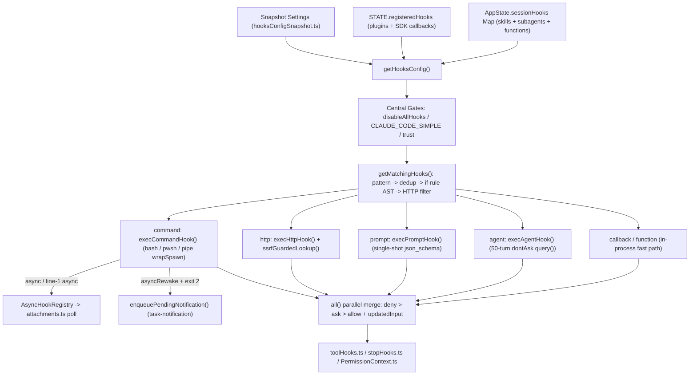

# 13. The Hook System: Intercepting Every Lifecycle Event

> **Status: written.** Reverse-engineered from the Claude Code 2.1.88 source snapshot (see the Prologue (`prologue-how-to-read-a-1900-file-agent.md`) for snapshot caveats).
>
> **Layer:** Layer 4 (Safety, Policy, Sandbox & Lifecycle Hooks)
> **Prerequisites:** [Chapter 02](ch002-the-tool-contract.md), [Chapter 06](ch006-executing-tools.md), [Chapter 07](ch007-the-heartbeat-query-loop.md), [Chapter 11](ch011-the-permission-engine.md), [Chapter 12](ch012-shell-execution-sandboxing-and-workspace-tools.md)
> **Primary Source Files:**
> - `types/hooks.ts` — Zod response envelopes (`syncHookResponseSchema`, `hookJSONOutputSchema`), prompt-elicitation schemas, and internal `HookCallback` / `HookResult` types
> - `schemas/hooks.ts` — cycle-breaking Zod schemas for the 4 persisted hook backends (`command`, `prompt`, `http`, `agent`) and `if` rule filters
> - `entrypoints/sdk/coreTypes.ts` — runtime `HOOK_EVENTS` tuple (27 events); re-exports generated SDK hook input/output types (`coreTypes.generated.ts` is absent from this snapshot, though its source Zod schemas live in `entrypoints/sdk/coreSchemas.ts`)
> - `utils/hooks.ts` — 5,022-line core hook engine: trust gate, matcher/dedup/`if`-filter pipeline, `execCommandHook()`, `executeHooks()`, `executeHooksOutsideREPL()`, and all 27 event entrypoints
> - `utils/hooks/execHttpHook.ts` & `utils/hooks/ssrfGuard.ts` — HTTP webhook runner, header env-var allowlisting/CRLF sanitization, sandbox/env proxy routing, and DNS-rebinding-safe SSRF lookup guard
> - `utils/hooks/execPromptHook.ts`, `utils/hooks/execAgentHook.ts` & `utils/hooks/hookHelpers.ts` — single-shot structured-JSON LLM hooks and multi-turn verifier-agent hooks
> - `utils/hooks/hooksConfigSnapshot.ts`, `utils/hooks/hooksConfigManager.ts` & `utils/hooks/hooksSettings.ts` — startup hook snapshotting, enterprise policy precedence, and `/hooks` UI aggregation
> - `utils/hooks/sessionHooks.ts`, `utils/hooks/registerFrontmatterHooks.ts` & `utils/hooks/registerSkillHooks.ts` — ephemeral per-session/per-agent hooks, `FunctionHook` callbacks, and `once: true` self-removal
> - `utils/hooks/AsyncHookRegistry.ts`, `utils/hooks/hookEvents.ts` & `utils/hooks/fileChangedWatcher.ts` — non-blocking background hook polling, out-of-band progress event bus, and `CwdChanged`/`FileChanged` env watchers
> - `services/tools/toolHooks.ts` — `PreToolUse` / `PostToolUse` / `PostToolUseFailure` adapters and the `resolveHookPermissionDecision()` rule-preservation guard

> [!NOTE]
> **Snapshot boundaries:** Two type modules imported across the hook subsystem are absent from this checkout: `types/message.ts` (observed at call sites for `Message`, `AssistantMessage`, `AttachmentMessage`, `ProgressMessage`, and `HookResultMessage`) and `entrypoints/sdk/coreTypes.generated.ts` (re-exported by `entrypoints/sdk/coreTypes.ts:19` for `HookInput` / `HookJSONOutput` types, whose authoritative Zod schemas are present in `entrypoints/sdk/coreSchemas.ts:355-795`).

---

## Why This Layer Exists

By the end of [Chapter 12](ch012-shell-execution-sandboxing-and-workspace-tools.md), the agent harness can enforce static permission rules (`allow`/`deny`/`ask`), run an auto-mode security classifier, and isolate shell processes inside an OS sandbox. Static policy covers *what* the agent may touch, but real engineering teams quickly need *programmable interception* across the entire lifecycle:

- Rewriting or blocking dangerous tool invocations before they reach the permission dialog (`PreToolUse`).
- Running a formatter, linter, or MCP response scrubber immediately after a tool finishes (`PostToolUse`).
- Answering permission prompts from an external enterprise policy server (`PermissionRequest`).
- Forcing the model to keep working if tests are still red or a structured output tool was skipped (`Stop`, `SubagentStop`).
- Reloading `direnv`/virtualenv exports when directories or `.envrc` files change (`CwdChanged`, `FileChanged`), delegating worktrees to Mercurial or Jujutsu (`WorktreeCreate`), or auditing mid-session config edits (`ConfigChange`).

Yet letting `.claude/settings.json` execute arbitrary shell commands, HTTP webhooks, or nested LLM queries inside an agent harness opens a minefield of failure modes: pre-trust remote code execution on untrusted repos, SSRF into cloud metadata endpoints (`169.254.169.254`), infinite recursion when a prompt hook submits a prompt, hidden mid-session hook tampering, subagent hook leakage, and permissive hooks punching holes through enterprise `deny` rules. Every abstraction in `utils/hooks/` and `services/tools/toolHooks.ts` exists to tame one of those hazards without turning every tool call into a latency cliff.

---

## 1. The 27-Event Lifecycle Bus, Matching Pipeline, and Dual Dispatch Paths

### The Problem

A single hook engine has to serve two wildly different runtime worlds. Inside the interactive `query()` generator loop, hooks need progress spinners, abort propagation, model-visible attachments, and structured permission/input overrides. Outside the REPL — during process shutdown (`SessionEnd`), chokidar file-watch events (`ConfigChange`, `FileChanged`), compaction (`PreCompact`), or MCP elicitations — there is no active turn stream or `ToolUseContext` at all. Worse, on the hot path (`PreToolUse` / `PostToolUse`), 99% of sessions have either zero user hooks or only internal analytics callbacks; allocating `JSON.stringify` payloads or spawning shells just to inspect `tool_name` would stall every tool batch.

### The Real Implementation

`entrypoints/sdk/coreTypes.ts:25-53` defines the canonical 27-member `HOOK_EVENTS` tuple (mirrored with Zod input schemas in `entrypoints/sdk/coreSchemas.ts:355-795` and UI descriptions in `utils/hooks/hooksConfigManager.ts:26-267`):

| Lifecycle Family | Events (`HOOK_EVENTS`) | Primary `matchQuery` Field (`utils/hooks.ts:1616-1670`) | Dispatch Path |
| --- | --- | --- | --- |
| **Tools & Permissions** | `PreToolUse`, `PostToolUse`, `PostToolUseFailure`, `PermissionRequest`, `PermissionDenied` | `tool_name` | `executeHooks()` |
| **Turn & Session** | `SessionStart`, `Setup`, `UserPromptSubmit`, `Stop`, `StopFailure`, `SessionEnd`, `Notification` | `source` / `trigger` / — / `error` / `reason` / `notification_type` | Mixed (`StopFailure`, `SessionEnd`, `Notification` outside REPL) |
| **Context & Compaction** | `PreCompact`, `PostCompact`, `InstructionsLoaded` | `trigger` / `load_reason` | `executeHooksOutsideREPL()` |
| **Subagents & Swarms** | `SubagentStart`, `SubagentStop`, `TeammateIdle`, `TaskCreated`, `TaskCompleted` | `agent_type` / — | `executeHooks()` |
| **MCP & Workspace** | `Elicitation`, `ElicitationResult`, `ConfigChange`, `WorktreeCreate`, `WorktreeRemove`, `CwdChanged`, `FileChanged` | `mcp_server_name` / `source` / — / `basename(file_path)` | `executeHooksOutsideREPL()` |

Two additional settings-configured command runners — `StatusLine` and `FileSuggestion` (`utils/hooks.ts:4584-4738`) — bypass event matching but reuse `execCommandHook()`, the trust gate, and managed-only policy. Separately, `utils/hooks/postSamplingHooks.ts` maintains a programmatic-only registry (`registerPostSamplingHook`) not exposed in `settings.json`; for example, `utils/hooks/skillImprovement.ts:175-182` registers a post-sampling LLM hook via `utils/hooks/apiQueryHookHelper.ts` behind `feature('SKILL_IMPROVEMENT')` and GrowthBook flag `tengu_copper_panda`.

To break a circular dependency between `utils/settings/types.ts` and `utils/plugins/schemas.ts`, the persisted hook schemas live in `schemas/hooks.ts`, while the response envelopes live in `types/hooks.ts` with a compile-time `type-fest` lockstep guard:

```ts
// types/hooks.ts:195-200
// Compile-time assertion that SDK and Zod types match
import type { IsEqual } from 'type-fest'
type Assert<T extends true> = T
type _assertSDKTypesMatch = Assert<
  IsEqual<SchemaHookJSONOutput, HookJSONOutput>
>
```

Before *any* hook runs — inside or outside the REPL — `executeHooks()` (`utils/hooks.ts:1978-1999`) and `executeHooksOutsideREPL()` (`utils/hooks.ts:3016-3036`) enforce three centralized gates in order:

1. `shouldDisableAllHooksIncludingManaged()` — enterprise `policySettings.disableAllHooks === true` kills everything.
2. `isEnvTruthy(process.env.CLAUDE_CODE_SIMPLE)` — simple/minimal mode disables all hooks.
3. `shouldSkipHookDueToTrust()` (`utils/hooks.ts:286-296`) — in interactive mode, **every** hook requires `checkHasTrustDialogAccepted()`; in non-interactive SDK mode, trust is implicit.

On hot paths (`PreToolUse`, `PostToolUseFailure`, `PermissionDenied`, `Stop`, `StopFailure`, `UserPromptSubmit`), callers first probe `hasHookForEvent()` (`utils/hooks.ts:1582-1593`), which intentionally over-approximates across all three hook sources so unconfigured sessions skip `createBaseHookInput()` path joins and matching completely. If only internal callbacks (`hook.type === 'callback' && hook.internal === true`, such as file-access analytics or commit attribution) match, `executeHooks()` takes a zero-overhead fast path (`utils/hooks.ts:2036-2067`) that skips OTEL spans, progress messages, `createCombinedAbortSignal`, and JSON processing — cutting `PostToolUse` overhead from **6.01µs to ~1.8µs (-70%)**.

When user hooks do exist, `getMatchingHooks()` (`utils/hooks.ts:1603-1874`) executes a four-stage funnel:

1. **Matcher filtering (`matchesPattern`, `utils/hooks.ts:1346-1381`):** Empty string or `*` matches all; pure alphanumeric/pipe strings (`Write|Edit`) run fast exact checks with `normalizeLegacyToolName()`; anything else compiles a `RegExp` tested against both `matchQuery` and `getLegacyToolNames(matchQuery)` so legacy patterns like `^Task$` keep matching `Agent`.
2. **Source-namespaced deduplication (`hookDedupKey`, `utils/hooks.ts:1453-1455, 1735-1806`):** Settings-file hooks share the `''` prefix so identical commands across user/project/local collapse (last-merged scope wins via `new Map`), while plugin and skill hooks prefix with `pluginRoot` or `skillRoot` so two plugins referencing `${CLAUDE_PLUGIN_ROOT}/hook.sh` never collide (`gh-29724`). Identity also folds in `shell` (defaulting to `'bash'`) and the `if` condition.
3. **Pre-spawn `if` condition filtering (`prepareIfConditionMatcher`, `utils/hooks.ts:1390-1421`):** Hooks on `PreToolUse`, `PostToolUse`, `PostToolUseFailure`, and `PermissionRequest` may declare an `if` field in permission-rule syntax (e.g., `"Bash(git *)"`, `"Read(*.ts)"`). Expensive work — tool lookup, Zod input parsing, and [Chapter 12](ch012-shell-execution-sandboxing-and-workspace-tools.md)'s `tool.preparePermissionMatcher()` (which invokes `parseForSecurity()` for Bash) — runs **once per event batch**, returning a closure evaluated per hook before spawning a single subprocess.
4. **Event-specific transport exclusions (`utils/hooks.ts:1850-1864`):** HTTP hooks are stripped from `SessionStart` and `Setup`.

```ts
// utils/hooks.ts:1390-1421
async function prepareIfConditionMatcher(
  hookInput: HookInput,
  tools: Tools | undefined,
): Promise<IfConditionMatcher | undefined> {
  if (
    hookInput.hook_event_name !== 'PreToolUse' &&
    hookInput.hook_event_name !== 'PostToolUse' &&
    hookInput.hook_event_name !== 'PostToolUseFailure' &&
    hookInput.hook_event_name !== 'PermissionRequest'
  ) {
    return undefined
  }

  const toolName = normalizeLegacyToolName(hookInput.tool_name)
  const tool = tools && findToolByName(tools, hookInput.tool_name)
  const input = tool?.inputSchema.safeParse(hookInput.tool_input)
  const patternMatcher =
    input?.success && tool?.preparePermissionMatcher
      ? await tool.preparePermissionMatcher(input.data)
      : undefined

  return ifCondition => {
    const parsed = permissionRuleValueFromString(ifCondition)
    if (normalizeLegacyToolName(parsed.toolName) !== toolName) {
      return false
    }
    if (!parsed.ruleContent) {
      return true
    }
    return patternMatcher ? patternMatcher(parsed.ruleContent) : false
  }
}
```

Once matched, `executeHooks()` lazily stringifies `hookInput` at most once per batch (`getJsonInput()`, `utils/hooks.ts:2124-2140`), yields a `hook_progress` message for every matched hook, and runs all hooks **concurrently** via [Chapter 01](ch001-atoms-types-stores-and-primitives.md)'s `all(hookPromises)` (`utils/hooks.ts:2744`). Independently of the REPL message stream, `utils/hooks/hookEvents.ts` broadcasts `started`, 1-second `.unref()`-ed `progress`, and `response` events for SDK consumers — always emitting `SessionStart` and `Setup` (`ALWAYS_EMITTED_HOOK_EVENTS`), buffering up to `MAX_PENDING_EVENTS = 100` events until `registerHookEventHandler()` attaches, and unlocking all 27 events when `setAllHookEventsEnabled(true)` is set (SDK `includeHookEvents` or `CLAUDE_CODE_REMOTE`).

### Hidden Invariants & Failure Modes

> [!WARNING]
> **The pre-trust RCE scar (`utils/hooks.ts:268-296`):** `captureHooksConfigSnapshot()` runs in `setup.ts:166` *before* the workspace trust dialog appears. Two historical bugs — `SessionEnd` firing when a user declined trust and `SubagentStop` firing before trust — forced `shouldSkipHookDueToTrust()` to be centralized inside `executeHooks()`, `executeHooksOutsideREPL()`, `executeStatusLineCommand()`, and `executeFileSuggestionCommand()`.

- **Never add Zod `.transform()` to `schemas/hooks.ts` (`schemas/hooks.ts:130-137`, `gh-24920` / `CC-79`):** `parseSettingsFile()` uses `HooksSchema`, and `updateSettingsForSource()` round-trips parsed objects through `JSON.stringify`. An earlier `.transform()` wrapping `AgentHookSchema.prompt` into a closure silently vanished on stringify, deleting users' prompts from `settings.json`.
- **Headless HTTP deadlock (`utils/hooks.ts:1850-1864`):** HTTP hooks are filtered out on `SessionStart` and `Setup` because in headless mode the sandbox network ask callback deadlocks before the `structuredInput` consumer loop has started.
- **Session-ID alignment on `StopFailure` (`utils/hooks.ts:3600-3604`):** `executeHooksOutsideREPL()` always queries hooks under the main `getSessionId()`, so `executeStopFailureHooks()` deliberately gates with `getSessionId()` rather than `agentId` to prevent passing the gate and failing execution.
- **Unblockable enterprise policy audits (`utils/hooks.ts:4232-4236`):** `executeConfigChangeHooks()` runs hooks when `policy_settings` changes so admins get audit logs, then overwrites `blocked: false` on every result so local hooks can never veto enterprise policy.

---

## 2. The Four Hook Execution Backends (Plus In-Process Callbacks & Functions)

### The Problem

Not every hook can — or should — shell out to `/bin/sh`. Teams want local shell scripts with cross-platform Windows support, remote HTTPS policy webhooks that cannot be abused for SSRF or secret exfiltration, cheap single-shot LLM judges for semantic guardrails, and full multi-turn verifier agents that can inspect the repo and conversation transcript before letting the main agent finish. Each backend requires a different isolation boundary.

### The Real Implementation

`HookCommandSchema` (`schemas/hooks.ts:176-189`) defines four persisted backends discriminated on `type`: `'command'`, `'http'`, `'prompt'`, and `'agent'`. Two additional in-memory backends — `'callback'` (`types/hooks.ts:211-226`) and `'function'` (`utils/hooks/sessionHooks.ts:24-31`) — serve SDK control hooks, internal telemetry hooks, and ephemeral validators.

#### Backend 1: Shell Command (`type: 'command'`) — `execCommandHook()`

`utils/hooks.ts:747-1335` runs shell hooks with a default 10-minute timeout (`TOOL_HOOK_EXECUTION_TIMEOUT_MS`, overridden to 1,500ms or `CLAUDE_CODE_SESSIONEND_HOOKS_TIMEOUT_MS` for `SessionEnd`, `utils/hooks.ts:166-182`). It builds directly on [Chapter 12](ch012-shell-execution-sandboxing-and-workspace-tools.md)'s shell primitives:

- **Dual shell dispatch (`utils/hooks.ts:790-811, 957-984`):** Resolves `hook.shell ?? DEFAULT_HOOK_SHELL` (`'bash'` vs `'powershell'`). Bash hooks on Windows run via `findGitBashPath()` (Cygwin/Git Bash, not `cmd.exe`), convert all injected paths with `windowsPathToPosixPath()`, auto-prepend `bash` for `.sh` scripts, and apply `CLAUDE_CODE_SHELL_PREFIX` via `formatShellPrefixCommand()`. PowerShell hooks spawn `getCachedPowerShellPath()` with `buildPowerShellArgs()` (`-NoProfile -NonInteractive -Command`), keep native Windows paths, and intentionally skip `.sh` auto-prepend, `SHELL_PREFIX`, and `CLAUDE_ENV_FILE` (since PowerShell writes `$env:FOO` syntax that bash cannot source).
- **Ordered template substitution & missing-plugin pre-check (`utils/hooks.ts:818-857`):** For plugin hooks, `execCommandHook()` checks `await pathExists(pluginRoot)` *before* spawning. Without that guard, `python3 <missing>.py` exits with code **2** — identical to the hook protocol's blocking code, which would brick `UserPromptSubmit` or `Stop` until restart! It then substitutes `${CLAUDE_PLUGIN_ROOT}` and `${CLAUDE_PLUGIN_DATA}` using function-form `.replace(..., () => path)` (avoiding `$`-pattern mangling on Windows UNC shares like `\\server\c$\plugin`) *before* `substituteUserConfigVariables()`, so user-entered config values containing `${CLAUDE_PLUGIN_ROOT}` are treated as opaque literals. Plugin options are also exported as `CLAUDE_PLUGIN_OPTION_<KEY>`.
- **Stable root, safe cwd, and `CLAUDE_ENV_FILE` (`utils/hooks.ts:816, 882-938`):** `CLAUDE_PROJECT_DIR` pins to `getProjectRoot()` (stable even inside a mid-session worktree), while `cwd` falls back from `getCwd()` to `getOriginalCwd()` if a worktree directory was deleted out from under AsyncLocalStorage. For `SessionStart`, `Setup`, `CwdChanged`, and `FileChanged`, `CLAUDE_ENV_FILE` points to a per-hook `.sh` file whose exports are sourced into subsequent `BashTool` commands.
- **Pipe-mode `wrapSpawn()`, newline-terminated stdin, and bidirectional prompt elicitation (`utils/hooks.ts:986-1282`):** Unlike `BashTool` (which uses file-fd output), hooks use `wrapSpawn()` in **pipe mode** so JS inspects `stdout` incrementally:
  1. Line 1 is sniffed for `{"async": true}` (`utils/hooks.ts:1117-1164`) to background immediately without blocking if the process emits more lines quickly.
  2. When `requestPrompt` is passed, `stdout` is parsed line-by-line against `promptRequestSchema` (`types/hooks.ts:28-47`), serialized through `promptChain`, and answered over open `stdin` as `{ prompt_response, selected }\n`; processed prompt lines are recorded in `processedPromptLines` and stripped by content match on close (`utils/hooks.ts:1243-1249`) so elicitation frames never leak into `parseHookOutput()`.
  3. Input JSON is always written with a trailing `\n` (`jsonInput + '\n'`, `utils/hooks.ts:1006, 1210`) — a production scar (`gh-30509` / `CC-161`) because bash `read -r line` exits 1 on EOF without a newline!

#### Backend 2: HTTP Webhook (`type: 'http'`) — `execHttpHook()` + `ssrfGuard.ts`

`utils/hooks/execHttpHook.ts` POSTs `jsonInput` to `hook.url` with layered defenses against project-configured exfiltration and SSRF:

1. **URL allowlist before any I/O (`execHttpHook.ts:137-145`):** Reads `allowedHttpHookUrls` from `getInitialSettings()` (`undefined` = unrestricted, `[]` = block all, non-empty = wildcard `*` match).
2. **Double-gated env-var interpolation & CRLF sanitization (`execHttpHook.ts:76-108, 161-172`):** Header values may reference `$VAR` or `${VAR}`, but only variables in the intersection of `hook.allowedEnvVars` and enterprise `settings.httpHookAllowedEnvVars` resolve; everything else becomes `''`, and `sanitizeHeaderValue()` strips `\r`, `\n`, and `\x00` to prevent header injection from poisoned env vars.
3. **DNS-rebinding-proof SSRF guard (`utils/hooks/ssrfGuard.ts:42-283`):** Rather than pre-resolving DNS and letting axios resolve again (a classic TOCTOU DNS-rebinding window), `execHttpHook()` passes `ssrfGuardedLookup` directly into axios's `lookup` option, alongside `maxRedirects: 0`:

```ts
// utils/hooks/ssrfGuard.ts:245-268 (trimmed)
dnsLookup(hostname, { all: true }, (err, addresses) => {
  if (err) {
    callback(err, '')
    return
  }

  for (const { address } of addresses) {
    if (isBlockedAddress(address)) {
      callback(ssrfError(hostname, address), '')
      return
    }
  }

  const first = addresses[0]
  if (!first) {
    callback(Object.assign(new Error(`ENOTFOUND ${hostname}`), {
      code: 'ENOTFOUND', hostname,
    }), '')
    return
  }
  // ... returns validated address(es) directly to the socket
})
```

`isBlockedAddress()` rejects `0.0.0.0/8`, `10.0.0.0/8`, `100.64.0.0/10` (RFC 6598 CGNAT — used by Alibaba Cloud metadata `100.100.100.200`), `169.254.0.0/16` (AWS/GCP/Azure link-local metadata), `172.16.0.0/12`, `192.168.0.0/16`, IPv6 `::`, `fc00::/7`, `fe80::/10`, AND **IPv4-mapped IPv6 in any representation** — `expandIPv6Groups()` + `extractMappedIPv4()` (`ssrfGuard.ts:133-204`) unpack hex-form addresses like `::ffff:a9fe:a9fe` (`169.254.169.254`) before delegating to `isBlockedV4()`. Loopback (`127.0.0.0/8`, `::1`) is intentionally allowed so developers can run local policy servers.

4. **Proxy handoff (`execHttpHook.ts:21-41, 176-217`):** `getSandboxProxyConfig()` dynamically imports `SandboxManager` (breaking a static cycle `sandbox-adapter → settings → ... → hooks → execHttpHook`) and awaits `SandboxManager.waitForNetworkInitialization()`. When either the sandbox proxy or an env-var proxy (`HTTP_PROXY`/`HTTPS_PROXY`, respecting `NO_PROXY`) is active, `lookup` is set to `undefined` — because the proxy resolves the target's DNS, and running `ssrfGuardedLookup` would mistakenly block a corporate proxy hosted on `10.0.0.1:3128`!

HTTP hooks must return valid JSON (`parseHttpHookOutput`, `utils/hooks.ts:453-487`; empty body normalizes to `{}`). Non-2xx statuses, network errors, and schema failures all yield `non_blocking_error`.

#### Backend 3: Single-Shot LLM Prompt Hook (`type: 'prompt'`) — `execPromptHook()`

`utils/hooks/execPromptHook.ts` turns a natural-language check into a single structured API call (`queryModelWithoutStreaming()`, `querySource: 'hook_prompt'`, default 30s timeout, `model: hook.model ?? getSmallFastModel()`, `thinkingConfig: { type: 'disabled' }`):

- Expands `$ARGUMENTS` via `addArgumentsToPrompt()` and builds `createUserMessage()` directly — deliberately skipping `processUserInput()` so a `UserPromptSubmit` prompt hook never triggers infinite recursion (`execPromptHook.ts:40-42`).
- Prepends conversation `messages` when available (e.g., on `Stop`), constrains output via `outputFormat: { type: 'json_schema' }` to `{ ok: boolean, reason?: string }`, and validates with `hookResponseSchema()`.
- `{ ok: false, reason }` returns `outcome: 'blocking'`, `blockingError`, `preventContinuation: true`, and `stopReason: reason`. Malformed JSON or API failures degrade safely to `non_blocking_error`.

#### Backend 4: Multi-Turn Agent Hook (`type: 'agent'`) — `execAgentHook()`

`utils/hooks/execAgentHook.ts` escalates verification to a full multi-turn `query()` loop (`querySource: 'hook_agent'`, default 60s timeout, `MAX_AGENT_TURNS = 50`, `model: hook.model ?? getSmallFastModel()`, `thinkingConfig: { type: 'disabled' }`). Running an agent inside a hook demands four explicit containment boundaries:

```ts
// utils/hooks/execAgentHook.ts:100-160 (trimmed)
const tools: Tool[] = [
  ...filteredTools.filter(
    tool => !ALL_AGENT_DISALLOWED_TOOLS.has(tool.name),
  ),
  structuredOutputTool,
]
// ...
const hookAgentId = asAgentId(`hook-agent-${randomUUID()}`)
const agentToolUseContext: ToolUseContext = {
  ...toolUseContext,
  agentId: hookAgentId,
  abortController: hookAbortController,
  // ...
  getAppState() {
    const appState = toolUseContext.getAppState()
    const existingSessionRules =
      appState.toolPermissionContext.alwaysAllowRules.session ?? []
    return {
      ...appState,
      toolPermissionContext: {
        ...appState.toolPermissionContext,
        mode: 'dontAsk' as const,
        alwaysAllowRules: {
          ...appState.toolPermissionContext.alwaysAllowRules,
          session: [...existingSessionRules, `Read(/${transcriptPath})`],
        },
      },
    }
  },
}
registerStructuredOutputEnforcement(toolUseContext.setAppState, hookAgentId)
```

1. **Tool filtering:** Removes any parent `StructuredOutput` tool (avoiding duplicate-schema clashes under `--json-schema`) and strips `ALL_AGENT_DISALLOWED_TOOLS` so a `Stop` verifier cannot spawn recursive subagents or enter plan mode.
2. **Non-interactive transcript permission:** Overrides `getAppState()` to force `mode: 'dontAsk'` while injecting a scoped session allow rule `Read(/${transcriptPath})` so the verifier can inspect the conversation log without hanging on a dialog.
3. **Self-bootstrapped structured output enforcement:** Calls `registerStructuredOutputEnforcement()` (`utils/hooks/hookHelpers.ts:70-83`), which registers a session-scoped `Stop` **function hook** under `hookAgentId` verifying `hasSuccessfulToolCall(messages, SYNTHETIC_OUTPUT_TOOL_NAME)`. The moment the `structured_output` attachment arrives, `execAgentHook()` aborts `hookAbortController`, breaks out of `for await`, and calls `clearSessionHooks(toolUseContext.setAppState, hookAgentId)` (`execAgentHook.ts:212-233`).
4. **Fail-open exhaustion (`execAgentHook.ts:236-268`):** Hitting `MAX_AGENT_TURNS` or exiting without structured output logs telemetry (`tengu_agent_stop_hook_max_turns` / `tengu_agent_stop_hook_error`) and returns `outcome: 'cancelled'` rather than trapping the user in an unbreakable stop loop.

### Hidden Invariants & Failure Modes

- **Outside-REPL backend limits (`utils/hooks.ts:3152-3186`):** `executeHooksOutsideREPL()` only executes `command`, `http`, and `callback` hooks; `prompt`, `agent`, and `function` hooks return non-blocking errors because no `ToolUseContext` or `messages` array exists outside the query loop.
- **No timeout double-stacking on HTTP hooks (`utils/hooks.ts:2299-2307`):** `executeHooks()` passes the raw parent `signal` (not the wrapper's `abortSignal`) to `execHttpHook()`, because `execHttpHook()` constructs its own combined timeout signal internally.

---

## 3. Exit Codes, JSON Decision Envelopes, and Safe Permission Composition

### The Problem

Hooks speak through two channels — legacy POSIX exit codes and structured JSON envelopes — and multiple hooks run concurrently for the same event. That creates three subtle composition hazards:
1. Conflicting decisions from parallel `PreToolUse` hooks (one says `'allow'`, another says `'deny'`).
2. A hook returning `{ permissionDecision: "allow", updatedInput: ... }` attempting to bypass a user or enterprise `settings.json` `deny`/`ask` rule (the exact class of bug flagged as `inc-4788` in source comments).
3. `Stop` hooks needing to either *continue* the turn with corrective feedback (exit 2 / blocking error) or *halt* the entire turn immediately (`continue: false`).

### The Real Implementation

#### Exit Codes vs. `syncHookResponseSchema`

For command hooks, `executeHooks()` checks `parseHookOutput(result.stdout)` first (`utils/hooks.ts:2500-2697`). If `stdout.trim()` starts with `{`, it validates against `hookJSONOutputSchema()` (`types/hooks.ts:50-176`) and dispatches through `processHookJSONOutput()` (`utils/hooks.ts:489-737`). Otherwise, it falls back to three exit-code semantics:

| Exit Code / Envelope | Outcome | Effect on Execution |
| --- | --- | --- |
| Exit `0` (plain text) | `'success'` | `stdout` becomes `hook_success` attachment content (model-visible on `UserPromptSubmit`, `SessionStart`, `Setup`, `SubagentStart`; transcript-visible on `PostToolUse`). |
| Exit `2` (plain text) | `'blocking'` | `stderr` becomes `blockingError`, blocking tool call (`PreToolUse`), prompt (`UserPromptSubmit`), stop (`Stop`/`SubagentStop`), task creation/completion, or config change (`ConfigChange`). |
| Other non-zero exit | `'non_blocking_error'` | `stderr` shown to user only; execution proceeds. |
| JSON `continue: false` | `preventContinuation: true` | Halts turn continuation with optional `stopReason` (takes precedence over `blockingErrors` in `Stop` hooks). |
| JSON `decision: 'approve' \| 'block'` | Legacy top-level decision | Maps to `permissionBehavior: 'allow'` or `'deny'` + `blockingError`. |
| JSON `hookSpecificOutput` | Event-scoped structured output | Validated against `expectedHookEvent` (`utils/hooks.ts:583-590`); carries `permissionDecision`, `updatedInput`, `additionalContext`, `updatedMCPToolOutput`, `permissionRequestResult`, `retry`, `watchPaths`, `worktreePath`, or elicitation actions. |

Notice two UI/transcript deduplication scars in this layer: JSON-output hooks create their `hook_success` attachment with `content: ''` (`utils/hooks.ts:725-729`) so `messages.ts` suppresses noisy `"X hook success: Success"` reminders (context travels via `additionalContext` instead), and `services/tools/toolHooks.ts:90-103` skips `hook_blocking_error` messages already yielded alongside `result.blockingError` on `PostToolUse` / `PostToolUseFailure` (`#31301`).

#### Parallel Precedence and Three-Way `updatedInput`

As concurrent hooks settle via `all(hookPromises)`, `executeHooks()` aggregates `permissionBehavior` monotonically with strict precedence **`deny > ask > allow`** (`utils/hooks.ts:2820-2847`): once `'deny'` is observed, neither `'ask'` nor `'allow'` can downgrade it; `'ask'` overrides `'allow'`; `'passthrough'` makes no decision.

Crucially, `PreToolUse` hooks can rewrite `updatedInput` in **three** distinct ways:
1. Paired with `permissionDecision: 'allow'` (`utils/hooks.ts:2850-2868`).
2. Paired with `permissionDecision: 'ask'` (rewritten input shown in the prompt dialog).
3. **Passthrough** — returning `updatedInput` with *no* `permissionDecision` (`utils/hooks.ts:2873-2880` → `toolHooks.ts:558-563` → `toolExecution.ts:834-838`), rewriting `processedInput` while letting normal permission evaluation run untouched.

#### The `inc-4788` Invariant: `resolveHookPermissionDecision()`

After `runPreToolUseHooks()` finishes in `services/tools/toolExecution.ts:800-862`, `toolExecution.ts:921` hands `hookPermissionResult` to `resolveHookPermissionDecision()` in `services/tools/toolHooks.ts:332-433` (shared with `REPLTool/toolWrappers.ts` so REPL inner calls enforce identical policy):

```ts
// services/tools/toolHooks.ts:347-406
  if (hookPermissionResult?.behavior === 'allow') {
    const hookInput = hookPermissionResult.updatedInput ?? input

    // Hook provided updatedInput for an interactive tool — the hook IS the
    // user interaction (e.g. headless wrapper that collected AskUserQuestion
    // answers). Treat as non-interactive for the rule-check path.
    const interactionSatisfied =
      requiresInteraction && hookPermissionResult.updatedInput !== undefined

    if ((requiresInteraction && !interactionSatisfied) || requireCanUseTool) {
      return {
        decision: await canUseTool(
          tool, hookInput, toolUseContext, assistantMessage, toolUseID,
        ),
        input: hookInput,
      }
    }

    // Hook allow skips the interactive prompt, but deny/ask rules still apply.
    const ruleCheck = await checkRuleBasedPermissions(
      tool,
      hookInput,
      toolUseContext,
    )
    if (ruleCheck === null) {
      return { decision: hookPermissionResult, input: hookInput }
    }
    if (ruleCheck.behavior === 'deny') {
      return { decision: ruleCheck, input: hookInput }
    }
    // ask rule — dialog required despite hook approval
    return {
      decision: await canUseTool(
        tool, hookInput, toolUseContext, assistantMessage, toolUseID,
      ),
      input: hookInput,
    }
  }
```

> [!IMPORTANT]
> **Hook `'allow'` never bypasses `settings.json` `deny` or `ask` rules.** `resolveHookPermissionDecision()` runs `checkRuleBasedPermissions()` against the *post-rewrite* `hookInput`, closing the escalation vector where a hook rewrites a benign command into a denied command and simultaneously approves it. Only when `ruleCheck === null` (and neither `requireCanUseTool` nor an unsatisfied `requiresUserInteraction()` applies) does hook `'allow'` skip the interactive prompt.

When `hookPermissionResult` is `'ask'`, `resolveHookPermissionDecision()` passes it as `forceDecision` to `canUseTool()` (`toolHooks.ts:415-432`) so the permission dialog displays the hook's explanation and `updatedInput`. Before `tool.call()` executes (`toolExecution.ts:1181-1205`), if a hook modified or schema-parsed `processedInput` from a `backfillObservableInput` clone while leaving `file_path` equal to the expanded backfill value, `toolExecution.ts` restores the model's original `file_path` string so transcript and VCR hashes stay stable.

#### `PermissionRequest`, `PermissionDenied`, `PostToolUse`, and `Stop`

- **`PermissionRequest` (`hooks/toolPermission/PermissionContext.ts:216-263`):** Fires inside the permission dialog handler when interactive approval would be shown. Returning `{ behavior: 'allow', updatedInput?, updatedPermissions? }` persists permanent permission updates via `handleHookAllow()` and approves without prompting; returning `{ behavior: 'deny', message?, interrupt: true }` rejects and calls `toolUseContext.abortController.abort()`.
- **`PermissionDenied` (`services/tools/toolExecution.ts:1075-1101`, gated on `feature('TRANSCRIPT_CLASSIFIER')`):** Fires after an auto-mode classifier denial; if any hook yields `retry: true`, `toolExecution.ts` appends an `isMeta: true` user message notifying the model it may retry.
- **`PostToolUse` (`services/tools/toolHooks.ts:39-191`):** Can append `additionalContext`, stop continuation (`continue: false`), or replace an MCP tool's output via `updatedMCPToolOutput` (strictly guarded by `isMcpTool(tool)` at `toolHooks.ts:146`, so hooks cannot spoof built-in tool output shapes).
- **`Stop` / `SubagentStop` (`query/stopHooks.ts:180-455`):** `executeStopHooks()` switches to `'SubagentStop'` whenever `subagentId` is present and passes `stop_hook_active` so hooks can detect re-entry and avoid infinite loops. Blocking errors become `isMeta: true` user messages that keep `query()` iterating — **unless** any hook sets `preventContinuation: true`, which short-circuits and drops `blockingErrors` (`query/stopHooks.ts:325-327`). For swarm teammates, `TaskCompleted` (for each in-progress owned task) and `TeammateIdle` execute right after `Stop` passes (`query/stopHooks.ts:335-453`).

### Hidden Invariants & Failure Modes

- **Interactive-tool override (`toolHooks.ts:350-355`):** For tools declaring `requiresUserInteraction()` (like `AskUserQuestion`), a hook returning `allow` *without* `updatedInput` still falls into `canUseTool`; returning `allow` *with* `updatedInput` sets `interactionSatisfied = true` because the hook itself collected the user's answer.
- **No double `hook_blocking_error` (`toolHooks.ts:90-103, 245-255`):** Exit-code-2 hooks only yield `{ blockingError }`, whereas JSON `{ decision: 'block' }` hooks yield both `{ blockingError }` and `{ message: hook_blocking_error }`. `runPostToolUseHooks` and `runPostToolUseFailureHooks` filter out the duplicate attachment message explicitly.

---

## 4. Consistency Across Time, Subagents, and Background Execution

### The Problem

Three operational dynamics threaten hook reliability in long-running sessions:
1. **Mid-session settings drift:** Re-reading `.claude/settings.json` on every tool call would let an agent (or rogue script) silently install a hook mid-session; yet legitimate `/hooks` edits, `--worktree` switches, and enterprise policy pushes *do* need controlled reloads.
2. **Subagent and skill isolation:** Skills and subagents declare temporary frontmatter hooks, and `StructuredOutput` registers temporary `Stop` function hooks. Cross-session leakage breaks parent turns, while naive immutable copies of `AppState` trigger O(N²) overhead and UI listener storms under parallel workflow agents.
3. **Blocking latency vs. background wakeups:** Long verification scripts cannot block every tool call synchronously, but backgrounding naively drops stderr or fails to notify an idle agent when a background check fails.

### The Real Implementation

#### Startup Snapshots & Three-Source Merging (`hooksConfigSnapshot.ts`, `hooksConfigManager.ts`)

`setup.ts:166` calls `captureHooksConfigSnapshot()` immediately after `setCwd(cwd)` (and re-calls `updateHooksConfigSnapshot()` at `setup.ts:284` after `--worktree` changes directories, at `ExitWorktreeTool.ts:140` on worktree exit, and in `applySettingsChange.ts:42` on approved settings reloads). Inside `utils/hooks/hooksConfigSnapshot.ts:18-53`, `getHooksFromAllowedSources()` enforces a four-tier enterprise precedence ladder:

1. `policySettings.disableAllHooks === true` → `{}` (all hooks disabled, including managed).
2. `policySettings.allowManagedHooksOnly === true` → `policySettings.hooks ?? {}` (ignores user, project, local, plugin, and session hooks).
3. `isRestrictedToPluginOnly('hooks')` → `policySettings.hooks ?? {}` (blocks user/project/local settings hooks, while plugin hooks and admin-trusted agent frontmatter hooks remain permitted — gated at registration time in `tools/AgentTool/runAgent.ts:564-568` where `agentDefinition.source` is known).
4. Non-managed `mergedSettings.disableAllHooks === true` → `policySettings.hooks ?? {}` (**non-managed settings cannot disable enterprise managed hooks**).

`updateHooksConfigSnapshot()` calls `resetSettingsCache()` first (`hooksConfigSnapshot.ts:104-112`) so external edits followed immediately by `/hooks` never read stale cached settings before chokidar's stability threshold elapses.

At execution time, `getHooksConfig()` (`utils/hooks.ts:1492-1566`) assembles matchers from three independent registries:
1. **Snapshot settings hooks** (`getHooksConfigFromSnapshot()`).
2. **Process-level registered hooks** (`getRegisteredHooks()` in `bootstrap/state.ts:1419-1465` — plugin native hooks carrying `pluginRoot`, SDK control callbacks, and internal hooks). When `shouldAllowManagedHooksOnly()` is true, entries with `'pluginRoot' in matcher` are skipped (`utils/hooks.ts:1524`).
3. **Ephemeral session hooks** (`appState.sessionHooks`, skipped entirely under `managedOnly` so agent/skill frontmatter cannot bypass enterprise lock-down).

For the `/hooks` management UI, `utils/hooks/hooksConfigManager.ts` and `utils/hooks/hooksSettings.ts` group hooks by event and matcher, deduplicate identical resolved file paths (when running from `$HOME`, `userSettings` and `projectSettings` both resolve to `~/.claude/settings.json`, `hooksSettings.ts:109-122`), hide all settings hooks when `allowManagedHooksOnly` is active, and expose `[ANT-ONLY] Built-in Hook` entries only under `process.env.USER_TYPE === 'ant'` (`hooksConfigManager.ts:346-359`).

#### Subagent & Skill Scoping and the `Map` Identity Scar (`sessionHooks.ts`)

`utils/hooks/sessionHooks.ts` scopes every temporary hook to a `sessionId` — either the main session ID or a subagent's `agentId` (`utils/hooks.ts:2003`). Three helpers build on it:

- `registerFrontmatterHooks()` (called from `tools/AgentTool/runAgent.ts:568` with `isAgent = true`, cleaned up via `clearSessionHooks(rootSetAppState, agentId)` at `runAgent.ts:821`): automatically converts `Stop` hooks to `SubagentStop` because subagents fire `SubagentStop` (`registerFrontmatterHooks.ts:40-45`).
- `registerSkillHooks()` (called from `utils/processUserInput/processSlashCommand.tsx:877`): preserves `skillRoot` (exported as `CLAUDE_PLUGIN_ROOT` for skill/plugin parity) and implements `once: true` by registering an `onHookSuccess` callback that invokes `removeSessionHook()` after the first `outcome === 'success'` (`utils/hooks.ts:2919-2927`).
- `addFunctionHook()` (`sessionHooks.ts:93-115`): attaches in-memory `FunctionHook` callbacks (e.g., `registerStructuredOutputEnforcement` and `teammateInit.ts:98`).

The container type itself carries a textbook performance scar:

```ts
// utils/hooks/sessionHooks.ts:48-62
/**
 * Map (not Record) so .set/.delete don't change the container's identity.
 * Mutator functions mutate the Map and return prev unchanged, letting
 * store.ts's Object.is(next, prev) check short-circuit and skip listener
 * notification. Session hooks are ephemeral per-agent runtime callbacks,
 * never reactively read (only getAppState() snapshots in the query loop).
 *
 * This matters under high-concurrency workflows: parallel() with N
 * schema-mode agents fires N addFunctionHook calls in one synchronous
 * tick. With a Record + spread, each call cost O(N) to copy the growing
 * map (O(N²) total) plus fired all ~30 store listeners. With Map: .set()
 * is O(1), return prev means zero listener fires.
 */
export type SessionHooksState = Map<string, SessionStore>
```

#### Non-Blocking Async Hooks, `asyncRewake`, and Reactive Env Watchers

Command hooks can opt into background execution either statically (`async: true` or `asyncRewake: true` in `BashCommandHookSchema`) or dynamically by emitting `{"async": true, "asyncTimeout": ...}` on stdout line 1 (`utils/hooks.ts:995-1030, 1117-1151`, suppressed if `forceSyncExecution` is true). From there, `executeInBackground()` (`utils/hooks.ts:184-265`) splits into **two** distinct delivery engines:

1. **Standard Async (`AsyncHookRegistry.ts`):** Calls `shellCommand.background(processId)` and registers a `PendingAsyncHook` (default 15s timeout, 1s progress polling). Before each subsequent model turn, `getAsyncHookResponseAttachments()` (`utils/attachments.ts:3464-3518`) polls `checkForAsyncHookResponses()` (`AsyncHookRegistry.ts:113-268`), which uses `Promise.allSettled()` so one throwing hook cannot orphan another's cleanup, scans completed stdout for the first non-async JSON line, marks `responseAttachmentSent = true`, emits `hookResponse`, invalidates the session env cache if a `SessionStart` hook completed (`AsyncHookRegistry.ts:257-262`), and yields `async_hook_response` attachments. In headless/print mode, `cli/print.ts:2674, 4134` calls `finalizePendingAsyncHooks()` to flush completed hooks and kill still-running stragglers on shutdown.
2. **Wake-on-Failure (`asyncRewake: true`, `utils/hooks.ts:205-246`):** Bypasses `AsyncHookRegistry` *and* deliberately skips `shellCommand.background()` — because `background()` invokes `taskOutput.spillToDisk()`, under which `getStderr()` returns `''`! Instead, the `StreamWrapper`s keep piping into in-memory `TaskOutput` buffers; when `shellCommand.result` resolves, it yields one tick via `await new Promise(resolve => setImmediate(resolve))` so pending stdio `'data'` events drain after `'exit'`, then on exit code `2` enqueues a `task-notification` via `enqueuePendingNotification()` to wake an idle model or inject mid-query.

Finally, `utils/hooks/fileChangedWatcher.ts` closes the loop for environment-sync hooks: `initializeFileChangedWatcher(cwd)` (`setup.ts:172`) watches pipe-separated filenames from `FileChanged` matchers (e.g., `.envrc|.env`) plus dynamic `watchPaths` returned by `SessionStart`, `CwdChanged`, or `FileChanged` hooks (`chokidar` with `stabilityThreshold: 500`). Whenever `CwdChanged` or `FileChanged` runs, `executeEnvHooks()` (`utils/hooks.ts:4241-4258`) invalidates the session environment cache so new `CLAUDE_ENV_FILE` exports immediately apply to future `BashTool` commands.

### Hidden Invariants & Failure Modes

- **Mirroring `managedOnly` in existence checks (`utils/hooks.ts:4910-4920`):** `hasWorktreeCreateHook()` must skip plugin hooks when `shouldAllowManagedHooksOnly()` is true — mirroring `getHooksConfig()`. Otherwise `hasWorktreeCreateHook()` would return `true`, skip native git worktree setup, and then `executeWorktreeCreateHook()` would find zero runnable hooks and throw.
- **`onHookSuccess` scoping nuance (`utils/hooks.ts:2907-2928`):** The `onHookSuccess` lookup calls `getSessionId()` (the main session ID) rather than `toolUseContext?.agentId`, which works for main-session `registerSkillHooks` (`once: true`) while subagent frontmatter hooks rely on `clearSessionHooks(..., agentId)` at teardown.
- **Post-exit stream drain (`utils/hooks.ts:219-222`):** In `asyncRewake`, `shellCommand.result` resolves on process `'exit'` before final stdout/stderr `'data'` chunks finish flushing into `TaskOutput`; the `setImmediate` yield prevents truncating the very stderr message meant to wake the model.

---

## Putting the Layer Together

First, the full hook configuration, matching, and multi-backend execution pipeline:



And the exact tool-execution interception envelope (where hooks compose safely with [Chapter 11](ch011-the-permission-engine.md)'s permission engine):

```text
  tool_use (Zod parsed + validateInput + backfillObservableInput)
     │
     ▼
  runPreToolUseHooks() ──► parallel hooks ──► precedence: deny > ask > allow
     │                                        (+ updatedInput on passthrough)
     ▼
  resolveHookPermissionDecision()
     ├─ hook 'deny'  ─────────────────────────► tool_result (is_error: true)
     ├─ hook 'allow' ──► checkRuleBasedPermissions(tool, hookInput)
     │                      ├─ deny rule ─────► DENIED (inc-4788 invariant!)
     │                      ├─ ask / reqUI ───► canUseTool() ─► PermissionReq
     │                      └─ null ──────────► execute tool.call(callInput)
     └─ 'ask' / none ──► canUseTool(forceDecision) ─► PermissionRequest hooks
                                                        │
     ┌───────────────────── denied (auto-mode) ◄────────┤ allowed
     ▼                                                  ▼
  PermissionDenied hooks (retry?)               tool.call(callInput)
                                                   ├─ ok  ─► PostToolUse
                                                   │         (updatedMCPOut?)
                                                   └─ err ─► PostToolUseFail
```

---

## How This Snaps Into the Next Layer

Chapter 13's hook snapshot and `ConfigChange` event form a tight bidirectional contract with **[Chapter 14 (Configuration, Settings Precedence, and Enterprise Policy)](ch014-configuration-settings-and-enterprise-policy.md)**:

- **Hooks gate live settings reloads:** In `utils/settings/changeDetector.ts:290-301` and `utils/settings/changeDetector.ts:343-353`, every detected disk edit or deletion fires `executeConfigChangeHooks()` *before* calling `fanOut(source)`. If any hook exits `2` or returns `{ decision: 'block' }` (`hasBlockingResult()`), the reload is vetoed — except for `policy_settings`, where `utils/hooks.ts:4234-4236` forces `blocked: false` so enterprise policy always lands.
- **Settings reloads refresh the hook snapshot:** Once `fanOut(source)` passes, `utils/settings/applySettingsChange.ts:42` invokes `updateHooksConfigSnapshot()` alongside `loadAllPermissionRulesFromDisk()`, keeping both interactive (`AppState.tsx`) and headless (`cli/print.ts`) hook snapshots synchronized with disk.
- **Enterprise policy knobs live in the settings schema:** `utils/settings/types.ts:459-499` declares `disableAllHooks`, `allowManagedHooksOnly`, `allowedHttpHookUrls`, and `httpHookAllowedEnvVars` and imports `HooksSchema` from `schemas/hooks.ts` — the exact multi-source settings hierarchy Chapter 14 dissects next.

---

## Reading Exercises & Code Checkpoints

1. **Audit the `inc-4788` permission-composition invariant and `updatedInput` backfill restoration:**
   Run `rg -n "checkRuleBasedPermissions|interactionSatisfied|hookUpdatedInput|backfilledClone" services/tools/toolHooks.ts services/tools/toolExecution.ts` and trace why `resolveHookPermissionDecision()` evaluates `checkRuleBasedPermissions()` on `hookInput` (not the original `input`) and why `toolExecution.ts:1189-1205` restores `callInput.file_path` when unchanged from `backfilledClone`.
2. **Verify the SSRF guard's IPv6 hex-mapped defense and proxy bypass:**
   Inspect `utils/hooks/ssrfGuard.ts:88-204` and `utils/hooks/execHttpHook.ts:176-217`. Trace how `::ffff:a9fe:a9fe` is decoded into `169.254.169.254`, why `100.64.0.0/10` is blocked while `127.0.0.0/8` is allowed, and why `lookup` becomes `undefined` under `sandboxProxy` or `envProxyActive`.
3. **Trace the three hook registries, `allowManagedHooksOnly`, and the `SessionHooksState` `Map` trick:**
   Run `rg -n "getHooksConfigFromSnapshot|getRegisteredHooks|sessionHooks|shouldAllowManagedHooksOnly" utils/hooks.ts utils/hooks/hooksConfigSnapshot.ts utils/hooks/sessionHooks.ts` and confirm why `hasWorktreeCreateHook()` (`utils/hooks.ts:4910-4920`) must mirror `getHooksConfig()`'s `pluginRoot` filter, and why `sessionHooks.ts` mutates `prev.sessionHooks` in place and returns `prev`.
4. **Follow the Chapter 13 ↔ Chapter 14 `ConfigChange` feedback loop:**
   Run `rg -n "executeConfigChangeHooks|hasBlockingResult|updateHooksConfigSnapshot|policy_settings" utils/settings/changeDetector.ts utils/settings/applySettingsChange.ts utils/hooks.ts` and verify which config sources a `ConfigChange` hook can block versus audit-only.
