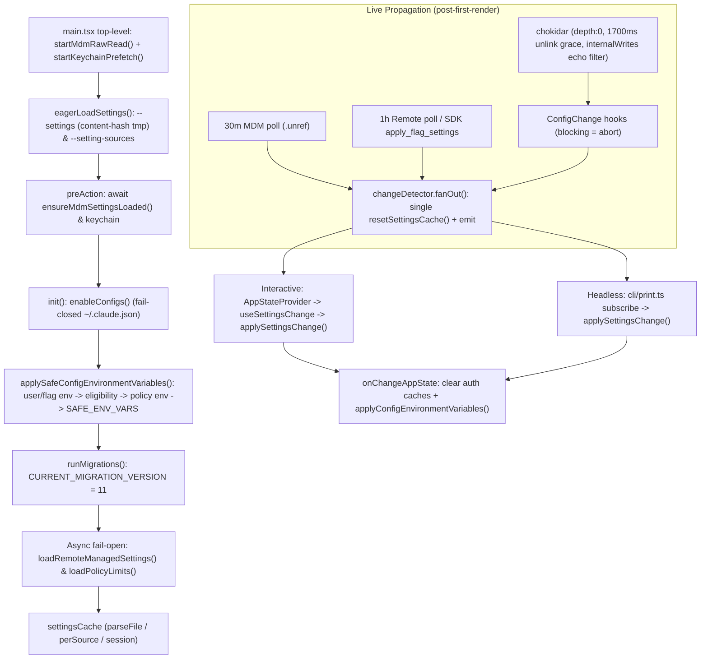

# 14. Configuration, Settings Precedence, and Enterprise Policy

> **Status: written.** Reverse-engineered from the Claude Code 2.1.88 source snapshot (see the Prologue (`prologue-how-to-read-a-1900-file-agent.md`) for snapshot caveats).
>
> **Layer:** Layer 4 (Safety, Policy, Sandbox & Lifecycle Hooks)
> **Prerequisites:** [Chapter 01](ch001-atoms-types-stores-and-primitives.md), [Chapter 11](ch011-the-permission-engine.md), [Chapter 13](ch013-the-hook-system.md)
> **Primary Source Files:**
> - `utils/config.ts` — Global (`~/.claude.json`) and per-project mutable state, lockfile persistence, backup rotation, auth-loss guard, and `fs.watchFile` freshness polling.
> - `utils/settings/constants.ts` — Canonical `SETTING_SOURCES` cascade, `--setting-sources` parser, and editable vs. read-only source types.
> - `utils/settings/settings.ts` — Multi-source deep merge, `managed-settings.d/` drop-in loading, policy first-source-wins resolution, and trusted-source guards.
> - `utils/settings/types.ts`, `utils/settings/validation.ts`, `utils/settings/settingsCache.ts` — Zod v4 `SettingsSchema`, per-rule permission filtering, forward-compat validation, and three-tier caching.
> - `utils/settings/mdm/rawRead.ts`, `utils/settings/mdm/settings.ts`, `utils/settings/mdm/constants.ts` — Early-boot OS MDM subprocess reads (`plutil` / `reg query`) and admin vs. user-writable registry tiers.
> - `utils/settings/changeDetector.ts`, `utils/settings/applySettingsChange.ts`, `utils/settings/internalWrites.ts` — Live chokidar watcher, echo suppression, deletion grace window, centralized cache invalidation, and interactive/headless state sync.
> - `utils/managedEnv.ts`, `utils/managedEnvConstants.ts` — Two-phase environment variable loading across the workspace trust boundary and host-integrity strip filters.
> - `services/remoteManagedSettings/index.ts`, `syncCache.ts`, `syncCacheState.ts`, `securityCheck.tsx` — Enterprise remote settings fetch, ETag SHA-256 caching, dangerous-setting approval dialog, and SCC cycle-breaking leaf cache.
> - `services/policyLimits/index.ts` — Organization-level feature kill-switches and the HIPAA essential-traffic fail-closed exception.
> - `migrations/` and `main.tsx` — Version-gated (`CURRENT_MIGRATION_VERSION = 11`) startup migration runner and idempotence patterns.

---

## Why This Layer Exists

By the end of [Chapter 13](ch013-the-hook-system.md), the agent harness can enforce permissions, sandbox shell commands, and run lifecycle hooks. Every one of those mechanisms asks the same foundational question: **whose rules are currently in force, and can we trust the file they came from?**

In a toy CLI, configuration is a single `readFileSync('config.json')`. In Claude Code, configuration sits directly on an adversarial boundary:

1. **Untrusted repositories ship config.** Cloning a repo and running `claude` puts `.claude/settings.json` in the working directory. If Claude Code blindly applied `env.ANTHROPIC_BASE_URL`, `apiKeyHelper`, `hooks`, or `skipDangerousModePermissionPrompt` from that file before workspace trust, opening a malicious repository would be instant credential exfiltration or remote code execution.
2. **Enterprise IT policy must win—without bricking offline laptops.** Admins deploy policy through four different mechanisms (cloud API, macOS MDM plists, Windows registry keys, or root-owned `/etc`/`/Library` files and drop-in fragments). Policy must override user and project files, stay fresh during long sessions, and never deadlock cold start when a laptop is on an airplane.
3. **Concurrent CLI tabs mutate state simultaneously.** Ten open terminals share one `~/.claude.json` holding OAuth account metadata, trust decisions, and startup caches. A naive read-modify-write loses authentication state and forces users back through login.

To survive all three constraints, Claude Code splits persistence into **two separate stores**—mutable machine state (`utils/config.ts`) and declarative layered policy (`utils/settings/`)—wired together by a live change-propagation pipeline, two remote enterprise policy services, and a version-gated migration runner.

---

## 1. Two Stores, One Trust Boundary: `GlobalConfig` vs. the Settings Cascade

### The Problem

Why not put everything in `~/.claude/settings.json`? Because user-authored preferences and harness-managed bookkeeping have opposite failure modes:

- Bookkeeping state (`numStartups`, `oauthAccount`, per-project `hasTrustDialogAccepted`, GrowthBook/Statsig caches, `migrationVersion`) is written programmatically dozens of times across concurrent processes. Humans rarely edit it, and losing it logs the user out or re-prompts every dialog.
- Declarative settings (`permissions`, `hooks`, `sandbox`, `env`, `model`, enterprise lockouts) are hand-edited by developers, committed to git, passed via `--settings`, or pushed via MDM. They must merge across scopes, tolerate schema evolution across client versions, and hot-reload when modified externally.

Separating them puts high-churn internal state in `~/.claude.json` (`getGlobalClaudeFile()` in `utils/env.ts:14-26`) and layered policy in the `settings.json` cascade.

### The Real Implementation

`GlobalConfig` in `utils/config.ts` is guarded by a boot latch, a file lock, an auth-loss detector, a rotating backup ring, and a background freshness poller.

First, **no module may read `~/.claude.json` during module evaluation.** `configReadingAllowed` starts `false`; calling `getConfig()` before `enableConfigs()` throws `'Config accessed before allowed.'` (`utils/config.ts:1332-1356, 1427-1429`). During `entrypoints/init.ts:65`, `enableConfigs()` flips the latch and immediately parses `~/.claude.json` with `throwOnInvalid = true`. That makes startup **fail-closed** on a corrupted global config: in non-interactive mode, `init()` prints the error to `stderr` and exits with code `1` (`entrypoints/init.ts:220-226`); in interactive mode, it lazy-imports `InvalidConfigDialog` (`entrypoints/init.ts:229-231`) so the user can inspect or reset the file before the app overwrites it.

After boot, `saveGlobalConfig()` and `saveCurrentProjectConfig()` share `saveConfigWithLock()` (`utils/config.ts:1153-1329`):

```ts
// utils/config.ts:1169-1232 (condensed)
release = lockfile.lockSync(file, {
  lockfilePath: `${file}.lock`,
  onCompromised: err => {
    // Default onCompromised throws from a setTimeout callback, which
    // becomes an unhandled exception. Log instead -- the lock being
    // stolen (e.g. after a 10s event-loop stall) is recoverable.
    logForDebugging(`Config lock compromised: ${err}`, { level: 'error' })
  },
})

const currentConfig = getConfig(file, createDefault)
if (file === getGlobalClaudeFile() && wouldLoseAuthState(currentConfig)) {
  logEvent('tengu_config_auth_loss_prevented', {})
  return false
}

const mergedConfig = mergeFn(currentConfig)
if (mergedConfig === currentConfig) {
  return false
}
```

Four production scars live right inside that write path:

1. **The GH #3117 auth-loss guard (`wouldLoseAuthState()`, `utils/config.ts:783-795`).** If another process truncates `~/.claude.json` mid-write, `getConfig()` fails open to `createDefaultGlobalConfig()`. Writing those defaults back would permanently wipe `oauthAccount` and `hasCompletedOnboarding`. Comparing the freshly read disk config against the in-memory `globalConfigCache.config` aborts the write whenever auth or onboarding would vanish—in *both* the locked path (`1217`) and the unlocked catch-block fallback (`846, 1673`).
2. **Rate-limited backup rotation (`utils/config.ts:1245-1309`).** Before writing, `saveConfigWithLock()` copies the existing file into `~/.claude/backups/.claude.json.backup.<timestamp>`, throttled to `MIN_BACKUP_INTERVAL_MS = 60_000` (preventing startup write bursts from flooding disk) and capped at `MAX_BACKUPS = 5`. Corrupted files discovered on read are separately snapshotted to `.claude.json.corrupted.<timestamp>`, deduplicated by exact file content (`utils/config.ts:1521-1561`).
3. **Default stripping and symlink-preserving atomic writes.** `pickBy` strips any key whose JSON serialization equals `defaultConfig[key]` (`utils/config.ts:1235-1239`), keeping `~/.claude.json` minimal. `writeFileSyncAndFlush_DEPRECATED()` (`utils/file.ts:362-395`) resolves symlinks first (so dotfiles managers keep their symlinks intact) and writes to `${targetPath}.tmp.${process.pid}.${Date.now()}` with `mode: 0o600` before renaming into place.
4. **Write-through cache + `fs.watchFile` cross-process sync (`utils/config.ts:992-1086`).** After the first synchronous load, `getGlobalConfig()` is a pure memory hit. Our own writes update `globalConfigCache = { config, mtime: Date.now() }`—intentionally overshooting the file's `mtime` so the background `fs.watchFile(..., { interval: 1000, persistent: false })` callback skips our own writes via `curr.mtimeMs <= globalConfigCache.mtime`. Writes from *other* `claude` processes advance `curr.mtimeMs`, triggering an async background re-read without ever blocking the main thread on `statSync`.

Finally, **workspace trust** lives in `GlobalConfig.projects[path].hasTrustDialogAccepted`. `checkHasTrustDialogAccepted()` (`utils/config.ts:697-743`) latches `true` once accepted (never caching `false`, since trust can be granted mid-session), checks in-memory session trust (used when running directly in `$HOME`, where trust is never persisted), checks the canonical git root, and walks parent directories all the way to `/`: trusting a parent directory implicitly trusts its children.

### Hidden Invariants & Failure Modes

> [!WARNING]
> **Re-entrancy recursion on corrupted config (`utils/config.ts:48-51, 1477-1501`).** When `getConfig()` logs a `ConfigParseError` via `logEvent('tengu_config_parse_error', ...)`, the telemetry sampler checks a GrowthBook feature cached in `GlobalConfig`, which calls `getGlobalConfig()` → `getConfig()` again. Without the module-level `insideGetConfig` boolean guard, a single malformed `~/.claude.json` triggers a stack overflow.

A second invariant protects the cache from self-sabotage: `saveConfigWithLock()` returns a `boolean` (`didWrite`) specifically so `saveGlobalConfig()` only calls `writeThroughGlobalConfigCache()` when a write actually landed (`utils/config.ts:828-833`). If `wouldLoseAuthState()` tripped and returned `false`, clearing or overwriting `globalConfigCache` would destroy the very in-memory auth snapshot the guard relies on to protect the next write. Similarly, updater callbacks signal a no-op by returning the exact `current` reference (`mergedConfig === currentConfig`), avoiding lock contention and unnecessary disk flushes.

---

## 2. The Five-Source Settings Cascade, Merge Semantics, and Fail-Closed vs. Fail-Open

### The Problem

Unlike `~/.claude.json`, declarative settings come from up to **six layers** (plugins plus five `SETTING_SOURCES`), and the highest layer (`policySettings`) itself has **four competing origins** across three operating systems. We need deterministic precedence, predictable array/object merging, zero-thrash caching, and clear rules for what fails closed versus what degrades gracefully.

### The Real Implementation

#### Canonical Precedence Order

`utils/settings/constants.ts:7-22` defines the five file/policy sources from lowest to highest priority:

```ts
// utils/settings/constants.ts:7-24
export const SETTING_SOURCES = [
  'userSettings',    // ~/.claude/settings.json (or cowork_settings.json)
  'projectSettings', // <originalCwd>/.claude/settings.json
  'localSettings',   // <originalCwd>/.claude/settings.local.json (gitignored)
  'flagSettings',    // --settings <file|json> + SDK inline overrides
  'policySettings',  // remote API > OS MDM > managed-settings.json + .d/ > HKCU
] as const
```

In `utils/settings/settings.ts:645-796`, `loadSettingsFromDisk()` seeds `mergedSettings` with `getPluginSettingsBase()` (allowlisted plugin-contributed keys, lowest priority of all—set in `utils/settings/settingsCache.ts:66-76`), then iterates `getEnabledSettingSources()` in order and deep-merges each source with `lodash-es/mergeWith` and `settingsMergeCustomizer`.

Three subtle path and source details matter in production:

- **Cowork user file swap (`utils/settings/settings.ts:264-272`).** When `--cowork` or `CLAUDE_CODE_USE_COWORK_PLUGINS` is truthy, `userSettings` switches from `settings.json` to `cowork_settings.json`.
- **The `--settings` 12× prompt-cache scar (`main.tsx:432-458`).** When a caller passes inline JSON to `--settings '{...}'`, `loadSettingsFromFlag()` writes it to a temporary file so the rest of the settings pipeline sees a uniform path. Crucially, it uses a **content-hash filename** (`generateTempFilePath('claude-settings', '.json', { contentHash: trimmedSettings })`) instead of a random UUID. Why? Because the active settings file path is injected into the Bash tool's sandbox `denyWithinAllow` list—which is serialized into the tool definition sent to the Anthropic API (see [Chapter 04](ch004-prompt-engineering-and-cache-boundaries.md) and [Chapter 12](ch012-shell-execution-sandboxing-and-workspace-tools.md)). A random UUID per spawned SDK subprocess busted the API prompt cache on every `query()` turn, causing a 12× input token cost penalty.
- **Deduplicating identical resolved paths (`utils/settings/settings.ts:743-748`).** `seenFiles` tracks `resolve(filePath)` so running Claude Code from `~/.claude` doesn't merge the same file twice under `userSettings` and `projectSettings`.

#### Inside `policySettings`: Strict First-Source-Wins & Drop-In Fragments

Unlike the outer five-source cascade (which merges across sources), **`policySettings` uses strict first-source-wins** across its four origins (`utils/settings/settings.ts:322-345, 375-407, 677-739`):

1. **Remote managed settings** (from `~/.claude/remote-settings.json` / Anthropic API cache — highest).
2. **Admin-only OS MDM**:
   - macOS: `/Library/Managed Preferences/<username>/com.anthropic.claudecode.plist`, then device-level `/Library/Managed Preferences/com.anthropic.claudecode.plist` (plus `~/Library/Preferences/...` **only** when `process.env.USER_TYPE === 'ant'`, `utils/settings/mdm/constants.ts:45-81`).
   - Windows: `HKLM\SOFTWARE\Policies\ClaudeCode`, value `Settings` (`REG_SZ` or `REG_EXPAND_SZ`). Living under `SOFTWARE\Policies` is a deliberate WOW64 invariant: Windows places `SOFTWARE\Policies` on the shared key list so 32-bit and 64-bit builds read the exact same key without silent `WOW6432Node` redirection (`mdm/constants.ts:17-26`).
3. **File-based managed settings (`loadManagedFileSettings()`, `utils/settings/settings.ts:74-121`)**:
   - Base file: `<managedDir>/managed-settings.json`, where `getManagedFilePath()` (`utils/settings/managedPath.ts:8-25`) resolves to `/Library/Application Support/ClaudeCode` (macOS), `C:\Program Files\ClaudeCode` (Windows), or `/etc/claude-code` (Linux)—with an ant-only override via `CLAUDE_CODE_MANAGED_SETTINGS_PATH`.
   - Drop-in directory: `<managedDir>/managed-settings.d/*.json` (ignoring dotfiles, following symlinks, sorted alphabetically). Following systemd/sudoers conventions, the base file merges first and drop-ins merge on top so independent teams can ship `10-otel.json` and `20-security.json` without editing a monolithic file.
4. **Windows `HKCU\SOFTWARE\Policies\ClaudeCode`** (lowest—user-writable, only used if none of the three admin/remote sources above exist; `consumeRawReadResult()` in `utils/settings/mdm/settings.ts:255-270` explicitly checks `hasManagedSettingsFile()` before falling through to HKCU).

To keep MDM reads off the startup critical path, `main.tsx:13-16` calls `startMdmRawRead()` at module evaluation—before ~135ms of heavy imports run. On macOS, `utils/settings/mdm/rawRead.ts:60-77` performs a synchronous `existsSync(path)` check before spawning `/usr/bin/plutil`: non-MDM laptops skip the ~5ms `plutil` spawn completely, while MDM machines still spawn `execFile` before the first `await` so the child process overlaps with JS module loading. `main.tsx:914` then awaits `Promise.all([ensureMdmSettingsLoaded(), ensureKeychainPrefetchCompleted()])` inside Commander's `preAction` hook right before `init()` triggers the first settings read.

#### Asymmetric Merge Semantics: Reads vs. Writes

The merge algorithm intentionally behaves differently when **reading across sources** versus **writing to one source**:

- **Cross-source read (`settingsMergeCustomizer`, `utils/settings/settings.ts:529-547`):** Objects deep-merge; scalar keys take the higher-priority source; **arrays concatenate and deduplicate** (`uniq([...targetArray, ...sourceArray])`). That lets user, project, and policy sources all contribute entries to `permissions.deny` or `deniedMcpServers` without clobbering one another.
- **Single-source write (`updateSettingsForSource()`, `utils/settings/settings.ts:416-524`):** Read-only sources (`policySettings`, `flagSettings`) are silent no-ops (`420-425`). For editable sources, arrays **replace** the previous array (the caller computes the desired final list), and setting a key to explicit `undefined` **deletes** that key from the target object (`482-486`)—calling JS `delete` on your patch object before passing it in leaves the existing disk key untouched. When updating `localSettings`, Claude Code also asynchronously registers `.claude/settings.local.json` in `.gitignore` (`508-514`).
- **SDK inline flag clearing (`cli/print.ts:3709-3718`):** Because JSON serialization strips `undefined`, the SDK `apply_flag_settings` control request uses `null` to mean "clear this key"; `print.ts` deletes `null` keys before calling `setFlagSettingsInline()` so `SettingsSchema().safeParse()` doesn't reject the whole object.

#### Three-Tier Caching and Defensive Cloning

`utils/settings/settingsCache.ts` maintains three synchronized caches cleared together by `resetSettingsCache()`:

1. `parseFileCache` (`Map<string, ParsedSettings>`): deduplicates disk read + Zod parse when both `getSettingsForSource()` and `loadSettingsFromDisk()` inspect the same path during boot. `parseSettingsFile()` **deep-clones on every return—including the first uncached return** (`utils/settings/settings.ts:182-199`) because callers feed the returned object directly into lodash's mutating `mergeWith`.
2. `perSourceCache` (`Map<SettingSource, SettingsJson | null>`): distinguishes a cache miss (`undefined`) from a cached absent source (`null`). `updateSettingsForSource()` deliberately bypasses this cache via `getSettingsForSourceUncached()` (`436-440`) so a failed write cannot leak mutated nested objects into the cache.
3. `sessionSettingsCache` (`SettingsWithErrors | null`): caches the full merged result of `loadSettingsFromDisk()` (protected against recursive calls by the `isLoadingSettings` flag at `settings.ts:639-649`).

#### Fail-Closed vs. Fail-Open Behavior Across Every Failure Mode

| Surface / Operation | Failure Mode | Policy | Exact Mechanism |
| --- | --- | --- | --- |
| `enableConfigs()` (`~/.claude.json` at startup) | Malformed JSON | **Fail-closed** | Throws `ConfigParseError`; exits `1` in headless mode or shows `InvalidConfigDialog` (`entrypoints/init.ts:216-232`). |
| `--settings` / `--setting-sources` CLI flags | Invalid JSON, missing file, bad source name | **Fail-closed** | Prints red error to `stderr` and calls `process.exit(1)` (`main.tsx:439-495`). |
| `FileEditTool` editing a `settings.json` | Edit breaks `SettingsSchema().strict()` | **Fail-closed** (if previously valid) | `validateInputForSettingsFileEdit()` (`utils/settings/validateEditTool.ts:14-45`) rejects the edit with full JSON Schema; if the *before* file was already invalid, allows the edit so it can be repaired. |
| `updateSettingsForSource()` write | Target file has JSON syntax error | **Fail-closed** | Refuses to overwrite (`settings.ts:455-463`). If valid JSON fails schema validation, merges onto the raw JSON object to avoid losing unknown/broken keys (`464-469`). |
| `parseSettingsFile()` single bad permission rule | Malformed rule in `permissions.{allow,deny,ask}` | **Surgical strip (fail-open)** | `filterInvalidPermissionRules()` (`validation.ts:224-265`) drops only the offending rule and records a warning *before* Zod parses the file, so one typo never voids the entire file. |
| `parseSettingsFile()` unknown future keys | Older client sees newer schema field | **Fail-open (preserve)** | `SettingsSchema()` ends with `.passthrough()` (`types.ts:1072`). `strictPluginOnlyCustomization` also uses `.preprocess()` + `.catch(undefined)` (`types.ts:518-540`) so an unknown surface name degrades to locking known surfaces rather than nulling `managed-settings.json`. |
| `parseSettingsFile()` top-level schema/JSON failure | File fails `SettingsSchema().safeParse()` | **Fail-open (skip source)** | Returns `{ settings: null, errors }` (`settings.ts:221-224`); errors surface in UI/doctor. For `policySettings`, an invalid remote payload surfaces errors and falls through to MDM/file (`settings.ts:684-720`). |
| `rawSettingsContainsKey()` (`settings.ts:984-1015`) | Settings file invalid, but user set `cleanupPeriodDays` | **Intent-preserving** | Scans raw JSON without schema validation so invalid unrelated fields don't trigger default transcript cleanup. |

### Hidden Invariants & Failure Modes

> [!WARNING]
> **The `--setting-sources` `Set`-insertion precedence quirk (`utils/settings/constants.ts:159-167`).**
> Look closely at `getEnabledSettingSources()`:
> ```ts
> // utils/settings/constants.ts:159-167
> export function getEnabledSettingSources(): SettingSource[] {
>   const allowed = getAllowedSettingSources()
>   const result = new Set<SettingSource>(allowed)
>   result.add('policySettings')
>   result.add('flagSettings')
>   return Array.from(result)
> }
> ```
> By default, `STATE.allowedSettingSources` (`bootstrap/state.ts:313-319`) already lists `'flagSettings'` before `'policySettings'`, so both `.add()` calls are no-ops and `policySettings` wins. However, when `--setting-sources user,project` (or `--setting-sources ""`) is passed, `parseSettingSourcesFlag()` returns only the requested subset of `user`/`project`/`local`. Because `getEnabledSettingSources()` inserts `'policySettings'` *before* `'flagSettings'` and `loadSettingsFromDisk()` iterates that array directly (`settings.ts:674`), scalar fields from `--settings` actually merge *after* `policySettings` whenever `--setting-sources` is explicitly passed!
>
> **Why enterprise security lockouts still hold:** Every hard enterprise boundary (`allowManagedPermissionRulesOnly`, `allowManagedHooksOnly`, `allowManagedMcpServersOnly`, `strictPluginOnlyCustomization`) bypasses the merged `SettingsJson` and calls `getSettingsForSource('policySettings')` directly. (By contrast, `isBypassPermissionsModeDisabled()` in `utils/permissions/permissionSetup.ts:1371-1384` reads merged `getSettings_DEPRECATED()` plus the GrowthBook gate `tengu_disable_bypass_permissions_mode`.)

Separately, **security-sensitive opt-in readers exclude `projectSettings` entirely** (`utils/settings/settings.ts:882-982`): `hasSkipDangerousModePermissionPrompt()`, `hasAutoModeOptIn()`, `getUseAutoModeDuringPlan()`, and `getAutoModeConfig()` (the latter three behind build-time `feature('TRANSCRIPT_CLASSIFIER')`, with an ant-only `deny` alias at `settings.ts:965`) query `userSettings`, `localSettings`, `flagSettings`, and `policySettings` individually—never `projectSettings`. Otherwise, a malicious repository could commit `skipDangerousModePermissionPrompt: true` or permissive classifier rules to `.claude/settings.json` and achieve RCE on checkout.

---

## 3. Live Settings Propagation: File Watching, Trust Boundaries, and Headless Parity

### The Problem

Enterprise policies and developer settings do not stay frozen after startup. An admin updates `/etc/claude-code/managed-settings.d/20-security.json`, an MDM profile refreshes on a corporate laptop, a user edits `~/.claude/settings.json` in another terminal, or a host IDE pushes `apply_flag_settings` over the SDK JSON-RPC channel.

Propagating those updates into both the React TUI and headless `--print` / SDK sessions without thrashing or leaking untrusted project settings requires solving five concrete hazards:

1. Watching `--settings` temp files in `$TMPDIR` crashes or hangs chokidar on sibling sockets and FIFOs (macOS `EOPNOTSUPP`, GH #16469).
2. Writing a settings file from inside Claude Code triggers our own watcher.
3. Atomic editor saves and auto-updaters delete and recreate files, masquerading as a settings wipe.
4. Multiple subscribers resetting the settings cache independently cause N full disk reloads per edit.
5. Applying `settings.env` from `.claude/settings.json` before workspace trust gives an untrusted repo control over `ANTHROPIC_BASE_URL`, `HTTPS_PROXY`, or `LD_PRELOAD`.

### The Real Implementation

#### File Watching, Echo Suppression, and Single-Producer Fan-Out

`utils/settings/changeDetector.ts` is initialized lazily in `startDeferredPrefetches()` (`main.tsx:422`)—*after* the first REPL paint, and skipped entirely in `--bare` mode and remote mode (`changeDetector.ts:85`).

`getWatchTargets()` (`changeDetector.ts:180-250`) collects parent directories that already contain at least one settings file, **explicitly skipping `flagSettings`** (avoiding `$TMPDIR`), and adds `managed-settings.d/` as its own `depth: 0` watch target. Every potential settings filename in a watched directory is whitelisted so files created mid-session (like a brand-new `.claude/settings.local.json`) are detected, while chokidar's `ignored` predicate rejects non-file/non-directory special nodes (sockets/FIFOs/devices), `.git`, and unrelated siblings (`changeDetector.ts:113-136`).

Four stabilization layers sit between raw OS filesystem events and listener callbacks:

```ts
// utils/settings/changeDetector.ts:31-63, 268-302, 437-440 (condensed)
const FILE_STABILITY_THRESHOLD_MS = 1000
const FILE_STABILITY_POLL_INTERVAL_MS = 500
const INTERNAL_WRITE_WINDOW_MS = 5000
const DELETION_GRACE_MS =
  FILE_STABILITY_THRESHOLD_MS + FILE_STABILITY_POLL_INTERVAL_MS + 200 // 1700ms

function handleChange(path: string): void {
  const source = getSourceForPath(path)
  if (!source) return
  const pendingTimer = pendingDeletions.get(path)
  if (pendingTimer) {
    clearTimeout(pendingTimer)
    pendingDeletions.delete(path)
  }
  if (consumeInternalWrite(path, INTERNAL_WRITE_WINDOW_MS)) return

  void executeConfigChangeHooks(
    settingSourceToConfigChangeSource(source),
    path,
  ).then(results => {
    if (hasBlockingResult(results)) return
    fanOut(source)
  })
}

function fanOut(source: SettingSource): void {
  resetSettingsCache()
  settingsChanged.emit(source)
}
```

Each piece solves a real scar:

- **Self-write echo suppression via a zero-import leaf (`utils/settings/internalWrites.ts`).** `updateSettingsForSource()` calls `markInternalWrite(filePath)` immediately before writing (`settings.ts:498`). When chokidar fires within `5000ms`, `consumeInternalWrite()` returns `true` and deletes the timestamp so only the single echo is suppressed. That 37-line module was split out of `changeDetector.ts` purely to break a circular import: `settings.ts → changeDetector.ts → hooks.ts → … → settings.ts`.
- **Deletion grace window (`DELETION_GRACE_MS = 1700ms`, `changeDetector.ts:54-63, 330-360`).** Why `1700ms` instead of `500ms`? Because it **must exceed** chokidar's `awaitWriteFinish` delay (`1000 + 500ms`) so a delete-and-recreate's `add`/`change` event finishes stabilizing and cancels the pending `unlink` timer before the deletion fans out.
- **`ConfigChange` hook gate (`changeDetector.ts:292-301, 344-353`).** External edits and deletions execute `ConfigChange` hooks ([Chapter 13](ch013-the-hook-system.md)) *before* `fanOut(source)`. A blocking hook (`exit 2` or `decision: 'block'`) prevents the session from absorbing the on-disk change.
- **30-minute MDM polling (`startMdmPoll()`, `changeDetector.ts:381-418`).** Registry keys and macOS plists don't emit reliable file-watch events, so an `.unref()`'d interval refreshes MDM/HKCU every 30 minutes, compares `jsonStringify({ mdm, hkcu })`, updates the MDM cache, and calls `fanOut('policySettings')` only on diff.
- **Centralized cache reset in `fanOut()` (`changeDetector.ts:420-440`).** Previously, `useSettingsChange` and `applySettingsChange` each reset the settings cache defensively; profiling revealed **5 full `loadSettingsFromDisk` calls in 12ms** when remote managed settings resolved at startup. Resetting once in the single producer (`fanOut`) means **one notification = one disk reload**: the first subscriber pays the cache miss, and every subsequent subscriber (`AppState`, `loadPluginHooks`, `sandbox-adapter`, `useSettingsErrors`) hits cache.

#### Interactive vs. Headless State Propagation

Both UI modes funnel into the exact same `applySettingsChange()` routine:

- **Interactive TUI (`state/AppState.tsx:59-91`):** `AppStateProvider` subscribes via `useSettingsChange` (`hooks/useSettingsChange.ts`) and calls `applySettingsChange(source, store.setState)`. It also runs a mount-time `useEffect` (`AppState.tsx:60-68`) to close a startup race: if remote managed settings finished loading *before* React mounted and set `disableBypassPermissionsMode`, the mount check still tears down bypass mode.
- **Headless / SDK (`cli/print.ts:517-532`):** With no React tree, `print.ts` subscribes directly to `settingsChangeDetector.subscribe(source => { applySettingsChange(source, setAppState); ... })` and additionally syncs the denormalized `fastMode` field into `AppState`. When an IDE sends an `apply_flag_settings` control request (`cli/print.ts:3705-3743`), it routes through `settingsChangeDetector.notifyChange('flagSettings')` instead of calling `applySettingsChange()` directly—ensuring `fanOut()` flushes the cache *and* notifies sibling subscribers (`loadPluginHooks`, `sandbox-adapter`).

Inside `applySettingsChange()` (`utils/settings/applySettingsChange.ts:33-92`), every live update:
1. Reads fresh merged settings (`getInitialSettings()`), reloads permission rules (`loadAllPermissionRulesFromDisk()`), and refreshes the frozen hook snapshot (`updateHooksConfigSnapshot()`, [Chapter 13](ch013-the-hook-system.md)).
2. Re-syncs `toolPermissionContext`, re-strips overly broad Bash allow rules in ant builds (`process.env.USER_TYPE === 'ant'`, skipping `local-agent`), enforces `isBypassPermissionsModeDisabled()`, and reconciles plan/auto mode via `transitionPlanAutoMode()`.
3. Updates `effortValue` **only when `effortLevel` itself changed AND the new disk value is defined** (`applySettingsChange.ts:70-89`). Without both guards, unrelated settings churn (like dismissing a tip) would clobber a `--effort` CLI flag held in `AppState`, and a stale `prev.settings.effortLevel` after a suppressed internal write would wipe a session-scoped `/effort` value.
4. Triggers `state/onChangeAppState.ts:156-170` when `newState.settings !== oldState.settings`: clears `apiKeyHelper`, AWS, and GCP credential caches and, if `settings.env` changed, calls `applyConfigEnvironmentVariables()`.

#### Two-Phase Environment Loading Across the Workspace Trust Boundary

Environment variables from settings are split into two strict phases in `utils/managedEnv.ts`:

```ts
// utils/managedEnv.ts:124-178 (abbreviated)
export function applySafeConfigEnvironmentVariables(): void {
  // 1. Capture Claude Desktop spawn env once so settings.env can't clobber stdio/OTEL
  // 2. Apply ~/.claude.json env (filtered)
  // 3. Apply ALL env vars from trusted non-policy sources (userSettings, flagSettings),
  //    gated by isSettingSourceEnabled() so SDK settingSources: [] stays isolated
  // 4. Compute isRemoteManagedSettingsEligible() NOW — sees Bedrock/Vertex/base URL
  //    from userSettings/flagSettings before policySettings reads the remote cache
  isRemoteManagedSettingsEligible()
  // 5. Apply ALL env vars from policySettings (highest priority, filtered)
  // 6. Apply ONLY SAFE_ENV_VARS allowlisted keys from merged settings (project/local)
}
```

Before workspace trust is accepted, `entrypoints/init.ts:74` runs **only** `applySafeConfigEnvironmentVariables()`. Project-scoped sources (`projectSettings`, `localSettings`) can only set allowlisted keys in `SAFE_ENV_VARS` (`utils/managedEnvConstants.ts:108-191`)—blocking attacker-controlled redirects (`ANTHROPIC_BASE_URL`, `HTTP_PROXY`, `OTEL_EXPORTER_OTLP_ENDPOINT`), TLS bypasses (`NODE_TLS_REJECT_UNAUTHORIZED`, `NODE_EXTRA_CA_CERTS`), and credential hijacks. Only *after* trust is granted (or in non-interactive `-p` mode, where trust is documented as implicit) does `applyConfigEnvironmentVariables()` (`managedEnv.ts:187-199`) apply the full merged `settings.env` and rebuild CA cert, mTLS, and HTTP proxy agents.

Furthermore, *every* settings-sourced env object passes through three host-protection strip filters (`filterSettingsEnv`, `utils/managedEnv.ts:23-91`):
- `withoutSSHTunnelVars`: when `ANTHROPIC_UNIX_SOCKET` is set (`claude ssh`), strips tunnel/auth vars so the remote host's `~/.claude/settings.json` cannot break the forwarded auth socket.
- `withoutHostManagedProviderVars`: when `CLAUDE_CODE_PROVIDER_MANAGED_BY_HOST` is truthy, strips all provider/endpoint/model routing vars (`PROVIDER_MANAGED_ENV_VARS` + `VERTEX_REGION_CLAUDE_*`) so a user's CLI Bedrock config cannot redirect a host-managed session.
- `withoutCcdSpawnEnvKeys`: in Claude Desktop (`CLAUDE_CODE_ENTRYPOINT === 'claude-desktop'`), snapshots `Object.keys(process.env)` before the first settings apply and refuses to let settings overwrite any desktop-injected key (e.g., `OTEL_LOGS_EXPORTER=console` would corrupt the stdio JSON-RPC stream).

### Hidden Invariants & Failure Modes

> [!NOTE]
> **Additive-only env hot-reload (`state/onChangeAppState.ts:162-166`).** `applyConfigEnvironmentVariables()` uses `Object.assign(process.env, ...)`. Adding or modifying a key in `settings.env` takes effect immediately mid-session, but *removing* a key from `settings.json` does **not** delete it from `process.env` until the next process restart.

Notice also why `onChangeAppState` calling `applyConfigEnvironmentVariables()` unconditionally on `settings.env` change does **not** leak untrusted `projectSettings.env`: `settingsChangeDetector.initialize()` is deferred to `startDeferredPrefetches()` *after* the REPL mounts (`main.tsx:422`), and the interactive REPL only mounts after the workspace trust dialog has been accepted.

---

## 4. Enterprise Policy Services: Remote Managed Settings & Policy Limits

### The Problem

File-based `managed-settings.json` and OS MDM profiles require IT endpoint tooling. Cloud-managed organizations also want to push settings and feature kill-switches straight from Anthropic's control plane—without adding 200ms to every `claude -p` invocation, without breaking offline work, without pulling `auth.ts` into the `settings.ts` strongly connected component (SCC), and without turning a compromised org console into silent shell execution on developer laptops.

### The Real Implementation

Claude Code runs two parallel enterprise cloud services side by side: `services/remoteManagedSettings/` (full `SettingsJson` policy payload) and `services/policyLimits/` (org feature kill-switches).

#### Remote Managed Settings: Cache-First Boot, ETag Sync, and SCC Cycle Breaking

At startup, `entrypoints/init.ts:123-125` calls `initializeRemoteManagedSettingsLoadingPromise()`, creating a promise that other subsystems (like plugin hook loaders or telemetry initialization) can `await` via `waitForRemoteManagedSettingsToLoad()`. To avoid deadlocks in Agent SDK harnesses or tests that never enter `main.tsx`, that promise self-resolves after `LOADING_PROMISE_TIMEOUT_MS = 30_000` (`services/remoteManagedSettings/index.ts:66-99`).

In `main.tsx:957`, `void loadRemoteManagedSettings()` launches non-blockingly:

```ts
// services/remoteManagedSettings/index.ts:524-555 (condensed)
// Cache-first: unblock waiters immediately if ~/.claude/remote-settings.json exists
// (saves ~77ms fetch-wait on print-mode startup). Fetch still runs below.
if (getRemoteManagedSettingsSyncFromCache() && loadingCompleteResolve) {
  loadingCompleteResolve()
  loadingCompleteResolve = null
}

try {
  const settings = await fetchAndLoadRemoteManagedSettings()
  if (isRemoteManagedSettingsEligible()) {
    startBackgroundPolling() // 1 hour interval, .unref()
  }
  if (settings !== null) {
    settingsChangeDetector.notifyChange('policySettings')
  }
} finally {
  if (loadingCompleteResolve) {
    loadingCompleteResolve()
    loadingCompleteResolve = null
  }
}
```

Four design details make this service resilient in production:

1. **Eligibility pre-check without circular `getSettings()` (`syncCache.ts:49-112`).** Only first-party Anthropic API users (`getAPIProvider() === 'firstParty'` and `isFirstPartyAnthropicBaseUrl()`, excluding `CLAUDE_CODE_ENTRYPOINT === 'local-agent'` Cowork VMs) hit `/api/claude_code/settings`. Notably, `isRemoteManagedSettingsEligible()` checks **OAuth tokens before API keys** specifically to avoid spawning macOS's `security find-generic-password` (~20–50ms) for OAuth-only users (`syncCache.ts:70-74`). Enterprise/Team OAuth users with `CLAUDE_AI_INFERENCE_SCOPE`, externally-injected OAuth tokens carrying `subscriptionType === null` (letting the server decide via 204/404), and Console API-key users (called with `skipRetrievingKeyFromApiKeyHelper: true` to avoid re-entering `getSettings()`) are eligible.
2. **Breaking the `settings.ts → auth.ts → settings.ts` SCC (`syncCacheState.ts:1-96`).** `settings.ts` must read the remote cache synchronously, yet eligibility depends on `auth.ts`. Splitting `syncCacheState.ts` into a zero-auth leaf module with a tri-state `eligible: boolean | undefined` breaks the cycle. `applySafeConfigEnvironmentVariables()` computes eligibility once and mirrors it via `setEligibility()`. Better yet, the first time `getRemoteManagedSettingsSyncFromCache()` hydrates `~/.claude/remote-settings.json`, it calls `resetSettingsCache()` once (`syncCacheState.ts:74-93`)—fixing **gh-23085**, where an early pre-`init()` probe poisoned the merged settings cache while `eligible` was still `undefined`!
3. **Deterministic ETag caching and revocation cleanup (`index.ts:112-137, 273-306, 456-491`).** `computeChecksumFromSettings()` recursively sorts object keys and serializes with compact separators to match the backend's Python `json.dumps(settings, sort_keys=True, separators=(",", ":"))`, hashing to `sha256:<hex>` for `If-None-Match`.
   - `304 Not Modified`: reuses disk cache.
   - `204` / `404`: sets `{}` and **`unlink()`s `~/.claude/remote-settings.json`** so revoked org policies don't stick around forever.
   - `401` / `403` / missing auth: sets `skipRetry: true`.
   - Timeouts / network / 5xx: retries up to `DEFAULT_MAX_RETRIES = 5` with exponential backoff (`getRetryDelay()`), then **fails open** to stale disk cache (if present) or `null`.
   - Persistence writes with `open(path, 'w', 0o600)` + `handle.datasync()` (`index.ts:370-377`).
4. **Blocking security dialog for dangerous remote settings (`securityCheck.tsx` + `components/ManagedSettingsSecurityDialog/utils.ts`).** Before applying newly fetched remote settings, `extractDangerousSettings()` checks for any `DANGEROUS_SHELL_SETTINGS` (`apiKeyHelper`, `awsAuthRefresh`, `awsCredentialExport`, `gcpAuthRefresh`, `otelHeadersHelper`, `statusLine`), any env var *not* in `SAFE_ENV_VARS`, or any `hooks`. If dangerous fields were added or changed relative to the cached file in an interactive session, Claude Code renders a blocking `ManagedSettingsSecurityDialog`. Approving applies and caches them; rejecting calls `gracefulShutdownSync(1)` (**fail-closed** on explicit refusal). Non-interactive sessions skip the dialog (`securityCheck.tsx:34-36`).

#### Enterprise Lockdown Primitives in `SettingsSchema`

When enterprise admins want strict guardrails—whether delivered remotely, via MDM, or via `managed-settings.json`—four managed-only boolean/enum switches lock down lower layers:

- `allowManagedPermissionRulesOnly` (`utils/settings/types.ts:501-507`, read in `utils/permissions/permissionsLoader.ts:33`): ignores all user, project, local, and CLI permission rules.
- `allowManagedHooksOnly` (`types.ts:472-478`, read in `utils/hooks/hooksConfigSnapshot.ts:27`): runs only managed hooks; hides/skips user, project, local, and session hooks.
- `allowManagedMcpServersOnly` (`types.ts:509-516`, read in `services/mcp/config.ts:1487`): reads `allowedMcpServers` exclusively from `policySettings`.
- `strictPluginOnlyCustomization` (`types.ts:518-545`, enforced by `utils/settings/pluginOnlyPolicy.ts`): locks `CUSTOMIZATION_SURFACES` (`['skills', 'agents', 'hooks', 'mcp']`)—either all four (`true`) or a named subset—so `~/.claude/*` and `.claude/*` definitions are skipped and only `ADMIN_TRUSTED_SOURCES` (`'plugin'`, `'policySettings'`, `'built-in'`, `'builtin'`, `'bundled'`) load, with plugins gated separately by `strictKnownMarketplaces`.

#### Policy Limits: Org Feature Kill-Switches and the HIPAA Exception

`services/policyLimits/index.ts` mirrors remote managed settings—hitting `/api/claude_code/policy_limits`, caching to `~/.claude/policy-limits.json`, sending SHA-256 `If-None-Match` ETags, retrying 5×, unlinking on 404, and polling hourly with an `.unref()`'d timer—but carries a compact schema (`services/policyLimits/types.ts:8-12`):

```ts
{ restrictions: Record<string, { allowed: boolean }> }
```

Only *blocked* policies appear in the map; callers query synchronously via `isPolicyAllowed(policy)`. Across this snapshot, three org kill-switches are enforced:
- `'allow_remote_sessions'` (`main.tsx:3405`, `cli/print.ts:4991`, `utils/teleport.tsx:431`, `utils/background/remote/remoteSession.ts:53`, `RemoteTriggerTool.ts:60`, `commands/remote-env/`, `commands/remote-setup/`, `skills/bundled/scheduleRemoteAgents.ts`).
- `'allow_remote_control'` (`bridge/initReplBridge.ts:155`, `commands/bridge/bridge.tsx:474`, `entrypoints/cli.tsx:157`).
- `'allow_product_feedback'` (`components/FeedbackSurvey/useFeedbackSurvey.tsx`, `useMemorySurvey.tsx`, `commands/feedback/index.ts`).

The critical security invariant sits at `services/policyLimits/index.ts:497-526`:

```ts
// services/policyLimits/index.ts:502-526
const ESSENTIAL_TRAFFIC_DENY_ON_MISS = new Set(['allow_product_feedback'])

export function isPolicyAllowed(policy: string): boolean {
  const restrictions = getRestrictionsFromCache()
  if (!restrictions) {
    if (
      isEssentialTrafficOnly() &&
      ESSENTIAL_TRAFFIC_DENY_ON_MISS.has(policy)
    ) {
      return false
    }
    return true // fail open
  }
  const restriction = restrictions[policy]
  if (!restriction) {
    return true // unknown policy = allowed
  }
  return restriction.allowed
}
```

Normally `isPolicyAllowed()` fails open so transient API blips don't break developer workflows. For HIPAA / essential-traffic-only environments (`isEssentialTrafficOnly()`), however, `allow_product_feedback` **flips to fail-closed on cache miss**: a network timeout must never silently re-enable feedback prompts and leak protected data.

### Hidden Invariants & Failure Modes

> [!NOTE]
> **Subtle divergences between `remoteManagedSettings` and `policyLimits`:**
> 1. `isPolicyLimitsEligible()` (`services/policyLimits/index.ts:167-211`) checks API keys *before* OAuth and does **not** treat `subscriptionType === null` tokens as eligible or exempt `local-agent`.
> 2. `policyLimits` background polling updates `sessionCache` silently without emitting through `settingsChangeDetector`; feature gates read `isPolicyAllowed()` dynamically on demand.
> 3. Background **user-settings sync** (`services/settingsSync/index.ts`) is separate from enterprise remote managed settings and is compile-time gated behind `feature('UPLOAD_USER_SETTINGS')` (`main.tsx:963`) and `feature('DOWNLOAD_USER_SETTINGS')` (`cli/print.ts:511`).

---

## 5. Idempotent Startup Migrations (`migrations/` & `main.tsx`)

### The Problem

Over dozens of releases, fields migrate across stores (`autoUpdates` and `bypassPermissionsModeAccepted` moved from `~/.claude.json` into `~/.claude/settings.json`; MCP server approvals moved from `GlobalConfig.projects` into `.claude/settings.local.json`), deprecated model pins (`claude-sonnet-4-5-20250929`, legacy Opus IDs) must be rewritten to current aliases, and one-shot opt-in resets must fire once per machine.

Running 11 migrations unconditionally on every CLI boot used to acquire the `~/.claude.json` lock and re-read disk up to 11 times on startup (`utils/config.ts:574-577`). Yet skipping them unsafely—or running them out of order—would corrupt user preferences or re-trigger dismissed prompts.

### The Real Implementation

The true migration registry is `runMigrations()` in `main.tsx:325-352`, invoked in Commander's `preAction` hook right after `init()` (`main.tsx:950`):

```ts
// main.tsx:325-352
const CURRENT_MIGRATION_VERSION = 11;
function runMigrations(): void {
  if (getGlobalConfig().migrationVersion !== CURRENT_MIGRATION_VERSION) {
    migrateAutoUpdatesToSettings();
    migrateBypassPermissionsAcceptedToSettings();
    migrateEnableAllProjectMcpServersToSettings();
    resetProToOpusDefault();
    migrateSonnet1mToSonnet45();
    migrateLegacyOpusToCurrent();
    migrateSonnet45ToSonnet46();
    migrateOpusToOpus1m();
    migrateReplBridgeEnabledToRemoteControlAtStartup();
    if (feature('TRANSCRIPT_CLASSIFIER')) {
      resetAutoModeOptInForDefaultOffer();
    }
    if ("external" === 'ant') {
      migrateFennecToOpus();
    }
    saveGlobalConfig(prev => prev.migrationVersion === CURRENT_MIGRATION_VERSION ? prev : {
      ...prev,
      migrationVersion: CURRENT_MIGRATION_VERSION
    });
  }
  // Async migration - fire and forget since it's non-blocking
  migrateChangelogFromConfig().catch(() => {});
}
```

*(Note: In this external-build snapshot, `process.env.USER_TYPE === 'ant'` at `main.tsx:340` is constant-folded to `"external" === 'ant'`, dead-coding `migrateFennecToOpus()`, while `resetAutoModeOptInForDefaultOffer()` is gated behind `feature('TRANSCRIPT_CLASSIFIER')`.)*

Because every migration in the block can re-run whenever `CURRENT_MIGRATION_VERSION` bumps (when migration #12 ships), **every single migration must be independently idempotent**. Across the 11 files in `migrations/`, four concrete idioms enforce idempotence and crash-safety:

1. **Write-target-first, strip-source-second (`migrateAutoUpdatesToSettings.ts`, `migrateBypassPermissionsAcceptedToSettings.ts`, `migrateEnableAllProjectMcpServersToSettings.ts`).**
   Each migration first writes into `userSettings` or `localSettings` via `updateSettingsForSource()`, and *only then* removes the legacy key from `GlobalConfig` / `ProjectConfig` via object destructuring. If the process crashes halfway, the next boot sees the legacy key still present and safely retries—merging arrays with `new Set([...existing, ...legacy])` (`migrateEnableAllProjectMcpServersToSettings.ts:64-69`) and respecting `existingSettings.enableAllProjectMcpServers === undefined` so existing user edits are never overwritten. `migrateAutoUpdatesToSettings.ts:18-23` also checks `autoUpdatesProtectedForNative !== true` so an automatic native-installer safeguard isn't misread as a user disabling updates.
2. **Source-scoped value rewrite (`migrateSonnet45ToSonnet46.ts:29-60`).**
   Reads `getSettingsForSource('userSettings')?.model`—deliberately *not* merged settings—so repo-level `projectSettings` or `localSettings` model pins are left intact. It rewrites only exact Sonnet 4.5 strings to `'sonnet'` / `'sonnet[1m]'` (so re-running is a no-op) and skips setting the toast timestamp when `config.numStartups <= 1` so brand-new installs don't see an upgrade banner.
3. **Cross-store one-shot guard (`resetAutoModeOptInForDefaultOffer.ts:25-50`).**
   Clears `skipAutoPermissionPrompt` in `userSettings` (by passing `{ skipAutoPermissionPrompt: undefined }`), but records its completion latch (`hasResetAutoModeOptInForDefaultOffer: true`) in `~/.claude.json` (`GlobalConfig`) rather than `settings.json`—ensuring a settings file reset never re-arms the migration. It also bails out unless `getAutoModeEnabledState() === 'enabled'` so `'opt-in'` users aren't locked out of reaching the dialog.
4. **Opportunistic read/write-time normalization (`utils/config.ts:912-989`).**
   Two legacy `GlobalConfig` cleanups live directly in `config.ts`: `migrateConfigFields()` translates removed `autoUpdaterStatus` into `installMethod` + `autoUpdates` on every load, and `removeProjectHistory()` strips deprecated per-project `history` blobs (moved to `history.jsonl`) on every `saveGlobalConfig()`.

Every migration wraps I/O in `try/catch` and logs errors rather than throwing, so a read-only `.claude/settings.local.json` cannot crash startup.

### Hidden Invariants & Failure Modes

> [!WARNING]
> **Global version latch vs. per-project migrations.**
> `CURRENT_MIGRATION_VERSION` is persisted globally in `~/.claude.json`, yet `migrateEnableAllProjectMcpServersToSettings()` operates only on `getCurrentProjectConfig()` (the current working repo). Once a user runs Claude Code in repo A and stamps `migrationVersion = 11` in `~/.claude.json`, opening a legacy repo B skips `runMigrations()` until `CURRENT_MIGRATION_VERSION` is bumped again. That is why `ProjectConfig` in `utils/config.ts:117-120` still retains the legacy `enabledMcpjsonServers` / `enableAllProjectMcpServers` fields for backward compatibility.

---

## Putting the Layer Together

### Startup & Live-Reload Dataflow



### Settings Precedence & Trust-Boundary Map

```text
Lowest Priority                                                Highest Priority
+---------+   +------+   +---------+   +-------+   +------+   +---------------+
| Plugin  |-->| User |-->| Project |-->| Local |-->| Flag |-->|    Policy     |
|  Base   |   |      |   | (repo!) |   |(gitig)|   |(CLI/ |   | (1st wins!)   |
+---------+   +------+   +---------+   +-------+   | SDK) |   +-------+-------+
                               |                   +------+           |
         Excluded from:        |                                      v
         - pre-trust unsafe env|                      1. Remote API / cache
         - bypass/auto opt-ins |                      2. Admin MDM (plist/HKLM)
         - autoMode rules      |                      3. managed-settings.json
                                                         + managed-settings.d/*
  Cross-source merge: objects deep-merge,             4. Windows HKCU (lowest)
  scalars last-wins, arrays concat+uniq.
```

---

## How This Snaps Into the Next Layer

With configuration precedence, trust boundaries, live propagation, and enterprise lockouts in place, **Chapter 15 — Model Context Protocol (MCP): Clients, Transports, Auth, and Tool Search** ([`15-model-context-protocol-mcp.md`](ch015-model-context-protocol-mcp.md)) plugs straight into four exact contracts built here, centered in `services/mcp/config.ts`:

1. **Enterprise MCP file location:** `getEnterpriseMcpFilePath()` (`services/mcp/config.ts:62-64`) joins `getManagedFilePath()` with `'managed-mcp.json'`, placing org-mandated MCP servers in the exact same admin-owned OS directory as `managed-settings.json`.
2. **Asymmetric allowlist vs. denylist enforcement:** `shouldAllowManagedMcpServersOnly()` (`services/mcp/config.ts:1485-1489`) reads `getSettingsForSource('policySettings')?.allowManagedMcpServersOnly === true`. When active, `getMcpAllowlistSettings()` (`services/mcp/config.ts:341-346`) restricts `allowedMcpServers` exclusively to `policySettings`, while `getMcpDenylistSettings()` (`services/mcp/config.ts:353-355`) still merges `deniedMcpServers` from all sources via `getInitialSettings()`—guaranteeing users can always deny additional servers even under enterprise lockdown.
3. **Plugin-only customization lockdown:** When `strictPluginOnlyCustomization` includes `'mcp'`, `isRestrictedToPluginOnly('mcp')` (`utils/settings/pluginOnlyPolicy.ts:19-27`) gates out user and `.mcp.json` server definitions while preserving managed and plugin-provided servers.
4. **Cycle-free validation error aggregation:** Because `services/mcp/config.ts` imports `utils/settings/settings.ts`, `settings.ts` cannot import MCP config validation without forming a cycle. `utils/settings/allErrors.ts` sits above both as a leaf module, exposing `getSettingsWithAllErrors()` to merge `SettingsSchema` errors with `getMcpConfigsByScope(scope).errors` for `/doctor` and startup diagnostics.

---

## Reading Exercises & Code Checkpoints

1. **Trace the `--setting-sources` ordering bug yourself.**
   Inspect `getEnabledSettingSources()` in `utils/settings/constants.ts:159-167` and the loop in `utils/settings/settings.ts:674-784`. Trace what array `getEnabledSettingSources()` returns for `--setting-sources local,user` vs. default startup, and verify with `rg` which enterprise policy flags protect themselves by calling `getSettingsForSource('policySettings')` directly:
   ```bash
   rg -n "getSettingsForSource\('policySettings'\)" utils/ services/
   ```
2. **Verify every caller of `isPolicyAllowed()`.**
   Run the following search to list every feature controlled by `services/policyLimits/` and check whether any other policy key besides `allow_product_feedback` is listed in `ESSENTIAL_TRAFFIC_DENY_ON_MISS`:
   ```bash
   rg -n "isPolicyAllowed\(" --glob '!book/**'
   ```
3. **Inspect the `GlobalConfig` auth-loss guard and corruption backup paths.**
   Read `wouldLoseAuthState()` and both callers inside `saveGlobalConfig()` and `saveCurrentProjectConfig()` in `utils/config.ts:783-866, 1216-1224, 1672-1680`. Why does `saveGlobalConfig` guard *both* the locked path and the catch-block fallback, and what happens to `globalConfigCache` if `wouldLoseAuthState` returns `true`?
4. **Audit all subscribers to `settingsChangeDetector.subscribe`.**
   Locate every module that reacts to live settings reloads across interactive and headless runtimes, and verify that none of them call `resetSettingsCache()` themselves (preserving the single-producer invariant in `changeDetector.fanOut`):
   ```bash
   rg -n "settingsChangeDetector\.(subscribe|notifyChange)" --glob '!book/**'
   ```
