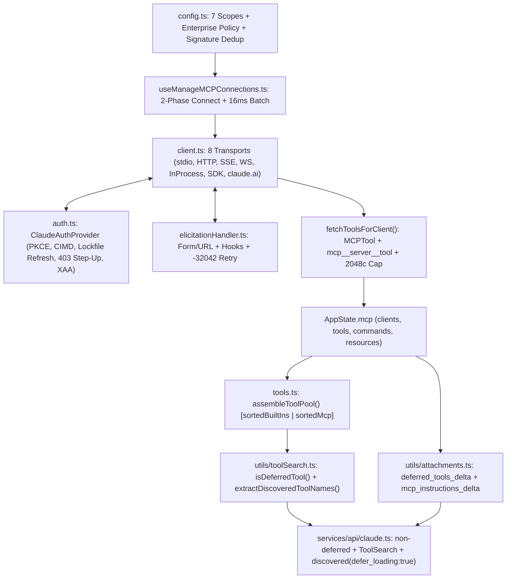

# 15. Model Context Protocol (MCP): Clients, Transports, Auth, and Tool Search

> **Status: written.** Reverse-engineered from the Claude Code 2.1.88 source snapshot (see the Prologue (`prologue-how-to-read-a-1900-file-agent.md`) for snapshot caveats).
>
> **Layer:** Layer 5 (Dynamic Capabilities: MCP, Skills, Plugins & LSP)
> **Prerequisites:** [Chapter 02](ch002-the-tool-contract.md), [Chapter 04](ch004-prompt-engineering-and-cache-boundaries.md), [Chapter 06](ch006-executing-tools.md), [Chapter 11](ch011-the-permission-engine.md), [Chapter 14](ch014-configuration-settings-and-enterprise-policy.md)
> **Primary Source Files:**
> - `services/mcp/config.ts` — Multi-scope server resolution, enterprise allow/deny policy, content-signature deduplication, and atomic `.mcp.json` writes
> - `services/mcp/client.ts` — Transport construction, memoized connections, timeout/401/session-expiry recovery, tool/prompt/resource adaptation, output budgeting, and URL elicitation retries
> - `services/mcp/auth.ts` — `ClaudeAuthProvider`, OAuth 2.1 + PKCE + CIMD, cross-process lockfile refresh, 403 step-up interception, and XAA orchestration (`services/mcp/xaa.ts`)
> - `services/mcp/useManageMCPConnections.ts` — React lifecycle hook, two-phase startup, 16 ms state coalescing, backoff reconnects, `list_changed`, and channel push handlers
> - `services/mcp/elicitationHandler.ts` — Server-initiated form/URL elicitations, hook interception, and completion notifications
> - `services/mcp/InProcessTransport.ts` & `services/mcp/SdkControlTransport.ts` — Microtask-linked in-process transport and CLI↔SDK control-channel bridge
> - `services/mcp/mcpStringUtils.ts` & `services/mcp/normalization.ts` — `mcp__server__tool` naming, character normalization, and permission-key extraction
> - `tools/MCPTool/MCPTool.ts` & `tools.ts` — Base MCP `Tool` template and cache-safe `assembleToolPool()` partitioning
> - `tools/ToolSearchTool/ToolSearchTool.ts`, `tools/ToolSearchTool/prompt.ts`, & `utils/toolSearch.ts` — `shouldDefer` / `defer_loading: true`, `tool_reference` discovery, keyword ranking, and `deferred_tools_delta` cache stability

---

## Why This Layer Exists

Everything built in Layers 0 through 4 operates over a closed world of compiled-in tools (`Bash`, `Read`, `Edit`, `Grep`, `Agent`). Those tools share a single process, deterministic schemas, static permission rules, and a byte-stable prefix that lets Anthropic's backend cache the system prompt and tool array globally across sessions.

External capabilities shatter every one of those assumptions simultaneously:

1. **Heterogeneous transports and lifecycles.** An external server might be a local Docker container over `stdio`, a remote SaaS endpoint behind OAuth 2.1 Streamable HTTP, a VS Code extension over WebSocket, a browser controller running in-process to avoid a 325 MB fork, or a JavaScript callback inside a parent SDK host process. Connections stall, drop mid-tool-call, expire sessions, and rotate tokens across competing CLI processes.
2. **Untrusted schemas and outputs.** Third-party servers emit arbitrary Unicode tool names, 60 KB OpenAPI-generated descriptions, raw base64 audio/binary blobs, and server-initiated UI prompts (elicitations) that must be routed through hooks and user consent dialogs without hanging the loop.
3. **Context bloat and cache destruction.** Attach twenty corporate MCP servers (Slack, GitHub, Linear, Jira, Datadog, `claude.ai` connectors) and you easily inherit 200+ tools—tens of thousands of tokens of JSON Schema on turn 1. Worse, if servers finish handshaking asynchronously after turn 1—or sort alphabetically between built-in tools—every late connection invalidates the entire prompt cache.

Layer 5 solves all three problems without leaking transport mechanics into `query.ts`. To the turn engine, an MCP tool is just another `Tool<Input, Output, P>`—normalized, policy-filtered, partitioned behind built-ins, and lazily materialized via `ToolSearch`.

---

## 1. Configuration Resolution, Policy Gates, and Deduplication

### The Problem

MCP server definitions arrive from seven distinct scopes (`ConfigScopeSchema` in `services/mcp/types.ts:10-20`): `local`, `user`, `project`, `dynamic` (CLI `--mcp-config` and plugins), `enterprise`, `claudeai`, and `managed`. Merging them by object key alone fails in three real-world ways:

- **Silent duplication across namespaces.** Plugin servers are keyed `plugin:<plugin>:<server>` (`utils/plugins/mcpPluginIntegration.ts:350`) and `claude.ai` org connectors are keyed `claude.ai <DisplayName>` (`services/mcp/claudeai.ts:100`). Neither collides by key with a user's manual `slack` entry in `.mcp.json`, so both connect to `mcp.slack.com`—doubling processes and burning ~600 chars/turn of duplicate tool listings.
- **Rewritten proxy URLs.** In remote CCR sessions, `claude.ai` connectors arrive with URLs rewritten to `/v2/session_ingress/shttp/mcp/...` or `/v2/ccr-sessions/...` carrying the original vendor URL in `?mcp_url=...`. Naive URL comparison misses the duplicate.
- **Pre-trust code execution.** Both `.mcp.json` servers and dynamic `headersHelper` shell commands can come from an untrusted repository cloned off the internet.

### The Real Implementation

`services/mcp/config.ts` resolves configurations in a strict pipeline inside `getClaudeCodeMcpConfigs()` (`config.ts:1071-1251`) and `getAllMcpConfigs()` (`config.ts:1258-1290`):

1. **Exclusive enterprise override.** If `managed-mcp.json` exists (`doesEnterpriseMcpConfigExist()`, `config.ts:1470-1477`), it takes *exclusive* control: user, project, local, plugin, and `claude.ai` servers are ignored completely. Even dynamic `--mcp-config` entries are rejected unless every server satisfies `areMcpConfigsAllowedWithEnterpriseMcpConfig()` (`config.ts:1494-1504`), which currently whitelists only `type === 'sdk' && name === 'claude-vscode'` so enterprise policies do not break the VS Code extension.
2. **Scope discovery and precedence.** Otherwise, unless `isRestrictedToPluginOnly('mcp')` locks out non-plugin scopes, `getMcpConfigsByScope()` loads `user` (`~/.claude.json`), `project` (`.mcp.json` walked from filesystem root down to `cwd` so nearer directories override parents, filtered through `getProjectMcpServerStatus(name) === 'approved'`), `local` (per-project config in `~/.claude.json`), and enabled plugins (`loadAllPluginsCacheOnly()` → `getPluginMcpServers()`). Merge order is `claudeai < plugin (dynamic) < user < approved project < local`.
3. **Policy evaluation (`isMcpServerAllowedByPolicy()`, `config.ts:417-508`).**
   - `deniedMcpServers` always merges across *all* setting sources (`getMcpDenylistSettings()`, so users can still deny servers for themselves even under managed policy) and takes absolute precedence.
   - `allowedMcpServers` reads exclusively from `policySettings` when `allowManagedMcpServersOnly: true`, else merged settings. An empty array `[]` blocks everything.
   - Matching is **mode-strict**: if the allowlist contains *any* `serverCommand` entry, every `stdio` server must match one by exact `[command, ...args]` array equality; if it contains *any* `serverUrl` entry, every remote server must match a wildcard pattern (`*` → `.*`). Only when no command/URL entries exist does matching fall back to `serverName`.
   - `filterMcpServersByPolicy()` (`config.ts:536-551`) explicitly exempts `type === 'sdk'` servers because they are host-managed callbacks with neither a subprocess command nor a network URL.
4. **Content-signature deduplication (`config.ts:182-310`).** `getMcpServerSignature()` normalizes each server to either `stdio:${JSON.stringify([command, ...args])}` or `url:${unwrapCcrProxyUrl(url)}`, deliberately ignoring `env` (plugins inject `CLAUDE_PLUGIN_ROOT`) and `headers`. `dedupPluginMcpServers()` and `dedupClaudeAiMcpServers()` drop duplicates where a manually configured server already covers the same signature, surfacing suppressed plugin duplicates as informational `mcp-server-suppressed-duplicate` entries in `/plugin`.

```ts
// services/mcp/config.ts:202-212
export function getMcpServerSignature(config: McpServerConfig): string | null {
  const cmd = getServerCommandArray(config)
  if (cmd) {
    return `stdio:${jsonStringify(cmd)}`
  }
  const url = getServerUrl(config)
  if (url) {
    return `url:${unwrapCcrProxyUrl(url)}`
  }
  return null
}
```

5. **Variable expansion & dynamic headers.** `parseMcpConfig()` expands `${VAR}` and `${VAR:-default}` across `command`, `args`, `env`, `url`, and `headers` (`services/mcp/envExpansion.ts:10-38`), logging warnings for missing variables and Windows `npx` commands lacking a `cmd /c` wrapper. At connection time, `services/mcp/headersHelper.ts` runs an optional `headersHelper` shell command (10 s timeout, passing `CLAUDE_CODE_MCP_SERVER_NAME` and `CLAUDE_CODE_MCP_SERVER_URL`) whose JSON object output overrides static `headers`.

### Hidden Invariants & Failure Modes

- **Disabled manual servers must never suppress twins.** Both `dedupPluginMcpServers` (caller at `config.ts:1188-1193`) and `dedupClaudeAiMcpServers` (`config.ts:290`) exclude disabled or policy-blocked servers from the dedup target map. Otherwise a disabled manual `slack` entry would suppress `claude.ai Slack` or a plugin twin, leaving *neither* running.
- **Trust gate on `headersHelper`.** For `project` and `local` scopes in interactive sessions, `getMcpHeadersFromHelper()` (`headersHelper.ts:42-57`) refuses to execute unless `checkHasTrustDialogAccepted()` is true, logging `tengu_mcp_headersHelper_missing_trust`.
- **Atomic `.mcp.json` mutation.** `writeMcpjsonFile()` (`config.ts:88-131`) reads existing file mode, writes to `.mcp.json.tmp.<pid>.<ts>`, calls `handle.datasync()`, restores permissions via `chmod`, and performs an atomic `rename()` without following symlinks.
- **Opt-in vs. opt-out disable state.** Normal servers default enabled and are recorded in `disabledMcpServers`. Under `feature('CHICAGO_MCP')`, the built-in Computer Use MCP server is marked `DEFAULT_DISABLED_BUILTIN` (`config.ts:1512-1536`), flipping polarity to opt-in via `enabledMcpServers`. Both `claude-in-chrome` and the Computer Use server name are reserved and blocked in `addMcpConfig()`.

---

## 2. The Eight Transports and Connection Resilience

### The Problem

Once configs are resolved, `services/mcp/client.ts` has to establish and sustain JSON-RPC connections over eight distinct transport shapes—while neutralizing a surprising collection of runtime and MCP SDK pitfalls:

- Passing a single `AbortSignal.timeout()` into a transport's `requestInit` expires 60 seconds after startup and fails every future tool call permanently.
- Using `AbortSignal.timeout()` per request in Bun leaks ~2.4 KB of native memory per call until lazy GC runs after the full 60 s timer expires.
- Applying any request timeout to `GET` kills persistent SSE event streams after 60 s.
- Runtimes spreading a `Headers` instance drop `Accept: application/json, text/event-stream`, triggering HTTP `406` from strict Streamable HTTP servers.
- The MCP SDK's HTTP/SSE transports invoke `onerror` on broken streams and exhausted SSE retries *without* calling `onclose`—leaving pending `callTool()` promises hung forever.
- `StdioClientTransport.close()` only aborts stdin/stdout, leaving Docker-wrapped MCP servers running as orphaned containers.

### The Real Implementation

`connectToServer()` (`services/mcp/client.ts:595-1641`) constructs the transport for each `ScopedMcpServerConfig['type']`:

| Config `type` | Transport Class | Special Wiring & Auth |
|---|---|---|
| `stdio` (or omitted) | `StdioClientTransport` | `subprocessEnv()` + `serverRef.env`; `stderr: 'pipe'` (capped at 64 MB); honors `CLAUDE_CODE_SHELL_PREFIX` |
| `stdio` (`claude-in-chrome` or `CHICAGO_MCP`) | `InProcessTransport.ts` (`createLinkedTransportPair()`) | Runs server in-process via `queueMicrotask()` to avoid spawning a ~325 MB subprocess (`client.ts:905-943`) |
| `sse` | `SSEClientTransport` | `ClaudeAuthProvider`; `fetch` wrapped with step-up + 60 s POST timeout; separate *untimed* `eventSourceInit.fetch` |
| `sse-ide` | `SSEClientTransport` | No OAuth; proxy dispatcher if configured; sends `ide_connected` notification |
| `http` | `StreamableHTTPClientTransport` | `ClaudeAuthProvider`; session-ingress bearer fallback *only* when `!hasOAuthTokens` (SDK merges `requestInit` *after* `authProvider`) |
| `ws` / `ws-ide` | `utils/mcpWebSocketTransport.ts` (`WebSocketTransport`) | Subprotocol `['mcp']`; dual runtime dispatch (`globalThis.WebSocket` on Bun vs. `ws` package on Node); `ws-ide` adds `X-Claude-Code-Ide-Authorization` |
| `claudeai-proxy` | `StreamableHTTPClientTransport` | Routes through `MCP_PROXY_URL` with `X-Mcp-Client-Session-Id` and `createClaudeAiProxyFetch()` |
| `sdk` | `SdkControlTransport.ts` (`SdkControlClientTransport`) | Handled separately in `setupSdkMcpClients()` (`client.ts:3262-3348`), multiplexing JSON-RPC over CLI↔SDK control messages |

#### Fetch Wrapping, In-Process Microtasks, and SDK Bridging

Every remote POST path passes through `wrapFetchWithTimeout()` (`client.ts:492-550`):

```ts
// services/mcp/client.ts:492-549 (condensed)
export function wrapFetchWithTimeout(baseFetch: FetchLike): FetchLike {
  return async (url: string | URL, init?: RequestInit) => {
    const method = (init?.method ?? 'GET').toUpperCase()
    if (method === 'GET') {
      return baseFetch(url, init) // long-lived SSE stream — never time out
    }
    const headers = new Headers(init?.headers)
    if (!headers.has('accept')) {
      headers.set('accept', MCP_STREAMABLE_HTTP_ACCEPT) // 'application/json, text/event-stream'
    }
    const controller = new AbortController()
    const timer = setTimeout(
      c => c.abort(new DOMException('The operation timed out.', 'TimeoutError')),
      MCP_REQUEST_TIMEOUT_MS, // 60_000 ms
      controller,
    )
    timer.unref?.()
    // ... forwards parentSignal abort, clears timer in try/catch, returns baseFetch(...)
  }
}
```

For first-party in-process servers (`claude-in-chrome` via `@ant/claude-for-chrome-mcp`, and Computer Use behind `feature('CHICAGO_MCP')`), `services/mcp/InProcessTransport.ts:11-63` links two `InProcessTransport` instances where `send()` schedules `queueMicrotask(() => this.peer?.onmessage?.(message))`. The microtask hop is load-bearing: synchronous delivery would blow the JS call stack on request/response chains.

For Agent SDK hosts (`type: 'sdk'`), `services/mcp/SdkControlTransport.ts:60-136` provides a mirror pair: `SdkControlClientTransport` in the CLI process invokes `sendMcpMessage(serverName, message)` (which sends an NDJSON control request over stdout and awaits the response on stdin), while `SdkControlServerTransport` in the SDK process forwards incoming JSON-RPC frames to the in-process MCP server and returns responses via callback.

For `claudeai-proxy` connectors, `createClaudeAiProxyFetch()` (`client.ts:372-422`) attaches the `claude.ai` OAuth bearer token and retries once on `401` via `handleOAuth401Error(sentToken)`. Notice the subtle race it explicitly prevents: it returns `{ response, sentToken }` from `doRequest()` rather than re-reading `getClaudeAIOAuthTokens()` after the 401. Under 30+ concurrent connectors hitting a stale token simultaneously, another connector's refresh clears the memoize cache; re-reading after the request would pass the *new* token to `handleOAuth401Error()`, see no diff against keychain, and skip the retry—stranding the connector in the 15-minute `needs-auth` cache. It also re-checks `getClaudeAIOAuthTokens()?.accessToken !== sentToken` when `handleOAuth401Error` returns `false` due to `ELOCKED` lockfile contention.

#### Connection Drop Detection and Session Expiry Recovery

The MCP client declares `capabilities: { roots: {}, elicitation: {} }` (`client.ts:994-1000`) and races `client.connect(transport)` against `MCP_TIMEOUT` (default 30 s). Once connected, `client.ts` installs a defensive wrapper around `client.onerror` and `client.onclose`:

```ts
// services/mcp/client.ts:1227-1263
let consecutiveConnectionErrors = 0
const MAX_ERRORS_BEFORE_RECONNECT = 3
let hasTriggeredClose = false

const closeTransportAndRejectPending = (reason: string) => {
  if (hasTriggeredClose) return
  hasTriggeredClose = true
  logMCPDebug(name, `Closing transport (${reason})`)
  void client.close().catch(e => {
    logMCPDebug(name, `Error during close: ${errorMessage(e)}`)
  })
}
```

> [!WARNING]
> **Why `client.close()` instead of `client.onclose?.()`:** Calling `client.onclose?.()` directly would clear the memoization cache, but any in-flight `callTool()` promise would remain hung indefinitely. Calling `client.close()` flows through `transport.close()` → SDK `_onclose()`, which rejects all pending request handlers with `McpError -32000 "Connection closed"` *and* fires `client.onclose` to evict caches (`client.ts:1234-1247`).

Three error signatures trigger `closeTransportAndRejectPending()`:
1. **Session expiry (`isMcpSessionExpiredError`, `client.ts:193-206`):** requires *both* HTTP `404` (`error.code === 404`) and JSON-RPC error code `-32001` in the message body so generic web 404s never cause false reconnect storms.
2. **Exhausted SDK SSE retries:** `error.message.includes('Maximum reconnection attempts')` (`client.ts:1342`).
3. **Three consecutive terminal transport errors:** `ECONNRESET`, `ETIMEDOUT`, `EPIPE`, `EHOSTUNREACH`, `ECONNREFUSED`, `Body Timeout Error`, `terminated`, `SSE stream disconnected`, or `Failed to reconnect SSE stream`.

At the tool-call layer, `callMCPTool()` (`client.ts:3217-3231`) catches both a direct `404 / -32001` and the derived HTTP `-32000 "Connection closed"` rejection, clears the connection cache via `clearServerCache()`, and throws `McpSessionExpiredError`. The outer loop in `fetchToolsForClient()`'s `call()` wrapper (`client.ts:1859-1922`) retries once (`MAX_SESSION_RETRIES = 1`) via `ensureConnectedClient()`.

### Hidden Invariants & Failure Modes

- **Stdio escalation ladder (`client.ts:1426-1562`).** `cleanup()` registers with `registerCleanup()` (`utils/cleanupRegistry.ts`) for *all* transport types. For `stdio`, it explicitly sends `SIGINT`, polls `process.kill(pid, 0)` every 50 ms for 100 ms, escalates to `SIGTERM` for 400 ms, and finishes with `SIGKILL` under a 600 ms absolute failsafe.
- **Work-stealing concurrency split (`client.ts:2218-2403`).** `getMcpToolsCommandsAndResources()` partitions active servers into local (`stdio`/`sdk`, concurrency 3 via `MCP_SERVER_CONNECTION_BATCH_SIZE`) and remote (concurrency 20 via `MCP_REMOTE_SERVER_CONNECTION_BATCH_SIZE`) and runs both pools concurrently through `pMap`. A March 2026 scar note (`client.ts:2212-2217`) explains why `pMap` replaced fixed sequential batches: one slow server in batch *N* previously stalled all 20 slots of batch *N+1*.
- **Coupled cache eviction.** `connectToServer` is `lodash-es/memoize`d by `${name}-${jsonStringify(serverRef)}`, while `fetchToolsForClient`, `fetchResourcesForClient`, and `fetchCommandsForClient` use `memoizeWithLRU(..., 20)` keyed by `client.name`. Both `client.onclose` (`client.ts:1389-1396`) and `clearServerCache()` (`client.ts:1666-1672`) must evict all four caches together—otherwise a reconnected client serves stale tools from the dead connection. `reconnectMcpServerImpl()` (`client.ts:2152`) also calls `clearKeychainCache()` before reconnecting so tokens updated by a sibling process (like the VS Code extension host) take effect immediately.

---

## 3. OAuth 2.1, Cross-Process Refresh Locking, Step-Up Auth, and XAA

### The Problem

Remote `sse` and `http` MCP servers authenticate through OAuth 2.1, exposing five classic production traps:

1. **Multi-process token rotation races.** A developer runs three Claude Code terminals pointing at the same Linear or Slack MCP server. All three detect an expiring token at the same minute and race to consume a single-use refresh token—two fail with `invalid_grant` and wipe the third process's freshly saved credentials.
2. **The macOS Keychain 4 KB cliff.** Storing full OAuth authorization server metadata (~1.5–2 KB per server) in secure storage overflows `security -i`'s 4096-byte stdin line limit (~2013 bytes of JSON after hex encoding) as soon as two OAuth servers are connected, corrupting the entire credential store.
3. **Hot-path keychain CPU burn.** The MCP SDK invokes `authProvider.tokens()` inside `_commonHeaders` on *every* HTTP request; invalidating the keychain cache on each call spawns `security find-generic-password` 30–40 times/sec (measured at 7.2% of total CPU).
4. **RFC 6749 §6 step-up deadlocks.** When a server returns `403 insufficient_scope`, the SDK's default handler sees a `refresh_token`, refreshes (which RFC 6749 §6 forbids from elevating scope), retries with the same-scoped token, gets `403` again, and aborts—never triggering re-consent.
5. **Non-standard providers and startup 401 storms.** Slack returns HTTP `200` with `{"error":"invalid_refresh_token"}`, bypassing the SDK's `!response.ok` error parser. Meanwhile, 30 unauthenticated remote servers would execute 60+ HTTP round-trips on every startup (blocking print mode) without negative caching.

### The Real Implementation

`services/mcp/auth.ts` solves each of these inside `ClaudeAuthProvider` (implementing the SDK's `OAuthClientProvider`) and `performMCPOAuthFlow()`.

#### Keying, Discovery, and CIMD

Credentials live in `getSecureStorage()` under `mcpOAuth[serverKey]` where `getServerKey()` (`auth.ts:325-341`) hashes `{ type, url, headers }` into `${serverName}|${sha256.slice(0, 16)}`, preventing tokens from leaking across two servers that share a name.

`fetchAuthServerMetadata()` (`auth.ts:256-311`) resolves OAuth metadata in three tiers:
1. Explicit `oauth.authServerMetadataUrl` (enforcing `https://` at both Zod schema and runtime).
2. RFC 9728 Protected Resource Metadata (`/.well-known/oauth-protected-resource`) → RFC 8414 Authorization Server Metadata via `discoverOAuthServerInfo()`.
3. Legacy path-aware RFC 8414 fallback (`/.well-known/oauth-authorization-server/{path}`) when the MCP URL has a non-root path.

For client registration, `ClaudeAuthProvider.clientMetadataUrl` (`auth.ts:1445-1452`) implements **CIMD (SEP-991)**: when the authorization server advertises `client_id_metadata_document_supported: true`, the SDK uses `MCP_CLIENT_METADATA_URL` (or `MCP_OAUTH_CLIENT_METADATA_URL`) as `client_id` instead of Dynamic Client Registration.

#### Browser Callback Flow (`performMCPOAuthFlow`, `auth.ts:847-1342`)

Interactive auth binds a temporary HTTP server on `127.0.0.1` using `findAvailablePort()` (`services/mcp/oauthPort.ts:36-78`)—picking a random port in `49152–65535` on POSIX, `39152–49151` on Windows (where 49152+ is reserved), falling back to `3118`, or honoring `oauth.callbackPort` / `MCP_OAUTH_CALLBACK_PORT`. It generates a 32-byte `base64url` CSRF `state`, passes the URL to `onAuthorizationUrl` *before* calling `openBrowser()`, supports manual callback URL pasting (`options.onWaitingForCallback`) for SSH/headless users, sanitizes error pages with `xss()`, and calls `server.unref()` plus `timeoutId.unref()` (5 min timeout) so an unmounted UI never keeps the process alive.

#### Cross-Process Lockfile Token Refresh (`auth.ts:2090-2359`)

When `tokens()` sees `expiresIn <= 300s` and a `refreshToken` exists, it coalesces concurrent in-process callers on `this._refreshInProgress` and enters `refreshAuthorization()`:

```ts
// services/mcp/auth.ts:2138-2165
try {
  // Re-read tokens after acquiring lock — another process may have refreshed
  clearKeychainCache()
  const storage = getSecureStorage()
  const data = storage.read()
  const tokenData = data?.mcpOAuth?.[serverKey]
  if (tokenData) {
    const expiresIn = (tokenData.expiresAt - Date.now()) / 1000
    if (expiresIn > 300) {
      logMCPDebug(this.serverName, `Another process already refreshed tokens ...`)
      return {
        access_token: tokenData.accessToken,
        refresh_token: tokenData.refreshToken,
        expires_in: expiresIn,
        scope: tokenData.scope,
        token_type: 'Bearer',
      }
    }
    if (tokenData.refreshToken) {
      refreshToken = tokenData.refreshToken
    }
  }
  return await this._doRefresh(refreshToken)
} finally { ... }
```

The lockfile is `~/.claude/mcp-refresh-<sanitizedKey>.lock` (up to 5 retries with 1–2 s jitter on `ELOCKED`). Inside `_doRefresh()`, transient errors (`ServerError`, `TemporarilyUnavailableError`, `TooManyRequestsError`, timeouts) retry up to 3 times (`1s`, `2s`, `4s`). Even if the AS returns `InvalidGrantError`, `_doRefresh()` calls `clearKeychainCache()` and checks storage one last time—adopting a sibling process's winning token if `expiresIn > 300` before calling `invalidateCredentials('tokens')` (`auth.ts:2289-2325`).

#### Step-Up Scope Interception & Slack 200-Error Normalization

To break the RFC 6749 §6 refresh loop, both `sse` and `http` transports wrap their innermost fetch with `wrapFetchWithStepUpDetection()` (`auth.ts:1354-1374`):

```ts
// services/mcp/auth.ts:1354-1374
export function wrapFetchWithStepUpDetection(
  baseFetch: FetchLike,
  provider: ClaudeAuthProvider,
): FetchLike {
  return async (url, init) => {
    const response = await baseFetch(url, init)
    if (response.status === 403) {
      const wwwAuth = response.headers.get('WWW-Authenticate')
      if (wwwAuth?.includes('insufficient_scope')) {
        const match = wwwAuth.match(/scope=(?:"([^"]+)"|([^\s,]+))/)
        const scope = match?.[1] ?? match?.[2]
        if (scope) {
          provider.markStepUpPending(scope)
        }
      }
    }
    return response
  }
}
```

When `this._pendingStepUpScope` contains a scope missing from `tokenData.scope`, `tokens()` intentionally returns `refresh_token: undefined` (`auth.ts:1628-1690`). The SDK skips refresh, calls `redirectToAuthorization()`, and because the transport-attached provider has `handleRedirection = false`, it persists `existing.stepUpScope` (`auth.ts:1890-1900`) so the subsequent interactive `performMCPOAuthFlow()` requests the elevated scope immediately without an extra probe.

Meanwhile, `createAuthFetch()` pipes every OAuth `POST` response through `normalizeOAuthErrorBody()` (`auth.ts:147-190`), which peeks at HTTP `2xx` bodies matching `OAuthErrorResponseSchema` (and not `OAuthTokensSchema`), rewrites non-standard error codes (`invalid_refresh_token`, `expired_refresh_token`, `token_expired`) to `invalid_grant`, and returns a synthetic HTTP `400` so the SDK's `InvalidGrantError` path fires reliably.

#### Cross-App Access (XAA / SEP-990)

Behind `CLAUDE_CODE_ENABLE_XAA=1` and per-server `oauth.xaa: true`, `services/mcp/xaa.ts` and `services/mcp/xaaIdpLogin.ts` eliminate per-server browser consent screens for enterprise deployments:
1. A single OIDC browser login against the org's IdP (`settings.xaaIdp`) caches an `id_token` keyed by issuer.
2. `performCrossAppAccess()` exchanges `id_token` → ID-JAG via **RFC 8693 Token Exchange** at the IdP, then exchanges ID-JAG → `access_token` via **RFC 7523 `jwt-bearer` grant** at the MCP server's AS.
3. `ClaudeAuthProvider.tokens()` (`auth.ts:1585-1615`) silently triggers `xaaRefresh()` whenever a cached `id_token` exists and the access token is absent or expiring.

> [!IMPORTANT]
> **No silent downgrade on XAA (`auth.ts:864-876`).** If `oauth.xaa: true` is configured, `performMCPOAuthFlow()` never falls back to the standard consent flow—even if `CLAUDE_CODE_ENABLE_XAA` is unset. Falling back would silently bypass the enterprise IdP's authorization posture.

#### Needs-Auth Caching & `McpAuthTool`

To stop unauthenticated remote servers from burning startup latency on every turn, `client.ts:257-316` maintains a 15-minute `mcp-needs-auth-cache.json` (coalescing concurrent reads on `authCachePromise` and serializing read-modify-write updates through a module-level `writeChain`). `getMcpToolsCommandsAndResources()` (`client.ts:2307-2322`) skips connecting if the server is in that cache *or* `hasMcpDiscoveryButNoToken()` sees persisted OAuth discovery state with empty tokens (bypassed for XAA servers so silent re-auth stays reachable).

Rather than leaving the server invisible to the model, `needs-auth` servers receive a synthesized pseudo-tool from `createMcpAuthTool()` (`tools/McpAuthTool/McpAuthTool.ts:49-215`) named `mcp__<server>__authenticate`. When the model calls it, it launches `performMCPOAuthFlow(..., { skipBrowserOpen: true })`, races `onAuthorizationUrl` against silent completion (XAA), and returns the URL for the user to open. A `.then()` continuation waits in the background, calls `reconnectMcpServerImpl()`, and swaps the server's real tools into `AppState.mcp.tools`—automatically wiping the `authenticate` pseudo-tool via prefix replacement (`mcp__<server>__*`).

### Hidden Invariants & Failure Modes

- **Stripped discovery persistence (`auth.ts:2007-2035`).** `saveDiscoveryState()` writes *only* `{ authorizationServerUrl, resourceMetadataUrl }`—never `authorizationServerMetadata` or `resourceMetadata`—to stay well under macOS `security -i`'s 4096-byte stdin cap.
- **No `clearKeychainCache()` in `tokens()` (`auth.ts:1541-1549`).** `tokens()` uses `await storage.readAsync()` and relies on the keychain TTL; cache clearing is reserved for lock-protected refreshes, explicit reconnects, and `InvalidGrantError` recovery.
- **Mid-session 401 demotion.** If an active tool call hits HTTP 401 or `UnauthorizedError`, `callMCPTool()` throws `McpAuthError` (`client.ts:3198-3207`). `services/tools/toolExecution.ts:1601-1629` catches `McpAuthError` and transitions that entry in `AppState.mcp.clients` from `'connected'` to `'needs-auth'` so `/mcp` reflects the stale token immediately.

---

## 4. Live Connection Lifecycle, Notifications, and Elicitation

### The Problem

In interactive sessions, MCP connections are not a one-shot startup step. Servers connect asynchronously at wildly different speeds, drop over Wi-Fi sleep, change their tool lists at runtime, push inbound chat messages (channels), pause mid-tool-call to request human input (elicitations), and get added/removed live when the user edits `.mcp.json` or runs `/reload-plugins`.

### The Real Implementation

`services/mcp/MCPConnectionManager.tsx` mounts `useManageMCPConnections()` (`services/mcp/useManageMCPConnections.ts`) and exposes `reconnectMcpServer` and `toggleMcpServer` via React context.

#### Two-Phase Startup & 16 ms State Coalescing

`useManageMCPConnections()` runs two coordinated effects keyed on `sessionId`, `authVersion`, `dynamicMcpConfig`, and `mcp.pluginReconnectKey`:

1. **Pending initialization + stale eviction (`useManageMCPConnections.ts:772-854`).** Seeds all local/plugin servers into `AppState.mcp.clients` as `'pending'` (or `'disabled'`) immediately so the UI renders status right away. Before adding new entries, it runs `excludeStalePluginClients()` (`services/mcp/utils.ts:185-224`), which compares `hashMcpConfig()` (SHA-256 of key-sorted config excluding `scope`) to detect edited `.mcp.json` servers across *all* scopes and removed servers in `'dynamic'` scope.
2. **Two-phase connection (`useManageMCPConnections.ts:858-1024`).** Kicks off `fetchClaudeAIMcpConfigsIfEligible()` *before* `getClaudeCodeMcpConfigs()` so the network call overlaps with `loadAllPluginsCacheOnly()`. Phase 1 starts connecting local/plugin servers immediately without waiting for Phase 2; Phase 2 awaits the memoized `claudeaiPromise`, policy-filters, deduplicates against manual servers, and starts connecting `claude.ai` proxies concurrently.
3. **16 ms batch window (`useManageMCPConnections.ts:207-308`).** Because 20+ servers complete handshakes milliseconds apart, `updateServer()` buffers incoming updates in `pendingUpdatesRef` and flushes them in one `setAppState()` call every `MCP_BATCH_FLUSH_MS = 16` ms (one terminal frame). Each flush replaces tools/commands/resources cleanly by server prefix (`mcp__<server>__`, plus `<server>:` for MCP skills via `commandBelongsToServer()`).

#### Automatic Backoff Reconnects & Server Notifications

Inside `onConnectionAttempt()` (`useManageMCPConnections.ts:310-763`), every newly `'connected'` server wires four classes of runtime handlers:

- **`client.onclose` backoff loop (`333-468`).** For remote transports (`http`, `sse`, `ws`, `ws-ide`, `sse-ide`, `claudeai-proxy`), clears server cache and retries up to `MAX_RECONNECT_ATTEMPTS = 5` with exponential backoff (`1s → 2s → 4s → 8s → 16s`, capped at `30s`), checking `isMcpServerDisabled(name)` before every attempt. Local `stdio` and `sdk` servers transition directly to `'failed'`.
- **`list_changed` notifications (`618-751`).** If the server advertises `capabilities.{tools,prompts,resources}.listChanged`, registers handlers for `ToolListChangedNotificationSchema`, `PromptListChangedNotificationSchema`, and `ResourceListChangedNotificationSchema` that evict the corresponding `fetch*ForClient` LRU entry and push fresh snapshots through `updateServer()`.
- **Channel push notifications (`473-614`, `services/mcp/channelNotification.ts`).** Behind `feature('KAIROS') || feature('KAIROS_CHANNELS')` and runtime gate `tengu_harbor` (requiring `claude.ai` OAuth and org `channelsEnabled: true`), `gateChannelServer()` decides `'register'` vs. `'skip'`. Registered servers map `notifications/claude/channel` into `enqueue()` wrapped in `<channel>` XML tags (with strict identifier validation on `meta` keys to prevent XML attribute injection), and—if the server explicitly opts in via `capabilities.experimental['claude/channel/permission']`—route `notifications/claude/channel/permission` replies to `ChannelPermissionCallbacks`. On `'skip'`, it explicitly calls `removeNotificationHandler()` so a mid-session `/logout` demotes live handlers idempotently.

> [!NOTE]
> **Snapshot Absences Observed at Call Sites:** Two build-time-gated modules imported in `services/mcp/client.ts:117-121` and `services/mcp/useManageMCPConnections.ts:22-31` are absent from this checkout: `skills/mcpSkills.ts` (under `feature('MCP_SKILLS')`, observed calling `fetchMcpSkillsForClient(client)` and `.cache.delete(name)` when `resources/list_changed` fires) and `services/skillSearch/localSearch.ts` (under `feature('EXPERIMENTAL_SKILL_SEARCH')`, observed calling `clearSkillIndexCache()`). Similarly, `types/message.ts` and `@ant/claude-for-chrome-mcp` are referenced at call sites but absent from the snapshot.

#### Elicitation: Form, URL, Hooks, and Error `-32042` Retries

MCP Elicitation lets a server pause execution to ask the user for structured form data (`mode: 'form'`) or out-of-band browser action (`mode: 'url'`). Two subtle design details hold it together:

1. **Empty capability object (`client.ts:996-999`).** The handshake advertises `elicitation: {}` instead of `{ form: {}, url: {} }` because Spring AI's Java MCP SDK defines an empty `Elicitation` class that throws on unknown JSON properties.
2. **Bootstrap cancel handler (`client.ts:1188-1197`).** `connectToServer()` installs a placeholder `ElicitRequestSchema` handler returning `{ action: 'cancel' }` to cover the narrow window before `onConnectionAttempt()` calls `registerElicitationHandler()` (`services/mcp/elicitationHandler.ts:68-212`).

Once registered, elicitations flow along two complementary paths:

- **Explicit request (`ElicitRequestSchema`):** Runs `runElicitationHooks()` first (hooks can programmatically `accept`, `decline`, or `cancel` without touching the UI); otherwise pushes an `ElicitationRequestEvent` onto `AppState.elicitation.queue`, awaits the dialog's `respond()` (or `extra.signal` abort), and filters the user's answer through `runElicitationResultHooks()` (which can mutate or block the response before returning it to the server).
- **Error-driven URL retry (`callMCPToolWithUrlElicitationRetry`, `client.ts:2813-3027`):** When a tool call fails with `McpError` code `ErrorCode.UrlElicitationRequired` (`-32042`), `client.ts` extracts `error.data.elicitations` (note: checks `error.code` rather than `instanceof UrlElicitationRequiredError` because the SDK constructs plain `McpError`s) and processes up to `MAX_URL_ELICITATION_RETRIES = 3` rounds. In headless/SDK mode, it delegates to `context.handleElicitation` (`structuredIO`); in interactive REPL mode, it uses a **two-phase waiting flow**: `respond({ action: 'accept' })` is intentionally a no-op (the user just opened the browser), while either `onWaitingDismiss('retry')` or the server's `ElicitationCompleteNotificationSchema` setting `completed: true` on the queue entry (`elicitationHandler.ts:175-207`) resolves the promise and retries the tool call.

### Hidden Invariants & Failure Modes

- **Three hazards defused during stale-server cleanup (`useManageMCPConnections.ts:791-812`).** Because React state updaters must be synchronous, disconnecting stale servers on `/reload-plugins` or `.mcp.json` edits runs fire-and-forget—after explicitly: (1) clearing any pending `reconnectTimersRef` timer (which holds the *old* config), (2) setting `s.client.onclose = undefined` (preventing the old closure's `reconnectWithBackoff` from racing the fresh connection), and (3) calling `clearServerCache()` *only* when `s.type === 'connected'` (for never-connected servers, `clearServerCache` invokes memoized `connectToServer`, which would spawn a server just to kill it).
- **Disk-first disable ordering (`useManageMCPConnections.ts:1093-1100`).** `toggleMcpServer()` writes `setMcpServerEnabled(serverName, false)` to disk *before* calling `clearServerCache()`. The `onclose` callback deliberately reads disk state via `isMcpServerDisabled()` rather than a stale React state closure; reversing those two lines spawns an immediate auto-reconnect loop for a server the user just disabled.

---

## 5. Adapting MCP Tools: Normalization, Permissions, Output Budgeting, and Cache Partitioning

### The Problem

Raw MCP tool definitions cannot be handed directly to the Anthropic Messages API or the permission engine:

- Server and tool names can contain dots, spaces, or slashes (`claude.ai Google Drive`, `org/search`), violating the API's `^[a-zA-Z0-9_-]{1,64}$` tool-name pattern.
- OpenAPI-generated MCP servers have been observed returning 15–60 KB `description` strings and massive JSON payloads or raw base64 audio/PDF attachments.
- In `CLAUDE_AGENT_SDK_MCP_NO_PREFIX` mode, SDK MCP servers expose unprefixed tool names (like `Write`) to override built-ins—which could accidentally match built-in permission rules if rule matching inspected `tool.name`.
- Sorting MCP tools alongside built-ins alphabetically inserts `mcp__*` between `Grep` and `Read`, shattering Anthropic's global tool-prefix prompt cache across every user.

### The Real Implementation

#### Naming & Permission Key Separation

`services/mcp/normalization.ts:17-23` implements `normalizeNameForMCP()`: replaces any character outside `[a-zA-Z0-9_-]` with `_`, and for `claude.ai ` servers also collapses consecutive `_+` and trims leading/trailing underscores so they cannot collide with the `__` delimiter. (`services/mcp/claudeai.ts:93-111` additionally deduplicates post-normalization collisions by appending `(2)`, `(3)` suffixes.)

`services/mcp/mcpStringUtils.ts:19-67` builds and parses qualified names (`mcp__<server>__<tool>`) and defines the permission-key invariant:

```ts
// services/mcp/mcpStringUtils.ts:60-67
export function getToolNameForPermissionCheck(tool: {
  name: string
  mcpInfo?: { serverName: string; toolName: string }
}): string {
  return tool.mcpInfo
    ? buildMcpToolName(tool.mcpInfo.serverName, tool.mcpInfo.toolName)
    : tool.name
}
```

`utils/permissions/permissions.ts:240-269` uses `getToolNameForPermissionCheck(tool)` for *every* allow, deny, and ask rule match. Even when `CLAUDE_AGENT_SDK_MCP_NO_PREFIX` sets `tool.name = 'Write'`, permission evaluation checks `mcp__my_sdk_server__Write` via `tool.mcpInfo`. `toolMatchesRule()` also supports server-wide rules: a rule targeting `mcp__github` or `mcp__github__*` matches every tool whose parsed `mcpInfoFromString()` shares `serverName === 'github'`. Crucially, `filterToolsByDenyRules()` (`tools.ts:262-269`) runs this exact matcher *before* tools reach the model, so blanket-denied servers disappear from the prompt entirely.

#### Synthesizing `Tool` Objects via `MCPTool`

`tools/MCPTool/MCPTool.ts` defines the shared fail-closed template (`isMcp: true`, `inputSchema: z.object({}).passthrough()`, `maxResultSizeChars: 100_000`, `checkPermissions()` returning `'passthrough'`, plus shared Ink UI renderers). For each connected server, `fetchToolsForClient()` (`client.ts:1743-1998`) runs `tools/list`, sanitizes the payload via `recursivelySanitizeUnicode()`, and spreads `...MCPTool` with per-tool overrides:

- **Description & instruction caps:** Both `tool.prompt()` (`client.ts:1789-1794`) and `InitializeResult.instructions` (`client.ts:1160-1171`) truncate at `MAX_MCP_DESCRIPTION_LENGTH = 2048` chars.
- **Safety & scheduling annotations:** `isConcurrencySafe()` and `isReadOnly()` both delegate to `tool.annotations?.readOnlyHint ?? false` (fail-closed serial execution unless the server explicitly declares read-only); `isDestructive()` and `isOpenWorld()` read `destructiveHint` and `openWorldHint`; `toAutoClassifierInput()` encodes arguments as `k=v` pairs for Chapter 11's auto-mode classifier.
- **Discovery metadata:** `searchHint` reads `_meta['anthropic/searchHint']` and collapses `\s+` to a single space (preventing external servers from injecting fake tool lines via `\n` into deferred-tool listings!), while `alwaysLoad` checks `_meta['anthropic/alwaysLoad'] === true`.
- **Permission suggestions:** `checkPermissions()` returns `'passthrough'` with an `addRules` suggestion targeting the exact `fullyQualifiedName` in `localSettings` (`client.ts:1814-1832`).
- **Execution & progress:** `call()` attaches `_meta: { 'claudecode/toolUseId': toolUseId }`, streams `MCPProgress` events (`started` / `progress` / `completed` / `failed`), races `client.callTool()` against `MCP_TOOL_TIMEOUT` (default `100_000_000` ms ≈ 27.8 h, guarding against broken SSE streams where the SDK's own timeout fails to fire), and maps `isError: true` into `McpToolCallError` while preserving `_meta`.

MCP **prompts** (`prompts/list`) are adapted in `fetchCommandsForClient()` (`client.ts:2033-2107`) into `type: 'prompt'` `Command` objects named `mcp__<server>__<prompt>` (using `prompt.name`, not `prompt.title`, so spaces cannot break slash-command parsing). Whenever any connected server advertises `capabilities.resources`, `client.ts:2360-2364` injects the built-in `ListMcpResourcesTool` and `ReadMcpResourceTool` into the tool pool.

#### Output Transformation & Disk Spillover

`transformMCPResult()` and `processMCPResult()` (`client.ts:2478-2799`) protect the context window from rogue server payloads:
- `image` blocks and image resource blobs pass through `maybeResizeAndDownsampleImageBuffer()`.
- `audio` blocks and non-image binary `resource.blob`s are decoded and saved to disk via `persistBlobToTextBlock()`, returning a short file-path text block instead of raw base64.
- Text / `structuredContent` / `contentArray` outputs exceeding `getMaxMcpOutputTokens()` (`utils/mcpValidation.ts:16-47`: default `25,000` tokens, overridable via `MAX_MCP_OUTPUT_TOKENS` or GrowthBook `tengu_satin_quoll['mcp_tool']`) are persisted via `persistToolResult()` with a compact jq-friendly shape inferred by `inferCompactSchema()` (`{title: string, items: [{id: number, name: string}]}`) so the model can slice the file precisely. If `ENABLE_MCP_LARGE_OUTPUT_FILES` is falsy or the output contains images (which would lose compression if JSON-serialized), it falls back to `truncateMcpContentIfNeeded()`.

#### Partition-Sorting for Global Prompt Cache Stability

In `tools.ts:345-367` (and identically in `utils/toolPool.ts:55-79` for `useMergedTools`), built-in tools and MCP tools are *never* sorted in one flat array:

```ts
// tools.ts:345-367
export function assembleToolPool(
  permissionContext: ToolPermissionContext,
  mcpTools: Tools,
): Tools {
  const builtInTools = getTools(permissionContext)
  const allowedMcpTools = filterToolsByDenyRules(mcpTools, permissionContext)

  const byName = (a: Tool, b: Tool) => a.name.localeCompare(b.name)
  return uniqBy(
    [...builtInTools].sort(byName).concat(allowedMcpTools.sort(byName)),
    'name',
  )
}
```

> [!IMPORTANT]
> **Why partition-sorting is load-bearing:** Anthropic's server-side `claude_code_system_cache_policy` places a global cache breakpoint immediately after the last prefix-matched built-in tool. Keeping built-ins as a contiguous sorted prefix means per-user MCP tools sit strictly *after* the global breakpoint, and `uniqBy(..., 'name')` guarantees built-ins win any name collision.

### Hidden Invariants & Failure Modes

- **Double-underscore parsing asymmetry (`mcpStringUtils.ts:14-31`).** `mcpInfoFromString()` splits on `__`, takes `parts[1]` as `serverName`, and rejoins `parts.slice(2)` with `__` as `toolName`. Tool names with `__` round-trip intact; server names containing `__` do not.
- **IDE server tool allowlist (`client.ts:568-573`).** `isIncludedMcpTool()` drops every tool prefixed `mcp__ide__` except `mcp__ide__executeCode` and `mcp__ide__getDiagnostics`.
- **Coordinator mode pruning (`utils/toolPool.ts:11-41`).** Under `feature('COORDINATOR_MODE')`, `applyCoordinatorToolFilter()` strips MCP tools from the coordinator except lightweight PR activity subscription suffixes (`subscribe_pr_activity`, `unsubscribe_pr_activity`).

---

## 6. Solving Tool-Schema Bloat Without Cache Busts: `ToolSearchTool` and Deferred Loading

### The Problem

Partition-sorting protects built-in caches, but two scaling cliffs remain when dozens of MCP servers are attached:
1. **Token bloat:** Sending 250 full JSON schemas on every turn consumes 25k–60k tokens before the user types a word—and degrades tool-selection accuracy.
2. **Cache-busting announcements:** Even if schemas are deferred, telling the model *which* deferred tools exist by prepending a synthetic `<available-deferred-tools>` message at index 0—or injecting server instructions into the system prompt—invalidates the *entire* conversation cache whenever an MCP server connects 2 seconds late or reconnects mid-session.

### The Real Implementation

Claude Code solves both problems through a four-part protocol spanning `tools/ToolSearchTool/prompt.ts`, `tools/ToolSearchTool/ToolSearchTool.ts`, `utils/toolSearch.ts`, `utils/attachments.ts`, and `services/api/claude.ts`.

#### 1. Deferral Policy and Mode Selection

`isDeferredTool(tool)` (`tools/ToolSearchTool/prompt.ts:62-108`) decides per tool in strict priority order:
1. `tool.alwaysLoad === true` → **never deferred** (lets MCP servers opt critical tools into turn 1 via `_meta['anthropic/alwaysLoad']`).
2. `tool.isMcp === true` → **always deferred**.
3. `ToolSearch` itself (plus `Agent` when `feature('FORK_SUBAGENT')` is enabled, and `Brief` / `SendUserFile` under `feature('KAIROS')` / `KAIROS_BRIEF`) → **never deferred**.
4. Built-ins setting `tool.shouldDefer === true` → **deferred**.

`getToolSearchMode()` (`utils/toolSearch.ts:172-198`) resolves `ENABLE_TOOL_SEARCH`:
- Unset (default), `true`, or `auto:0` → `'tst'` (always defer).
- `auto` or `auto:1-99` → `'tst-auto'` (defer only when deferred tool schemas exceed *N*% of the model's context window—default `10%`—measured via memoized `countToolDefinitionTokens()` with a `2.5` chars/token fallback).
- `false` or `auto:100` → `'standard'` (inline all tools).

Three runtime guards can still disable deferral for a specific call (`utils/toolSearch.ts:181-435`):
- `CLAUDE_CODE_DISABLE_EXPERIMENTAL_BETAS` forces `'standard'` *and* strips `defer_loading` at `toolToAPISchema()` (`utils/api.ts:243`) for strict third-party gateways.
- Non-first-party `ANTHROPIC_BASE_URL` proxies disable tool search automatically *only when* `ENABLE_TOOL_SEARCH` is unset (`utils/toolSearch.ts:299-311`); setting `ENABLE_TOOL_SEARCH=true` or `auto` explicitly opts compatible proxies (LiteLLM, Cloudflare AI Gateway) back in.
- `modelSupportsToolReference(model)` rejects models matching GrowthBook `tengu_tool_search_unsupported_models` (default `['haiku']`), and `isToolSearchToolAvailable(tools)` disables deferral if `ToolSearch` was stripped by `disallowedTools`.

#### 2. Dynamic Wire Filtering & `defer_loading: true`

At API request assembly in `services/api/claude.ts:1120-1255`, Claude Code does **not** send all 250 deferred tool definitions on turn 1—not even with `defer_loading: true`:

```ts
// services/api/claude.ts:1154-1168
if (useToolSearch) {
  const discoveredToolNames = extractDiscoveredToolNames(messages)

  filteredTools = tools.filter(tool => {
    // Always include non-deferred tools
    if (!deferredToolNames.has(tool.name)) return true
    // Always include ToolSearchTool (so it can discover more tools)
    if (toolMatchesName(tool, TOOL_SEARCH_TOOL_NAME)) return true
    // Only include deferred tools that have been discovered
    return discoveredToolNames.has(tool.name)
  })
}
```

Every tool in `filteredTools` is converted by `toolToAPISchema()` (`utils/api.ts:119-230`), which session-caches the immutable base schema (`name`, `description`, `input_schema`, `strict`, `eager_input_streaming`) keyed by `${tool.name}:${jsonStringify(inputJSONSchema)}` so mid-session GrowthBook flips (`tengu_tool_pear`, `tengu_fgts`) never mutate serialized schema bytes, and overlays `defer_loading: true` on every discovered deferred tool (`willDefer(t)` at `claude.ts:1208-1209`, which also defers LSP tools when `shouldDeferLspTool(t)` is true).

The request adds the provider-specific beta header (`advanced-tool-use` on 1P/Foundry; `tool-search-tool` on Vertex/Bedrock). On the server, Anthropic's API strips `defer_loading: true` definitions out of the top-of-prompt tool list and expands them inline *only* where a `tool_reference` content block appears inside a `ToolSearch` `tool_result` in message history.

That gives two simultaneous wins:
- **Zero prefix mutation on discovery:** Adding a newly discovered MCP tool to `filteredTools` with `defer_loading: true` never alters the cached top-of-prompt tool bytes. `claude.ts:1212-1214` even keeps global system-prompt caching active (`needsToolBasedCacheMarker = false`) whenever all MCP tools in `filteredTools` are deferred, and `PROMPT_CACHE_BREAK_DETECTION` (`claude.ts:1460-1467`) excludes `defer_loading: true` schemas from its cache-break hash.
- **Compaction survival (`utils/toolSearch.ts:545-592`):** Because compaction summarizes away earlier `tool_result` blocks containing `tool_reference`s, `services/compact/compact.ts` and `services/compact/sessionMemoryCompact.ts` call `extractDiscoveredToolNames()` before summarizing and persist the set onto `compactMetadata.preCompactDiscoveredTools` on the `compact_boundary` system message. `extractDiscoveredToolNames()` reads that field back on subsequent turns so the model keeps calling previously discovered tools without re-searching.

#### 3. Cache-Safe Announcements via `deferred_tools_delta`

How does the model know what names exist to search for?
- **Legacy path (`!isDeferredToolsDeltaEnabled()`):** `services/api/claude.ts:1330-1345` prepends an ephemeral `<available-deferred-tools>` user message at index 0 of `messagesForAPI`. Every time an MCP server connects or disconnects, index 0 changes and busts the entire conversation cache.
- **Delta attachment path (`USER_TYPE === 'ant'` or GrowthBook `tengu_glacier_2xr`):** `getDeferredToolsDeltaAttachment()` (`utils/attachments.ts:1455-1475`) calls `getDeferredToolsDelta()` (`utils/toolSearch.ts:646-706`), which reconstructs the already-announced set by scanning prior `deferred_tools_delta` attachments in `messages` and appends *only* newly added or disconnected tool names at the **tail** of the conversation as a `<system-reminder>` (`utils/messages.ts:4178-4193`). Earlier turns stay byte-identical and cache-hot.

Notice the exact twin mechanism for MCP server instructions in `utils/mcpInstructionsDelta.ts` (gated by `USER_TYPE === 'ant'`, GrowthBook `tengu_basalt_3kr`, or `CLAUDE_CODE_MCP_INSTR_DELTA`): instead of rebuilding a `DANGEROUS_uncachedSystemPromptSection` every turn, `mcp_instructions_delta` appends `## <server>\n<instructions>` blocks (plus client-side blocks like Chrome instructions) only when servers connect or disconnect.

#### 4. `ToolSearchTool` Query Parsing, Ranking, and Pending-Server Hints

When the model invokes `ToolSearch` (`tools/ToolSearchTool/ToolSearchTool.ts`, `isConcurrencySafe: true`, `isReadOnly: true`), `call()` handles three query paths:

1. **Direct selection (`select:A,B,C`, lines 363-406):** Splits comma-separated names, searching `deferredTools` first and falling back to already-loaded `tools` (selecting an already-loaded tool is a harmless no-op that avoids model retry churn).
2. **Fast paths (`lines 199-216`):** An exact bare tool name (common from subagents or post-compaction) returns immediately; a query starting with `mcp__` performs prefix matching up to `max_results` (default `5`).
3. **Weighted keyword search (`lines 218-302`):** Splits terms into `+required` (pre-filtered so *all* required terms must match name parts, `searchHint`, or description) and optional terms, pre-compiles `\b<term>\b` regexes once per query, splits tool names (`mcp__server__action` on `__`/`_`; built-ins on CamelCase/`_`), and scores each candidate:

```ts
// tools/ToolSearchTool/ToolSearchTool.ts:266-291 (abridged)
let score = 0
for (const term of allScoringTerms) {
  const pattern = termPatterns.get(term)!
  if (parsed.parts.includes(term)) {
    score += parsed.isMcp ? 12 : 10       // exact name part match
  } else if (parsed.parts.some(part => part.includes(term))) {
    score += parsed.isMcp ? 6 : 5         // partial name part match
  }
  if (parsed.full.includes(term) && score === 0) {
    score += 3                            // full-name substring fallback
  }
  if (hintNormalized && pattern.test(hintNormalized)) {
    score += 4                            // _meta['anthropic/searchHint']
  }
  if (pattern.test(descNormalized)) {
    score += 2                            // memoized tool.prompt() match
  }
}
```

`mapToolResultToToolResultBlockParam()` (`ToolSearchTool.ts:444-470`) returns `{ type: 'tool_reference', tool_name }` blocks for every match—causing the Anthropic API to expand their full JSON schemas into the model's context on the very next turn. On zero matches, `ToolSearchTool` checks `getAppState().mcp.clients` for `type === 'pending'` servers and appends `"Some MCP servers are still connecting: ..."` so the model knows to retry rather than giving up.

### Hidden Invariants & Failure Modes

- **Mid-conversation model switch sanitization (`claude.ts:1283-1296`).** If the user switches from Sonnet/Opus to Haiku mid-session, `useToolSearch` flips to `false`; `claude.ts` strips `tool_reference` blocks from prior user messages and `caller` fields from assistant `tool_use` blocks so Haiku does not reject the history with HTTP 400.
- **Pending-server latch (`claude.ts:1139-1148`).** Even when `deferredToolNames.size === 0`, `claude.ts` keeps `ToolSearch` enabled if `options.hasPendingMcpServers` is true—preventing turn 1 from stripping `ToolSearch` right before a slow MCP server finishes handshaking.
- **Undeferral is silent (`utils/toolSearch.ts:671-675`).** If a previously deferred tool transitions to non-deferred while remaining in the pool, `getDeferredToolsDelta()` deliberately omits it from `removedNames` so the model is never told a callable tool vanished.
- **Description cache invalidation (`ToolSearchTool.ts:55-100`).** `getToolDescriptionMemoized` caches `tool.prompt()` per tool name and wipes itself whenever the sorted CSV of deferred tool names changes.

---

## Putting the Layer Together



At the prompt-cache boundary, every mechanism in this chapter aligns to keep the prefix byte-frozen:

```text
+--------------------------------------------------------------------------+
| [Global Cache Prefix]  Static System Prompt + Sorted Built-in Tools      |
|                        (MCP tools excluded or marked defer_loading:true) |
+--------------------------------------------------------------------------+
| [Turn History...]      User msgs + <system-reminder> deferred_tools_delta|
|                        + <system-reminder> mcp_instructions_delta        |
|                        + ToolSearch tool_result [tool_reference blocks]  |
+--------------------------------------------------------------------------+
  ^ Late MCP connect appends a tail delta  -> 0% prefix cache invalidation
  ^ ToolSearch discovers mcp__slack__post  -> defer_loading:true stays out
                                              of top tool prefix
```

---

## How This Snaps Into the Next Layer

MCP is only the first dynamic capability in Layer 5; [Chapter 16](ch016-skills-plugins-output-styles-and-lsp.md) builds three sibling extension systems directly on top of the seams we just exposed:

- **Plugins bundling MCP servers:** `utils/plugins/mcpPluginIntegration.ts` (`getPluginMcpServers()`, `loadPluginMcpServers()`) parses plugin `.mcp.json`, inline manifests, and `.mcpb` bundles, resolves `${CLAUDE_PLUGIN_ROOT}` and `${user_config.X}` variables, namespaces servers as `plugin:<plugin>:<server>` (`scope: 'dynamic'`), and feeds them directly into `services/mcp/config.ts:1147-1154`.
- **Zero-restart hot reload:** Running `/reload-plugins` calls `refreshActivePlugins()` (`utils/plugins/refresh.ts:72-136`), which clears plugin caches and increments `AppState.mcp.pluginReconnectKey`. That single counter re-fires `useManageMCPConnections.ts` to run `excludeStalePluginClients()`, tear down removed or edited plugin MCP servers cleanly, and connect newly enabled ones in the background.
- **Shared deferral & discovery hooks:** `LSPTool` (`tools.ts:224`, gated by `ENABLE_LSP_TOOL`) plugs directly into `shouldDeferLspTool()` in `services/api/claude.ts:783` using the exact same `defer_loading: true` and `ToolSearch` machinery, while MCP `resources/list_changed` notifications already coordinate with `fetchMcpSkillsForClient` (`feature('MCP_SKILLS')`) and `clearSkillIndexCache` (`feature('EXPERIMENTAL_SKILL_SEARCH')`).

---

## Reading Exercises & Code Checkpoints

1. **Trace a permission rule collision in no-prefix SDK mode.**
   Run `rg -n "getToolNameForPermissionCheck|CLAUDE_AGENT_SDK_MCP_NO_PREFIX" services/mcp/ utils/permissions/` and trace what happens when an SDK MCP server named `custom` exposes a tool named `Write` while the user has a deny rule `Write` vs. `mcp__custom`. Why does `tools.ts:filterToolsByDenyRules()` automatically stay consistent with runtime permission checks?
2. **Verify every MCP cache-invalidation site.**
   Run `rg -n "fetchToolsForClient\.cache|connectToServer\.cache|clearKeychainCache" services/mcp/` and map each call site to the failure mode it prevents (broken stream, manual reconnect, cross-process OAuth refresh, `tools/list_changed`).
3. **Inspect all `defer_loading` and `tool_reference` escape hatches.**
   Run `rg -n "CLAUDE_CODE_DISABLE_EXPERIMENTAL_BETAS|defer_loading|preCompactDiscoveredTools" utils/ services/api/ services/compact/` and verify how a tool discovered on turn 2 remains callable after turn 15 compaction *and* how the wire payload degrades safely if the user switches to Haiku or sets `CLAUDE_CODE_DISABLE_EXPERIMENTAL_BETAS=1`.
4. **Compare `deferred_tools_delta` vs. `mcp_instructions_delta` vs. `agent_listing_delta`.**
   Read `utils/toolSearch.ts:646-706`, `utils/mcpInstructionsDelta.ts:55-130`, and `utils/attachments.ts:1455-1510`. Notice why all three use stateless history scanning over persisted attachment messages instead of an in-memory `Set`—what breaks on `/resume`, compaction, or subagent forks if you used a module-level `Set` instead?
