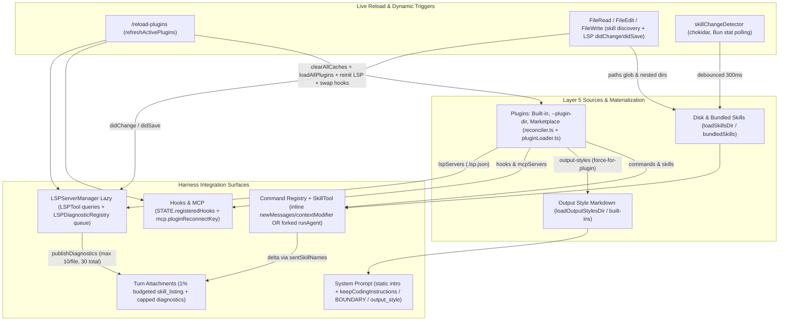

# 16. Skills, Plugins, Output Styles, and LSP Intelligence

> **Status: written.** Reverse-engineered from the Claude Code 2.1.88 source snapshot (see the Prologue (`prologue-how-to-read-a-1900-file-agent.md`) for snapshot caveats).
>
> **Layer:** Layer 5 (Dynamic Capabilities: MCP, Skills, Plugins & LSP)
> **Prerequisites:** [Chapter 03](ch003-command-and-message-contracts.md), [Chapter 04](ch004-prompt-engineering-and-cache-boundaries.md), [Chapter 13](ch013-the-hook-system.md), [Chapter 14](ch014-configuration-settings-and-enterprise-policy.md), [Chapter 15](ch015-model-context-protocol-mcp.md)
> **Primary Source Files:**
> - `skills/loadSkillsDir.ts` — Multi-source Markdown skill discovery, `realpath` deduplication, dynamic & `paths`-scoped conditional activation
> - `skills/bundledSkills.ts` — Programmatic bundled-skill registry and symlink-safe lazy file extraction
> - `tools/SkillTool/SkillTool.ts` & `tools/SkillTool/prompt.ts` — Skill execution (inline vs. forked subagent), `SAFE_SKILL_PROPERTIES` allowlist, and 1% listing budget
> - `utils/skills/skillChangeDetector.ts` — Debounced chokidar skill watching with Bun deadlock workaround
> - `plugins/builtinPlugins.ts` & `utils/plugins/pluginLoader.ts` — Built-in, `--plugin-dir`, and marketplace plugin loading, policy fail-closed guards, and cache-only startup
> - `utils/plugins/reconciler.ts`, `utils/plugins/refresh.ts`, & `commands/reload-plugins/reload-plugins.ts` — Three-layer plugin materialization and live `/reload-plugins` hot-swapping
> - `outputStyles/loadOutputStylesDir.ts`, `constants/outputStyles.ts`, & `constants/prompts.ts` — Output style loading, plugin takeover (`force-for-plugin`), and system-prompt framing surgery
> - `services/lsp/manager.ts`, `services/lsp/LSPServerManager.ts`, `services/lsp/LSPServerInstance.ts`, `services/lsp/LSPClient.ts`, `services/lsp/passiveFeedback.ts`, `services/lsp/LSPDiagnosticRegistry.ts`, & `tools/LSPTool/LSPTool.ts` — Lazy LSP lifecycle, JSON-RPC resilience, active code-intelligence queries, and passive diagnostic attachments

## Why This Layer Exists

Chapter 15 gave the harness external RPC tools over MCP, solving how an agent reaches third-party APIs and databases. Yet an agent working in a real engineering organization still hits four walls that external tool schemas alone cannot solve:

1. **Reusable workflows without prompt bloat.** Putting every deploy playbook, PR review rubric, and migration checklist in `CLAUDE.md` burns context on every session and offers zero permission scoping, argument substitution, or subagent isolation. The harness needs *skills*—lazy-loaded Markdown playbooks that advertise a one-line description up front and expand only when invoked (or only after the agent touches matching files).
2. **Coordinated distribution and live reload.** Real capabilities rarely consist of a single prompt or a single MCP server. A team's "frontend toolkit" bundles skills, custom subagents, lifecycle hooks, an output style, an MCP server, and a language server. Users need to install, version, trust-check, and hot-swap that entire bundle via `/reload-plugins` without tearing down a running REPL.
3. **Behavioral reframing without forking prompts.** Sometimes the harness should teach (`Learning`), explain architectural trade-offs (`Explanatory`), or act as a non-coding domain specialist—which requires selectively stripping the software-engineering task instructions while preserving the prompt-cache boundary from Chapter 04.
4. **Compiler-grade code intelligence.** `GrepTool` and `GlobTool` match text; they cannot resolve overloaded symbols, walk call hierarchies, or report type errors right after an edit. The harness needs language servers managed lazily in the background, queried explicitly through `LSPTool` and harvested passively through compiler diagnostics.

This chapter dissects all four subsystems in dependency order: skills first, then the plugin container that packages skills alongside hooks/agents/MCP/LSP, then output styles, and finally the LSP engine.

---

## 1. Skills: Markdown Playbooks, Path-Scoped Triggers, and Inline vs. Forked Execution

### The Problem

A skill in Claude Code is represented as a `PromptCommand` ([Chapter 03](ch003-command-and-message-contracts.md))—unifying `/slash` commands invoked by a human and skills invoked proactively by the model through `SkillTool`. Making that abstraction survive real repositories forces the loader to solve five thorny problems simultaneously:

- **Discovery sprawl & symlink aliasing:** Skills arrive from enterprise policy directories, `~/.claude/skills`, every ancestor `.claude/skills` up to `$HOME`, `--add-dir` paths, legacy `.claude/commands` trees, compiled-in bundled skills, plugins, and MCP servers—often symlinked across dotfiles repos or containers with broken inode reporting.
- **Turn-1 token budgets:** Power users accumulate hundreds of skills. Dumping full skill bodies—or even verbose descriptions—into the system prompt bloats turn-1 cache creation and breaks prompt caches whenever a new skill activates mid-session.
- **Execution isolation vs. main-turn injection:** Some skills ("review this diff in a clean window") want a dedicated subagent (`context: fork`); others ("adopt these conventions and keep editing") must inject instructions, extra `allowedTools`, a `model` override, or an `effort` override directly into the current turn.
- **Untrusted inputs:** Skills can execute inline shell snippets (`` !`cmd` ``) and extract reference files to disk, creating command-injection and symlink-race surfaces if remote or multi-user inputs aren't fenced off.

### The Real Implementation

#### Multi-Source Discovery, Precedence, and `realpath` Deduplication

`skills/loadSkillsDir.ts` loads disk-based skills inside the memoized `getSkillDirCommands(cwd)` (lines 638–804). Unlike legacy `/commands/` (which accepts both single `.md` files and `SKILL.md` directories), modern `/skills/` directories strictly enforce `skill-name/SKILL.md` (`loadSkillsFromSkillsDir`, lines 407–480).

Five independent sources run in parallel via `Promise.all` (lines 679–714), then concatenate in strict first-wins precedence order:

1. **Managed policy skills** (`<managed>/.claude/skills`, skipped if `CLAUDE_CODE_DISABLE_POLICY_SKILLS` is truthy).
2. **User skills** (`~/.claude/skills`), if `userSettings` is enabled and not locked by org plugin-only policy (`isRestrictedToPluginOnly('skills')`).
3. **Project skills** (`getProjectDirsUpToHome('skills', cwd)`), walking upward from `cwd`.
4. **Additional directories** (`--add-dir`), each checked at `<dir>/.claude/skills`.
5. **Legacy `/commands/`** (`loadSkillsFromCommandsDir`, tagged `loadedFrom: 'commands_DEPRECATED'`).

In `--bare` mode (`isBareMode()`, lines 658–675), auto-discovery is skipped completely; only explicit `--add-dir` directories load, while `isRestrictedToPluginOnly('skills')` still applies so `--bare` can never be used as a policy bypass.

Deduplication (`getFileIdentity`, lines 118–124 and 728–763) intentionally resolves canonical paths via `fs/promises.realpath()` instead of comparing `(dev, ino)` pairs—a production scar explicitly citing GitHub issue `#13893`, because virtual/container/NFS filesystems report `inode 0` and ExFAT loses inode precision.

Frontmatter is normalized by `parseSkillFrontmatterFields()` (lines 185–265), supporting `description`, `when_to_use`, `allowed-tools`, `argument-hint`, `arguments`, `model`, `effort`, `hooks` (validated with `HooksSchema()`), `disable-model-invocation`, `user-invocable`, `context: fork`, `agent`, `shell`, and `paths`. When the skill executes, `createSkillCommand()` builds `getPromptForCommand()` with three substitutions and one hard security boundary:

```ts
// skills/loadSkillsDir.ts:344-399
async getPromptForCommand(args, toolUseContext) {
  let finalContent = baseDir
    ? `Base directory for this skill: ${baseDir}\n\n${markdownContent}`
    : markdownContent

  finalContent = substituteArguments(finalContent, args, true, argumentNames)

  if (baseDir) {
    const skillDir =
      process.platform === 'win32' ? baseDir.replace(/\\/g, '/') : baseDir
    finalContent = finalContent.replace(/\$\{CLAUDE_SKILL_DIR\}/g, skillDir)
  }

  finalContent = finalContent.replace(/\$\{CLAUDE_SESSION_ID\}/g, getSessionId())

  // Security: MCP skills are remote and untrusted — never execute inline
  // shell commands (!`…` / ```! … ```) from their markdown body.
  if (loadedFrom !== 'mcp') {
    finalContent = await executeShellCommandsInPrompt(
      finalContent,
      {
        ...toolUseContext,
        getAppState() {
          const appState = toolUseContext.getAppState()
          return {
            ...appState,
            toolPermissionContext: {
              ...appState.toolPermissionContext,
              alwaysAllowRules: {
                ...appState.toolPermissionContext.alwaysAllowRules,
                command: allowedTools,
              },
            },
          }
        },
      },
      `/${skillName}`,
      shell,
    )
  }

  return [{ type: 'text', text: finalContent }]
}
```

Notice how `skills/loadSkillsDir.ts:1083-1086` also registers `createSkillCommand` and `parseSkillFrontmatterFields` into a zero-import leaf module, `skills/mcpSkillBuilders.ts`. That indirection breaks an import cycle (`client.ts → mcpSkills.ts → loadSkillsDir.ts → … → client.ts`) without using a variable dynamic `import(specifier)`, which fails at runtime inside Bun-bundled `$bunfs` single-file executables.

#### Bundled Skills and Symlink-Safe Lazy Extraction

Skills compiled directly into the CLI binary register at startup via `initBundledSkills()` (`skills/bundled/index.ts`) calling `registerBundledSkill()` (`skills/bundledSkills.ts`). Core bundled skills (`update-config`, `keybindings`, `verify`, `debug`, `simplify`, `batch`, `remember`, `skillify`, `stuck`, `loremIpsum`) register unconditionally, while experimental or product-specific skills are dead-code-eliminated behind build-time `feature('...')` gates (`KAIROS` / `KAIROS_DREAM`, `REVIEW_ARTIFACT`, `AGENT_TRIGGERS` for `/loop`, `AGENT_TRIGGERS_REMOTE`, `BUILDING_CLAUDE_APPS`, `RUN_SKILL_GENERATOR`).

Bundled skills can embed companion reference files (`files?: Record<string, string>`). Rather than stuffing large docs into the prompt, `registerBundledSkill()` extracts them lazily on first invocation (memoizing the *promise* so concurrent callers share one write) into a per-process nonce directory (`getBundledSkillsRoot()`) and prepends `Base directory for this skill: <dir>` so the model can `Read`/`Grep` them on demand. The write path (`bundledSkills.ts:169-206`) is hardened against local `/tmp` symlink attacks: directories are created `0o700`, files open with `0o600` and `O_WRONLY | O_CREAT | O_EXCL | O_NOFOLLOW` on POSIX (using string `'wx'` on Windows because numeric `O_EXCL` triggers `EINVAL` through libuv), and `EEXIST` intentionally fails rather than calling `unlink()`+retry because `unlink()` follows intermediate symlinks.

#### Dynamic Discovery & `paths`-Scoped Conditional Activation

Skills are not static for the lifetime of a session. Two dynamic mechanisms live at the bottom of `skills/loadSkillsDir.ts` and are triggered whenever the agent operates on a file in `tools/FileReadTool/FileReadTool.ts` (lines 579–590), `tools/FileEditTool/FileEditTool.ts` (lines 408–422), or `tools/FileWriteTool/FileWriteTool.ts` (lines 234–245):

1. **Nested subdirectory discovery (`discoverSkillDirsForPaths` + `addSkillDirectories`, lines 861–975):** Walks up from `dirname(filePath)` strictly below `cwd` (checking `currentDir.startsWith(resolvedCwd + pathSep)` so `/project-backup` never false-matches `/project`). Both hits and misses are memoized in `dynamicSkillDirs` to avoid repeated `stat()` syscalls on every file read. Before loading a discovered `.claude/skills`, `isPathGitignored(currentDir, resolvedCwd)` blocks untrusted vendored trees such as `node_modules/pkg/.claude/skills`. Newly discovered directories are sorted deepest-first and merged shallower-to-deeper so skills closest to the touched file win.
2. **Conditional `paths` glob activation (`parseSkillPaths` + `activateConditionalSkillsForPaths`, lines 159–178 and 997–1058):** At initial load (`lines 771-790`), any skill with a non-empty `paths:` frontmatter (stripping trailing `/**`, and ignoring match-all `**`) is withheld from the unconditional list and parked in the `conditionalSkills` map. When the agent reads, writes, or edits a matching file, `activateConditionalSkillsForPaths()` evaluates the patterns with the `ignore` library (matching `CLAUDE.md` rule semantics):

```ts
// skills/loadSkillsDir.ts:1007-1041
for (const [name, skill] of conditionalSkills) {
  if (skill.type !== 'prompt' || !skill.paths || skill.paths.length === 0) {
    continue
  }

  const skillIgnore = ignore().add(skill.paths)
  for (const filePath of filePaths) {
    const relativePath = isAbsolute(filePath) ? relative(cwd, filePath) : filePath

    // ignore() throws on empty strings, paths escaping the base (../),
    // and absolute paths (Windows cross-drive relative() returns absolute).
    if (!relativePath || relativePath.startsWith('..') || isAbsolute(relativePath)) {
      continue
    }

    if (skillIgnore.ignores(relativePath)) {
      dynamicSkills.set(name, skill)
      conditionalSkills.delete(name)
      activatedConditionalSkillNames.add(name)
      activated.push(name)
      break
    }
  }
}
```

Recording the skill in `activatedConditionalSkillNames` ensures that once triggered, it survives cache invalidations during the same session. Both dynamic paths emit `skillsLoaded.emit()`, which `utils/skills/skillChangeDetector.ts` (lines 92–100) handles by calling `clearCommandMemoizationCaches()`—deliberately *not* `clearCommandsCache()`, because `clearCommandsCache()` calls `clearSkillCaches()` and would wipe the very dynamic skills just loaded.

#### Incremental Skill Listing & The 1% Context Budget

How does the model learn about skills without mutating the static system prompt and busting prompt caches every time a conditional skill activates? Through incremental `skill_listing` attachments in `utils/attachments.ts` (lines 2661–2751).

`getSkillListingAttachments()` collects `getSkillToolCommands(cwd)` plus MCP-provided skills (`getMcpSkillCommands`, gated by `feature('MCP_SKILLS')` in `commands.ts`:547–559), diffs them against a per-agent `sentSkillNames` map, and emits *only the newly available delta*. On `--resume`, `conversationRecovery.ts` calls `suppressNextSkillListing()` so a restarted process doesn't re-inject the full ~600-token listing that is already in the restored transcript.

Formatting runs through `formatCommandsWithinBudget()` in `tools/SkillTool/prompt.ts` (lines 20–171):

- **Total budget:** `1%` of the model's context window in characters (`contextWindowTokens * 4 * 0.01`, fallback `8,000` chars, overridable via `SLASH_COMMAND_TOOL_CHAR_BUDGET`).
- **Per-entry cap:** `MAX_LISTING_DESC_CHARS = 250` so verbose `whenToUse` strings cannot waste turn-1 cache creation.
- **Bundled-skill protection:** If the full list exceeds budget, bundled skills (`source === 'bundled'`) are partitioned out and *never* truncated; remaining budget is divided evenly across user/project/plugin skills. If the per-skill share drops below `MIN_DESC_LENGTH = 20` characters, non-bundled skills degrade gracefully to names-only (`- skill-name`).

#### Inline Execution vs. Forked Subagent Execution

When the model calls `SkillTool` (`tools/SkillTool/SkillTool.ts`), permission evaluation (`checkPermissions`, lines 432–578) runs in strict order: `deny` rules → (remote canonical auto-grant, ant-only) → `allow` rules → `skillHasOnlySafeProperties()` → default `ask`.

> [!IMPORTANT]
> **`SAFE_SKILL_PROPERTIES` is a fail-closed allowlist (`SkillTool.ts:875-933`).** Skills that only declare benign metadata (`description`, `model`, `effort`, `paths`, `context`, `agent`, etc.) auto-allow without prompting. Notice what is deliberately *absent* from the allowlist: `allowedTools` and `hooks` (plus any future `PromptCommand` field not yet reviewed). Any skill granting extra tool permissions or registering lifecycle hooks forces an explicit user prompt.

After approval, `call()` branches on `command.context === 'fork'`:

1. **Inline execution (default, lines 634–840):** Calls `processPromptSlashCommand()` (`utils/processUserInput/processSlashCommand.tsx`:827–885), which registers any skill-scoped hooks via `registerSkillHooks()`, records the rendered body via `addInvokedSkill()` (so compaction in [Chapter 09](ch009-five-layer-compaction-pipeline.md) can re-inject active skills), and returns expanded user messages. `SkillTool` returns a brief tool result (`"Launching skill: <name>"`), attaches the expanded prompt as `newMessages` (tagged with `sourceToolUseID`), and returns a `contextModifier` that mutates the *subsequent* turn's execution context:

```ts
// tools/SkillTool/SkillTool.ts:767-839 (condensed)
return {
  data: { success: true, commandName, allowedTools: allowedTools.length > 0 ? allowedTools : undefined, model },
  newMessages,
  contextModifier(ctx) {
    let modifiedContext = ctx
    if (allowedTools.length > 0) {
      const previousGetAppState = modifiedContext.getAppState
      modifiedContext = {
        ...modifiedContext,
        getAppState() {
          const appState = previousGetAppState()
          return {
            ...appState,
            toolPermissionContext: {
              ...appState.toolPermissionContext,
              alwaysAllowRules: {
                ...appState.toolPermissionContext.alwaysAllowRules,
                command: [...new Set([...(appState.toolPermissionContext.alwaysAllowRules.command || []), ...allowedTools])],
              },
            },
          }
        },
      }
    }
    // Carry [1m] suffix over — otherwise a skill with `model: opus` on an
    // opus[1m] session drops the effective window to 200K and trips autocompact.
    if (model) {
      modifiedContext = {
        ...modifiedContext,
        options: {
          ...modifiedContext.options,
          mainLoopModel: resolveSkillModelOverride(model, ctx.options.mainLoopModel),
        },
      }
    }
    if (effort !== undefined) {
      const previousGetAppState = modifiedContext.getAppState
      modifiedContext = {
        ...modifiedContext,
        getAppState() { return { ...previousGetAppState(), effortValue: effort } },
      }
    }
    return modifiedContext
  },
}
```

2. **Forked subagent execution (`executeForkedSkill`, lines 122–289):** Calls `prepareForkedCommandContext()` (`utils/forkedAgent.ts`:191–232) to expand the prompt, wrap `allowedTools` via `createGetAppStateWithAllowedTools()`, and resolve `command.agent ?? 'general-purpose'`. It then runs `runAgent({ isAsync: false, querySource: 'agent:custom', override: { agentId } })` synchronously inside the tool call, forwards intermediate `tool_use`/`tool_result` blocks as `skill_progress` updates, extracts the final assistant text with `extractResultText()`, zeros `agentMessages.length = 0` to release memory, and clears `clearInvokedSkillsForAgent(agentId)` in `finally`. The main conversation receives only the synthesized summary string—keeping the parent context window clean.

### Hidden Invariants & Failure Modes

- **Bun `fs.watch()` deadlock (`utils/skills/skillChangeDetector.ts:51-62`):** Live-reloading edited skills via chokidar sets `USE_POLLING = typeof Bun !== 'undefined'` with a 2-second stat interval (`POLLING_INTERVAL_MS = 2000`) and a 300ms batch debounce (`RELOAD_DEBOUNCE_MS = 300`). Under Bun, native `FSWatcher` churn across deep skill trees triggers a `PathWatcherManager` `__ulock_wait2` deadlock (`oven-sh/bun#27469`, `#26385`). Debouncing also collapses mass git-checkout edits into a single `ConfigChange` hook invocation (`paths[0]`) and cache sweep.
- **Preserving `[1m]` model windows:** Calling `resolveSkillModelOverride()` instead of directly assigning `command.model` stops a skill authored with `model: opus` from silently downgrading an `opus[1m]` session to 200K tokens and triggering an immediate autocompact.
- **Snapshot absence (`services/skillSearch/`):** Behind `feature('EXPERIMENTAL_SKILL_SEARCH')`, five call sites (`tools/SkillTool/SkillTool.ts`:108–115, `utils/attachments.ts`:95–101, `commands.ts`:96–100, `query.ts`:67, and `constants/prompts.ts`:95–96) conditionally `require()` modules under `services/skillSearch/` (`featureCheck`, `prefetch`, `localSearch`, `remoteSkillState`, `remoteSkillLoader`, `telemetry`, `signals`). **This entire directory is absent from the snapshot.** From the call sites we can observe its contract: when enabled, `getSkillListingAttachments()` shrinks the static listing to bundled+MCP skills (`filterToBundledAndMcp`, capped at 30) while dynamic discovery surfaces the long tail; `SkillTool` intercepts `_canonical_<slug>` names (additionally gated on `process.env.USER_TYPE === 'ant'`) to load remote declarative `SKILL.md` files directly without `!` shell expansion; and `clearCommandMemoizationCaches()` calls `clearSkillIndexCache()` to bust the outer search index cache.

---

## 2. Plugins: Packaging, Trust Boundaries, Caching, and `/reload-plugins` Hot-Swapping

### The Problem

Once teams want to ship a cohesive package—say, a Kubernetes plugin with three skills, a specialized `k8s-debugger` subagent, a `PreToolUse` safety hook, an MCP server, and a YAML language server—standalone `.claude/` directories break down. You need versioning, marketplaces, dependency checks, enterprise allowlists/blocklists, fast startup that never stalls on `git clone`, and a way to apply newly installed or edited plugins without restarting the terminal session.

### The Real Implementation

#### The Three-Layer Plugin Architecture

As documented at the top of `utils/plugins/refresh.ts` (lines 4–7), the plugin subsystem separates *desired state*, *disk materialization*, and *in-memory activation* into three explicit layers:

- **Layer 1 — Intent (Settings):** `enabledPlugins`, `extraKnownMarketplaces`, and enterprise `policySettings` (`strictKnownMarketplaces`, `blockedMarketplaces`, force-enabled/disabled plugins) merged via Chapter 14's settings cascade.
- **Layer 2 — Materialization (`~/.claude/plugins/`):** `utils/plugins/reconciler.ts` diffs declared marketplace intent against `known_marketplaces.json` (`diffMarketplaces`, lines 50–83) and runs `reconcileMarketplaces()` (lines 114–234)—idempotent and strictly additive (never deletes). Relative local marketplace paths are normalized against `findCanonicalGitRoot()` (lines 237–250) so git worktree sessions don't overwrite the user-global `known_marketplaces.json` with ephemeral worktree paths that break once the worktree is deleted.
- **Layer 3 — Active Components (`AppState` + `STATE.registeredHooks`):** Loaded by `loadAllPlugins()` / `loadAllPluginsCacheOnly()` (`utils/plugins/pluginLoader.ts`) and swapped live by `refreshActivePlugins()` (`utils/plugins/refresh.ts`).

#### Manifest Anatomy, Sources, and Component Wiring

A plugin root optionally contains `.claude-plugin/plugin.json` validated against `PluginManifestSchema` (`utils/plugins/schemas.ts`); if absent, `loadPluginManifest()` synthesizes a minimal manifest from the directory name (`pluginLoader.ts:1147-1160`). `createPluginFromPath()` (`pluginLoader.ts:1348-1770`) probes standard directories in parallel (`commands/`, `skills/`, `agents/`, `output-styles/`, `hooks/hooks.json`, `settings.json`) and merges explicit manifest overrides:

| Component | Default Location / Manifest Field | Loader & Namespacing |
|---|---|---|
| Commands & Skills | `commands/`, `skills/`, `manifest.{commands,skills}` | `loadPluginCommands.ts` — `pluginName[:sub]:cmdName` |
| Subagents | `agents/`, `manifest.agents` | `loadPluginAgents.ts` — `agentType = pluginName[:sub]:agentName` |
| Hooks | `hooks/hooks.json`, `manifest.hooks` | `loadPluginHooks.ts` — deduped by `realpath()`, registered in `STATE.registeredHooks` |
| Output Styles | `output-styles/`, `manifest.outputStyles` | `loadPluginOutputStyles.ts` — `${pluginName}:${baseStyleName}` |
| MCP Servers | `.mcp.json`, `manifest.mcpServers` (JSON, inline, or `.mcpb`/`.dxt`) | `mcpPluginIntegration.ts` — supports `manifest.channels` + MCPB config dialogs |
| LSP Servers | `.lsp.json`, `manifest.lspServers` | `lspPluginIntegration.ts` — scoped as `plugin:${pluginName}:${serverName}` |
| Settings | `settings.json`, `manifest.settings` | `pluginLoader.ts`:1776–1849 — allowlist-filtered via `SettingsSchema().pick({ agent: true }).strip()` |

Plugins also support templated variables: `${CLAUDE_PLUGIN_ROOT}`, `${CLAUDE_PLUGIN_DATA}`, and `${user_config.KEY}` declared in `manifest.userConfig` (`schemas.ts`:632–654). Option keys must match `/^[A-Za-z_]\w*$/` because they also export as `CLAUDE_PLUGIN_OPTION_<KEY>` env vars to hooks. Non-sensitive values persist in `settings.json`; `sensitive: true` values live in secure storage (macOS keychain or `.credentials.json`, explicitly warning plugin authors to keep secret counts small because they share the ~2 KB keychain entry with OAuth tokens — `INC-3028`) and are *excluded* from skill and agent Markdown substitution so secrets do not leak into LLM prompts.

Three plugin sources merge in `mergePluginSources()` (`pluginLoader.ts:3009-3064`):

1. **Session plugins (`--plugin-dir` / SDK inline):** Override installed marketplace plugins with the same name so authors can iterate locally—*unless* that plugin name is locked by enterprise `policySettings.enabledPlugins` (whether force-enabled *or* force-disabled), in which case the `--plugin-dir` copy is dropped with a visible error.
2. **Marketplace plugins (`name@marketplace`):** Installed from git, GitHub, URL, npm, or local directory marketplaces.
3. **Built-in plugins (`name@builtin`, `plugins/builtinPlugins.ts`):** Compiled into the CLI, toggleable in `/plugin`, and intentionally tagging their skills with `source: 'bundled'` rather than `'builtin'` (lines 145–150) because `Command.source === 'builtin'` means hardcoded CLI commands (`/help`, `/clear`) and would drop them from `SkillTool`'s listing and truncation exemption.

After merging, `verifyAndDemote()` (`utils/plugins/dependencyResolver.ts`) performs an `apt`-style fixed-point presence check (no topological load order needed), demoting plugins with unsatisfied dependencies session-locally without rewriting user settings. Cross-marketplace dependencies are blocked by default unless explicitly permitted on the *root* marketplace's `allowCrossMarketplaceDependenciesOn` list (no transitive trust).

#### Trust Boundaries, Caching, and the Startup Split

Because marketplace plugins execute hooks, MCP servers, and LSP binaries, the loader enforces multiple defense-in-depth gates:

- **Official-name & homograph defense (`utils/plugins/schemas.ts`:19–157):** `ALLOWED_OFFICIAL_MARKETPLACE_NAMES` reserves 8 official Anthropic marketplace names; `isBlockedOfficialName()` rejects non-ASCII characters (`NON_ASCII_PATTERN`, blocking Cyrillic lookalikes) and `BLOCKED_OFFICIAL_NAME_PATTERN` impersonations; `validateOfficialNameSource()` enforces that reserved names originate exclusively from `github.com/anthropics/`.
- **Enterprise policy fail-closed guard (`utils/plugins/pluginLoader.ts`:1920–1995):** If `strictKnownMarketplaces` (even `[]`, meaning deny-all) or non-empty `blockedMarketplaces` is active, and `loadKnownMarketplacesConfigSafe()` cannot resolve a plugin's marketplace (missing entry or corrupt JSON), the plugin is blocked with `marketplace-blocked-by-policy`. Without this guard, falling back to `getPluginByIdCacheOnly()` (which performs an unvalidated raw cast) would silently fail open. Similarly, `isPluginBlockedByPolicy()` (`utils/plugins/pluginPolicy.ts`) enforces org-disabled plugins across install, enable, and UI paths, while `detectAndUninstallDelistedPlugins()` (`utils/plugins/pluginBlocklist.ts`) auto-uninstalls plugins removed from their marketplace catalog (noting the removal of remote `security.json` polling after `#25447` generated ~29.5M GitHub requests/week).
- **Versioned, seed, and ZIP caches:** Materialized plugins live at `~/.claude/plugins/cache/{marketplace}/{plugin}/{version}/` (stripping `.git` and sanitizing version segments against path traversal). Read-only container/BYOC environments can populate `probeSeedCache()` (`pluginLoader.ts:195-238`), and headless Filestore setups can enable `CLAUDE_CODE_PLUGIN_USE_ZIP_CACHE=1` + `CLAUDE_CODE_PLUGIN_CACHE_DIR` (`utils/plugins/zipCache.ts`) to store plugins as `.zip` archives extracted into a session-local temp directory. Orphaned cache versions receive a `.orphaned_at` timestamp and are garbage-collected after 7 days (`cleanupOrphanedPluginVersionsInBackground`, `utils/plugins/cacheUtils.ts`:74–116)—skipped in ZIP mode so empty-dir pruning doesn't wipe `.zip` files.
- **Cache-only vs. full loading (`pluginLoader.ts:3096-3146`):** Interactive startup calls `loadAllPluginsCacheOnly()`, reading `installed_plugins.json` without ever blocking on network git clones; explicit refresh paths (and headless `CLAUDE_CODE_SYNC_PLUGIN_INSTALL=1`) call `loadAllPlugins()`. Crucially, `loadAllPlugins()` writes its resolved promise into `loadAllPluginsCacheOnly.cache` (line 3106) so downstream cache-only consumers immediately see newly cloned plugins.

#### Hot-Swapping Mid-Session: `/reload-plugins`

Running `/reload-plugins` (`commands/reload-plugins/reload-plugins.ts`) first re-downloads user settings if running in remote mode (`feature('DOWNLOAD_USER_SETTINGS')` + `CLAUDE_CODE_REMOTE`, manually firing `settingsChangeDetector.notifyChange('userSettings')` because internal writes suppress the watcher), then calls `refreshActivePlugins(context.setAppState)`:

```ts
// utils/plugins/refresh.ts:72-155 (condensed)
export async function refreshActivePlugins(
  setAppState: SetAppState,
): Promise<RefreshActivePluginsResult> {
  clearAllCaches()
  clearPluginCacheExclusions()

  // Sequence full load BEFORE cache-only consumers (#23693).
  // loadAllPlugins() warms loadAllPluginsCacheOnly's memoize cache.
  const pluginResult = await loadAllPlugins()
  const [pluginCommands, agentDefinitions] = await Promise.all([
    getPluginCommands(),
    getAgentDefinitionsWithOverrides(getOriginalCwd()),
  ])

  const { enabled, disabled, errors } = pluginResult

  // Eagerly warm lazy mcpServers / lspServers cache slots
  const [mcpCounts, lspCounts] = await Promise.all([
    Promise.all(enabled.map(async p => {
      if (p.mcpServers) return Object.keys(p.mcpServers).length
      const servers = await loadPluginMcpServers(p, errors)
      if (servers) p.mcpServers = servers
      return servers ? Object.keys(servers).length : 0
    })),
    Promise.all(enabled.map(async p => {
      if (p.lspServers) return Object.keys(p.lspServers).length
      const servers = await loadPluginLspServers(p, errors)
      if (servers) p.lspServers = servers
      return servers ? Object.keys(servers).length : 0
    })),
  ])

  setAppState(prev => ({
    ...prev,
    plugins: {
      ...prev.plugins,
      enabled, disabled,
      commands: pluginCommands,
      errors: mergePluginErrors(prev.plugins.errors, errors),
      needsRefresh: false,
    },
    agentDefinitions,
    mcp: { ...prev.mcp, pluginReconnectKey: prev.mcp.pluginReconnectKey + 1 },
  }))

  reinitializeLspServerManager() // Fixes #15521; clears stale LSP config too
  await loadPluginHooks()        // Atomic clear + register into STATE.registeredHooks
  // ...
}
```

Every single step in `refreshActivePlugins()` encodes a real production fix:

1. `clearAllCaches()` (`utils/plugins/cacheUtils.ts`:26–50) clears ten memoized caches across plugins, commands, agents, output styles, skill prompts, and `sentSkillNames`—leaving nothing stale.
2. Sequencing `await loadAllPlugins()` before `getPluginCommands()` and `getAgentDefinitionsWithOverrides()` fixed `#23693`: racing them in one `Promise.all` caused cache-only consumers to read `installed_plugins.json` before `loadAllPlugins()` finished cloning, emitting spurious `plugin-cache-miss` errors.
3. Incrementing `mcp.pluginReconnectKey` wakes `useManageMCPConnections` ([Chapter 15](ch015-model-context-protocol-mcp.md)) to connect newly enabled plugin MCP servers and tear down disabled ones.
4. `reinitializeLspServerManager()` runs unconditionally so both adding the first LSP plugin (fixing `#15521`) and removing the last LSP plugin take effect cleanly.
5. `loadPluginHooks()` (`utils/plugins/loadPluginHooks.ts`:91–157) performs `clearRegisteredPluginHooks()` and `registerHookCallbacks()` as an atomic pair. Previously, clearing hooks inside `clearPluginHookCache()` wiped `STATE.registeredHooks` during `/plugin` UI operations, silently killing plugin `Stop` hooks (`gh-29767`). Meanwhile, `clearAllPluginCaches()` fires `pruneRemovedPluginHooks()` (lines 179–207) so *uninstalled* plugins stop firing hooks immediately (`gh-36995`), re-reading `getRegisteredHooks()` *after* its `await` so it never clobbers a concurrent hot reload.

### Hidden Invariants & Failure Modes

- **Four-field policy hash for background hook reload (`loadPluginHooks.ts:217-287`):** `setupPluginHookHotReload()` subscribes to `policySettings` changes and hashes *four* fields—`enabledPlugins`, `extraKnownMarketplaces`, `strictKnownMarketplaces`, and `blockedMarketplaces`. Hashing only `enabledPlugins` previously skipped reloads when remote managed settings updated only marketplace allow/blocklists, leaving a poisoned memoize cache (`#23085`, `#23152`).
- **Startup settings cache short-circuit (`pluginLoader.ts:3281-3295`):** `cachePluginSettings()` only calls `resetSettingsCache()` when enabled plugins actually contribute allowlisted settings keys (`agent`); skipping the reset in the common empty case saves ~17ms of redundant settings re-parsing on startup.

---

## 3. Output Styles: Re-Framing the System Prompt Across the Cache Boundary

### The Problem

Skills govern *a task*; output styles govern *the agent's entire persona and pedagogical contract* across every turn of a session. Changing that framing naively—either by rewriting the whole system prompt or by dumping style text unconditionally at the top—either breaks Claude Code's carefully engineered tool-use/safety guardrails or shatters the cross-org global prompt cache ([Chapter 04](ch004-prompt-engineering-and-cache-boundaries.md)).

### The Real Implementation

Output styles are Markdown files with optional frontmatter (`name`, `description`, `keep-coding-instructions`, and—for plugins only—`force-for-plugin`) collected from five tiers in `constants/outputStyles.ts`:

1. **Built-in styles** (`OUTPUT_STYLE_CONFIG`, lines 41–135): `default` (`null`), `Explanatory` (injects `Insight` callout boxes before/after coding), and `Learning` (pauses to insert `TODO(human)` markers and request 2–10 line user contributions on design decisions). Both built-in non-default styles explicitly set `keepCodingInstructions: true`.
2. **Plugin styles** (`utils/plugins/loadPluginOutputStyles.ts`): loaded from `output-styles/` or `manifest.outputStyles`, namespaced `${pluginName}:${baseStyleName}`.
3. **User, project, and managed styles** (`outputStyles/loadOutputStylesDir.ts`): loaded via `loadMarkdownFilesForSubdir('output-styles', cwd)` from `~/.claude/output-styles`, `.claude/output-styles`, and `<managed>/.claude/output-styles`.

When `getOutputStyleConfig()` (`constants/outputStyles.ts:181-211`) resolves the active style, any enabled plugin style with `forceForPlugin === true` wins unconditionally over `settings.outputStyle` (first forced style wins with a warning if multiple plugins compete).

The resolved `OutputStyleConfig | null` then performs three surgical edits inside `getSystemPrompt()` in `constants/prompts.ts`:

```ts
// constants/prompts.ts:151-184, 505-576 (condensed)
function getOutputStyleSection(outputStyleConfig: OutputStyleConfig | null): string | null {
  if (outputStyleConfig === null) return null
  return `# Output Style: ${outputStyleConfig.name}\n${outputStyleConfig.prompt}`
}

function getSimpleIntroSection(outputStyleConfig: OutputStyleConfig | null): string {
  return `\nYou are an interactive agent that helps users ${
    outputStyleConfig !== null
      ? 'according to your "Output Style" below, which describes how you should respond to user queries.'
      : 'with software engineering tasks.'
  } Use the instructions below and the tools available to you to assist the user.\n...`
}

// Inside getSystemPrompt():
const dynamicSections = [
  // ...
  systemPromptSection('output_style', () => getOutputStyleSection(outputStyleConfig)),
  // ...
]

return [
  // --- Static content (cacheable) ---
  getSimpleIntroSection(outputStyleConfig),
  getSimpleSystemSection(),
  outputStyleConfig === null || outputStyleConfig.keepCodingInstructions === true
    ? getSimpleDoingTasksSection()
    : null,
  getActionsSection(),
  getUsingYourToolsSection(enabledTools),
  getSimpleToneAndStyleSection(),
  getOutputEfficiencySection(),
  // === BOUNDARY MARKER - DO NOT MOVE OR REMOVE ===
  ...(shouldUseGlobalCacheScope() ? [SYSTEM_PROMPT_DYNAMIC_BOUNDARY] : []),
  // --- Dynamic content (registry-managed) ---
  ...resolvedDynamicSections,
].filter(s => s !== null)
```

Look closely at how this preserves the architecture of Chapter 04:
- **Static prefix minimalism:** The custom style's arbitrary prompt text is placed *below* `SYSTEM_PROMPT_DYNAMIC_BOUNDARY` inside a session-cached `systemPromptSection('output_style', ...)`. Above the boundary, only two coarse switches change: the one-sentence intro clause and the presence/absence of `getSimpleDoingTasksSection()`. Thus every user running any custom non-coding output style still shares the exact same static prefix cache key!
- **Coding-instructions gate:** Setting `keep-coding-instructions: false` (or omitting it on a custom style) drops `getSimpleDoingTasksSection()` entirely, letting an output style repurpose the harness for writing, research, or ops workflows without fighting software-engineering instructions, while retaining core tool, permission, and safety rules (`getSimpleSystemSection`, `getActionsSection`, `getUsingYourToolsSection`).

### Hidden Invariants & Failure Modes

- **Comment vs. code precedence inversion (`constants/outputStyles.ts:158-159`):** The inline comment claims lowest-to-highest priority is `built-in, plugin, managed, user, project`, but the actual array is `const styleGroups = [pluginStyles, userStyles, projectStyles, managedStyles]`. Because later entries overwrite earlier ones, `managedStyles` (`policySettings`) actually has the *highest* precedence—matching enterprise expectations in Chapter 14 even though the comment says otherwise.
- **Plugin styles always drop coding instructions:** `loadOutputStylesDir.ts` (lines 53–62) parses `keep-coding-instructions` and warns on `force-for-plugin`, whereas `loadPluginOutputStyles.ts` (lines 64–78) parses `force-for-plugin` but *never* reads `keep-coding-instructions`. Consequently, plugin-provided output styles always leave `keepCodingInstructions` `undefined`, omitting `getSimpleDoingTasksSection()`.

---

## 4. LSP Intelligence: Lazy Language Servers, `LSPTool`, and Passive Compiler Feedback

### The Problem

Running language servers (`typescript-language-server`, `pyright`, `gopls`, `rust-analyzer`) inside a CLI agent creates four operational hazards:

1. **Cold-start & memory tax:** Spawning heavy language servers eagerly at CLI startup ruins interactive startup latency and wastes gigabytes of RAM when the user never touches files of that language (or runs headless `claude -p`).
2. **Startup race with plugins:** Language servers in Claude Code come *exclusively* from plugins (`services/lsp/config.ts`:10–11). If LSP initializes before plugin marketplaces finish reconciling, it caches zero servers permanently unless explicitly reinitialized.
3. **Hostile real-world server quirks:** Servers crash mid-session, reject requests with JSON-RPC `-32801` (`ContentModified`) while indexing, send reverse `workspace/configuration` requests even when the client advertises `configuration: false`, and require deprecated `rootUri`/`rootPath` fields alongside `workspaceFolders`.
4. **Diagnostic spam:** Every keystroke or save triggers asynchronous `textDocument/publishDiagnostics` bursts across dozens of files. Injecting unfiltered diagnostics into every turn would flood the context window with repetitive warnings.

### The Real Implementation

#### Plugin-Only Configuration and Generation-Guarded Singleton Lifecycle

`services/lsp/config.ts` loads LSP configurations solely from enabled plugins via `getPluginLspServers()` (`utils/plugins/lspPluginIntegration.ts`), reading `.lsp.json` and `manifest.lspServers`. Relative config file paths pass through `validatePathWithinPlugin()` to block `..` traversal; command, args, env, and `workspaceFolder` expand `${CLAUDE_PLUGIN_ROOT}`, `${CLAUDE_PLUGIN_DATA}`, `${user_config.KEY}`, and `${ENV_VAR}`; and server names are scoped as `plugin:${plugin.name}:${serverName}` so plugins cannot collide.

`services/lsp/manager.ts` wraps the singleton `LSPServerManager` behind a four-state lifecycle (`'not-started' | 'pending' | 'success' | 'failed'`) guarded by a monotonic `initializationGeneration` counter (lines 35, 173–207, 287). `initializeLspServerManager()` returns immediately in `--bare` mode, creates the manager synchronously, and starts async config loading without blocking startup. When `/reload-plugins` calls `reinitializeLspServerManager()` (lines 226–253), it fires a best-effort `shutdown()` on the old instance, bumps `initializationGeneration` so any in-flight startup promise from the prior generation silently drops its result, and kicks off a fresh config parse—fixing `#15521`.

#### Lazy Startup, Protocol Scars, and Crash Recovery

`LSPServerManager.initialize()` (`services/lsp/LSPServerManager.ts`:71–148) never spawns a child process. It only validates each server's `command` and `extensionToLanguage` map, builds a lowercase `extensionMap` (e.g., `.ts → ['plugin:typescript-lsp:tsserver']`), instantiates an idle `LSPServerInstance`, and pre-registers a reverse `workspace/configuration` handler returning `params.items.map(() => null)` so servers like TypeScript don't stall waiting for a reply.

Actual process spawning is deferred until `ensureServerStarted(filePath)` is called by `LSPTool` or a file edit. Inside `services/lsp/LSPServerInstance.ts` (lines 106–125):
- `LSPClient.js` is lazy-`require()`d inside `createLSPServerInstance()` so `vscode-jsonrpc` (~129 KB) stays off the cold-start import graph whenever no LSP plugins are configured.
- `createLSPClient(name, onCrash)` wires an `onCrash` callback that transitions `state = 'error'` and increments `crashRecoveryCount` on unexpected non-zero exits—avoiding a zombie `'running'` state where `ensureServerStarted` would never restart the server. Restart attempts cap at `config.maxRestarts ?? 3` (`lines 142-150`).
- Inside `services/lsp/LSPClient.ts`, `start()` explicitly awaits a `'spawn'` vs. `'error'` race (lines 115–131) *before* attaching `StreamMessageReader`/`StreamMessageWriter` so a missing binary (`ENOENT`) fails cleanly instead of causing unhandled stream-write rejections. Notification and request handlers registered while the server was still stopped queue in `pendingHandlers` / `pendingRequestHandlers` (lines 64–71) and attach immediately after `connection.listen()` (lines 228–244).
- `initialize()` sends `workspaceFolders` (LSP 3.16+, needed by Pyright and gopls), deprecated `rootPath` and `rootUri` (needed by `typescript-language-server` for `goToDefinition`), and `initializationOptions ?? {}` (needed by `vue-language-server`).
- `sendRequest()` transparently retries transient `-32801` (`ContentModified`) errors during initial project indexing:

```ts
// services/lsp/LSPServerInstance.ts:367-402 (condensed)
for (let attempt = 0; attempt <= MAX_RETRIES_FOR_TRANSIENT_ERRORS; attempt++) {
  try {
    return await client.sendRequest(method, params)
  } catch (error) {
    lastAttemptError = error as Error
    // Duck-type instead of instanceof: multiple vscode-jsonrpc versions
    // (8.2.0 vs 8.2.1) may coexist in the dependency tree.
    const errorCode = (error as { code?: number }).code
    const isContentModifiedError =
      typeof errorCode === 'number' && errorCode === LSP_ERROR_CONTENT_MODIFIED

    if (isContentModifiedError && attempt < MAX_RETRIES_FOR_TRANSIENT_ERRORS) {
      const delay = RETRY_BASE_DELAY_MS * Math.pow(2, attempt) // 500, 1000, 2000ms
      await sleep(delay)
      continue
    }
    break
  }
}
```

#### Active Queries: `LSPTool`

`tools/LSPTool/LSPTool.ts` exposes 9 read-only, concurrency-safe operations: `goToDefinition`, `findReferences`, `hover`, `documentSymbol`, `workspaceSymbol`, `goToImplementation`, `prepareCallHierarchy`, `incomingCalls`, and `outgoingCalls`. Key design properties:

- **Deferred & self-gating:** Declares `shouldDefer: true` (discovered on demand via `ToolSearchTool` from [Chapter 15](ch015-model-context-protocol-mcp.md)) and `isEnabled: () => isLspConnected()` (requiring at least one configured server not in `'error'` state).
- **1-based to 0-based translation:** Accepts editor-friendly 1-based `line`/`character` inputs and converts to 0-based LSP positions in `getMethodAndParams()` (lines 432–436).
- **Lazy `didOpen` & safety guards:** Before dispatching a request, `call()` waits if initialization is still `'pending'`, checks `manager.isFileOpen(absolutePath)`, and opens unopened files with a 10 MB ceiling (`MAX_LSP_FILE_SIZE_BYTES = 10_000_000`, lines 261–278). `validateInput()` skips `stat()` on UNC paths (`\\...` / `//...`, lines 170–173) to prevent Windows NTLM credential leaks.
- **Two-step call hierarchy & gitignore filtering:** `incomingCalls` and `outgoingCalls` automatically chain `textDocument/prepareCallHierarchy` into `callHierarchy/{incoming,outgoing}Calls` using `callItems[0]` (lines 302–334). Location-returning operations filter out gitignored hits via batched `git check-ignore` calls (50 paths per batch, lines 556–611).

#### Passive Compiler Feedback Loop

Even if the model never calls `LSPTool`, language servers act as a passive compiler oracle whenever the agent modifies code:

1. **Edit/Write sync:** Right after writing to disk, `tools/FileEditTool/FileEditTool.ts` (lines 494–514) and `tools/FileWriteTool/FileWriteTool.ts` (lines 309–326) fire `lspManager.changeFile()` (`textDocument/didChange`, auto-falling back to `didOpen` if not yet opened) and `lspManager.saveFile()` (`textDocument/didSave`—explicitly required to trigger diagnostics in TypeScript's language server).
2. **Notification capture:** Upon manager initialization, `registerLSPNotificationHandlers()` (`services/lsp/passiveFeedback.ts`:125–328) attaches a `textDocument/publishDiagnostics` listener to every server instance (queued via `pendingHandlers` until spawn). Each notification normalizes severity (`1→Error`, `2→Warning`, `3→Info`, `4→Hint`), drops empty diagnostic arrays, and stores the batch via `registerPendingLSPDiagnostic()`—tracking per-server consecutive handler failures and warning after 3+.
3. **Deduplication, severity sorting, and volume caps:** `services/lsp/LSPDiagnosticRegistry.ts` buffers notifications in `pendingDiagnostics` and maintains a 500-file `LRUCache<string, Set<string>>` (`deliveredDiagnostics`) keyed by JSON-serialized `(message, severity, range, source, code)` for cross-turn deduplication. When `checkForLSPDiagnostics()` runs (lines 193–338), it deduplicates within-batch and against prior turns, sorts each file's diagnostics by severity (`Error` first), and enforces hard caps of `MAX_DIAGNOSTICS_PER_FILE = 10` and `MAX_TOTAL_DIAGNOSTICS = 30`.
4. **Attachment delivery:** On the next turn, `getLSPDiagnosticAttachments()` (`utils/attachments.ts`:2885–2935)—gated on the agent possessing `BashTool` so read-only subagents aren't distracted by build errors they can't act on—drains `checkForLSPDiagnostics()`, emits `{ type: 'diagnostics', files, isNew: true }`, and clears `pendingDiagnostics`.

### Hidden Invariants & Failure Modes

- **Snapshot absence (`services/lsp/types.ts`):** `services/lsp/types.ts` is absent from this checkout. Its exported types—`LspServerConfig`, `ScopedLspServerConfig` (adds `scope: 'dynamic'` and `source: string`), and `LspServerState` (`'stopped' | 'starting' | 'running' | 'stopping' | 'error'`)—are observed directly across `utils/plugins/schemas.ts` (`LspServerConfigSchema`), `utils/plugins/lspPluginIntegration.ts`, and `services/lsp/LSPServerInstance.ts`.
- **Unimplemented config fields fail loudly:** `createLSPServerInstance()` (`LSPServerInstance.ts:95-104`) explicitly throws if a plugin sets `restartOnCrash` or `shutdownTimeout`, even though `LspServerConfigSchema` still accepts them.
- **File-close lifecycle gap:** `LSPServerManager.closeFile()` (`LSPServerManager.ts:377-400`) carries an explicit `TODO` noting it is not yet wired into compaction, so `openedFiles` retains every opened URI until server shutdown.

> [!WARNING]
> **Verified URI-key mismatch in diagnostic cache invalidation.** Look at `services/lsp/passiveFeedback.ts`:50–52: `formatDiagnosticsForAttachment()` converts `file:///abs/path` to `/abs/path` via `fileURLToPath()`, so `deliveredDiagnostics` in `LSPDiagnosticRegistry.ts:292` keys entries by *plain filesystem path* (`/abs/path`). However, `tools/FileEditTool/FileEditTool.ts`:497 and `tools/FileWriteTool/FileWriteTool.ts`:311 call ``clearDeliveredDiagnosticsForFile(`file://${absoluteFilePath}`)``. Because `deliveredDiagnostics.has('file:///abs/path')` misses `/abs/path`, editing a file without shifting an existing diagnostic's exact message and line range will *not* clear its cross-turn dedup entry until the diagnostic changes or ages out of the 500-file LRU.

---

## Putting the Layer Together

Notice how all four dynamic capabilities converge onto the same core harness contracts established in Layers 1–4—never creating parallel agent loops:



---

## How This Snaps Into the Next Layer

Every dynamic capability in Layer 5 shares one lifecycle constraint: work is either **turn-scoped** (inline skills, output styles, diagnostic attachments), **synchronously blocking a tool call** (forked skills calling `runAgent({ isAsync: false })` inside `SkillTool`), or **session-scoped infrastructure** owned by a singleton manager (MCP connections and lazy LSP child processes).

What is still missing is a first-class runtime for *user- and model-visible background work* that outlives a single turn—such as a long-running build server promoted from `BashTool`, an asynchronous subagent, a remote agent, a teammate, an MCP monitor, a background memory dream, or a scheduled cron job driven by the bundled `/loop` skill (`skills/bundled/loop.ts`). In [Chapter 17](ch017-background-task-runtime.md), we cross into Layer 6 at `Task.ts` (`TaskStateBase` and its 7 `TaskType` variants) and `tasks.ts`, where background execution gets unified identity, disk-backed byte-offset output tailing, completion notifications, and clean cancellation.

---

## Reading Exercises & Code Checkpoints

1. **Audit the `SkillTool` permission allowlist:** Inspect `SAFE_SKILL_PROPERTIES` in `tools/SkillTool/SkillTool.ts` (lines 875–933) and compare it against the fields returned by `createSkillCommand()` in `skills/loadSkillsDir.ts` (lines 317–345). Which frontmatter fields force a user permission prompt, and what happens if a skill sets `allowed-tools: []` (an empty array)?
2. **Trace the `/reload-plugins` cache-invalidation blast radius:** Run:
   ```sh
   rg -n "clearPluginCache|clearAllCaches|clearCommandMemoizationCaches" utils/plugins/ commands.ts utils/skills/
   ```
   Verify why `skillChangeDetector.ts` calls `clearCommandMemoizationCaches()` on `onDynamicSkillsLoaded` whereas `scheduleReload()` calls `clearSkillCaches()` + `clearCommandsCache()`.
3. **Verify the snapshot-absent `services/skillSearch/` boundary:** Run:
   ```sh
   rg -n "EXPERIMENTAL_SKILL_SEARCH" --glob '*.ts' --glob '*.tsx'
   ```
   Trace how every `require()` of `services/skillSearch/*` is protected by `feature('EXPERIMENTAL_SKILL_SEARCH')` for Bun dead-code elimination, and check how `utils/attachments.ts:2692-2697` explains why `feature()` must appear *before* optional chaining.
4. **Confirm the LSP diagnostic URI-key mismatch:** Read `services/lsp/passiveFeedback.ts` (lines 43–61), `services/lsp/LSPDiagnosticRegistry.ts` (lines 290–300 and 372–379), and `tools/FileEditTool/FileEditTool.ts` (lines 493–514). Trace the exact string passed to `deliveredDiagnostics.set(...)` versus `clearDeliveredDiagnosticsForFile(...)` for `/tmp/app.ts` on macOS/Linux.
