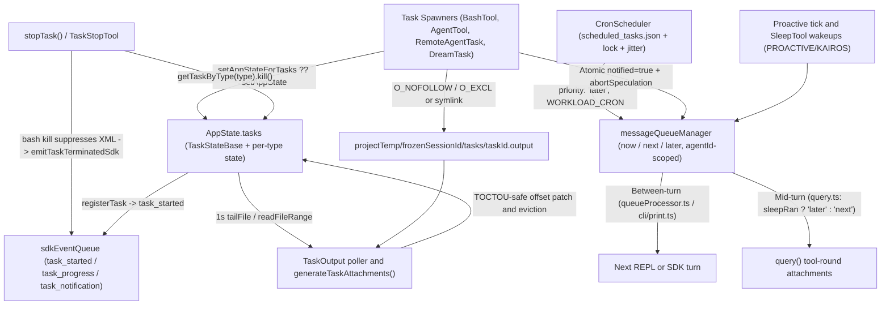

# 17. The Background Task Runtime: Unified State, Disk-Backed Output, Notifications, and Proactive Scheduling

> **Status: written.** Reverse-engineered from the Claude Code 2.1.88 source snapshot (see the Prologue (`prologue-how-to-read-a-1900-file-agent.md`) for snapshot caveats).
>
> **Layer:** Layer 6 (Concurrency, Tasks, Subagents & Swarms)
> **Prerequisites:** [Chapter 01](ch001-atoms-types-stores-and-primitives.md), [Chapter 02](ch002-the-tool-contract.md), [Chapter 06](ch006-executing-tools.md), [Chapter 12](ch012-shell-execution-sandboxing-and-workspace-tools.md), [Chapter 16](ch016-skills-plugins-output-styles-and-lsp.md)
> **Primary Source Files:**
> - `Task.ts` — `TaskType` union, `TaskStatus`, `TaskStateBase`, polymorphic `Task` kill interface, and symlink-resistant `generateTaskId()`
> - `tasks.ts` & `tasks/types.ts` — Task registry (`getAllTasks`, `getTaskByType`), `TaskState` discriminated union, and `isBackgroundTask()`
> - `tasks/stopTask.ts` & `tools/TaskStopTool/TaskStopTool.ts` — Unified cancellation, notification suppression asymmetry, and SDK termination bookends
> - `tasks/LocalShellTask/LocalShellTask.tsx`, `tasks/LocalShellTask/guards.ts`, & `tasks/LocalShellTask/killShellTasks.ts` — Background/foreground shell promotion, interactive-prompt stall watchdog, and subagent orphan reaping
> - `tasks/LocalAgentTask/LocalAgentTask.tsx` & `tasks/LocalMainSessionTask.ts` — Local subagent tasks, `Ctrl+B` main-session backgrounding, panel retention, and transcript symlinks
> - `tasks/RemoteAgentTask/RemoteAgentTask.tsx` — Cloud session polling, `--resume` sidecar recovery, `STABLE_IDLE_POLLS` debouncing, and remote review/ultraplan completion
> - `tasks/InProcessTeammateTask/InProcessTeammateTask.tsx`, `tasks/InProcessTeammateTask/types.ts`, & `tasks/DreamTask/DreamTask.ts` — Teammate task state with `TEAMMATE_MESSAGES_UI_CAP` and UI-only auto-dream lock rollback
> - `utils/task/framework.ts`, `utils/task/diskOutput.ts`, `utils/task/TaskOutput.ts`, `utils/ShellCommand.ts`, & `tools/TaskOutputTool/TaskOutputTool.tsx` — TOCTOU-safe offset polling, `O_NOFOLLOW` disk queues, file-vs-pipe capture, and 5 GB size watchdog
> - `utils/messageQueueManager.ts`, `utils/queueProcessor.ts`, `utils/sdkEventQueue.ts`, & `query.ts` — Priority command queue, `<task-notification>` delivery, `agentId` scoping, and SDK event bookends
> - `utils/cron.ts`, `utils/cronTasks.ts`, `utils/cronTasksLock.ts`, `utils/cronScheduler.ts`, `utils/cronJitterConfig.ts`, `hooks/useScheduledTasks.ts`, `tools/ScheduleCronTool/CronCreateTool.ts`, & `tools/SleepTool/prompt.ts` — Local cron scheduling, deterministic anti-herd jitter, `O_EXCL` lease locks, missed-task prompt-injection defense, and proactive `SleepTool` wakeups

## Why This Layer Exists

Up through Layer 5, the agent executes synchronously inside one turn at a time: the model emits tool calls, `StreamingToolExecutor` runs them ([Chapter 06](ch006-executing-tools.md)), and the turn waits until every tool resolves. Real engineering sessions immediately break that synchronous mold:

- A user launches a 20-minute integration test suite or dev server in `BashTool` and presses `Ctrl+B` to keep working.
- A coordinator fans out five subagents in parallel and wants to review results as each finishes rather than blocking on the slowest one.
- A `/ultrareview` or `/ultraplan` teleports work to a remote cloud session that outlives the local CLI process and must reconnect on `--resume`.
- A user asks the agent to "check CI every 5 minutes" or "remind me at 3pm", or runs an autonomous loop that sleeps between check-ins without burning tokens on "still waiting" turns.

> [!NOTE]
> **Two different "task" concepts live in this repository.** This chapter dissects the **background execution runtime**—live processes, agents, remote sessions, and dreams stored in `AppState.tasks` (`Task.ts`, `tasks/`, `utils/task/`). It is completely separate from the user-facing **persistent task checklist / team work board** stored as JSON files under `utils/tasks.ts` and mutated by `TaskCreateTool`, `TaskUpdateTool`, `TaskGetTool`, and `TaskListTool` (covered with swarms in [Chapter 19](ch019-agent-teams-swarms-and-coordinator-mode.md)).

Turning a single-turn REPL into a concurrent task runtime introduces four brutal systems problems:

1. **One registry across seven execution backends—including nested subagents.** Every background job needs a stable ID, footer pill, kill switch, and GC lifecycle, even when spawned by a subagent whose `setAppState` callback was deliberately stubbed to a no-op.
2. **Gigabytes of output without gigabytes of RAM or disk.** A stuck shell loop once wrote 768 GB to disk; a swarm session that mirrored full transcripts into `AppState` hit 36.8 GB RSS; and sandboxed shells share `/tmp` with the host process, creating symlink-clobber attack vectors.
3. **Asynchronous wakeups without duplicate delivery, zombie state, or cross-agent leakage.** Completion events arrive from OS exit handlers, remote HTTP pollers, and timers while the main loop may be idle, mid-tool-call, or running inside a subagent.
4. **Time-driven wakeups at fleet scale.** Naive local cron triggers `:00` thundering herds against inference servers, double-fires whenever two terminals open the same repository, leaks memory across multi-day sessions, and turns missed one-shot prompts into self-inflicted prompt injections.

---

## 1. The Unified Task State Contract & `setAppStateForTasks`

### The Problem

Earlier iterations of Claude Code grew separate ad-hoc subsystems for background shells, async agents (`asyncAgentUtils.ts`), and remote sessions (`BackgroundRemoteSession`), each with its own state slice, polling loop, and cancellation path. Worse, once subagents were given isolated contexts (`createSubagentContext()` in `utils/forkedAgent.ts`) with a no-op `setAppState` so child turns couldn't mutate parent UI state, any background shell spawned *inside* a subagent vanished into the void—never registered in `AppState.tasks`, never visible in the UI, and never killed when the subagent exited (`PPID=1` zombies).

### The Real Implementation

#### `TaskType`, `TaskStateBase`, and Symlink-Resistant IDs

`Task.ts` defines the single base record stored under `AppState.tasks: Record<string, TaskState>`. Every background execution backend shares one 7-member `TaskType` union, one 5-state lifecycle (`pending | running | completed | failed | killed`), and one `TaskStateBase` header:

```ts
// Task.ts:6-29, 45-57
export type TaskType =
  | 'local_bash'
  | 'local_agent'
  | 'remote_agent'
  | 'in_process_teammate'
  | 'local_workflow'
  | 'monitor_mcp'
  | 'dream'

export type TaskStatus =
  | 'pending'
  | 'running'
  | 'completed'
  | 'failed'
  | 'killed'

export function isTerminalTaskStatus(status: TaskStatus): boolean {
  return status === 'completed' || status === 'failed' || status === 'killed'
}

export type TaskStateBase = {
  id: string
  type: TaskType
  status: TaskStatus
  description: string
  toolUseId?: string
  startTime: number
  endTime?: number
  totalPausedMs?: number
  outputFile: string
  outputOffset: number
  notified: boolean
}
```

Task IDs are generated by `generateTaskId(type)` (`Task.ts`:79-106): a 1-character type prefix (`b` for `local_bash`, `a` for `local_agent`, `r` for `remote_agent`, `t` for `in_process_teammate`, `w` for `local_workflow`, `m` for `monitor_mcp`, `d` for `dream`; `tasks/LocalMainSessionTask.ts`:75-82 uses `s` for backgrounded main sessions) followed by 8 random characters from a lowercase alphanumeric alphabet (`0-9a-z`). That alphabet is intentionally case-insensitive-safe (for macOS/Windows filesystems) and yields $36^8 \approx 2.8 \times 10^{12}$ IDs—high enough that a sandboxed process cannot pre-plant symlinks by guessing upcoming task output filenames.

Notice what the polymorphic `Task` interface in `Task.ts`:69-76 actually contains:

```ts
// Task.ts:69-76
// What getTaskByType dispatches for: kill. spawn/render were never
// called polymorphically (removed in #22546). All six kill implementations
// use only setAppState — getAppState/abortController were dead weight.
export type Task = {
  name: string
  type: TaskType
  kill(taskId: string, setAppState: SetAppState): Promise<void>
}
```

That comment is classic reverse-engineering gold: the team originally built a heavier polymorphic `Task` contract (`spawn`, `render`, `kill(taskId, getAppState, setAppState, abortController)`), discovered in production that every spawner and renderer is called directly by concrete type, and ruthlessly pruned the shared interface down to the single operation that truly needs dynamic dispatch by `task.type`: `kill()`.

`tasks.ts` registers implementations in `getAllTasks()` and resolves them via `getTaskByType(type)`. Two entries are dead-code-eliminated behind build-time `feature()` flags via conditional `require()`:

- `LocalWorkflowTask` behind `feature('WORKFLOW_SCRIPTS')` (`tasks.ts`:9-11)
- `MonitorMcpTask` behind `feature('MONITOR_TOOL')` (`tasks.ts`:12-14)

> [!NOTE]
> **Snapshot absence:** Both `tasks/LocalWorkflowTask/LocalWorkflowTask.ts` and `tasks/MonitorMcpTask/MonitorMcpTask.ts` are **absent from this source snapshot**. Their contracts are observed at call sites in `tasks.ts`, `tasks/types.ts`:8-29, `tasks/pillLabel.ts`:57-60, `utils/task/sdkProgress.ts`:8, `tools/AgentTool/runAgent.ts`:849-857 (`killMonitorMcpTasksForAgent`), and `components/tasks/BackgroundTasksDialog.tsx`:18-119. Similarly, note that `InProcessTeammateTask` implements `Task` in `tasks/InProcessTeammateTask/InProcessTeammateTask.tsx`:24-30, but is intentionally **not** in `getAllTasks()`—teammates are stopped via swarm shutdown/kill helpers rather than `TaskStopTool`.

#### The Five Present Backends and Their Load-Bearing Quirks

`tasks/types.ts`:12-46 unites all seven concrete state types into `TaskState` and defines `isBackgroundTask(task)`: a task appears in the background indicator (`tasks/pillLabel.ts`) only when `status` is `'running'` or `'pending'` **and** `'isBackgrounded' in task ? task.isBackgrounded !== false : true`. That `isBackgrounded` flag lets shells and subagents register in `AppState.tasks` while still running in the foreground, then seamlessly promote to background tasks in place when `Ctrl+B` or an auto-background timer fires—without re-registering or emitting duplicate `task_started` SDK events.

Each concrete task implementation carries production-hardened behaviors tailored to its execution model:

1. **`LocalShellTask` (`type: 'local_bash'`)** — `LocalShellTask.tsx`, `guards.ts`, `killShellTasks.ts`.
   - **Module-graph hygiene:** `guards.ts` and `killShellTasks.ts` were extracted out of `LocalShellTask.tsx` so headless consumers (`stopTask.ts` via `cli/print.ts`, and `runAgent.ts`) can type-check and kill shell tasks without pulling React/Ink into their bundle.
   - **Foreground → background promotion:** `registerForeground()` inserts a task with `isBackgrounded: false`. When `Ctrl+B` runs `backgroundAll()` (lines 390-410) or an auto-background timer fires `backgroundExistingForegroundTask()` (lines 420-474), it calls `shellCommand.background(taskId)`, flips `isBackgrounded: true` in place, starts the stall watchdog, and attaches the exit handler. If the command finishes in the foreground instead, `unregisterForeground()` removes it silently.
   - **Interactive-prompt stall watchdog:** `startStallWatchdog()` (lines 46-104) polls `stat(outputPath)` every 5 seconds (disabled for `kind === 'monitor'`). If the file stops growing for 45 seconds (`STALL_THRESHOLD_MS`), it reads the last 1 KB (`STALL_TAIL_BYTES`) and tests the final line against `PROMPT_PATTERNS` (`(y/n)`, `[y/n]`, `(yes/no)`, `Press any key/Enter`, `Continue?`, `Overwrite?`, or `Do you/Are you sure...?`). Merely slow commands (`git log -S`, long builds) stay silent; a matching prompt emits a **one-shot, statusless** `<task-notification>` telling the model to kill and re-run with piped input or a non-interactive flag.
   - **Subagent orphan reaping:** `LocalShellTaskState.agentId` records which subagent spawned the shell. When that subagent finishes, `runAgent.ts`'s `finally` block calls `killShellTasksForAgent()` (`killShellTasks.ts`:53-76), killing every running shell with that `agentId` ("prevents 10-day `fake-logs.sh` zombies") and purging any queued notifications addressed to the dead agent via `dequeueAllMatching(cmd => cmd.agentId === agentId)`.

2. **`LocalAgentTask` (`type: 'local_agent'`) & `LocalMainSessionTask` (`agentType: 'main-session'`)** — `LocalAgentTask.tsx`, `LocalMainSessionTask.ts`.
   - **Promise-based background signal:** `registerAgentForeground()` (lines 526-614) creates a `backgroundSignal` `Promise<void>` stored in a module-level `backgroundSignalResolvers` map. Pressing `Ctrl+B` (`backgroundAgentTask`) or hitting `autoBackgroundMs` flips `isBackgrounded: true` and resolves the promise, letting `AgentTool` detach the child turn into the background without aborting it.
   - **UI retention vs. eviction grace period:** `LocalAgentTaskState` distinguishes `retain: boolean` ("the UI is holding this task open in a transcript viewer, blocking GC") from `viewingAgentTaskId` ("what I am currently looking at") and tracks `evictAfter?: number`. Terminal transitions (`completeAgentTask`, `failAgentTask`, `killAsyncAgent`) set `evictAfter = task.retain ? undefined : Date.now() + PANEL_GRACE_MS` (30 seconds), keeping finished workers visible in the coordinator panel briefly before GC.
   - **Accurate token accounting:** `ProgressTracker` (lines 41-96) stores `latestInputTokens` (overwritten per assistant message because Anthropic API `input_tokens` + cache tokens are cumulative per turn) separately from `cumulativeOutputTokens` (summed per turn), preventing quadratic double-counting in UI progress displays.
   - **Backgrounding the main session (`LocalMainSessionTask.ts`):** Double-`Ctrl+B` backgrounds the active foreground query by spawning an independent `query()` loop under `type: 'local_agent'`, `agentType: 'main-session'`, with an `s`-prefixed ID. Crucially, `registerMainSessionTask()` symlinks its `.output` file to an **isolated per-task transcript** (`getAgentTranscriptPath(asAgentId(taskId))`), *not* the main session transcript, and runs inside `runWithAgentContext` (`AsyncLocalStorage`)—so if the user runs `/clear` in the foreground, the background query neither corrupts the fresh session transcript nor loses its invoked skills (`LocalMainSessionTask.ts`:102-110, 364-375).

3. **`RemoteAgentTask` (`type: 'remote_agent'`)** — `RemoteAgentTask.tsx`.
   - Tracks cloud sessions (`remoteTaskType`: `'remote-agent' | 'ultraplan' | 'ultrareview' | 'autofix-pr' | 'background-pr'`) and persists lightweight sidecar metadata via `writeRemoteAgentMetadata()`. On `--resume`, `restoreRemoteAgentTasks()` (lines 477-532) fetches live CCR status for each entry: **only HTTP 404** (`Session not found:`) or `'archived'` deletes the sidecar, while 401/network errors skip recovery so the user can `/login` without losing an in-flight cloud job.
   - Its 1-second poller (`startRemoteSessionPolling`, lines 538-799) guards against four subtle distributed races:
     - *Transient idle between turns:* Remote agents flip to `'idle'` between every tool turn, so `STABLE_IDLE_POLLS = 5` consecutive idle polls with zero log growth are required before declaring completion.
     - *Bughunter vs. prompt-mode discrimination:* Remote code review runs either as a `SessionStart` hook (`run_hunt.sh`) where the session stays `"idle"` the entire time, or as assistant prompt turns. Checking `hasSessionStartHook` prevents `stableIdle` from prematurely completing a bughunter run between heartbeat echoes; only `<remote-review>` or the 30-minute `REMOTE_REVIEW_TIMEOUT_MS` (measured from `pollStartedAt`, not `spawnedAt`, so `--resume` doesn't instantly time out!) completes it.
     - *Tag-only delta scanning:* Scanning only `response.newEvents` keeps polling $O(\text{new})$, and `extractReviewTagFromLog()` refuses to fall back to untagged assistant prose so early `"I'm analyzing the diff..."` text never triggers premature completion.
     - *Kill race guard:* If `stopTask` marks the task `'killed'` while `pollRemoteSessionEvents()` is in flight, `raceTerminated` aborts the poller before it can overwrite status or fire notifications (lines 689-720).

4. **`InProcessTeammateTask` (`type: 'in_process_teammate'`)** — `types.ts`, `InProcessTeammateTask.tsx`.
   - Stores plain-data `TeammateIdentity` (mirroring `AsyncLocalStorage`'s `TeammateContext`), two distinct `AbortController`s (`abortController` kills the whole teammate; `currentWorkAbortController` aborts only its current turn), `isIdle`, `pendingUserMessages`, and a capped UI transcript mirror:

```ts
// tasks/InProcessTeammateTask/types.ts:89-101
// BQ analysis (round 9, 2026-03-20) showed ~20MB RSS per agent at 500+ turn
// sessions and ~125MB per concurrent agent in swarm bursts. Whale session
// 9a990de8 launched 292 agents in 2 minutes and reached 36.8GB. The dominant
// cost is this array holding a second full copy of every message.
export const TEAMMATE_MESSAGES_UI_CAP = 50
```

   Every `appendCappedMessage()` call slices to the most recent 50 messages in `AppState`, leaving the authoritative history in the runner's local array and on disk.

5. **`DreamTask` (`type: 'dream'`)** — `DreamTask.ts`.
   - Surfaces auto-dream memory consolidation ([Chapter 10](ch010-memory-systems-claudemd-auto-memory-and-dream.md)) in the footer pill without changing the dream agent itself. Because dream has no model-facing notification path (it's UI-only), `completeDreamTask()` and `failDreamTask()` immediately set `notified: true` so GC can evict the entry. Its `DreamTaskState` stashes `priorMtime` so `DreamTask.kill()` can call `rollbackConsolidationLock(priorMtime)` (lines 136-156), allowing the next session to retry consolidation rather than waiting out the lock window.

#### Why `setAppStateForTasks` Exists

Look at `createSubagentContext()` in `utils/forkedAgent.ts`:408-422:

```ts
// utils/forkedAgent.ts:408-422
    // AppState access
    getAppState,
    setAppState: overrides?.shareSetAppState
      ? parentContext.setAppState
      : () => {},
    // Task registration/kill must always reach the root store, even when
    // setAppState is a no-op — otherwise async agents' background bash tasks
    // are never registered and never killed (PPID=1 zombie).
    setAppStateForTasks:
      parentContext.setAppStateForTasks ?? parentContext.setAppState,
    // Async subagents whose setAppState is a no-op need local denial tracking
    // so the denial counter actually accumulates across retries.
    localDenialTracking: overrides?.shareSetAppState
      ? parentContext.localDenialTracking
      : createDenialTrackingState(),
```

`ToolUseContext` (`Tool.ts`:183-192) carries **two** store setters on purpose:

- `setAppState` mutates UI and turn-scoped state; async subagents and in-process teammates receive a no-op `() => {}` so they cannot flip the user's permission mode, stomp foreground dialogs, or mutate parent UI flags.
- `setAppStateForTasks` is always threaded to the **root** `AppState` store across arbitrary subagent nesting depth (`parentContext.setAppStateForTasks ?? parentContext.setAppState`). Every task-infrastructure call site—`BashTool.tsx`:651, `PowerShellTool.tsx`:460, `AgentTool.tsx`:259, `runAgent.ts`:338, `resumeAgent.ts`:60, `SendMessageTool.ts`:813, `autoDream.ts`:201, and `utils/attachments.ts`:1093—writes through `toolUseContext.setAppStateForTasks ?? toolUseContext.setAppState`.

> [!IMPORTANT]
> **Invariant:** Session-scoped infrastructure (background tasks, session hooks, `todos` cleanup) must always route through `setAppStateForTasks ?? setAppState`. Routing a background spawn through `setAppState` works on the main thread during manual testing and silently leaks `PPID=1` orphan processes whenever invoked from an async subagent or teammate.

### Hidden Invariants & Failure Modes

- **Reference-equality no-op suppression:** `updateTaskState()` (`utils/task/framework.ts`:48-72) checks `if (updated === task) return prev`. Roughly 18 React components subscribe to `s.tasks` (REPL, Spinner, PromptInput, task pills); without this guard, a 1-second remote poller returning an unchanged spread would force a full terminal re-render every second while idle (`RemoteAgentTask.tsx`:699-707).
- **Resume replacement preservation:** When a background agent is resumed in place (`resumeAgentBackground`), `registerTask()` (`utils/task/framework.ts`:77-117) detects `existing !== undefined`, carries forward UI-owned fields (`retain`, `startTime`, `messages`, `diskLoaded`, `pendingMessages`) so the user's open transcript viewer doesn't reset or reorder, and skips emitting a duplicate `task_started` SDK event.
- **No side effects inside state updaters:** Functions like `backgroundTask()` (`LocalShellTask.tsx`:342-358) and `unregisterAgentForeground()` (`LocalAgentTask.tsx`:668-681) capture `cleanupFn = task.unregisterCleanup` inside the `setAppState` updater and invoke `cleanupFn?.()` *after* `setAppState` returns, keeping updaters pure.

---

## 2. Disk-Backed Output, Byte Offsets, and Bounded Memory

### The Problem

Background commands and agents can run for hours and produce megabytes—or gigabytes—of output. Holding stdout in JS strings crashes the process with OOM, while polling full output files every second wastes disk bandwidth. Even writing to disk introduces four nasty failure modes observed in production:

1. **Cross-session clobbering (`inc-4586`):** Two Claude sessions in the same repository used to share one `tasks/` directory; startup cleanup in Session B unlinked Session A's in-flight `.output` files, leaving Session A's writer holding a live unlinked inode while `getStdout()` read `ENOENT` and silently returned empty output.
2. **`/clear` path drift:** `/clear` calls `regenerateSessionId()`. If `getTaskOutputDir()` re-read `getSessionId()` dynamically, background bash tasks that survive `/clear` would suddenly point at a different directory from the live fd.
3. **Sandbox symlink attacks:** A sandboxed command running inside the workspace can inspect temp directories; if the host opens `<taskId>.output` without `O_NOFOLLOW`, an attacker could pre-create a symlink pointing to `~/.ssh/authorized_keys` or `~/.bashrc` and trick the unsandboxed host process into writing there.
4. **Runaway disk fill ("768GB incident"):** When a bash command writes directly to a file descriptor (bypassing JavaScript), JS-side output caps never see the bytes—a tight `yes` or broken append loop can fill the entire disk once the foreground timeout is lifted by backgrounding.

### The Real Implementation

#### Path Freezing, Symlink Hardening, and Zero-Retention Write Queues

`utils/task/diskOutput.ts` resolves all four hazards:

- **Session-scoped, first-call-frozen output directory (lines 49-74):** `getTaskOutputDir()` memoizes `join(getProjectTempDir(), getSessionId(), 'tasks')` on first call. Putting it under the project temp dir guarantees `checkReadableInternalPath` auto-allows `ReadTool` without permission prompts; embedding `getSessionId()` isolates concurrent sessions; freezing on first call ensures background bash tasks survive `/clear`. Every task's file path is deterministically `${getTaskOutputDir()}/${taskId}.output`.
- **Symlink-safe file creation (lines 21, 400-451):** `initTaskOutput()` opens the file with `O_WRONLY | O_CREAT | O_EXCL | O_NOFOLLOW` on POSIX (and `'wx'` on Windows because numeric `O_EXCL` produces `EINVAL` through libuv). For `LocalAgentTask` and `LocalMainSessionTask`, `initTaskOutputAsSymlink(taskId, transcriptPath)` intentionally points `<taskId>.output` directly at the agent's JSONL sidechain transcript—so `Read` on `outputFile` reads live agent progress without duplicating bytes on disk.
- **Flat-array, GC-conscious `DiskTaskOutput` queue (lines 97-231):** For tasks that push text from JS (`RemoteAgentTask`, pipe-mode hooks, spilled buffers), `DiskTaskOutput` avoids chained `.then()` promises (which retain every chunk closure until the whole chain settles). Instead, it pushes strings into `#queue: string[]`, caps total writes at `MAX_TASK_OUTPUT_BYTES = 5 * 1024 * 1024 * 1024` (5 GB), and drains in a single loop with `O_NOFOLLOW` and a single transient-error retry (`EMFILE` / Windows `EPERM`):

```ts
// utils/task/diskOutput.ts:178-205
  #writeAllChunks(): Promise<void> {
    // This code is extremely precise.
    // You **must not** add an await here!! That will cause memory to balloon as the queue grows.
    // It's okay to add an `await` to the caller of this method (e.g. #drainAllChunks) because that won't cause Buffer[] to be kept alive in memory.
    return this.#fileHandle!.appendFile(
      // This variable needs to get GC'd ASAP.
      this.#queueToBuffers(),
    )
  }

  /** Keep this in a separate method so that GC doesn't keep it alive for any longer than it should. */
  #queueToBuffers(): Buffer {
    // Use .splice to in-place mutate the array, informing the GC it can free it.
    const queue = this.#queue.splice(0, this.#queue.length)

    let totalLength = 0
    for (const str of queue) {
      totalLength += Buffer.byteLength(str, 'utf8')
    }

    const buffer = Buffer.allocUnsafe(totalLength)
    let offset = 0
    for (const str of queue) {
      offset += buffer.write(str, offset, 'utf8')
    }

    return buffer
  }
```

Putting `#queueToBuffers()` in a separate non-`async` frame and returning `appendFile(...)` without `await` keeps the temporary `Buffer` off any suspended async stack frame—so the GC can reclaim it the instant libuv finishes the write.

#### Dual-Mode `TaskOutput` and the 5 GB Disk Size Watchdog

`utils/task/TaskOutput.ts` and `utils/ShellCommand.ts` split shell capture into two completely different data paths:

1. **File mode (`stdoutToFile = true`, used by `BashTool`):** Both `stdio[1]` and `stdio[2]` are bound directly to the `.output` file descriptor at `spawn()` time. Zero bytes flow through Node/Bun streams.
   - *Live UI progress:* Rather than polling every running command unconditionally, `TaskOutput` maintains a static `#registry` and `#activePolling` map driven by React component mount/unmount (`TaskOutput.startPolling(taskId)` / `stopPolling(taskId)`, lines 81-103). One shared `.unref()`'d 1-second timer runs non-async `#tick()`, reading only the last 4 KB (`PROGRESS_TAIL_BYTES = 4096`) via `tailFile()`, slicing the last 5 and 100 lines, and computing a monotone extrapolated line count `Math.max(prevLines, Math.round((bytesTotal / bytesRead) * lineCount))`. Even when the file is empty (`git log -S`), `#tick()` still invokes `onProgress` so the tool generator wakes up and checks backgrounding timers.
   - *Disk-fill watchdog:* As soon as `ShellCommandImpl.background(taskId)` lifts the foreground timeout (`ShellCommand.ts`:239-261, 349-366), it starts `#startSizeWatchdog()`, which `stat()`s the output file every 5 seconds and `treeKill(..., 'SIGKILL')`s the entire process tree if size exceeds `MAX_TASK_OUTPUT_BYTES` (5 GB).
   - *Foreground cleanup:* If a command completes *without* being backgrounded and its entire output fits inside `getMaxOutputLength()` (`outputFileRedundant === true`), `#handleExit()` deletes the `.output` file automatically; if larger, it returns `outputFilePath` so `toolResultStorage.ts` ([Chapter 06](ch006-executing-tools.md)) handles `<persisted-output>` spill. If the file disappeared mid-run (`ENOENT`), `#readStdoutFromFile()` returns a loud diagnostic string instead of silent empty output (`TaskOutput.ts`:313-325).

2. **Pipe mode (`stdoutToFile = false`, used by hooks):** `StreamWrapper` (`ShellCommand.ts`:66-104) pipes UTF-8 chunks into `TaskOutput.#writeBuffered()`, buffering up to `DEFAULT_MAX_MEMORY` (8 MB) in RAM. For progress extraction, `#updateProgress()` deliberately copies extracted lines with `Buffer.from(line).toString()` (line 230) so short slices do not pin giant parent chunks in V8/JSC memory. If memory exceeds 8 MB—or the command is backgrounded—`#spillToDisk()` flushes both buffers into `DiskTaskOutput` and streams subsequent chunks directly to disk.

#### Incremental Byte-Offset Polling Without TOCTOU Zombification

To inspect task progress without re-reading multi-gigabyte files, `utils/task/diskOutput.ts`:304-357 provides two bounded readers (both capped at `DEFAULT_MAX_READ_BYTES = 8 MB`):

- `getTaskOutputDelta(taskId, fromOffset, maxBytes)` calls `readFileRange()` starting at `task.outputOffset` and returns `{ content, newOffset: fromOffset + bytesRead }`.
- `getTaskOutput(taskId, maxBytes)` calls `tailFile()` and prepends `[NKB of earlier output omitted]` if the file exceeded 8 MB.

On every turn's attachment pass, `getUnifiedTaskAttachments()` (`utils/attachments.ts`:3439-3462) invokes `generateTaskAttachments()` and `applyTaskOffsetsAndEvictions()` (`utils/task/framework.ts`:158-249). Look closely at the TOCTOU scar encoded directly into `applyTaskOffsetsAndEvictions()`:

```ts
// utils/task/framework.ts:213-249
export function applyTaskOffsetsAndEvictions(
  setAppState: SetAppState,
  updatedTaskOffsets: Record<string, number>,
  evictedTaskIds: string[],
): void {
  const offsetIds = Object.keys(updatedTaskOffsets)
  if (offsetIds.length === 0 && evictedTaskIds.length === 0) {
    return
  }
  setAppState(prev => {
    let changed = false
    const newTasks = { ...prev.tasks }
    for (const id of offsetIds) {
      const fresh = newTasks[id]
      // Re-check status on fresh state — task may have completed during the
      // await. If it's no longer running, the offset update is moot.
      if (fresh?.status === 'running') {
        newTasks[id] = { ...fresh, outputOffset: updatedTaskOffsets[id]! }
        changed = true
      }
    }
    for (const id of evictedTaskIds) {
      const fresh = newTasks[id]
      // Re-check terminal+notified on fresh state (TOCTOU: resume may have
      // replaced the task during the generateTaskAttachments await)
      if (!fresh || !isTerminalTaskStatus(fresh.status) || !fresh.notified) {
        continue
      }
      if ('retain' in fresh && (fresh.evictAfter ?? Infinity) > Date.now()) {
        continue
      }
      delete newTasks[id]
      changed = true
    }
    return changed ? { ...prev, tasks: newTasks } : prev
  })
}
```

Because `generateTaskAttachments()` `await`s `getTaskOutputDelta()` on disk, the `AppState` snapshot it started with can go stale mid-flight: a task may finish and transition to `'completed'`, or a completed agent may be resumed back to `'running'`. Returning **only** a narrow offset patch (`Record<string, number>`) and a candidate eviction list—then re-checking `fresh.status`, `fresh.notified`, and `fresh.evictAfter` inside the `setAppState(prev => ...)` updater—guarantees that an offset update never clobbers a completion transition (which would turn the task into an eternal `'running'` zombie) and an eviction never deletes a freshly resumed agent.

> [!NOTE]
> **Why `TaskOutputTool` is deprecated:** `tools/TaskOutputTool/TaskOutputTool.tsx` (keeping aliases `AgentOutputTool` and `BashOutputTool`) still supports `block: true/false` polling (sleeping 100 ms per check up to 600 s), extracts clean `agentTask.result` text instead of raw symlinked JSONL for `local_agent`, and tail-truncates output through `formatTaskOutput()` (`utils/task/outputFormatting.ts`: `TASK_MAX_OUTPUT_LENGTH`, default 32,000 chars, upper cap 160,000 chars). However, its prompt now explicitly tells the model to prefer `ReadTool` directly on the task's `outputFile` path—avoiding blocking poll loops inside a turn—and `TaskOutputTool.isEnabled()` disables it in internal `ant` builds (compiled in this snapshot as `return "external" !== 'ant'`, line 164).

### Hidden Invariants & Failure Modes

- **`evictTaskOutput()` vs. `cleanupTaskOutput()`:** When a task finishes, every task backend calls `evictTaskOutput(taskId)` (`diskOutput.ts`:288-298), which flushes pending writes and drops the `DiskTaskOutput` object from the in-memory `outputs` map **without unlinking the `.output` file**. The file intentionally remains on disk so the model can `Read` it after receiving the `<task-notification>`.
- **`'exit'` vs. `'close'` on child processes:** `ShellCommandImpl.#createResultPromise()` (`ShellCommand.ts`:269-273) listens for `'exit'`, never `'close'`. Node's `'close'` waits until all stdio fds close, meaning a command that spawns a detached daemon (`sleep 30 &`) would hang forever.
- **Teardown ordering in `ShellCommandImpl.cleanup()`:** `cleanup()` (`ShellCommand.ts`:368-381) calls `#cleanupListeners()` *before* nulling `#abortSignal`. Because `kill()` schedules `#handleExit()` on the microtask queue, nulling `#abortSignal` first would crash `#handleExit()` when it calls `removeEventListener` on `null`.

---

## 3. Asynchronous Notification Delivery, Cancellation, and SDK Bookends

### The Problem

Persisting output to disk solves *where* bytes live, not *when* the model learns a task finished. A naive polling framework that generates inline attachments for completed tasks races against exit callbacks, delivering the same completion twice (once as an attachment, once as a new turn). Meanwhile, in-process subagents share the same process-global command queue as the coordinator: without explicit routing, a worker's background shell completion leaks directly into the coordinator's prompt context.

### The Real Implementation

#### Atomic `notified` Check-and-Set and the `<task-notification>` Envelope

Look at `utils/task/framework.ts`:199-202: `generateTaskAttachments()` deliberately leaves `attachments` empty for completed tasks. Instead, each concrete task type owns its own completion notification (`enqueueShellNotification`, `enqueueAgentNotification`, `enqueueRemoteNotification`, `enqueueMainSessionNotification`) following one strict protocol:

1. **Atomic test-and-set on `task.notified`:** Inside `updateTaskState()`, check `if (task.notified) return task`; otherwise set `shouldEnqueue = true` and flip `notified: true`. If `TaskStopTool`, `TaskOutputTool`, or `markTaskNotified()` already claimed the bit, the completion handler exits silently.
2. **Invalidate prompt speculation:** Call `abortSpeculation(setAppState)` so any pre-computed speculative response built against stale background-task state is discarded while preserving the suggestion text.
3. **Enqueue structured XML:** Push a `<task-notification>` block containing `<task-id>`, optional `<tool-use-id>`, `<output-file>`, `<status>`, `<summary>`, and (for agents) `<result>`, `<usage>`, and `<worktree>` via `enqueuePendingNotification({ value, mode: 'task-notification', priority, agentId })`.

#### The Unified Priority Command Queue and Dual Drain Paths

All user inputs, task notifications, cron fires, and proactive ticks converge in a single module-level queue in `utils/messageQueueManager.ts` (exposed to React via `useSyncExternalStore` with frozen snapshots). Every `QueuedCommand` (`types/textInputTypes.ts`:277-358) carries a priority—`'now' (0) > 'next' (1) > 'later' (2)`—plus `mode`, optional `isMeta`, optional `workload`, and optional `agentId`:

- `enqueue()` (user input) defaults to `'next'`.
- `enqueuePendingNotification()` (task completions) defaults to `'later'` so background noise never starves human typing—except `LocalShellTask` completions when `feature('MONITOR_TOOL')` is enabled and stall-watchdog alerts, which pass `priority: 'next'`.
- `'task-notification'` is in `NON_EDITABLE_MODES` (`messageQueueManager.ts`:343-361); `isQueuedCommandEditable()` rejects both non-editable modes and `isMeta: true` items so raw XML never gets pulled into the user's editable prompt buffer on `UP`/`ESC` (`popAllEditable()`).

Items leave the queue through **two** distinct drain points depending on whether a turn is currently running:

1. **Mid-turn drain inside `query()` (`query.ts`:1566-1643):** After tools execute on each loop iteration, `query()` snapshots qualifying queue entries, converts `'prompt'` and `'task-notification'` entries into `queued_command` attachments via `getQueuedCommandAttachments()` (`utils/attachments.ts`:1044-1083), yields them before the next model round-trip, and calls `removeFromQueue(consumedCommands)`:

```ts
// query.ts:1566-1578
    const sleepRan = toolUseBlocks.some(b => b.name === SLEEP_TOOL_NAME)
    const isMainThread =
      querySource.startsWith('repl_main_thread') || querySource === 'sdk'
    const currentAgentId = toolUseContext.agentId
    const queuedCommandsSnapshot = getCommandsByMaxPriority(
      sleepRan ? 'later' : 'next',
    ).filter(cmd => {
      if (isSlashCommand(cmd)) return false
      if (isMainThread) return cmd.agentId === undefined
      // Subagents only drain task-notifications addressed to them — never
      // user prompts, even if someone stamps an agentId on one.
      return cmd.mode === 'task-notification' && cmd.agentId === currentAgentId
    })
```

   Two critical invariants jump off those 13 lines:
   - **Agent isolation:** When PR `#18453` unified the command queue, subagent notifications briefly leaked into the coordinator. Filtering by `cmd.agentId === undefined` on the main thread and `cmd.mode === 'task-notification' && cmd.agentId === currentAgentId` inside subagents restores strict isolation—and guarantees subagents can never consume human prompts.
   - **Post-sleep priority upgrade:** Normally, mid-turn draining only pulls `'now'` and `'next'` items, leaving `'later'` notifications for between turns. If `Sleep` ran in that tool round (`sleepRan`), the threshold widens to `'later'` so the notification that woke `SleepTool` is consumed immediately instead of remaining in the queue and causing the next `Sleep` call to wake in 0 ms in an infinite loop (`utils/attachments.ts`:1052-1056).

2. **Between-turn drain (when the main loop is idle):**
   - **Interactive REPL (`utils/queueProcessor.ts`:52-87):** `processQueueIfReady()` peeks **with** the `cmd.agentId === undefined` filter—because an unfiltered `peek()` landing on a subagent notification would set `targetMode`, fail to match any main-thread item, return `processed: false`, and stall queued human prompts permanently. It drains slash commands and bash-mode commands singly, and batches consecutive same-mode items (never mixing `'prompt'` and `'task-notification'`). For UI cleanliness in fullscreen non-verbose mode, `utils/collapseBackgroundBashNotifications.ts` folds consecutive completed bash notifications (matched via `BACKGROUND_BASH_SUMMARY_PREFIX` + `<status>completed</status>`) into one synthetic `"N background commands completed"` line while leaving failures, kills, agents, and monitors expanded.
   - **Headless / SDK streaming mode (`cli/print.ts`:1934-2094):** `drainCommandQueue()` processes `'task-notification'` singly, parses `<task-id>`, `<tool-use-id>`, `<output-file>`, `<status>`, `<summary>`, and `<usage>` out of the XML, emits a structured `task_notification` SDK system event, and then **falls through to `ask()`** so the model still reacts to the result. Critically, lines 2063-2092 only emit the SDK event when **`statusMatch` is present**—preventing statusless progress pings (such as `LocalShellTask`'s stall watchdog or monitor stream events) from falling through to `'completed'` and falsely closing the task in IDE/SDK panels!

#### Unified Cancellation (`stopTask.ts`) and SDK Bookend Symmetry

Both `TaskStopTool` (`tools/TaskStopTool/TaskStopTool.ts`, which keeps the deprecated `KillShell` alias and `shell_id` parameter for transcript/SDK backwards compatibility) and the SDK `stop_task` control request delegate to `stopTask()` in `tasks/stopTask.ts`:

```ts
// tasks/stopTask.ts:57-96
  const taskImpl = getTaskByType(task.type)
  if (!taskImpl) {
    throw new StopTaskError(
      `Unsupported task type: ${task.type}`,
      'unsupported_type',
    )
  }

  await taskImpl.kill(taskId, setAppState)

  // Bash: suppress the "exit code 137" notification (noise). Agent tasks: don't
  // suppress — the AbortError catch sends a notification carrying
  // extractPartialResult(agentMessages), which is the payload not noise.
  if (isLocalShellTask(task)) {
    let suppressed = false
    setAppState(prev => {
      const prevTask = prev.tasks[taskId]
      if (!prevTask || prevTask.notified) {
        return prev
      }
      suppressed = true
      return {
        ...prev,
        tasks: {
          ...prev.tasks,
          [taskId]: { ...prevTask, notified: true },
        },
      }
    })
    // Suppressing the XML notification also suppresses print.ts's parsed
    // task_notification SDK event — emit it directly so SDK consumers see
    // the task close.
    if (suppressed) {
      emitTaskTerminatedSdk(taskId, 'stopped', {
        toolUseId: task.toolUseId,
        summary: task.description,
      })
    }
  }
```

Every `registerTask()` emits a `task_started` event into `utils/sdkEventQueue.ts` (a 1,000-entry bounded queue that no-ops in interactive TUI mode when `!getIsNonInteractiveSession()`). Normally, `cli/print.ts` closes that bookend by parsing the `<task-notification>` XML. Whenever a termination path suppresses that XML notification—killing a `local_bash` task in `stopTask()`, killing a `remote_agent` in `RemoteAgentTask.kill()`, foregrounding a `LocalMainSessionTask` before completion, or aborting mid-stream—that path **must** call `emitTaskTerminatedSdk()` directly so IDE/SDK consumers don't display a spinner forever. Conversely, `stopTask()` intentionally leaves `local_agent` un-suppressed so the aborted agent's `catch (AbortError)` can still deliver its partial results.

### Hidden Invariants & Failure Modes

- **Eager vs. lazy task eviction:** `evictTerminalTask()` (`utils/task/framework.ts`:125-144) allows components (`CoordinatorAgentStatus`, `inProcessRunner`) to free finished tasks immediately without waiting for the next `query()` turn, while `generateTaskAttachments()` acts as a lazy GC safety net. Both enforce the exact same triple guard: `isTerminalTaskStatus(task.status) && task.notified && (!('retain' in task) || (task.evictAfter ?? Infinity) <= Date.now())`.
- **`STOPPED_DISPLAY_MS = 3_000` vs. `PANEL_GRACE_MS = 30_000`:** Killed tasks linger briefly for visual confirmation before eviction; retained agent transcripts cannot be evicted at all until the user closes the transcript view (`retain: false` and `evictAfter` stamped).
- **Double-emit danger:** Never emit both a `<status>`-bearing XML `<task-notification>` *and* a direct `emitTaskTerminatedSdk()` on the same exit path—`cli/print.ts` will emit a second `task_notification` event for the same `task_id`.

---

## 4. Scheduled Cron Tasks and Proactive `SleepTool` Wakeups

### The Problem

Background shells and subagents only run *after* a human turn kicks them off. Many real workflows are time-driven: checking a PR every 10 minutes, waking up at 9am to run a smoke test, or polling an external system while idle. Implementing local scheduling naively breaks at scale in five predictable ways:

1. **Global `:00` thundering herds:** If 50,000 sessions schedule `0 * * * *` ("hourly") or `0 9 * * *` ("9am"), every client fires on the exact same second and hammers the inference backend.
2. **Duplicate fires across terminals:** Opening two Claude sessions in the same repository causes both to read `.claude/scheduled_tasks.json` and execute every cron job twice.
3. **Unbounded multi-day memory accumulation:** After cron shipped (`#19931`), p99 session uptime jumped from 61 minutes to 53 hours, allowing slow Tier-1 heap leaks to compound indefinitely.
4. **Daemon restart catch-up storms:** If a daemon child despawns while idle and re-anchors recurring crons from a 10-day-old `createdAt`, every recurring task fires immediately on every spawn.
5. **Self-inflicted prompt injection on missed one-shots:** If the user closed their laptop and missed a one-shot task, dumping its raw multi-line prompt directly into the next startup turn can trick the model into executing stale side effects without confirmation—or breaking out of a naive Markdown code fence using triple backticks.

### The Real Implementation

#### Feature Gates, Killswitches, and Dual Storage

The cron subsystem (`CronCreateTool`, `CronDeleteTool`, `CronListTool` under `tools/ScheduleCronTool/`) is gated by `isKairosCronEnabled()` in `tools/ScheduleCronTool/prompt.ts`:36-62:

- **Build-time gate:** `feature('AGENT_TRIGGERS')` (intentionally decoupled from `feature('KAIROS')` with zero imports into `src/assistant/`).
- **Local killswitch:** `CLAUDE_CODE_DISABLE_CRON` overrides everything.
- **Runtime fleet killswitch:** GrowthBook `tengu_kairos_cron` (5-minute refresh, **default `true`** so Bedrock/Vertex/Foundry and `DISABLE_TELEMETRY` users who disable GrowthBook keep `/loop` working—citing GH `#31759`). A narrower `tengu_kairos_cron_durable` flag (also default `true`) forces `effectiveDurable = false` at `CronCreateTool.call()` without changing the tool's Zod schema mid-session.

Tasks live in one of two stores managed by `utils/cronTasks.ts`:

- **Session-only (`durable: false`, default in `CronCreateTool`):** Held purely in `bootstrap/state.ts` process memory (`addSessionCronTask` / `getSessionCronTasks` / `removeSessionCronTasks`). Never touches disk, dies with the process, and does not require a file lock. Teammates are **forbidden** from creating `durable: true` crons (`CronCreateTool.ts`:105-114) because teammates don't survive session restarts and would leave orphaned `agentId` targets; `CronListTool` and `CronDeleteTool` also scope teammates strictly to `task.agentId === ctx.agentId`.
- **Durable (`durable: true`):** Persisted to `<project>/.claude/scheduled_tasks.json` (total combined cap `MAX_JOBS = 50`). Invalid entries are silently skipped on read so one malformed manual edit never bricks the scheduler. Writing an empty task list writes `{ "tasks": [] }` instead of unlinking so `chokidar` sees a clean change event.

#### 5-Field Local Cron Parser and Asymmetric Deterministic Jitter

`utils/cron.ts` implements a compact 5-field local-timezone cron parser (`minute hour dayOfMonth month dayOfWeek`, supporting `*`, `N`, `*/S`, `N-M`, `N-M/S`, comma lists, and `7` as Sunday alias). `computeNextCronRun()` walks forward bounded at 366 days using standard vixie-cron semantics: when both `dayOfMonth` and `dayOfWeek` are constrained, matching **either** fires (OR semantics); spring-forward DST gaps skip fixed-hour matches; and `formatLocalTime()` constructs `new Date(2000, 0, 1, hour, minute)` (January 1, never a DST transition) so displaying `2:30am` doesn't roll to `3:30am` on spring-forward day.

To eliminate thundering herds, `utils/cronTasks.ts`:348-445 applies **asymmetric, deterministic jitter** derived by parsing the 8-hex-character `taskId` prefix as a `uint32` fraction `jitterFrac(taskId) ∈ [0, 1)` (stable across restarts, uniform across the fleet):

```ts
// utils/cronTasks.ts:381-445 (condensed)
export function jitteredNextCronRunMs(
  cron: string,
  fromMs: number,
  taskId: string,
  cfg: CronJitterConfig = DEFAULT_CRON_JITTER_CONFIG,
): number | null {
  const t1 = nextCronRunMs(cron, fromMs)
  if (t1 === null) return null
  const t2 = nextCronRunMs(cron, t1)
  if (t2 === null) return t1
  const jitter = Math.min(
    jitterFrac(taskId) * cfg.recurringFrac * (t2 - t1), // default: up to 10% of period
    cfg.recurringCapMs,                                 // capped at 15 min
  )
  return t1 + jitter
}

export function oneShotJitteredNextCronRunMs(
  cron: string,
  fromMs: number,
  taskId: string,
  cfg: CronJitterConfig = DEFAULT_CRON_JITTER_CONFIG,
): number | null {
  const t1 = nextCronRunMs(cron, fromMs)
  if (t1 === null) return null
  // Local minutes (not UTC!): in India (UTC+5:30), local :00 is UTC :30.
  if (new Date(t1).getMinutes() % cfg.oneShotMinuteMod !== 0) return t1
  const lead =
    cfg.oneShotFloorMs +
    jitterFrac(taskId) * (cfg.oneShotMaxMs - cfg.oneShotFloorMs) // default: 0..90s early
  return Math.max(t1 - lead, fromMs)
}
```

Notice the engineering elegance of that asymmetry:

- **Recurring jobs jitter *forward*** by up to 10% of their inter-fire interval (capped at 15 min), spreading hourly `0 * * * *` jobs across `[:00, :06)` while only shifting per-minute jobs by a few seconds.
- **One-shot jobs jitter *backward*** (up to 90 s early by default) whenever their computed **local** minute hits `minute % 30 === 0` (`:00` or `:30`, where humans round)—because firing "remind me at 3pm" 40 seconds *early* feels crisp, whereas firing it 4 minutes *late* breaks the user's expectation. Clamping to `Math.max(t1 - lead, fromMs)` prevents firing before creation time.
- **Live incident lever:** `utils/cronJitterConfig.ts` pulls `tengu_kairos_cron_config` from GrowthBook on a 60-second refresh and validates it with an all-or-nothing Zod schema (`oneShotFloorMs <= oneShotMaxMs`, hard upper bounds of 30 minutes / 30 days). During a `:00` load spike, ops can push `{ oneShotMinuteMod: 15, oneShotMaxMs: 300000, oneShotFloorMs: 30000 }` to force every client off the mark within 60 seconds without shipping a build. `cronJitterConfig.ts` is deliberately split from `cronScheduler.ts` so the public Agent SDK bundle (`sdk.mjs`) never pulls in `growthbook.ts` and its transitive dependency graph.
- **7-day auto-expiry:** `DEFAULT_CRON_JITTER_CONFIG.recurringMaxAgeMs` defaults to 7 days (`isRecurringTaskAged()`). Aged recurring tasks fire one final time and then auto-delete—unless stamped `permanent: true` (an internal escape hatch not exposed to `CronCreateTool`, reserved for assistant mode's built-in catch-up/morning-checkin/dream tasks).
- **Behavioral defense-in-depth:** `buildCronCreatePrompt()` (`tools/ScheduleCronTool/prompt.ts`:103-110) also instructs the model to pick off-minutes (`57 8 * * *` or `7 * * * *`) whenever the user's request is approximate, layering prompt-level spreading on top of scheduler-level jitter.

#### Multi-Session `O_EXCL` Lease Lock and the Scheduler Core

To guarantee only one Claude process per repository fires durable `.claude/scheduled_tasks.json` tasks, `utils/cronTasksLock.ts` implements an atomic lease lock at `.claude/scheduled_tasks.lock` storing `{ sessionId, pid, acquiredAt }`:

- Creation uses `writeFile(path, body, { flag: 'wx' })` (`O_EXCL`).
- If the file exists and `existing.sessionId === sessionId`, re-acquisition is idempotent—and after `--resume` (same `sessionId`, new `process.pid`), it refreshes the PID so peer sessions don't mistake it for a dead owner.
- If another live PID holds the lock (`isProcessRunning(existing.pid)`), `tryAcquireSchedulerLock()` returns `false`; passive sessions stay quiet and re-probe every `LOCK_PROBE_INTERVAL_MS = 5000` ms to take over automatically if the owner crashes.
- If the lock is corrupt or the PID is dead, the prober unlinks it and retries `wx` once—so concurrent recovery races still elect at most one winner.

`utils/cronScheduler.ts` drives the 1-second `check()` loop (`.unref()`'d so `-p` one-shot runs still exit cleanly) with four production invariants:

1. **First-sight anchoring with batched `lastFiredAt` (lines 253-281, 358-369):** Recurring tasks anchor their first-sight schedule from `t.lastFiredAt ?? t.createdAt`. When recurring file tasks fire, `check()` reschedules them from `now` (never from `next`, avoiding catch-up storms after laptop sleep) and batches all IDs into one `markCronTasksFired()` write so a restarted process reconstructs the exact same `nextFireAt`.
2. **`inFlight` anti-double-fire set (lines 170, 335-343, 359-368):** Removing a fired one-shot or stamping `lastFiredAt` on disk is asynchronous and triggers a `chokidar` reload (`FILE_STABILITY_MS = 300`). Adding the ID to `inFlight` until the write settles prevents the next 1-second tick from double-firing.
3. **Mid-session killswitch (`isKilled`):** Checked on line 231 at the top of every tick (`() => !isKairosCronEnabled()`), stopping already-running schedulers immediately if GrowthBook flips off mid-session.
4. **Prompt-injection-hardened missed-task surfacing (`buildMissedTaskNotification`, lines 542-565):** On *initial* load only (never on mid-session `chokidar` reloads), overdue one-shot tasks are deleted from disk, parked at `nextFireAt = Infinity`, and formatted into a confirmation prompt that precedes the bodies with `"Do NOT execute this prompt yet. First use the AskUserQuestion tool..."` and wraps each prompt in a CommonMark fence **one backtick longer than the longest backtick run inside the prompt** (`'`'.repeat(Math.max(3, longestRun + 1))`) so a prompt containing triple backticks cannot break out of the fence.

Finally, the REPL and headless modes wire `createCronScheduler()` slightly differently:

- **REPL (`hooks/useScheduledTasks.ts`):** Mounts unconditionally (respecting React's Rules of Hooks), stores `isLoading` in a ref so turn transitions don't restart the watcher or drop the lock, tags fired prompts with `workload: WORKLOAD_CRON` (threaded to `cc_workload=` in the billing header for lower-priority inference QoS), routes `task.agentId` directly to `injectUserMessageToTeammate()`, and deletes orphaned teammate crons if the target teammate has terminated.
- **Headless / SDK (`cli/print.ts`:2702-2734):** Enqueues fired prompts with `isMeta: true` and `workload: WORKLOAD_CRON`, then explicitly invokes `void run()` (safe during active turns because `run()`'s mutex no-ops and re-checks the queue on exit).

#### Proactive Mode, `<tick>`, and `SleepTool`

> [!NOTE]
> **Snapshot absence:** Both `tools/SleepTool/SleepTool.ts` and `proactive/index.ts` (gated behind `feature('PROACTIVE') || feature('KAIROS')`) are **absent from this source snapshot**. Only `tools/SleepTool/prompt.ts` is present on disk; the runtime mechanics below are reconstructed strictly from verified call sites in `tools.ts`:25-27,234, `query.ts`:1566-1578, `cli/print.ts`:361-363,535-545,1834-1856,2475-2485,3876-3890, `constants/prompts.ts`:72-80,861-886, `types/textInputTypes.ts`:283-292, `services/mcp/channelNotification.ts`:9, `utils/attachments.ts`:1052-1056, `utils/handlePromptSubmit.ts`:320, and `screens/REPL.tsx`:1655-1682.

Where cron schedules discrete wall-clock prompts, proactive mode turns the harness into an autonomous loop driven by two cooperating primitives:

1. **The `<tick>` heartbeat (`cli/print.ts:1834-1856, 2475-2485`):** When `proactiveModule.isProactiveActive()` is true and not paused, finishing a turn with an empty queue schedules a `setTimeout(..., 0)` (yielding one event-loop turn so pending stdin/interrupts win) that enqueues `<tick><localTime></tick>` at `priority: 'later', isMeta: true` and restarts `run()`. The proactive system prompt section (`constants/prompts.ts`:866-886) explains that `<tick>` means *"you're awake, what now?"*—and mandates that if there is no useful action to take, the model **must call `Sleep`** rather than outputting idle narration text.
2. **Interruptible `SleepTool` (`tools/SleepTool/prompt.ts` + observed call sites):**
   - Unlike `Bash(sleep 60)`, `Sleep` holds no OS child process, is concurrency-safe with sibling tools, declares `interruptBehavior: 'cancel'` (`utils/handlePromptSubmit.ts`:320) so a human message cleanly cancels the sleep without surfacing an error, and suppresses active-tool spinner clutter when it is the only running tool (`screens/REPL.tsx`:1655-1682).
   - While sleeping, `SleepTool` polls `hasCommandsInQueue()` and wakes within 1 second whenever a user prompt, channel notification, cron fire, or `<task-notification>` arrives (`services/mcp/channelNotification.ts`:9).
   - On wakeup, `query.ts:1566-1571` sees `sleepRan === true` and upgrades the mid-turn drain threshold from `'next'` to `'later'`, pulling the waking event straight into the current turn's attachments so the model handles it immediately while staying inside its 5-minute prompt-cache window (`tools/SleepTool/prompt.ts`:17).

### Hidden Invariants & Failure Modes

- **Lazy scheduler startup:** `cronScheduler.start()` does not unconditionally load `chokidar` or create `.claude/scheduled_tasks.lock` on every CLI startup. Unless `assistantMode` or `hasCronTasksSync()` is true (or `dir` is passed by a daemon), it polls `getScheduledTasksEnabled()` once per second until `CronCreateTool.call()` flips the flag—keeping cold start free of watcher overhead (`utils/cronScheduler.ts`:463-498).
- **Session vs. file split when non-owner:** Even when a second Claude window loses the `.claude/scheduled_tasks.lock` race (`isOwner === false`), `check()` still ticks its own process-private `getSessionCronTasks()` (`durable: false`) because no peer session can see or double-fire them (`utils/cronScheduler.ts`:371-378).

---

## Putting the Layer Together



The seven task types and their operational contracts fit in one compact reference matrix:

```text
Type                |Pfx| Output Backing         | Kill Action          |Snap
--------------------+---+------------------------+----------------------+----
local_bash          |b  | Direct fd (5GB cap)    | treeKill + evict     |Yes
local_agent         |a/s| Symlink -> JSONL chain | abort() + 30s grace  |Yes
remote_agent        |r  | appendTaskOutput poll  | archive CCR+sidecar  |Yes
in_process_teammate |t  | Transcript (cap: 50)   | abort teammate loop  |Yes
dream               |d  | UI-only (notified end) | abort+lock rollback  |Yes
local_workflow      |w  | WORKFLOW_SCRIPTS gate  | call-site observed   |No
monitor_mcp         |m  | MONITOR_TOOL gate      | call-site observed   |No
```

---

## How This Snaps Into the Next Layer

Everything built in this chapter is the execution substrate that subagents and worktrees snap directly onto in [Chapter 18](ch018-subagents-context-forking-and-worktrees.md):

- **Subagent lifecycle & root task wiring:** `tools/AgentTool/runAgent.ts`:338 resolves `rootSetAppState = toolUseContext.setAppStateForTasks ?? toolUseContext.setAppState`, while `utils/forkedAgent.ts`:410-418 stubs `setAppState` to a no-op and preserves `setAppStateForTasks` across nested forks.
- **Background agent registration & resumption:** `tools/AgentTool/AgentTool.tsx` and `tools/AgentTool/resumeAgent.ts` call `registerAsyncAgent()`, `registerAgentForeground()`, `completeAgentTask()`, `failAgentTask()`, and `enqueueAgentNotification()` from `tasks/LocalAgentTask/LocalAgentTask.tsx`, symlinking each agent's `<agentId>.output` file straight to its sidechain JSONL transcript so `Read` and `--resume` share one durable log.
- **Deterministic child cleanup:** `tools/AgentTool/runAgent.ts`:844-857 invokes `killShellTasksForAgent()` (`tasks/LocalShellTask/killShellTasks.ts`)—and, under `feature('MONITOR_TOOL')`, `killMonitorMcpTasksForAgent()`—in its `finally` block, purging orphaned shells and queued notifications keyed to the exiting `agentId`.

In Chapter 18, we step up one level to see how `AgentTool`, `forkSubagent.ts`, sidechain transcripts, and `EnterWorktreeTool` turn these background task primitives into isolated, cache-sharing, resumable subagents.

---

## Reading Exercises & Code Checkpoints

1. **Trace the `setAppStateForTasks` boundary:** Run `rg -n "setAppStateForTasks" Tool.ts utils/ tools/ services/` and inspect every call site. Which call site in `utils/attachments.ts` uses `setAppStateForTasks`, and which one (around line 3447) still passes `toolUseContext.setAppState`? Explain why `getUnifiedTaskAttachments()` can safely use `toolUseContext.setAppState` when called from a subagent whose `setAppState` is a no-op—and what happens to `outputOffset` updates in that case.
2. **Verify the TOCTOU window in `applyTaskOffsetsAndEvictions`:** Read `utils/task/framework.ts`:158-249 alongside `tasks/LocalAgentTask/LocalAgentTask.tsx`:412-432. Walk through the exact interleaving where `generateTaskAttachments()` starts reading an agent's output file, the agent finishes and flips `status: 'completed'` + `notified: true`, and then `applyTaskOffsetsAndEvictions()` executes. Confirm which guard prevents reverting `status` to `'running'`.
3. **Audit the XML `<status>` contract between producers and `cli/print.ts`:** Run `rg -n "enqueuePendingNotification|TASK_NOTIFICATION_TAG" tasks/ cli/print.ts`. Compare `startStallWatchdog()` in `tasks/LocalShellTask/LocalShellTask.tsx`:76-94 against `cli/print.ts:2015-2093`. What exact bug would occur in VS Code's subagent/task panel if the stall watchdog included `<status>stalled</status>`?
4. **Compute cron jitter bounds by hand:** Read `jitteredNextCronRunMs()` and `oneShotJitteredNextCronRunMs()` in `utils/cronTasks.ts`:362-445. Given a task ID starting with `80000000` (`jitterFrac = 0.5`) and `DEFAULT_CRON_JITTER_CONFIG`:
   - What exact delay does a recurring `0 * * * *` job receive?
   - What exact lead time does a one-shot `30 14 15 6 *` job receive, and why does `oneShotJitteredNextCronRunMs` inspect `new Date(t1).getMinutes()` rather than `getUTCMinutes()`?
