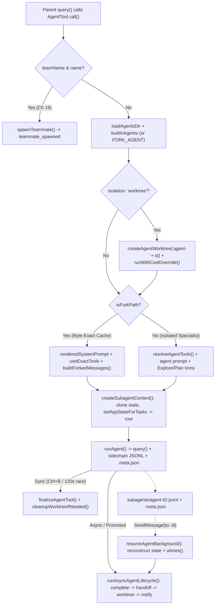

# 18. Subagents, Context Forking, and Git Worktrees

> **Status: written.** Reverse-engineered from the Claude Code 2.1.88 source snapshot (see the Prologue (`prologue-how-to-read-a-1900-file-agent.md`) for snapshot caveats).
>
> **Layer:** Layer 6 (Concurrency, Tasks, Subagents & Swarms)
> **Prerequisites:** [Chapter 02](ch002-the-tool-contract.md) (`ToolUseContext`), [Chapter 04](ch004-prompt-engineering-and-cache-boundaries.md) (prompt-cache boundaries, `SystemPrompt`), [Chapter 07](ch007-the-heartbeat-query-loop.md) (`query()`), [Chapter 08](ch008-session-envelope-query-engine-and-transcripts.md) (JSONL transcripts & `parentUuid` DAG), [Chapter 17](ch017-background-task-runtime.md) (`LocalAgentTask`, `TaskStateBase`, disk output)
> **Primary Source Files:**
> - `utils/forkedAgent.ts` — `createSubagentContext()`, `CacheSafeParams`, and `runForkedAgent()` for isolated yet cache-sharing child loops (689 lines)
> - `tools/AgentTool/loadAgentsDir.ts` — Markdown/JSON agent parsing, source-precedence merging, and memory-tool auto-injection (755 lines)
> - `tools/AgentTool/builtInAgents.ts` — built-in agent registry (`general-purpose`, `Explore`, `Plan`, `statusline-setup`, `claude-code-guide`, `verification`) and feature/env gates (72 lines)
> - `tools/AgentTool/forkSubagent.ts` — `FORK_AGENT`, `buildForkedMessages()`, `isInForkChild()`, and worktree path-translation notices (210 lines)
> - `tools/AgentTool/runAgent.ts` — subagent `query()` driver: permission overrides, `CLAUDE.md`/git stripping, scoped MCP/hooks/skills, sidechain persistence, and `finally` teardown (973 lines)
> - `tools/AgentTool/AgentTool.tsx` — `Agent` tool front door: sync/async/mid-run backgrounding, fork routing, worktree lifecycle, and handoff classification (1,397 lines)
> - `tools/AgentTool/agentToolUtils.ts` — `filterToolsForAgent()`, `resolveAgentTools()`, `finalizeAgentTool()`, `classifyHandoffIfNeeded()`, and `runAsyncAgentLifecycle()` (686 lines)
> - `tools/AgentTool/resumeAgent.ts` — sidechain transcript replay, `ContentReplacementState` reconstruction, and worktree/fork restoration (265 lines)
> - `utils/cwd.ts` — `AsyncLocalStorage`-backed `runWithCwdOverride()` isolating concurrent working directories (32 lines)
> - `utils/worktree.ts` — Git and hook-based worktree creation, `.worktreeinclude` copying, sparse-checkout teardown, and fail-closed stale cleanup (1,519 lines)
> - `tools/EnterWorktreeTool/EnterWorktreeTool.ts` & `tools/ExitWorktreeTool/ExitWorktreeTool.ts` — mid-session worktree entry/exit and fail-closed change verification (127 & 329 lines)

---

## Why This Layer Exists

By the end of [Chapter 17](ch017-background-task-runtime.md), Claude Code can run `query()` loops, persist conversations to JSONL, and track background jobs in `AppState.tasks`. Spawning a *child* agent inside the same Node/Bun process immediately triggers four hard systems failures:

1. **Shared-process state corruption:** Passing the parent's `ToolUseContext` into a child lets it mutate `readFileState`, fire parent UI callbacks, deadlock on interactive permission prompts from the background, or orphan `PPID=1` child shells when `setAppState` is stubbed out.
2. **Prompt-cache cliffs on context inheritance:** Naively giving a child the parent's conversation history causes a single-byte drift—a GrowthBook flag warming up mid-session, a different tool schema, or divergent tool-result truncation—that invalidates the entire 100k-token prefix cache on every spawn.
3. **Composable personas and long-lived continuity:** Built-in specialists (`Explore`, `Plan`), custom `.claude/agents/*.md` files, and plugin agents need strict tool/permission boundaries, scoped MCP servers and hooks, mid-run foreground-to-background promotion, and the ability to resume a stopped worker days later from disk.
4. **Filesystem collisions under a single `process.cwd()`:** Two concurrent subagents editing files in the same working tree overwrite each other, and calling `process.chdir()` for one child yanks the working directory out from under the parent and every sibling.

This chapter reverse-engineers how Claude Code solves all four problems in dependency order: context isolation, cache-exact forking, agent registration and lifecycle, sidechain resumption, and Git worktree isolation.

---

## 1. Isolating Child State Without Breaking the Root Store (`utils/forkedAgent.ts`)

### The Problem

A subagent executes inside the parent's `query()` engine (`query.ts`), which reads and mutates a `ToolUseContext` ([Chapter 02](ch002-the-tool-contract.md)). If two concurrent subagents share the parent's `readFileState`, one child's `Read` tricks another child's `Edit` staleness check. If a background agent calls `parentContext.setAppState`, it corrupts REPL UI state; yet if `setAppState` is simply replaced with `() => {}`, two production bugs erupt immediately:

- Any background bash process the subagent launches is never registered in `AppState.tasks`, so when the subagent finishes or the session exits, that shell survives as an orphaned `PPID=1` zombie.
- Any permission classifier denial counter stored in `AppState` stops incrementing across retries, creating an infinite retry loop.

### The Real Implementation (`utils/forkedAgent.ts`, `utils/abortController.ts`)

`createSubagentContext()` (`utils/forkedAgent.ts:345-462`) is the single chokepoint that constructs an isolated `ToolUseContext` for both internal forks (`runForkedAgent`) and user-visible subagents (`runAgent`). By default, **every mutable field is cloned or stubbed**, and callers explicitly opt in to sharing callbacks via `SubagentContextOverrides`:

```ts
// utils/forkedAgent.ts:345-436 (abbreviated for focus)
export function createSubagentContext(
  parentContext: ToolUseContext,
  overrides?: SubagentContextOverrides,
): ToolUseContext {
  const abortController =
    overrides?.abortController ??
    (overrides?.shareAbortController
      ? parentContext.abortController
      : createChildAbortController(parentContext.abortController))

  const getAppState: ToolUseContext['getAppState'] = overrides?.getAppState
    ? overrides.getAppState
    : overrides?.shareAbortController
      ? parentContext.getAppState
      : () => {
          const state = parentContext.getAppState()
          if (state.toolPermissionContext.shouldAvoidPermissionPrompts) {
            return state
          }
          return {
            ...state,
            toolPermissionContext: {
              ...state.toolPermissionContext,
              shouldAvoidPermissionPrompts: true,
            },
          }
        }

  return {
    readFileState: cloneFileStateCache(
      overrides?.readFileState ?? parentContext.readFileState,
    ),
    nestedMemoryAttachmentTriggers: new Set<string>(),
    loadedNestedMemoryPaths: new Set<string>(),
    dynamicSkillDirTriggers: new Set<string>(),
    discoveredSkillNames: new Set<string>(),
    toolDecisions: undefined,
    contentReplacementState:
      overrides?.contentReplacementState ??
      (parentContext.contentReplacementState
        ? cloneContentReplacementState(parentContext.contentReplacementState)
        : undefined),
    abortController,
    getAppState,
    setAppState: overrides?.shareSetAppState
      ? parentContext.setAppState
      : () => {},
    // Task registration/kill must always reach the root store, even when
    // setAppState is a no-op — otherwise async agents' background bash tasks
    // are never registered and never killed (PPID=1 zombie).
    setAppStateForTasks:
      parentContext.setAppStateForTasks ?? parentContext.setAppState,
    // Async subagents whose setAppState is a no-op need local denial tracking
    // so the denial counter actually accumulates across retries.
    localDenialTracking: overrides?.shareSetAppState
      ? parentContext.localDenialTracking
      : createDenialTrackingState(),
    setInProgressToolUseIDs: () => {},
    updateFileHistoryState: () => {},
    updateAttributionState: parentContext.updateAttributionState,
    // UI callbacks nulled; new agentId and queryTracking { chainId, depth + 1 } ...
  }
}
```

Five deliberate design choices carry the load here:

1. **Split store channels (`setAppState` vs. `setAppStateForTasks`):** `setAppState` is stubbed to `() => {}` unless `shareSetAppState: true` (which `runAgent.ts:709` sets only for `!isAsync` foreground agents). Meanwhile, `setAppStateForTasks` threads `parentContext.setAppStateForTasks ?? parentContext.setAppState` straight through arbitrary nesting depths (`async → async`) to the root React/AppState store. Every task registration, frontmatter hook registration (`runAgent.ts:569`), todo cleanup, and child-shell kill uses `rootSetAppState = toolUseContext.setAppStateForTasks ?? toolUseContext.setAppState`.
2. **Local denial tracking (`utils/permissions/denialTracking.ts:7-45`):** When `shareSetAppState` is false, `localDenialTracking` receives a fresh `{ consecutiveDenials: 0, totalDenials: 0 }` object instead of relying on the stubbed `setAppState`, so `DENIAL_LIMITS` (`maxConsecutive: 3`, `maxTotal: 20`) still trips `shouldFallbackToPrompting()`.
3. **WeakRef-linked vs. unlinked abort trees (`utils/abortController.ts:68-99`):** By default, `createSubagentContext()` calls `createChildAbortController(parentContext.abortController)`, which links parent abort → child abort using `WeakRef` in *both* directions and module-scope `propagateAbort` / `removeAbortHandler` functions—so dropping a child without aborting it never leaks memory onto the parent's `AbortSignal`. By contrast, `runAgent.ts:524-528` explicitly passes an **unlinked** `new AbortController()` for async agents (`AgentTool.tsx:694-696` notes that pressing `ESC` on the main thread must not kill background agents; only explicit `TaskStop` / `chat:killAgents` does).
4. **Clone vs. fresh `readFileState`:** `createSubagentContext()` clones `readFileState` by default so forked agents inherit the parent's file-read freshness table. Non-forked subagents in `runAgent.ts:375-378` override it with `createFileStateCacheWithSizeLimit(READ_FILE_STATE_CACHE_SIZE)` so a fresh agent cannot edit a file it has never read itself.
5. **Fresh per-agent telemetry and tracking:** Every subagent gets a fresh `agentId` (`createAgentId()`), fresh memory/skill discovery `Set`s, `undefined` UI setters (`addNotification`, `setToolJSX`, `setStreamMode`, `setSDKStatus`, `openMessageSelector`), and a fresh `queryTracking: { chainId: randomUUID(), depth: (parentContext.queryTracking?.depth ?? -1) + 1 }`. `updateAttributionState` is intentionally shared (`utils/forkedAgent.ts:433-435`) because it uses functional `(prev => next)` updates that safely compose across concurrent callers.

### Hidden Invariants & Failure Modes

> [!WARNING]
> **Whale-session leaks & zombie teardown (`tools/AgentTool/runAgent.ts:816-859`):** Every resource a subagent allocates must be released in `runAgent()`'s `finally` block—otherwise long sessions spawning hundreds of agents leak memory and orphan OS processes:
> - `agentToolUseContext.readFileState.clear()` and `initialMessages.length = 0` release cloned file contents and inherited message arrays.
> - `rootSetAppState` deletes `prev.todos[agentId]` (`runAgent.ts:835-843`) so `TodoWrite` keys do not accumulate forever.
> - `killShellTasksForAgent(agentId, ...)` (`runAgent.ts:847`)—and under `feature('MONITOR_TOOL')`, `killMonitorMcpTasksForAgent()` (`runAgent.ts:849-857`)—reap any background processes the subagent spawned via `rootSetAppState`.
> - `clearSessionHooks(rootSetAppState, agentId)` and `mcpCleanup()` remove frontmatter hooks and inline MCP connections.

---

## 2. Context Forking and Byte-Exact Prompt-Cache Sharing (`forkSubagent.ts`, `utils/forkedAgent.ts`)

### The Problem

As established in [Chapter 04](ch004-prompt-engineering-and-cache-boundaries.md), Anthropic's prompt cache hashes the exact request prefix:

```text
cache_key = H(system_prompt, tools, model, thinking_config, messages_prefix)
```

When the parent already has a 120k-token cached conversation and spawns three parallel workers to investigate different subsystems, a fresh subagent either loses all context or re-pays full cache-creation tokens three times. Worse, even if you *try* to share the parent's prefix, **five subtle divergences silently bust the cache**:

1. Re-calling `getSystemPrompt()` can return different bytes if a GrowthBook gate flipped between cold start and warm cache mid-session.
2. Re-assembling tools under the child's permission mode (`bubble` or `acceptEdits`) changes the serialized tool array at the first differing tool.
3. Disabling thinking (the default for normal subagents) or setting `maxOutputTokens` on non-adaptive models (which clamps `budget_tokens` in `claude.ts`) changes `thinkingConfig`.
4. Passing a fresh `ContentReplacementState` causes `enforceToolResultBudget()` to make different truncation decisions on inherited parent `tool_use_id`s, mutating earlier messages on the wire.
5. Giving sibling forks different `tool_result` texts for the parent's parallel `Agent` calls diverges the message prefix *before* the end of the shared turn.

### The Real Implementation (`utils/forkedAgent.ts`, `tools/AgentTool/forkSubagent.ts`, `tools/AgentTool/AgentTool.tsx`)

Claude Code has two distinct fork layers built on the same cache-preservation invariants:

- **Internal utility forks (`runForkedAgent()` in `utils/forkedAgent.ts:489-626`):** Used by post-turn helpers—session memory (`services/SessionMemory/sessionMemory.ts`), background agent summaries (`services/AgentSummary/agentSummary.ts`), prompt suggestions, and `/btw`. `handleStopHooks` snapshots the parent's exact `CacheSafeParams` (`systemPrompt`, `userContext`, `systemContext`, `toolUseContext`, `forkContextMessages`) via `saveCacheSafeParams()` (`utils/forkedAgent.ts:70-81`). Callers pass `skipCacheWrite: true` for fire-and-forget forks whose suffix no future request will read, and `runForkedAgent()` logs `tengu_fork_agent_query` with the measured `cacheHitRate` (`utils/forkedAgent.ts:631-689`).
- **Implicit subagent forks (`tools/AgentTool/forkSubagent.ts`):** Gated by `feature('FORK_SUBAGENT')` via `isForkSubagentEnabled()` (`forkSubagent.ts:32-39`), which returns `false` in Coordinator Mode and non-interactive sessions. When enabled, omitting `subagent_type` on `AgentTool` routes to the synthetic `FORK_AGENT` (`agentType: 'fork'`, `tools: ['*']`, `model: 'inherit'`, `permissionMode: 'bubble'`, `maxTurns: 200`, `getSystemPrompt: () => ''`) and forces **all** `AgentTool` spawns async (`forceAsync = isForkSubagentEnabled()`, `AgentTool.tsx:557`).

To guarantee near-100% cache hits across all sibling forks, Claude Code locks down all five components of the cache key:

1. **Frozen `renderedSystemPrompt` (`AgentTool.tsx:495-511`, `screens/REPL.tsx:2543, 2788`):** The REPL stashes the exact rendered `SystemPrompt` bytes on `toolUseContext.renderedSystemPrompt`. `AgentTool.call()` passes `override: { systemPrompt: toolUseContext.renderedSystemPrompt }` directly into `runAgent()`, falling back to `buildEffectiveSystemPrompt()` only if absent.
2. **Exact tool pool & thinking parity (`AgentTool.tsx:610-633`, `runAgent.ts:500-502, 667-695`):** `AgentTool` passes `availableTools: toolUseContext.options.tools` and `useExactTools: true`. Inside `runAgent()`, `useExactTools` bypasses `resolveAgentTools()`, keeps `model: 'inherit'`, and copies `toolUseContext.options.thinkingConfig` and `isNonInteractiveSession` verbatim instead of forcing `{ type: 'disabled' }`.
3. **Cloned `ContentReplacementState` (`utils/forkedAgent.ts:399-403`, `utils/toolResultStorage.ts:405-412`):** `createSubagentContext()` calls `cloneContentReplacementState(parentContext.contentReplacementState)`, duplicating both `seenIds: Set<string>` and `replacements: Map<string, string>`. When `query()` runs tool-result budget enforcement on inherited messages, every parent `tool_use_id` hits the exact same cached replacement decision while child mutations stay isolated from the parent.
4. **Identical placeholder `tool_result` blocks (`tools/AgentTool/forkSubagent.ts:91-169`):** When the parent emits N parallel `Agent` calls in one assistant turn, `buildForkedMessages()` ensures all N children serialize an identical wire prefix right up to their final directive block:

```ts
// tools/AgentTool/forkSubagent.ts:91-169 (abbreviated)
const FORK_PLACEHOLDER_RESULT = 'Fork started — processing in background'

export function buildForkedMessages(
  directive: string,
  assistantMessage: AssistantMessage,
): MessageType[] {
  const fullAssistantMessage: AssistantMessage = {
    ...assistantMessage,
    uuid: randomUUID(),
    message: {
      ...assistantMessage.message,
      content: [...assistantMessage.message.content],
    },
  }
  const toolUseBlocks = assistantMessage.message.content.filter(
    (block): block is BetaToolUseBlock => block.type === 'tool_use',
  )
  if (toolUseBlocks.length === 0) {
    return [createUserMessage({ content: [{ type: 'text', text: buildChildMessage(directive) }] })]
  }
  const toolResultBlocks = toolUseBlocks.map(block => ({
    type: 'tool_result' as const,
    tool_use_id: block.id,
    content: [{ type: 'text' as const, text: FORK_PLACEHOLDER_RESULT }],
  }))
  const toolResultMessage = createUserMessage({
    content: [
      ...toolResultBlocks,
      { type: 'text' as const, text: buildChildMessage(directive) },
    ],
  })
  return [fullAssistantMessage, toolResultMessage]
}
```

Every sibling receives `[...parentHistory, fullAssistantMessage(all tool_uses), user(identical placeholder tool_results..., <fork_boilerplate> + directive)]`. Only the final text block differs per child.

### Hidden Invariants & Failure Modes

> [!IMPORTANT]
> **Compaction-resistant recursive fork guard (`AgentTool.tsx:325-335`, `runAgent.ts:688-694`, `forkSubagent.ts:74-89`):** Because fork children *must* keep the `Agent` tool in their tool pool for cache-identical tool definitions, recursion cannot be stopped by filtering `Agent` out. Instead, `AgentTool.call()` enforces a two-tier runtime guard:
> 1. **Primary:** `toolUseContext.options.querySource === 'agent:builtin:fork'` (injected by `runAgent.ts:694` when `useExactTools` is true). This lives on `context.options`, so it survives autocompact rewriting the message list.
> 2. **Fallback:** `isInForkChild(toolUseContext.messages)` scans for `<${FORK_BOILERPLATE_TAG}>` inside user text blocks—catching paths where `querySource` was not threaded, though autocompact can erase the boilerplate message.

- **Two different incomplete-tool-call strategies:** `runForkedAgent()` (`utils/forkedAgent.ts:520-524`) explicitly **does not** call `filterIncompleteToolCalls()` because dropping a whole assistant message on partial tool batches orphans paired `tool_result`s (API 400); instead it lets `ensureToolResultPairing()` in `claude.ts` repair dangling calls identically to the main thread. By contrast, `runAgent.ts:370-372` *does* run `filterIncompleteToolCalls(forkContextMessages)` (`runAgent.ts:866-904`) before appending `promptMessages`, because `AgentTool`'s fork path constructs the complete paired `fullAssistantMessage + toolResultMessage` inside `promptMessages` while `toolUseContext.messages` still holds the parent's history up through the prior turn.
- **Worktree + fork path drift (`AgentTool.tsx:598-602`, `forkSubagent.ts:205-210`):** When a fork child also uses `isolation: 'worktree'`, `buildWorktreeNotice(getCwd(), worktreeInfo.worktreePath)` is pushed *after* the fork directive so the shared prefix remains untouched while instructing the child to translate inherited parent paths into its worktree root and re-read files before editing.

---

## 3. Agent Registry, Custom Definitions, and Execution Lifecycle

### The Problem

A single generic subagent prompt is both too expensive (sending 40 KB of `gitStatus` and `CLAUDE.md` to every read-only `Explore` call burns billions of tokens per week fleet-wide) and too rigid (teams want repo-local `.claude/agents/*.md` specialists with custom models, tools, persistent memory, hooks, and MCP servers). At the same time, user-defined agents must not bypass enterprise `strictPluginOnlyCustomization` policies, and long-running foreground agents need a clean escape hatch into the background without hanging or leaking resources.

### The Real Implementation (`builtInAgents.ts`, `loadAgentsDir.ts`, `agentToolUtils.ts`, `runAgent.ts`, `AgentTool.tsx`)

#### Built-in vs. Custom & Plugin Registration

`getBuiltInAgents()` (`tools/AgentTool/builtInAgents.ts:22-72`) assembles the baseline roster behind explicit env, build-time, and GrowthBook gates:

- **Blank-slate SDK escape hatch:** `CLAUDE_AGENT_SDK_DISABLE_BUILTIN_AGENTS` (only in non-interactive sessions) returns `[]`.
- **Coordinator swap:** Under `feature('COORDINATOR_MODE')` and `CLAUDE_CODE_COORDINATOR_MODE`, `builtInAgents.ts:35-43` lazily `require`s `coordinator/workerAgent.ts` *(absent from this snapshot; observed at call site)* to break a module-init cycle (`coordinatorMode → tools → AgentTool → builtInAgents`).
- **Standard roster:** Always includes `GENERAL_PURPOSE_AGENT` (`tools: ['*']`) and `STATUSLINE_SETUP_AGENT`. Adds `EXPLORE_AGENT` and `PLAN_AGENT` when `feature('BUILTIN_EXPLORE_PLAN_AGENTS')` and GrowthBook `tengu_amber_stoat` (default `true`) are enabled. Adds `CLAUDE_CODE_GUIDE_AGENT` for non-SDK entrypoints (`CLAUDE_CODE_ENTRYPOINT` not in `sdk-ts`/`sdk-py`/`sdk-cli`). Adds `VERIFICATION_AGENT` when `feature('VERIFICATION_AGENT')` and GrowthBook `tengu_hive_evidence` (default `false`) are active.

`getAgentDefinitionsWithOverrides` (`tools/AgentTool/loadAgentsDir.ts:296-393`, memoized by `cwd`, bypassed when `CLAUDE_CODE_SIMPLE` is truthy) loads Markdown files via `loadMarkdownFilesForSubdir('agents', cwd)`, silently skipping `.md` files lacking a `name` frontmatter field so co-located documentation does not emit parse errors (`loadAgentsDir.ts:321-326`). Plugin agents (`loadPluginAgents()`) load concurrently with `initializeAgentMemorySnapshots()` (under `feature('AGENT_MEMORY_SNAPSHOT')` + `isAutoMemoryEnabled()`).

When an agent defines `memory: 'user' | 'project' | 'local'`, both `parseAgentFromMarkdown()` (`loadAgentsDir.ts:662-674`) and `parseAgentFromJson()` (`loadAgentsDir.ts:455-467`, used for CLI `--agents` `flagSettings`) automatically inject `Write`, `Edit`, and `Read` into its tool list if explicit `tools` were declared, and append `loadAgentMemoryPrompt()` (`tools/AgentTool/agentMemory.ts`) inside its `getSystemPrompt()` closure. Note also that `isolation: 'remote'` is accepted only when `process.env.USER_TYPE === 'ant'` (`loadAgentsDir.ts:94-97, 608-610`).

All sources merge in `getActiveAgentsFromList()` (`loadAgentsDir.ts:193-221`) using last-write-wins precedence in a `Map<agentType, AgentDefinition>`:

```text
built-in < plugin < userSettings < projectSettings < flagSettings < policy
(lowest)                                                          (highest)
```

#### Tool Filtering, Permission Overrides, and Token Trimming

Before entering `query()`, `runAgent()` resolves tools, permissions, and context:

1. **Tool filtering (`tools/AgentTool/agentToolUtils.ts:70-225`, `constants/tools.ts:36-88`):** `AgentTool.tsx:573-577` builds `workerTools` via `assembleToolPool()` using the worker's own permission mode (`selectedAgent.permissionMode ?? 'acceptEdits'`) so parent restrictions do not leak into workers (and avoiding a `runAgent → tools.ts` circular import). For non-fork subagents, `resolveAgentTools()` runs `filterToolsForAgent()`:
   - Always allows `mcp__*` tools and allows `ExitPlanMode` when `permissionMode === 'plan'`.
   - Strips `ALL_AGENT_DISALLOWED_TOOLS` (`TaskOutput`, `EnterPlanMode`, `ExitPlanMode`, `AskUserQuestion`, `TaskStop`, `Workflow` under `feature('WORKFLOW_SCRIPTS')`, plus `Agent` for non-ant builds—`constants/tools.ts:41` omits `AGENT_TOOL_NAME` when `process.env.USER_TYPE === 'ant'` to allow nested agents).
   - When `isAsync` is true, allows only `ASYNC_AGENT_ALLOWED_TOOLS` (`Read`, `Edit`, `Write`, `NotebookEdit`, `Glob`, `Grep`, shells, `WebSearch`, `WebFetch`, `TodoWrite`, `Skill`, `SyntheticOutput`, `ToolSearch`, `EnterWorktree`, `ExitWorktree`), with an explicit bypass for `isInProcessTeammate()` that adds `Agent` (sync-only) and `IN_PROCESS_TEAMMATE_ALLOWED_TOOLS`.
   - Applies the agent's `disallowedTools` and `tools` allowlist, extracting `Agent(worker, researcher)` specs into `allowedAgentTypes`.
2. **Permission wrapping (`runAgent.ts:415-498`):** `agentGetAppState()` overlays `agentDefinition.permissionMode` *unless* the parent is already in `bypassPermissions`, `acceptEdits`, or `auto` (under `feature('TRANSCRIPT_CLASSIFIER')`). It sets `shouldAvoidPermissionPrompts: true` for background agents that cannot show UI (`!canShowPermissionPrompts`, overridden to `false` by `permissionMode === 'bubble'`), sets `awaitAutomatedChecksBeforeDialog: true` for async agents that *can* prompt so automated hooks/classifiers settle before interrupting the user, and when `allowedTools` is supplied, preserves SDK `cliArg` allow rules while replacing `session` rules so parent approvals do not leak.
3. **Admin-trusted policy gate on MCP & hooks (`runAgent.ts:112-127, 557-575`):** Agents may declare additive `mcpServers` (either string references to existing memoized servers or inline `{ [name]: config }` definitions—only inline clients are torn down in `finally`) and frontmatter `hooks` (registered via `rootSetAppState` with `isAgent = true`, converting `Stop` hooks to `SubagentStop`). Under `isRestrictedToPluginOnly('mcp' | 'hooks')`, user-controlled agents are blocked while `isSourceAdminTrusted(agentDefinition.source)` (plugin, built-in, `policySettings`) still loads.
4. **Fleet-scale token trimming (`runAgent.ts:385-410`, `AgentTool.tsx:1351-1362`, `constants.ts:8-12`):** Read-only `Explore` and `Plan` agents set `omitClaudeMd: true` (kill-switch GrowthBook `tengu_slim_subagent_claudemd`, default `true`), strip `gitStatus` from `systemContext`, and belong to `ONE_SHOT_BUILTIN_AGENT_TYPES` so `mapToolResultToToolResultBlockParam()` omits the `agentId`/`SendMessage`/`<usage>` trailer—source comments attribute ~6–20 Gtok/week of fleet savings to these three trims alone.

#### Sync, Async, and Mid-Run Backgrounding (`AgentTool.tsx:555-1262`)

`AgentTool.call()` forces `shouldRunAsync` when `run_in_background`, `selectedAgent.background`, Coordinator Mode, `isForkSubagentEnabled()`, `feature('KAIROS')` `appState.kairosEnabled`, or `proactiveModule?.isProactiveActive()` is true (unless `CLAUDE_CODE_DISABLE_BACKGROUND_TASKS` is set).

- **Async-from-start (`AgentTool.tsx:686-764`):** Registers the task via `registerAsyncAgent()` (unlinked abort controller), optionally registers `name → agentId` in `AppState.agentNameRegistry` for `SendMessage` routing, launches `runAsyncAgentLifecycle()` (`agentToolUtils.ts:508-686`) detached inside `runWithAgentContext` + `wrapWithCwd`, and returns `{ status: 'async_launched', agentId, outputFile }`.
- **Foreground with live promotion (`AgentTool.tsx:765-1262`):** Immediately registers via `registerAgentForeground()` (passing `autoBackgroundMs = 120_000` if `CLAUDE_AUTO_BACKGROUND_TASKS` or GrowthBook `tengu_auto_background_agents` is enabled), then loops over `Promise.race([agentIterator.next(), backgroundPromise])`—creating `backgroundPromise` *once* outside the `while` loop so iterations do not pile up `.then()` callbacks (`AgentTool.tsx:811-832`). If the user presses `Ctrl+B` or auto-background fires, `AgentTool` races `agentIterator.return(undefined)` against `sleep(1000)` (so a hanging MCP teardown cannot stall backgrounding), spawns a fresh `runAgent({ ..., isAsync: true })` stream in the background, and immediately returns `async_launched`.

### Hidden Invariants & Failure Modes

> [!WARNING]
> **Status transition BEFORE handoff/git work (`gh-20236`, `agentToolUtils.ts:599-603, 641-645`, `AgentTool.tsx:953-957, 994-996`):** In both `runAsyncAgentLifecycle()` and the mid-run-backgrounded closure, `completeAsyncAgent()` / `killAsyncAgent()` MUST run *before* `classifyHandoffIfNeeded()` (an auto-mode classifier API call under `feature('TRANSCRIPT_CLASSIFIER')`) and `getWorktreeResult()` / `cleanupWorktreeIfNeeded()` (git subprocesses). Both embellishments can hang; transitioning status first unblocks `TaskOutput(block=true)` immediately.

- **Pending MCP startup race (`AgentTool.tsx:371-392`):** If `selectedAgent.requiredMcpServers` matches a client in `pending` state, `AgentTool.call()` polls `getAppState()` every 500 ms up to 30 s—exiting early the moment any required server transitions to `failed`—before checking `mcp.tools` (a connected but unauthenticated server exposes zero tools).
- **The `AgentTool.tsx` DCE cliff (`utils/toolResultStorage.ts:997-999`):** Note an extraordinary bundler scar documented in `utils/toolResultStorage.ts`: `AgentTool.tsx` sits at Bun's `feature()` dead-code-elimination complexity ceiling, where adding even a single net line can break `feature('TRANSCRIPT_CLASSIFIER')` evaluation in tests. Notice too that in this snapshot, `AgentTool.tsx` has its `USER_TYPE` checks constant-folded to `"external" === 'ant'` (lines 99, 435, 525, 1287) with an inline source map at line 1398.
- **Inference cache eviction hint (`agentToolUtils.ts:337-346`):** `finalizeAgentTool()` logs `tengu_cache_eviction_hint` (`scope: 'subagent_end'`, `last_request_id`) when a subagent completes so inference servers can reclaim its KV cache chain promptly.

---

## 4. Sidechain Transcripts and Resuming Agents Days Later (`resumeAgent.ts`, `sessionStorage.ts`)

### The Problem

Once a background agent completes, its `LocalAgentTask` can be evicted from `AppState.tasks`—or the user can close the CLI and resume the session days later. Calling `SendMessage({ to: agentId })` (or replying in the UI) needs to revive that exact worker with its prior conversation, original agent persona (`FORK_AGENT` vs. custom agent), working tree, and prompt-cache alignment intact.

### The Real Implementation (`utils/sessionStorage.ts`, `tools/AgentTool/resumeAgent.ts`, `tools/SendMessageTool/SendMessageTool.ts`)

#### Sidechain JSONL + Sidecar `.meta.json`

Every subagent writes two files under the parent session directory (`utils/sessionStorage.ts:247-303`):

```text
<projectDir>/<sessionId>/subagents/[<subdir>/]agent-<agentId>.jsonl
<projectDir>/<sessionId>/subagents/[<subdir>/]agent-<agentId>.meta.json
```

`runAgent()` persists `initialMessages` fire-and-forget before entering `query()`, then awaits `recordSidechainTranscript([message], agentId, lastRecordedUuid)` (`runAgent.ts:735-745, 792-805`, calling `insertMessageChain(..., isSidechain=true)` in `utils/sessionStorage.ts:1451-1462`) for every `assistant`, `user`, `progress`, and `compact_boundary` message—updating `lastRecordedUuid` on every non-`progress` message for O(1) incremental parent chaining. Alongside it, `writeAgentMetadata()` (`sessionStorage.ts:283-290`) writes `{ agentType, worktreePath?, description? }` into `.meta.json`. Using a sidecar file avoids changing the JSONL schema while ensuring that resuming a `fork` agent does not silently degrade to `general-purpose`.

#### The Resume Pipeline (`tools/AgentTool/resumeAgent.ts:42-265`)

`SendMessageTool.ts:800-874` handles messages addressed to a subagent by name (`appState.agentNameRegistry`) or raw ID (`toAgentId()`): if the task is `running`, it calls `queuePendingMessage()`; if the task is stopped *or already evicted from `AppState.tasks`*, it invokes `resumeAgentBackground()` (also called from `screens/REPL.tsx:3556`):

```ts
// tools/AgentTool/resumeAgent.ts:63-98 (abbreviated)
const [transcript, meta] = await Promise.all([
  getAgentTranscript(asAgentId(agentId)),
  readAgentMetadata(asAgentId(agentId)),
])
if (!transcript) {
  throw new Error(`No transcript found for agent ID: ${agentId}`)
}
const resumedMessages = filterWhitespaceOnlyAssistantMessages(
  filterOrphanedThinkingOnlyMessages(
    filterUnresolvedToolUses(transcript.messages),
  ),
)
const resumedReplacementState = reconstructForSubagentResume(
  toolUseContext.contentReplacementState,
  resumedMessages,
  transcript.contentReplacements,
)
const resumedWorktreePath = meta?.worktreePath
  ? await fsp.stat(meta.worktreePath).then(
      s => (s.isDirectory() ? meta.worktreePath : undefined),
      () => undefined,
    )
  : undefined
if (resumedWorktreePath) {
  // Bump mtime so stale-worktree cleanup doesn't delete a just-resumed worktree (#22355)
  const now = new Date()
  await fsp.utimes(resumedWorktreePath, now, now)
}
```

Step by step, `resumeAgentBackground()` repairs every invariant needed for a clean restart:

1. **Transcript & replacement-state replay:** `getAgentTranscript()` (`utils/sessionStorage.ts:4190-4236`) finds the latest leaf matching `agentId && isSidechain`, walks `buildConversationChain()`, and returns `{ messages, contentReplacements }`. `resumeAgent.ts:70-74` strips unresolved `tool_use`s, orphaned thinking-only messages, and whitespace-only assistant messages. `reconstructForSubagentResume()` (`utils/toolResultStorage.ts:1001-1012`) rebuilds `ContentReplacementState` from the sidechain's recorded replacements, gap-filling fork-inherited `mustReapply` entries from the parent's live `replacements` map so resumed forks preserve prompt-cache stability.
2. **Best-effort worktree survival + `utimes` touch (`#22355`):** If `meta.worktreePath` was deleted externally, `stat()` falls back to the parent CWD rather than crashing. If it still exists, `fsp.utimes()` refreshes its `mtime` so the 30-day stale-worktree sweeper cannot reap a freshly resumed worktree.
3. **Persona and fork restoration (`resumeAgent.ts:100-195`):** Skips `filterDeniedAgents` (the original spawn already passed permission checks). If `meta?.agentType === 'fork'`, it selects `FORK_AGENT`, restores `renderedSystemPrompt`, sets `useExactTools: true`, and crucially passes **`forkContextMessages: undefined`** (`resumeAgent.ts:187-189`)—because the sidechain JSONL *already* persisted the original parent history slice; re-supplying it would emit duplicate `tool_use` IDs and trigger an API 400. It also passes `worktreePath` and `description` back into `runAgent()` so `runAgent`'s `writeAgentMetadata()` overwrite does not erase them.
4. **Execution:** Re-registers the task via `registerAsyncAgent()` on `rootSetAppState` (preserving existing name-registry mappings) and launches `runAsyncAgentLifecycle()` inside `runWithAgentContext({ invocationKind: 'resume', ... })` and `runWithCwdOverride()`.

### Hidden Invariants & Failure Modes

- **Why `SendMessageTool` validates raw IDs with `toAgentId()` (`SendMessageTool.ts:804-805, 846-849`):** Unregistered teammate names must fall through to the swarm mailbox router ([Chapter 19](ch019-agent-teams-swarms-and-coordinator-mode.md)), never triggering a failed sidechain transcript lookup.
- **Disk-write-before-yield UI merge (`agentToolUtils.ts:556-570`):** Because `runAgent()` awaits `recordSidechainTranscript()` *before* `yield message`, a UI pane attaching mid-run (`task.retain`) can read the JSONL prefix from disk in parallel while appending live yielded messages as a guaranteed suffix, deduplicating cleanly by UUID.

---

## 5. Isolating Concurrent Edits with Git Worktrees (`utils/cwd.ts`, `utils/worktree.ts`, `EnterWorktreeTool`, `ExitWorktreeTool`)

### The Problem

A single Node/Bun process has one global `process.cwd()`. Calling `process.chdir()` for a worktree-isolated subagent would corrupt every sibling agent and the parent REPL. Conversely, when a *user* invokes `EnterWorktree` (or `--worktree` at CLI startup), the session *does* want to switch directories, propagate local configs and gitignored secrets (`.env`, `settings.local.json`), avoid multi-second `git fetch` stalls in monorepos, and refuse to destroy uncommitted work on exit.

### The Real Implementation

#### Concurrent Directory Isolation via `AsyncLocalStorage` (`utils/cwd.ts`)

Subagents with `isolation: 'worktree'` (or `feature('KAIROS')` explicit `cwd`) **never** touch `process.chdir()` or `currentWorktreeSession`. Instead, `utils/cwd.ts` scopes `getCwd()` per async execution tree:

```ts
// utils/cwd.ts:1-21
import { AsyncLocalStorage } from 'async_hooks'
import { getCwdState, getOriginalCwd } from '../bootstrap/state.js'

const cwdOverrideStorage = new AsyncLocalStorage<string>()

export function runWithCwdOverride<T>(cwd: string, fn: () => T): T {
  return cwdOverrideStorage.run(cwd, fn)
}

export function pwd(): string {
  return cwdOverrideStorage.getStore() ?? getCwdState()
}
```

`AgentTool.tsx:618-641` wraps both async and sync agent execution in `runWithCwdOverride(cwdOverridePath, fn)`. Equally subtle: when `worktreeInfo` or `cwd` is active on a non-fork agent, `AgentTool` intentionally passes `override: undefined` (`AgentTool.tsx:624-626`) so `runAgent()` computes `getAgentSystemPrompt()` *inside* `wrapWithCwd`, where `getCwd()` returns the worktree path rather than the parent repo root.

#### Worktree Creation, Monorepo Speedups, and VCS Hooks (`utils/worktree.ts`)

1. **Slug allowlist & injective D/F flattening (`utils/worktree.ts:48-87, 208-227`):** `validateWorktreeSlug()` runs synchronously before any git command, hook, or `chdir`. It enforces `<= 64` chars and validates every `/`-separated segment against `/^[a-zA-Z0-9._-]+$/`, rejecting `.`, `..`, leading/trailing `/`, and drive prefixes. `flattenSlug()` then replaces `/` with `+` for both `.claude/worktrees/<flat>` and branch `worktree-<flat>`. Because `+` is outside the allowlist, the mapping is injective and eliminates two real hazards: Git ref directory/file conflicts (`worktree-user` vs. `worktree-user/feature`) and nested worktree directories where removing a parent deletes a child's uncommitted files.
2. **Hook-first VCS abstraction (`utils/worktree.ts:715-728, 912-919, 1260-1272`):** Every entry point (`createWorktreeForSession`, `createAgentWorktree`, and the `--worktree --tmux` fast-path `execIntoTmuxWorktree`) checks `hasWorktreeCreateHook()` first, delegating to `WorktreeCreate` / `WorktreeRemove` hooks so non-Git VCS systems (Sapling, Mercurial, Jujutsu) work without Git.
3. **Fast creation & sparse checkout (`utils/worktree.ts:235-375`):**
   - *Fast resume:* Reads `.git` directly via `readWorktreeHeadSha()` instead of spawning `git rev-parse HEAD` (~15 ms spawn overhead saved).
   - *Zero-fetch local base:* Resolves `refs/remotes/origin/<defaultBranch>` from disk via `resolveRef()` before falling back to `git fetch`—avoiding a 6–8 s local commit-graph scan observed on 210k-file / 16M-object repos. When `fetch` *is* needed (or for PR refs parsed by `parsePRReference()`), `GIT_NO_PROMPT_ENV` (`GIT_TERMINAL_PROMPT=0`, `GIT_ASKPASS=''`, `stdin: 'ignore'`) prevents headless credential hangs.
   - *Orphan branch reset:* Uses `git worktree add -B <branch>` instead of a separate `git branch -D`.
   - *Transactional sparse checkout:* When `settings.worktree.sparsePaths` is set, runs `--no-checkout` → `sparse-checkout set --cone` → `checkout HEAD`. If either follow-up command fails, `tearDown()` immediately runs `git worktree remove --force` so a subsequent invocation's fast-resume does not treat an empty directory as a healthy worktree (`worktree.ts:336-366`).
4. **Post-creation setup (`utils/worktree.ts:391-624`):**
   - Copies `.claude/settings.local.json` into the worktree.
   - Configures `core.hooksPath` to the main repo's `.husky` or `.git/hooks` (skipping the `git config` subprocess when `parseGitConfigValue()` already matches). Under `feature('COMMIT_ATTRIBUTION')`, also dynamically imports `utils/postCommitAttribution.ts` *(absent from snapshot; observed at `worktree.ts:606-609`)* to install the attribution hook directly into the worktree's `.husky/`—because `bun install` runs `husky`'s prepare script, which resets shared `core.hooksPath` back to relative `.husky`!
   - Symlinks opt-in `settings.worktree.symlinkDirectories` (guarding each entry with `containsPathTraversal()`).
   - Copies gitignored files matching `.worktreeinclude` (`copyWorktreeIncludeFiles()`, `worktree.ts:391-504`) using `git ls-files --others --ignored --exclude-standard --directory`—collapsing massive ignored trees like `node_modules/` into single entries (cutting ~500k entries / ~7 s down to ~100 ms) and running a scoped second `ls-files` only on collapsed dirs matching a literal or anchored glob prefix.

#### Subagent Cleanup vs. 30-Day Sweeper (`utils/worktree.ts:902-1173`, `AgentTool.tsx:590-685`)

`createAgentWorktree('agent-' + earlyAgentId.slice(0, 8))` resolves the repo via `findCanonicalGitRoot(getCwd())` (not `findGitRoot()`) so agents spawned *inside* a session worktree still create sibling worktrees under the main repository's `.claude/worktrees/` where cleanup can find them. On completion, `cleanupWorktreeIfNeeded()` (`AgentTool.tsx:644-685`, made idempotent by nulling `worktreeInfo`) keeps hook-based worktrees unconditionally and calls `hasWorktreeChanges(worktreePath, headCommit)` (`worktree.ts:1144-1173`, fail-closed: any non-zero git exit returns `true`). If clean, it deletes the worktree and branch and strips `worktreePath` from `.meta.json`; if dirty or committed, it preserves the worktree and returns `{ worktreePath, worktreeBranch }` to the parent.

When the parent crashes or is killed before in-process cleanup runs, `cleanupStaleAgentWorktrees(cutoffDate)` (`worktree.ts:1058-1136`) sweeps only slugs matching `EPHEMERAL_WORKTREE_PATTERNS` (`/^agent-a[0-9a-f]{7}$/`, workflow `wf_*`, `bridge-*`, `job-*`—never user-named worktrees), skips the active session worktree and entries newer than `cutoffDate`, and requires **both** `git --no-optional-locks status --porcelain -uno` and `git rev-list --max-count=1 HEAD --not --remotes` to exit 0 with empty stdout before removing.

#### Session-Level `EnterWorktreeTool` and `ExitWorktreeTool`

Both tools are deferred (`shouldDefer: true`, discovered via `ToolSearchTool`—[Chapter 15](ch015-model-context-protocol-mcp.md)):

- **`EnterWorktreeTool` (`EnterWorktreeTool.ts:77-119`):** Rejects if `getCurrentWorktreeSession()` is already set, resolves `findCanonicalGitRoot()` so entering a worktree from inside a manual worktree still roots cleanly, calls `createWorktreeForSession()`, mutates process-wide `process.chdir()` + `setCwd()` + `setOriginalCwd()`, persists `saveWorktreeState()`, and invalidates CWD-dependent caches (`clearSystemPromptSections()`, `clearMemoryFileCaches()`, `getPlansDirectory.cache.clear()`).
- **`ExitWorktreeTool` (`ExitWorktreeTool.ts:67-321`):** Marks `isDestructive(input)` true for `action: 'remove'` and enforces two fail-closed guards inside `validateInput()`:
  1. **Session-scope guard:** Refuses as a no-op if `getCurrentWorktreeSession()` is null—never touching worktrees created manually or in a prior session.
  2. **Fail-closed change check (`countWorktreeChanges()`, `ExitWorktreeTool.ts:79-113`):** Returns `null` on any git error *or* when `git status` succeeds without an `originalHeadCommit` (the hook-wrapping-git case where commits cannot be counted). For `action: 'remove'` without `discard_changes: true`, both `null` and any `changedFiles > 0 || commits > 0` refuse deletion and report exact counts.

### Hidden Invariants & Failure Modes

> [!WARNING]
> **The `--worktree` vs. mid-session `projectRoot` distinction (`ExitWorktreeTool.ts:122-146, 244-250`):** Startup `--worktree` (`setup.ts`) sets *both* `originalCwd` and `projectRoot` to the realpath'd worktree and re-reads hooks via `updateHooksConfigSnapshot()`. Mid-session `EnterWorktreeTool` sets `originalCwd` but intentionally leaves `projectRoot` unchanged to preserve stable project identity. On exit, `ExitWorktreeTool` detects which mode created the worktree via `const projectRootIsWorktree = getProjectRoot() === getOriginalCwd()` (immune to `BashTool` `cd` mutations on `getCwd()` and symlink mismatch on raw `session.worktreePath`), restoring `projectRoot` and re-snapshotting hooks only when startup `--worktree` changed them.

- **`process.chdir()` does not update `getCwd()` (`utils/worktree.ts:838-846`):** `cleanupWorktree()` passes explicit `{ cwd: originalCwd }` to `execFileNoThrowWithCwd()` for `git worktree remove` and `git branch -D` (after `sleep(100)` so git releases locks), because `execFileNoThrow()` defaults to `getCwd()` which could point inside the directory being deleted or a non-repo dir the model `cd`'d into.
- **CLI `--worktree --tmux` fast-path (`utils/worktree.ts:1180-1519`):** Runs early in `entrypoints/cli.tsx` before loading `main.tsx`, supports iTerm2 control mode (`tmux -CC`, disabled by `--tmux=classic` or nested `$TMUX`), detects prefix keybinding collisions with Claude shortcuts, and for `USER_TYPE === 'ant'` inside `claude-cli-internal` auto-splits dev panes (`bun run watch` / `bun run start`).

---

## Putting the Layer Together



The four subagent execution shapes trade isolation against cache reuse and UI reachability:

```text
Mode            | readFileState | Abort    | setAppState | Tasks | Cache
----------------+---------------+----------+-------------+-------+----------
Sync subagent   | fresh cache   | shared   | shared      | root  | cold/own
Async subagent  | fresh cache   | unlinked | no-op       | root  | cold/own
Forked subagent | parent clone  | unlinked | no-op       | root  | ~100% hit
Worktree child  | fresh/clone*  | per-mode | per-mode    | root  | +ALS cwd
(* clone when combined with fork, plus buildWorktreeNotice after directive)
```

> [!NOTE]
> **Snapshot-Absent Modules Observed via Call Sites Only:** Three modules referenced by this layer are **absent from this checkout** and documented solely from their call sites:
> - `types/message.ts` — message union types (`Message`, `AssistantMessage`, `UserMessage`, `SystemCompactBoundaryMessage`) imported across `utils/forkedAgent.ts`, `tools/AgentTool/runAgent.ts`, and `tools/AgentTool/forkSubagent.ts`.
> - `coordinator/workerAgent.ts` — lazily `require`d inside `tools/AgentTool/builtInAgents.ts:38-41` under `feature('COORDINATOR_MODE')` and `CLAUDE_CODE_COORDINATOR_MODE`.
> - `utils/postCommitAttribution.ts` — dynamically imported inside `utils/worktree.ts:606-609` under `feature('COMMIT_ATTRIBUTION')` to install `.husky` attribution hooks in fresh worktrees.

---

## How This Snaps Into the Next Layer

Everything in [Chapter 19 — Agent Teams, Swarms, and Coordinator Mode](ch019-agent-teams-swarms-and-coordinator-mode.md) builds directly on the primitives we just dissected:

1. **Teammate spawn intercept (`tools/AgentTool/AgentTool.tsx:284-316`):** Before any subagent resolution runs, `AgentTool.call()` checks `if (teamName && name)` and hands off to `spawnTeammate()` in `tools/shared/spawnMultiAgent.ts` (blocking teammates from spawning nested teammates to keep `TeamFile.members` flat, and blocking in-process teammates from spawning background agents at `AgentTool.tsx:272-280, 361-363`).
2. **Multi-turn in-process teammates (`utils/swarm/inProcessRunner.ts:1035-1069`):** Rather than running one `runAgent()` call and exiting, `inProcessRunner.ts` drives `runAgent()` inside a persistent `while (!abortController.signal.aborted && !shouldExit)` mailbox loop—passing `canShowPermissionPrompts: true`, `preserveToolUseResults: true`, and a persistent `teammateReplacementState` so repeated turns over `allMessages` do not reset `ContentReplacementState` and bust the teammate's prompt cache.
3. **Teammate & Coordinator tool gates (`constants/tools.ts:77-88, 107-112`, `tools/AgentTool/agentToolUtils.ts:100-112`):** `filterToolsForAgent()` unlocks `IN_PROCESS_TEAMMATE_ALLOWED_TOOLS` (`TaskCreate`, `TaskGet`, `TaskList`, `TaskUpdate`, `SendMessage`, plus crons under `feature('AGENT_TRIGGERS')`) when `isInProcessTeammate()` is true, while Coordinator Mode restricts the leader to `COORDINATOR_MODE_ALLOWED_TOOLS` (`Agent`, `TaskStop`, `SendMessage`, `SyntheticOutput`) and swaps the built-in agent roster inside `builtInAgents.ts:35-43`.

---

## Reading Exercises & Code Checkpoints

1. **Trace the root-store bypass across nesting levels:** Run `rg -n "setAppStateForTasks" .` and verify every consumer that relies on `setAppStateForTasks ?? setAppState`. What breaks in `runAgent.ts:568-575` and `runAgent.ts:839-847` if a nested async subagent falls back to its own `toolUseContext.setAppState`?
2. **Audit every prompt-cache key component for fork children:** Compare `runAgentParams` in `tools/AgentTool/AgentTool.tsx` (`lines 603-636`) against `agentOptions` in `tools/AgentTool/runAgent.ts` (`lines 667-695`) and `CacheSafeParams` in `utils/forkedAgent.ts` (`lines 46-68`). Verify why setting `maxOutputTokens` on `runForkedAgent()` can bust the cache on older models (`utils/forkedAgent.ts:96-103`) and why `resumeAgent.ts:187-189` sets `forkContextMessages: undefined`.
3. **Verify fail-closed worktree deletion invariants:** Inspect `countWorktreeChanges()` in `tools/ExitWorktreeTool/ExitWorktreeTool.ts` (`lines 79-113`), `hasWorktreeChanges()` (`lines 1144-1173`), and `cleanupStaleAgentWorktrees()` (`lines 1058-1136`) in `utils/worktree.ts`. Confirm what each function returns when a `git` subprocess exits non-zero or when a hook-based worktree wraps a Git repository without `originalHeadCommit`.
4. **Trace `SendMessage` → sidechain resume:** Read `tools/SendMessageTool/SendMessageTool.ts` (`lines 800-874`) alongside `tools/AgentTool/resumeAgent.ts` (`lines 63-195`). Confirm how a stopped agent that has already been evicted from `AppState.tasks` is distinguished from a swarm teammate name and restored from `<sessionId>/subagents/agent-<id>.jsonl` + `.meta.json`.
