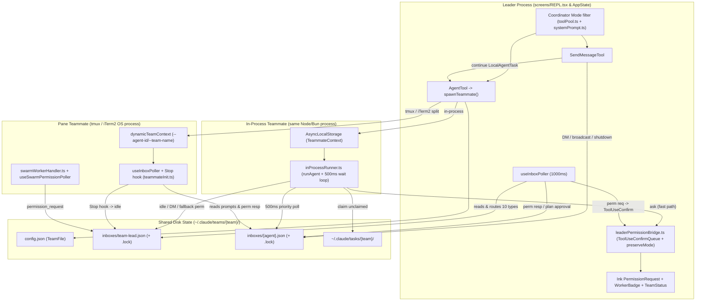

# 19. Agent Teams, Swarms, and Coordinator Mode: Multi-Agent IPC, Permission Bubbling, and Pure Orchestration

> **Status: written.** Reverse-engineered from the Claude Code 2.1.88 source snapshot (see the Prologue (`prologue-how-to-read-a-1900-file-agent.md`) for snapshot caveats).
>
> **Layer:** Layer 6 (Concurrency, Tasks, Subagents & Swarms)
> **Prerequisites:** [Chapter 11](ch011-the-permission-engine.md), [Chapter 17](ch017-background-task-runtime.md), [Chapter 18](ch018-subagents-context-forking-and-worktrees.md)
> **Primary Source Files:**
> - `utils/swarm/teamHelpers.ts` — `TeamFile` roster persistence, path sanitization, worktree teardown, and `SIGINT`/`SIGTERM` orphan cleanup
> - `tools/TeamCreateTool/TeamCreateTool.ts` & `tools/TeamDeleteTool/TeamDeleteTool.ts` — Team lifecycle tools, task-list alignment, and active-member cleanup guards
> - `utils/teammate.ts` & `utils/teammateContext.ts` — Three-tier identity resolution (`AsyncLocalStorage` → `dynamicTeamContext` → `AppState`) and zero-polling idle waiters
> - `utils/swarm/backends/registry.ts`, `utils/swarm/backends/InProcessBackend.ts`, `utils/swarm/backends/PaneBackendExecutor.ts`, `utils/swarm/backends/TmuxBackend.ts`, & `utils/swarm/backends/ITermBackend.ts` — Polymorphic teammate execution across in-process, `tmux`, and native `iTerm2` panes
> - `tools/shared/spawnMultiAgent.ts`, `utils/swarm/spawnInProcess.ts`, & `utils/swarm/inProcessRunner.ts` — Spawning pipeline, persistent multi-turn teammate loop, dual abort controllers, and isolated compaction
> - `utils/teammateMailbox.ts`, `tools/SendMessageTool/SendMessageTool.ts`, & `hooks/useInboxPoller.ts` — File-locked JSON mailboxes, structured control messages, priority wakeups, and graceful shutdown
> - `utils/swarm/leaderPermissionBridge.ts`, `utils/swarm/permissionSync.ts`, `hooks/toolPermission/handlers/swarmWorkerHandler.ts`, & `hooks/useSwarmPermissionPoller.ts` — Cross-async and cross-process permission bubbling with rule write-back
> - `coordinator/coordinatorMode.ts`, `utils/toolPool.ts`, & `utils/systemPrompt.ts` — Coordinator Mode gates, surgical tool stripping, worker-context injection, and pure-orchestrator prompt framing

## Why This Layer Exists

[Chapter 18](ch018-subagents-context-forking-and-worktrees.md) gave the harness subagents: a parent calls `AgentTool`, a child executes one isolated prompt—optionally in a forked cache-sharing context or a dedicated git worktree—and returns a single final result. That RPC model works well for narrow research or one-off refactors, but it breaks down as soon as work requires sustained multi-agent collaboration:

1. **Persistent, peer-addressable workers.** A researcher, an implementer, and a verifier often need to stay alive across multiple rounds, exchange findings directly, claim follow-up work from a shared task list, and negotiate graceful shutdown instead of exiting after one turn.
2. **Execution-mode polymorphism.** Inside `tmux` or `iTerm2`, developers want live split panes where each teammate is a visible terminal process. Inside VS Code's integrated terminal, SSH, or headless `-p` runs, there is no pane multiplexer—teammates must run concurrently inside the leader's own runtime without global-state collisions.
3. **Centralized permission governance.** In [Chapter 11](ch011-the-permission-engine.md), `useCanUseTool` assumed the agent asking for permission owns the interactive terminal. A teammate running either as a background async loop or inside a separate pane cannot safely prompt on a hidden TTY; its `ask` decisions must bubble up to the leader's interactive terminal with full diff/command rendering and propagate allow/deny decisions back without corrupting the leader's permission mode.
4. **Role separation through tool restriction.** When a single top-level model holds `Bash`, `Edit`, and `Read` alongside `Agent`, it constantly drifts into doing ad-hoc file reads and edits itself, serializing work and filling its own context window. Sometimes the architecture must strip editing tools from the leader outright and convert it into a pure orchestrator.

Two independent feature gates guard the subsystems in this chapter:

- **Agent Teams / Swarms** are gated by `isAgentSwarmsEnabled()` (`utils/agentSwarmsEnabled.ts:24-44`): always active when `process.env.USER_TYPE === 'ant'`, while external builds require *both* an explicit opt-in (`CLAUDE_CODE_EXPERIMENTAL_AGENT_TEAMS` env var or `--agent-teams` CLI flag) *and* the GrowthBook killswitch `tengu_amber_flint` (defaulting `true`).
- **Coordinator Mode** is dead-code-eliminated at bundle time behind `feature('COORDINATOR_MODE')` and enabled at runtime by `CLAUDE_CODE_COORDINATOR_MODE` (`coordinator/coordinatorMode.ts:36-41`).

This chapter traces the stack bottom-up: team rosters and identity first, then execution backends, then file-locked mailboxes, then permission bubbling, and finally Coordinator Mode.

---

## 1. Team Formation, Flat Rosters, and Dual Identity Resolution

### The Problem

Once two or more Claude instances cooperate on a task, the harness needs a shared source of truth on disk and an unambiguous answer to *"which agent am I?"* inside every helper function (`writeToMailbox`, `isTeammate`, `hasPermissionsToUseTool`). Two constraints make this harder than storing a global `currentAgentId`:

- **Mixed-process topology.** A pane-based teammate runs in its own OS process with its own `process.env` and `AppState`, whereas an in-process teammate shares the *leader's* Node/Bun process, event loop, and reactive `AppState` store. Mutating a module global for an in-process teammate would corrupt every concurrent teammate and the leader itself.
- **Directory and process leaks.** Every team writes a roster directory (`~/.claude/teams/{team}/`) and a task directory (`~/.claude/tasks/{team}/`), and may spawn external `tmux`/`iTerm2` panes plus git worktrees. If the leader exits via `SIGINT` without calling `TeamDelete`, orphaned panes keep running and stale directories accumulate on disk forever.

### The Real Implementation

#### Deterministic IDs and the `TeamFile` Roster

Team identities avoid random UUIDs in favor of deterministic `agentName@teamName` strings produced by `formatAgentId()` (`utils/agentId.ts:38-40`). Because `@` is the structural delimiter parsed by `parseAgentId()`, `sanitizeAgentName()` (`utils/swarm/teamHelpers.ts:108-110`) strips `@` to `-` before forming an ID, and `sanitizeName()` (`teamHelpers.ts:100-102`) lowercases and replaces non-alphanumeric characters with `-` for filesystem paths and tmux window names.

When the leader invokes `TeamCreateTool` (`tools/TeamCreateTool/TeamCreateTool.ts:128-237`), it enforces a strict **one team per leader** rule (`appState.teamContext?.teamName`), resolves name collisions by falling back to `generateWordSlug()` (`lines 64-72`), and writes `~/.claude/teams/{sanitizedName}/config.json` (`TeamFile`, defined in `utils/swarm/teamHelpers.ts:64-90`):

```ts
// utils/swarm/teamHelpers.ts:64-90
export type TeamFile = {
  name: string
  description?: string
  createdAt: number
  leadAgentId: string
  leadSessionId?: string // Actual session UUID of the leader (for discovery)
  hiddenPaneIds?: string[] // Pane IDs that are currently hidden from the UI
  teamAllowedPaths?: TeamAllowedPath[] // Paths all teammates can edit without asking
  members: Array<{
    agentId: string
    name: string
    agentType?: string
    model?: string
    prompt?: string
    color?: string
    planModeRequired?: boolean
    joinedAt: number
    tmuxPaneId: string
    cwd: string
    worktreePath?: string
    sessionId?: string
    subscriptions: string[]
    backendType?: BackendType
    isActive?: boolean // false when idle, undefined/true when active
    mode?: PermissionMode // Current permission mode for this teammate
  }>
}
```

Right after `writeTeamFileAsync()`, `TeamCreateTool` performs three load-bearing wiring steps (`TeamCreateTool.ts:177-212`):

1. **Session-end cleanup registration:** `registerTeamForSessionCleanup(finalTeamName)` records the team in a `Set` hosted inside `bootstrap/state.ts` (`teamHelpers.ts:554-562`, avoiding cross-shard test leaks and fixing `gh-32730` where undeleted teams lingered forever).
2. **Task-list unification (`Team = Project = TaskList`):** `resetTaskList(taskListId)`, `ensureTasksDir(taskListId)`, and `setLeaderTeamName(taskListId)` align the leader's task directory (`~/.claude/tasks/{sanitizedName}/`) with what pane-based teammates compute from `--team-name`. Without `setLeaderTeamName()`, the leader would fall through to `getSessionId()` and write tasks to a directory teammates never see (`TeamCreateTool.ts:188-191`).
3. **Leader identity omission:** `TeamCreateTool` stores the team in `AppState.teamContext` and **deliberately refrains from setting `CLAUDE_CODE_AGENT_ID` or `dynamicTeamContext`** (`TeamCreateTool.ts:224-228`). Setting an agent ID on the leader would make `isTeammate()` return `true`, breaking inbox polling and permission routing.

#### Three-Tier Identity Resolution

Every swarm helper queries `utils/teammate.ts`, which layers `utils/teammateContext.ts` (`AsyncLocalStorage<TeammateContext>`) above process-scoped CLI state:

```ts
// utils/teammate.ts:88-131
export function getAgentId(): string | undefined {
  const inProcessCtx = getTeammateContext()
  if (inProcessCtx) return inProcessCtx.agentId
  return dynamicTeamContext?.agentId
}

export function getTeamName(teamContext?: {
  teamName: string
}): string | undefined {
  const inProcessCtx = getTeammateContext()
  if (inProcessCtx) return inProcessCtx.teamName
  if (dynamicTeamContext?.teamName) return dynamicTeamContext.teamName
  return teamContext?.teamName
}

export function isTeammate(): boolean {
  // In-process teammates run within the same process
  const inProcessCtx = getTeammateContext()
  if (inProcessCtx) return true
  // Tmux teammates require both agent ID and team name
  return !!(dynamicTeamContext?.agentId && dynamicTeamContext?.teamName)
}
```

For pane-based teammates, `main.tsx:1187-1211` validates that `--agent-id`, `--agent-name`, and `--team-name` appear together (exiting with status `1` if partial) and populates `dynamicTeamContext` via `setDynamicTeamContext()`. Before React's first render, `computeInitialTeamContext()` (`utils/swarm/reconnection.ts:23-66`) reads `config.json` synchronously so `AppState.teamContext` is hydrated on mount without `useEffect` flicker. For in-process teammates, `runWithTeammateContext()` (`utils/teammateContext.ts:59-64`) binds a per-teammate store across every `await` inside that teammate's execution loop.

#### Teardown and Crash Cleanup

`tools/TeamDeleteTool/TeamDeleteTool.ts:71-135` refuses to disband a team if any non-lead member still has `isActive !== false` (`lines 81-98`), forcing the leader to run graceful shutdown first. Once clear, `cleanupTeamDirectories()` (`utils/swarm/teamHelpers.ts:641-683`) reads `config.json` *before* deleting it, tears down any member `worktreePath` via `git worktree remove --force` (falling back to `rm -rf`, `lines 492-551`), removes both `~/.claude/teams/{team}` and `~/.claude/tasks/{team}`, and calls `unregisterTeamForSessionCleanup()` to avoid double cleanup.

If the leader dies ungracefully (`SIGINT`/`SIGTERM`), `cleanupSessionTeams()` (`utils/swarm/teamHelpers.ts:576-634`) runs during `gracefulShutdown`. Crucially, it runs `killOrphanedTeammatePanes()` *before* `cleanupTeamDirectories()`—dynamically importing `registry.ts` and `detection.ts` so shutdown code doesn't bloat startup imports—because deleting directories while pane processes are still alive leaves runaway terminals behind.

### Hidden Invariants & Failure Modes

- **Flat rosters only:** In `tools/AgentTool/AgentTool.tsx:266-280`, passing both `team_name` and `name` triggers `spawnTeammate()`, *unless* the caller is already a teammate (`isTeammate()`), which throws immediately: `TeamFile.members` is a flat array with a single `leadAgentId`, so nested teammates would have no provenance. Likewise, `isInProcessTeammate()` forbids `run_in_background: true` subagents because their lifecycle is bound to the leader's process.
- **Identity-keyed vs. pane-keyed removal:** All in-process teammates share the sentinel `tmuxPaneId: 'in-process'`. Removing one must call `removeMemberByAgentId()` (`utils/swarm/teamHelpers.ts:326-348`) rather than `removeMemberFromTeam(teamName, tmuxPaneId)` (`lines 285-317`), which would evict whichever in-process teammate appears first in `members`.

---

## 2. Execution Backends: In-Process Runner vs. `tmux` and `iTerm2` Panes

### The Problem

Spawning a teammate via `AgentTool` (`name` + `team_name`) must work identically across three wildly different terminal environments: inside `tmux`, inside macOS `iTerm2`, and everywhere else (plain terminals, VS Code, CI, headless `-p` runs). Each environment carries nasty operational edge cases:

- `Shell.ts` mutates `process.env.TMUX` after startup when initializing Claude's shell socket, and users click away to other panes mid-session.
- Spawning three teammates in parallel inside a single assistant message fires three concurrent split-pane commands that race on pane geometry and shell prompt initialization.
- `tmux` login shells drop environment variables (`CLAUDE_CODE_USE_BEDROCK`, `HTTPS_PROXY`, CA bundles) unless explicitly forwarded.
- Inside a single process, hundreds of turns across dozens of concurrent teammates can blow up heap RSS and shatter prompt caches if message mirrors or tool-result budgets aren't bounded.

### The Real Implementation

#### Startup Mode Snapshot and Backend Detection

Just like `hooksConfigSnapshot.ts` from Chapter 13, `utils/swarm/backends/teammateModeSnapshot.ts:56-87` snapshots `teammateMode` (`'auto' | 'tmux' | 'in-process'`) once during startup (CLI `--teammate-mode` overriding global config) so mid-session config edits cannot silently mix backends.

`utils/swarm/backends/registry.ts:351-398` decides between in-process and pane execution in `isInProcessEnabled()`:

1. Non-interactive (`-p`) sessions **always** force in-process (`lines 354-359`).
2. Explicit `'in-process'` or `'tmux'` snapshot modes win directly (`lines 364-368`).
3. In `'auto'` mode, if a prior spawn already fell back (`inProcessFallbackActive`), stay in-process (`lines 372-377`); otherwise use panes only if `isInsideTmuxSync() || isInITerm2()` (`lines 380-383`).

Look closely at the battle scars in `utils/swarm/backends/detection.ts`:

- **Module-load capture (`lines 10-19`):** `ORIGINAL_USER_TMUX` and `ORIGINAL_TMUX_PANE` are read once at module load time before `Shell.ts` can overwrite `process.env.TMUX`, and before the user switches panes.
- **No `tmux display-message` fallback (`lines 32-34`):** Running `tmux display-message` succeeds whenever *any* tmux server exists on the machine—even if Claude was launched in a plain terminal—so `isInsideTmux()` trusts `ORIGINAL_USER_TMUX` exclusively.
- **Probing the iTerm2 Python API (`lines 112-120`):** `isIt2CliAvailable()` executes `it2 session list` instead of `it2 --version`, because `--version` exits `0` even when iTerm2's Python API is disabled in preferences, which would cause `session split` to fail later with no recovery.

When pane execution is chosen, `detectAndGetBackend()` (`utils/swarm/backends/registry.ts:136-254`) resolves in strict priority order: (1) inside `tmux` → native `TmuxBackend`; (2) inside `iTerm2` with `it2` (unless user chose `preferTmuxOverIterm2`) → native `ITermBackend`; (3) `tmux` installed anywhere → external `TmuxBackend` running on an isolated PID-scoped socket `-L claude-swarm-${process.pid}` (`utils/swarm/constants.ts:12-14`, `TmuxBackend.ts:87-91`); (4) nothing available → throws platform-specific install instructions. In `'auto'` mode, `handleSpawn()` (`tools/shared/spawnMultiAgent.ts:1053-1069`) catches that throw, calls `markInProcessFallback()`, and falls through to `handleSpawnInProcess()` transparently.

#### Pane-Based Spawning (`TmuxBackend`, `ITermBackend`, `PaneBackendExecutor`)

Both `TmuxBackend.ts:28-53` and `ITermBackend.ts:15-31` serialize parallel pane splits through an in-memory promise-chain mutex (`acquirePaneCreationLock()`). Inside `tmux`, the first teammate splits horizontally alongside the leader (rebalancing to `main-vertical` with the leader pinned at 30% width, `TmuxBackend.ts:343-358`); outside `tmux`, teammates tile evenly in `claude-swarm:swarm-view`. `TmuxBackend` waits `PANE_SHELL_INIT_DELAY_MS = 200` (`lines 31-37`) so slow shells (`starship`, `oh-my-zsh`) finish initializing before `tmux send-keys` types the launch command. `ITermBackend` splits explicitly from the leader's UUID parsed out of `ITERM_SESSION_ID` (`wXtYpZ:UUID`, `ITermBackend.ts:63-73`) via `-s` so user pane clicks don't misplace splits, and sets `supportsHideShow = false` (whereas `TmuxBackend` hides panes via `break-pane` into a detached `claude-hidden` session and restores them via `join-pane`, `TmuxBackend.ts:281-361`).

The command injected into the new pane (`tools/shared/spawnMultiAgent.ts:401-444` and `utils/swarm/backends/PaneBackendExecutor.ts:114-158`) has three subtle invariants:

1. **Model alias resolution (`spawnMultiAgent.ts:93-101`):** `resolveTeammateModel()` expands `'inherit'` from agent frontmatter to the leader's model (fixing `gh-31069`, where literal `--model inherit` failed at the API) and otherwise defaults via `getHardcodedTeammateModelFallback()` (`utils/swarm/teammateModel.ts:8-10`) to the provider-aware Opus 4.6 model ID (`CLAUDE_OPUS_4_6_CONFIG[getAPIProvider()]`).
2. **Permission-mode safety (`utils/swarm/spawnUtils.ts:45-56`):** `buildInheritedCliFlags()` propagates `--dangerously-skip-permissions`, `--permission-mode acceptEdits`, or `--permission-mode auto` (`spawnMultiAgent.ts:226-231`), *except* when `planModeRequired` is true—plan mode always takes precedence over bypass permissions.
3. **Explicit env forwarding (`utils/swarm/spawnUtils.ts:96-146`):** `buildInheritedEnvVars()` builds `env CLAUDECODE=1 CLAUDE_CODE_EXPERIMENTAL_AGENT_TEAMS=1 ...` and selectively forwards `TEAMMATE_ENV_VARS`—including `CLAUDE_CODE_USE_BEDROCK`/`VERTEX`/`FOUNDRY` (fixing GitHub `#23561`), `ANTHROPIC_BASE_URL`, `CLAUDE_CODE_REMOTE` paired with `CLAUDE_CODE_REMOTE_MEMORY_DIR` (so remote auto-memory isn't accidentally disabled), and `HTTP(S)_PROXY`/`NODE_EXTRA_CA_CERTS` (so teammates route through the parent container's upstream MITM proxy).

Finally, `handleSpawnSplitPane()` calls `registerOutOfProcessTeammateTask()` (`spawnMultiAgent.ts:760-834`), registering a synthetic `in_process_teammate` task in the leader's `AppState.tasks` whose `abortController` listener invokes `getBackendByType(backendType).killPane()`. That single adapter makes external tmux/iTerm2 teammates appear in the leader's background-tasks pill and respond uniformly to task kills. It then writes the teammate's initial prompt into `~/.claude/teams/{team}/inboxes/{name}.json` (`lines 513-521`).

#### In-Process Spawning and the Persistent Runner Loop

In-process teammates follow a two-step launch: `utils/swarm/spawnInProcess.ts:104-216` creates an **independent** `AbortController` (not linked to the leader's turn controller, so pressing Escape on the leader does not kill running teammates), constructs `TeammateContext`, registers an `InProcessTeammateTaskState` in `AppState.tasks`, and registers a `registerCleanup()` hook. Then `startInProcessTeammate()` (`utils/swarm/inProcessRunner.ts:1544-1552`) launches `runInProcessTeammate()` fire-and-forget.

Notice two memory-retention defenses right at the launch boundary:

```ts
// tools/shared/spawnMultiAgent.ts:927-932
      // Strip messages: the teammate never reads toolUseContext.messages
      // (it builds its own history via allMessages in inProcessRunner).
      // Passing the parent's full conversation here would pin it for the
      // teammate's lifetime, surviving /clear and auto-compact.
      toolUseContext: { ...context, messages: [] },
```

```ts
// utils/swarm/inProcessRunner.ts:1544-1552
export function startInProcessTeammate(config: InProcessRunnerConfig): void {
  // Extract agentId before the closure so the catch handler doesn't retain
  // the full config object (including toolUseContext) while the promise is
  // pending - which can be hours for a long-running teammate.
  const agentId = config.identity.agentId
  void runInProcessTeammate(config).catch(error => {
    logForDebugging(`[inProcessRunner] Unhandled error in ${agentId}: ${error}`)
  })
}
```

Inside `runInProcessTeammate()` (`utils/swarm/inProcessRunner.ts:883-1534`), the runner constructs a full system prompt appended with `TEAMMATE_SYSTEM_PROMPT_ADDENDUM` (`utils/swarm/teammatePromptAddendum.ts`—reminding the model that plain assistant text is invisible to peers and it *must* call `SendMessage`), pins `resolvedAgentDefinition.permissionMode = 'default'` (later overridden per-iteration from `task.permissionMode` so the leader can cycle an individual teammate's mode with `Shift+Tab`, `lines 1144-1154`), and injects team-essential tools (`SendMessage`, `TeamCreate`, `TeamDelete`, `TaskCreate`/`Get`/`List`/`Update`). Those extra tools survive subagent filtering because `filterToolsForAgent()` (`tools/AgentTool/agentToolUtils.ts:100-112`) checks `isAgentSwarmsEnabled() && isInProcessTeammate()` and exempts `IN_PROCESS_TEAMMATE_ALLOWED_TOOLS` (`constants/tools.ts:77-88`, which also includes `CronCreate`/`Delete`/`List` under `feature('AGENT_TRIGGERS')`) plus `AgentTool` for synchronous subagents.

The core execution loop (`inProcessRunner.ts:1048-1417`) wraps `runAgent()` inside nested `AsyncLocalStorage` scopes—`runWithTeammateContext(teammateContext, () => runWithAgentContext(agentContext, ...))`—and layers four production invariants on top of [Chapter 18](ch018-subagents-context-forking-and-worktrees.md)'s `runAgent()`:

1. **Dual AbortControllers (`lines 1053-1063, 1204-1219, 1292-1309`):** Each turn allocates a fresh `currentWorkAbortController` stored on `task`. Pressing Escape while viewing a teammate aborts only `currentWorkAbortController`: the loop breaks out of `runAgent()`, appends `ERROR_MESSAGE_USER_ABORT` to the teammate's scrollback, transitions the teammate to `isIdle: true` with `idleReason: 'interrupted'`, and keeps the teammate alive waiting for its next prompt. Only the outer lifecycle `abortController` terminates the teammate.
2. **Cache-preserving `teammateReplacementState` (`lines 1035-1045`):** Because `runAgent()` is called once per prompt over an accumulating `allMessages` array containing *full* unpersisted tool results, creating a fresh `contentReplacementState` on each iteration would make holistic "replace-globally-largest" decisions that diverge from earlier turns' frozen-first choices—mutating the wire prefix and causing a prompt-cache miss on every follow-up message. Persisting one `teammateReplacementState` across iterations (and resetting it only after full compaction at `lines 1111-1113`) keeps the wire prefix stable.
3. **Isolated auto-compaction (`lines 1071-1126`):** When `tokenCountWithEstimation(allMessages)` crosses `getAutoCompactThreshold()`, the runner builds an `isolatedContext` with a cloned `FileStateCache` (`cloneFileStateCache`) and cleared `onCompactProgress`/`setStreamMode` callbacks so compacting a teammate neither wipes the leader's read-file cache nor hijacks the leader's compaction spinner. It then mirrors the compacted array into `task.messages` (`lines 1121-1125`).
4. **Capped UI transcript mirror (`tasks/InProcessTeammateTask/types.ts:89-121`):** `task.messages` exists purely for the leader's zoomed transcript view, while the true conversation lives in `allMessages` and on disk. Every update goes through `appendCappedMessage()` with `TEAMMATE_MESSAGES_UI_CAP = 50`.

> [!WARNING]
> **Production scar — the 36.8 GB swarm burst:** The comment on `TEAMMATE_MESSAGES_UI_CAP` (`tasks/InProcessTeammateTask/types.ts:96-101`) documents why a UI mirror cannot hold unbounded history: BigQuery telemetry analysis (`2026-03-20`) showed ~20 MB RSS per agent at 500+ turns and ~125 MB per concurrent agent in swarm bursts, culminating in whale session `9a990de8` launching 292 agents in two minutes and hitting **36.8 GB RSS**. Capping `task.messages` at 50 entries and truncating terminal tasks to their last message (`inProcessRunner.ts:1440`, `spawnInProcess.ts:288-290`) eliminated that duplicate heap copy.

### Hidden Invariants & Failure Modes

- **Zero-polling idle barrier:** Headless/print mode and orchestration code wait for in-process teammates via `waitForTeammatesToBecomeIdle()` (`utils/teammate.ts:238-292`), which attaches `onIdleCallbacks` directly onto each running task inside `setAppState`. Crucially, inside the `setAppState` updater it re-checks `if (task.isIdle) onIdle()` (`lines 279-280`) to close the race where a teammate finishes between the initial snapshot scan and callback registration.
- **Single-emit SDK bookend guard:** Both `killInProcessTeammate()` (`spawnInProcess.ts:245-247, 308-315`) and `runInProcessTeammate()`'s normal/error exit paths (`inProcessRunner.ts:1425-1431, 1479-1482`) pre-set `notified: true` and guard `emitTaskTerminatedSdk()` on `task.status === 'running'`. Otherwise a force-kill racing with loop exit would flip `killed → completed` and emit duplicate SDK `task_notification` bookends.

---

## 3. File-Locked Mailboxes, Protocol Multiplexing, and Idle/Wakeup Semantics

### The Problem

A team can mix pane-based processes and in-process async loops, and *both* need to exchange plain DMs, broadcasts, plan approvals, permission prompts, mode switches, and shutdown handshakes. An in-memory queue won't cross OS process boundaries; raw `fs.writeFile` will lose updates under concurrent writers; a naive FIFO inbox lets noisy peer-to-peer chatter starve a leader's shutdown request; and a single inbox file read by both an attachment collector and a background poller can eat JSON control frames as raw LLM prompt text.

### The Real Implementation

#### File-Locked JSON Inboxes

All teammate IPC flows through `utils/teammateMailbox.ts`, storing one JSON array per agent at `~/.claude/teams/{safeTeam}/inboxes/{safeAgentName}.json` (`getInboxPath`, `lines 56-66`). Every mutation (`writeToMailbox`, `markMessageAsReadByIndex`, `markMessagesAsRead`, `markMessagesAsReadByPredicate`) acquires `${inboxPath}.lock` through `utils/lockfile.ts`—a lazy `require('proper-lockfile')` shim that keeps `graceful-fs`'s ~8 ms `fs` monkey-patching off cold-start paths like `--help`.

```ts
// utils/teammateMailbox.ts:35-41, 148-184 (abridged)
const LOCK_OPTIONS = {
  retries: { retries: 10, minTimeout: 5, maxTimeout: 100 },
}

// Ensure the inbox file exists before locking (proper-lockfile requires the file to exist)
try {
  await writeFile(inboxPath, '[]', { encoding: 'utf-8', flag: 'wx' })
} catch (error) {
  if (getErrnoCode(error) !== 'EEXIST') return
}

release = await lockfile.lock(inboxPath, {
  lockfilePath: lockFilePath,
  ...LOCK_OPTIONS,
})
// Re-read messages after acquiring lock to get the latest state
const messages = await readMailbox(recipientName, teamName)
messages.push({ ...message, read: false })
await writeFile(inboxPath, jsonStringify(messages, null, 2), 'utf-8')
```

Two details here are classic production scars: `{ flag: 'wx' }` creates an empty `[]` atomically without clobbering an existing file (satisfying `proper-lockfile`'s existence precondition), and `LOCK_OPTIONS` supplies 10 exponential retries because migrating from `lockSync` (which blocked the event loop) to async `lock()` dropped implicit serialization unless concurrent callers retried (`lines 31-41`). Similarly, `clearMailbox()` (`lines 349-368`) uses `{ flag: 'r+' }` so clearing a nonexistent inbox catches `ENOENT` instead of creating a phantom file.

#### `SendMessageTool`: One Tool, Four Routing Domains

`tools/SendMessageTool/SendMessageTool.ts` accepts `{ to, summary?, message }` where `message` is either a plain string (requiring a 5–10 word `summary` for UI previews and marked `isReadOnly: true`, `lines 539-541`) or a discriminated `StructuredMessage` (`shutdown_request`, `shutdown_response`, or `plan_approval_response`, `lines 46-65`).

Its `call()` method (`lines 741-913`) routes in four cascading tiers:

1. **Cross-session peer transport (`feature('UDS_INBOX')`, lines 742-798):** Recognizes `bridge:<session-id>` and `uds:<socket-path>` addresses via `parseAddress()`. Plain text only—structured messages are rejected up front in `validateInput()`. For `bridge:`, `checkPermissions()` (`lines 585-600`) returns a bypass-immune `safetyCheck` (`classifierApprovable: false`) so cross-machine prompt injection always requires explicit human consent, and `call()` *re-checks* `getReplBridgeHandle() && isReplBridgeActive()` after the permission prompt returns in case the bridge dropped during a multi-minute wait (`lines 745-756`).
2. **In-process subagent continuation (`lines 802-874`):** Before touching any team mailbox, `SendMessageTool` checks `appState.agentNameRegistry.get(input.to) ?? toAgentId(input.to)`. If the target is a running `LocalAgentTask`, it enqueues directly via `queuePendingMessage()` (`lines 809-821`); if the task is stopped or already evicted from `AppState`, it auto-resumes the agent from its sidechain transcript in the background via `resumeAgentBackground()` (`lines 823-872`). This is the exact primitive Coordinator Mode uses to continue workers.
3. **Team broadcast & DM (`lines 876-881`):** `to: '*'` iterates `teamFile.members` (skipping the sender case-insensitively, `lines 221-226`) and calls `writeToMailbox()` for each peer; structured messages cannot be broadcast (`lines 678-684, 883-885`). Named teammates receive a single `writeToMailbox()` call.
4. **Structured protocol handshakes (`lines 887-912`):**
   - `shutdown_request`: writes a `ShutdownRequestMessage` with a deterministic `requestId` (`shutdown-{ts}@{target}`).
   - `shutdown_response`: validated to target `TEAM_LEAD_NAME` only (`lines 694-703`). On `approve: true`, `handleShutdownApproval()` (`lines 305-399`) reads its own `tmuxPaneId` and `backendType` from `config.json`, writes `shutdown_approved` to `team-lead`, and then self-terminates: aborting its own `AbortController` if `in-process` (with an `AppState` fallback lookup), or calling `setImmediate(() => gracefulShutdown(0, 'other'))` if running in a pane process.
   - `plan_approval_response`: guarded by `isTeamLead(appState.teamContext)` (`lines 442-446, 487-491`), attaching the leader's current `permissionMode` (substituting `'default'` if the leader is itself in `'plan'` mode, `lines 448-449`) so the teammate transitions straight into the team's execution mode.

> [!NOTE]
> **Snapshot absence:** Under `feature('UDS_INBOX')`, `SendMessageTool.ts` dynamically requires `bridge/peerSessions.ts` (`line 759`, calling `postInterClaudeMessage`) and `utils/udsClient.ts` (`line 778`, calling `sendToUdsSocket`). Both modules are **absent from this snapshot**; their behavior is observed only from these call sites and `utils/peerAddress.ts`. Likewise, `types/message.ts` (imported by `inProcessRunner.ts` and `teammateMailbox.ts`) is absent from the snapshot.

#### Priority Wakeups, Idle Notifications, and the Poller Split

Two distinct pollers drain mailboxes because in-process teammates share the leader's React tree while pane teammates and the leader own their own REPLs:

- **In-process teammates** stay alive inside `waitForNextPromptOrShutdown()` (`utils/swarm/inProcessRunner.ts:689-868`), polling every `500 ms` across a strict five-tier priority hierarchy:
  1. `task.pendingUserMessages` (typed directly by the human while zoomed into the teammate's transcript via `injectUserMessageToTeammate()` in `InProcessTeammateTask.tsx:68-84`)
  2. Unread `shutdown_request` scanned across the entire inbox (`inProcessRunner.ts:771-804`)—preventing peer-to-peer chatter from starving shutdown
  3. Unread messages from `TEAM_LEAD_NAME` (`lines 813-819`)—prioritizing leader intent over peer chatter
  4. First unread peer message in FIFO order (`lines 822-824`)
  5. Unclaimed, unblocked `pending` tasks in the team task list via `tryClaimNextTask()` (`lines 624-657, 854-861`)

  When an in-process teammate finishes a turn, it flips `isIdle: true`, invokes `task.onIdleCallbacks`, and calls `sendIdleNotification()` (`inProcessRunner.ts:1318-1347`, skipped if `wasAlreadyIdle` to avoid duplicates), attaching `getLastPeerDmSummary(allMessages)` (`utils/teammateMailbox.ts:1149-1183`) so the leader sees `[to peer] summary` even for peer-to-peer DMs it didn't receive.

- **Team leaders and pane teammates** run `useInboxPoller()` (`hooks/useInboxPoller.ts:126-969`), mounted in `screens/REPL.tsx:4034-4039` on a `1000 ms` interval. Its very first guard (`getAgentNameToPoll()`, `lines 81-105`) returns `undefined` if `isInProcessTeammate()` is true—because when an in-process teammate calls shared `setAppState`, React can re-render the leader's hooks *inside* the teammate's active `AsyncLocalStorage` context!
  - Pane teammates also register a `Stop` function hook during startup via `initializeTeammateHooks()` (`utils/swarm/teammateInit.ts:98-128`), which marks `isActive: false` in `config.json` and `await`s writing an `idle_notification` to `leadAgentName` before the turn closes.
  - On each poll, `useInboxPoller` partitions unread messages into 10 buckets (`lines 205-248`): 9 structured protocol types plus `regularMessages`.
  - Regular messages are formatted as `<teammate-message teammate_id="..." color="..." summary="...">` XML. If the session is idle (`!isLoading && !focusedInputDialog`), `onSubmitTeammateMessage(formatted)` starts a new turn immediately; if busy, messages are queued into `AppState.inbox.messages` (`status: 'pending'`) for mid-turn attachment pickup or post-turn delivery. Crucially, `markRead()` runs *only after* delivery or `AppState` enqueue (`lines 860-864`), so a crash mid-poll re-reads the messages instead of dropping them silently.
  - When the leader processes `shutdown_approved` (`lines 678-800`), it kills the pane via `ensureBackendsRegistered()` + `getBackendByType(backendType).killPane()`, removes the member from `config.json`, unassigns its tasks, and flips any matching synthetic task in `AppState.tasks` to `status: 'completed'` (`lines 749-765`) so the leader's spinner stops.

### Hidden Invariants & Failure Modes

> [!IMPORTANT]
> **Preventing the attachment-vs.-poller race:** In `ant` builds, `getTeammateMailboxAttachments()` (`utils/attachments.ts:3532-3630`) also reads the file mailbox mid-turn to inject peer messages as attachments without waiting for the turn to end. Without coordination, it raced `useInboxPoller`: whoever read first marked messages read, and if attachments won, raw JSON `permission_request` payloads were dumped into the LLM context and never reached the permission modal. Two guards close this hole:
> 1. `isStructuredProtocolMessage()` (`utils/teammateMailbox.ts:1073-1095`) filters all 10 control message types out of attachment reads so they stay unread for `useInboxPoller`.
> 2. `getTeammateMailboxAttachments()` skips `appState.inbox.messages` whenever `viewedTeammate || isInProcessTeammate()` (`attachments.ts:3607-3610`) so in-process teammates never read the leader's inbox (preventing broadcast self-echo), and deduplicates overlapping file + `AppState.inbox` reads by `from + timestamp + text` prefix (`lines 3615-3630`).

- **Protocol forgery defense:** Both `plan_approval_response` (`useInboxPoller.ts:158-195`) and `mode_set_request` (`useInboxPoller.ts:550-562`) explicitly verify `msg.from === 'team-lead'` before mutating `toolPermissionContext.mode`. A peer cannot forge a JSON approval to escape plan mode or escalate another teammate's permissions.
- **No double welcome prompts:** `handleSpawnInProcess()` deliberately does *not* write the initial prompt to the teammate's mailbox (`spawnMultiAgent.ts:1011-1014`) because `startInProcessTeammate()` already receives `prompt` directly; writing to both would duplicate turn 1.
- **Auto-approved plan mode on the leader:** Notice that in `useInboxPoller.ts:600-662`, incoming `plan_approval_request` messages are immediately auto-approved by the leader's poller (inheriting the leader's external permission mode) and *also* pushed into `regularMessages` so the leader model sees what the teammate planned.

---

## 4. Permission Bubbling Across Async and Process Boundaries

### The Problem

When a teammate calls `Bash` or `Edit` and `hasPermissionsToUseTool()` ([Chapter 11](ch011-the-permission-engine.md)) returns `behavior: 'ask'`, the teammate cannot simply block on `stdin`—an in-process teammate doesn't own the terminal, and a pane teammate may be tucked inside a hidden or detached `tmux` window. Returning an automatic denial cripples workers, while letting workers bypass prompts destroys the permission model. The harness needs every worker's `ask` decision to appear inside the leader's own `ToolUseConfirm` modal—complete with tool-specific diff previews, a colored `@worker` badge, and "always allow" rule persistence—and return the human's answer across either an in-process `Promise` or a cross-process mailbox round-trip.

### The Real Implementation

#### Path A: The Direct In-Process Bridge (`leaderPermissionBridge.ts`)

Because in-process teammates share the leader's heap but run *outside* React's component tree, `utils/swarm/leaderPermissionBridge.ts` exposes a minimal 54-line module-level bridge holding two React state setters:

```ts
// utils/swarm/leaderPermissionBridge.ts:16-36
export type SetToolUseConfirmQueueFn = (
  updater: (prev: ToolUseConfirm[]) => ToolUseConfirm[],
) => void

export type SetToolPermissionContextFn = (
  context: ToolPermissionContext,
  options?: { preserveMode?: boolean },
) => void

let registeredSetter: SetToolUseConfirmQueueFn | null = null
let registeredPermissionContextSetter: SetToolPermissionContextFn | null = null
```

`screens/REPL.tsx` binds both setters in `useEffect` hooks (`registerLeaderToolUseConfirmQueue(setToolUseConfirmQueue)` at `lines 1178-1181` and `registerLeaderSetToolPermissionContext(setToolPermissionContext)` at `lines 2378-2381`) and unregisters them on unmount.

Inside `utils/swarm/inProcessRunner.ts:128-334`, `createInProcessCanUseTool()` handles `result.behavior === 'ask'` in five steps:

1. **Await Bash classifier first (`lines 159-176`):** Behind `feature('BASH_CLASSIFIER')`, if `result.pendingClassifierCheck` is present, the teammate awaits `awaitClassifierAutoApproval()` *before* queuing UI on the leader—unlike the main thread, which races the classifier against human keystrokes.
2. **Enqueue onto the leader's `ToolUseConfirm` queue (`lines 195-239`):** If `getLeaderToolUseConfirmQueue()` is non-null, it wraps a `Promise<PermissionDecision>` guarded by `let decisionMade = false`, stamps `workerBadge: { name: identity.agentName, color: identity.color }`, and pushes a full `ToolUseConfirm` entry directly onto the leader's UI queue.
3. **Subtract human wait time (`lines 201-207, 1182-1191`):** Every settlement path calls `reportPermissionWait()`, adding `Date.now() - permissionStartMs` to `task.totalPausedMs` so worker elapsed-time badges don't count minutes spent waiting on the user.
4. **Rule write-back with `preserveMode: true` (`lines 263-281`):**

```ts
// utils/swarm/inProcessRunner.ts:263-281
persistPermissionUpdates(permissionUpdates)
// Write back permission updates to the leader's shared context
if (permissionUpdates.length > 0) {
  const setToolPermissionContext = getLeaderSetToolPermissionContext()
  if (setToolPermissionContext) {
    const currentAppState = toolUseContext.getAppState()
    const updatedContext = applyPermissionUpdates(
      currentAppState.toolPermissionContext,
      permissionUpdates,
    )
    // Preserve the leader's mode to prevent workers'
    // transformed 'acceptEdits' context from leaking back
    // to the coordinator
    setToolPermissionContext(updatedContext, {
      preserveMode: true,
    })
  }
}
```

5. **Cascading queue rechecks (`screens/REPL.tsx:2365-2374`, `inProcessRunner.ts:305-330`):** Whenever the leader's `setToolPermissionContext` runs, it schedules a `setImmediate` sweep calling `item.recheckPermission()` on every remaining entry in `toolUseConfirmQueue`. If approving Worker A added an "always allow `npm test`" rule, Worker B's queued prompt for `npm test` re-evaluates `hasPermissionsToUseTool()`, removes itself from the queue, and resolves immediately with `allow` without bothering the user a second time.

#### Path B: Mailbox IPC for Pane Workers (and Headless In-Process Fallback)

When no React bridge is available—either because the worker lives in a separate `tmux`/`iTerm2` OS process, or because an in-process teammate is running headless without a mounted `REPL` (`getLeaderToolUseConfirmQueue() === null`)—permissions travel over the file-locked mailbox using `utils/swarm/permissionSync.ts`, `hooks/toolPermission/handlers/swarmWorkerHandler.ts`, and `hooks/useSwarmPermissionPoller.ts`:

- **Worker side:** For pane teammates, `handleSwarmWorkerPermission()` (`swarmWorkerHandler.ts:40-156`) first awaits the optional `BASH_CLASSIFIER`, builds a `SwarmPermissionRequest` (`perm-{ts}-{rand}`), and **registers its callback in `pendingCallbacks` *before* sending the mailbox message** (`lines 79-123`) so an instant leader response can never race ahead of callback registration. It wraps resolution in `createResolveOnce()`'s atomic `claim()` before `await ctx.handleUserAllow(...)` so a concurrent abort cannot double-settle, and sets `AppState.pendingWorkerRequest` so the worker pane displays a "waiting for leader approval" indicator. For headless in-process fallback (`inProcessRunner.ts:337-449`), `createInProcessCanUseTool()` uses the exact same `registerPermissionCallback()` + `sendPermissionRequestViaMailbox()` pair and polls its own inbox every `500 ms` via `setInterval` until `isPermissionResponse()` matches `request.id`.
- **Leader side:** `useInboxPoller` (`hooks/useInboxPoller.ts:251-364`) pops `permission_request` messages, resolves the `Tool` object via `findToolByName(getAllBaseTools(), parsed.tool_name)`, constructs a `ToolUseConfirm` with a cyan `workerBadge`, deduplicates by `toolUseID` in case `markMessagesAsRead` failed on a prior poll (`lines 338-345`), fires a desktop notification if the leader is idle, and wires `onAllow`/`onReject`/`onAbort` to `sendPermissionResponseViaMailbox()` (`permissionSync.ts:734-783`).
- **Response delivery & validation:** On the worker, `useInboxPoller` (`lines 367-397`) matches `permission_response` to `hasPermissionCallback(parsed.request_id)` and invokes `processMailboxPermissionResponse()` (`useSwarmPermissionPoller.ts:124-156`), which deletes the callback entry *before* running it and sanitizes `permissionUpdates` through Zod (`parsePermissionUpdates()`, `lines 35-53`).
- **Sandbox network prompts:** Outbound network blocks inside OS sandboxes ([Chapter 12](ch012-shell-execution-sandboxing-and-workspace-tools.md)) follow the identical mailbox round-trip via `sendSandboxPermissionRequestViaMailbox()` / `sendSandboxPermissionResponseViaMailbox()` (`permissionSync.ts:805-928`), routing through `AppState.workerSandboxPermissions.queue` on the leader (`useInboxPoller.ts:400-463`) and `pendingSandboxCallbacks` on the worker (`useSwarmPermissionPoller.ts:172-226`).

> [!NOTE]
> **Evolution scar in `permissionSync.ts`:** Lines 112–641 of `utils/swarm/permissionSync.ts` still retain the older directory-based permission protocol (`~/.claude/teams/{team}/permissions/{pending,resolved}/{id}.json` + `useSwarmPermissionPoller()`), kept for backward compatibility. As noted at `screens/REPL.tsx:4062-4064`, live interactive sessions now route all permission requests and responses exclusively through mailboxes and `useInboxPoller`.

### Hidden Invariants & Failure Modes

- **Untrusted IPC validation:** `parsePermissionUpdates()` (`hooks/useSwarmPermissionPoller.ts:35-53`) runs `permissionUpdateSchema().safeParse()` on every rule received over mailbox IPC, dropping malformed entries from mismatched or buggy peer versions instead of crashing `applyPermissionUpdates()`.
- **Team-wide directory rules:** Permissions granted to a directory can be persisted in `TeamFile.teamAllowedPaths` (applied at startup by `initializeTeammateHooks()` in `utils/swarm/teammateInit.ts:45-79`, converting absolute `/foo` into `//foo/**` rule syntax) and broadcast live to running teammates via `team_permission_update` (`useInboxPoller.ts:498-547`).
- **Asymmetric `recheckPermission()`:** For in-process teammates sharing memory with the leader, `recheckPermission()` auto-dismisses duplicate queued prompts when rules update. For pane teammates, `recheckPermission()` in `useInboxPoller.ts:333-335` is an explicit no-op because the worker's `toolPermissionContext` lives in another process.

---

## 5. Coordinator Mode: Turning the Leader into a Pure Orchestrator

### The Problem

Swarms give a leader the *option* to delegate, but an LLM holding `Read`, `Grep`, `Edit`, and `Bash` suffers from strong "do it myself" inertia: it reads files directly, edits small bugs inline, and serializes investigations instead of fanning them out. Furthermore, when a leader delegates lazily (*"based on your findings, fix the bug"*), the next worker inherits vague instructions and misses root causes. Coordinator Mode solves both problems structurally by stripping all execution tools from the top-level agent, replacing its system prompt with an explicit orchestration discipline, and keeping workers asynchronous under a unified `<task-notification>` / `SendMessage` loop.

### The Real Implementation

#### Feature Gate, Live Env Toggle, and Resume Continuity

`coordinator/coordinatorMode.ts:36-78` gates the mode behind `feature('COORDINATOR_MODE')` and reads `process.env.CLAUDE_CODE_COORDINATOR_MODE` live without caching:

```ts
// coordinator/coordinatorMode.ts:36-41, 49-70 (abridged)
export function isCoordinatorMode(): boolean {
  if (feature('COORDINATOR_MODE')) {
    return isEnvTruthy(process.env.CLAUDE_CODE_COORDINATOR_MODE)
  }
  return false
}

export function matchSessionMode(
  sessionMode: 'coordinator' | 'normal' | undefined,
): string | undefined {
  if (!sessionMode) return undefined
  const currentIsCoordinator = isCoordinatorMode()
  const sessionIsCoordinator = sessionMode === 'coordinator'
  if (currentIsCoordinator === sessionIsCoordinator) return undefined

  // Flip the env var — isCoordinatorMode() reads it live, no caching
  if (sessionIsCoordinator) {
    process.env.CLAUDE_CODE_COORDINATOR_MODE = '1'
  } else {
    delete process.env.CLAUDE_CODE_COORDINATOR_MODE
  }
  // ...logs 'tengu_coordinator_mode_switched' and returns a user-facing banner
}
```

Every session save point (`main.tsx:3771`, `REPL.tsx:1904`, `cli/print.ts:5169`, `utils/sessionRestore.ts:515`) persists `'coordinator' | 'normal'` to the transcript. When a user resumes a coordinator session from a normal CLI (or vice versa), `matchSessionMode()` flips `process.env.CLAUDE_CODE_COORDINATOR_MODE` in-process so tool filtering and system-prompt selection immediately match the historical transcript without forcing a restart.

#### Surgical Tool Stripping and the `CLAUDE_CODE_SIMPLE` Dance

The entire tool restriction boils down to a four-tool allowlist in `constants/tools.ts:107-112` and a 15-line filter in `utils/toolPool.ts:11-41`:

```ts
// constants/tools.ts:107-112
export const COORDINATOR_MODE_ALLOWED_TOOLS = new Set([
  AGENT_TOOL_NAME,
  TASK_STOP_TOOL_NAME,
  SEND_MESSAGE_TOOL_NAME,
  SYNTHETIC_OUTPUT_TOOL_NAME,
])

// utils/toolPool.ts:35-41
export function applyCoordinatorToolFilter(tools: Tools): Tools {
  return tools.filter(
    t =>
      COORDINATOR_MODE_ALLOWED_TOOLS.has(t.name) ||
      isPrActivitySubscriptionTool(t.name),
  )
}
```

`isPrActivitySubscriptionTool()` (`utils/toolPool.ts:11-18`) matches MCP tools ending in `subscribe_pr_activity` or `unsubscribe_pr_activity` by suffix (since MCP server prefixes vary), keeping lightweight GitHub PR event subscriptions directly on the coordinator.

`mergeAndFilterTools()` (`utils/toolPool.ts:55-79`)—placed in a React-free file so headless `cli/print.ts` can call it without pulling Ink/React into the SDK graph—runs partition-sorting (built-in tools first, MCP tools second, preserving Chapter 02's prompt-cache prefix) and then applies `applyCoordinatorToolFilter()` whenever `isCoordinatorMode()` is true. The same filter runs in `main.tsx:1876` and `hooks/useMergedTools.ts:32`.

There is a neat edge case in `tools.ts:273-298` when `CLAUDE_CODE_SIMPLE` (which normally exposes only `[BashTool, FileReadTool, FileEditTool]`) is combined with Coordinator Mode: `getTools()` explicitly *adds* `AgentTool`, `TaskStopTool`, and `SendMessageTool` to `simpleTools` so that `mergeAndFilterTools()` keeps orchestration tools for the coordinator while `filterToolsForAgent()` hands `[Bash, Read, Edit]` down to the spawned workers.

#### System Prompt Takeover and Worker Context Injection

In `utils/systemPrompt.ts:56-75`, Coordinator Mode occupies **Priority #1** in `buildEffectiveSystemPrompt()`—outranked only by `overrideSystemPrompt` and bypassed only if an explicit `mainThreadAgentDefinition` is active:

```ts
// utils/systemPrompt.ts:62-75
if (
  feature('COORDINATOR_MODE') &&
  isEnvTruthy(process.env.CLAUDE_CODE_COORDINATOR_MODE) &&
  !mainThreadAgentDefinition
) {
  // Lazy require to avoid circular dependency at module load time
  const { getCoordinatorSystemPrompt } =
    require('../coordinator/coordinatorMode.js') as typeof import('../coordinator/coordinatorMode.js')
  return asSystemPrompt([
    getCoordinatorSystemPrompt(),
    ...(appendSystemPrompt ? [appendSystemPrompt] : []),
  ])
}
```

Notice it uses an inline `isEnvTruthy(process.env.CLAUDE_CODE_COORDINATOR_MODE)` check + lazy `require` to break a test-time module load cycle.

`getCoordinatorSystemPrompt()` (`coordinator/coordinatorMode.ts:111-369`) reshapes the model's entire operating contract:

- **Role & XML framing (`lines 118-165`):** Every response goes to the human; incoming `<task-notification>` blocks arrive as `user`-role messages but are internal signals (never thanked or acknowledged). The coordinator must end its turn after launching workers and never predict or fabricate results.
- **Four-phase workflow (`lines 198-228`):** Parallel `Research` (workers) → `Synthesis` (coordinator) → `Implementation` (workers, serialized per file area) → independent `Verification` (workers instructed to run tests with the feature enabled and dig into typecheck errors rather than rubber-stamping).
- **Anti-lazy-delegation & continue-vs.-spawn rubric (`lines 251-307`):** Explicitly forbids writing *"based on your findings"*—the coordinator must absorb research outputs and emit self-contained specs with exact file paths, line numbers, and acceptance criteria. It then chooses between continuing an existing worker via `SendMessage({ to: agentId })` (high context overlap, fixing its own test failures) versus spawning a fresh worker via `Agent` (broad exploration → narrow edit, independent verification, or resetting after a wrong approach).

Alongside the system prompt, `screens/REPL.tsx:2775` and `QueryEngine.ts:304` spread `getCoordinatorUserContext(mcpClients, scratchpadDir)` (`coordinator/coordinatorMode.ts:80-109`) into the user context. This injects `workerToolsContext`: the sorted list of tools workers can use (`ASYNC_AGENT_ALLOWED_TOOLS` minus `INTERNAL_WORKER_TOOLS`, or `Bash, Edit, Read` under `CLAUDE_CODE_SIMPLE`), connected MCP server names, and—when GrowthBook gate `tengu_scratch` is enabled—a shared `scratchpadDir` where workers can read/write cross-worker notes without permission prompts. Notice the dependency-injection scar at `coordinatorMode.ts:19-27`: `isScratchpadGateEnabled()` duplicates the `tengu_scratch` check and takes `scratchpadDir` as a parameter because importing `utils/permissions/filesystem.ts` directly would introduce a circular dependency (`filesystem → permissions → … → coordinatorMode`).

### Hidden Invariants & Failure Modes

Four subtle runtime hooks keep Coordinator Mode coherent across Layer 6:

- **No worker model downgrading:** `tools/AgentTool/AgentTool.tsx:252` strips any model argument chosen by the coordinator (`const model = isCoordinatorMode() ? undefined : modelParam`), forcing workers onto the default model for substantive engineering tasks.
- **Mutual exclusion with context forking:** `tools/AgentTool/forkSubagent.ts:32-39` returns `false` whenever `isCoordinatorMode()` is true—a coordinator never forks its orchestration transcript into workers because workers are meant to start from clean, synthesized specs.
- **Automatic progress summaries on resumed workers:** `tools/AgentTool/resumeAgent.ts:250-253` enables background progress summarization whenever `isCoordinatorMode()` is active, giving the user live visibility as `SendMessage` continues workers.
- **Proactive loop suppression:** `main.tsx:2199` disables autonomous proactive ticks (`!coordinatorModeModule?.isCoordinatorMode()`) so proactive heartbeats don't collide with coordinator orchestration.

---

## Putting the Layer Together

The diagram below shows how the leader REPL, file-locked mailboxes, direct permission bridge, pane backends, and Coordinator Mode compose at runtime:



Comparing the three Layer 6 multi-agent execution shapes side-by-side clarifies why each exists:

```text
+---------------+--------------------+-------------------+-------------------+
| Dimension     | In-Process         | Pane Teammate     | Coordinator       |
|               | Teammate           | (tmux / iTerm2)   | Worker            |
+---------------+--------------------+-------------------+-------------------+
| Isolation     | Shared heap +      | Separate OS proc  | Shared heap       |
|               | AsyncLocalStorage  | (--agent-id CLI)  | LocalAgentTask    |
+---------------+--------------------+-------------------+-------------------+
| Spawner       | AgentTool (name +  | AgentTool (name + | AgentTool         |
|               | team_name)         | team_name)        | (no team_name)    |
+---------------+--------------------+-------------------+-------------------+
| Continuation  | File mailbox +     | File mailbox      | SendMessage ->    |
| & IPC         | pendingUserMsgs    | (useInboxPoller)  | queue/resumeAgent |
+---------------+--------------------+-------------------+-------------------+
| Permissions   | leaderPermission-  | Mailbox IPC ->    | Parent canUseTool |
|               | Bridge (fallback:  | leader ToolUse-   | / async tool      |
|               | mailbox IPC)       | ConfirmQueue      | allowlist         |
+---------------+--------------------+-------------------+-------------------+
| Abort / Stop  | Dual: Escape stops | killPane() or     | TaskStopTool ->   |
|               | turn; lifecycle    | gracefulShutdown  | task abort; can   |
|               | kills teammate     | via mailbox       | resume via SendMsg|
+---------------+--------------------+-------------------+-------------------+
| Leader Tools  | Full tool pool +   | Full tool pool +  | Stripped to 4     |
|               | Team/SendMessage   | Team/SendMessage  | tools + PR MCPs   |
+---------------+--------------------+-------------------+-------------------+
```

---

## How This Snaps Into the Next Layer

Every concurrency primitive in Part VI ultimately has to be observed, controlled, and approved by a human sitting at a single terminal window. Look at the exact UI boundaries touched throughout this chapter:

- `components/permissions/PermissionRequest.tsx` and `components/permissions/WorkerBadge.tsx` render queued `ToolUseConfirm` prompts pushed by both `leaderPermissionBridge.ts` (in-process teammates) and `useInboxPoller.ts` (pane teammates), drawing colored `@worker` badges above live Bash/Edit diff modals.
- `components/teams/TeamStatus.tsx` and `components/teams/TeamsDialog.tsx` project `AppState.teamContext` and `InProcessTeammateTaskState` (with its 50-message UI mirror cap and `getRunningTeammatesSorted()` index order) into footer pills, live spinner trees, and zoomed interactive transcripts.
- `utils/swarm/It2SetupPrompt.tsx` hijacks `context.setToolJSX` mid-spawn to walk iTerm2 users through installing `it2` or choosing `tmux`.

Every single one of those components returns `<Box>` and `<Text>` elements from `ink.ts`. In **[Chapter 20 — Inside `ink/`: A Custom React Renderer for the Terminal](ch020-inside-ink-terminal-react-renderer.md)**, we drop directly beneath those React components into `ink/reconciler.ts`, `ink/dom.ts`, and `ink/ink.tsx` to see how Claude Code lays out flexbox trees with Yoga, diffs 2D character cell screens, and paints simultaneous multi-agent spinners, permission dialogs, and keybindings at 60 FPS without tearing the terminal.

---

## Reading Exercises & Code Checkpoints

1. **Trace the mailbox lock & race guards:** Run `rg -n "isStructuredProtocolMessage|markMessagesAsRead" utils/ hooks/` and inspect `utils/attachments.ts:3583-3630` alongside `hooks/useInboxPoller.ts:204-248,860-864`. What would happen if a new structured control message type were added to `useInboxPoller` without also adding it to `isStructuredProtocolMessage()`?
2. **Verify `preserveMode` across permission write-back:** Run `rg -n "preserveMode" utils/swarm/ screens/`. Trace a worker running in `acceptEdits` mode whose `Bash` call triggers a leader prompt where the user selects "Always allow": why must `screens/REPL.tsx:2355-2359` preserve `prev.toolPermissionContext.mode` while still running `recheckPermission()` across queued items?
3. **Audit Coordinator Mode's complete surface area:** Run `rg -n "COORDINATOR_MODE|isCoordinatorMode" .` across the repo. List every file that changes behavior in coordinator mode (tool pool, system prompt, user context, `AgentTool` model stripping, `forkSubagent` suppression, `resumeAgent` summarization, proactive suppression, and transcript mode persistence via `matchSessionMode`).
4. **Compare in-process vs. pane shutdown paths:** Inspect `handleShutdownApproval()` in `tools/SendMessageTool/SendMessageTool.ts:305-399` and the `shutdownApprovals` handler in `hooks/useInboxPoller.ts:678-800`. Why does `useInboxPoller` explicitly mark matching `in_process_teammate` tasks `status: 'completed'` for *out-of-process* tmux teammates?
