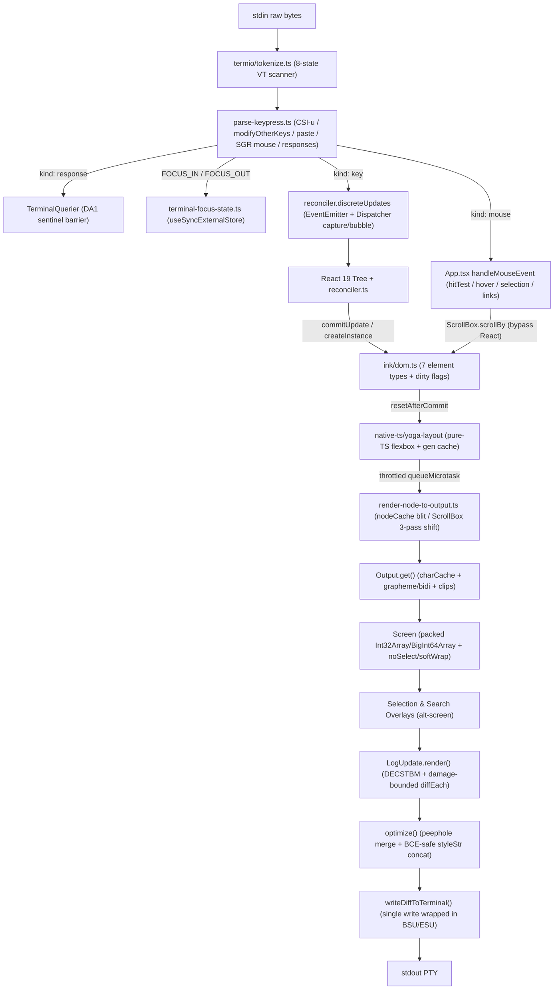

# 20. Inside `ink/`: A Custom React Renderer for the Terminal

> **Status: written.** Reverse-engineered from the Claude Code 2.1.88 source snapshot (see the Prologue (`prologue-how-to-read-a-1900-file-agent.md`) for snapshot caveats).
>
> **Layer:** Layer 7 (The Terminal UI Engine)
> **Prerequisites:** [Chapter 01](ch001-atoms-types-stores-and-primitives.md), [Chapter 19](ch019-agent-teams-swarms-and-coordinator-mode.md)
> **Primary Source Files:**
> - `ink/dom.ts` — Custom terminal DOM nodes, dirty-flag propagation, text measurement, and Yoga tree wiring
> - `ink/reconciler.ts` — React 19 `react-reconciler` host config, prop diffing, event priority bridge, and commit hooks
> - `ink/root.ts` & `ink/ink.tsx` — `createRoot` / `Ink` orchestrator: double-buffered frames, resize/SIGCONT, alt-screen, IME cursor parking, and shutdown cleanup
> - `ink/layout/yoga.ts` & `native-ts/yoga-layout/index.ts` — Layout adapter and 2,578-line pure-TypeScript port of Meta's Yoga flexbox engine
> - `ink/renderer.ts`, `ink/render-node-to-output.ts`, & `ink/output.ts` — Subtree blitting, `ScrollBox` culling/drain/shift fast path, grapheme clustering, and deferred paint pipeline
> - `ink/screen.ts` — Packed 64-bit-per-cell `Screen` typed-array buffer, intern pools, `noSelect`/`softWrap` bitmaps, and `diffEach`
> - `ink/log-update.ts`, `ink/optimizer.ts`, & `ink/terminal.ts` — Virtual cursor diffing, `DECSTBM` hardware scroll, patch peephole optimizer, and `DEC 2026` synchronized output
> - `ink/parse-keypress.ts`, `ink/termio/tokenize.ts`, & `ink/terminal-querier.ts` — Streaming VT input tokenizer, Kitty/CSI-u/`modifyOtherKeys`/mouse parser, and timeout-free `DA1` sentinel querier
> - `ink/focus.ts`, `ink/terminal-focus-state.ts`, `ink/hit-test.ts`, `ink/selection.ts`, & `ink/supports-hyperlinks.ts` — Focus management, mouse hit-testing/hover, fullscreen text selection, and OSC 8 hyperlinks
> - `ink/components/App.tsx` & `ink/components/AlternateScreen.tsx` — Raw-mode `stdin` loop, multi-click/drag/hover state machine, and DEC 1049 alt-screen lifecycle

---

## Why This Layer Exists

By the end of Layer 6, the harness can stream tokens from the model, orchestrate concurrent tools, manage background tasks, and coordinate multi-agent swarms. Now all of that concurrent activity has to land inside a 2D monospace grid connected over a PTY—potentially tunneled through `tmux`, `ssh`, VS Code's `xterm.js`, or Windows `conhost`—while running at 60 FPS (`FRAME_INTERVAL_MS = 16` in `ink/constants.ts`).

A natural first question when opening this repository is: **why maintain a 96-file vendored fork of Ink (`ink/`) plus a 2,578-line pure-TypeScript port of Meta's Yoga layout engine (`native-ts/yoga-layout/index.ts`) instead of installing stock `ink` from npm?**

Stock Ink was built for short-lived CLI widgets: it flattens the tree to strings each frame, erases and rewrites lines via `log-update`, loads Yoga as an async WASM binary, and treats terminals as write-only output streams with rudimentary keypress parsing. Every one of those assumptions breaks under an interactive coding agent:

1. **Streaming diffs & spinners destroy string-based rendering.** Re-tokenizing ANSI strings and rewriting 100+ rows on every 16 ms spinner tick causes visible flicker, tears frames across `tmux` chunk boundaries, and creates massive GC pressure.
2. **WASM Yoga imposes startup latency, async init races, and linear-memory growth.** Long-lived sessions that mount and unmount thousands of message nodes hit WASM heap overhead and dangling-pointer hazards.
3. **Alternate-screen (`DEC 1049`) + mouse tracking breaks native terminal ergonomics.** The moment a TUI enables SGR mouse tracking (`DEC 1000/1002/1003/1006`) for wheel scrolling and clickable controls, the terminal stops doing native click-drag text selection, double-click word selection, and Cmd+Click URL opening. The renderer must re-implement all of them faithfully—down to soft-wrap logical-line joining, `<NoSelect>` diff gutters, and clipboard fallback chains.
4. **Modern keyboard & terminal diversity cannot be solved with regex hacks.** Disambiguating `Shift+Enter` or `Ctrl+Shift+C` requires both Kitty's `CSI u` protocol and xterm's `modifyOtherKeys`, while CJK IME composition requires parking the physical terminal cursor at the React input caret without breaking relative cursor diffs.

What lives in `ink/` is therefore less a CLI helper and more a **browser-grade terminal compositor** built directly on `react-reconciler`.

> [!NOTE]
> **Snapshot notes:** Functional `.tsx` components inside `ink/` (such as `ink/components/AlternateScreen.tsx`, `ink/components/Link.tsx`, and `ink/components/TerminalFocusContext.tsx`) appear in this checkout after the React Compiler memoization pass (`const $ = _c(...)` from `react/compiler-runtime`), while class components like `ink/components/App.tsx` and `ink/ink.tsx` remain untransformed. Three auxiliary files imported inside `ink/` are **absent from the snapshot** and observed only at call sites: `ink/cursor.ts` (type `Cursor = { x: number; y: number; visible: boolean }` in `ink/frame.ts`:1), `ink/devtools.ts` (dev-only dynamic import in `ink/reconciler.ts`:36), and `ink/global.d.ts` (JSX intrinsic declarations imported in `ink/components/Box.tsx`:2 and `ink/components/ScrollBox.tsx`:8). There are no build-time `feature()` gates inside `ink/` or `native-ts/yoga-layout/`; the sole build/user-tier gate is `process.env.USER_TYPE === 'ant'` in `ink/termio/osc.ts`:468 for experimental OSC 21337 tab status indicators.

---

## 1. Custom DOM Nodes, React 19 Reconciliation, and Pure-TS Yoga Layout

### The Problem

React produces a fiber tree of components, props, and text strings; Yoga computes 2D flexbox rectangles. Bridging them naively creates three acute failure modes:

- **Spurious invalidation:** React allocates fresh `style`, `textStyles`, `children`, and event-handler closures on every render. Passing them blindly to the host node marks subtrees dirty, forcing full Yoga re-measurement and defeating screen-buffer blitting.
- **Commit-phase timing skew:** `react-reconciler` invokes `resetAfterCommit()` *before* React's layout phase (`ref` attachment and `useLayoutEffect`). Painting synchronously inside `resetAfterCommit()` leaves anything declared in `useLayoutEffect`—especially the native IME cursor position from `useDeclaredCursor`—lagging one keystroke behind.
- **Pathological flexbox relayout cascades:** In a 500-message `ScrollBox`, dirtying one leaf (such as a streaming assistant token) causes Yoga's measure→layout recursion to visit clean siblings with multiple constraint combinations, thrashing a single-slot layout cache into $O(2^{\text{depth}})$ visits.

### The Real Implementation

#### Seven Host Elements and Dirty Propagation (`ink/dom.ts`)

The custom DOM defines exactly seven element node names plus `#text`:

```ts
// ink/dom.ts:18-26, 110-132
export type TextName = '#text'
export type ElementNames =
  | 'ink-root'
  | 'ink-box'
  | 'ink-text'
  | 'ink-virtual-text'
  | 'ink-link'
  | 'ink-progress'
  | 'ink-raw-ansi'

export const createNode = (nodeName: ElementNames): DOMElement => {
  const needsYogaNode =
    nodeName !== 'ink-virtual-text' &&
    nodeName !== 'ink-link' &&
    nodeName !== 'ink-progress'
  const node: DOMElement = {
    nodeName,
    style: {},
    attributes: {},
    childNodes: [],
    parentNode: undefined,
    yogaNode: needsYogaNode ? createLayoutNode() : undefined,
    dirty: false,
  }

  if (nodeName === 'ink-text') {
    node.yogaNode?.setMeasureFunc(measureTextNode.bind(null, node))
  } else if (nodeName === 'ink-raw-ansi') {
    node.yogaNode?.setMeasureFunc(measureRawAnsiNode.bind(null, node))
  }

  return node
}
```

Three design details in `createNode` and `dom.ts` do heavy lifting:

1. **Inline nodes do not allocate Yoga nodes.** Nested `<Text>` elements become `ink-virtual-text` via `HostContext.isInsideText` (`ink/reconciler.ts`:342-345); `<Link>` emits `ink-link`; progress bars emit `ink-progress`. Because their `yogaNode` is `undefined`, `insertBeforeNode` (`ink/dom.ts`:168-186) cannot pass the DOM child index to Yoga—it counts preceding children that actually possess a `yogaNode` to compute `yogaIndex`.
2. **`ink-raw-ansi` fast-paths pre-rendered output.** Syntax-highlighted diffs (`ColorDiff`) already know their exact terminal dimensions and wrapped ANSI lines. `measureRawAnsiNode` (`ink/dom.ts`:379-387) simply returns `{ width: rawWidth, height: rawHeight }`—zero `stringWidth()`, zero wrapping, zero tab expansion.
3. **Value-equality dirty guards and side-channel event handlers.** `setStyle` and `setTextStyles` perform `shallowEqual` before calling `markDirty(node)` (`ink/dom.ts`:266-289), `setAttribute` ignores `children` and unchanged scalars, and `reconciler.ts` stores event handlers on `node._eventHandlers` rather than `node.attributes` (`ink/dom.ts`:48-51, `ink/reconciler.ts`:114-143) so inline callback identity changes never dirty the node or defeat blitting. When `markDirty(node)` runs (`ink/dom.ts`:393-413), it walks `parentNode` up to `ink-root` setting `.dirty = true`, and calls `yogaNode.markDirty()` on the first enclosing leaf with a measure function (`ink-text` or `ink-raw-ansi`).

#### React 19 Host Config and the Microtask Paint Boundary (`ink/reconciler.ts`, `ink/ink.tsx`)

`ink/reconciler.ts` constructs a `ConcurrentRoot` reconciler targeting React 19 (`commitUpdate` receives `oldProps` and `newProps` directly rather than a React 18 `updatePayload`; `maySuspendCommit` / `HostTransitionContext` / `resolveUpdatePriority` are implemented). Notice how `reconciler.ts` wires the event `Dispatcher` (`ink/events/dispatcher.ts`) into `resolveUpdatePriority`, `resolveEventType`, and `resolveEventTimeStamp`, then injects `dispatcher.discreteUpdates = reconciler.discreteUpdates.bind(reconciler)` at module end (`ink/reconciler.ts`:510) to break the circular import.

Inside `resetAfterCommit(rootNode)` (`ink/reconciler.ts`:247-315):
1. It synchronously calls `rootNode.onComputeLayout()`—which runs `yogaNode.calculateLayout(this.terminalColumns)` (`ink/ink.tsx`:239-258)—*before* React runs `useLayoutEffect`, so layout effects read fresh Yoga geometry.
2. In test mode (`NODE_ENV === 'test'`), it skips empty post-content commits (guarding against React 19's effect double-invoke) and calls `onImmediateRender()`.
3. In production, it calls `rootNode.onRender()`, which points to a throttled microtask scheduler:

```ts
// ink/ink.tsx:212-216
const deferredRender = (): void => queueMicrotask(this.onRender);
this.scheduleRender = throttle(deferredRender, FRAME_INTERVAL_MS, {
  leading: true,
  trailing: true
});
```

That single `queueMicrotask` solves the commit-phase timing skew: React finishes attaching refs and running `useLayoutEffect` (including `useDeclaredCursor`) synchronously after `resetAfterCommit()`, and then `this.onRender` runs in the microtask queue of the *exact same event-loop turn*—zero keystroke lag for CJK IME preedit text, zero frame-rate penalty.

#### Pure-TypeScript Yoga and Generation-Stamped Layout Caching (`native-ts/yoga-layout/index.ts`)

Behind the thin adapter `ink/layout/yoga.ts`, the entire flexbox engine is implemented in pure TypeScript inside `native-ts/yoga-layout/index.ts`. There is no WASM binary, no linear-memory allocator, and no async initialization. Yet `ink/root.ts`:111-115 and `137-138` retain a telling production scar:

```ts
// ink/root.ts:111-116
// Preserve the microtask boundary that `await loadYoga()` used to provide.
// Without it, the first render fires synchronously before async startup work
// (e.g. useReplBridge notification state) settles, and the subsequent Static
// write overwrites scrollback instead of appending below the logo.
await Promise.resolve()
const instance = renderSync(node, options)
```

To make pure-TS flexbox fast enough for 60 FPS scrolling over deep transcript trees, `layoutNode()` in `native-ts/yoga-layout/index.ts`:1058-1194 uses a **three-tier cache** (`_hasL` single-slot layout cache, `_cIn`/`_cOut` multi-entry cache, and `_hasM` measure cache) stamped with a monotonic `_generation` counter incremented on every `calculateLayout()`:

```ts
// native-ts/yoga-layout/index.ts:1086-1134 (abridged single-slot checks)
const sameGen = node._cGen === _generation && !performLayout
if (!node.isDirty_ || sameGen) {
  if (!node.isDirty_ && node._hasL && /* mode/force/size match */) {
    _yogaCacheHits++
    layout.width = node._lOutW
    layout.height = node._lOutH
    return
  }
  if (node._cN > 0 && (sameGen || !node.isDirty_)) {
    const cIn = node._cIn!
    for (let i = 0; i < node._cN; i++) {
      const o = i * 8
      if (
        cIn[o + 2] === widthMode &&
        cIn[o + 3] === heightMode &&
        cIn[o + 6] === (forceWidth ? 1 : 0) &&
        cIn[o + 7] === (forceHeight ? 1 : 0) &&
        sameFloat(cIn[o]!, availableWidth) &&
        sameFloat(cIn[o + 1]!, availableHeight) &&
        sameFloat(cIn[o + 4]!, ownerWidth) &&
        sameFloat(cIn[o + 5]!, ownerHeight)
      ) {
        layout.width = node._cOut![i * 2]!
        layout.height = node._cOut![i * 2 + 1]!
        _yogaCacheHits++
        return
      }
    }
  }
```

As the inline benchmark note explains, adding the multi-entry cache plus same-generation measure bypass cut a single dirty-leaf relayout in a 500-message scrollbox from **76,000 `layoutNode` visits (6.86 ms) to 4,000 visits (550 µs)**, and cut fresh virtual-scroll mounts from 105,000 visits to ~10,000.

### Hidden Invariants & Failure Modes

- **Never clear `isDirty_` on the measure pass:** `layoutNode()` clears `node.isDirty_ = false` *only* when `performLayout === true` (`native-ts/yoga-layout/index.ts`:1152-1194). Clearing it during the earlier measure pass (`performLayout === false`) lets the layout pass immediately hit a stale `_hasL` entry from the prior frame, so `ScrollBox` content height never grows and sticky-scroll stops following streaming tokens.
- **Explicit reference clearing before Yoga teardown:** Even though TS Yoga is GC-managed, `cleanupYogaNode` (`ink/reconciler.ts`:95-104) still unsets measure functions, recursively nulls `yogaNode` references via `clearYogaNodeReferences()` (`ink/dom.ts`:446-453), and calls `freeRecursive()`—while `Ink.unmount()` (`ink/ink.tsx`:1526) calls `.free()` (not `.freeRecursive()`) on `rootNode` because `removeChildFromContainer` already freed the children, keeping `getYogaCounters().live` accurate as a leak detector.
- **Built-in repaint forensics:** Setting `CLAUDE_CODE_DEBUG_REPAINTS` causes `createInstance` (`ink/reconciler.ts`:354-356) to walk React's internal `_debugOwner` / `return` fiber chain (`getOwnerChain`) and attach `debugOwnerChain` to every DOM node, so `findOwnerChainAtRow(root, triggerY)` (`ink/dom.ts`:465-484) can blame the exact React component that triggered a scrollback flicker. Setting `CLAUDE_CODE_COMMIT_LOG` logs slow commits, `SLOW_YOGA` (>20 ms with `getYogaCounters()`), and `SLOW_PAINT` (>10 ms).

---

## 2. Painting the Tree: Blitting, ScrollBox Culling, and the Packed `Screen` Buffer

### The Problem

Once Yoga finishes `calculateLayout()`, the renderer must rasterize a tree of styled boxes, wrapped Unicode text, borders, and scrollable viewports into a 2D character grid every 16 ms. Two performance cliffs dominate this stage:

1. **Cell allocation pressure:** A 200×120 terminal has 24,000 cells. Allocating an object per cell per frame (times two frames for diffing) thrashes the nursery allocator and stalls interactive typing.
2. **Wasted re-rasterization:** During token streaming or spinner animation, >95% of the terminal is visually identical to the previous frame—or shifted vertically by $N$ rows during scrolling. Re-running ANSI tokenization, `Intl.Segmenter` grapheme clustering, and bidi reordering across the whole viewport wastes milliseconds on every tick.

### The Real Implementation

#### The Packed 64-Bit-Per-Cell `Screen` Buffer (`ink/screen.ts`)

`Ink` maintains a double-buffered pair of `Frame` objects (`frontFrame` and `backFrame`, `ink/ink.tsx`:99-100) backed by grow-only `Screen` buffers that are zeroed and reused via `resetScreen()` rather than reallocated. Each `Screen` allocates a single `ArrayBuffer` (`width * height * 8` bytes) with **two typed-array views over the same memory**:

- `cells: Int32Array` (2 words per cell) for fast per-cell reads/writes and integer diffing.
- `cells64: BigInt64Array` (1 `BigInt64` per cell) for single-call bulk clears (`cells64.fill(0n, 0, size)`) and in-place row shifting (`cells64.copyWithin(...)` in `shiftRows`).

```ts
// ink/screen.ts:332-348
// Each cell is 2 consecutive Int32 elements in the cells array:
//   word0 (cells[ci]):     charId (full 32 bits)
//   word1 (cells[ci + 1]): styleId[31:17] | hyperlinkId[16:2] | width[1:0]
const STYLE_SHIFT = 17
const HYPERLINK_SHIFT = 2
const HYPERLINK_MASK = 0x7fff // 15 bits
const WIDTH_MASK = 3 // 2 bits

function packWord1(
  styleId: number,
  hyperlinkId: number,
  width: number,
): number {
  return (styleId << STYLE_SHIFT) | (hyperlinkId << HYPERLINK_SHIFT) | width
}
```

Three interning pools—shared across both frames so cell comparisons are pure integer equality—sit beside the buffer:

1. **`CharPool` (`ink/screen.ts`:21-53):** Reserves index `0` for `' '` and `1` for `''` (spacer cells), with a 128-entry `Int32Array` ASCII fast path bypassing `Map.get`. Because `StylePool.none === 0`, an unwritten cell is `[0, 0]` (`0n`), indistinguishable from an explicitly cleared cell without normalization.
2. **`HyperlinkPool` (`ink/screen.ts`:57-75):** Reserves `0` for "no hyperlink" and interns URLs into 15-bit IDs. Both `CharPool` and `HyperlinkPool` undergo generational migration (`migrateScreenPools`, `ink/screen.ts`:554-587) every 5 minutes (`ink/ink.tsx`:600-603) so long sessions never leak unique grapheme clusters or URLs.
3. **`StylePool` (`ink/screen.ts`:112-260):** Session-lived (never reset, so `Output.charCache` can cache `styleId` across frames). Encodes a clever bit-0 invariant: `id = (rawId << 1) | (hasVisibleSpaceEffect ? 1 : 0)`. Styles with background color, inverse, underline, strikethrough, or overline get **odd** IDs; foreground-only styles get **even** IDs. In `visibleCellAtIndex()` (`ink/screen.ts`:624-650), checking `(word1 & 0x3fffc) === 0` tests hyperlink ID + style visibility bit in one mask so invisible or fg-only spaces can be skipped with cursor-forward instead of allocating a `Cell` view. `StylePool.transition(fromId, toId)` caches the pre-serialized ANSI transition string keyed by `fromId * 0x100000 + toId`.

Two parallel sidecar typed arrays complete `Screen`:
- `noSelect: Uint8Array` (1 byte/cell): Fenced off by `<NoSelect>` (e.g., diff line numbers and `⎿` prefixes).
- `softWrap: Int32Array` (1 Int32/row): `softWrap[r] = N > 0` records that row `r` is a word-wrap continuation of row `r - 1` *and* that row `r - 1`'s actual written content ended at column `N`—solving the ambiguity between unwritten padding spaces and genuine word-separator spaces (both pack as `[0, 0]`) when copying wrapped prose.

#### Deferred Paint Pipeline, Clean-Subtree Blitting, and the ScrollBox Fast Path

`ink/renderer.ts` reuses a single `Output` instance across frames so `Output.charCache` (capped at 16,384 entries, `ink/output.ts`:204) preserves tokenized, grapheme-clustered (`getGraphemeSegmenter()`), bidi-reordered (`reorderBidi()`), pre-interned `ClusteredChar[]` arrays per unique text line. `renderNodeToOutput()` (`ink/render-node-to-output.ts`) walks the DOM tree and records seven deferred operation types into `Output`: `clear`, `clip`, `unclip`, `blit`, `shift`, `write`, and `noSelect`.

Two optimizations make 60 FPS steady-state rendering possible:

1. **Clean-subtree blitting (`nodeCache`):** Every painted `DOMElement` caches its `{ x, y, width, height, top }` in a `WeakMap` (`ink/node-cache.ts`). On the next frame, if `!node.dirty`, layout coordinates are unchanged, and `prevScreen` is clean, `renderNodeToOutput()` (`ink/render-node-to-output.ts`:454-482) emits a single `output.blit(prevScreen, fx, fy, fw, fh)`—which executes a contiguous `TypedArray.set()` copy of `cells`, `noSelect`, and `softWrap` in `ink/screen.ts`:858-952—plus `blitEscapingAbsoluteDescendants()` so floating overlays (like slash-command menus with `position='absolute' bottom='100%'`) survive a parent blit.
2. **DOM-bypass scrolling & three-pass `blit + shift`:** In `ink/components/ScrollBox.tsx`:103-117, `scrollTo()` and `scrollBy()` **bypass React's reconciler completely**: they mutate `el.scrollTop` / `el.pendingScrollDelta` on the DOM node, call `markScrollActivity()` (telling background IDE/LSP polls to skip a tick), call `markDirty(el)`, and coalesce multiple wheel events in one `discreteUpdates` batch via `queueMicrotask(() => scheduleRenderFrom(el))`.
   - At paint time (`ink/render-node-to-output.ts`:803-850), `pendingScrollDelta` is drained via `drainProportional` (3/4 of remaining, min 4 rows, capped at `innerHeight - 1` so `DECSTBM` triggers) on native terminals, or `drainAdaptive` (instant for ≤5 rows, 2–3 rows/frame for bursts) on `xterm.js` / VS Code, and visually clamped to `[scrollClampMin, scrollClampMax]` so rapid `PageUp` bursts never flash blank virtual-scroll spacers while React catches up.
   - When the scroll delta fits inside the viewport (`|delta| < innerHeight`) and `heightDelta === 0 || (delta > 0 && heightDelta === delta)`, `renderNodeToOutput()` (`ink/render-node-to-output.ts`:917-1105) records a `ScrollHint` for hardware scrolling and executes a **three-pass fast path**:
     - *Pass 1:* `output.blit` the previous scroll region, `output.shift(top, bottom, delta)` in place, clip strictly to the newly exposed edge rows, and render only children intersecting those edge rows.
     - *Pass 2:* Re-render dirty children in stable rows and any clean children below a mid-list height growth (tracking `cumHeightShift` so bottom-append stays $O(\text{dirty})$ instead of $O(\text{mounted})$).
     - *Pass 3:* Repair rows where shifted copies of `position: absolute` overlays (recorded in `absoluteRectsPrev`) landed inside the scrolled region.

### Hidden Invariants & Failure Modes

- **Wide-character orphan prevention:** Double-wide CJK/emoji characters occupy two cells: `CellWidth.Wide` at `x` and `CellWidth.SpacerTail` at `x + 1` (plus `CellWidth.SpacerHead` at the right margin when a wide char cannot fit at `screenWidth - 1`). Overwriting *either* half in `setCellAt()` (`ink/screen.ts`:703-808) or clipping across a boundary in `clearRegion()` (`ink/screen.ts`:998-1028) explicitly clears the orphaned partner cell and expands `screen.damage`—otherwise a lingering `SpacerTail` is skipped by the diff engine and ghosts stale text from prior frames.
- **Blit contamination rules:** `output.clear()` only expands `screen.damage` (because `resetScreen` already zeroed the buffer), so blitting from a polluted `prevScreen` can resurrect deleted overlays. Five guards prevent ghosting: (a) `collectRemovedRects` (`ink/dom.ts`:225-245) sets a global `absoluteNodeRemoved` flag if *any* removed node or ancestor had `position: 'absolute'`, disabling blit for one frame; (b) `prevFrameContaminated` (`ink/ink.tsx`:159, 743) disables blit whenever selection/search overlays mutated `frontFrame` or after alt-screen/resize resets; (c) `renderChildren` (`ink/render-node-to-output.ts`:1257-1294) disables sibling blit after an unclipped dirty child (`seenDirtyChild`) while still allowing clean siblings *after* a both-axis-clipped `ScrollBox` to blit (`seenDirtyClipped` only forces `skipSelfBlit` on non-opaque absolute overlays); (d) `didLayoutShift()` forces full-screen damage in `ink/ink.tsx`:559-566 as a correctness backstop against sibling-resize boundary bleed; and (e) `noSelect` ops apply *last* in `Output.get()` (`ink/output.ts`:510-520) so they always override blits.
- **Drain-timer vs. lodash throttle bug:** When `frame.scrollDrainPending` is true, `Ink.onRender()` schedules the next drain frame with `setTimeout(() => this.onRender(), FRAME_INTERVAL_MS >> 2)` (~250 fps floor) rather than `this.scheduleRender()` (`ink/ink.tsx`:745-759). Calling lodash's `throttle` from inside its own trailing-edge invocation hits `leadingEdge` immediately, causing back-to-back renders 0.1 ms apart.
- **Sanitizing stray C0/escape bytes:** `writeLineToScreen` (`ink/output.ts`:659-757) expands `\t` to 8-column tab stops, drops `\r`/`\b`/zero-width combining codepoints, and parses/skips any raw CSI/OSC/DCS/APC/PM/SOS sequences that `@alcalzone/ansi-tokenize` left unparsed so untrusted tool output cannot hijack the terminal cursor.

---

## 3. Diffing, Peephole Optimization, Synchronized Output, and Alt-Screen Lifecycle

### The Problem

Having two packed `Screen` buffers is only half the battle. Turning the difference into minimal, flicker-free ANSI bytes requires modeling the terminal's stateful cursor and graphics attributes without ever letting the virtual model diverge from the physical emulator—across `iTerm2`, `Ghostty`, `kitty`, `WezTerm`, `Alacritty`, `VS Code`/`xterm.js`, `tmux`, and Windows Terminal.

### The Real Implementation

#### Zero-Allocation Diffing and Hardware Scrolling (`ink/log-update.ts`)

`LogUpdate.render(prev, next, altScreen, decstbmSafe)` translates `(prevFrame, nextFrame)` into a `Patch[]` array:

1. **Resize and offscreen scrollback guards:** On main screen, shrinking height from overflowing-viewport back into viewport, narrowing width, or modifying any row `y < viewportY` (where `viewportY = prev.screen.height - prev.viewport.height + (prevHadScrollback ? 1 : 0)`, accounting for the `+1` row scrolled off by the previous frame's trailing LF) is unreachable via relative cursor moves. `LogUpdate` falls back to `fullResetSequence_CAUSES_FLICKER()` (`ink/log-update.ts`:503-513), emitting a `clearTerminal` patch that `Ink.onRender()` records in `FrameEvent.flickers` and attributes via `findOwnerChainAtRow()`.
2. **`DECSTBM` hardware scroll fast path:** When `altScreen && next.scrollHint && decstbmSafe`, `LogUpdate` mutates `prev.screen` with `shiftRows()` to mirror what the terminal is about to do, then prepends a single hardware-scroll patch:

```ts
// ink/log-update.ts:165-185
let scrollPatch: Diff = []
if (altScreen && next.scrollHint && decstbmSafe) {
  const { top, bottom, delta } = next.scrollHint
  if (
    top >= 0 &&
    bottom < prev.screen.height &&
    bottom < next.screen.height
  ) {
    shiftRows(prev.screen, top, bottom, delta)
    scrollPatch = [
      {
        type: 'stdout',
        content:
          setScrollRegion(top + 1, bottom + 1) +
          (delta > 0 ? csiScrollUp(delta) : csiScrollDown(-delta)) +
          RESET_SCROLL_REGION +
          CURSOR_HOME,
      },
    ]
  }
}
```

Because `prev.screen` was shifted in lockstep, the subsequent `diffEach()` sees **only the newly exposed edge rows** (plus any dirty/repaired cells) as changed—cutting scroll output from tens of kilobytes to ~200 bytes. Crucially, `ink.tsx:586-591` passes `decstbmSafe = SYNC_OUTPUT_SUPPORTED`. Under `tmux`, `SYNC_OUTPUT_SUPPORTED` is `false` (`ink/terminal.ts`:70-74) because `tmux` chunks proxied output and breaks `DEC 2026` atomicity; omitting `DECSTBM` there avoids flashing blank scrolled edge rows.

3. **Integer-scanned `diffEach` (`ink/screen.ts`:1156-1372):** Computes the bounding box `unionRect(prev.damage, next.damage)` (plus grown/shrunk edge bands) and scans rows with a tiny JIT-inlinable loop (`findNextDiff`, comparing `a[w0] !== b[w0] || a[w1] !== b[w1]`). It unpacks differing cells into **two reused `Cell` scratch objects**—zero heap allocations per cell diff—and drives `VirtualScreen` to emit relative cursor moves, `StylePool.transition()` strings, hyperlink transitions, and character writes.

#### Single-Pass Patch Optimizer and Synchronized Output (`ink/optimizer.ts`, `ink/terminal.ts`)

`optimize(diff)` (`ink/optimizer.ts`:16-93) folds the `Patch[]` list in one pass: stripping empty `stdout`/zero `cursorMove`/`clear(0)`, merging adjacent `cursorMove` vectors, collapsing consecutive `cursorTo`, deduplicating identical `hyperlink` URIs, and cancelling adjacent `cursorHide`/`cursorShow` pairs.

One subtle scar sits at `ink/optimizer.ts`:58-66:

```ts
// ink/optimizer.ts:58-66
// Concat adjacent style patches. styleStr is a transition diff
// (computed by diffAnsiCodes(from, to)), not a setter — dropping
// the first is only sound if its undo-codes are a subset of the
// second's, which is NOT guaranteed. e.g. [\e[49m, \e[2m]: dropping
// the bg reset leaks it into the next \e[2J/\e[2K via BCE.
if (type === 'styleStr' && lastType === 'styleStr') {
  result[lastIdx] = { type: 'styleStr', str: last.str + patch.str }
  continue
}
```

Dropping an earlier `styleStr` would discard its reset codes (like `\x1b[49m`), causing Background Color Erase (BCE) to paint erased rows with a stale background color.

Finally, `writeDiffToTerminal()` (`ink/terminal.ts`:190-248) serializes the optimized patches into a **single string** wrapped in `BSU` (`\x1b[?2026h`) and `ESU` (`\x1b[?2026l`)—unless `skipSyncMarkers` is set (alt-screen on non-DEC-2026 terminals like `tmux`)—and flushes it in one `terminal.stdout.write(buffer)` syscall.

#### Alt-Screen (`DEC 1049`), Resize Atomicity, and Native Cursor Parking

Fullscreen mode is mounted declaratively via `<AlternateScreen>` (`ink/components/AlternateScreen.tsx`), which wraps children in a fixed-height `<Box height={rows} width="100%" flexShrink={0}>` and enters/exits `DEC 1049` inside **`useInsertionEffect`** (not `useLayoutEffect`). Why? Because `react-reconciler` runs `resetAfterCommit()` between the mutation and layout phases; `useLayoutEffect` fires *after* frame 1 has already painted to the main screen, corrupting scrollback when the user later exits. Insertion effects fire during the mutation phase, guaranteeing `ENTER_ALT_SCREEN` lands on stdout before frame 1.

Five cooperating invariants keep alt-screen rendering completely flicker-free and drift-proof:

1. **Fake `viewport.height = terminalRows + 1` & clamped `cursor.y` (`ink/renderer.ts`:152-175):** `shouldClearScreen()` treats `screen.height >= viewport.height` as main-screen scrollback overflow. Adding `+1` prevents spurious `fullResetSequence_CAUSES_FLICKER`, while clamping `cursor.y` to `terminalRows - 1` keeps the cursor inside the viewport so no trailing LF scrolls the alt buffer.
2. **Blank `rows×cols` seed frames (`resetFramesForAltScreen`, `ink/ink.tsx`:984-1009):** Seeding `frontFrame` as `0×0` would make `LogUpdate` see `heightDelta > 0` (`growing`) and run `renderFrameSlice`, whose per-row `\r\n` on the final row scrolls the alt buffer by one row. Seeding a full `rows×cols` blank buffer forces `heightDelta === 0` so every cell writes via cursor positioning without ever emitting LF.
3. **Self-healing `CSI H` anchor & bottom park (`ink/ink.tsx`:45-66, 568-584, 624-651):** Every non-empty alt-screen diff is computed from `ALT_SCREEN_ANCHOR_CURSOR` `(0, 0)`, prefixed with `CSI H` (healing any out-of-band cursor drift from `tmux` status bars or pane redraws), and suffixed with `cursorPosition(terminalRows, 1)` so `iTerm2`'s cursor guide doesn't jump wildly around the viewport.
4. **Atomic resize erase (`handleResize` + `needsEraseBeforePaint`, `ink/ink.tsx`:309-346, 636-649):** `handleResize` is deliberately **not debounced** (debouncing opens a window where `stdout.columns` is new while Yoga is old, triggering a double clear-flicker). It never writes `ENTER_ALT_SCREEN` (iTerm2 treats `?1049h` as a buffer clear even when already in alt-screen) and never writes `ERASE_SCREEN` synchronously (which would leave the terminal blank during the ~80 ms React re-render). Instead it sets `needsEraseBeforePaint = true`, prepending `ERASE_SCREEN + CURSOR_HOME` *inside* the next frame's `BSU`/`ESU` block so clear + paint swap atomically.
5. **Native cursor parking (`useDeclaredCursor` + `displayCursor`, `ink/ink.tsx`:660-734):** After the diff, `onRender` looks up the declared node's fresh screen rect in `nodeCache`, moves the physical terminal cursor to `(rect.x + relativeX, rect.y + relativeY)` so OS CJK IME preedit overlays and screen magnifiers track the input caret, and remembers `this.displayCursor` on main-screen so the *next* frame's preamble moves back to `prevFrame.cursor` before relative diffs execute.

### Hidden Invariants & Failure Modes

- **Emoji `wcwidth` drift compensation (`ink/log-update.ts`:662-681, 733-750):** For Unicode 12+ pictographs (`U+1FA70–U+1FBFF`) and text-by-default emoji carrying VS16 (`U+FE0F`, e.g., `⚔️`, `❤️`), older terminal `wcwidth` tables advance the cursor 1 column instead of 2. `writeCellWithStyleStr` writes a styled space at `col + 1`, moves back, writes the glyph, and emits `CHA` (`cursorTo(px + 3)`) to force-lock the terminal cursor column. On modern terminals the `CHA` is a harmless no-op; on old terminals it prevents permanent row corruption.
- **Stray `stderr` interception (`ink/ink.tsx`:1604-1639):** `patchConsole()` only intercepts `console.*`, not direct `process.stderr.write()` calls from dependencies. `patchStderr()` intercepts raw stderr writes (with a `reentered` guard so `--debug-to-stderr` doesn't stack-overflow), routes them to the debug log, and sets `prevFrameContaminated = true` + `scheduleRender()` in alt-screen to heal any damage.
- **Kitty keyboard stack balance & external editor handoff (`ink/ink.tsx`:357-419, 875-919):** Unlike idempotent DEC private modes, Kitty's `CSI >1u` (`ENABLE_KITTY_KEYBOARD`) pushes onto a **stack**. Whenever Ink re-asserts terminal modes—after returning from an external editor (`exitAlternateScreen`), `SIGCONT`, or a >5-second stdin silence gap (`STDIN_RESUME_GAP_MS = 5000` in `ink/components/App.tsx`:35, catching `tmux` detach/reattach, SSH reconnect, and laptop sleep/wake)—it writes `DISABLE_KITTY_KEYBOARD + ENABLE_KITTY_KEYBOARD + ENABLE_MODIFY_OTHER_KEYS` (**pop before push**). Because popping an empty stack is a spec no-op, stack depth stays pinned at 1 and a single pop on exit leaves the user's shell clean.
- **Shutdown cleanup and non-blocking `/dev/tty` drain (`ink/ink.tsx`:921-950, 1480-1505, 1664-1718):** `unmount()` uses synchronous `writeSync(1, ...)` to exit alt-screen *first*, unconditionally disable mouse tracking, Kitty, `modifyOtherKeys`, focus events (`DFE`), bracketed paste (`DBP`), restore the cursor, and clear iTerm2 progress / OSC 21337 tab status. It then runs `drainStdin()`, which briefly re-enters raw mode and opens a fresh `/dev/tty` descriptor with `O_RDONLY | O_NONBLOCK` (bounded to 64×1 KB reads) to drain kernel-buffered in-flight mouse bytes so they never spill onto the shell prompt. `detachForShutdown()` prevents `signal-exit` from running a duplicate `EXIT_ALT_SCREEN` after `gracefulShutdown` has already printed the resume hint.

---

## 4. Terminal I/O Protocols: Keyboard Parsing, Querying, Focus, Mouse Hit-Testing, Selection, and Hyperlinks

### The Problem

Everything coming back from the terminal—human keystrokes, multi-kilobyte pastes, SGR/X10 mouse coordinates, focus gain/loss notifications, and responses to capability queries—arrives concatenated over a single raw-mode `stdin` stream, arbitrarily fragmented across `read()` chunks. Worse, once alt-screen mouse tracking is enabled, the application owns *every* pointer interaction: clicking buttons, hovering, single/double/triple-click selection, drag-to-scroll, and opening links.

### The Real Implementation

#### Streaming Tokenization, Extended Keys, and Batch Dispatch (`ink/termio/tokenize.ts`, `ink/parse-keypress.ts`, `ink/components/App.tsx`)

When any component enables raw mode (reference-counted via `rawModeEnabledCount` in `ink/components/App.tsx`:209-280), `App` stops early-input capture (`stopCapturingEarlyInput()`), puts `stdin` into raw UTF-8 mode, enables bracketed paste (`EBP`), DECSET 1004 focus reporting (`EFE`), and—for allowlisted emulators (`EXTENDED_KEYS_TERMINALS`: `iTerm.app`, `kitty`, `WezTerm`, `ghostty`, `tmux`, `windows-terminal` in `ink/terminal.ts`:156-169)—writes both `ENABLE_KITTY_KEYBOARD` (`CSI >1u`) and `ENABLE_MODIFY_OTHER_KEYS` (`CSI >4;2m`).

Incoming chunks flow through `createTokenizer({ x10Mouse: true })` (`ink/termio/tokenize.ts`), an 8-state streaming scanner (`ground`, `escape`, `escapeIntermediate`, `csi`, `ss3`, `osc`, `dcs`, `apc`) that splits raw bytes into `{ type: 'text' }` and `{ type: 'sequence' }` tokens while buffering incomplete escape sequences across chunks. `x10Mouse: true` is strictly stdin-only: `\x1b[M` consumes 3 payload bytes on stdin (X10 mouse), whereas on stdout `\x1b[M` is CSI Delete Lines!

`parseMultipleKeypresses()` (`ink/parse-keypress.ts`:213-302) turns tokens into a discriminated union `ParsedInput = ParsedKey | ParsedMouse | ParsedResponse`:

```ts
// ink/parse-keypress.ts:247-283 (condensed)
const response = parseTerminalResponse(token.value)
if (response) {
  keys.push({ kind: 'response', sequence: token.value, response })
} else {
  const mouse = parseMouseEvent(token.value)
  if (mouse) {
    keys.push(mouse)
  } else {
    keys.push(parseKeypress(token.value))
  }
}
```

Key protocol details handled in `parseKeypress()` (`ink/parse-keypress.ts`:611-785):
- **Bracketed paste (`CSI 200~` … `CSI 201~`):** Switches parser state to `IN_PASTE`, accumulates all sequences literally into `pasteBuffer`, and emits a single `ParsedKey` with `isPasted: true`—even when empty, so macOS image-paste handlers can trigger on an empty clipboard text paste.
- **Kitty `CSI u` (`\x1b[codepoint[;modifier]u`) & xterm `modifyOtherKeys` (`\x1b[27;modifier;keycode~`):** Decodes XTerm bitmask modifiers (`m = modifier - 1`: shift=1, meta/alt=2, ctrl=4, super=8) and Kitty Private Use Area numpad codepoints (`57399–57415`). Note that `modifyOtherKeys` puts `modifier` *before* `keycode` (the reverse of `CSI u`) and must run before `FN_KEY_RE`.
- **iTerm2 natural editing:** Translates `\x1bb` / `\x1bf` into `meta+left` / `meta+right`.
- **Mouse split:** SGR mouse events (`\x1b[<btn;col;row[Mm]`) with wheel bit `0x40` stay `ParsedKey` (`wheelup`/`wheeldown`) so they flow cleanly through the keybinding system; clicks, drags (`0x20`), releases, and mode-1003 hover motions (`0x20 | 3`) become `ParsedMouse` routed to `handleMouseEvent()`.
- **Single-batch `discreteUpdates` + Bun recovery:** `ink/components/App.tsx`:319-321 wraps the entire parsed batch in one `reconciler.discreteUpdates(processKeysInBatch, ...)` call to prevent "Maximum update depth exceeded" during fast pastes. `handleReadable` (`ink/components/App.tsx`:348-367) wraps `stdin.read()` in `try/catch` and re-attaches the `'readable'` listener on error—working around a Bun runtime bug where an uncaught throw inside `'readable'` permanently wedges stdin.

#### Timeout-Free Terminal Capability Querying (`ink/terminal-querier.ts`)

Environment variables like `TERM_PROGRAM` do not survive `ssh`. Immediately after enabling raw mode, `App` fires an in-band `XTVERSION` query (`CSI > 0 q`) through `TerminalQuerier` (`ink/components/App.tsx`:253-262) so `isXtermJs()` detects VS Code / Cursor / Windsurf even across remote SSH hops.

How do you know if a terminal ignored a query without waiting on a fragile timeout? Every VT100-compatible terminal answers Primary Device Attributes (`DA1`, `CSI c`), and terminals answer queries in FIFO order. `TerminalQuerier.flush()` appends a `DA1` sentinel to the queue:

```ts
// ink/terminal-querier.ts:195-211
onResponse(r: TerminalResponse): void {
  const idx = this.queue.findIndex(p => p.kind === 'query' && p.match(r))
  if (idx !== -1) {
    const [q] = this.queue.splice(idx, 1)
    if (q?.kind === 'query') q.resolve(r)
    return
  }

  if (r.type === 'da1') {
    const s = this.queue.findIndex(p => p.kind === 'sentinel')
    if (s === -1) return
    for (const p of this.queue.splice(0, s + 1)) {
      if (p.kind === 'query') p.resolve(undefined)
      else p.resolve()
    }
  }
}
```

If `XTVERSION` (`DCS > | xterm.js(5.5.0) ST`) arrives before `DA1`, it resolves with the version string; if `DA1` arrives first, all preceding unmatched queries resolve immediately to `undefined` in a single PTY round-trip.

#### Two-Layer Focus Tracking and Capture/Bubble Events

1. **Terminal window focus (DECSET 1004):** `FOCUS_IN` (`CSI I`) and `FOCUS_OUT` (`CSI O`) update a lightweight module-level store in `ink/terminal-focus-state.ts` (`'focused' | 'blurred' | 'unknown'`, where `'unknown'` behaves as focused). `ink/components/TerminalFocusContext.tsx` subscribes via `useSyncExternalStore` inside a separate provider component so focus flips never re-render `App` itself—only consumers like `ClockProvider` (which throttles animation timers when blurred). Receiving any keypress while blurred self-heals focus back to `true` (`ink/components/App.tsx`:495-497).
2. **DOM element focus & event dispatch (`ink/focus.ts`, `ink/events/dispatcher.ts`):** `ink-root` owns a `FocusManager` tracking `activeElement` and a deduplicated `focusStack` (max depth 32). When a modal unmounts, `reconciler.removeChild` calls `handleNodeRemoved()`, which blurs the removed element and pops the stack back to the most recent still-mounted ancestor. Keyboard events dispatch via `Dispatcher.dispatchDiscrete(activeElement ?? rootNode, event)` using `react-dom`'s two-phase accumulation (`[root-cap, ..., target-cap, target-bub, ..., root-bub]`); if no handler calls `preventDefault()`, `Ink.dispatchKeyboardEvent` (`ink/ink.tsx`:1269-1283) runs browser-style `Tab`/`Shift+Tab` cycling across `tabIndex >= 0` nodes.

#### Mouse Hit-Testing and Hover (`ink/hit-test.ts`)

In alt-screen, `nodeCache` rects map 1:1 to screen coordinates (with `-scrollTop` already applied). `hitTest()` traverses `childNodes` in **reverse order** so later siblings (painted on top, including overlays) win:

```ts
// ink/hit-test.ts:18-41
export function hitTest(
  node: DOMElement,
  col: number,
  row: number,
): DOMElement | null {
  const rect = nodeCache.get(node)
  if (!rect) return null
  if (
    col < rect.x ||
    col >= rect.x + rect.width ||
    row < rect.y ||
    row >= rect.y + rect.height
  ) {
    return null
  }
  // Later siblings paint on top; reversed traversal returns topmost hit.
  for (let i = node.childNodes.length - 1; i >= 0; i--) {
    const child = node.childNodes[i]!
    if (child.nodeName === '#text') continue
    const hit = hitTest(child, col, row)
    if (hit) return hit
  }
  return node
}
```

`dispatchClick()` finds the closest ancestor with a numeric `tabIndex` for click-to-focus, then bubbles a `ClickEvent` with per-target `localCol = col - rect.x` and `localRow = row - rect.y`. `dispatchHover()` diffs the ancestor chain of hover-listening nodes against `Ink.hoveredNodes`, firing non-bubbling `onMouseLeave` (skipping detached nodes) and `onMouseEnter` on mode-1003 motion events.

#### Fullscreen Text Selection, Scroll-Off Capture, and Clipboard (`ink/selection.ts`)

`ink/selection.ts` implements a complete terminal-native linear selection engine owned by `Ink`:

- **Multi-click on press, not release:** `handleMouseEvent` (`ink/components/App.tsx`:570-595) detects double-click (word) and triple-click (line) within `MULTI_CLICK_TIMEOUT_MS = 500` and `MULTI_CLICK_DISTANCE = 1` on mouse *press* so the highlight appears immediately and dragging extends word-by-word or line-by-line around `anchorSpan`. `WORD_CHAR = /[\p{L}\p{N}_/.\-+~\\]/u` mirrors iTerm2's default so double-clicking `/usr/bin/bash` selects the whole path.
- **Sub-pixel tremor & lost-release recovery:** Mode-1002 drag events at the exact anchor cell are ignored before focus is set (`updateSelection`, `ink/selection.ts`:111-112) so bare clicks never turn into 1-cell selections that clobber the clipboard. If the user releases the mouse outside the terminal window (where emulators drop the SGR `'m'` release), both `FOCUS_OUT` and the next mode-1003 no-button motion event (`button & 0x20 && baseButton === 3`) call `finishSelection()` so drag-to-scroll timers never run away (`ink/components/App.tsx`:480-488, 528-538).
- **Scroll-off accumulation with virtual clamp debt:** Because `Screen` holds only the visible viewport, both drag-to-scroll and streaming auto-follow (`consumeFollowScroll()` in `ink/ink.tsx`:462-513) call `captureScrolledRows()` on `this.frontFrame.screen` *before* the front/back buffer swap, appending outgoing lines and their `softWrap` flags into `scrolledOffAbove`/`scrolledOffBelow`, paired with `shiftAnchor()` / `shiftSelectionForFollow()`. Keyboard scrolling (`shiftSelection`, `ink/selection.ts`:470-565) tracks `virtualAnchorRow`/`virtualFocusRow` (pre-clamp coordinates) so scrolling down (`PgDn`) and back up (`PgUp`) pops rows cleanly off the accumulator instead of double-counting them.
- **Logical-line copy & theme-aware overlay:** `getSelectedText()` skips `noSelect` cells and `SpacerTail`/`SpacerHead` cells, reads `screen.softWrap[row + 1]` to preserve trailing word-separator spaces on wrapped rows, and concatenates `softWrap[row] > 0` continuations without inserting spurious newlines. Visually, `applySelectionOverlay` replaces each cell's `styleId` via `StylePool.withSelectionBg` (theme-aware solid background preserving syntax-highlighted foregrounds, falling back to SGR 7 inverse before the theme loads). Copying via `setClipboard()` (`ink/termio/osc.ts`:138-158) fires native `pbcopy`/`wl-copy`/`xclip`/`xsel`/`clip` *first* (gated on `!SSH_CONNECTION`, not `SSH_TTY`, because tmux clears `SSH_CONNECTION` on local reattach), then runs `tmux load-buffer` (omitting `-w` under iTerm2 because tmux's empty-param OSC 52 crashes iTerm2 over SSH), and returns DCS-passthrough-wrapped OSC 52.

#### OSC 8 Hyperlinks and Plain-Text URL Fallback

`<Link>` (`ink/components/Link.tsx`) renders `<ink-link href={url}>` when `supportsHyperlinks()` (`ink/supports-hyperlinks.ts`) detects support via `supports-hyperlinks` plus `ADDITIONAL_HYPERLINK_TERMINALS` (`ghostty`, `Hyper`, `kitty`, `alacritty`, `iTerm.app`, `iTerm2`, checked against `TERM_PROGRAM`, tmux-surviving `LC_TERMINAL`, and `TERM` for kitty).

During text wrapping (`ink/render-node-to-output.ts`:585-592), each wrapped line is individually wrapped in `\x1b]8;;url\x07...\x1b]8;;\x07` so `Output.flushBuffer` extracts the URL into `HyperlinkPool` on every cell. At terminal output time, `termio/osc.ts` attaches a deterministic `id=` parameter so terminals treat wrapped lines as one unified clickable link:

```ts
// ink/termio/osc.ts:403-417
export function link(url: string, params?: Record<string, string>): string {
  if (!url) return LINK_END
  const p = { id: osc8Id(url), ...params }
  const paramStr = Object.entries(p)
    .map(([k, v]) => `${k}=${v}`)
    .join(':')
  return osc(OSC.HYPERLINK, paramStr, url)
}

function osc8Id(url: string): string {
  let h = 0
  for (let i = 0; i < url.length; i++)
    h = ((h << 5) - h + url.charCodeAt(i)) | 0
  return (h >>> 0).toString(36)
}
```

In fullscreen mode, where mouse tracking intercepts the terminal's native Cmd+Click, single-clicks that aren't consumed by a DOM `onClick` handler synchronously query `Ink.getHyperlinkAt(col, row)` (`ink/ink.tsx`:1293-1304): it checks the cell's OSC 8 hyperlink (stepping left on `SpacerTail`), then falls back to `findPlainTextUrlAt()` (`ink/selection.ts`:272-359), which scans ASCII URL runs and strips unbalanced trailing punctuation (`.,;:!?` and unmatched `)]}`). Browser launch is deferred by `MULTI_CLICK_TIMEOUT_MS` (500 ms) so double-clicking a URL selects the word without launching a browser—and is **disabled entirely on `xterm.js` / VS Code** (`ink/components/App.tsx`:632-643) because `xterm.js`'s `Linkifier` opens Cmd+Click URLs *without* stopping SGR mouse propagation, which would otherwise open every link twice.

### Hidden Invariants & Failure Modes

- **50 ms escape flush vs. Node's event-loop phases (`ink/components/App.tsx`:283-306, `ink/parse-keypress.ts`:262-279):** Because Node executes the `timers` phase *before* the `poll` phase, a >50 ms render stall can fire `incompleteEscapeTimer` while the rest of an SGR mouse sequence (`[<64;74;16M`) is already sitting in `stdin`'s buffer—splitting it into a bogus `Escape` key plus literal text. `flushIncomplete` checks `this.props.stdin.readableLength > 0` and re-arms instead of flushing; as a second line of defense, `parseMultipleKeypresses` re-synthesizes orphaned SGR/wheel-X10 tails back into mouse events (restricting X10 `Cb` to the wheel range `[\x60-\x7f]` so typed strings like `[MAX]` are never swallowed as phantom clicks).
- **Non-alphanumeric key leak guard:** `nonAlphanumericKeys` (`ink/parse-keypress.ts`:408-421) explicitly appends `'escape'` and `'backspace'` (not present in `keyName`), preventing `Ctrl+Escape` via Kitty/`modifyOtherKeys` from leaking the literal string `"escape"` into text input.

---

## Putting the Layer Together

The entire `ink/` subsystem forms a closed bidirectional loop between `stdin` and `stdout`, with a fast DOM-only bypass for 60–250 fps scrolling:



At the center of that pipeline sits the packed 8-byte cell layout in `ink/screen.ts` that makes both blitting and integer diffing allocation-free:

```text
Screen backing ArrayBuffer (8 bytes / cell; width * height cells)
+-----------------------------------+-----------------------------------+
| word0: cells[ci] (Int32)          | word1: cells[ci + 1] (Int32)      |
| [ 31 ......................... 0 ]| [31..17]     [16..2]       [1..0] |
|          charId (CharPool)        | styleId      hyperlinkId   width  |
|   0 = ' ' (space), 1 = '' (spacer)| (bit 0 =     (0 = none)    0=Narr |
|                                   |  visOnSpace)               1=Wide |
|                                   |                            2=Tail |
|                                   |                            3=Head |
+-----------------------------------+-----------------------------------+
|<------------ cells64[i]: single BigInt64 (0n = empty cell) ---------->|

Parallel sidecars:
  noSelect : Uint8Array(width * height)  -> 1 = excluded from selection/copy
  softWrap : Int32Array(height)          -> N>0 = row continues prev (end col N)
```

---

## How This Snaps Into the Next Layer

Application code outside `ink/` rarely imports `ink/root.ts` or `ink/ink.tsx` directly. Instead, it goes through the top-level barrel `ink.ts`, which wraps `ink/root.ts`'s `render()` and `createRoot()` in `ThemeProvider` (keeping `ink/` itself theme-agnostic) and re-exports themed `Box`/`Text` alongside `useInput`, `useSelection`, `useTerminalFocus`, `useAnimationFrame`, `RawAnsi`, `NoSelect`, and `Link`.

When starting an interactive session, `main.tsx` calls `createRoot()` from `ink.ts` and hands the resulting `Root` to `launchRepl()` in `replLauncher.tsx`:12-22, which dynamically imports and mounts `<App>` (`components/App.tsx`) wrapping `<REPL>` (`screens/REPL.tsx`). In [Chapter 21](ch021-the-interactive-repl-screens-keybindings-and-vim.md), we step right across that boundary to see how the interactive REPL turns this 60 FPS terminal engine into a full coding workspace with modal dialogs, keybinding contexts, and a pure-functional Vim editor.

---

## Reading Exercises & Code Checkpoints

1. **Trace a zero-React-commit scroll frame.** Read `scrollMutated` in `ink/components/ScrollBox.tsx`:103-117, follow `scheduleRenderFrom` in `ink/dom.ts`:419-423, and trace how `renderNodeToOutput` (`ink/render-node-to-output.ts`:852-957) emits `ScrollHint` and hands off to `LogUpdate.render` (`ink/log-update.ts`:165-185). Under what exact condition does `safeForFastPath` clear `scrollHint = null`?
2. **Audit every terminal capability check.** Run:
   ```sh
   rg -n "TERM_PROGRAM|TMUX|WT_SESSION|SSH_CONNECTION|XTVERSION|isXtermJs" ink/
   ```
   Verify why `setClipboard` checks `SSH_CONNECTION` instead of `SSH_TTY`, why `SYNC_OUTPUT_SUPPORTED` returns `false` under `TMUX`, and why `App.tsx` suppresses hyperlink opening when `isXtermJs()` is true.
3. **Inspect the blit-safety guards.** Run:
   ```sh
   rg -n "prevFrameContaminated|absoluteNodeRemoved|didLayoutShift|seenDirtyClipped" ink/
   ```
   Trace what happens on Frame $N$ and Frame $N+1$ when a user clears a fullscreen text selection or unmounts an absolute-positioned autocomplete menu.
4. **Verify pure-TS Yoga's generation cache invariant.** Read `native-ts/yoga-layout/index.ts`:1086-1195 and explain why `sameGen` is gated on `!performLayout` and why `isDirty_` must remain `true` until the layout pass begins.
