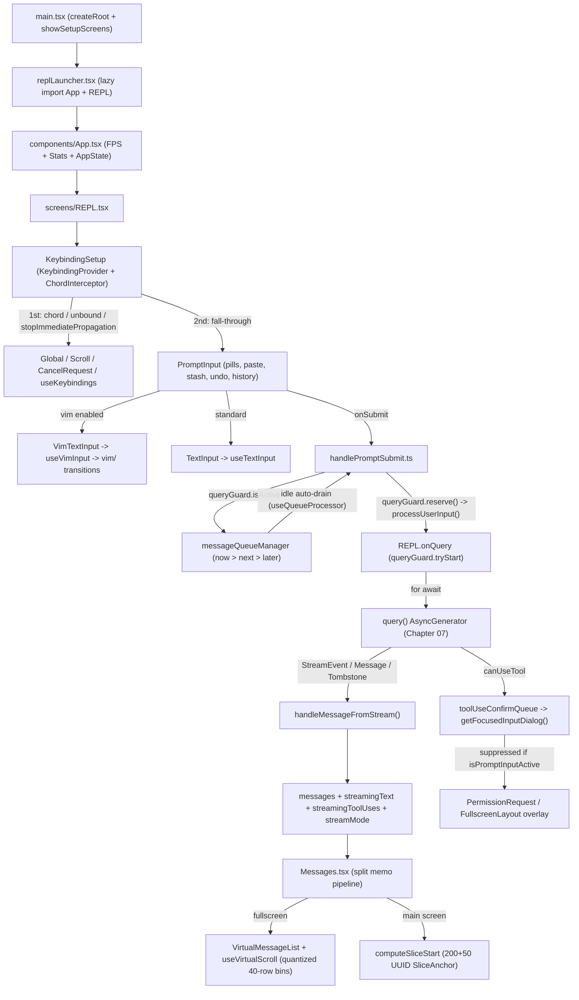

# 21. The Interactive REPL: Screens, Input, Keybindings, and Vim Mode

> **Status: written.** Reverse-engineered from the Claude Code 2.1.88 source snapshot (see the Prologue (`prologue-how-to-read-a-1900-file-agent.md`) for snapshot caveats).
>
> **Layer:** Layer 7 (The Terminal UI Engine)
> **Prerequisites:** [Chapter 01](ch001-atoms-types-stores-and-primitives.md), [Chapter 03](ch003-command-and-message-contracts.md), [Chapter 07](ch007-the-heartbeat-query-loop.md), [Chapter 11](ch011-the-permission-engine.md), [Chapter 20](ch020-inside-ink-terminal-react-renderer.md)
> **Primary Source Files:**
> - `replLauncher.tsx` — lazy dynamic import boundary that mounts `<App>` + `<REPL>` after setup dialogs finish
> - `interactiveHelpers.tsx` — sequential setup-screen runner (`showSetupScreens`), workspace trust boundary, Ink-safe exit helpers, and frame-telemetry wiring
> - `components/App.tsx` — top-level provider stack (`FpsMetricsProvider` → `StatsProvider` → `AppStateProvider`)
> - `screens/REPL.tsx` — the interactive orchestrator bridging `query()`, streaming deltas, modal dialogs, permission queues, and `PromptInput`
> - `utils/QueryGuard.ts` — synchronous 3-state generation-numbered lifecycle guard exposed via `useSyncExternalStore`
> - `utils/handlePromptSubmit.ts` — unified submission, mid-turn queueing, immediate `local-jsx` dispatch, and `processUserInput()` driver
> - `utils/messageQueueManager.ts` & `hooks/useQueueProcessor.ts` — priority command queue (`now > next > later`) and idle auto-drain loop
> - `hooks/useMergedCommands.ts`, `hooks/useMergedTools.ts`, & `utils/toolPool.ts` — live merging of built-in, plugin, and MCP capabilities with cache-safe tool partitioning
> - `components/Messages.tsx`, `components/VirtualMessageList.tsx`, & `hooks/useVirtualScroll.ts` — memoized transcript pipeline, fullscreen height-cached virtualization, and main-screen UUID-anchored render cap
> - `components/PromptInput/PromptInput.tsx`, `inputModes.ts`, & `inputPaste.ts` — prompt editor shell, paste/image pills, undo, stash, history, and queue pop-to-edit
> - `keybindings/schema.ts`, `defaultBindings.ts`, `resolver.ts`, `match.ts`, `KeybindingContext.tsx`, `KeybindingProviderSetup.tsx`, `useKeybinding.ts`, `loadUserBindings.ts`, & `reservedShortcuts.ts` — context-aware chorded keybinding engine with hot-reload
> - `vim/types.ts`, `vim/motions.ts`, `vim/textObjects.ts`, `vim/operators.ts`, `vim/transitions.ts`, `hooks/useVimInput.ts`, & `components/VimTextInput.tsx` — pure-functional Vim state machine bridged into the terminal prompt editor

> [!NOTE]
> **Snapshot boundaries & compiled `.tsx` output:** Three type-only modules imported by this layer—`types/message.ts`, `types/messageQueueTypes.ts`, and `keybindings/types.ts`—are **absent from this source snapshot**; their shapes are observed directly at call sites and in companion runtime schemas (`keybindings/schema.ts`, `keybindings/validate.ts`, `utils/messageQueueManager.ts`). Additionally, `.tsx` files in this checkout contain React Compiler memoization transforms (`const $ = _c(N)`) and inline base64 source maps; all descriptions and excerpts below refer strictly to the underlying application logic, never compiler-emitted cache arrays.

---

## Why This Layer Exists

By the end of [Chapter 20](ch020-inside-ink-terminal-react-renderer.md), we have a custom 60 FPS terminal React renderer (`ink/`) with Yoga flexbox layout, mouse hit-testing, synchronized output, and Kitty keyboard parsing. From Layers 0–6, we have a pull-based `query()` async generator ([Chapter 07](ch007-the-heartbeat-query-loop.md)), a multi-mode permission engine ([Chapter 11](ch011-the-permission-engine.md)), dynamic MCP/plugin discovery ([Chapters 15–16](ch015-model-context-protocol-mcp.md)), and background tasks/swarms ([Chapters 17–19](ch017-background-task-runtime.md)).

Gluing an asynchronous, streaming agent engine to a reactive terminal UI is where clean abstractions collide with human timing:

1. **Startup trust vs. bundle weight.** Before the workspace is trusted, the harness cannot apply repo environment variables, start OTel helpers, or pay the parse cost of the 5,000-line `REPL.tsx` module graph—yet it still needs interactive dialogs rendered through the same Ink root.
2. **React batching vs. synchronous concurrency.** React `useState` updates asynchronously; `query()`, permission prompts, `Esc` cancellations, and rapid follow-up submits happen synchronously across microtask boundaries. One desynced loading boolean produces duplicate turns, stale `finally` cleanups, or a 56-year elapsed timer.
3. **Unbounded transcript growth vs. terminal memory.** Mounting one React/Yoga subtree per message costs ~250 KB RSS each. Without virtualization (fullscreen) or a stable render-window cap (main screen), long sessions enter a GC death spiral.
4. **Overlapping keybindings, chords, and modal Vim editing.** Eighteen UI contexts share `Escape`, `Enter`, `Tab`, and arrow keys; multi-key chords like `ctrl+x ctrl+k` must stop their second key from landing in the text box; and Vim commands like `2d3w` or `ci"` must run faster than React re-renders without corrupting inline `[Image #N]` pills or wrapped terminal lines.

This chapter dissects the five subsystems that make the interactive REPL hold together under real terminal workloads.

---

## 1. Mounting the Workspace: Setup Screens, Lazy REPL Launch, and Live Capability Merging

### The Problem

When `main.tsx` enters interactive mode, it allocates a single Ink `Root`, runs up to half a dozen sequential consent/onboarding screens (theme onboarding, workspace trust, `.mcp.json` server approval, external `CLAUDE.md` includes, custom API key approval, bypass-permissions/auto-mode consent, dev channels), and only then mounts the REPL. If any of those screens statically imported `screens/REPL.tsx`, users sitting at a first-run trust dialog would pay the entire REPL + prompt-input + markdown + tool-UI import cost upfront—and if a fatal error occurred after `createRoot()`, calling `console.error()` would vanish silently because Ink's `patchConsole` intercepts stdout/stderr.

Once `<REPL>` does mount, MCP servers and plugins finish connecting asynchronously in the background. The UI must merge newly discovered tools and slash commands into the active session without reordering built-in tools (which would invalidate the Anthropic prompt cache prefix established in [Chapter 02](ch002-the-tool-contract.md) and [Chapter 04](ch004-prompt-engineering-and-cache-boundaries.md)).

### The Real Implementation

Interactive bootstrapping is split cleanly across three small files: `interactiveHelpers.tsx`, `replLauncher.tsx`, and `components/App.tsx`.

First, `getRenderContext(exitOnCtrlC)` in `interactiveHelpers.tsx`:299-365 wires Ink's `onFrame` hook to three observers before `createRoot()` runs: `FpsTracker`, a process-wide `StatsStore`, an optional JSONL frame-timing benchmark sink gated by `CLAUDE_CODE_FRAME_TIMING_LOG`, and a flicker telemetry detector that skips DEC 2026 synchronized-output terminals (`isSynchronizedOutputSupported()`) and only logs `tengu_flicker` when two non-resize flickers land within 1,000 ms.

Second, `showSetupScreens()` (`interactiveHelpers.tsx`:104-298) drives every pre-REPL modal sequentially over that *same* Ink `Root` via `showDialog()` and `showSetupDialog()`:

```ts
// interactiveHelpers.tsx:39-44, 86-92
export function showDialog<T = void>(
  root: Root,
  renderer: (done: (result: T) => void) => React.ReactNode,
): Promise<T> {
  return new Promise<T>(resolve => {
    const done = (result: T): void => void resolve(result)
    root.render(renderer(done))
  })
}

export function showSetupDialog<T = void>(
  root: Root,
  renderer: (done: (result: T) => void) => React.ReactNode,
  options?: { onChangeAppState?: typeof onChangeAppState },
): Promise<T> {
  return showDialog<T>(root, done => (
    <AppStateProvider onChangeAppState={options?.onChangeAppState}>
      <KeybindingSetup>{renderer(done)}</KeybindingSetup>
    </AppStateProvider>
  ))
}
```

Wrapping each dialog in a temporary `<AppStateProvider>` + `<KeybindingSetup>` means confirmation keys (`Enter`, `Esc`, `Up`/`Down`) work identically before `<App>` exists. For fatal exits after `createRoot()`, `exitWithError()` / `exitWithMessage()` (`interactiveHelpers.tsx`:52-80) dynamically import `<Text>`, render the final line through Ink, call `root.unmount()`, await optional cleanup, and then `process.exit(exitCode)`.

Only after `showSetupScreens()` resolves does `main.tsx` call `launchRepl()` in `replLauncher.tsx`:12-22:

```ts
// replLauncher.tsx:12-22
export async function launchRepl(
  root: Root,
  appProps: AppWrapperProps,
  replProps: REPLProps,
  renderAndRun: (root: Root, element: React.ReactNode) => Promise<void>,
): Promise<void> {
  const { App } = await import('./components/App.js')
  const { REPL } = await import('./screens/REPL.js')
  await renderAndRun(
    root,
    <App {...appProps}>
      <REPL {...replProps} />
    </App>,
  )
}
```

`<App>` (`components/App.tsx`:19-55) is a thin three-provider shell: `FpsMetricsProvider` → `StatsProvider` → `AppStateProvider` (wired to `onChangeAppState`). `renderAndRun()` (`interactiveHelpers.tsx`:98-103) calls `root.render(element)`, triggers `startDeferredPrefetches()` in `main.tsx`, awaits `root.waitUntilExit()`, and runs `gracefulShutdown(0)`.

Inside `screens/REPL.tsx:811-835`, live capability merging uses two specialized hooks:

- **Commands** (`hooks/useMergedCommands.ts`:5-15): `REPL.tsx` chains `useMergedCommands` twice—first merging `localCommands` + `plugins.commands`, then merging `mcp.commands` on top with `uniqBy([...initialCommands, ...mcpCommands], 'name')`, short-circuiting to the original array reference when the dynamic list is empty.
- **Tools** (`hooks/useMergedTools.ts`:20-44 + `utils/toolPool.ts`:55-79): `useMergedTools` runs inside `useMemo`, delegating to `assembleToolPool(toolPermissionContext, mcpTools)` and then `mergeAndFilterTools(initialTools, assembled, toolPermissionContext.mode)`. `mergeAndFilterTools()` deduplicates by `name`, **partitions MCP tools from built-in tools**, sorts each partition alphabetically (`[...builtIn.sort(byName), ...mcp.sort(byName)]`) so built-ins remain a stable contiguous prompt-cache prefix, and—when `feature('COORDINATOR_MODE')` is enabled and coordinator mode is active—filters the pool through `applyCoordinatorToolFilter()`. Finally, `REPL.tsx:814-829` applies `resolveAgentTools()` if `--agent` (`mainThreadAgentDefinition`) is set.

### Hidden Invariants & Failure Modes

- **Trust boundary ordering in `showSetupScreens()`** (`interactiveHelpers.tsx`:131-190): Workspace trust is enforced *even in `bypassPermissions` mode* (skipped only under `process.env.CLAUBBIT`). Once `TrustDialog` resolves (or fast-paths via `checkHasTrustDialogAccepted()`), the runner executes a strict sequence: `setSessionTrustAccepted(true)` → `resetGrowthBook()` + `initializeGrowthBook()` (so GrowthBook picks up authenticated headers after trust/login) → `getSystemContext()` prefetch → `handleMcpjsonServerApprovals()` → `ClaudeMdExternalIncludesDialog` → `updateGithubRepoPathMapping()` (post-trust so untrusted repos cannot poison teleport mappings) → `applyConfigEnvironmentVariables()` (applies untrusted repo env vars only after consent) → `setImmediate(() => initializeTelemetryAfterTrust())`. Deferring OTel to `setImmediate` keeps its dynamic import out of the pre-render microtask queue.
- **Feature-gated setup screens:** `AutoModeOptInDialog` is gated behind `feature('TRANSCRIPT_CLASSIFIER')` and only runs when `permissionMode === 'auto'` actually resolved (`interactiveHelpers.tsx`:224-235). `DevChannelsDialog` is gated behind `feature('KAIROS') || feature('KAIROS_CHANNELS')` and awaits `checkGate_CACHED_OR_BLOCKING('tengu_harbor')` first so a cold disk cache does not silently drop channel notifications (`interactiveHelpers.tsx`:241-288).
- **Turn-1 MCP race avoidance** (`screens/REPL.tsx`:2746-2755): Even though `useMergedTools` keeps React state fresh, `onQueryImpl` intentionally extracts `freshTools` and `freshMcpClients` from `getToolUseContext(...)` (which reads `store.getState()` directly) rather than trusting the closure-captured `tools` prop—ensuring MCP connections that flushed between render and `onQuery` appear on turn 1.

---

## 2. Bridging `query()` Into React: `QueryGuard`, Stream Dispatch, Queued Prompts, and Modal Arbitration

### The Problem

A single interactive turn spans at least four asynchronous stages: (1) `processUserInput()` expanding slash commands, shell `!` commands, images, and attachments; (2) `onBeforeQuery` hooks and system-prompt construction; (3) `for await (const event of query(...))` streaming hundreds of SSE chunks and executing tools; and (4) `finally` cleanup + queue draining.

Originally, `REPL.tsx` tracked "is a turn running?" with two values: a React `isLoading` state (asynchronously batched) and an `isQueryRunning` ref (synchronous). Those two regularly drifted apart, opening four severe failure modes:

1. A second submission arriving during `processUserInput()`'s `await` started a concurrent turn instead of queueing.
2. Pressing `Esc` (`onCancel`) and immediately submitting a new prompt let the cancelled turn's microtask `finally` block clear the *new* turn's loading state.
3. A spinner rendered in the gap between reserving a turn and resetting `loadingStartTimeRef` computed `Date.now() - 0 ≈ 56 years` (**INC-4549**).
4. Nineteen competing overlays (permission prompts, sandbox network approvals, MCP elicitations, rewind selector, cost warnings, onboarding callouts) could fight over focus and steal keystrokes while the user was mid-sentence.

### The Real Implementation

#### 1. `QueryGuard`: Synchronous Generation-Numbered Turn Ownership

`utils/QueryGuard.ts` replaces the dual-state pattern with a 3-state machine (`idle` → `dispatching` → `running` → `idle`) subscribed to by React via `useSyncExternalStore`:

```ts
// utils/QueryGuard.ts:29-93 (abridged)
export class QueryGuard {
  private _status: 'idle' | 'dispatching' | 'running' = 'idle'
  private _generation = 0
  private _changed = createSignal()

  reserve(): boolean {
    if (this._status !== 'idle') return false
    this._status = 'dispatching'
    this._notify()
    return true
  }

  tryStart(): number | null {
    if (this._status === 'running') return null
    this._status = 'running'
    ++this._generation
    this._notify()
    return this._generation
  }

  end(generation: number): boolean {
    if (this._generation !== generation) return false
    if (this._status !== 'running') return false
    this._status = 'idle'
    this._notify()
    return true
  }

  forceEnd(): void {
    if (this._status === 'idle') return
    this._status = 'idle'
    ++this._generation
    this._notify()
  }
}
```

In `screens/REPL.tsx`:900-916, `REPL` allocates one `queryGuard` ref and derives read-only `isLoading = isQueryActive || isExternalLoading` (where `isExternalLoading` covers remote CCR sessions and foregrounded background tasks that bypass `onQuery`).

#### 2. Submission, Priority Queueing, and Idle Auto-Drain

Every prompt submission flows through `onSubmit` (`screens/REPL.tsx`:3170-3545) into `handlePromptSubmit()` (`utils/handlePromptSubmit.ts`:120-387):

1. **Immediate `local-jsx` escape hatch** (`screens/REPL.tsx`:3184-3281, `utils/handlePromptSubmit.ts`:229-311): Slash commands marked `immediate: true` (e.g., `/config`, `/model`, `/btw`) or invoked via a keybinding (`fromKeybinding`) execute *while `queryGuard.isActive` is true*, mounting their UI via `setToolJSX({ isLocalJSXCommand: true, isImmediate: true })` without queueing or clobbering the user's draft text.
2. **Mid-turn queueing vs. interruptible tools** (`utils/handlePromptSubmit.ts`:313-351): If `queryGuard.isActive || isExternalLoading`, `handlePromptSubmit` filters orphaned image entries, expands pasted text refs early (`expandPastedTextRefs`), and pushes a `QueuedCommand` onto the module-level priority queue in `utils/messageQueueManager.ts`:53-193 (`PRIORITY_ORDER`: `'now' (0) > 'next' (1, user input) > 'later' (2, task notifications)`). If every currently running tool declares `interruptBehavior: 'cancel'` (such as `SleepTool`), `handlePromptSubmit` also calls `abortController.abort('interrupt')` so the queued prompt preempts the sleep immediately.
3. **Reservation & `AsyncLocalStorage` workload scoping** (`utils/handlePromptSubmit.ts`:396-610): When idle, `executeUserInput()` calls `queryGuard.reserve()` *synchronously before the first `await`*, wraps the turn in `runWithWorkload(turnWorkload, ...)` so detached subagents inherit the turn's workload tag via `AsyncLocalStorage`, iterates `commands` through `processUserInput()` (only command `0` attaches IDE selection, attachments, and `pastedContents`), snapshots `fileHistory`, and calls `onQuery()`. Its `finally` block calls `queryGuard.cancelReservation()`, which is a no-op if `onQuery` already promoted `dispatching → running` and later ran `end()`.
4. **Reactive queue drain** (`hooks/useCommandQueue.ts` + `hooks/useQueueProcessor.ts`): Both `useCommandQueue` and `useQueueProcessor` subscribe to the module-level queue via `useSyncExternalStore` (avoiding React context lag in Ink). Whenever `!isQueryActive && !hasActiveLocalJsxUI && queueSnapshot.length > 0`, `useQueueProcessor` calls `processQueueIfReady({ executeInput: executeQueuedInput })`, whose synchronous chain immediately calls `queryGuard.reserve()` before React re-runs the effect on the dequeue snapshot update.

#### 3. Pumping `query()` Events Into React State

Inside `onQuery` (`screens/REPL.tsx`:2855-2960), `queryGuard.tryStart()` atomically claims the next `thisGeneration` (if a race still occurs and returns `null`, non-meta user messages are salvaged by re-enqueueing them onto the command queue instead of dropping them). It appends `newMessages`, reads `messagesRef.current` synchronously, and calls `onQueryImpl()` (`screens/REPL.tsx`:2661-2854), which builds `systemPrompt`/`userContext`/`systemContext` in parallel and drives the generator:

```ts
// screens/REPL.tsx:2793-2803
for await (const event of query({
  messages: messagesIncludingNewMessages,
  systemPrompt,
  userContext,
  systemContext,
  canUseTool,
  toolUseContext,
  querySource: getQuerySourceForREPL(),
})) {
  onQueryEvent(event)
}
```

Each yielded item goes to `onQueryEvent` → `handleMessageFromStream()` (`utils/messages.ts`:2930-3090), which fans out five distinct streams:

| Generator Event | Target State / Callback | Purpose |
| :--- | :--- | :--- |
| `stream_request_start` | `setStreamMode('requesting')` | Spinner transitions to waiting-for-TTFT state |
| `message_start` | `apiMetricsRef.current.push(...)` | Captures `ttftMs` and response-length baseline |
| `content_block_start` (`thinking`/`text`/`tool_use`) | `setStreamMode(...)`, `setStreamingToolUses(...)` | Updates spinner verb; registers live tool stub before full JSON arrives |
| `content_block_delta` (`text_delta`/`input_json_delta`/`thinking_delta`) | `setResponseLength`, `onStreamingText`, `setStreamingToolUses` | Feeds live token counter, streaming markdown preview, and partial tool args (`signature_delta` explicitly excluded from length/OTPS!) |
| `message_stop` | `setStreamMode('tool-use')`, `setStreamingToolUses([])` | Clears transient tool stubs as execution begins |
| `tombstone` | `setMessages(filter)`, `removeTranscriptMessage(uuid)` | Deletes rolled-back/superseded messages from UI and JSONL |
| Completed `Message` (`assistant`, `user`, `progress`, `system`, `attachment`) | `onStreamingText(() => null)`, `setMessages(...)` | Atomically swaps streaming preview for final message |

Notice the streaming-text polish at `screens/REPL.tsx`:1461-1473: `streamingText` updates on every `text_delta` (coalesced by Ink's 16 ms render throttle), but `visibleStreamingText` slices to `streamingText.lastIndexOf('\n') + 1` so Markdown streams **line-by-line** instead of jittering character-by-character, and disables itself entirely when `prefersReducedMotion` or `hasCursorUpViewportYankBug()` is true.

#### 4. Permission Prompts and `getFocusedInputDialog()` Arbitration

Tool permissions ([Chapter 11](ch011-the-permission-engine.md)) enter `REPL` through `useCanUseTool(setToolUseConfirmQueue, setToolPermissionContext)` (`screens/REPL.tsx`:2382), which pushes a `ToolUseConfirm` onto `toolUseConfirmQueue` and returns a `Promise` that blocks `runToolUse()` until `<PermissionRequest>` calls `onDone`.

Because nineteen different interactive overlays can become ready at the same moment, `getFocusedInputDialog()` (`screens/REPL.tsx`:2017-2065) resolves focus with a single deterministic priority ladder:

1. **Exit flow** (`isExiting || exitFlow`) → returns `undefined` (nothing steals exit).
2. **High-priority explicit overlay:** `isMessageSelectorVisible` → `'message-selector'` (always wins).
3. **Typing guard:** `if (isPromptInputActive) return undefined` — if the user is mid-keystroke in `PromptInput`, incoming permission modals are **suppressed** rather than eating the user's next `y` or `Enter`! `hasSuppressedDialogs` (`screens/REPL.tsx`:2068) flags `PromptInput` to show a dim `"Waiting for permission…"` banner until the prompt clears.
4. **Blocking security & tool queues:** `sandbox-permission` → (gated by `allowDialogsWithAnimation = !toolJSX || toolJSX.shouldContinueAnimation` so background tool hints never deadlock a permission prompt) → `tool-permission` → `prompt` → `worker-sandbox-permission` → `elicitation`.
5. **Turn-end & advisory dialogs:** `cost` → `idle-return` → `ultraplan-choice`/`ultraplan-launch` (`feature('ULTRAPLAN')`) → `ide-onboarding` → ant-only callouts (`model-switch`, `undercover-callout`, dead-code-eliminated in external builds via `"external" === 'ant'`) → `effort-callout` → `remote-callout` → `lsp-recommendation` → `plugin-hint` → `desktop-upsell`.

### Hidden Invariants & Failure Modes

> [!WARNING]
> **INC-4549 (The 56-Year Elapsed Timer):** `queryGuard.reserve()` flips `isQueryActive` to `true` *before* `processUserInput()` awaits, whereas `onQuery()` resets `loadingStartTimeRef` *after* `processUserInput()` finishes. During that window, the spinner read `loadingStartTimeRef.current === 0` and displayed `Date.now() - 0 ≈ 56 years`. `screens/REPL.tsx`:949-953 fixes this with an inline render-phase edge check (`if (isQueryActive && !wasQueryActiveRef.current) resetTimingRefs()`), and `setIsExternalLoading` performs the same reset for remote sessions.

- **Ephemeral progress coalescing prevents 120 MB transcripts** (`screens/REPL.tsx`:2608-2627): `SleepTool` and `BashTool` emit a progress tick every second. When `isEphemeralToolProgress(newMessage.data.type)` is true and the last message shares the same `parentToolUseID` and progress type, `onQueryEvent` **replaces the last array element in place** instead of appending. Appending previously grew `messages` past 13,000 entries and bloated JSONL logs to 120 MB; same-length replacement also keeps `useLogMessages` from writing redundant lines to disk. Conversely, `agent_progress`, `hook_progress`, and `skill_progress` are *not* ephemeral because the UI renders their full subagent/hook trail.
- **Cancel preserves partial text and bumps generation** (`screens/REPL.tsx`:2106-2163): `onCancel()` calls `queryGuard.forceEnd()` (invalidating any pending `finally` via `++_generation`), commits any non-empty `streamingText` into `messages` *before* `resetLoadingState()` clears it (ensuring transcript order `[user, partial-assistant, [Request interrupted by user]]`), aborts the active controller or permission queue, and clears `abortController` to `null` so subsequent `Esc` presses don't see a stale aborted signal.
- **Synchronous `messagesRef` & `streamModeRef` prevent latency spikes and heap leaks** (`screens/REPL.tsx`:838-848, 2901-2906, 3538-3545): Updating `messagesRef.current` synchronously inside the `setMessages` wrapper lets `onQuery` pass `latestMessages` immediately without awaiting React's scheduler (eliminating a 20–56 ms per-prompt stall). Reading `messagesRef.current` and `streamModeRef.current` inside `onSubmit` keeps `onSubmit` referentially stable across ~30 `setMessages` and ~10 `streamMode` flips per turn—preventing downstream closures from pinning ~9–15 historical 1,776-byte REPL scopes and message arrays on the heap.
- **Config lock-storm guard (GH #3117)** (`screens/REPL.tsx`:3840-3857): Counting prompt-queue usage via `saveGlobalConfig` uses an edge-triggered `hasCountedQueueUseRef` (firing only on `0 → ≥1`), because writing on every queue length mutation caused `ELOCKED` write storms and `~/.claude.json` corruption across concurrent sessions.

---

## 3. Rendering Thousands of Messages Without a GC Death Spiral: `Messages.tsx`, `VirtualMessageList`, and `PromptInput`

### The Problem

Once `messages` is in React state, rendering it at 60 FPS inside a terminal hits two scaling walls:

1. **Memory & O(n) scroll stalls:** Every mounted `MessageRow` allocates React fibers, memo caches, and Yoga nodes (~250 KB RSS per message). At ~2,000 messages, main-screen Ink held ~500 MB of fibers and 3,000-line screen buffers—triggering observed 59 GB RSS / 14k `mmap`/`munmap`/sec GC death spirals. Even in fullscreen virtual scroll, rebuilding grouping/collapse Maps on every scroll range change burned ~50 ms of allocations per scroll over 27k messages, causing 100–173 ms stop-the-world GC pauses.
2. **Rich terminal editing in a single box:** `PromptInput` has to handle multi-line text, `!` bash mode, 50 KB pastes, clipboard images, inline `[Image #N]` pills, undo history, prompt stashing, external `$EDITOR`, queued-command recall, and floating notifications—without causing Ink to repaint the whole terminal or unmounting stateful background hooks.

### The Real Implementation

#### 1. The Split Memo Pipeline in `Messages.tsx`

`components/Messages.tsx`:379-543 splits transcript preparation into two strictly separated `useMemo` stages so scrolling never recomputes O(n) message transforms:

1. **Transform stage** (`collapsed_0`, `lookups_0`):
   - `normalizeMessages(messages).filter(isNotEmptyMessage)` splits multi-block API messages into one renderable row per block with deterministic derived UUIDs.
   - `syntheticStreamingToolUseMessages` converts in-flight `streamingToolUses` into synthetic rows whose UUID is `deriveUUID(streamingToolUse.contentBlock.id, 0)`—never `randomUUID()`, which would remount rows on every `input_json_delta` chunk and corrupt Ink's DOM (`components/Messages.tsx`:447-458).
   - Main-screen mode slices at the latest compact boundary (`getMessagesAfterCompactBoundary(..., { includeSnipped: true })`); fullscreen keeps pre-compact scrollback (capped to one compact interval in `onQueryEvent` at `screens/REPL.tsx`:2594-2600).
   - Drops `progress` rows and `isNullRenderingAttachment(msg)` rows (`hook_success`, etc.) *before* counting or slicing (CC-724), reorders tool results next to their tool calls (`reorderMessagesInUI`), applies optional `BRIEF` filtering (`feature('KAIROS') || feature('KAIROS_BRIEF')`), and runs the grouping/collapsing chain: `applyGrouping` → `collapseReadSearchGroups` → `collapseTeammateShutdowns` → `collapseHookSummaries` → `collapseBackgroundBashNotifications` → `buildMessageLookups`.
2. **Cheap slice stage** (`renderableMessages`):
   - In **fullscreen mode** (`virtualScrollRuntimeGate = scrollRef != null && !CLAUDE_CODE_DISABLE_VIRTUAL_SCROLL`), `Messages` mounts `<VirtualMessageList>` (`components/VirtualMessageList.tsx`), powered by `useVirtualScroll()` (`hooks/useVirtualScroll.ts`:19-130). Instead of mounting all items, `useVirtualScroll` mounts only viewport + `OVERSCAN_ROWS = 80` rows flanked by top/bottom Yoga spacer `<Box>` nodes. It caches measured Yoga heights per item key (invalidated whenever `columns` changes), quantizes `scrollTop` to `SCROLL_QUANTUM = 40` rows for `useSyncExternalStore` so wheel ticks bypass React completely via Ink's `ScrollBox.forceRender`, caps newly mounted rows at `SLIDE_STEP = 25` per commit (preventing 290 ms synchronous Markdown-lexing stalls), and enforces a hard ceiling of `MAX_MOUNTED_ITEMS = 300`.
   - In **main-screen mode** (no fullscreen `scrollRef`), `Messages` caps mounted rows via `computeSliceStart()` (`components/Messages.tsx`:307-340):

```ts
// components/Messages.tsx:307-340
const MAX_MESSAGES_WITHOUT_VIRTUALIZATION = 200
const MESSAGE_CAP_STEP = 50

export function computeSliceStart(
  collapsed: ReadonlyArray<{ uuid: string }>,
  anchorRef: { current: SliceAnchor },
  cap = MAX_MESSAGES_WITHOUT_VIRTUALIZATION,
  step = MESSAGE_CAP_STEP,
): number {
  const anchor = anchorRef.current
  const anchorIdx = anchor
    ? collapsed.findIndex(m => m.uuid === anchor.uuid)
    : -1
  let start =
    anchorIdx >= 0
      ? anchorIdx
      : anchor
        ? Math.min(anchor.idx, Math.max(0, collapsed.length - cap))
        : 0
  if (collapsed.length - start > cap + step) {
    start = collapsed.length - cap
  }
  const msgAtStart = collapsed[start]
  if (msgAtStart && (anchor?.uuid !== msgAtStart.uuid || anchor.idx !== start)) {
    anchorRef.current = { uuid: msgAtStart.uuid, idx: start }
  } else if (!msgAtStart && anchor) {
    anchorRef.current = null
  }
  return start
}
```

Why a `{ uuid, idx }` anchor instead of `collapsed.slice(-200)`? Naive `slice(-200)` drops one row on every append, shifting scrollback and triggering a full terminal reset every turn (CC-941). Quantizing to 50-row steps (CC-1154) still jittered whenever compaction or regrouping changed `collapsed.length`. The UUID anchor advances *only* when rendered count exceeds `cap + step` (CC-1174), and the fallback `idx` heals cases where `collapseHookSummaries` + `reorderMessagesInUI` changes the first UUID in a merged group.

Each visible row renders through `<MessageRow>` (`components/MessageRow.tsx`) → `<Message>` (`components/Message.tsx`:58-180), which dispatches across ~30 specialized renderers in `components/messages/` (`AssistantTextMessage`, `AssistantToolUseMessage`, `AssistantThinkingMessage`, `UserTextMessage`, `UserToolResultMessage`, `CollapsedReadSearchContent`, `GroupedToolUseContent`, `AttachmentMessage`, `SystemTextMessage`, `CompactBoundaryMessage`, etc.). Live streaming text renders as a sibling `<StreamingMarkdown>` directly below the list (`components/Messages.tsx`:703-712), so when the final assistant message arrives and `streamingText` clears in the same React batch, the transition is positionally seamless.

#### 2. `PromptInput`: Pills, Pastes, Stash, and Queue Editing

`components/PromptInput/PromptInput.tsx` coordinates every input concern around a single inner editor (`<VimTextInput>` when `isVimModeEnabled()`, otherwise `<TextInput>`, at line 2243):

- **Mode prefixing** (`components/PromptInput/inputModes.ts`:4-33): Typing or pasting a leading `!` into an empty prompt flips `mode` to `'bash'`, strips `!` from the displayed value, and swaps the border to `bashBorder`; history serialization prepends `!` back via `prependModeCharacterToInput()`.
- **Paste & image pill lifecycle** (`components/PromptInput/PromptInput.tsx`:1151-1246, `inputPaste.ts`:4-90):
  - `onTextPaste()` strips ANSI codes, normalizes `\r` and tabs, and collapses any paste longer than `PASTE_THRESHOLD` (`800` chars in `utils/imagePaste.ts:30`) or taller than `Math.min(rows - 10, 2)` lines into a compact `[Pasted text #N]` ref backed by `pastedContents[pasteId]`—keeping Ink's input box from growing tall enough to force a full terminal repaint. Separately, `maybeTruncateInput()` in `inputPaste.ts` truncates huge programmatic inputs over `10,000` chars into `[...Truncated text #N +M lines...]`.
  - `onImagePaste()` caches the image path synchronously, persists the base64 payload to disk asynchronously, inserts `[Image #N]`, and arms `pendingSpaceAfterPillRef.current = true` so `lazySpaceInputFilter` auto-inserts a single space before the next printable character. A companion `useEffect` (`PromptInput.tsx`:1189-1200) prunes any `pastedContents` image whose `[Image #N]` token was deleted from the text.
- **Stash, external editor, undo, and queue recall** (`PromptInput.tsx`:1257-1383):
  - `ctrl+s` (`handleStash`) snapshots `{ text, cursorOffset, pastedContents }` into `stashedPrompt` (and pops it back on empty input, or automatically after a submitted prompt/slash command completes—deferred past `handlePromptSubmit` when submitting a slash command or queueing mid-turn so the restored draft isn't clobbered, `screens/REPL.tsx`:3328-3357, 3521-3532).
  - `ctrl+g` / `ctrl+x ctrl+e` (`handleExternalEditor`) expands collapsed paste refs, opens `$EDITOR`, and pushes the previous state onto the undo buffer (`ctrl+_` / `ctrl+shift+-`) before writing edits back.
  - Pressing Up when editable commands are waiting in the queue calls `popAllCommandsFromQueue()`, restoring both queued prompt text and any attached images back into the active input box.

### Hidden Invariants & Failure Modes

- **React Compiler `memoCache` pinning trap** (`components/Messages.tsx`:695-698, `components/MessageRow.tsx`:45-48): `Messages` intentionally precomputes `isUserContinuation` and `hasContentAfter` as booleans instead of passing `renderableMessages` to each `MessageRow`. Because the React Compiler caches previous prop values inside each fiber's `memoCache`, passing the array prop pinned every historical version of `renderableMessages` (~1–2 MB leaked over just 7 turns).
- **`LogoHeader` blit-cache protection** (`components/Messages.tsx`:55, and source comment): Because `LogoHeader` is the *first* sibling before all `MessageRow`s in main-screen mode, letting it become dirty on every message append tripped Ink's `seenDirtyChild` cascade ([Chapter 20](ch020-inside-ink-terminal-react-renderer.md)), disabling prev-screen blitting for all 2,800 subsequent rows and pegging CPU at 100%. Wrapping it in `React.memo` + `<OffscreenFreeze>` keeps it permanently clean.
- **Custom `Messages` `React.memo` comparator** (`components/Messages.tsx`:741-778): Ignores stable refs/callbacks, compares `streamingToolUses` by `contentBlock` object identity (so `input_json_delta` chunks don't re-render the whole transcript), compares `inProgressToolUseIDs` by set equality, and compares `tools` by tool names.
- **`Notifications` uses `height={0}`, never unmount** (`components/PromptInput/PromptInput.tsx`:2276-2295): In fullscreen mode, floating notifications sit in an `absolute` zero-layout-height box above the prompt border. When slash autocomplete opens, the box collapses via `height={0}` instead of unmounting—because unmounting `<Notifications>` re-fired `AutoUpdater`'s initial check effect on every slash-completion toggle (PR #22413).
- **Multiline arrow-key ownership** (`components/PromptInput/PromptInput.tsx`:1656-1659, 2177-2182): `history:previous` and `history:next` are intentionally *not* bound via `useKeybindings` in `PromptInput`; they are passed as `onHistoryUp`/`onHistoryDown` props to `TextInput`/`VimTextInput` so `useTextInput` attempts intra-prompt cursor movement first and falls through to history only at the top/bottom boundary.

---

## 4. The Keybindings Subsystem: Stacked Contexts, Chords, and Terminal Quirks

### The Problem

An interactive coding terminal layers up to 18 UI contexts (`keybindings/schema.ts`:12-32): `Global`, `Chat`, `Autocomplete`, `Confirmation`, `Help`, `Transcript`, `HistorySearch`, `Task`, `ThemePicker`, `Settings`, `Tabs`, `Attachments`, `Footer`, `MessageSelector`, `DiffDialog`, `ModelPicker`, `Select`, and `Plugin` (plus `Scroll` and feature-gated `MessageActions` in `defaultBindings.ts`).

The same physical key means completely different things depending on what is open:
- `Ctrl+T` toggles todos in `Global`, but toggles syntax highlighting inside `ThemePicker`.
- `Escape` cancels a running query in `Chat`, dismisses autocomplete in `Autocomplete`, rejects a permission prompt in `Confirmation`, closes `/help` in `Help`, and exits `Transcript`.
- Multi-keystroke chords like `ctrl+x ctrl+k` (kill background agents) or `ctrl+x ctrl+e` (open `$EDITOR`) must swallow the first key (`ctrl+x`), wait up to 1 second, and intercept the second key (`k` or `e`) *before* `PromptInput` inserts a literal `'k'` into the prompt—and if the user aborts mid-chord with `ctrl+x ctrl+c`, that second key must cancel the chord without triggering `app:interrupt`.

### The Real Implementation

#### 1. Declarative Bindings, Platform Defaults, and Pure Chord Resolution

`keybindings/defaultBindings.ts` defines `DEFAULT_BINDINGS` as an ordered array of `{ context, bindings }` blocks. Platform quirks are resolved at module load:
- `IMAGE_PASTE_KEY`: `'alt+v'` on Windows (`ctrl+v` is system paste), `'ctrl+v'` elsewhere.
- `MODE_CYCLE_KEY`: `'shift+tab'` when the terminal supports VT mode (`getPlatform() !== 'windows'`, or Bun `>=1.2.23` / Node `>=22.17.0 <23 || >=24.2.0`), otherwise `'meta+m'`.
- `chat:undo` binds *both* `'ctrl+_'` (legacy terminals sending `0x1f`) and `'ctrl+shift+-'` (Kitty protocol sending physical key + modifiers).
- Feature-gated defaults (`feature('QUICK_SEARCH')`, `feature('TERMINAL_PANEL')`, `feature('MESSAGE_ACTIONS')`, `feature('VOICE_MODE')`, `feature('KAIROS')`) spread conditionally into `DEFAULT_BINDINGS` so dead code elimination strips them cleanly.

`keybindings/parser.ts` normalizes modifier aliases (`opt`/`option` → `alt`, `cmd`/`command`/`win` → `super`) and splits space-separated chords (preserving a lone `' '` as the `Space` key!). `keybindings/match.ts` maps Ink's `Key` flags to canonical names and collapses `alt` and `meta` into one logical modifier (because legacy terminals cannot distinguish them) while keeping `super` (`cmd`/`win`) distinct for Kitty-protocol terminals.

The heart of the resolver is the pure function `resolveKeyWithChordState()` in `keybindings/resolver.ts`:166-244:

```ts
// keybindings/resolver.ts:192-236
const ctxSet = new Set(activeContexts)
const contextBindings = bindings.filter(b => ctxSet.has(b.context))

// Check if this could be a prefix for longer chords. Group by chord
// string so a later null-override shadows the default it unbinds —
// otherwise null-unbinding `ctrl+x ctrl+k` still makes `ctrl+x` enter
// chord-wait and the single-key binding on the prefix never fires.
const chordWinners = new Map<string, string | null>()
for (const binding of contextBindings) {
  if (
    binding.chord.length > testChord.length &&
    chordPrefixMatches(testChord, binding)
  ) {
    chordWinners.set(chordToString(binding.chord), binding.action)
  }
}
let hasLongerChords = false
for (const action of chordWinners.values()) {
  if (action !== null) {
    hasLongerChords = true
    break
  }
}
if (hasLongerChords) {
  return { type: 'chord_started', pending: testChord }
}

let exactMatch: ParsedBinding | undefined
for (const binding of contextBindings) {
  if (chordExactlyMatches(testChord, binding)) {
    exactMatch = binding
  }
}
if (exactMatch) {
  return exactMatch.action === null
    ? { type: 'unbound' }
    : { type: 'match', action: exactMatch.action }
}
```

#### 2. Two-Phase Dispatch: `ChordInterceptor` + `useKeybinding` / `useKeybindings`

`keybindings/KeybindingProviderSetup.tsx`:119-307 mounts `<KeybindingProvider>` and immediately renders `<ChordInterceptor>` as its **first child** before `{children}`:

```tsx
// keybindings/KeybindingProviderSetup.tsx:205-208 (logical structure)
<KeybindingProvider bindings={bindings} pendingChordRef={pendingChordRef} ...>
  <ChordInterceptor ... />
  {children}
</KeybindingProvider>
```

Because Ink dispatches `useInput` listeners in mount order, `ChordInterceptor` sees every keystroke first:

- **Synchronous ref + React state duality:** `pendingChordRef` and `activeContextsRef` (a `Set` mutated synchronously in `useLayoutEffect` by `useRegisterKeybindingContext()`, `KeybindingContext.tsx`:215-242) let `resolve()` observe rapid consecutive chord keystrokes and newly mounted modals without waiting for a React render flush. `setPendingChord()` updates both the ref and React state and resets a `CHORD_TIMEOUT_MS = 1000` cancellation timer.
- **Fast wheel skip:** `if ((key.wheelUp || key.wheelDown) && pendingChordRef.current === null) return` avoids scanning `handlerRegistryRef` on every mouse-wheel event, while still letting a wheel tick mid-chord cancel the pending chord.
- **Why `ChordInterceptor` only invokes handlers on chord completion (`wasInChord === true`):** On `chord_started`, `chord_cancelled`, `unbound`, or a completed multi-key chord (`match` with `wasInChord === true`), `ChordInterceptor` calls `event.stopImmediatePropagation()` (invoking the matching registered handler from `handlerRegistryRef` on chord completion). On a **single-keystroke** `match`, it intentionally *does not* invoke handlers or stop propagation—it clears `pendingChord` and lets the event flow down to per-component `useKeybinding()` / `useKeybindings()` hooks (`keybindings/useKeybinding.ts`:33-196) so component mount order and ordering-sensitive handlers like `useTypeahead` (Enter accepting autocomplete before submit) remain intact.
- **Fall-through convention:** In `useKeybinding` / `useKeybindings`, if a handler returns literal `false`, `event.stopImmediatePropagation()` is *not* called—allowing fall-through (for instance, `ScrollKeybindingHandler` returns `false` on `scroll:lineUp`/`lineDown` when the `ScrollBox` content already fits, letting a child list handle the wheel event instead).

#### 3. User Customization, Validation, and Hot-Reload

`keybindings/loadUserBindings.ts` loads `~/.claude/keybindings.json` synchronously on mount (`loadKeybindingsSyncWithWarnings`) and watches it with `chokidar` (`awaitWriteFinish: { stabilityThreshold: 500, pollInterval: 200 }`, `atomic: true`) for live hot-reload. User customization is currently runtime-gated behind GrowthBook `tengu_keybinding_customization_release` (`isKeybindingCustomizationEnabled()` at lines 41-46); external users without that flag get `DEFAULT_BINDINGS` only.

User blocks are appended *after* defaults (`[...defaultBindings, ...userParsed]`) and validated by `keybindings/validate.ts` and `keybindings/reservedShortcuts.ts`:
- **`checkDuplicateKeysInJson(rawJson)`** scans the raw JSON text with regex *before* relying on `JSON.parse`, because `JSON.parse` silently overwrites earlier duplicate keys inside the same block.
- **Reserved shortcut checks** flag `NON_REBINDABLE` (`ctrl+c`, `ctrl+d`, and `ctrl+m`—which sends identical CR bytes to Enter in terminals), `TERMINAL_RESERVED` (`ctrl+z` SIGTSTP, `ctrl+\` SIGQUIT—explicitly *omitting* `ctrl+s`/`ctrl+q` because `ctrl+s` is prompt stash), and `MACOS_RESERVED` (`cmd+c/v/x/q/w/tab/space`). `normalizeKeyForComparison()` splits chords on whitespace *before* splitting steps on `+` so multi-key chords aren't mangled.
- Validation issues surface via a 60-second notification pointing to `/doctor` (`KeybindingProviderSetup.tsx`:59-112).

### Hidden Invariants & Failure Modes

> [!IMPORTANT]
> **How context precedence *actually* works:** Although comments in `useKeybinding.ts:59` suggest deduplicated `activeContexts` order determines priority, `keybindings/resolver.ts`:193-229 converts `activeContexts` into an unordered `Set` (`ctxSet`) and scans `bindings` linearly, keeping the **last** matching entry. Context precedence therefore comes from the array order in `DEFAULT_BINDINGS` (`Global` at index 0, specific overlays like `Confirmation`, `ThemePicker`, and `Help` later) plus user overrides appended at the end.

- **Ink's Escape-sets-Meta quirk** (`keybindings/match.ts`:96-102, `resolver.ts`:86-89): Legacy VT escape parsing causes Ink to set `key.meta = true` whenever bare Escape is pressed. Both `matchesKeystroke` and `buildKeystroke` explicitly force `meta = false` when `key.escape` is true—otherwise `"escape"` bindings and chord cancellations would never match.
- **Direct `chat:submit` registration bypass** (`components/PromptInput/PromptInput.tsx`:1637-1653): `PromptInput` registers `chat:submit` directly via `keybindingContext.registerHandler(...)` instead of `useKeybindings`. That lets `ChordInterceptor` invoke submit if a user binds a custom chord (e.g., `ctrl+e s`), while preventing `useKeybindings` from calling `stopImmediatePropagation()` on bare `Enter` before `useTypeahead` accepts autocomplete.
- **The `voice:pushToTalk` null-unbind trap** (`keybindings/defaultBindings.ts`:91-96): Under `feature('VOICE_MODE')`, `space` is registered as `voice:pushToTalk` so help displays can find it. If a user tries to disable it by setting `"space": null` in `keybindings.json`, `resolveKeyWithChordState` returns `{ type: 'unbound' }` and `ChordInterceptor`/`useKeybinding` calls `event.stopImmediatePropagation()`—making the spacebar completely dead for typing!
- **Handler mount-order contract in `REPL.tsx`** (`screens/REPL.tsx`:4550-4563): Inside `<KeybindingSetup>`, `<ScrollKeybindingHandler>` is deliberately mounted *before* `<CancelRequestHandler>` so `Ctrl+C` with an active terminal text selection copies the selection and stops propagation, whereas `Ctrl+C` without a selection falls through to cancel the running query.

---

## 5. Pure-Functional Vim Mode Inside the Prompt Editor

### The Problem

When a user enables Vim mode, `PromptInput` swaps `<TextInput>` for `<VimTextInput>` (`components/PromptInput/PromptInput.tsx`:2243). Implementing Vim inside a React terminal input is deceptively hard:

1. **Multi-keystroke commands outrun React renders.** Typing `2d3w` or `ci"` delivers 3–4 keypress events faster than React commits state; if intermediate operator/count states lived in `useState`, fast bursts would read stale closures.
2. **Wrapped rows vs. logical lines.** A long prompt wraps across multiple terminal columns. `j`/`k` and `dd` operate on *logical* `\n`-delimited lines, whereas `gj`/`gk` move across *visual* wrapped rows (and per `:help gj`, `dgj` is characterwise exclusive, not linewise!).
3. **Grapheme clusters and inline pills.** Emoji and combining sequences span multiple UTF-16 code units, and `[Image #1]` is an atomic UI pill embedded inside plain text. Naive `offset + 1` splits surrogate pairs, and `dw` landing inside `[Image #1]` would leave broken `[Image` debris.

### The Real Implementation

The Vim engine separates a **pure, React-free TypeScript state machine** under `vim/` from a thin React hook adapter in `hooks/useVimInput.ts`.

#### 1. Discriminated State Machine (`vim/types.ts` + `vim/transitions.ts`)

`vim/types.ts`:49-120 encodes every legal mode and partial-command state as discriminated unions:

- `VimState`: either `{ mode: 'INSERT'; insertedText: string }` (accumulating typed text for `.` repeat) or `{ mode: 'NORMAL'; command: CommandState }`.
- `CommandState`: **11 exhaustive variants**—`idle`, `count`, `operator`, `operatorCount`, `operatorFind`, `operatorTextObj`, `find`, `g`, `operatorG`, `replace`, and `indent`.
- `PersistentState`: survives across commands (`lastChange: RecordedChange | null`, `lastFind`, `register`, `registerIsLinewise`).
- `MAX_VIM_COUNT = 10000`: clamps numeric prefixes (`999999999x` cannot hang the event loop).

`vim/transitions.ts`:59-460 is a pure transition table dispatching on `state.type` and returning `{ next?: CommandState; execute?: () => void }`:

```ts
// vim/transitions.ts:283-332 (operator + multiplicative operatorCount)
function fromOperator(
  state: { type: 'operator'; op: Operator; count: number },
  input: string,
  ctx: TransitionContext,
): TransitionResult {
  // dd, cc, yy = line operation
  if (input === state.op[0]) {
    return { execute: () => executeLineOp(state.op, state.count, ctx) }
  }
  if (/[0-9]/.test(input)) {
    return {
      next: { type: 'operatorCount', op: state.op, count: state.count, digits: input },
    }
  }
  return handleOperatorInput(state.op, state.count, input, ctx) ?? { next: { type: 'idle' } }
}

function fromOperatorCount(
  state: { type: 'operatorCount'; op: Operator; count: number; digits: string },
  input: string,
  ctx: TransitionContext,
): TransitionResult {
  if (/[0-9]/.test(input)) {
    const parsedDigits = Math.min(parseInt(state.digits + input, 10), MAX_VIM_COUNT)
    return { next: { ...state, digits: String(parsedDigits) } }
  }
  const effectiveCount = state.count * parseInt(state.digits, 10)
  return handleOperatorInput(state.op, effectiveCount, input, ctx) ?? { next: { type: 'idle' } }
}
```

Thus `2d3w` walks `idle` → `count("2")` → `operator('delete', 2)` → `operatorCount('delete', 2, "3")` → executes `executeOperatorMotion('delete', 'w', 6, ctx)`. Notice also how `0` is start-of-logical-line in `fromIdle` (`transitions.ts`:253-257) but appends as a digit inside `fromCount` and `fromOperatorCount`.

#### 2. Motions, Text Objects, and Operators (`vim/motions.ts`, `textObjects.ts`, `operators.ts`)

- **Motions** (`vim/motions.ts`:13-82): `resolveMotion(key, cursor, count)` iterates up to `count` steps over immutable `Cursor` methods (`nextVimWord`, `downLogicalLine`, `down` for `gj`, etc.) and breaks early as soon as `next.equals(result)` (no wasted work at buffer boundaries). `isInclusiveMotion` marks `e`, `E`, `$`; `isLinewiseMotion` marks `j`, `k`, `G`, `gg` (explicitly excluding `gj`/`gk`).
- **Text objects** (`vim/textObjects.ts`:38-186): `findTextObject()` supports `w`/`W` (pre-segmenting the buffer via `Intl.Segmenter` from `getGraphemeSegmenter()` so emoji and accented characters never split), line-scoped quote objects (`"`, `'`, `` ` ``) paired strictly `0-1, 2-3, ...`, and nested depth-counting bracket objects (`()`, `[]`, `{}`, `<>`, `b`, `B`) spanning multiple lines.
- **Operators** (`vim/operators.ts`:42-556): `getOperatorRange()` handles three subtle Vim/harness rules in one place:
  1. `cw` / `cW` changes to the *end* of the word (matching Vim's classic `ce` exception) instead of deleting trailing whitespace up to the next word.
  2. Linewise motions (`dj`, `dk`, `dG`, `dgg`, and `dd` in `executeLineOp`) expand to full `\n`-bounded lines, absorbing the *preceding* newline when deleting the last line so no stray blank line remains, and normalize the yanked register to end with `\n` for linewise `p`/`P`.
  3. **Image-pill protection** (`vim/operators.ts`:469-473):
     ```ts
     // vim/operators.ts:469-473
     // Word motions can land inside an [Image #N] chip; extend the range to
     // cover the whole chip so dw/cw/yw never leave a partial placeholder.
     from = cursor.snapOutOfImageRef(from, 'start')
     to = cursor.snapOutOfImageRef(to, 'end')
     ```

#### 3. Bridging Into React (`hooks/useVimInput.ts` + `components/VimTextInput.tsx`)

`hooks/useVimInput.ts`:34-316 wraps `useTextInput` and intercepts its `onInput` handler:

- **Ref-backed machine, state-backed badge:** `vimStateRef` and `persistentRef` mutate synchronously on every keypress; only `mode` (`'INSERT' | 'NORMAL'`) triggers React `setMode` so the footer badge updates without re-rendering on `d` → `i` → `"`.
- **Dot-repeat without recursion:** Exiting INSERT mode snapshots `insertedText` into `persistentRef.current.lastChange = { type: 'insert', text }` (grapheme-safe on Backspace via `lastGrapheme`). Pressing `.` calls `replayLastChange()`, which constructs an `OperatorContext` with `isReplay = true` so `recordChange` becomes a no-op and replaying never overwrites `lastChange`.
- **Shared rendering:** `<VimTextInput>` (`components/VimTextInput.tsx`:13-136) passes the returned `vimInputState` straight into `<BaseTextInput>` alongside `useTerminalFocus()` (inverting the cursor cell only when the terminal window is focused) and `useClipboardImageHint()`.

### Hidden Invariants & Failure Modes

- **Why `inputFilter` is stripped from `useTextInput` and invoked manually** (`hooks/useVimInput.ts`:42-46, 177-181): `useVimInput` passes `inputFilter: undefined` to `useTextInput` and runs `inputFilter(rawInput, key)` itself at the top of `handleVimInput` in *both* modes—but only feeds the filtered string forward in `INSERT` mode (`const input = state.mode === 'INSERT' ? filtered : rawInput`). Otherwise, pasting an image pill (which arms `lazySpaceInputFilter`), hitting `Esc` to enter NORMAL mode, and returning to INSERT mode would leave the filter stale and prepend a surprise space—whereas applying the filtered string in NORMAL mode would turn `'w'` into `' w'` and break command dispatch.
- **Escape intentionally bypasses `keybindings/`** (`hooks/useVimInput.ts`:189-201): `Esc` in INSERT always calls `switchToNormalMode()` (stepping the cursor left by 1 unless at offset 0 or after `\n`), and `Esc` in NORMAL resets `command` to `{ type: 'idle' }`. Leaving it out of `keybindings.json` guarantees a user config can never trap them in INSERT mode.
- **Guarding Backspace/Delete in literal-character states** (`hooks/useVimInput.ts`:251-271, `vim/transitions.ts`:438-448): Backspace maps to `h` and Delete maps to `x` *only* when `expectsMotion` is true (`idle`, `count`, `operator`, `operatorCount`—with Delete also excluded from `count` so `5<Del>` doesn't become a destructive `5x`). In `replace`, `find`, and `operatorFind`, mapping them would turn `r<BS>` into "replace with `h`" and `df<Del>` into "delete to `x`". Meanwhile `fromReplace` explicitly checks `if (input === '') return { next: { type: 'idle' } }` so `r<BS>` cancels cleanly instead of deleting the character under the cursor.
- **Logical vs. wrapped line asymmetry in `vim/operators.ts`:** Notice an instructive detail in the snapshot: `executeLineOp` (`vim/operators.ts`:109-111) carefully counts `\n` via `countCharInString` because `cursor.getPosition()` returns the *wrapped visual* row, whereas `executeJoin` (line 261), `executePaste` (line 308), `executeIndent` (line 355), and `executeOpenLine` (line 403) still index `text.split('\n')` using `cursor.getPosition().line`—a real subtle boundary where long wrapped prompts behave differently across operators.

---

## Putting the Layer Together

Here is how a keystroke travels from Ink's input pipeline through keybinding interception, Vim/prompt editing, `QueryGuard` + queue orchestration, `query()`, and back into bounded terminal frames:



And underneath that loop sit two load-bearing state/dispatch invariants that keep concurrent input from tearing:

```text
1. QueryGuard lifecycle (utils/QueryGuard.ts - sync + useSyncExternalStore)
   +------+  reserve()     +-------------+  tryStart() [++gen]  +---------+
   | idle | -------------> | dispatching | -------------------> | running |
   +--+---+ <------------- +-------------+                      +----+----+
      |     cancelReservation()                                      |
      |                                                              |
      |     tryStart() [++gen] (direct submit)                       |
      +--------------------------------------------------------------+
      ^                                                              |
      +---------- end(gen) [if gen matches] / forceEnd() [++gen] ----+

2. Two-phase Keybinding dispatch (KeybindingProviderSetup + useKeybinding)
   Ink useInput
     +-> [1] ChordInterceptor (mounted FIRST inside KeybindingProvider)
     |        +- chord_started / chord_cancelled / unbound -> stopProp
     |        +- match (wasInChord=true)  -> invoke registry + stopProp
     |        +- match (wasInChord=false) -> clear pending, FALL THROUGH
     +-> [2] ScrollKeybindingHandler (mounted before CancelRequestHandler)
     |        +- Ctrl+C w/ selection copies + stops; no-op wheel -> false
     +-> [3] CancelRequestHandler / per-context useKeybindings
     +-> [4] PromptInput -> VimTextInput (Esc hardcoded) / TextInput
```

---

## How This Snaps Into the Next Layer

With Chapter 21 complete, we have rebuilt the entire agent harness from Layer 0 atoms ([Chapter 01](ch001-atoms-types-stores-and-primitives.md)) all the way to the interactive terminal workspace. Look at how the top of this chapter connects directly into `main.tsx`:

1. `main.tsx`:2218-2242 calls `getRenderContext(false)` from `interactiveHelpers.tsx`, dynamically imports `createRoot` from `ink.ts`, logs the `startup` timer *before* any blocking dialog renders (so p99 startup metrics aren't skewed by users sitting on trust dialogs), and awaits `showSetupScreens(...)`.
2. After resolving sessions, `--resume` pickers, bridge checks, and initial hook messages, `main.tsx`:3798-3806 hands `root`, `{ getFpsMetrics, stats, initialState }`, `sessionConfig`, and `renderAndRun` straight to `launchRepl()` in `replLauncher.tsx`.

In [Chapter 22](ch022-cold-start-mastery-cli-init-main.md), we step into Layer 8 and trace the cold-start funnel from the very first byte executed in `entrypoints/cli.tsx`, through `entrypoints/init.ts` (TLS/CA setup, preconnects, safe env vars), into `setup.ts` and `main.tsx`—seeing how Claude Code decides in milliseconds whether to branch into a zero-import fast path, headless `-p` / SDK mode, or the full interactive REPL we just dissected.

---

## Reading Exercises & Code Checkpoints

1. **Trace the context-precedence mechanics.** Open `keybindings/resolver.ts`:187-236 alongside `keybindings/defaultBindings.ts`:32-194. Suppose `ThemePicker` mounts and calls `useRegisterKeybindingContext('ThemePicker')`, and the user presses `Ctrl+T`. Trace why `theme:toggleSyntaxHighlighting` wins over `Global`'s `app:toggleTodos`—and predict what would happen if a user's `keybindings.json` put a `Global` override for `ctrl+t` *after* a `ThemePicker` block.
2. **Audit every `QueryGuard` transition site.** Run:
   ```sh
   rg -n "queryGuard\.(reserve|cancelReservation|tryStart|end|forceEnd|isActive)" screens/ utils/ hooks/
   ```
   Verify how `executeUserInput()`'s `try/finally` cooperates with `onQuery()`'s `try/finally` and `onCancel()`'s `forceEnd()` when a user hits `Esc` during `processUserInput()` vs. mid-stream inside `query()`.
3. **Inspect all `Messages.tsx` memory and scrollback defenses.** Read `components/Messages.tsx`:278-340 and `hooks/useVirtualScroll.ts`:13-58. Why is `DEFAULT_ESTIMATE = 3` intentionally biased *low* while `PESSIMISTIC_HEIGHT = 1` is used for viewport coverage, and what specific bug does `SLIDE_STEP = 25` prevent during rapid scrolling?
4. **Trace a compound Vim edit across `useVimInput` and `vim/`.** Walk the exact state sequence of typing `2d3w` followed by `.` (dot-repeat) and then `r<Backspace>` starting from `useVimInput.ts:175` through `vim/transitions.ts` and `vim/operators.ts`. Where is the `[Image #N]` boundary protected during `2d3w`, and why doesn't `r<Backspace>` delete the character under the cursor?
