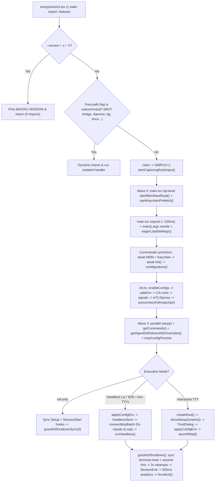

# 22. Cold Start Mastery: From `entrypoints/cli.tsx` Through `init.ts` to `main.tsx`

> **Status: written.** Reverse-engineered from the Claude Code 2.1.88 source snapshot (see the Prologue (`prologue-how-to-read-a-1900-file-agent.md`) for snapshot caveats).
>
> **Layer:** Layer 8 (Entrypoints, Startup, SDK & Remote Control)
> **Prerequisites:** [Chapter 01](ch001-atoms-types-stores-and-primitives.md), [Chapter 14](ch014-configuration-settings-and-enterprise-policy.md), [Chapter 21](ch021-the-interactive-repl-screens-keybindings-and-vim.md)
> **Primary Source Files:**
> - `entrypoints/cli.tsx` — Zero-import bootstrapper, pre-import env fixes, fast-path command router, early stdin capture, and dynamic handoff to `main.tsx`.
> - `entrypoints/init.ts` — Memoized core initializer enforcing config → safe env → CA certs → signal handlers → mTLS/proxy → API TCP+TLS preconnect ordering, plus post-trust OTLP telemetry.
> - `setup.ts` — Working-directory and hooks-snapshot lock-in, `--worktree`/`--tmux` provisioning, `tengu_started` crash-denominator beacon, and bypass-permission safety gates.
> - `main.tsx` — Top-of-file MDM/keychain prefetches, Commander setup (with `-p` subcommand skip), `preAction` hook, trust boundary orchestration, and interactive vs. headless dispatch.
> - `interactiveHelpers.tsx` & `replLauncher.tsx` — Interactive onboarding/trust dialog pipeline (`showSetupScreens()`), lazy REPL mounting (`launchRepl()`), and Ink exit epilogue (`renderAndRun()`).
> - `utils/startupProfiler.ts` & `utils/profilerBase.ts` — Sampled `perf_hooks` checkpointing, parallel memory snapshots, and `tengu_startup_perf` phase telemetry.
> - `utils/gracefulShutdown.ts` & `utils/cleanupRegistry.ts` — Cycle-free cleanup registry, Bun `signal-exit` workaround, synchronous terminal reset, bounded teardown phases, and `SIGKILL` fallback.

---

## Why This Layer Exists

By the end of [Chapter 21](ch021-the-interactive-repl-screens-keybindings-and-vim.md), every subsystem of Claude Code exists: stores, tools, prompt caches, `query()`, compaction, memory, permissions, hooks, settings, MCP, plugins, subagents, swarms, and a custom React/Ink terminal renderer. Now they all have to wake up inside a single CLI binary—fast enough to feel instantaneous when a user runs `claude --version` or pipes text into `claude -p`, yet disciplined enough to enforce enterprise security boundaries before a single untrusted byte executes.

Three hard systems constraints shape the boot path:

1. **Monolith import gravity.** `main.tsx` is 4,683 lines (~785 KB on disk, including its inline base64 source map) whose static import graph pulls in Commander, React, Ink, tools, commands, MCP config parsers, and eleven startup migrations (~135 ms of synchronous module evaluation). Paying that cost for `--version`, MCP helper servers, daemon workers, or `tmux` trampolines would destroy CLI responsiveness.
2. **Irreversible runtime latches.** Several process-level invariants lock in permanently on first use: BoringSSL caches the TLS certificate store on the first handshake; tool modules capture `DISABLE_BACKGROUND_TASKS` into module-level `const`s at import time; Windows `SearchPathW` searches the current directory unless blocked up front; and `.claude/settings.json` inside an untrusted git clone cannot be allowed to set `ANTHROPIC_BASE_URL`, `LD_PRELOAD`, or `NODE_EXTRA_CA_CERTS` until a human accepts the workspace trust dialog.
3. **Hostile teardown environments.** Processes exit on `SIGINT`, `SIGTERM`, `SIGHUP`, silent macOS TTY revocation, or declined trust dialogs—often with live MCP child processes, unflushed JSONL transcripts, pending 10-second analytics POSTs, and an Ink alternate screen waiting to overwrite the shell prompt.

> [!NOTE]
> **Snapshot & build-artifact transparency:** Compiled `.tsx` files in this checkout (`entrypoints/cli.tsx`, `main.tsx`, `interactiveHelpers.tsx`, `replLauncher.tsx`) contain inline base64 source maps and constant-folded external-build literals such as `"external" === 'ant'` (`main.tsx:266,340,428,1137,1531,1763,2013,2223,2819,3064,3581,3816,4370,4381,4405`) and `"production" === 'test' || isEnvTruthy(false)` (`interactiveHelpers.tsx:105`). In addition, several `feature('...')`-gated targets referenced by the startup router are **absent from this snapshot** and observed only at their call sites: `daemon/workerRegistry.ts`, `daemon/main.ts`, `cli/bg.ts`, `cli/handlers/templateJobs.ts`, `environment-runner/main.ts`, `self-hosted-runner/main.ts`, `utils/udsMessaging.ts`, `services/contextCollapse/index.ts`, `utils/attributionHooks.ts`, `utils/sessionDataUploader.ts`, `utils/eventLoopStallDetector.ts`, `ssh/createSSHSession.ts`, `server/server.ts`, `assistant/index.ts`, and `proactive/index.ts`.

---

## 1. Zero-Import Bootstrap and Fast-Path Branching (`entrypoints/cli.tsx`)

### The Problem

In JavaScript runtimes (Bun and Node.js alike), static `import` declarations evaluate depth-first *before* line 1 of the entry module executes. If `cli.tsx` statically imported `config.ts`, `startupProfiler.ts`, or `main.tsx`, then `claude --version` would instantiate thousands of modules just to print a build-time version string. Conversely, certain environment fixes must execute *before* any downstream module evaluates—because waiting until `init()` is already too late for modules that read `process.env` at top level.

### The Real Implementation

`entrypoints/cli.tsx` solves both halves by importing **only** `feature` from `'bun:bundle'` statically, running three surgical `process.env` patches at module top level, and making every other import inside `main()` dynamic:

```ts
// entrypoints/cli.tsx:1-48
import { feature } from 'bun:bundle';

// Bugfix for corepack auto-pinning, which adds yarnpkg to peoples' package.jsons
process.env.COREPACK_ENABLE_AUTO_PIN = '0';

// Set max heap size for child processes in CCR environments (containers have 16GB)
if (process.env.CLAUDE_CODE_REMOTE === 'true') {
  const existing = process.env.NODE_OPTIONS || '';
  process.env.NODE_OPTIONS = existing
    ? `${existing} --max-old-space-size=8192`
    : '--max-old-space-size=8192';
}

// Harness-science L0 ablation baseline. Inlined here (not init.ts) because
// BashTool/AgentTool/PowerShellTool capture DISABLE_BACKGROUND_TASKS into
// module-level consts at import time — init() runs too late.
if (feature('ABLATION_BASELINE') && process.env.CLAUDE_CODE_ABLATION_BASELINE) {
  for (const k of [
    'CLAUDE_CODE_SIMPLE', 'CLAUDE_CODE_DISABLE_THINKING',
    'DISABLE_INTERLEAVED_THINKING', 'DISABLE_COMPACT', 'DISABLE_AUTO_COMPACT',
    'CLAUDE_CODE_DISABLE_AUTO_MEMORY', 'CLAUDE_CODE_DISABLE_BACKGROUND_TASKS',
  ]) {
    process.env[k] ??= '1';
  }
}

async function main(): Promise<void> {
  const args = process.argv.slice(2);

  // Fast-path for --version/-v: zero module loading needed
  if (args.length === 1 && (args[0] === '--version' || args[0] === '-v' || args[0] === '-V')) {
    console.log(`${MACRO.VERSION} (Claude Code)`);
    return;
  }

  // For all other paths, load the startup profiler
  const { profileCheckpoint } = await import('../utils/startupProfiler.js');
  profileCheckpoint('cli_entry');
```

Immediately after `'cli_entry'`, `cli.tsx` walks a ladder of fast-path branches (`entrypoints/cli.tsx:53-274`). Notice that every `feature('...')` check is written inline—never wrapped in a helper—so Bun's bundler can dead-code-eliminate the dynamic `import()` target completely in builds where that flag is off:

| CLI Trigger | Gate / Scope | Loaded Target | Snapshot Status | Notable Startup Rule |
|---|---|---|---|---|
| `--version` / `-v` / `-V` | Always | None (`MACRO.VERSION`) | Inlined | Zero imports; exits before profiler |
| `--dump-system-prompt` | `feature('DUMP_SYSTEM_PROMPT')` | `config`, `model`, `constants/prompts` | Present | Ant-only prompt-eval extractor |
| `--claude-in-chrome-mcp` / `--chrome-native-host` | Always | `utils/claudeInChrome/*` | Present | Bypasses CLI & Ink completely |
| `--computer-use-mcp` | `feature('CHICAGO_MCP')` | `utils/computerUse/mcpServer.ts` | Present | Isolated MCP server process |
| `--daemon-worker` | `feature('DAEMON')` | `daemon/workerRegistry.js` | Absent | Precedes `daemon`; skips `enableConfigs()` & sinks so workers stay lean |
| `remote-control` / `rc` / `remote` / `sync` / `bridge` | `feature('BRIDGE_MODE')` | `bridge/bridgeMain.ts` | Present | Strict order: `enableConfigs` → OAuth check → GrowthBook gate → min version → policy limits |
| `daemon` | `feature('DAEMON')` | `daemon/main.js` | Absent | Calls `enableConfigs()` + `initSinks()` |
| `ps\|logs\|attach\|kill`, `--bg`/`--background` | `feature('BG_SESSIONS')` | `cli/bg.js` | Absent | Flag literals inlined so `bg.js` loads only on dispatch |
| `new\|list\|reply` | `feature('TEMPLATES')` | `cli/handlers/templateJobs.js` | Absent | Calls `process.exit(0)` because `mountFleetView`'s Ink TUI can leave dangling handles |
| `environment-runner` / `self-hosted-runner` | `feature('BYOC_ENVIRONMENT_RUNNER')` / `feature('SELF_HOSTED_RUNNER')` | `environment-runner/main.js`, `self-hosted-runner/main.js` | Absent | Headless cloud/BYOC worker loops |
| `--worktree` + `--tmux` (`--tmux=classic`) | Runtime `isWorktreeModeEnabled()` | `utils/worktree.ts` | Present | Execs into tmux before paying `main.tsx` load cost; falls through if unhandled |

If none of the fast-paths claim the invocation, `entrypoints/cli.tsx:277-298` runs three final pre-`main.tsx` steps:

1. **Flag normalization:** redirects single-arg `--update` / `--upgrade` into `process.argv = [..., 'update']`.
2. **Early `--bare` latch:** `if (args.includes('--bare')) process.env.CLAUDE_CODE_SIMPLE = '1'` so module-evaluation and Commander option-building gates fire *during* `main.tsx`'s import, not only inside the action handler.
3. **Early keystroke capture (`utils/earlyInput.ts`):** users frequently type `claude<Enter>` and start typing their prompt immediately while `main.tsx` is still loading. Calling `startCapturingEarlyInput()` right before `await import('../main.js')` puts TTY `stdin` into raw mode and buffers printable text, grapheme-aware backspaces (`lastGrapheme`), and newlines while ignoring ANSI escape sequences (`utils/earlyInput.ts:29-136`).

### Hidden Invariants & Failure Modes

- **Why `bridge` checks OAuth *before* GrowthBook (`entrypoints/cli.tsx:132-145`):** `getBridgeDisabledReason()` awaits live GrowthBook initialization so stale disk cache cannot override a server kill-switch, but without `getClaudeAIOAuthTokens()?.accessToken`, GrowthBook lacks user identity headers and silently returns default `false`. Checking auth first surfaces `BRIDGE_LOGIN_ERROR` instead of a misleading "feature disabled" message.
- **Why early input capture refuses `-p`/`--print` (`utils/earlyInput.ts:30-40`):** enabling `setRawMode(true)` disables terminal `ISIG` (kernel translation of `Ctrl+C` into `SIGINT`). In print mode, that would render the process uninterruptible. Even in interactive mode, raw mode means `earlyInput.ts` must explicitly intercept byte `3` (`Ctrl+C`) and call `process.exit(130)` (`utils/earlyInput.ts:81-86`) because `gracefulShutdown` has not been installed yet.
- **Why `stopCapturingEarlyInput()` never calls `setRawMode(false)` (`utils/earlyInput.ts:154-156`):** it only detaches the `'readable'` listener. Resetting raw mode right as Ink mounts would race with Ink's own stdin initialization and drop keystrokes.
- **Top-level `void main()` (`entrypoints/cli.tsx:302`):** because the entry promise is unawaited, any synchronous or async `throw` out of early CLI validation becomes an unhandled rejection—which in `stream-json` mode vanishes silently. That is why early validation failures in `main.tsx` write to `stderr` and call `process.exit(1)` explicitly (`main.tsx:1487-1490`).

---

## 2. The Strict Boot Sequence: `entrypoints/init.ts` and Startup Profiling

### The Problem

Once `main.tsx` is loaded and a command is actually executing (not `--help`), Claude Code must initialize configuration, environment variables, CA certificates, mTLS/proxy agents, TCP+TLS warmup, signal handlers, and telemetry. Every one of those subsystems can silently break another if ordered wrong:

- Fire any `fetch()` before `NODE_EXTRA_CA_CERTS` is populated from `settings.json`, and Bun's BoringSSL caches the default CA store without the corporate root certificate for the rest of the process lifetime.
- Load `config.ts` from inside `utils/caCerts.ts`, and `config.ts → file.ts → permissions/filesystem.ts → commands.ts` pulls ~5,300 modules (React, Ink, every slash command) into `proxy.ts`/`mtls.ts`—bloating the Agent SDK bundle from ~0.4 MB to ~10.8 MB (`utils/caCertsConfig.ts:1-14`).
- Apply project-level `.claude/settings.json` environment variables before the trust dialog, and a hostile repository can redirect `ANTHROPIC_BASE_URL` or inject `NODE_EXTRA_CA_CERTS` / `LD_PRELOAD` during onboarding.

### The Real Implementation

`entrypoints/init.ts` wraps the entire boot sequence in `memoize(async () => ...)` so repeated callers share one idempotent initialization promise, and enforces a strict seven-step sequence:

```ts
// entrypoints/init.ts:63-160 (abridged for clarity)
enableConfigs()
profileCheckpoint('init_configs_enabled')

// 1. Safe env vars only before trust (full env applied post-trust)
applySafeConfigEnvironmentVariables()

// 2. Copy NODE_EXTRA_CA_CERTS from user config/settings BEFORE any TLS
//    handshake so Bun's BoringSSL cert store sees it at first init.
applyExtraCACertsFromConfig()
profileCheckpoint('init_safe_env_vars_applied')

// 3. Install signal handlers before spawning background work
setupGracefulShutdown()
profileCheckpoint('init_after_graceful_shutdown')

// 4. Fire-and-forget non-blocking warmups (1P logger deferred to skip OTel sdk-logs)
void Promise.all([
  import('../services/analytics/firstPartyEventLogger.js'),
  import('../services/analytics/growthbook.js'),
]).then(([fp, gb]) => {
  fp.initialize1PEventLogging()
  gb.onGrowthBookRefresh(() => { void fp.reinitialize1PEventLoggingIfConfigChanged() })
})
void populateOAuthAccountInfoIfNeeded()
void initJetBrainsDetection()
void detectCurrentRepository()
if (isEligibleForRemoteManagedSettings()) initializeRemoteManagedSettingsLoadingPromise()
if (isPolicyLimitsEligible()) initializePolicyLimitsLoadingPromise()
recordFirstStartTime()

// 5. Configure mTLS + HTTP/HTTPS proxy agents (NO_PROXY-aware)
configureGlobalMTLS()
configureGlobalAgents()
profileCheckpoint('init_network_configured')

// 6. Overlap Anthropic API TCP+TLS handshake (~100-200ms) with remaining startup
preconnectAnthropicApi()
```

Walk through the load-bearing engineering details behind each step:

1. **`enableConfigs()` (`utils/config.ts:1334-1356`):** flips `configReadingAllowed = true` and reads `~/.claude.json` with `throwOnInvalid = true`. Guarding config reads behind this latch catches accidental module-init disk reads during development. If `~/.claude.json` is malformed (`ConfigParseError`), `init.ts:216-233` branches on `getIsNonInteractiveSession()`: non-interactive callers write plain text to `stderr` and call `gracefulShutdownSync(1)` (never rendering an Ink dialog that would corrupt JSON consumers such as Desktop's `plugin marketplace list --json`), while interactive sessions dynamically import `InvalidConfigDialog`.
2. **Two-phase env loading (`utils/managedEnv.ts:124-199`):** before trust, `applySafeConfigEnvironmentVariables()` snapshots `ccdSpawnEnvKeys` once when `CLAUDE_CODE_ENTRYPOINT === 'claude-desktop'` (so user settings cannot override host-orchestrated vars like `OTEL_LOGS_EXPORTER=console` and corrupt stdio JSON-RPC), strips SSH-tunnel and host-managed-provider vars via `filterSettingsEnv()`, applies *all* env vars from trusted sources (`~/.claude.json`, `userSettings`, `flagSettings`), computes `isRemoteManagedSettingsEligible()`, applies `policySettings`, and applies only the `SAFE_ENV_VARS` allowlist from project-scoped settings.
3. **CA certs split across two modules (`utils/caCertsConfig.ts` & `utils/caCerts.ts`):** `NODE_EXTRA_CA_CERTS` is intentionally excluded from `SAFE_ENV_VARS` because trusting an attacker's CA defeats TLS. Yet corporate users behind HTTPS proxies need their CA loaded *during `init()`*. `applyExtraCACertsFromConfig()` resolves this tension by reading `NODE_EXTRA_CA_CERTS` strictly from user-controlled `~/.claude/settings.json` and `~/.claude.json`—never project settings—and writing it to `process.env`. Meanwhile, `utils/caCerts.ts:28-50` remains completely `config.ts`-free (preventing the 10.8 MB SDK bloat) and lazy-`require`s `'tls'` only when `--use-system-ca`, `--use-openssl-ca`, or `NODE_EXTRA_CA_CERTS` is actually set, because Bun's `node:tls` eagerly materializes ~150 Mozilla root certificates (~750 KB heap) on import.
4. **Proxy, mTLS, and `preconnectAnthropicApi()` (`utils/mtls.ts`, `utils/proxy.ts`, `utils/apiPreconnect.ts`):** `configureGlobalAgents()` ejects any previous axios request interceptor before installing a `NO_PROXY`-aware one, and lazy-`require`s `undici` (~1.5 MB deferred on the common no-proxy/no-mTLS path). Only *after* CA certs and agents are ready does `preconnectAnthropicApi()` fire a `HEAD` request with a 10-second `AbortSignal.timeout` to warm Bun's global keep-alive pool (`utils/apiPreconnect.ts:31-71`). It explicitly returns early for Bedrock/Vertex/Foundry (different endpoints) and for proxy/mTLS/`ANTHROPIC_UNIX_SOCKET` (where the SDK passes a custom dispatcher that never shares the global pool). A comment in `utils/apiPreconnect.ts:15-18` records the scar: an earlier call site in `cli.tsx` had to be removed because it ran before `settings.json` loaded, warming the wrong pool and locking BoringSSL before `NODE_EXTRA_CA_CERTS` landed.
5. **CCR upstream proxy & post-trust OTLP telemetry (`entrypoints/init.ts:167-210, 247-340`):** when `CLAUDE_CODE_REMOTE` is truthy, `init()` lazily boots `upstreamproxy/upstreamproxy.ts` (fail-open; covered in [Chapter 24](ch024-across-the-wire-remote-sessions-bridge-and-direct-connect.md)), sets up Windows git-bash, registers LSP and swarm-team (`gh-32730`) cleanups, and creates the scratchpad directory. Customer OpenTelemetry (`initializeTelemetryAfterTrust()`) stays completely dormant until after trust—deferring ~400 KB of OTel/protobuf in `utils/telemetry/instrumentation.ts` (and ~700 KB of `@grpc/grpc-js`) until `waitForRemoteManagedSettingsToLoad()` resolves and `applyConfigEnvironmentVariables()` re-applies remote OTEL env vars. Once the meter initializes, `setMeterState()` increments `getSessionCounter()?.add(1)` because the earlier startup path executed while the meter was still `null` (`entrypoints/init.ts:335-338`).

#### Measuring Every Millisecond: `utils/startupProfiler.ts`

Every checkpoint above feeds `utils/startupProfiler.ts` and `utils/profilerBase.ts`. To keep profiling cost at zero for 99.5% of external runs, sampling is decided once at module load:

```ts
// utils/startupProfiler.ts:26-54
const DETAILED_PROFILING = isEnvTruthy(process.env.CLAUDE_CODE_PROFILE_STARTUP)
const STATSIG_SAMPLE_RATE = 0.005
const STATSIG_LOGGING_SAMPLED =
  process.env.USER_TYPE === 'ant' || Math.random() < STATSIG_SAMPLE_RATE
const SHOULD_PROFILE = DETAILED_PROFILING || STATSIG_LOGGING_SAMPLED

const memorySnapshots: NodeJS.MemoryUsage[] = []

const PHASE_DEFINITIONS = {
  import_time: ['cli_entry', 'main_tsx_imports_loaded'],
  init_time: ['init_function_start', 'init_function_end'],
  settings_time: ['eagerLoadSettings_start', 'eagerLoadSettings_end'],
  total_time: ['cli_entry', 'main_after_run'],
} as const
```

Two subtle implementation details make the profiler trustworthy:
- `getPerformance()` (`utils/profilerBase.ts:14-20`) lazy-`require`s `perf_hooks` only when `SHOULD_PROFILE` is true.
- Under `CLAUDE_CODE_PROFILE_STARTUP=1`, heap/RSS readings are appended to a parallel `memorySnapshots[]` array indexed identically to `perf.getEntriesByType('mark')`—*not* a `Map<string, MemoryUsage>`—because checkpoints like `loadSettingsFromDisk_start` fire multiple times across plugin cache resets, and a `Map` would overwrite earlier snapshots (`utils/startupProfiler.ts:38-46`). Note also a minor doc drift in the file header (`0.1%` in comments vs. `STATSIG_SAMPLE_RATE = 0.005`, i.e., 0.5% in code).

### Hidden Invariants & Failure Modes

> [!IMPORTANT]
> **Post-trust transport invalidation:** When workspace trust is later accepted (or bypassed in `-p` mode), `applyConfigEnvironmentVariables()` (`utils/managedEnv.ts:187-199`) does not just call `Object.assign(process.env, ...)`. It explicitly invokes `clearCACertsCache()`, `clearMTLSCache()`, `clearProxyCache()`, and `configureGlobalAgents()` so any newly trusted proxy or mTLS settings replace the pre-trust transport agents cleanly without stacking duplicate axios interceptors.

- **Deadlock protection on remote-settings promises (`entrypoints/init.ts:120-128`):** `init()` initializes the loading promises for remote managed settings and policy limits *before* `loadRemoteManagedSettings()` is even called in `main.tsx`'s `preAction`. Those promises carry internal timeouts so callers (such as Agent SDK tests that never invoke `loadRemoteManagedSettings()`) never deadlock waiting for them.
- **Eager beta-tracing race guard (`entrypoints/init.ts:248-303`):** in non-interactive SDK sessions with `isBetaTracingEnabled()`, `initializeTelemetryAfterTrust()` kicks `doInitializeTelemetry()` eagerly without waiting for remote settings so the tracer is ready before the first query, while the remote-settings `.then()` path still calls `doInitializeTelemetry()` later—guarded against double-init by the `telemetryInitialized` latch (which resets to `false` on error to allow retries).

---

## 3. Winning the Import Race: Parallel Prefetches in `main.tsx` and `setup.ts`

### The Problem

Evaluating `main.tsx`'s static import graph takes ~135 ms on a warm machine. On macOS, enterprise MDM (`plutil`) plus two sequential `security find-generic-password` keychain lookups (`"Claude Code-credentials"` ~32 ms + `"Claude Code"` ~33 ms) would add another ~70 ms on top of that—followed by UDS socket binding (~20 ms), command/agent filesystem scans, and MCP config discovery. Running those sequentially turns cold start into a sluggish pause before the first frame even draws.

### The Real Implementation

Claude Code eliminates that serial chain by overlapping startup work across **four distinct waves**:

#### Wave 0 — Pre-Import Subprocess Launches (`main.tsx:1-20`)

The very first 20 lines of `main.tsx` interleave executable statements *above* line 21's heavy imports:

```ts
// main.tsx:9-21
import { profileCheckpoint, profileReport } from './utils/startupProfiler.js';
profileCheckpoint('main_tsx_entry');

import { startMdmRawRead } from './utils/settings/mdm/rawRead.js';
startMdmRawRead();

import { ensureKeychainPrefetchCompleted, startKeychainPrefetch } from './utils/secureStorage/keychainPrefetch.js';
startKeychainPrefetch();

import { feature } from 'bun:bundle'; // Heavy static imports begin here...
```

Look closely at the two leaf modules invoked here:
- `utils/settings/mdm/rawRead.ts:55-123` imports only `child_process`, `fs`, and `mdm/constants.ts`. On macOS, it checks `existsSync(path)` *synchronously* before calling `execFile('plutil', ...)`: non-MDM laptops skip the ~5 ms `plutil` spawn completely, while MDM machines guarantee `execFile` is the very first `await` so the OS spawns `plutil` before the event loop blocks on the remaining imports. On Windows, it fires `reg query` for `HKLM` and `HKCU` in parallel.
- `utils/secureStorage/keychainPrefetch.ts:69-89` spawns both macOS `security` queries concurrently (skipped on non-darwin or under `isBareMode()`). Its comment captures a classic import-graph trap: it imports lightweight `macOsKeychainHelpers.ts` instead of `macOsKeychainStorage.ts`, because the latter pulls in `execa → human-signals → cross-spawn`—~58 ms of synchronous module init that would erase the entire savings! It also distinguishes `null` ("not started") from `{ stdout: null }` ("completed, exit 44 / no entry") and refuses to prime the cache on timeout so the synchronous fallback can retry rather than falsely caching "no key".

#### Wave 1 — Pre-Commander Normalization, Eager Settings, and `preAction` (`main.tsx:432-967`)

When `entrypoints/cli.tsx` invokes `cliMain()`, `main()` runs before Commander parses arguments:

1. **Windows PATH-hijack shield (`main.tsx:591`):** sets `process.env.NoDefaultCurrentDirectoryInExePath = '1'` before any child process can spawn, preventing Windows `SearchPathW` from executing malicious binaries dropped in an untrusted repository's cwd.
2. **Anti-debugging guard (`main.tsx:232-271`):** top-level `if ("external" !== 'ant' && isBeingDebugged()) process.exit(1)`. Under Bun single-file executables, application flags from `process.argv` leak into `process.execArgv` (Bun issue #11673), so the Bun branch skips matching `--debug` to avoid falsely killing `claude --debug`.
3. **Argv rewriting (`main.tsx:612-795`):** intercepts `cc://`/`cc+unix://` (`feature('DIRECT_CONNECT')`), OS protocol deep links `--handle-uri` and macOS LaunchServices `__CFBundleIdentifier === 'com.anthropic.claude-code-url-handler'` (`feature('LODESTONE')`), `claude assistant [sessionId]` (`feature('KAIROS')`), and `claude ssh <host> [dir]` (`feature('SSH_REMOTE')`). Stashing target parameters into module-level `_pendingConnect` / `_pendingAssistantChat` / `_pendingSSH` and rewriting `process.argv` routes interactive runs through the default action so they inherit the full REPL instead of a stripped-down subcommand.
4. **Interactive classification & `eagerLoadSettings()` (`main.tsx:799-855`):** detects `isNonInteractive = hasPrintFlag || hasInitOnlyFlag || hasSdkUrl || !process.stdout.isTTY`, stops early input capture for non-interactive runs, determines `CLAUDE_CODE_ENTRYPOINT` and `clientType`, and parses `--settings` and `--setting-sources` via `utils/cliArgs.ts` *before* `init()` runs.

> [!WARNING]
> **The 12x Prompt-Cache Scar (`main.tsx:445-457`):** When a caller passes inline JSON to `--settings '{...}'`, `loadSettingsFromFlag()` writes it to a temporary file so the settings loader can treat it uniformly. Crucially, the filename uses `contentHash: trimmedSettings`—*never* a random UUID. Why? Because the flag-settings file path lands inside the Bash tool's sandbox `denyWithinAllow` list, which is serialized into the tool definition sent to the Anthropic API. In Agent SDK loops where each `query()` spawns a fresh CLI subprocess, a random UUID mutated the tool schema on every call, invalidating the prompt-cache prefix and causing a 12x input token cost penalty.

5. **Commander `preAction` hook (`main.tsx:907-967`) & the `-p` subcommand skip (`main.tsx:3875-3890`):** attaching initialization to `program.hook('preAction')` guarantees `claude --help` never runs `init()` or migrations. When a real command executes, `preAction` joins Wave 0 via `await Promise.all([ensureMdmSettingsLoaded(), ensureKeychainPrefetchCompleted()])` (nearly free since both finished during imports), awaits `init()`, sets `process.title = 'claude'`, attaches logging/analytics sinks via `utils/sinks.ts` (so subcommands like `doctor` and `plugin` that bypass `setup()` don't silently drop queued events), wires repeatable `--plugin-dir` options (`gh-33508`), executes `runMigrations()` (`CURRENT_MIGRATION_VERSION = 11`, `main.tsx:325-352`), and kicks off non-blocking `loadRemoteManagedSettings()`, `loadPolicyLimits()`, and `feature('UPLOAD_USER_SETTINGS')` sync. Meanwhile, in `-p`/`--print` mode (unless a `cc://` URL was rewritten to `open`), `main.tsx:3883-3890` skips registering all 52 subcommands (`mcp`, `auth`, `plugin`, `doctor`, `update`, etc.) and jumps straight to `program.parseAsync(process.argv)`, saving ~65 ms on every headless invocation.

#### Wave 2 — Parallel `setup()`, Commands/Agents, and MCP Config Discovery (`main.tsx:1780-2031`, `setup.ts`)

Inside the default Commander action handler, `main.tsx` parses flags, validates tool permissions (`initializeToolPermissionContext()`), and kicks off read-only MCP config discovery (`mcpConfigPromise`, plus `claudeaiConfigPromise` in `-p` mode). Then it runs `setup()` in parallel with command and agent loading:

```ts
// main.tsx:1918-1936
const preSetupCwd = getCwd();
// Pure in-memory array pushes (<1ms). Previously ran inside setup() after
// ~20ms of awaits, causing parallel getCommands() to memoize an empty list.
if (process.env.CLAUDE_CODE_ENTRYPOINT !== 'local-agent') {
  initBuiltinPlugins();
  initBundledSkills();
}
const setupPromise = setup(
  preSetupCwd, permissionMode, allowDangerouslySkipPermissions,
  worktreeEnabled, worktreeName, tmuxEnabled,
  sessionId ? validateUuid(sessionId) : undefined,
  worktreePRNumber, messagingSocketPath,
);
const commandsPromise = worktreeEnabled ? null : getCommands(preSetupCwd);
const agentDefsPromise = worktreeEnabled ? null : getAgentDefinitionsWithOverrides(preSetupCwd);
commandsPromise?.catch(() => {});
agentDefsPromise?.catch(() => {});
await setupPromise;
```

Notice the two subtle guards in those 18 lines:
- **Preventing empty bundled-skills memoization:** `initBuiltinPlugins()` and `initBundledSkills()` were pulled *out* of `setup.ts` (`setup.ts:289-292`) because `setup()` awaits `startUdsMessaging()` (~20 ms socket bind, `feature('UDS_INBOX')`, absent from snapshot), allowing the concurrent `getCommands(preSetupCwd)` call to race ahead and memoize an empty bundled-skills list.
- **Worktree serialization & transient rejection suppression:** when `--worktree` is enabled, `commandsPromise` and `agentDefsPromise` stay `null` because `setup()` calls `process.chdir(worktreePath)`, changing the directory from which commands and agents must load. The `.catch(() => {})` calls suppress spurious global `unhandledRejection` events during the ~28 ms window before `Promise.all` joins them at `main.tsx:2029`.

Inside `setup.ts` (`setup.ts:56-477`), six load-bearing invariants execute in strict order:
1. **Runtime & identity prep (`setup.ts:69-158`):** enforces Node >= 18, applies custom `--session-id`, binds the UDS inbox socket *before* `SessionStart` hooks can snapshot `process.env`, captures the teammate-mode snapshot, and—in interactive sessions only—detects and restores interrupted iTerm2 or Terminal.app plist setups.
2. **CWD → Hooks Snapshot → Worktree (`setup.ts:160-285`):** `setCwd(cwd)` must precede `captureHooksConfigSnapshot()` and `initializeFileChangedWatcher(cwd)` so hooks snapshot from the real working directory. If `--worktree` is active, `setup()` checks for either a `WorktreeCreate` hook or git repo, resolves canonical repo root if invoked inside an existing worktree, creates the worktree (and optional `tmux` session), calls `process.chdir()`, updates `setOriginalCwd()` and `setProjectRoot()` (unlike mid-session `EnterWorktreeTool`, `--worktree` makes the worktree the session's project root), clears memory caches (`clearMemoryFileCaches()`), and re-runs `updateHooksConfigSnapshot()` against the worktree's `.claude/settings.json`.
3. **Background registrations & plugin prefetch (`setup.ts:293-370`):** synchronously registers `initSessionMemory()` and `feature('CONTEXT_COLLAPSE')` (`services/contextCollapse/index.js`, absent from snapshot), locks the binary version (`lockCurrentVersion()`), kicks off plugin hook prefetch + hot-reload (skipped when `CLAUDE_CODE_SYNC_PLUGIN_INSTALL` is set in headless mode to avoid racing `copyPluginToVersionedCache`, or under `--bare`), and registers ant undercover repo checks, `COMMIT_ATTRIBUTION` hooks (deferred via `setImmediate` to keep git spawns out of setup microtasks; module absent from snapshot), session file-access hooks, and `feature('TEAMMEM')` watchers.
4. **The `tengu_started` crash-denominator beacon (`setup.ts:371-378`):** `initSinks()` immediately followed by `logEvent('tengu_started', {})`. A comment documents `inc-3694`: a P0 crash inside `checkForReleaseNotes()` (line 387) killed the process before any downstream telemetry fired, hiding the outage from release-health dashboards. Placing `tengu_started` right after sink attachment establishes an honest denominator for session crash rates.
5. **Bypass-permissions safety gate (`setup.ts:396-442`):** if `permissionMode === 'bypassPermissions'` or `allowDangerouslySkipPermissions` is set, POSIX root (`process.getuid() === 0`) is rejected unless `IS_SANDBOX === '1'` or `CLAUDE_CODE_BUBBLEWRAP` is set. For `process.env.USER_TYPE === 'ant'` (exempting `local-agent` and `claude-desktop`), `setup()` also checks `envDynamic.getIsDocker()`, `envDynamic.getIsBubblewrapSandbox()`, and `env.hasInternetAccess()`—refusing to run unless sandboxed *with no internet access*.
6. **Prior-session exit telemetry (`setup.ts:449-476`):** emits `tengu_exit` carrying the *previous* session's persisted cost, durations, token counts, and FPS metrics from `projectConfig` without clearing them (they are still needed for cost restoration on `--resume`).

#### Wave 3 — Non-Interactive Overlap & Post-Render Deferred Prefetches (`main.tsx:388-431, 1952-1990`)

Right after `await setupPromise`, non-interactive (`-p`) sessions immediately call `applyConfigEnvironmentVariables()` (trust is implicit) and kick off `getSystemContext()`, `getUserContext()`, and `ensureModelStringsInitialized()` (overlapping Bedrock's 100–200 ms profile fetch with `commandsPromise`). Interactive sessions instead defer heavy process-spawning prefetches (`initUser`, `getUserContext`, `prefetchSystemContextIfSafe`, `getRelevantTips`, Bedrock/Vertex credential prefetches, `countFilesRoundedRg`, `initializeAnalyticsGates`, `settingsChangeDetector.initialize()`, `skillChangeDetector.initialize()`) into `startDeferredPrefetches()` (`main.tsx:388-431`), which runs *only after* `root.render(element)` in `renderAndRun()` (`interactiveHelpers.tsx:98-103`)—hiding child-process contention behind the user's thinking/typing window and skipping everything under `CLAUDE_CODE_EXIT_AFTER_FIRST_RENDER` or `--bare`.

### Hidden Invariants & Failure Modes

- **Why `--bare` (`CLAUDE_CODE_SIMPLE=1`) acts as a latency scalpel across all waves:** scripted `-p` calls have no "user is typing" window to hide background spawns. Passing `--bare` skips macOS keychain prefetch (`keychainPrefetch.ts:70`), UDS inbox & teammate snapshots (`setup.ts:89-110`), session memory & plugin/attribution/release-notes I/O (`setup.ts:293-393`), claude.ai & auto-discovered MCP configs (`main.tsx:1788,1809`), startup quota/bootstrap prefetches (`main.tsx:2346`), versioned plugin sync (`main.tsx:2555`), and `startDeferredPrefetches()` + `backgroundHousekeeping` (`main.tsx:399,2816`).
- **Cold GrowthBook alias crash-loop guard (`main.tsx:2001-2015`):** for ant builds (`"external" === 'ant'` in this snapshot), an explicit `--model` or `ANTHROPIC_MODEL` with an unpopulated `cachedGrowthBookFeatures['tengu_ant_model_override']` awaits `initializeGrowthBook()` before resolving model aliases—otherwise a cold container pod resolves an internal alias raw, hits a 404, and exits before the async disk cache write lands.

---

## 4. Trust Boundary, Mode Dispatch, and Interactive vs. Headless Handoff

### The Problem

After `setup()` and `commands`/`agents` complete, `main.tsx` faces a stark fork between two worlds:
- **Interactive sessions** run inside a user's terminal on potentially untrusted repositories. They must show onboarding/trust dialogs *before* executing `.claude/settings.json` env vars, LSP servers, `apiKeyHelper`, or `.mcp.json` commands; they must mount Ink (`createRoot`, whose `patchConsole` swallows `console.error`); and they must *never* block first paint on slow MCP servers or ~500 ms `SessionStart` hooks.
- **Headless (`-p` / SDK) sessions** have no terminal UI and treat workspace trust as implicit. They cannot create an Ink root, must materialize configured MCP tools *before* turn 1 (since `-p` is often single-turn), and must hand off an initialized `AppState` store to `cli/print.ts`.

### The Real Implementation

#### The Interactive Trust Gauntlet (`main.tsx:2211-2378`, `interactiveHelpers.tsx:104-298`)

When `!isNonInteractiveSession`, `main.tsx` constructs the Ink root (`createRoot(ctx.renderOptions)`), logs `tengu_timer` (`startup`) *before* any dialog renders—fixing an old bug where logging from REPL's first render measured user dialog-wait time and pushed p99 to ~70s (`main.tsx:2231-2238`)—and runs `showSetupScreens()`:

1. `Onboarding` (if `!config.theme || !config.hasCompletedOnboarding`).
2. `TrustDialog` (unless `CLAUBBIT` is set; fast-paths past dynamic import if `checkHasTrustDialogAccepted()` is already true).
3. **Post-trust unlock (`interactiveHelpers.tsx:144-190`):** marks `setSessionTrustAccepted(true)`, resets and re-initializes GrowthBook with fresh auth headers, prefetches `getSystemContext()`, approves `.mcp.json` servers and `CLAUDE.md` external includes, records the repo path for `--teleport` (`updateGithubRepoPathMapping()`), calls **`applyConfigEnvironmentVariables()`** (applying full project env vars and rebuilding CA/mTLS/proxy agents), and schedules `setImmediate(() => initializeTelemetryAfterTrust())` so OTel's dynamic import resolves after first render.
4. Conditional consent modals: `GroveDialog`, `ApproveApiKey` (for new `ANTHROPIC_API_KEY` outside homespace), `BypassPermissionsModeDialog`, `AutoModeOptInDialog` (`feature('TRANSCRIPT_CLASSIFIER')`), `DevChannelsDialog` (`feature('KAIROS') || feature('KAIROS_CHANNELS')`, blocking on `tengu_harbor` only if disk cache is cold/false to fix `gh#37026`), and `ClaudeInChromeOnboarding`.

Immediately after `showSetupScreens()` returns (and after `validateForceLoginOrg()`), `main.tsx` enforces a critical abort check:

```ts
// main.tsx:2308-2321
// If gracefulShutdown was initiated (e.g., user rejected trust dialog),
// process.exitCode will be set. Skip all subsequent operations that could
// trigger code execution before the process exits (e.g. apiKeyHelper).
if (process.exitCode !== undefined) {
  logForDebugging('Graceful shutdown initiated, skipping further initialization');
  return;
}

// Initialize LSP manager AFTER trust is established (or in non-interactive mode
// where trust is implicit). Prevents plugin LSP servers from executing code
// in untrusted directories before user consent.
initializeLspServerManager();
```

Next come post-trust settings validation (`launchInvalidSettingsDialog`), throttled background API prefetches (`checkQuotaStatus`, `fetchBootstrapData`, `prefetchPassesEligibility`, `prefetchFastModeStatus`—throttled across rapid restarts by GrowthBook `tengu_cicada_nap_ms` while still enforcing fast-mode org policy from cache via `resolveFastModeStatusFromCache()`, `main.tsx:2344-2375`), MCP config resolution (`await mcpConfigPromise`), and versioned plugin initialization (`await`ed in headless mode so sync completes before exit, fire-and-forget in interactive mode, skipped in `--bare`, `main.tsx:2555-2570`).

#### The Three Execution Exits from `main.tsx`

| Mode | Entry Condition (`main.tsx`) | MCP & Hook Strategy | State & Downstream Handoff |
|---|---|---|---|
| **1. `--init-only`** | `main.tsx:2572-2582` | Applies full env; runs `Setup` (`init`) + `SessionStart` (`startup`) with `forceSyncExecution: true` | `gracefulShutdownSync(0)` and return |
| **2. Headless / `-p` / SDK** | `isNonInteractiveSession` (`main.tsx:2585-2861`) | Awaits `connectMcpBatch(regularMcpConfigs)`; deduplicates `plugin:*` vs. `claude.ai` vs. manual `.mcp.json` (`gh-39974`) with a **5s cap** (`CLAUDE_AI_MCP_TIMEOUT_MS`); kicks `sessionStartHooksPromise` early | Creates `headlessStore = createStore(headlessInitialState, onChangeAppState)`, separates `sdkMcpConfigs` (`type === 'sdk'`), lazily imports and invokes `runHeadless(...)` in `cli/print.ts:455` |
| **3. Interactive REPL** | Default fallthrough (`main.tsx:2863-3807`) | **Never awaits** `mcpPromise` or `hooksPromise` before paint; `useManageMCPConnections` converges on memoized `connectToServer`, and `REPL` receives `pendingHookMessages` | Builds `initialState`, increments `numStartups` synchronously, dispatches across 6 flavors (`--continue`, `cc://` Direct Connect, `claude ssh`, `claude assistant` viewer, `--resume`/`--from-pr`/`--teleport`/`--remote`, or fresh session) into `launchRepl()` (`replLauncher.tsx:12-22`) → `renderAndRun()` (`interactiveHelpers.tsx:98-103`) |

Look at two notable scars in the headless vs. interactive split:
- **The 5-second `claude.ai` MCP cap (`main.tsx:2733-2809`):** making `claude.ai` connectors blocking in `-p` mode fixed single-turn connector visibility, but users with 40+ slow connectors saw `tengu_startup_perf` p99 explode to **76 seconds**. Racing `claudeaiConnect` against `CLAUDE_AI_MCP_TIMEOUT_MS = 5_000` bounds turn-1 startup while letting slow connectors finish into `headlessStore` in the background for turn 2+.
- **Why `launchRepl()` lives in its own 23-line file (`replLauncher.tsx`):** it dynamically imports `./components/App.js` and `./screens/REPL.js` only after every setup screen and session-resolution branch completes, keeping the entire React REPL component tree off the `main.tsx` static import graph for subcommands and `-p` runs.

### Hidden Invariants & Failure Modes

- **Early trust gate for `KAIROS` assistant mode (`main.tsx:1043-1089`):** `.claude/settings.json` can declare `assistant: true` and append `.claude/agents/assistant.md` ~1,000 lines *before* `showSetupScreens()` runs. Therefore the `KAIROS` block checks `checkHasTrustDialogAccepted()` itself and refuses to activate in untrusted directories (and skips re-initializing the team when `--agent-id` indicates the process is already a spawned teammate).
- **Double `SessionStart` hook prevention on resume (`main.tsx:2432-2440`):** `hooksPromise` is explicitly `null` when `options.continue || options.resume` is set, because `conversationRecovery.ts` fires `'resume'` hooks; firing `'startup'` too caused hooks to run twice and clobber the first system message (`gh-30825`).
- **Preserving `type: 'sdk'` MCP entries (`main.tsx:1493-1503`):** the Python Agent SDK passes SDK-hosted MCP servers via `--mcp-config` rather than the `initialize` control message. Dropping `type: 'sdk'` during dynamic config parsing broke Coworker (`inc-5122`), so `main.tsx` preserves them through policy filtering and extracts them into `sdkMcpConfigs` for `runHeadless()`.

---

## 5. Bulletproof Teardown: `cleanupRegistry.ts` and `gracefulShutdown.ts`

### The Problem

Shutting down a terminal agent cleanly is an adversarial distributed-systems problem disguised as process exit:
- 25+ subsystems (`config.ts`, `sessionStorage.ts`, `mcp/client.ts`, `lsp/manager.ts`, `settings/changeDetector.ts`, `telemetry/instrumentation.ts`, `swarm/teamHelpers.ts`, etc.) must flush state or reap children—without creating circular imports with `gracefulShutdown.ts`.
- Under Bun, any short-lived `signal-exit` v4 subscriber (like `execa` finishing a child command) calling `removeListener` resets the kernel `sigaction`, silently nuking Claude Code's `SIGTERM` handler!
- On macOS, closing a terminal window often revokes the TTY file descriptors *without* delivering `SIGHUP`, stranding an orphaned process forever; and when a PTY *is* dead, `process.exit()` itself can throw `EIO` trying to flush stdout.
- Unmounting Ink at the wrong moment sends a duplicate `EXIT_ALT_SCREEN` (`1049l` / `DECRC`) *after* `claude --resume <id>` is printed, jumping the cursor backwards and clobbering the resume hint.

### The Real Implementation

First, `utils/cleanupRegistry.ts` isolates the registration surface in a 25-line, zero-dependency leaf module (`const cleanupFunctions = new Set<() => Promise<void>>()`), returning an unregister thunk from `registerCleanup(fn)` and running all registered hooks concurrently via `runCleanupFunctions()`.

Second, `setupGracefulShutdown()` (`utils/gracefulShutdown.ts:237-334`) installs process-wide survival armor once via `memoize`:

```ts
// utils/gracefulShutdown.ts:237-297 (abridged)
export const setupGracefulShutdown = memoize(() => {
  // Pin signal-exit v4 so its emitter count stays > 0 and v4.unload() never
  // calls removeListener — working around a Bun bug where removeListener
  // resets the kernel sigaction even when other JS listeners remain.
  onExit(() => {})

  process.on('SIGINT', () => {
    if (process.argv.includes('-p') || process.argv.includes('--print')) return
    logForDiagnosticsNoPII('info', 'shutdown_signal', { signal: 'SIGINT' })
    void gracefulShutdown(0)
  })
  process.on('SIGTERM', () => { void gracefulShutdown(143) })
  if (process.platform !== 'win32') {
    process.on('SIGHUP', () => { void gracefulShutdown(129) })
    if (process.stdin.isTTY) {
      orphanCheckInterval = setInterval(() => {
        if (getIsScrollDraining()) return // Never steal a scroll frame
        if (!process.stdout.writable || !process.stdin.readable) {
          clearInterval(orphanCheckInterval)
          void gracefulShutdown(129)
        }
      }, 30_000)
      orphanCheckInterval.unref()
    }
  }
  // Plus uncaughtException & unhandledRejection analytics/diagnostics listeners
})
```

Third, `gracefulShutdown()` (`utils/gracefulShutdown.ts:391-523`) executes a strictly ordered, budget-bounded teardown pipeline:

1. **Re-entrancy latch & scaled failsafe timer (`gracefulShutdown.ts:401-429`):** if `shutdownInProgress` is already true, return immediately. Otherwise resolve `sessionEndTimeoutMs = getSessionEndHookTimeoutMs()` *before* arming the `.unref()`'d failsafe timer at `Math.max(5000, sessionEndTimeoutMs + 3500)`—fixing `gh-32712`, where a hardcoded 5-second failsafe silently truncated user-configured 10-second `SessionEnd` hooks.
2. **Synchronous terminal restoration & resume hint FIRST (`gracefulShutdown.ts:59-185, 431-438`):** runs *before* any async I/O so even a `SIGKILL` during macOS reboot leaves a usable terminal and visible resume command. Inside `cleanupTerminalModes()`, exact ordering matters:
   - `writeSync(1, DISABLE_MOUSE_TRACKING)` **first**, giving the terminal a round-trip to stop sending mouse bytes while React unmounts.
   - If `inst?.isAltScreenActive`, call `inst.unmount()` directly (falling back to `writeSync(1, EXIT_ALT_SCREEN)` only if unmount throws). Unmounting while `altScreenActive` is true keeps the final render on the alt buffer, unsubscribes Ink from `signal-exit`, and writes `1049l` exactly once.
   - `inst?.drainStdin()` then `inst?.detachForShutdown()` so deferred `signal-exit` handlers cannot emit redundant `EXIT_ALT_SCREEN` sequences after `printResumeHint()`.
   - Unconditionally `writeSync(1, ...)` `DISABLE_MODIFY_OTHER_KEYS`, `DISABLE_KITTY_KEYBOARD`, `DFE` (focus events), `DBP` (bracketed paste), `SHOW_CURSOR`, `CLEAR_ITERM2_PROGRESS`, optional `CLEAR_TAB_STATUS`, and `CLEAR_TERMINAL_TITLE` (respecting `CLAUDE_CODE_DISABLE_TERMINAL_TITLE`).
   - `printResumeHint()` prints `\nResume this session with:\nclaude --resume <title-or-id>\n` at most once (`resumeHintPrinted`) when TTY + interactive + session file exists.
3. **Phase 1 — Registered cleanups, capped at 2,000 ms (`gracefulShutdown.ts:439-467`):** races `runCleanupFunctions()` against a 2-second timeout. Running this *before* hooks and analytics guarantees session JSONL flush + `reAppendSessionMetadata()` (`utils/sessionStorage.ts:449-462`—which re-appends custom titles into the last 64 KB tail window so `--resume` never loses `/rename`) completes even if the network or TTY is dead.
4. **Phase 2 — `SessionEnd` hooks, capped at `sessionEndTimeoutMs` (`gracefulShutdown.ts:469-480`):** default 1.5s, configurable via `CLAUDE_CODE_SESSIONEND_HOOKS_TIMEOUT_MS`, bounded with `AbortSignal.timeout(sessionEndTimeoutMs)`.
5. **Phase 3 — `profileReport()` + `tengu_cache_eviction_hint` (`gracefulShutdown.ts:482-499`):** emits startup perf telemetry and signals inference (via `getLastMainRequestId()`) that this session's prompt cache can be evicted—both *before* analytics shutdown drains the queue.
6. **Phase 4 — Analytics flush, capped at 500 ms (`gracefulShutdown.ts:501-511`):** races `Promise.all([shutdown1PEventLogging(), shutdownDatadog()])` against `sleep(500)`. Previously unbounded, the 1P exporter awaited 10-second axios POSTs on stalled networks; losing late telemetry is acceptable, hanging exit is not.
7. **`forceExit(exitCode)` (`gracefulShutdown.ts:193-232`):** clears the failsafe timer, calls `instances.get(process.stdout)?.drainStdin()` one last time (using the Ink instance method so `/dev/tty` overrides are drained even when `process.stdin` was piped!), calls `process.exit(exitCode)`, and on `EIO` from a dead PTY falls back to `process.kill(process.pid, 'SIGKILL')`.

### Hidden Invariants & Failure Modes

- **Why `gracefulShutdownSync()` sets `process.exitCode` immediately (`gracefulShutdown.ts:344-359`):** `gracefulShutdownSync()` launches the async shutdown without awaiting it, but assigns `process.exitCode = exitCode` synchronously first. That single assignment is the contract `main.tsx:2312` checks right after `showSetupScreens()` to stop initialization dead in its tracks when a user rejects the trust dialog.
- **Dual `SIGINT` listener coordination (`main.tsx:598-606` vs. `gracefulShutdown.ts:256-267`):** `main.tsx` installs an early `SIGINT` listener (`process.exit(0)`) before `init()` runs so Ctrl+C works during pre-`init()` parsing, and both listeners explicitly `return` when `-p`/`--print` is in `process.argv` so `cli/print.ts` can abort in-flight queries and shut down cleanly without racing.

---

## Putting the Layer Together

The startup and shutdown architecture forms a single funnel: fast-paths peel off early in `cli.tsx`, normal executions overlap I/O across four waves into `init()` and `setup()`, branch sharply across the workspace trust boundary, and reconverge on `gracefulShutdown()`:



Zooming in on the **parallel overlap windows** that keep cold start fast:

```text
Stage A: Import Overlap (cli.tsx -> main.tsx preAction)
cli.tsx : [earlyInput]
Wave 0  : |--plutil / reg query (MDM)------|
        : |--security (OAuth + API key)----|
Imports : |======= main.tsx static imports (~135ms) =======|
preAct  :                                                  [join ~0ms]->init()

Stage B: Post-init() Overlap (init.ts -> Fork -> First Paint)
init()  : |-cfg->env->CA->sig->proxy-|
Preconn :                            |--TCP+TLS HEAD (~100-200ms)----|
Wave 2  :                            |--setup() (UDS/hooks/worktree)-|
        :                            |--getCommands() + getAgents()--|
        :                            |--mcpConfigPromise (file read)-|
Fork    :                                                            |-UI/-p-|
PostPnt :                                                              |-def-|
```

---

## How This Snaps Into the Next Layer

Every interactive session exiting `main.tsx` converges on `launchRepl()` (`replLauncher.tsx:12-22`) and the React/Ink REPL already dissected in [Chapter 21](ch021-the-interactive-repl-screens-keybindings-and-vim.md). Every non-interactive and Agent SDK session exits through two concrete handoffs that open **[Chapter 23 — Machine-Readable Modes: Headless CLI, Agent SDK, and Control Protocols](ch023-machine-readable-modes-headless-sdk-and-control-protocols.md)**:

1. **Headless & SDK execution (`main.tsx:2825-2860` → `cli/print.ts:455`):** `main.tsx` dynamically imports `runHeadless()` and hands it `inputPrompt` (either a string or the live `process.stdin` `AsyncIterable` when `--input-format=stream-json`), `headlessStore.getState`/`setState`, filtered `commandsHeadless`, `tools`, `sdkMcpConfigs`, `agentDefinitions.activeAgents`, and the already-in-flight `sessionStartHooksPromise`. Inside `cli/print.ts`, `StructuredIO` and `RemoteIO` take over NDJSON framing, stdout guarding, and SDK control-protocol round-trips.
2. **MCP server mode (`main.tsx:3894-3909` → `cli/handlers/mcp.ts` → `entrypoints/mcp.ts`):** `claude mcp serve` bypasses the default action and exposes Claude Code's own tool loop as an MCP server.

Finally, the remote and bridge branches that `cli.tsx` (`remote-control` → `bridge/bridgeMain.ts`), `init.ts` (`upstreamproxy/upstreamproxy.ts`), and `main.tsx` (`DIRECT_CONNECT`, `--remote`, `--teleport`, `--rc`) prepared will be unpacked end-to-end in [Chapter 24](ch024-across-the-wire-remote-sessions-bridge-and-direct-connect.md).

---

## Reading Exercises & Code Checkpoints

1. **Trace every `--bare` latency cut across the startup path:**
   Run:
   ```sh
   rg -n "isBareMode|CLAUDE_CODE_SIMPLE" entrypoints/cli.tsx main.tsx setup.ts utils/secureStorage/keychainPrefetch.ts
   ```
   Verify which subsystems `--bare` bypasses at module-eval time versus inside `setup()` versus inside `main.tsx`, and explain why `setup.ts:334-335` refuses to early-return out of `setup()` under `--bare`.

2. **Audit every checkpoint feeding `tengu_startup_perf`:**
   Run:
   ```sh
   rg -n "profileCheckpoint\(" entrypoints/ main.tsx setup.ts
   ```
   Match the checkpoint names against `PHASE_DEFINITIONS` in `utils/startupProfiler.ts:49-54`. Which checkpoint is missing if a user passes `--help`, and why does `init_time` stay undefined in that case?

3. **Verify the trust-boundary invariant on environment variables and CA certs:**
   Read `utils/managedEnv.ts:93-199` alongside `utils/caCertsConfig.ts:34-88`. Identify exactly which config sources can set `ANTHROPIC_BASE_URL` and `NODE_EXTRA_CA_CERTS` *before* `TrustDialog` runs, and trace how `applyConfigEnvironmentVariables()` invalidates cached TLS/proxy state after trust is granted.

4. **Inspect the distributed cleanup registry:**
   Run:
   ```sh
   rg -n "registerCleanup\(" entrypoints/ utils/ services/ main.tsx
   ```
   Pick three callers (including `utils/sessionStorage.ts:448-464`) and trace what happens if one cleanup hangs for 10 seconds during `gracefulShutdown()` while `CLAUDE_CODE_SESSIONEND_HOOKS_TIMEOUT_MS` is set to `8000`. What are the exact timeout budgets for Phase 1, Phase 2, Phase 4, and the outer failsafe timer?
