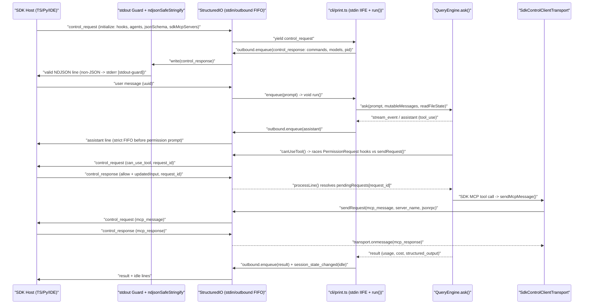

# 23. Machine-Readable Modes: Headless CLI, Agent SDK, and Control Protocols

> **Status: written.** Reverse-engineered from the Claude Code 2.1.88 source snapshot (see the Prologue (`prologue-how-to-read-a-1900-file-agent.md`) for snapshot caveats).
>
> **Layer:** Layer 8 (Entrypoints, Startup, SDK & Remote Control)
> **Prerequisites:** [Chapter 08](ch008-session-envelope-query-engine-and-transcripts.md), [Chapter 11](ch011-the-permission-engine.md), [Chapter 15](ch015-model-context-protocol-mcp.md), [Chapter 22](ch022-cold-start-mastery-cli-init-main.md)
> **Primary Source Files:**
> - `cli/print.ts` — headless runner (`runHeadless`), full-duplex streaming engine (`runHeadlessStreaming`), control-request dispatcher, and resume/replay orchestration
> - `cli/structuredIO.ts` — NDJSON line framer, bidirectional RPC multiplexer (`StructuredIO`), and permission/hook/elicitation/SDK-MCP bridges
> - `cli/ndjsonSafeStringify.ts` — ECMA-262 `U+2028`/`U+2029` line-terminator sanitizer for NDJSON wire framing
> - `utils/streamJsonStdoutGuard.ts` — runtime `process.stdout.write` interceptor diverting stray non-JSON output to `stderr`
> - `entrypoints/agentSdkTypes.ts` — public Agent SDK surface declarations and re-export hub
> - `entrypoints/sdk/coreSchemas.ts` & `entrypoints/sdk/coreTypes.ts` — Zod single source of truth for serializable `SDKMessage` wire types
> - `entrypoints/sdk/controlSchemas.ts` — Zod schemas for bidirectional `control_request` / `control_response` envelopes
> - `entrypoints/mcp.ts` — inverted entrypoint exposing built-in tools as an MCP stdio server (`claude mcp serve`)
> - `services/mcp/SdkControlTransport.ts` — MCP transport tunneling JSON-RPC over `mcp_message` control frames
> - `cli/remoteIO.ts` — `StructuredIO` subclass bridging the control protocol onto remote WebSocket/SSE transports

---

## Why This Layer Exists

In [Chapter 22](ch022-cold-start-mastery-cli-init-main.md), `main.tsx` finishes startup and hits a fork in the road. Interactive users mount the Ink React tree (`screens/REPL.tsx`), where a human watches ANSI spinners, hits Shift+Tab to toggle permission modes, and clicks through permission dialogs. Non-interactive callers have none of that—no TTY, no React tree, no modal UI, and often another program sitting on both ends of `stdin` and `stdout`.

Those programmatic consumers span four very different workloads:

1. **One-shot shell pipes** (`git diff | claude -p "summarize"`), expecting plain text and a clean exit code.
2. **Structured batch automation** (`-p --output-format=json --json-schema=...`), expecting a single machine-validated JSON payload.
3. **Full-duplex Agent SDK hosts** (the TypeScript and Python SDKs, VS Code, Desktop, and CI orchestrators) spawning Claude Code as a long-lived child process with `--input-format=stream-json --output-format=stream-json --verbose`, exchanging multi-turn prompts, partial token streams, mid-turn permission prompts, host-side hooks, and in-process MCP tool calls over one pair of pipes.
4. **Inverted tool hosting** (`claude mcp serve`), where another agent owns the LLM loop and wants to call Claude Code's workspace tools over standard MCP JSON-RPC.

The architectural insight of this layer is that **workloads 1, 2, and 3 share a single streaming engine**: `runHeadlessStreaming()` driven by `StructuredIO`. A plain string passed to `-p` is wrapped into a one-element `AsyncIterable` containing one JSON `user` line (`getStructuredIO` in `cli/print.ts`), then executed through the exact same pipeline as a multi-hour bidirectional SDK session. Only workload 4 steps outside `QueryEngine` entirely, mounting `getTools()` directly onto an MCP server.

We build this layer from the bytes up: wire hygiene first, then wire schemas, then full-duplex RPC multiplexing, then the headless coordinator in `cli/print.ts`, and finally the inverted MCP server.

---

## 1. The Wire Discipline: Keeping `stdout` Pure NDJSON

### The Problem

When `--output-format=stream-json` is active, file descriptor 1 (`stdout`) is no longer a human terminal—it is a framed binary-adjacent RPC channel parsed line-by-line as NDJSON by the parent SDK process. Two production failure modes routinely destroy NDJSON streams in Node/Bun applications:

1. **Unicode line-terminator truncation (`gh-28405`):** `JSON.stringify` emits raw `U+2028` (LINE SEPARATOR) and `U+2029` (PARAGRAPH SEPARATOR) inside strings, which is legal JSON per ECMA-404. Any receiver that splits lines using JavaScript line-terminator semantics (ECMA-262 §11.3: `\n`, `\r`, `U+2028`, `U+2029`) slices the JSON object in half mid-string. Even if the receiver skips malformed lines instead of crashing, the message is silently lost.
2. **Stray `stdout` writes:** A single stray `console.log`, third-party library startup banner, or forgotten debug print anywhere in ~1,900 source files or `node_modules` lands on `stdout` mid-stream and breaks the SDK client's JSON parser with no recovery path.

### The Real Implementation

Two small, surgical modules eliminate both failure classes. First, every NDJSON serializer routes through `ndjsonSafeStringify()` instead of raw `JSON.stringify`:

```ts
// cli/ndjsonSafeStringify.ts:16-32
const JS_LINE_TERMINATORS = /\u2028|\u2029/g

function escapeJsLineTerminators(json: string): string {
  return json.replace(JS_LINE_TERMINATORS, c =>
    c === '\u2028' ? '\\u2028' : '\\u2029',
  )
}

export function ndjsonSafeStringify(value: unknown): string {
  return escapeJsLineTerminators(jsonStringify(value))
}
```

A single alternating regex avoids scanning large serialized tool outputs twice; the `\u2028`/`\u2029` escape sequences parse back to identical strings under every JSON parser while being invisible to every line splitter.

Second, before `runHeadless()` emits a single message in `stream-json` mode (`cli/print.ts`:594–596), it installs a runtime gate on `process.stdout.write`:

```ts
// utils/streamJsonStdoutGuard.ts:59-91
process.stdout.write = function (
  chunk: string | Uint8Array,
  encodingOrCb?: BufferEncoding | ((err?: Error) => void),
  cb?: (err?: Error) => void,
): boolean {
  const text =
    typeof chunk === 'string' ? chunk : Buffer.from(chunk).toString('utf-8')

  buffer += text
  let newlineIdx: number
  let wrote = true
  while ((newlineIdx = buffer.indexOf('\n')) !== -1) {
    const line = buffer.slice(0, newlineIdx)
    buffer = buffer.slice(newlineIdx + 1)
    if (isJsonLine(line)) {
      wrote = originalWrite!(line + '\n')
    } else {
      process.stderr.write(`${STDOUT_GUARD_MARKER} ${line}\n`)
      logForDebugging(
        `streamJsonStdoutGuard diverted non-JSON stdout line: ${line.slice(0, 200)}`,
      )
    }
  }

  const callback = typeof encodingOrCb === 'function' ? encodingOrCb : cb
  if (callback) {
    queueMicrotask(() => callback())
  }
  return wrote
} as typeof process.stdout.write
```

`isJsonLine()` (`utils/streamJsonStdoutGuard.ts`:14–26) treats empty lines as valid (blank separators are tolerated in NDJSON) and tests every non-empty complete line with `JSON.parse(line)`. Anything that fails to parse is diverted to `stderr` prefixed with `STDOUT_GUARD_MARKER` (`'[stdout-guard]'`) so it stays debuggable in logs without poisoning the wire.

### Hidden Invariants & Failure Modes

- **Shutdown flush:** `installStreamJsonStdoutGuard()` registers a cleanup hook via `registerCleanup()` (`utils/streamJsonStdoutGuard.ts`:93–109). Any partial line sitting in `buffer` at exit without a trailing `\n` is flushed to `stdout` if valid JSON, or diverted to `stderr` with `[stdout-guard]` if it is a fragment, before restoring `originalWrite`.
- **Callback liveness:** Notice lines 86–89: even when a write is diverted to `stderr`, the caller's completion callback still fires via `queueMicrotask(() => callback())`. Skipping the callback would deadlock callers awaiting stream drain.
- **One extra `JSON.parse` per frame:** The blessed path (`structuredIO.write` → `writeToStdout` → `process.stdout.write`) always emits `ndjsonSafeStringify(msg) + '\n'`, so it passes straight through—at the deliberate cost of one `JSON.parse` validation pass per outbound message in `stream-json` mode.
- **Non-TTY `stdin` hygiene (`main.tsx`:857–883):** On the input side, `getInputPrompt()` guards against two classic pipe traps. First, it checks `!process.argv.includes('mcp')` before touching `process.stdin`—reading stdin during startup would steal bytes from MCP's JSON-RPC framing. Second, in `text` input mode with a non-TTY `stdin`, it waits at most 3 seconds via `peekForStdinData(process.stdin, 3000)` before warning on `stderr` and proceeding, preventing silent hangs when a parent spawns Claude Code with an inherited, open, silent pipe.

---

## 2. Schema-First Contracts and the Snapshot Boundary

### The Problem

At least five independent codebases consume Claude Code's NDJSON wire format: the CLI itself, the TypeScript Agent SDK (`@anthropic-ai/claude-agent-sdk`), the Python SDK, the VS Code extension, and the `claude.ai` remote bridge. Hand-maintaining duplicate type declarations and runtime validators across those boundaries guarantees schema drift—especially across 24+ message types and 20+ control request subtypes.

### The Real Implementation

The repository treats Zod v4 schemas in `entrypoints/sdk/` as the **single source of truth**:

- `entrypoints/sdk/coreSchemas.ts` (1,889 lines) defines every serializable SDK data type (`ModelUsageSchema`, `PermissionUpdateSchema`, `PermissionResultSchema`, `HookInputSchema`, `SDKResultSuccessSchema`, `SDKResultErrorSchema`, `SDKSystemMessageSchema`, `SDKPartialAssistantMessageSchema`, `SDKSessionStateChangedMessageSchema`, and the 24-variant `SDKMessageSchema` union at lines 1854–1881). Every schema is wrapped in `lazySchema()` ([Chapter 01](ch001-atoms-types-stores-and-primitives.md)) so importing schema modules incurs zero startup allocation.
- `entrypoints/sdk/controlSchemas.ts` (663 lines) defines the bidirectional control protocol layered on top of `coreSchemas.ts`, culminating in the two aggregate wire schemas:

```ts
// entrypoints/sdk/controlSchemas.ts:642-663
export const StdoutMessageSchema = lazySchema(() =>
  z.union([
    SDKMessageSchema(),
    SDKStreamlinedTextMessageSchema(),
    SDKStreamlinedToolUseSummaryMessageSchema(),
    SDKPostTurnSummaryMessageSchema(),
    SDKControlResponseSchema(),
    SDKControlRequestSchema(),
    SDKControlCancelRequestSchema(),
    SDKKeepAliveMessageSchema(),
  ]),
)

export const StdinMessageSchema = lazySchema(() =>
  z.union([
    SDKUserMessageSchema(),
    SDKControlRequestSchema(),
    SDKControlResponseSchema(),
    SDKKeepAliveMessageSchema(),
    SDKUpdateEnvironmentVariablesMessageSchema(),
  ]),
)
```

- `entrypoints/sdk/coreTypes.ts` re-exports generated TypeScript types derived from `coreSchemas.ts` via `bun scripts/generate-sdk-types.ts`, alongside runtime `const` arrays (`HOOK_EVENTS`—27 lifecycle events—and `EXIT_REASONS`).
- `entrypoints/agentSdkTypes.ts` is the public SDK declaration barrel: it re-exports core types, runtime callback interfaces, generated settings types, tool types, and `@alpha` control types (`SDKControlRequest`, `SDKControlResponse`). Its exported functions (`query()`, `tool()`, `createSdkMcpServer()`, the `@alpha` V2 session API `unstable_v2_createSession`/`resumeSession`/`prompt`, transcript utilities like `listSessions`/`forkSession`, and `@internal` daemon helpers `watchScheduledTasks`/`connectRemoteControl`) all throw `'not implemented'` stubs here—this file is the type-checked contract against which the external SDK package is built and published.

> [!NOTE]
> **Snapshot Absences in `entrypoints/sdk/`:** This source checkout contains `coreSchemas.ts`, `controlSchemas.ts`, `coreTypes.ts`, `entrypoints/agentSdkTypes.ts`, and `entrypoints/sandboxTypes.ts`, but **six imported sibling modules are absent from the snapshot**:
> - `entrypoints/sdk/coreTypes.generated.ts` (generated from `coreSchemas.ts`)
> - `entrypoints/sdk/controlTypes.ts` (TypeScript types corresponding to `controlSchemas.ts`)
> - `entrypoints/sdk/runtimeTypes.ts` (non-serializable SDK callback and `Query`/`SDKSession` interfaces)
> - `entrypoints/sdk/settingsTypes.generated.ts` (generated from settings JSON schema)
> - `entrypoints/sdk/toolTypes.ts` (`@internal` per-tool input/output types)
> - `entrypoints/sdk/sdkUtilityTypes.ts` (`NonNullableUsage`)
>
> Because `coreSchemas.ts` and `controlSchemas.ts` *are* present in full, every serializable wire type is directly inspectable, and the missing runtime/control TypeScript interfaces are unambiguously observed at call sites in `cli/structuredIO.ts`, `cli/print.ts`, and `entrypoints/agentSdkTypes.ts`.

### Hidden Invariants & Failure Modes

- **A second hidden code generator (Zod → Protobuf):** Look at the comment on `SDKControlGetSettingsResponseSchema` in `entrypoints/sdk/controlSchemas.ts`:506–510:
  `// String levels only — numeric effort is ant-only and the Zod→proto generator can't emit enum∪number unions.`
  The Zod schemas aren't only generating TypeScript `.d.ts` files; they also feed a Protobuf generator for web/mobile clients, constraining schema authors away from heterogeneous unions.
- **`StdinMessageSchema` vs. runtime `processLine()`:** While `StdinMessageSchema` lists five inbound message types, `StructuredIO.processLine()` (`cli/structuredIO.ts`:431–450) also accepts `assistant` and `system` messages on `stdin` so the remote bridge can inject prior conversation history directly into `mutableMessages` during replay (`cli/print.ts:4042–4052`).
- **Internal control subtypes beyond `controlSchemas.ts`:** `controlSchemas.ts` specifies 21 public/builder `SDKControlRequestInnerSchema` subtypes, while `cli/print.ts` dispatches additional internal/IDE subtypes (`end_session`, `channel_enable`, `mcp_authenticate`, `mcp_oauth_callback_url`, `claude_authenticate`, `claude_oauth_callback`, `claude_oauth_wait_for_completion`, `mcp_clear_auth`, `generate_session_title`, `side_question`, `set_proactive`, `remote_control`). Any unknown subtype gets an explicit `control_response` error (`cli/print.ts`:4021–4028) so callers never hang waiting for an unrecognized request.

---

## 3. `StructuredIO`: Full-Duplex RPC Multiplexing Over `stdin`/`stdout`

### The Problem

A single pair of unidirectional pipes (`stdin` in, `stdout` out) has to carry two asymmetric protocols simultaneously:

1. **Event streaming:** User turns flow in; `assistant` messages, `stream_event` deltas, `tool_progress`, `system` events, and `result` summaries flow out.
2. **Bidirectional RPC:**
   - **Host → CLI:** The host sends `control_request` frames (`initialize`, `interrupt`, `set_model`, `set_permission_mode`, `rewind_files`, etc.) and awaits matching `control_response` frames—even *while* a turn is blocked mid-tool.
   - **CLI → Host:** Mid-turn, Claude Code sends blocking `control_request` frames (`can_use_tool`, `hook_callback`, `mcp_message`, `elicitation`) and must park the calling tool coroutine until a `control_response` with the matching `request_id` arrives on `stdin`—even while other concurrent tools are also blocked on their own prompts.

Without careful framing, two nasty bugs appear immediately:
- **Reordering:** If `sendRequest()` writes directly to `stdout` while `print.ts` drains `QueryEngine` through a separate queue, a `can_use_tool` permission prompt can overtake the `assistant` message that announced the `tool_use` block, confusing host UIs.
- **Duplicate / orphaned `control_response` corruption:** If a WebSocket reconnect or worker restart redelivers an already-handled `can_use_tool` response after its `pendingRequests` entry was removed, treating it as a new orphaned approval re-executes the tool and appends duplicate `tool_use` IDs into `mutableMessages`—causing an unrecoverable Anthropic API `400 "tool_use ids must be unique"` error.

### The Real Implementation

`StructuredIO` (`cli/structuredIO.ts`:135–774) solves multiplexing with four interlocking primitives.

#### 1. One Shared Outbound FIFO (`outbound: Stream<StdoutMessage>`)

```ts
// cli/structuredIO.ts:160-162
// sendRequest() and print.ts both enqueue here; the drain loop is the
// only writer. Prevents control_request from overtaking queued stream_events.
readonly outbound = new Stream<StdoutMessage>()
```

`Stream<T>` (`utils/stream.ts`:1–76) is a minimal single-consumer async FIFO queue (`enqueue()`, `done()`, `error()`). Both `StructuredIO.sendRequest()` and `runHeadlessStreaming()` enqueue into `structuredIO.outbound`, and `runHeadless()`'s outer `for await` loop is the *only* code that calls `structuredIO.write()`. Every `stream_event`, `assistant` frame, `control_request`, and `control_response` hits `stdout` in strict causal order.

#### 2. Line Framing, `prependedLines`, and Inline Response Interception

`StructuredIO.read()` (`cli/structuredIO.ts`:215–261) splits chunks from `this.input` on `\n`, calling `processLine()` on each line. Notice the subtle `prependedLines` mechanism (`cli/structuredIO.ts:204–242`): `SessionStart` hooks (`takeInitialUserMessage()`) and SDK-defined `--agent` `initialPrompt` values can call `structuredIO.prependUserMessage(text)` before iteration starts *or mid-stream*. `splitAndProcess()` checks `this.prependedLines` on every iteration of its inner `for (;;)` loop, so a prepended turn lands ahead of the next message even when two messages arrived in the same read buffer. When `this.input` reaches EOF, `read()` sets `this.inputClosed = true` and rejects every promise still waiting in `this.pendingRequests` with `'Tool permission stream closed before response received'`.

Inside `processLine()` (`cli/structuredIO.ts`:333–463), incoming frames are classified *before* yielding to `cli/print.ts`:

```ts
// cli/structuredIO.ts:341-429 (abridged for clarity)
const message = normalizeControlMessageKeys(jsonParse(line)) as
  | StdinMessage
  | SDKMessage
if (message.type === 'keep_alive') {
  return undefined
}
if (message.type === 'update_environment_variables') {
  for (const [key, value] of Object.entries(message.variables)) {
    process.env[key] = value
  }
  return undefined
}
if (message.type === 'control_response') {
  // ... notifyCommandLifecycle(uuid, 'completed') ...
  const request = this.pendingRequests.get(message.response.request_id)
  if (!request) {
    const responsePayload =
      message.response.subtype === 'success'
        ? message.response.response
        : undefined
    const toolUseID = responsePayload?.toolUseID
    if (
      typeof toolUseID === 'string' &&
      this.resolvedToolUseIds.has(toolUseID)
    ) {
      return undefined // Duplicate delivery — do not re-process as orphan!
    }
    if (this.unexpectedResponseCallback) {
      await this.unexpectedResponseCallback(message)
    }
    return undefined
  }
  this.trackResolvedToolUseId(request.request)
  this.pendingRequests.delete(message.response.request_id)
  if (
    request.request.request.subtype === 'can_use_tool' &&
    this.onControlRequestResolved
  ) {
    this.onControlRequestResolved(message.response.request_id)
  }
  if (message.response.subtype === 'error') {
    request.reject(new Error(message.response.error))
    return undefined
  }
  // Zod-validate response payload against request.schema, then resolve
  // Yield message only if this.replayUserMessages is enabled
}
```

Two real battle scars sit right at the top of `processLine()`:
- **`normalizeControlMessageKeys()` (`utils/controlMessageCompat.ts`:13–32):** Older iOS app builds lacked a Swift `CodingKeys` mapping and emitted camelCase `requestId` instead of snake_case `request_id` on both top-level control requests and nested `response` objects. Without this in-place normalizer, `structuredIO.ts` read `message.response.request_id` as `undefined` and silently dropped mobile permission approvals.
- **`update_environment_variables`:** Mutates `process.env` directly inside the CLI process—not just child shells—because bridge session runners use it to rotate `CLAUDE_CODE_SESSION_ACCESS_TOKEN` in-flight for the running agent itself.

#### 3. Five Outbound RPC Bridges Built on `sendRequest()`

`sendRequest<Response>()` (`cli/structuredIO.ts`:469–531) generates a `requestId = randomUUID()`, enqueues `{ type: 'control_request', request_id, request }` onto `this.outbound`, stores `{ resolve, reject, schema, request }` in `this.pendingRequests`, and attaches a one-shot `AbortSignal` listener. If the signal aborts, it enqueues `{ type: 'control_cancel_request', request_id }`, records the `tool_use_id` in `resolvedToolUseIds` *before* rejecting (so a late reply from the host won't trip the orphan handler), and rejects immediately with `AbortError` without waiting for host acknowledgment.

All five CLI→Host RPC capabilities build directly on `sendRequest()`:

1. **Tool Permissions (`createCanUseTool`, `cli/structuredIO.ts`:533–659):**
   First evaluates local rules and modes via `hasPermissionsToUseTool()` ([Chapter 11](ch011-the-permission-engine.md)). Only when the local engine returns `'ask'` does `StructuredIO` go over the wire—and it **races** local `PermissionRequest` hooks against the remote SDK prompt in parallel:

```ts
// cli/structuredIO.ts:576-638 (abridged)
const hookPromise = executePermissionRequestHooksForSDK(
  tool.name, toolUseID, input, toolUseContext, mainPermissionResult.suggestions,
).then(decision => ({ source: 'hook' as const, decision }))

const requestId = randomUUID()
onPermissionPrompt?.(buildRequiresActionDetails(tool, input, toolUseID, requestId))
const sdkPromise = this.sendRequest<PermissionToolOutput>(
  {
    subtype: 'can_use_tool',
    tool_name: tool.name,
    input,
    permission_suggestions: mainPermissionResult.suggestions,
    blocked_path: mainPermissionResult.blockedPath,
    decision_reason: serializeDecisionReason(mainPermissionResult.decisionReason),
    tool_use_id: toolUseID,
    agent_id: toolUseContext.agentId,
  },
  permissionToolOutputSchema(),
  hookAbortController.signal,
  requestId,
).then(result => ({ source: 'sdk' as const, result }))

const winner = await Promise.race([hookPromise, sdkPromise])
if (winner.source === 'hook') {
  if (winner.decision) {
    sdkPromise.catch(() => {})
    hookAbortController.abort() // emits control_cancel_request to dismiss host UI
    return winner.decision
  }
  const sdkResult = await sdkPromise
  return permissionPromptToolResultToPermissionDecision(
    sdkResult.result, tool, input, toolUseContext,
  )
}
return permissionPromptToolResultToPermissionDecision(
  winner.result, tool, input, toolUseContext,
)
```

   Why race instead of awaiting hooks first? A slow `PermissionRequest` hook (e.g., an external approval service taking 20 seconds) would freeze the VS Code or Desktop permission dialog. Racing lets the host show the prompt immediately and dismiss it via `control_cancel_request` if the hook decides first.

   When the SDK host responds, `permissionPromptToolResultToPermissionDecision()` (`utils/permissions/PermissionPromptToolResultSchema.ts`:84–127) applies and persists any `updatedPermissions`, aborts `toolUseContext.abortController` if `behavior === 'deny' && result.interrupt`, and embeds two production scars:
   - **Mobile empty-object fallback (lines 107–111):** Mobile push notifications don't carry the full tool input payload, so they send `updatedInput: {}` to satisfy the schema. An empty `updatedInput` object is silently replaced with the original `input` so the tool isn't invoked with stripped arguments.
   - **Lenient telemetry/permission-update parsing (lines 37–62, `#29440`):** Both `decisionClassification` and `updatedPermissions` use Zod `.catch(undefined)` so a malformed permission suggestion from an older SDK host degrades gracefully instead of rejecting an entire `allow` decision.

2. **Sandbox Network Approval (`createSandboxAskCallback`, `cli/structuredIO.ts`:731–753):**
   Piggybacks OS-level sandbox network prompts onto the existing `can_use_tool` protocol using a synthetic tool name: `SANDBOX_NETWORK_ACCESS_TOOL_NAME = 'SandboxNetworkAccess'`. SDK hosts already know how to render `can_use_tool`, so they get network approval dialogs with zero new protocol subtypes. Failure or stream closure fails closed (`return false`).
3. **Host-Side Hooks (`createHookCallback`, `cli/structuredIO.ts`:661–689):**
   When the host sends `hooks` in `initialize`, each `callbackId` is wrapped in a `HookCallback` (`type: 'callback'`) that calls `sendRequest({ subtype: 'hook_callback', callback_id, input, tool_use_id }, hookJSONOutputSchema(), abort)`. Transport errors log to `stderr` and fail open to `{}`.
4. **MCP Elicitations (`handleElicitation`, `cli/structuredIO.ts`:694–721):**
   Wired into connected non-SDK MCP clients by `registerElicitationHandlers()` (`cli/print.ts`:1263–1387). Local `Elicitation` hooks get first crack; if none respond, `structuredIO.handleElicitation()` emits `{ subtype: 'elicitation', mcp_server_name, message, mode, url, elicitation_id, requested_schema }` validated against `SDKControlElicitationResponseSchema()`, then passes the result through `runElicitationResultHooks()`. Transport failures return `{ action: 'cancel' }`. URL-mode completion notifications (`ElicitationCompleteNotificationSchema`) are surfaced outbound as `system` / `elicitation_complete` SDK events.
5. **In-Process SDK MCP Tunneling (`sendMcpMessage`, `cli/structuredIO.ts`:758–773 + `services/mcp/SdkControlTransport.ts`):**
   When an SDK caller creates an in-process MCP server via `createSdkMcpServer()` (living inside the host's own Node/Python process rather than a separate child binary), the CLI connects to it using `SdkControlClientTransport`. Every JSON-RPC request from the CLI's MCP client is wrapped by `sendMcpMessage()` into `{ subtype: 'mcp_message', server_name, message }`, shipped over `stdout`, handled by the host's `SdkControlServerTransport`, and returned in `{ mcp_response }`. Unsolicited MCP server notifications travel the opposite direction as host→CLI `mcp_message` control requests, which `cli/print.ts:2979–2994` injects into `sdkClient.client.transport.onmessage`.

### Hidden Invariants & Failure Modes

> [!IMPORTANT]
> **Bounded Deduplication Against Orphaned Permission Replay:** `resolvedToolUseIds` is capped at `MAX_RESOLVED_TOOL_USE_IDS = 1000` (`cli/structuredIO.ts:133, 176–187`), evicting the oldest entry via `Set` insertion order. It is updated on *all three* resolution paths: normal `control_response`, bridge `injectControlResponse()`, and `AbortSignal` cancellation. Together with `handledOrphanedToolUseIds` in `cli/print.ts:2766, 5272`, this guarantees a redelivered `control_response` never triggers duplicate tool execution. Meanwhile, a *genuine* orphan (e.g., user clicked Approve on `claude.ai` after the worker restarted and lost its in-memory `pendingRequests` map) falls through `unexpectedResponseCallback` → `handleOrphanedPermissionResponse()` (`cli/print.ts:5241–5304`), locates the unresolved `tool_use` block in the persisted transcript via `findUnresolvedToolUse(toolUseID)`, and enqueues a synthetic `mode: 'orphaned-permission'` command to complete the turn.

- **Concurrent permission state transition (`cli/structuredIO.ts:653–655`):** In `createCanUseTool()`'s `finally` block, `notifySessionStateChanged('running')` fires *only* if `this.getPendingPermissionRequests().length === 0`. Because parallel tool execution ([Chapter 06](ch006-executing-tools.md)) can have multiple `can_use_tool` prompts in flight at once, prematurely emitting `'running'` while another prompt is still open would hide the host's remaining approval UI.
- **Dual-host permission race (`injectControlResponse`, `cli/structuredIO.ts:283–331`):** When a local SDK session activates `remote_control`, `onControlRequestSent` mirrors every `can_use_tool` request to the `claude.ai` bridge. If the remote web/mobile user answers first, `injectControlResponse()` resolves the local promise *and* sends `control_cancel_request` on `stdout` so the local SDK host's `canUseTool` callback aborts cleanly; if the local SDK host answers first, `onControlRequestResolved` tells the bridge to cancel the remote prompt.

---

## 4. `cli/print.ts`: Driving `QueryEngine` Across Text, JSON, and `stream-json`

### The Problem

Headless execution looks deceptively simple until you remove the React REPL. Every concern that lived in React hooks in `screens/REPL.tsx` (`useSettingsChange`, `useManageMCPConnections`, `useQueueProcessor`, `useInboxPoller`, `useScheduledTasks`, `useReplBridge`) still has to work in a 5,594-line non-React module—while simultaneously supporting three output formats, two input formats, structured JSON output enforcement, background agent completion hold-back, session resume/rewind, and ~30 control request subtypes.

### The Real Implementation

#### Step 1: Mode Validation and Unified Stream Normalization

Before calling `runHeadless()`, `main.tsx`:1237–1243 and 1818–1861 enforce the CLI flag invariants:
- `--sdk-url` automatically sets both `--input-format=stream-json` and `--output-format=stream-json`.
- `--input-format=stream-json` requires `--output-format=stream-json`; `--replay-user-messages` requires both; `--include-partial-messages` (or env `CLAUDE_CODE_INCLUDE_PARTIAL_MESSAGES`) requires `--print` and `--output-format=stream-json`.
- Inside `runHeadless()` (`cli/print.ts`:787–793), `--output-format=stream-json` additionally requires `--verbose`.

Then `getStructuredIO()` (`cli/print.ts`:5199–5233) collapses single-shot and streaming inputs into one abstraction:

```ts
// cli/print.ts:5199-5233
function getStructuredIO(
  inputPrompt: string | AsyncIterable<string>,
  options: {
    sdkUrl: string | undefined
    replayUserMessages?: boolean
  },
): StructuredIO {
  let inputStream: AsyncIterable<string>
  if (typeof inputPrompt === 'string') {
    if (inputPrompt.trim() !== '') {
      inputStream = fromArray([
        jsonStringify({
          type: 'user',
          session_id: '',
          message: { role: 'user', content: inputPrompt },
          parent_tool_use_id: null,
        } satisfies SDKUserMessage),
      ])
    } else {
      inputStream = fromArray([])
    }
  } else {
    inputStream = inputPrompt
  }

  return options.sdkUrl
    ? new RemoteIO(options.sdkUrl, inputStream, options.replayUserMessages)
    : new StructuredIO(inputStream, options.replayUserMessages)
}
```

#### Step 2: `runHeadless()` — Process Setup and Output-Format Dispatch

`runHeadless()` (`cli/print.ts`:455–974) prepares the non-React runtime before draining `runHeadlessStreaming()`:
- **Headless subscriptions & GC:** Subscribes directly to `settingsChangeDetector` (`lines 520–532`), triggers `downloadUserSettings()` if `feature('DOWNLOAD_USER_SETTINGS')` in remote mode, initializes GrowthBook (`void initializeGrowthBook()`), and starts `setInterval(Bun.gc, 1000).unref()` under Bun to keep memory bounded in long-lived workers.
- **Guard, sandbox, and hook events:** Installs `installStreamJsonStdoutGuard()` for `stream-json`; initializes `SandboxManager.initialize(structuredIO.createSandboxAskCallback())` (or exits if `isSandboxRequired()` and unavailable, `#34044`); and registers `registerHookEventHandler()` to emit `hook_started` / `hook_progress` / `hook_response` NDJSON frames when `stream-json` + `verbose`.
- **Resume / Rewind (`loadInitialMessages`, `cli/print.ts:4893–5197`):** Loads prior history for `--continue`, `--teleport` (checked against `isPolicyAllowed('allow_remote_sessions')`), or `--resume <uuid|.jsonl|url>` (URL resume is `[ANT-ONLY]`; hydrates remote logs under `CLAUDE_CODE_USE_CCR_V2` or `ENABLE_SESSION_PERSISTENCE`). Supports `--resume-session-at <uuid>` (slices loaded messages to `index + 1`), `--fork-session` (keeps a fresh session ID), and standalone `--rewind-files <user-uuid>` (rewinds disk via `handleRewindFiles()` and exits immediately).
- **Output format switching (`cli/print.ts:851–973`):** Consumes every `StdoutMessage` yielded by `runHeadlessStreaming()`:
  - **`stream-json`:** Writes each frame immediately via `await structuredIO.write(message)`. When `feature('STREAMLINED_OUTPUT')` is compiled in and `CLAUDE_CODE_STREAMLINED_OUTPUT=true`, frames pass through `createStreamlinedTransformer()` (`utils/streamlinedTransform.ts`:130–193), a "distillation-resistant" filter that strips thinking blocks, system/init metadata, and raw tool calls, replacing consecutive tool-only turns with cumulative counts (`streamlined_tool_use_summary`, e.g., `"Searched 2 patterns, read 3 files"`) and emitting text as `streamlined_text` while preserving `result`.
  - **`json`:** Only accumulates `messages[]` when `options.outputFormat === 'json' && options.verbose` (`needsFullArray`), avoiding O(session) RAM retention in `text` and `stream-json` modes. At stream end, writes either `jsonStringify(messages)` (`--verbose`) or `jsonStringify(lastMessage)`.
  - **`text` (default):** Writes `lastMessage.result` on `'success'`, or a human-readable diagnostic for `'error_during_execution'`, `'error_max_turns'`, `'error_max_budget_usd'`, or `'error_max_structured_output_retries'`.
  - **Exit code & cleanup:** Drains pending background memory extraction (`feature('EXTRACT_MEMORIES') && isExtractModeActive()`), then calls `gracefulShutdownSync(lastMessage?.type === 'result' && lastMessage.is_error ? 1 : 0)`. Note lines 892–909: `lastMessage` explicitly ignores `control_*`, `stream_event`, `session_state_changed`, `task_*`, `post_turn_summary`, and `prompt_suggestion` so late tail events after `result` never clobber the exit code.

#### Step 3: `runHeadlessStreaming()` — Dual-Loop Concurrency Over `QueryEngine`

Inside `runHeadlessStreaming()` (`cli/print.ts`:976–4143), two asynchronous loops run concurrently against `messageQueueManager` and `output = structuredIO.outbound`:

1. **The Inbound Reader IIFE (`cli/print.ts:2813–4140`):** Iterates `for await (const message of structuredIO.structuredInput)`:
   - **`control_request`:** Handled inline without waiting for an active turn to finish. Long-running auxiliary requests (`generate_session_title`, `side_question`) spawn fire-and-forget IIFEs (`lines 3783–3874`) specifically so their Haiku/forked-agent API round-trips don't block subsequent `interrupt` frames on `stdin`.
   - **`user`:** Marks `initialized = true`, deduplicates `message.uuid` against both disk (`doesMessageExistInSession`) and an in-memory 10,000-entry ring (`receivedMessageUuids`, emitting an `isReplay: true` ack for duplicates if `replayUserMessages` is set), resolves any web-composer `file_attachments`, enqueues a `prompt` command, and calls `void run()`.
   - **`assistant` / `system`:** History replay from bridge; converts via `toInternalMessages()` and pushes straight into `mutableMessages`.
   - **`control_response`:** Only arrives here when `replayUserMessages` is enabled; re-enqueued onto `output` for logging/UI parity.
   - **Stream close (`lines 4124–4139`):** Sets `inputClosed = true`, stops the `cronScheduler` (if `feature('AGENT_TRIGGERS')`), and—if `!running`—waits up to 5 seconds for any in-flight `prompt_suggestion`, finalizes pending async hooks, removes listeners, and closes `output.done()`.

2. **The Turn Consumer `run()` (`cli/print.ts:1865–2681`):** Guarded by a boolean mutex (`if (running) return; running = true`).
   - Ensures SDK MCP servers are synced (`updateSdkMcp()`) and optionally awaits synchronous plugin installation (`CLAUDE_CODE_SYNC_PLUGIN_INSTALL`, raced against `CLAUDE_CODE_SYNC_PLUGIN_INSTALL_TIMEOUT_MS`).
   - Enters a `do { ... } while (waitingForAgents)` loop calling `drainCommandQueue()`:
     - Dequeues main-thread commands (`cmd.agentId === undefined`). Consecutive `prompt` commands with matching `workload` and `isMeta` coalesce via `canBatchWith()` + `joinPromptValues()` (`cli/print.ts:428–453, 1949–1982`) into one `ask()` call; when `replayUserMessages` is enabled, merged intermediate UUIDs still receive synthetic `SDKUserMessageReplay` acks so hosts tracking per-UUID delivery don't stall.
     - Calls `ask()` (`QueryEngine.ts`:1185–1295), which constructs a fresh `QueryEngine` sharing `mutableMessages` by reference and cloning `readFileState`, yields `engine.submitMessage(prompt, { uuid, isMeta })`, and writes back `engine.getReadFileState()` in `finally`.
     - Streams yielded `SDKMessage` records into `output`, flushing `drainSdkEvents()` before every message and `result`.

#### Step 4: The Control Protocol Surface

The inbound reader dispatches the full host→CLI control grammar. Grouping the handlers reveals how an external host treats Claude Code as a controllable stateful engine:

| Category | Subtypes (`request.subtype`) | Key Implementation Details & Scars |
| :--- | :--- | :--- |
| **Lifecycle** | `initialize`, `interrupt`, `end_session` | `initialize` accepts `systemPrompt`, `appendSystemPrompt`, `agents`, and `jsonSchema` over `stdin` to **avoid OS `ARG_MAX` limits** (`cli/print.ts:4369–4384`), registers SDK hook callbacks, and returns commands, agents, models, account info, output styles, and `pid`. Re-initializing returns an error carrying `pending_permission_requests`. `end_session` aborts and breaks the `stdin` loop. |
| **Runtime Config** | `set_permission_mode`, `set_model`, `set_max_thinking_tokens`, `apply_flag_settings`, `get_settings` | `set_permission_mode` enforces policy/launch gates for `bypassPermissions` and `feature('TRANSCRIPT_CLASSIFIER')` `auto` (`cli/print.ts:4568–4642`). `set_model` updates `setMainLoopModelOverride()` and injects model-switch breadcrumbs. `apply_flag_settings` converts JSON `null` values to key deletions, fans out via `settingsChangeDetector.notifyChange('flagSettings')` (post-`#20625` cache reset), and syncs model override (`lines 3700–3755`). |
| **History & State** | `rewind_files`, `seed_read_state`, `cancel_async_message`, `get_context_usage`, `stop_task` | `rewind_files` supports `dry_run` diff stats via `fileHistory.ts`. `cancel_async_message` removes an unstarted prompt from `messageQueueManager` by UUID. `seed_read_state` restores `readFileState` entries removed by snip/compaction (see invariant below). |
| **MCP & Plugins** | `mcp_status`, `mcp_message`, `mcp_set_servers`, `mcp_reconnect`, `mcp_toggle`, `reload_plugins`, plus internal IDE OAuth/channel subtypes (`mcp_authenticate`, `mcp_oauth_callback_url`, `mcp_clear_auth`, `claude_authenticate`, `channel_enable`) | `mcp_set_servers` serializes mutations through a promise chain (`mcpChangesPromise`) and **sends `control_response` *before* calling `void updateSdkMcp()`** (`lines 3059–3064`)—otherwise connecting new SDK MCP servers over `stdout` deadlocks while the host is still awaiting `mcp_set_servers`! |
| **Remote & Auxiliary** | `remote_control`, `side_question`, `generate_session_title`, `set_proactive` (`PROACTIVE`/`KAIROS`) | `side_question` forks from `getLastCacheSafeParams()` (swapping in a fresh `AbortController` if the prior turn was aborted!) for prompt-cache hits (`lines 3815–3874`). `remote_control` dynamically imports `initReplBridge` (`lines 3892–4020`). |

#### Step 5: Partial Messages, Structured Output, and Permission Delegation

Three headless features cross the boundary between `cli/print.ts` and `QueryEngine.ts`:

- **Partial Messages (`--include-partial-messages`):** When enabled, `QueryEngine.ts:818–826` wraps every raw Anthropic SSE `stream_event` into `{ type: 'stream_event', event, parent_tool_use_id: null, uuid, session_id }`, letting SDK UIs render token-by-token deltas without waiting for complete `assistant` blocks.
- **Structured Output (`--json-schema` or `initialize.jsonSchema`):** Rather than relying on raw constrained decoding alone, the harness injects a synthetic built-in tool named `'StructuredOutput'` (`createSyntheticOutputTool()` in `tools/SyntheticOutputTool/SyntheticOutputTool.ts`:20–120, cached in a `WeakMap<object, CreateResult>` so repeated workflow invocations skip ~1.4 ms of Ajv JIT compilation). It is appended *after* `getTools()` filtering (`main.tsx:1885–1892` for CLI flags; `buildAllTools()` in `cli/print.ts:1492–1498` for `initialize.jsonSchema`). `QueryEngine.ts:331–333` registers a stop-hook enforcement guard (`registerStructuredOutputEnforcement`), captures the tool's output via a `structured_output` attachment (`QueryEngine.ts:838–840`), caps retries at `MAX_STRUCTURED_OUTPUT_RETRIES` (default `5`, emitting `error_max_structured_output_retries` at `QueryEngine.ts:1005–1048`), and surfaces the validated object on `SDKResultSuccess.structured_output` (`QueryEngine.ts:1149`).
- **Three Permission Modes (`getCanUseToolFn`, `cli/print.ts`:4267–4334):**
  1. `permissionPromptToolName === 'stdio'` (forced whenever `--sdk-url` is set) → `structuredIO.createCanUseTool(onPermissionPrompt)`.
  2. Unset → pure static `hasPermissionsToUseTool()` with no interactive fallback.
  3. Custom MCP tool name (`--permission-prompt-tool`) → **lazily resolved on first prompt** (`lines 4294–4333`) because MCP servers connect incrementally in print mode and aren't in `appState.mcp.tools` at startup; `createCanUseToolWithPermissionPrompt()` races the MCP tool call against `createCombinedAbortSignal()` so `Ctrl+C`/interrupts break out of blocking permission tools immediately (`lines 4149–4263`).

### Hidden Invariants & Failure Modes

> [!WARNING]
> **`heldBackResult` and the Teammate Deadlock (`gh-30008`):** When `ask()` yields a `result` while a background `local_agent` or `local_workflow` is still running, `cli/print.ts:2222–2236` captures the message in `heldBackResult` (and defers any `prompt_suggestion`) until the `do { drainCommandQueue(); ... } while (waitingForAgents)` loop finishes draining background task completions. Critically, lines 2392–2394 explicitly exclude `in_process_teammate` tasks:
> ```ts
> // cli/print.ts:2392-2394
> const hasRunningBg = getRunningTasks(state).some(
>   t => isBackgroundTask(t) && t.type !== 'in_process_teammate',
> )
> ```
> Teammates remain `running` until explicitly shut down—waiting on them inside `waitingForAgents` looped forever. Instead, once `inputClosed` is true with an active swarm (`lines 2617–2667`), `print.ts` injects `SHUTDOWN_TEAM_PROMPT` so the team lead tears down its workers cleanly before closing `output.done()`.

- **Lost-wakeup guard on the `run()` mutex (`cli/print.ts:2487–2495`):** If a user message arrives between the last `dequeue()` returning `undefined` and `running = false` in `finally`, the producer's `void run()` sees `running === true` and returns. `run()` closes this race by checking `if (peek(isMainThread) !== undefined) { void run(); return }` *after* releasing `running = false`.
- **Authoritative turn-over boundary (`session_state_changed: 'idle'`):** In `run()`'s `finally` block (`cli/print.ts:2453–2469`), `print.ts` flushes `structuredIO.flushInternalEvents()`, emits `notifySessionStateChanged('idle')`, and runs one final `drainSdkEvents()` loop *before* blocking on the next command. Because `heldBackResult` flushed before `finally`, `'idle'` is the authoritative signal that a turn (and all its background agents) is completely finished.
- **Surviving `ask()`'s clone-and-replace on `seed_read_state` (`cli/print.ts:1157–1167, 2168–2181, 3017–3054`):** Because the `stdin` IIFE runs concurrently with `ask()`, writing a `seed_read_state` entry directly into `readFileState` mid-turn would be overwritten when `ask()`'s `finally` replaces `readFileState` with its clone. Seeds instead buffer in `pendingSeeds` (one-shot survival across one clone-replace cycle), normalize paths with `expandPath()` plus BOM/CRLF stripping, and **skip seeding if `Math.floor(stat.mtimeMs) > request.mtime`**—otherwise caching current disk bytes under an older client timestamp would cause `getChangedFiles()` to diff current-vs-current, emit no change notification, and hide an external edit!
- **Auto-resume of interrupted turns (`cli/print.ts:1171–1192`):** When `CLAUDE_CODE_RESUME_INTERRUPTED_TURN` is set and `loadInitialMessages()` detects an interrupted turn (`turnInterruptionState.kind !== 'none'`), `print.ts` splices out the interrupted message and its sentinel via `removeInterruptedMessage()` and pre-enqueues it—waiting until after `initialize` completes (`lines 2913–2917`) before calling `run()` so SDK system prompts, agents, and hooks are wired first.

---

## 5. Inverting the Architecture: The Harness as an MCP Server (`entrypoints/mcp.ts`)

### The Problem

Everything above assumes Claude Code owns the agentic loop—calling Claude, streaming tokens, deciding which tools to invoke. Sometimes the architecture flips inside out: another agent harness, desktop host, or IDE already owns the LLM loop and wants to consume Claude Code's built-in tools (`Read`, `Edit`, `Write`, `Bash`, `Glob`, `Grep`, etc.) over standard MCP stdio JSON-RPC.

### The Real Implementation

When invoked as `claude mcp serve`, `main.tsx`:524–527 stamps `process.env.CLAUDE_CODE_ENTRYPOINT = 'mcp'`, registers the Commander subcommand (`main.tsx:3895–3906`), and lazily imports `mcpServeHandler()` (`cli/handlers/mcp.tsx`:42–71), which validates `cwd`, calls `setup(providedCwd, 'default', ...)`, and delegates to `startMCPServer()` in `entrypoints/mcp.ts`.

Unlike `cli/print.ts`, `entrypoints/mcp.ts` touches neither `QueryEngine` nor `StructuredIO`. It instantiates an `@modelcontextprotocol/sdk` `Server` named `'claude/tengu'` bound to `StdioServerTransport` and registers exactly two request handlers:

```ts
// entrypoints/mcp.ts:59-97 (abridged)
server.setRequestHandler(ListToolsRequestSchema, async () => {
  const toolPermissionContext = getEmptyToolPermissionContext()
  const tools = getTools(toolPermissionContext)
  return {
    tools: await Promise.all(
      tools.map(async tool => {
        let outputSchema: ToolOutput | undefined
        if (tool.outputSchema) {
          const convertedSchema = zodToJsonSchema(tool.outputSchema)
          // MCP SDK requires outputSchema to have type: "object" at root level
          // Skip schemas with anyOf/oneOf at root (issues/8014)
          if (
            typeof convertedSchema === 'object' &&
            convertedSchema !== null &&
            'type' in convertedSchema &&
            convertedSchema.type === 'object'
          ) {
            outputSchema = convertedSchema as ToolOutput
          }
        }
        return {
          ...tool,
          description: await tool.prompt({
            getToolPermissionContext: async () => toolPermissionContext,
            tools,
            agents: [],
          }),
          inputSchema: zodToJsonSchema(tool.inputSchema) as ToolInput,
          outputSchema,
        }
      }),
    ),
  }
})
```

On `CallToolRequestSchema` (`entrypoints/mcp.ts`:99–188), the server looks up the tool by name, constructs a minimal stub `ToolUseContext` (with `getAppState: () => getDefaultAppState()`, no-op state mutators, `isNonInteractiveSession: true`, `thinkingConfig: { type: 'disabled' }`, `commands: [review]`, and the shared 100-file LRU `readFileStateCache`), checks `tool.isEnabled()` and `tool.validateInput?.()`, and invokes `tool.call()` directly:

```ts
// entrypoints/mcp.ts:136-169
// TODO: validate input types with zod
try {
  if (!tool.isEnabled()) {
    throw new Error(`Tool ${name} is not enabled`)
  }
  const validationResult = await tool.validateInput?.(
    (args as never) ?? {},
    toolUseContext,
  )
  if (validationResult && !validationResult.result) {
    throw new Error(
      `Tool ${name} input is invalid: ${validationResult.message}`,
    )
  }
  const finalResult = await tool.call(
    (args ?? {}) as never,
    toolUseContext,
    hasPermissionsToUseTool,
    createAssistantMessage({ content: [] }),
  )

  return {
    content: [
      {
        type: 'text' as const,
        text:
          typeof finalResult === 'string'
            ? finalResult
            : jsonStringify(finalResult.data),
      },
    ],
  }
}
```

### Hidden Invariants & Failure Modes

Reading `entrypoints/mcp.ts` alongside `services/tools/toolExecution.ts` ([Chapter 06](ch006-executing-tools.md)) exposes five load-bearing differences caused by bypassing `runToolUse()`:

1. **Permission enforcement shifts to the MCP host:** `CallToolRequestSchema` *passes* `hasPermissionsToUseTool` as `tool.call()`'s `canUseTool` parameter, rather than calling `canUseTool()` *before* invoking `tool.call()`. Built-in leaf tools that rely on `runToolUse()` to check permissions ahead of time will execute directly once the MCP client sends `tools/call`—meaning **the calling MCP client is the permission boundary**, not `entrypoints/mcp.ts`.
2. **No Zod input parsing or hooks (`entrypoints/mcp.ts:136`):** The inline `// TODO: validate input types with zod` comment is literal: `tool.inputSchema.safeParse()` is skipped, and neither `PreToolUse` nor `PostToolUse` hooks run. Only `tool.validateInput()` executes before `tool.call()`.
3. **Cross-call `FileStateCache` bounded by LRU (`lines 40–45`):** Sharing a single 100-file (25 MB) `FileStateCache` across all `tools/call` requests preserves `FileEditTool`'s "must read before edit" and staleness invariants across sequential MCP tool calls while preventing unbounded memory growth in a long-lived server process.
4. **Root-object `outputSchema` filter (`issues/8014`, `lines 69–82`):** The MCP specification requires tool `outputSchema` to declare `type: "object"` at root. Tools whose Zod output schema is a `z.union` or `z.discriminatedUnion` convert to top-level `anyOf`/`oneOf`, which crashes strict MCP clients; `entrypoints/mcp.ts` drops `outputSchema` to `undefined` for those tools.
5. **No upstream MCP re-export & different startup path:** Note the `// TODO: Also re-expose any MCP tools` comments (`lines 62, 103`)—only built-in tools from `getTools()` are exposed. And unlike the specialized fast-path MCP servers in `entrypoints/cli.tsx`:72–95 (`--claude-in-chrome-mcp` and `feature('CHICAGO_MCP')` `--computer-use-mcp`) that bypass `main.tsx` completely, `claude mcp serve` routes through `main.tsx` Commander dispatch and runs full `setup()`.

---

## Putting the Layer Together

### The Three Machine-Readable Topologies

```text
(1) Single-Shot (-p text / json)      (2) Bidirectional SDK (stream-json)
    prompt string / piped stdin           Host (TS/Py SDK, IDE, Bridge)
                 |                             |                 ^
         getStructuredIO()            stdin    |  NDJSON lines   | stdout
      (wraps into 1 user JSON)        (raw)    v                 | (guarded)
                 |                     +-------+-----------------+-------+
                 v                     | StructuredIO  <-> outbound FIFO |
    +-------------------------+        |  - processLine()                |
    |  runHeadlessStreaming() | <----> |  - pendingRequests Map          |
    |  (cli/print.ts)         |        |  - ndjsonSafeStringify()        |
    +------------+------------+        |  - streamJsonStdoutGuard        |
                 |                     +---------------------------------+
                 v
           QueryEngine.ask()           (3) Inverted Server (claude mcp serve)
                                           External MCP Host
                                                 |  StdioServerTransport
                                                 v  (JSON-RPC)
                                           entrypoints/mcp.ts ('claude/tengu')
                                                 |  direct tool.call()
                                                 v
                                           getTools() + 100-file cache
```

### Full-Duplex Multiplexing During a Single SDK Turn



---

## How This Snaps Into the Next Layer

Notice that nothing in `cli/print.ts` assumes the SDK host sits on local `stdin`/`stdout` pipes—everything speaks to the `StructuredIO` interface. That abstraction is the exact hinge into [Chapter 24](ch024-across-the-wire-remote-sessions-bridge-and-direct-connect.md), snapping in at two concrete seams:

1. **Outbound worker transport (`cli/print.ts:5229–5232` → `cli/remoteIO.ts`):** When `--sdk-url` is passed, `getStructuredIO()` swaps `new StructuredIO(...)` for `new RemoteIO(options.sdkUrl, inputStream, options.replayUserMessages)`. `RemoteIO extends StructuredIO` replaces `stdin` with a `PassThrough` stream fed by `getTransportForUrl()` (`cli/transports/transportUtils.ts`:16–45)—selecting `SSETransport` (+ `CCRClient` lifecycle/heartbeats/internal-event persistence) under `CLAUDE_CODE_USE_CCR_V2`, `HybridTransport` under `CLAUDE_CODE_POST_FOR_SESSION_INGRESS_V2`, or `WebSocketTransport` by default. `RemoteIO.write()` ships frames over the network transport (still echoing `control_request` frames to `stdout` when `CLAUDE_CODE_ENVIRONMENT_KIND === 'bridge'` so a supervising bridge process detects permission prompts) and adds an Envoy idle keep-alive timer (`#21931`).
2. **Mid-session remote control (`cli/print.ts:3892–4020`):** Even a local stdio SDK session can dynamically attach a `claude.ai` remote-control bridge by sending `{ subtype: 'remote_control', enabled: true }`, which imports `src/bridge/initReplBridge.js` and wires `structuredIO.setOnControlRequestSent`, `setOnControlRequestResolved`, and `injectControlResponse` so local SDK and remote web/mobile clients race safely over the same session.

[Chapter 24](ch024-across-the-wire-remote-sessions-bridge-and-direct-connect.md) picks up directly on the far side of `RemoteIO` and `initReplBridge` to dissect the remote transports, always-on bridge daemons, Direct Connect, and the upstream credential proxy.

---

## Reading Exercises & Code Checkpoints

1. **Audit every control subtype handled in `cli/print.ts` vs. `controlSchemas.ts`:**
   Run:
   ```sh
   rg -n "request\.subtype ===" cli/print.ts
   rg -n "subtype: z\.literal\(" entrypoints/sdk/controlSchemas.ts
   ```
   Compare the two lists. Which subtypes exist in `cli/print.ts` (for IDE extensions, OAuth flows, or internal daemons) that are intentionally omitted from `SDKControlRequestInnerSchema`?
2. **Trace the `mcp_set_servers` deadlock prevention:**
   Inspect `cli/print.ts:3055–3065` alongside `cli/print.ts:1389–1461` (`updateSdkMcp`) and `cli/structuredIO.ts:758–773` (`sendMcpMessage`). Explain why awaiting `updateSdkMcp()` *before* sending `sendControlResponseSuccess(message)` would deadlock a synchronous SDK host.
3. **Verify the two-layer duplicate-response shield:**
   Read `cli/structuredIO.ts:176–187`, `374–401`, and `490–504`, then `cli/print.ts:5241–5304`. Trace what happens when a `PermissionRequest` hook wins the race against a slow host (`hookAbortController.abort()`), and the host's stale `control_response` arrives 200 ms later on `stdin`. Which data structure catches it and prevents `handleOrphanedPermissionResponse()` from running?
4. **Contrast `entrypoints/mcp.ts` with `services/tools/toolExecution.ts`:**
   Read `entrypoints/mcp.ts:99–188` and list every step from Chapter 06's `runToolUse()` lifecycle (Zod parse, `PreToolUse` hooks, `canUseTool` pre-check, `toolResultStorage` budgeting, `PostToolUse` hooks) that is *absent* when a tool is invoked via `claude mcp serve`. What security implication does this carry for an MCP host mounting `claude mcp serve`?
