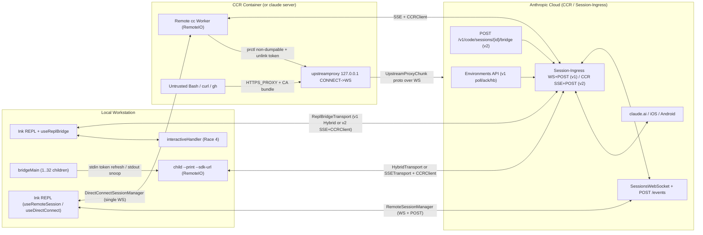

# 24. Across the Wire: Remote Sessions, Always-On Bridge, and Direct Connect

> **Status: written.** Reverse-engineered from the Claude Code 2.1.88 source snapshot (see the Prologue (`prologue-how-to-read-a-1900-file-agent.md`) for snapshot caveats).
>
> **Layer:** Layer 8 (Entrypoints, Startup, SDK & Remote Control)
> **Prerequisites:** [Chapter 08](ch008-session-envelope-query-engine-and-transcripts.md), [Chapter 11](ch011-the-permission-engine.md), [Chapter 22](ch022-cold-start-mastery-cli-init-main.md), [Chapter 23](ch023-machine-readable-modes-headless-sdk-and-control-protocols.md)
> **Primary Source Files:**
> - `cli/transports/WebSocketTransport.ts` — WebSocket transport with UUID ring-buffer replay, suspension detection, and idle keep-alives
> - `cli/transports/HybridTransport.ts` — WebSocket reads paired with serialized HTTP POST writes
> - `cli/transports/SSETransport.ts` — CCR v2 Server-Sent Events reader with sequence-number resumption and liveness watchdog
> - `cli/transports/SerialBatchEventUploader.ts` — single-flight batched HTTP uploader with backpressure and `Retry-After` jitter
> - `cli/transports/WorkerStateUploader.ts` — 2-slot RFC 7396 coalescing uploader for `PUT /worker`
> - `cli/transports/ccrClient.ts` — CCR v2 worker lifecycle, epoch enforcement, full-so-far text coalescing, and internal-event persistence
> - `cli/transports/transportUtils.ts` — environment-driven transport selector (`SSETransport` vs. `HybridTransport` vs. `WebSocketTransport`)
> - `cli/remoteIO.ts` — `StructuredIO` subclass wiring remote transports and `CCRClient` into `--sdk-url` print workers
> - `bridge/initReplBridge.ts` — REPL Remote Control entitlement gates, cross-process OAuth backoff, title derivation, and v1/v2 dispatch
> - `bridge/replBridge.ts` — env-based REPL bridge core (register/poll/ack/heartbeat loop and transport lifecycle)
> - `bridge/remoteBridgeCore.ts` — env-less REPL bridge core (`POST /bridge` direct JWT exchange, proactive epoch refresh)
> - `bridge/replBridgeTransport.ts` — unified `ReplBridgeTransport` adapter over v1 `HybridTransport` and v2 `SSETransport + CCRClient`
> - `bridge/bridgeMessaging.ts` — ingress routing, server control-request responder, and `BoundedUUIDSet` echo filter
> - `bridge/bridgePermissionCallbacks.ts` — callback contract connecting the permission engine to remote approvals
> - `bridge/bridgeMain.ts` — standalone always-on `claude remote-control` daemon and multi-session worktree spawner
> - `bridge/sessionRunner.ts` — child `--sdk-url` process spawner, stdout activity/permission watcher, and stdin token refresh
> - `bridge/inboundAttachments.ts` & `bridge/inboundMessages.ts` — remote `file_uuid` download-to-`@path` resolution and iOS/web image block normalization
> - `bridge/flushGate.ts`, `bridge/capacityWake.ts`, `bridge/bridgePointer.ts`, `bridge/sessionIdCompat.ts`, `bridge/trustedDevice.ts` — ordering, wake, crash-recovery, ID-retag, and elevated-auth primitives
> - `remote/RemoteSessionManager.ts`, `remote/SessionsWebSocket.ts`, `remote/sdkMessageAdapter.ts`, `remote/remotePermissionBridge.ts` — local REPL client attaching to remote CCR sessions
> - `server/directConnectManager.ts`, `server/createDirectConnectSession.ts`, `server/types.ts` — direct WebSocket client for self-hosted `claude server`
> - `upstreamproxy/upstreamproxy.ts` & `upstreamproxy/relay.ts` — non-dumpable container-side HTTP `CONNECT`-over-WebSocket credential-injection relay
> - `hooks/useReplBridge.tsx`, `hooks/useRemoteSession.ts`, `hooks/useDirectConnect.ts`, `hooks/toolPermission/handlers/interactiveHandler.ts` — React/permission-engine integration points

---

## Why This Layer Exists

In [Chapter 23](ch023-machine-readable-modes-headless-sdk-and-control-protocols.md), `StructuredIO` turned a local process's `stdin` and `stdout` into a multiplexed NDJSON channel for prompts, assistant streams, and `control_request` permission round-trips. That solves single-machine automation. Real users immediately demand three harder network topologies:

1. **Local agent, remote human (Remote Control & Always-On Bridge):** You start an interactive session on your laptop—or leave `claude remote-control` running on a workstation—and drive it from `claude.ai` or your phone. Prompts, file uploads, and tool-approval prompts must cross NATs, laptop lid closes, and token expirations without duplicating messages or hanging the terminal.
2. **Remote agent, local terminal (CCR Remote Sessions & Direct Connect):** The agent executes inside a cloud container (Claude Code Remote, **CCR**) or a self-hosted `claude server`, while your local Ink REPL attaches over WebSocket to stream output and answer permission modals.
3. **Untrusted container subprocess, org-scoped credentials (`upstreamproxy/`):** Inside a CCR container, shell tools (`curl`, `gh`, `kubectl`) need org API keys (such as `DD-API-KEY`) to talk to internal services. Exposing those keys in `process.env` or on disk turns any prompt injection into instant secret exfiltration.

Every one of these topologies reuses the exact NDJSON SDK and control-protocol vocabulary from Chapter 23. What changes across the wire is **transport reliability, ordering, identity, and trust boundaries**.

> [!NOTE]
> **Snapshot boundaries in this chapter:** Several imported type or host-server files referenced by this layer are absent from this checkout and reconstructed strictly from their call sites:
> - `cli/transports/Transport.ts` (interface implemented by `WebSocketTransport` and `SSETransport`, consumed by `cli/remoteIO.ts` and `transportUtils.ts`)
> - `entrypoints/sdk/controlTypes.ts` (type companion to the present `entrypoints/sdk/controlSchemas.ts`)
> - `types/message.ts` (internal REPL message union)
> - `bridge/webhookSanitizer.ts` (conditionally required under `feature('KAIROS_GITHUB_WEBHOOKS')` in `hooks/useReplBridge.tsx:193-200`)
> - Server-side Direct Connect host modules (`server/server.ts`, `server/sessionManager.ts`, `server/backends/dangerousBackend.ts`, `server/lockfile.ts`, `server/parseConnectUrl.ts`, `server/connectHeadless.ts`), whose dynamic imports and CLI wiring are observed in `main.tsx:3961-4095` while only the client-side files (`directConnectManager.ts`, `createDirectConnectSession.ts`, `types.ts`) are present on disk.

---

## 1. The Transport Substrate: WebSocket, Hybrid, SSE, and `CCRClient`

### The Problem

A naive WebSocket wrapper breaks under four production realities:

- **Silent proxy and NAT drops:** Edge proxies (Cloudflare's 5-minute idle timeout, Envoy sidecars) reset idle WebSockets even when RFC 6455 `ping`/`pong` control frames flow, because proxies only reset idle timers on *data* frames. Worse, after a laptop sleeps, `ws.ping()` on a dead NAT-mapped socket writes into the kernel send buffer and returns with zero error.
- **Write amplification and Firestore contention:** Bridge callers fire outbound messages via fire-and-forget `void transport.write()`. Sending concurrent HTTP POSTs for token-by-token `stream_event` deltas triggers concurrent Firestore writes to the same session document—producing write collisions, retry storms, and oncall pages (`cli/transports/HybridTransport.ts:50-52`).
- **Dual-runtime divergence (Bun vs. Node):** Compiled binaries run Bun's native `globalThis.WebSocket` (which hides HTTP upgrade response headers and takes a `proxy` URL string), while npm installs and CCR containers run Node's `ws` package (which exposes `upgradeReq.headers` and requires an `http.Agent`).
- **Mid-stream reconnect gaps:** If a phone or browser reconnects mid-generation, raw `text_delta` fragments leave the client missing earlier tokens, and overlapping worker restarts can interleave events from two processes unless fenced by a monotonic epoch.

### The Real Implementation

`cli/transports/transportUtils.ts:16-44` selects among three concrete transports in strict priority order:

| Priority | Activation | Read Channel | Write Channel | Ordering / Replay Primitive |
| :--- | :--- | :--- | :--- | :--- |
| **1. `SSETransport` + `CCRClient`** | `CLAUDE_CODE_USE_CCR_V2` | HTTP `fetch` SSE (`/worker/events/stream`) | `CCRClient` batched POST (`/worker/events`, `/worker/internal-events`, `PUT /worker`) | `from_sequence_num` + `Last-Event-ID`, `worker_epoch` fencing, full-so-far text snapshots |
| **2. `HybridTransport`** | `CLAUDE_CODE_POST_FOR_SESSION_INGRESS_V2` | WebSocket (`extends WebSocketTransport`) | `SerialBatchEventUploader` → `POST .../session/<id>/events` | 100ms `stream_event` batching, single in-flight POST, UUID dedup |
| **3. `WebSocketTransport`** | Default (`ws://` / `wss://`) | WebSocket | WebSocket NDJSON frames | 1,000-msg `CircularBuffer` + `X-Last-Request-Id` replay |

#### `WebSocketTransport`: Replay, Suspension Detection, and Leak-Free Reconnects

`cli/transports/WebSocketTransport.ts` owns the low-level WebSocket state machine (`idle` → `reconnecting` ↔ `connected` → `closing` → `closed`). Every outbound message carrying a `uuid` is appended to a 1,000-entry `CircularBuffer<StdoutMessage>` (`DEFAULT_MAX_BUFFER_SIZE = 1000`) and updates `lastSentId`. On reconnect, `connect()` sends `X-Last-Request-Id: <lastSentId>` (`WebSocketTransport.ts:152-157`). Under Node, `onNodeOpen` reads the server's `upgradeReq.headers['x-last-request-id']`, evicts confirmed entries, and replays only the tail. Under Bun—whose WebSocket hides upgrade response headers—`onBunOpen` replays the entire buffer and relies on server-side UUID deduplication (`WebSocketTransport.ts:201-208`). Crucially, `replayBufferedMessages()` never clears the buffer after replay; messages stay buffered until confirmed on a *subsequent* handshake so a drop mid-replay cannot lose them.

Two production scars live in `startPingInterval()` and `startKeepaliveInterval()`:

```ts
// cli/transports/WebSocketTransport.ts:706-745
this.pingInterval = setInterval(() => {
  if (this.state === 'connected' && this.ws) {
    const now = Date.now()
    const gap = now - lastTickTime
    lastTickTime = now

    // Process-suspension detector: setInterval coalesces missed ticks on wake.
    // ws.ping() on a dead NAT-expired socket returns immediately with no error,
    // so assume dead and force reconnect rather than waiting a full ping cycle.
    if (gap > SLEEP_DETECTION_THRESHOLD_MS) {
      logForDebugging(
        `WebSocketTransport: ${Math.round(gap / 1000)}s tick gap detected — process was suspended, forcing reconnect`,
      )
      this.handleConnectionError()
      return
    }

    if (!this.pongReceived) {
      this.handleConnectionError()
      return
    }
    this.pongReceived = false
    this.ws.ping?.()
  }
}, DEFAULT_PING_INTERVAL)
```

Notice the dual liveness design:
1. A 10-second `ping`/`pong` loop catches half-open links and detects laptop sleep (`gap > 60s`), while `handleConnectionError()` separately detects sleep gaps *between* reconnect attempts and resets the 10-minute `DEFAULT_RECONNECT_GIVE_UP_MS` budget (`WebSocketTransport.ts:476-488`).
2. A 5-minute data-frame keep-alive (`{"type":"keep_alive"}\n`, skipped when `CLAUDE_CODE_REMOTE` is set because CCR heartbeats take over) resets proxy idle timers, and `lastActivityTime` explicitly excludes ping/pong frames so `tengu_ws_transport_closed` telemetry can diagnose Cloudflare 300s RST clusters (`WebSocketTransport.ts:92-96, 403-418, 767-792`).
3. Close codes `1002` (session reaped), `4001` (session expired), and `4003` (unauthorized) terminate retries immediately—with one escape hatch: on `4003`, if `refreshHeaders()` returns a different `Authorization` value (parent refreshed the token), the transport retries instead of dying (`WebSocketTransport.ts:42-46, 427-455`).
4. All five socket listeners (`onBunOpen`…`onNodeClose`, `onPong`) are bound class-property arrow functions detached in `removeWsListeners()` *before* `ws.close()` so reconnect storms don't leak orphaned sockets and closures (`WebSocketTransport.ts:195-200, 360-395`).

#### `HybridTransport` and `SerialBatchEventUploader`: Serializing Writes Without Head-of-Line Poisoning

`HybridTransport` subclasses `WebSocketTransport` for reads and overrides `write()` to POST batches through `cli/transports/SerialBatchEventUploader.ts` (`maxBatchSize: 500`, `maxQueueSize: 100_000`, `POST_TIMEOUT_MS = 15_000`). High-frequency `stream_event` frames accumulate in a 100ms delay buffer (`BATCH_FLUSH_INTERVAL_MS = 100`); any non-stream message calls `takeStreamEvents()` first and enqueues `[...buffered, message]` atomically so ordering never inverts (`HybridTransport.ts:117-133`).

`SerialBatchEventUploader` enforces **at most one POST in flight** while new events batch behind it:

```ts
// cli/transports/SerialBatchEventUploader.ts:162-189
while (this.pending.length > 0 && !this.closed) {
  const batch = this.takeBatch()
  if (batch.length === 0) continue

  try {
    await this.config.send(batch)
    failures = 0
  } catch (err) {
    failures++
    if (
      this.config.maxConsecutiveFailures !== undefined &&
      failures >= this.config.maxConsecutiveFailures
    ) {
      this.droppedBatches++
      this.config.onBatchDropped?.(batch.length, failures)
      failures = 0
      this.releaseBackpressure()
      continue
    }
    this.pending = batch.concat(this.pending)
    const retryAfterMs =
      err instanceof RetryableError ? err.retryAfterMs : undefined
    await this.sleep(this.retryDelay(failures, retryAfterMs))
    continue
  }
  this.releaseBackpressure()
}
```

Three subtle invariants live inside `SerialBatchEventUploader`:
- **Poison-item eviction:** When `maxBatchBytes` is configured (`CCRClient` sets `10 * 1024 * 1024`), `takeBatch()` measures `Buffer.byteLength(jsonStringify(item))`. If serialization throws (BigInt, circular reference, throwing `toJSON`), it splices the bad item out in place—leaving it at `pending[0]` would hang `flush()` forever (`SerialBatchEventUploader.ts:209-233`).
- **Clamped, jittered `Retry-After`:** Throwing `RetryableError(msg, retryAfterMs)` overrides exponential backoff with the server's 429 hint, *clamped* to `[baseDelayMs, maxDelayMs]` and spread by `+ Math.random() * jitterMs` so neither a bad header nor a synchronized fleet can hot-loop or stampede (`SerialBatchEventUploader.ts:235-253`).
- **Backpressure deadlock hazard:** `enqueue()` blocks while `pending.length + items.length > maxQueueSize`. Passing a single batch larger than `maxQueueSize` would deadlock forever—which is why both `HybridTransport` and `CCRClient.eventUploader` raise `maxQueueSize` to `100_000` (`HybridTransport.ts:80-85`, `ccrClient.ts:362-367`).

#### `SSETransport`, `CCRClient`, and `WorkerStateUploader`: The CCR v2 Protocol

CCR v2 replaces Session-Ingress WebSockets with standard HTTP endpoints under `/v1/code/sessions/{id}/worker/*`. `cli/transports/SSETransport.ts` streams `GET .../worker/events/stream` via `fetch()` and parses frames incrementally with `parseSSEFrames()` (splitting on `\n\n`, treating `:keepalive` comments as liveness proofs, and aborting if 45 seconds pass without any frame—`LIVENESS_TIMEOUT_MS = 45_000` against a 15-second server keepalive). Each `event: client_event` frame carries a `StreamClientEvent` whose `payload` is unwrapped into NDJSON for `onData`. Sequence numbers are tracked in `lastSequenceNum` and sent back via *both* `?from_sequence_num=` and `Last-Event-ID` on reconnect; a `seenSequenceNums` set catches duplicates and self-prunes entries below `lastSequenceNum - 200` once size exceeds 1,000 (`SSETransport.ts:245-266, 357-384`). Permanent HTTP statuses (`401`, `403`, `404`) close immediately without burning the 10-minute backoff budget.

`cli/transports/ccrClient.ts` sits alongside `SSETransport` as the worker control plane:

1. **Epoch fencing:** Every `PUT /worker`, heartbeat (`POST /worker/heartbeat`, every 20s against a 60s server TTL), and event POST carries `worker_epoch`. A `409 Conflict` means a newer worker superseded this process and fires `onEpochMismatch()`—which defaults to `process.exit(1)` for spawned container/bridge children, but **must** be overridden by in-process REPL callers so a superseded bridge closes gracefully instead of killing the user's terminal (`ccrClient.ts:294-300, 586-588`).
2. **Deterministic vs. transient auth failure:** On `401`/`403`, `CCRClient` decodes the JWT's `exp` claim via `decodeJwtExpiry()`. If the token is genuinely expired, it exits immediately rather than wasting retries; if `exp` is still in the future (e.g., KMS hiccup or clock skew), it tolerates up to `MAX_CONSECUTIVE_AUTH_FAILURES = 10` (~200s across heartbeats) before giving up (`ccrClient.ts:589-614`).
3. **Full-so-far `text_delta` coalescing:** Rather than forwarding raw token deltas, `accumulateStreamEvents()` holds a per-message chunk array (`byMessage: Map<messageId, string[][]>`) and flushes one `ephemeral: true` snapshot per touched block containing the *entire accumulated text from block start* (`chunks.join('')`), reusing the first delta's UUID for retry idempotency. A client connecting mid-stream immediately renders complete text. Entries are evicted only when the final `SDKAssistantMessage` arrives—never on `content_block_stop`, which abort/error paths skip (`ccrClient.ts:98-223, 747-786`).
4. **Coalescing metadata updates (`WorkerStateUploader`):** Status and metadata updates (`PUT /worker`) don't need an unbounded queue. `cli/transports/WorkerStateUploader.ts` bounds storage to exactly **two slots** (`inflight` + `pending`), merging new patches using RFC 7396 semantics one level deep inside `external_metadata` / `internal_metadata` (preserving `null` values so the server deletes keys) and absorbing any arriving patches before each retry.
5. **Four separate channels in `CCRClient`:** `eventUploader` (frontend-visible client events), `internalEventUploader` (transcript + compaction markers for `hydrateFromCCRv2InternalEvents` on resume), `deliveryUploader` (`received`/`processing`/`processed` ACKs), and `workerState` (`PUT /worker`).

In spawned `--sdk-url` worker mode, `cli/remoteIO.ts` bridges this stack into `StructuredIO`: it pipes `transport.setOnData` into an internal `PassThrough` input stream, wires `new CCRClient(this.transport, this.url)` **synchronously before `this.transport.connect()`** so the earliest SSE catch-up frames don't hit an unwired `onEventCallback` and miss their `received` ACKs (`remoteIO.ts:111-172`), and registers internal-event writers/readers plus command-lifecycle hooks (`started` → `processing`, `completed` → `processed`).

### Hidden Invariants & Failure Modes

> [!IMPORTANT]
> **Per-instance auth closures prevent cross-session and MCP token leaks.** Both `SSETransport` and `CCRClient` accept an optional `getAuthHeaders` callback rather than reading the process-global `CLAUDE_CODE_SESSION_ACCESS_TOKEN`. Multi-session daemons require this to avoid stomping tokens across sessions; the env-less REPL bridge *also* uses it because `mcp/client.ts` reads `CLAUDE_CODE_SESSION_ACCESS_TOKEN` ungatedly and would otherwise leak the bridge's worker JWT to user-configured HTTP/WebSocket MCP servers (`bridge/remoteBridgeCore.ts:229-234`).

- **Cookie vs. Bearer collision:** In `SSETransport.connect()`, when `authHeaders` supplies a `Cookie` header (session-key auth), `delete headers['Authorization']` explicitly strips any stale Bearer header because sending both confuses the auth interceptor (`SSETransport.ts:250-263`).
- **`close()` drops queued writes unless preceded by `flush()`:** `HybridTransport.close()` races `uploader.flush()` against a 3-second `CLOSE_GRACE_MS` fallback, whereas `CCRClient.close()` immediately abandons pending queues. Callers that need a terminal `result` event delivered must issue it before an awaited teardown HTTP call (such as session archival) or call `flush()` explicitly.

---

## 2. Exposing the Local REPL: Bridge Cores, Flush Gates, Attachments, and the Permission Race

### The Problem

Connecting an already-running local terminal REPL to `claude.ai` and mobile apps—via `/remote-control`, `claude --rc`, or ant-only auto-connect (`feature('CCR_AUTO_CONNECT')` / `tengu_cobalt_harbor`)—presents five nasty distributed-systems hazards:

1. **History vs. live ordering:** When you run `/remote-control` mid-conversation, 200 historical messages must POST to the server before new live turns stream, or the web UI renders out-of-order transcripts—and echoing our own posted messages back from the read stream would re-inject them as fake user prompts!
2. **Dead OAuth retry storms:** Because `useReplBridge` mounts on startup before the first `/v1/messages` call, expired unrefreshable keychain tokens once caused a single stuck client to hammer `POST /v1/environments/bridge` **2,879 times in one day** (17% of all 401s on the route; `hooks/useReplBridge.tsx:31-39`).
3. **Two generations of bridge protocol:** Originally, REPL sessions had to register an *Environment* and run an Environments API poll/ack/heartbeat loop just to mint a `session_id`+`role=worker` JWT. A newer direct `/bridge` endpoint eliminates the Environments layer entirely—so the codebase must cleanly branch both paths while sharing message parsing, dedup, and transport adapters.
4. **Cross-client input quirks:** Web users attach files uploaded out-of-band (`file_uuid`), and iOS/web clients sometimes serialize base64 image blocks with camelCase `mediaType` instead of snake_case `media_type`—a single malformed block permanently poisons every subsequent Anthropic API request with `"media_type: Field required"` (`bridge/inboundMessages.ts:43-47`).
5. **Dual-control permission racing:** When a tool asks for approval, the modal appears simultaneously in the local Ink terminal and on the user's phone. Whichever human (or hook, or classifier, or MCP channel) responds first must win atomically and dismiss the *other* side's prompt.

### The Real Implementation

#### Entitlement, Trusted Device, and Cross-Process OAuth Backoff

Every bridge UI hook and entrypoint wraps its checks in the **positive ternary** `feature('BRIDGE_MODE') ? ... : false` pattern so Bun's dead-code eliminator strips GrowthBook flag names and dynamic imports from builds without bridge mode (`bridge/bridgeEnabled.ts:28-36`). Runtime eligibility in `getBridgeDisabledReason()` checks four layers in order: `isClaudeAISubscriber()` (excludes Bedrock/Vertex/Foundry/API-key users), `hasProfileScope()` (excludes inference-only `setup-token` / `CLAUDE_CODE_OAUTH_TOKEN`), `organizationUuid`, and the blocking GrowthBook gate `tengu_ccr_bridge` (`bridgeEnabled.ts:70-87`).

`bridge/initReplBridge.ts` layers on organization policy (`allow_remote_control`), proactive OAuth refresh (`checkAndRefreshOAuthTokenIfNeeded()`), and **content-addressed cross-process backoff**: if a token is still past `expiresAt` after refresh, it increments `bridgeOauthDeadFailCount` keyed by `bridgeOauthDeadExpiresAt` in global config. Once three processes observe the same dead `expiresAt`, future launches skip silently without hitting the network—and running `/login` produces a new `expiresAt` that automatically clears the backoff (`initReplBridge.ts:169-240`). In-process, `useReplBridge` pairs this with a `MAX_CONSECUTIVE_INIT_FAILURES = 3` circuit-breaker fuse.

For CCR v2's `SecurityTier=ELEVATED` enforcement, `bridge/trustedDevice.ts` enrolls a persistent 90-day `X-Trusted-Device-Token` in secure keychain storage immediately after `/login` (gated by GrowthBook `tengu_sessions_elevated_auth_enforcement`; enrollment must run within 10 minutes of login or the server rejects with `403 stale_session`). Reads are `memoize()`d because macOS keychain lookups spawn a ~40ms `security` subprocess, while the GrowthBook gate itself stays unmemoized so live flag flips take effect immediately.

#### Env-Based (`replBridge.ts`) vs. Env-Less (`remoteBridgeCore.ts`) Bridge

> [!IMPORTANT]
> **Don't conflate "env-less" with "CCR v2 transport."** As `bridge/remoteBridgeCore.ts:5-8` warns, *env-less* (`tengu_bridge_repl_v2` in `initReplBridge.ts:410`) removes the Environments API register/poll/ack/heartbeat loop by calling `POST /v1/code/sessions/{id}/bridge` directly. The legacy *env-based* core (`bridge/replBridge.ts`) can **also** use the CCR v2 transport (`SSETransport` + `CCRClient`) whenever the work secret sets `use_code_sessions: true` (or ant-dev sets `CLAUDE_BRIDGE_USE_CCR_V2`).

`bridge/initReplBridge.ts:410-544` splits into the two cores (staying on env-based when `perpetual` is true for KAIROS assistant continuity):

1. **Env-less core (`bridge/remoteBridgeCore.ts`):**
   - `POST /v1/code/sessions` (with `{ title, bridge: {} }`) → `cse_*` session ID (`bridge/codeSessionApi.ts:26-80`).
   - `POST /v1/code/sessions/{id}/bridge` (OAuth + optional `X-Trusted-Device-Token`) → `{ worker_jwt, expires_in, api_base_url, worker_epoch }`. Each `/bridge` call bumps `worker_epoch` server-side—no separate `/worker/register` call is needed.
   - Connects via `createV2ReplTransport()` (`bridge/replBridgeTransport.ts:119-370`).
   - Schedules proactive refresh 5 minutes before `expires_in` via `createTokenRefreshScheduler` (`bridge/jwtUtils.ts:147-163`). Because every `/bridge` call bumps `worker_epoch`, a JWT-only header swap would cause the old `CCRClient` heartbeat to `409` within 20 seconds; instead, `rebuildTransport()` gates live writes behind `FlushGate`, captures `transport.getLastSequenceNum()`, closes the old transport, constructs a fresh `createV2ReplTransport` seeded with `initialSequenceNum`, and drains queued messages (`remoteBridgeCore.ts:477-527`).
   - An `authRecoveryInFlight` boolean claimed **synchronously before any `await`** serializes proactive refresh against SSE `401` recovery—preventing a laptop-wake race where both fire simultaneously and cause a double epoch bump (`remoteBridgeCore.ts:330-340, 530-535`).

2. **Env-based core (`bridge/replBridge.ts`):**
   - Registers a bridge environment (`POST /v1/environments/bridge`) and creates a session (`createBridgeSession`), writing a crash-recovery pointer (`bridge-pointer.json`).
   - Runs `startWorkPollLoop()` (`replBridge.ts:1851-2180`): fast-polls every 2s when idle (`poll_interval_ms_not_at_capacity`), then enters an at-capacity heartbeat/poll loop (`600_000`ms default, woken immediately by `CapacityWake` if the transport drops, plus a 60s sleep-overrun detector that forces one fast-poll cycle on wake).
   - When work arrives (`onWorkReceived`), it validates session ownership via `sameSessionId()` (comparing UUID bodies after the last `_` because CCR v2 compat returns `session_*` to v1 clients while the work queue delivers `cse_*`; `bridge/workSecret.ts:50-73`), picks `createV2ReplTransport` vs. `createV1ReplTransport(new HybridTransport(...))` with a `v2Generation` counter to discard stale async handshakes, and caps Hybrid retries at `maxConsecutiveFailures: 50` (~20 minutes) so a dead Session-Ingress cannot pin the drain loop forever.

Both cores share three load-bearing primitives:
- **`FlushGate<Message>` (`bridge/flushGate.ts`):** Activated *before* `transport.connect()`. Live `writeMessages()` calls queue inside the gate until the initial history `writeBatch()` (capped by `tengu_bridge_initial_history_cap`, default 200) finishes; `drainFlushGate()` then flushes queued live messages in order and only then emits `onStateChange('connected')`.
- **Two-layer echo & re-delivery dedup (`bridge/bridgeMessaging.ts`):** `recentPostedUUIDs` (a FIFO ring-backed `BoundedUUIDSet`, default 2,000) plus unbounded `initialMessageUUIDs` drop server echoes of our own outbound messages; `recentInboundUUIDs` drops duplicate inbound prompts if sequence-number negotiation falls back to history replay.
- **Teardown inside a 2-second shutdown budget:** `gracefulShutdown` races cleanup functions against a 2-second cap. Both cores fire `makeResultMessage()` *without* closing the transport first, then `await archiveSession()` (1.5s timeout, retagging `cse_*` → `session_*` via `bridge/sessionIdCompat.ts` for `/v1/sessions/{compatId}/archive`), letting archive round-trip latency serve as the uploader's drain window before `transport.close()` (`remoteBridgeCore.ts:658-717`).

#### Inbound Messages, Attachments, and the Phantom-Prompt Scar

When `createV2ReplTransport` wires `SSETransport` for bridge/daemon sessions, it deliberately **overwrites** `CCRClient`'s `received`-only callback to ACK *both* `received` and `processed` immediately on SSE arrival (`bridge/replBridgeTransport.ts:234-252`). Why? In REPL/daemon bridge mode, `notifyCommandLifecycle` either never fires or runs in a separate child process; leaving events stuck at `received` caused `reconnectSession` to re-queue 21–25 already-answered prompts as phantom system-reminders on every restart!

Inbound user messages flow into `handleInboundMessage()` in `hooks/useReplBridge.tsx:180-221`:
1. `extractInboundMessageFields()` (`bridge/inboundMessages.ts`) normalizes malformed base64 image blocks (recovering `mediaType` or sniffing format via `detectImageFormatFromBase64()`) with a zero-allocation fast path when clean.
2. Under `feature('KAIROS_GITHUB_WEBHOOKS')`, `sanitizeInboundWebhookContent()` sanitizes webhook payloads (module absent from snapshot; observed at `useReplBridge.tsx:193-200`).
3. `resolveAndPrepend()` (`bridge/inboundAttachments.ts`) extracts `file_attachments: [{ file_uuid, file_name }]`, fetches each via OAuth-authenticated `GET /api/oauth/files/{uuid}/content` (30s timeout), sanitizes `basename(file_name)` to `[a-zA-Z0-9._-]`, writes `~/.claude/uploads/{sessionId}/{uuid8}-{safeName}`, and prepends quoted `@"<path>" ` refs to the **last** text block (`content.findLastIndex(b => b.type === 'text')`). Two subtle bugs forced those exact details: unquoted `@refs` truncate at the first space in home directories like `/Users/John Smith/`, and `processUserInputBase` reads `inputString` from the *last* block—so prepending to `block[0]` silently dropped attachments on `[text, image]` prompts (`inboundAttachments.ts:131-161`).
4. Finally, `enqueue()` injects the prompt into the REPL queue with `uuid` preserved (so the echoed turn matches the web UI's bubble), `skipSlashCommands: true`, and `bridgeOrigin: true` (allowing only `isBridgeSafeCommand` commands).

#### Race 4: Bidirectional Remote Permission Approvals

When `useReplBridge` finishes connecting (and is not in `outboundOnly` mirror mode), it constructs a BridgePermissionCallbacks (`bridge/bridgePermissionCallbacks.ts`) object backed by a `pendingPermissionHandlers: Map<requestId, handler>` and stores it in `AppState.replBridgePermissionCallbacks` (`hooks/useReplBridge.tsx:369-386, 540-586`). In `hooks/toolPermission/handlers/interactiveHandler.ts`, every interactive permission check creates an atomic `createResolveOnce()` gate (`claim()`) and launches local UI, hooks, bash classifier, MCP channel relay, and **Race 4 (CCR bridge)** concurrently:

```ts
// hooks/toolPermission/handlers/interactiveHandler.ts:244-281
if (bridgeCallbacks && bridgeRequestId) {
  bridgeCallbacks.sendRequest(
    bridgeRequestId, ctx.tool.name, displayInput,
    ctx.toolUseID, description, result.suggestions, result.blockedPath,
  )

  const signal = ctx.toolUseContext.abortController.signal
  const unsubscribe = bridgeCallbacks.onResponse(bridgeRequestId, response => {
    if (!claim()) return // Local user/hook/classifier already responded
    signal.removeEventListener('abort', unsubscribe)
    clearClassifierChecking(ctx.toolUseID)
    clearClassifierIndicator()
    ctx.removeFromQueue()
    channelUnsubscribe?.()

    if (response.behavior === 'allow') {
      if (response.updatedPermissions?.length) {
        void ctx.persistPermissions(response.updatedPermissions)
      }
      resolveOnce(ctx.buildAllow(response.updatedInput ?? displayInput))
    } else {
      resolveOnce(ctx.cancelAndAbort(response.message))
    }
  })
  signal.addEventListener('abort', unsubscribe, { once: true })
}
```

Symmetrically, when the local user approves, rejects, or aborts in Ink (`onAllow`/`onReject`/`onAbort`), the handler wins `claim()` and calls *both* `bridgeCallbacks.sendResponse()` and `bridgeCallbacks.cancelRequest(bridgeRequestId)` so `claude.ai` dismisses its modal and clears `requires_action` back to `running` (`interactiveHandler.ts:137-170`, `remoteBridgeCore.ts:832-872`). If a hook, classifier, or MCP channel resolves locally instead, `cancelRequest()` alone notifies CCR.

### Hidden Invariants & Failure Modes

- **Always reply to server `control_request`—even in `outboundOnly` mirror mode (`feature('CCR_MIRROR')`):** `handleServerControlRequest()` rejects mutable requests (`interrupt`, `set_model`, `set_permission_mode`, `set_max_thinking_tokens`) with an error when `outboundOnly` is true, *except* `initialize`, which must still return `success` or the server kills the connection after 10–14 seconds (`bridge/bridgeMessaging.ts:265-283`).
- **Policy checks before `transitionPermissionMode`:** In `useReplBridge.tsx:416-447`, `onSetPermissionMode` checks `isBypassPermissionsModeDisabled()`, `isBypassPermissionsModeAvailable`, and `isAutoModeGateEnabled()` *before* invoking `transitionPermissionMode()`, because the latter sets `STATE.autoModeActive = true` before throwing—which would both violate the 3-way auto-mode invariant and skip sending a `control_response`.
- **Privacy redaction in `system/init`:** When `tengu_bridge_system_init` is on, `useReplBridge.tsx:297-319` sends `tools: []`, `mcpClients: []`, and `plugins: []` intentionally so local filesystem paths and MCP server names are not persisted to CCR v2's Spanner store.
- **Teardown serialization:** `useReplBridge` awaits `teardownPromiseRef.current` before re-initializing so a previous environment's `DELETE /v1/environments/bridge/{id}` cannot race and destroy a newly registered environment (`hooks/useReplBridge.tsx:135-144`).

---

## 3. Always-On Multi-Session Bridge: `bridgeMain.ts`, `sessionRunner.ts`, and Crash Recovery

### The Problem

The in-process REPL bridge ends the moment you close your terminal. Users also need a persistent listener (`claude remote-control`, `claude rc`, or a supervised `claude daemon` worker) that stays online for days, spawns up to 32 concurrent remote sessions on a machine without letting them trample each other's working tree, rotates 5-hour session JWTs into live child processes without restarting them, and recovers cleanly if the machine crashes or sleeps.

### The Real Implementation

`entrypoints/cli.tsx:112-162` intercepts `claude remote-control` (and aliases `rc`, `remote`, `sync`, `bridge`) on the **zero-bloat fast path**—validating OAuth, `getBridgeDisabledReason()`, `checkBridgeMinVersion()`, and `allow_remote_control` policy, then dynamically importing `bridgeMain()` from `bridge/bridgeMain.ts` without ever touching the 800 KB `main.tsx`. Daemon supervisors invoke the non-interactive sibling `runBridgeHeadless()` (`bridgeMain.ts:2810-2960`), which skips readline dialogs/TUI and throws `BridgeHeadlessPermanentError` on non-retryable misconfigurations (untrusted workspace, HTTP non-localhost URL, or `worktree` mode outside a git repo) so the supervisor parks the worker instead of backoff-thrashing.

#### `runBridgeLoop()` and Multi-Session Spawn Modes

Behind GrowthBook gate `tengu_ccr_bridge_multi_session`, `bridgeMain()` supports three `SpawnMode`s (`bridge/types.ts:63-69`, `bridgeMain.ts:2278-2310`):

- `single-session` (`maxSessions = 1`): legacy mode; tears down when the one session exits. Also forced when resuming via `--continue` / `--session-id`.
- `same-dir` (`maxSessions = 32` default via `SPAWN_SESSIONS_DEFAULT`): persistent server; all spawned children share `config.dir`.
- `worktree` (`maxSessions = 32` default): persistent server; every on-demand session gets an isolated git worktree via `createAgentWorktree('bridge-<safeId>')` (`bridgeMain.ts:976-1015`), removed on exit via `removeAgentWorktree()` tracked in `pendingCleanups`. A pre-created initial session is exempted from worktree isolation so the user's first prompt lands in their launch directory.

When `pollForWork()` returns a `WorkResponse` (using `reclaim_older_than_ms: 5000` so un-ACK'd work items from a crashed prior worker are reclaimed promptly), `runBridgeLoop()` executes a strict commit order (`bridgeMain.ts:753-962`):
1. Skip if `work.id` is in `completedWorkIds` (sleeping if at capacity so stale redeliveries cannot tight-loop).
2. `decodeWorkSecret(work.secret)` (base64url JSON, `version === 1`). On decode failure, call OAuth-authed `stopWorkWithRetry()` so Redis `XAUTOCLAIM` doesn't redeliver the poisoned work item every 5 seconds!
3. If `activeSessions.get(sessionId)` already exists, deliver the rotated JWT to the running child (`existingHandle.updateAccessToken(...)`), update `sessionIngressTokens` and `sessionWorkIds`, reschedule `tokenRefresh`, and `ackWork()`.
4. Check capacity (`activeSessions.size >= config.maxSessions`) **before** calling `ackWork()`—acking before the capacity check would permanently drop overflow work (`bridgeMain.ts:832-836, 891-898`).
5. If `secret.use_code_sessions === true` (or `CLAUDE_BRIDGE_USE_CCR_V2`), call `registerWorker()` (2 attempts) to obtain `workerEpoch` and point the child at `/v1/code/sessions/{id}`; otherwise build a v1 `ws(s)://` Session-Ingress URL via `buildSdkUrl()`.

#### `createSessionSpawner()`: Child Process Isolation and In-Flight Token Rotation

`bridge/sessionRunner.ts:248-548` spawns each session as an isolated headless worker:

```ts
// bridge/sessionRunner.ts:287-323 (abridged)
const args = [
  ...deps.scriptArgs, // process.argv[1] for npm installs; [] for compiled binary
  '--print', '--sdk-url', opts.sdkUrl, '--session-id', opts.sessionId,
  '--input-format', 'stream-json', '--output-format', 'stream-json',
  '--replay-user-messages',
  ...(deps.permissionMode ? ['--permission-mode', deps.permissionMode] : []),
]
const env: NodeJS.ProcessEnv = {
  ...deps.env,
  CLAUDE_CODE_OAUTH_TOKEN: undefined, // force child onto session ingress token
  CLAUDE_CODE_ENVIRONMENT_KIND: 'bridge',
  ...(deps.sandbox && { CLAUDE_CODE_FORCE_SANDBOX: '1' }),
  CLAUDE_CODE_SESSION_ACCESS_TOKEN: opts.accessToken,
  CLAUDE_CODE_POST_FOR_SESSION_INGRESS_V2: '1',
  ...(opts.useCcrV2 && {
    CLAUDE_CODE_USE_CCR_V2: '1',
    CLAUDE_CODE_WORKER_EPOCH: String(opts.workerEpoch),
  }),
}
```

Look closely at two clever mechanisms in `sessionRunner.ts`:
- **Dual-path stdout snooping:** Because `RemoteIO.write()` echoes `control_request` (and all lines in debug mode) to child `stdout` when `CLAUDE_CODE_ENVIRONMENT_KIND === 'bridge'` (`cli/remoteIO.ts:237-241`), the bridge parent parses child `stdout` NDJSON to maintain a 10-entry `activities` ring buffer for the live TUI, derive a session title from the first real human `--replay-user-messages` line, and detect `can_use_tool` prompts.
- **In-flight token rotation via `stdin`:** Five minutes before a session JWT expires, `createTokenRefreshScheduler` wakes up. For **v1** children, `handle.updateAccessToken(token)` writes a single control frame into child `stdin`:
  ```ts
  // bridge/sessionRunner.ts:533-538
  handle.writeStdin(
    jsonStringify({
      type: 'update_environment_variables',
      variables: { CLAUDE_CODE_SESSION_ACCESS_TOKEN: token },
    }) + '\n',
  )
  ```
  The child's `StructuredIO` updates `process.env` in place so its transport's `refreshHeaders()` picks up the new token on the next reconnect (`sessionRunner.ts:527-542`). For **v2** children (`v2Sessions.has(sessionId)`), OAuth tokens lack the `session_id` JWT claim required by `/worker/*`—so `onRefresh` instead calls `api.reconnectSession(environmentId, sessionId)`, triggering server re-dispatch of fresh work with a brand-new JWT that then flows through the `existingHandle` path (`bridgeMain.ts:272-310`).

#### Crash-Recovery Pointer (`bridgePointer.ts`) and `CapacityWake`

`bridge/bridgePointer.ts` persists `{ sessionId, environmentId, source }` to `~/.claude/projects/<sanitizedDir>/bridge-pointer.json`. Instead of embedding a timestamp, staleness is anchored directly on the file's **`mtime`** against `BRIDGE_POINTER_TTL_MS` (4 hours, matching the server's rolling `BRIDGE_LAST_POLL_TTL`). Rewriting identical JSON on every work dispatch cheaply bumps the clock. On unclean death (`kill -9`, closed terminal), `claude remote-control --continue` runs `readBridgePointerAcrossWorktrees()`—fast-pathing the current directory (zero `git` exec) and fanning out in parallel across up to `MAX_WORKTREE_FANOUT = 50` git worktree siblings to pick the freshest pointer. In `perpetual` mode (`feature('KAIROS')`), teardown deliberately skips archiving, deregistering, and clearing the pointer so an assistant session resumes continuously across clean restarts (`hooks/useReplBridge.tsx:155-163`).

Meanwhile, `bridge/capacityWake.ts` solves the at-capacity responsiveness problem shared by both `replBridge.ts` and `bridgeMain.ts`: merging the outer shutdown `AbortSignal` with a rotatable internal `wakeController` so that the instant a session exits or a transport closes, a 10-minute at-capacity sleep aborts immediately without leaking event listeners.

### Hidden Invariants & Failure Modes

- **`spawnScriptArgs()` prevents Node CLI crashes:** Under compiled binaries, `process.execPath` is `claude` itself; under npm installs, `process.execPath` is `node`, so `spawnScriptArgs()` prepends `process.argv[1]`—otherwise `node --print --sdk-url ...` exits immediately with `bad option: --sdk-url` (`bridgeMain.ts:111-124`).
- **Capturing `spawnMode` before `await`:** Because the interactive `w` hotkey mutates `config.spawnMode` live while `createAgentWorktree()` takes 1–2 seconds, `runBridgeLoop()` snapshots `const spawnModeAtDecision = config.spawnMode` *before* awaiting so worktree creation and analytics never disagree (`bridgeMain.ts:969-973`).
- **Caching `compatSessionId` per session:** `sessionCompatIds` caches `toCompatSessionId(sessionId)` once at spawn so a mid-session flip of GrowthBook `tengu_bridge_repl_v2_cse_shim_enabled` cannot orphan logger/title keys (`bridgeMain.ts:166-169`).

---

## 4. Looking the Other Way: Remote CCR Client (`remote/`) and Direct Connect (`server/`)

### The Problem

Now invert the roles: the agent loop runs remotely—either inside a cloud CCR container (`claude --teleport`, `claude assistant`) or inside a self-hosted `claude server` (`cc://` URLs)—and your local Ink REPL acts as a pure terminal frontend. The local REPL already has rich message rendering, streaming tool-use spinners, and `ToolUseConfirm` permission modals, but it is **not** running `query()`, does not own the remote session's MCP tools, and can silently lose sync across container restarts or compaction pauses.

### The Real Implementation

#### Remote CCR Client (`remote/` + `hooks/useRemoteSession.ts`)

`remote/RemoteSessionManager.ts` splits reads and writes across two protocols:
- **Inbound stream (`SessionsWebSocket`):** `remote/SessionsWebSocket.ts` connects to `wss://.../v1/sessions/ws/{sessionId}/subscribe?organization_uuid={orgUuid}` with OAuth `Authorization: Bearer` headers (fetching a fresh token on every connect attempt), 30s WebSocket pings, and a deliberately open type guard (`isSessionsMessage` accepts any object with a string `type` so new backend message types aren't silently dropped before client upgrades). Its close-code policy captures a subtle server scar:

```ts
// remote/SessionsWebSocket.ts:246-272
if (PERMANENT_CLOSE_CODES.has(closeCode)) { // 4003 unauthorized
  this.callbacks.onClose?.()
  return
}

// 4001 (session not found) can be transient during compaction: the server
// may briefly consider the session stale while the CLI worker is busy with
// the compaction API call and not emitting events.
if (closeCode === 4001) {
  this.sessionNotFoundRetries++
  if (this.sessionNotFoundRetries > MAX_SESSION_NOT_FOUND_RETRIES) { // 3
    this.callbacks.onClose?.()
    return
  }
  this.scheduleReconnect(
    RECONNECT_DELAY_MS * this.sessionNotFoundRetries,
    `4001 attempt ${this.sessionNotFoundRetries}/${MAX_SESSION_NOT_FOUND_RETRIES}`,
  )
  return
}
```

- **Outbound prompts (`HTTP POST`) and control replies (`WebSocket`):** User messages go via `sendEventToRemoteSession()` (`utils/teleport/api.ts:361-386`) to `POST /v1/sessions/{sessionId}/events` with `anthropic-beta: ccr-byoc-2025-07-29` and `x-organization-uuid`. Permission responses (`control_response`) and interrupts (`control_request` with `subtype: 'interrupt'`) go back over `SessionsWebSocket`. Unrecognized `control_request` subtypes always receive a `control_response` with `subtype: 'error'` so the remote container never hangs waiting (`RemoteSessionManager.ts:198-213`).
- **Adapting SDK wire messages to Ink REPL state:**
  - `remote/sdkMessageAdapter.ts` maps `SDKMessage` → internal `Message` or `StreamEvent`. To detect remote tool results, `convertSDKMessage()` inspects `b.type === 'tool_result'` directly rather than `parent_tool_use_id`, because agent-side `normalizeMessage()` hardcodes `parent_tool_use_id: null` for top-level tool results (`sdkMessageAdapter.ts:178-185`).
  - `remote/remotePermissionBridge.ts` solves two local-UI gaps for remote `can_use_tool` prompts: `createSyntheticAssistantMessage()` fabricates the `AssistantMessage` required by `ToolUseConfirm`, and `createToolStub()` creates a minimal `Tool` fallback when the remote container invokes an MCP tool unknown to the local CLI.
  - `viewerOnly` mode (used by `claude assistant`) disables Ctrl+C interrupts, disables the 60s stuck-session reconnect timer, skips title overwrites, and passes `{ convertToolResults: true, convertUserTextMessages: true }` so `BriefTool` (`SendUserMessage`) tool results render visibly (`RemoteSessionManager.ts:56-61`, `hooks/useRemoteSession.ts:269-278, 534-580`).

#### Direct Connect (`server/` + `hooks/useDirectConnect.ts`)

Gated behind build-time `feature('DIRECT_CONNECT')`, Direct Connect eliminates the Anthropic cloud relay altogether for self-hosted `claude server` instances (`main.tsx:3961-4095`, where the server host modules are absent from this snapshot, while `server/types.ts` preserves `ServerConfig`, `SessionInfo`, and the `~/.claude/server-sessions.json` `SessionIndexEntry` schema). On the client side:

1. `server/createDirectConnectSession.ts` sends `POST ${serverUrl}/sessions` with `{ cwd, dangerously_skip_permissions }` and an optional `Authorization: Bearer` header, validating `{ session_id, ws_url, work_dir }` with `connectResponseSchema()`.
2. `server/directConnectManager.ts` opens a **single bidirectional WebSocket** directly to `ws_url`. Unlike `RemoteSessionManager`, there is no HTTP POST split: `sendMessage()` writes `--input-format stream-json` user frames straight onto the socket, `respondToPermissionRequest()` and `sendInterrupt()` speak the exact `StructuredIO` `control_response`/`control_request` envelopes, and incoming NDJSON lines are split on `\n` and routed to `onMessage` / `onPermissionRequest` (filtering out `keep_alive`, `streamlined_*`, and `post_turn_summary`).
3. `hooks/useDirectConnect.ts` reuses the *exact same* `convertSDKMessage({ convertToolResults: true })`, `createSyntheticAssistantMessage()`, and `createToolStub()` adapters as `useRemoteSession.ts`, shutting down via `gracefulShutdown(1)` if the server socket closes.

### Hidden Invariants & Failure Modes

Four real-world scars in `hooks/useRemoteSession.ts` explain why remote viewers are much trickier than they look:

- **Multi-echo ring dedup before POST:** `sentUUIDsRef` uses `BoundedUUIDSet(50)`—*not* a delete-on-first-match `Set`—and records `opts.uuid` *before* awaiting the POST. Why? The server may broadcast the POST to `/subscribe` *and* the worker may echo it again on its write path; deleting on the first echo lets the second echo duplicate the user bubble (`useRemoteSession.ts:126-137, 177-191, 490-493`).
- **Clear response timeout *before* echo filtering:** Receiving the WS echo of our own POST proves the subscription is alive. Clearing `responseTimeoutRef` before the echo filter prevents slow-to-stream agents from spuriously tripping the 60s (or 180s during compaction) "unresponsive" warning and force-reconnecting (`useRemoteSession.ts:168-175`).
- **Pruning `inProgressToolUseIDs` from raw `sdkMessage`:** Because non-`viewerOnly` mode returns `{ type: 'ignored' }` for `user` messages in `convertSDKMessage()`, deleting completed `tool_use_id`s post-conversion never fired—causing an unbounded set growth that showed up in BigQuery as a **5.2× higher RSS slope** for the CCR cohort (`useRemoteSession.ts:244-267`).
- **Resetting event-sourced counters on reconnect:** On `onReconnecting`, `runningTaskIdsRef` and `inProgressToolUseIDs` are cleared immediately because missed `task_notification` or `tool_result` events across a WS gap would otherwise leave stale counters and spinners stuck forever (`useRemoteSession.ts:421-431`).

---

## 5. Zero-Secret Subprocess Tunneling: The CCR `upstreamproxy/` Relay

### The Problem

Inside a CCR container, the LLM runs arbitrary shell commands (`curl`, `gh`, `kubectl`, Python scripts) that often need to query internal enterprise endpoints (like Datadog with `DD-API-KEY`). Putting org secrets into container environment variables or files violates basic prompt-injection containment: one malicious web page or repo comment instructing the agent to run `env` or `cat` exfiltrates the keys.

Putting a credential-injecting MITM proxy *outside* the container on CCR's server side solves secret isolation—the container never sees `DD-API-KEY`, only a short-lived session token—but hits three concrete systems obstacles:
1. **Heap scraping at the same UID:** If the parent Claude Code process holds `/run/ccr/session_token` in memory while spawning Bash subprocesses under the same Linux UID, a prompt-injected `gdb -p $PPID` could attach via `ptrace` and read the token straight off the heap!
2. **GKE L7 ingress has no raw `CONNECT` matcher:** CCR ingress routes by HTTP path prefix, so subprocesses cannot open raw `CONNECT` tunnels directly to the CCR edge—and direct container egress is blocked behind an egress gateway.
3. **Crash-restart vs. unlink race:** Unlinking `/run/ccr/session_token` too early breaks supervisor retries if CA download or socket bind fails; unlinking it too late exposes the file to the agent loop.

### The Real Implementation

`entrypoints/init.ts:167-183` dynamically imports `upstreamproxy/` only when `CLAUDE_CODE_REMOTE` is truthy, registers `getUpstreamProxyEnv` into `utils/subprocessEnv.ts:67-90` (so `Bash`, MCP, LSP, and shell hooks all inherit the proxy env without a static import), and runs `initUpstreamProxy()`. Every step is **fail-open**—a broken proxy setup logs a warning and disables itself rather than breaking the session.

`upstreamproxy/upstreamproxy.ts` executes a tightly ordered six-step bootstrap:

```ts
// upstreamproxy/upstreamproxy.ts:85-145 (abridged)
if (!isEnvTruthy(process.env.CLAUDE_CODE_REMOTE)) return state
// CCR evaluates ccr_upstream_proxy_enabled server-side (fresh containers
// have no warm GrowthBook cache) and injects this env var.
if (!isEnvTruthy(process.env.CCR_UPSTREAM_PROXY_ENABLED)) return state
const token = await readToken(tokenPath) // /run/ccr/session_token
if (!token) return state

setNonDumpable() // Linux prctl(PR_SET_DUMPABLE, 0) via bun:ffi libc.so.6

const baseUrl = opts?.ccrBaseUrl ?? process.env.ANTHROPIC_BASE_URL ?? 'https://api.anthropic.com'
const caOk = await downloadCaBundle(baseUrl, systemCaPath, caBundlePath) // 5s timeout
if (!caOk) return state

const wsUrl = baseUrl.replace(/^http/, 'ws') + '/v1/code/upstreamproxy/ws'
const relay = await startUpstreamProxyRelay({ wsUrl, sessionId, token })
registerCleanup(async () => relay.stop())
state = { enabled: true, port: relay.port, caBundlePath }

// Only unlink AFTER the listener is bound so supervisor restarts can retry on failure.
await unlink(tokenPath).catch(() => { /* warn */ })
```

Look at the security and compatibility engineering packed into those 60 lines:
- **Anti-`ptrace` FFI hardening:** `setNonDumpable()` (`upstreamproxy.ts:225-252`) uses `bun:ffi` to `dlopen('libc.so.6')` and invoke `prctl(PR_SET_DUMPABLE /* 4 */, 0n, 0n, 0n, 0n)` on Linux, blocking same-UID `ptrace`/`/proc/$PPID/mem` heap inspection.
- **CA bundle concatenation:** `downloadCaBundle()` fetches `/v1/code/upstreamproxy/ca-cert` (with an explicit `AbortSignal.timeout(5000)` because Bun has no default fetch timeout) and appends it to `/etc/ssl/certs/ca-certificates.crt` at `~/.ccr/ca-bundle.crt`, then exports all four runtime-specific trust vars (`SSL_CERT_FILE`, `NODE_EXTRA_CA_CERTS`, `REQUESTS_CA_BUNDLE`, `CURL_CA_BUNDLE`).
- **HTTPS-only + multi-runtime `NO_PROXY`:** Only `HTTPS_PROXY`/`https_proxy` are set (never `HTTP_PROXY`—plain HTTP has no credentials to inject and would 405). `NO_PROXY_LIST` bypasses loopback, RFC 1918, IMDS (`169.254.0.0/16`), package registries, GitHub, and **three** forms of Anthropic's domain (`anthropic.com`, `.anthropic.com`, `*.anthropic.com`) because Bun/curl/Go use glob matching while Python `urllib`/`httpx` strip a leading dot (`upstreamproxy.ts:37-63, 185-199`).
- **Nested child CLI inheritance:** If a child CLI process starts after the parent already unlinked `/run/ccr/session_token`, `getUpstreamProxyEnv()` detects inherited `HTTPS_PROXY` + `SSL_CERT_FILE` and passes the 8 proxy/CA env vars straight through to its own subprocesses (`upstreamproxy.ts:161-183`).

#### The CONNECT-over-WebSocket Relay (`upstreamproxy/relay.ts`)

`startUpstreamProxyRelay()` binds `127.0.0.1:0` (using `Bun.listen` under Bun, or Node `net.createServer` with preloaded `ws` under Node—the actual CCR container runtime) and runs a two-phase per-connection state machine:

1. **Phase 1 (CONNECT header parse):** Accumulates bytes until `\r\n\r\n` (capped at 8,192 bytes → `400 Bad Request`), validates `^CONNECT\s+(\S+)\s+HTTP\/1\.[01]$` (otherwise `405 Method Not Allowed`), and stashes any trailing bytes into `st.pending` before calling `openTunnel()`.
2. **Phase 2 (Protobuf-over-WebSocket tunnel):** Opens a WebSocket to `/v1/code/upstreamproxy/ws` routed through the container's egress proxy (`getWebSocketProxyAgent` under Node; `proxy: getWebSocketProxyUrl` under Bun) with two distinct auth layers:
   - **Upgrade headers:** `Authorization: Bearer <token>` (satisfies gateway `PRIVATE_API` auth) and **`Content-Type: application/proto`** (critical scar: without it, the Go server's `stream.go` defaults to `protojson` and fails silently with EOF; `relay.ts:352-359`).
   - **First tunnel chunk:** Encodes `${connectLine}\r\nProxy-Authorization: Basic base64(sessionId:token)\r\n\r\n` inside a 10-line hand-rolled protobuf message `UpstreamProxyChunk { bytes data = 1; }` (tag `0x0a` + varint length + bytes, zero `protobufjs` dependency; `relay.ts:66-103, 378-385`).
3. **Chunking and keepalive:** Client payloads are sliced to `MAX_CHUNK_BYTES = 512 * 1024` (Envoy's per-request buffer cap so `git push` works cleanly), and an empty zero-length `UpstreamProxyChunk` is sent every `PING_INTERVAL_MS = 30_000` (inside the 50-second sidecar idle timeout). Server chunks decode back to raw TCP bytes—first `HTTP/1.1 200 Connection Established`, then the MITM'd TLS stream.

### Hidden Invariants & Failure Modes

> [!WARNING]
> **Three low-level socket bugs that `relay.ts` explicitly guards against:**
> 1. **Coalesced `CONNECT` + `ClientHello` (`st.pending`):** TCP can deliver the `CONNECT` headers and initial TLS bytes in one packet (or fire `data` again while the WebSocket upgrade is in flight). `st.pending` buffers all post-header bytes until `ws.onopen` flushes them (`relay.ts:114-118, 327-340, 388-392`).
> 2. **Never write `502` into an established TLS tunnel (`st.established`):** Before the first server byte arrives, `ws.onerror` returns `HTTP/1.1 502 Bad Gateway\r\n\r\n`. Once `ws.onmessage` delivers payload bytes, `st.established = true` latches so a later error only closes the socket cleanly instead of injecting plaintext HTTP into TLS (`relay.ts:120-126, 405-420`).
> 3. **Bun partial TCP writes (`writeBuf` + `drain`):** Unlike Node's `net.Socket` (which buffers unconditionally), Bun's `sock.write()` returns the exact byte count accepted by the kernel and **silently drops the remainder**. `startBunRelay()` maintains a per-socket `writeBuf: Uint8Array[]` tail queue flushed in the `drain` callback (`relay.ts:181-226`).

---

## Putting the Layer Together

Every remote capability in Claude Code combines one of three topologies over the same NDJSON SDK/control protocol from Chapter 23:



Comparing all five remote modes side by side makes their architectural trade-offs explicit:

| Mode | Entrypoint / Manager | Auth & Session Setup | Read / Write Transports | Permission Path |
| :--- | :--- | :--- | :--- | :--- |
| **REPL Bridge (v1 env-based)** | `initReplBridge` → `initBridgeCore` (`replBridge.ts`) | OAuth → `POST /v1/environments/bridge` + poll/ack/hb | `HybridTransport` (WS + POST) or CCR v2 `SSE + CCRClient` | Race 4 in `interactiveHandler` (`BridgePermissionCallbacks`) |
| **REPL Bridge (v2 env-less)** | `initReplBridge` → `initEnvLessBridgeCore` (`remoteBridgeCore.ts`, `tengu_bridge_repl_v2`) | OAuth (+ Trusted Device) → `POST /v1/code/sessions/{id}/bridge` → `worker_jwt` + `worker_epoch` | `SSETransport` + `CCRClient` (rebuilt on proactive refresh / 401) | Race 4 + `reportState('requires_action' ↔ 'running')` |
| **Standalone / Daemon Bridge** | `entrypoints/cli.tsx` → `bridgeMain` / `runBridgeHeadless` (`bridgeMain.ts`) | OAuth env poll → spawns 1–32 `--sdk-url` children (worktree or same-dir) | Child `RemoteIO` (`HybridTransport` or `SSE + CCRClient`); stdin JWT rotation | Child emits `can_use_tool` to CCR + echoes to parent stdout |
| **Remote CCR Viewer** | `useRemoteSession` → `RemoteSessionManager` (`remote/`) | OAuth Bearer on WS + HTTP POST | `SessionsWebSocket` reads + `POST /v1/sessions/{id}/events` writes | Local Ink `ToolUseConfirm` via `createToolStub` + WS `control_response` |
| **Direct Connect** | `useDirectConnect` → `DirectConnectSessionManager` (`server/`, `feature('DIRECT_CONNECT')`) | Optional Bearer → `POST /sessions` → `{ws_url}` | Single bidirectional NDJSON WebSocket | Local Ink `ToolUseConfirm` via `createToolStub` + WS `control_response` |

---

## How This Snaps Into the Next Layer

Chapter 24 concludes our 24-chapter bottom-up climb through Claude Code—from Layer 0 primitives ([Chapter 01](ch001-atoms-types-stores-and-primitives.md)) and the tool/command/prompt contracts (Layers 1–2), through the streaming `query()` loop, compaction, memory, permissions, sandboxing, hooks, configuration, MCP, skills, background tasks, subagents, and swarms (Layers 3–6), into the custom Ink terminal renderer and interactive REPL (Layer 7), and finally out through cold-start bootstrapping, headless SDK protocols, and the remote wire protocols in this chapter (Layer 8).

From here, navigate to the book's reference companions:
- **[ARCHITECTURE_MAP.md](ARCHITECTURE_MAP.md)** — complete directory-to-layer index tying every major module in the repository back to its chapter.
- **Planned Appendices (tracked in [OUTLINE.md](OUTLINE.md)):**
  - *Appendix A* — Complete inventory of compile-time `feature()` flags (like `BRIDGE_MODE`, `CCR_MIRROR`, `CCR_AUTO_CONNECT`, `DIRECT_CONNECT`, `SSH_REMOTE`) and environment knobs.
  - *Appendix B* — Reconstructing the snapshot's absent interface boundaries (`types/message.ts`, `query/transitions.ts`, `cli/transports/Transport.ts`, `entrypoints/sdk/controlTypes.ts`, and the `server/` host files) from call sites.
  - *Appendix C* — A 500-line working mini-harness blueprint distilling the core loop, tool contract, permission gate, and transport patterns from Chapters 01–24.

---

## Reading Exercises & Code Checkpoints

1. **Trace all transport selection and epoch-mismatch paths:**
   ```bash
   rg -n "CLAUDE_CODE_USE_CCR_V2|CLAUDE_CODE_POST_FOR_SESSION_INGRESS_V2|onEpochMismatch" cli/ bridge/
   ```
   Verify why `CCRClient`'s default `onEpochMismatch` calls `process.exit(1)` while `createV2ReplTransport` overrides it to emit synthetic close code `4090` and throw `'epoch superseded'`.

2. **Audit every racer in the interactive permission engine:**
   Open `hooks/toolPermission/handlers/interactiveHandler.ts` and trace every call to `claim()` and `bridgeCallbacks.cancelRequest()`. Notice why `onAllow`/`onReject`/`onAbort` call *both* `sendResponse()` and `cancelRequest()`, whereas hooks, the bash classifier, and MCP channel replies call only `cancelRequest()`.

3. **Verify the `cse_*` vs. `session_*` retagging boundary:**
   ```bash
   rg -n "toCompatSessionId|toInfraSessionId|sameSessionId" bridge/
   ```
   Trace which endpoints require `cse_*` (infrastructure / CCR v2 worker paths) versus `session_*` (compat `/v1/sessions/*` archive and title endpoints), and see how `setCseShimGate()` avoids pulling `growthbook.ts` into the SDK bundle.

4. **Inspect the `upstreamproxy/` trust boundary end-to-end:**
   Read `entrypoints/init.ts:161-184`, `utils/subprocessEnv.ts:64-99`, and `upstreamproxy/upstreamproxy.ts:112-199` together. Confirm why `unlink(tokenPath)` runs *after* `startUpstreamProxyRelay()` resolves, how child CLI processes still reach the parent's relay after the token file is gone, and why `relay.ts` refuses to emit `HTTP/1.1 502` once `st.established` flips to `true`.
