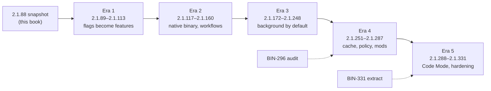
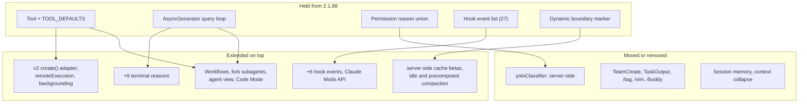

# 25. Bringing It to the Present: From 2.1.88 to 2.1.331

> **Status: written.** Maps Claude Code 2.1.88 through 2.1.331 using the 2.1.88 snapshot, public changelog, and binary extractions (see [The Evidence Legend](#the-evidence-legend)).
>
> **Layer:** All layers (Layers 0–8), viewed across eight months of releases
> **Prerequisites:** [Chapter 00](prologue-how-to-read-a-1900-file-agent.md), and ideally the chapter that covers each layer you care about. This chapter links back to each one.
> **Primary Evidence Sources:**
> - The 2.1.88 source snapshot this book is written against (repository root, for example `Tool.ts`, `query.ts`, `entrypoints/sdk/coreTypes.ts`, `types/permissions.ts`, `constants/betas.ts`)
> - The public Claude Code changelog, sections `2.1.89` through `2.1.331`
> - The JavaScript modules embedded in the shipped native binary for **2.1.331** (build time `2026-11-23T15:17:48Z`), carved out of the binary's `__BUN` section
> - The earlier binary audit of **2.1.296**: `2026-10-11-claude-code-2.1.296-workflows-binary-audit.md` and `2026-10-11-workflow-surface-audit.md`

---

## Why This Chapter Exists

Chapters 00 through 24 describe one build of Claude Code: 2.1.88, published on 2026-03-31. That build is a fixed point, and it is the only version whose TypeScript source, comments, and file layout we can read. Claude Code has kept shipping since then. The changelog adds roughly 240 release sections after 2.1.88. The build installed on our machine as we write this reports itself as:

```text
$ ~/.local/share/claude/versions/2.1.331 --version
2.1.331 (Claude Code)
```

A reader who finishes this book and then opens the current product will find most of the architecture where the book left it. They will also find whole subsystems that the snapshot only hinted at behind `feature()` gates, a handful of features that are gone, and new layers of policy, caching, and orchestration on top. This chapter maps that drift onto the book's nine-layer model.

We can't do that with the same certainty as the other 24 chapters, because we don't have the later source. Every claim in this chapter therefore carries an evidence label.

### The Evidence Legend

| Tag | Meaning | How strong |
| :--- | :--- | :--- |
| **[CL x.y.z]** | The public changelog says so, under release `x.y.z`. | What Anthropic chose to announce. It doesn't cover internals, and a "Removed" line doesn't always mean the code is gone. |
| **[BIN-331]** | We saw it in the modules extracted from the shipped 2.1.331 binary. Where it helps, we name the string, the property name, or the hashed chunk file it came from (for example `chunk-g0g3fmj2.js`). | Strong for "this string or shape exists in the build". Weak for "this code path runs for you", because the runtime gates are invisible to us. |
| **[BIN-296]** | We saw it in the earlier extraction of 2.1.296, as written up in the workflow audits in this repository. | Same strength as BIN-331, for an earlier build. |
| **[SNAP]** | We read it in the 2.1.88 source in this repository. | The book's normal standard. |
| **[SPEC]** | Our inference. The text always says what the inference rests on. | Plausible, unconfirmed. |

> [!IMPORTANT]
> Chunk file names such as `chunk-aczeq1a4.js` are content hashes that the bundler assigns at build time. They locate evidence inside the 2.1.331 build only. They change in every release, so treat them as coordinates, not as names.

---

## 1. How We Know What We Know

### The Problem

A source snapshot, a changelog, and a compiled binary are three different kinds of evidence. They fail in different ways, and they don't line up on their own.

- **The snapshot** has everything a reverse engineer wants: file paths, type names, comments that explain the scars (Chapter 00's `DANGEROUS_uncachedSystemPromptSection`, Chapter 07's withheld-error ladder). It also has holes. `types/message.ts`, `query/transitions.ts`, and `services/contextCollapse/` are imported but missing, and many modules sit behind `feature('...')` and `USER_TYPE === 'ant'` gates that external builds strip out.
- **The changelog** is complete and dated, but it is written for users. It says "Added dynamic workflows". It doesn't say which file owns the scheduler.
- **The binary** is what actually ships. It is also minified, its comments are gone, its module boundaries are redrawn by the bundler, and it still contains code that is gated off at run time.

### What a Bun Binary Gives Up

Native Claude Code installs have been bun-compiled executables since the CLI "changed … to spawn a native Claude Code binary (via a per-platform optional dependency) instead of bundled JavaScript" **[CL 2.1.113]**. The 2.1.331 file is a 381 MB arm64 Mach-O. Its JavaScript lives in a segment named `__BUN`.

We followed the extraction runbook in `coder-two-tools/docs/cc/extract-installed-cli.md`. Step 6 worked: `unbunjs list --json` read the module table and reported **3,857 modules** in a 237 MB payload, with one entry point, `/$bunfs/root/cli` **[BIN-331]**. Step 7 did not work. `unbunjs extract` misread each module's bytecode length on this Bun layout and began writing a `.bytecode` file of roughly 125 MB beside every chunk. It had filled the disk before we stopped it and deleted the output. We then carved the source text directly. Each module record in the `list` output carries a `contents_offset` and `contents_length` relative to `payload_start`, so a 20-line script could seek and copy each module. That produced 81 MB of source. The carved copy of a module that `unbunjs` had written correctly before it failed (`chunk-dkgv0tv2.js`) matched byte for byte.

> [!WARNING]
> If you repeat this on a later build, run `unbunjs list` first and check whether `bytecode_length` is plausible. In 2.1.331 it reported values around 131 MB per module, which can't be right. Carve the `contents` ranges yourself rather than running a full `extract`.

What the carve recovers:

- **3,609 JavaScript chunks**, minified, with hashed names. Only one original source path survived: `src/plugins/functionHooks/hooks-worker/hooks-worker.js`.
- **String literals and object property names, intact.** Minification renames local bindings, but `isConcurrencySafe`, `"aborted_streaming"`, `"PreToolUse"`, and every `tengu_*` event name survive. This chapter leans on them.
- **Bundled assets**: 135 zstd-compressed files and 75 Markdown files (skills, API reference docs, workflow templates), plus a 925 KB TypeScript declaration file for the plugin hook API (`claude-code.d.ts-32067a2b.txt`) **[BIN-331]**.
- **React Compiler output.** Components still carry the memo-cache arrays Chapter 00 described (`if(U[19]!==L||U[20]!==J)…U[21]=ae`) and the `react.memo_cache_sentinel` symbol **[BIN-331]**.

What it can't recover:

- **Names of local functions and modules.** `query()` and `queryLoop()` don't exist by name; we find them by their parameter shapes.
- **Comments.** The "why" that fills Chapters 01–24 is gone. Where this chapter explains *why*, that is **[SPEC]** unless the changelog says it.
- **Run-time gates.** Bun's compile-time `feature()` calls are already resolved. The leftovers are visible as empty spreads: the `/config` category table in `chunk-05hpdrv2.js` contains `"remoteHomeSettings",...[],...[],"dialogExpiry"` **[BIN-331]**, which is what `...(feature('X') ? [...] : [])` compiles to when `X` is off. GrowthBook gates are a different matter. They remain as `tengu_*` strings, and we can't tell which ones are on for any given account. The bundle has 4,225 distinct `"tengu_…"` strings, against 817 in the snapshot **[BIN-331, SNAP]**. That count includes both telemetry event names and flag names.

### Scale

| Build | Embedded modules | Source |
| :--- | :--- | :--- |
| 2.1.88 snapshot | ~1,884 TypeScript/TSX files (not bundled) | **[SNAP]** |
| 2.1.270 | 1,879 modules | runbook, **[BIN]** |
| 2.1.296 | 2,609 modules | **[BIN-296]** |
| 2.1.331 | 3,857 modules (3,609 `.js`) | **[BIN-331]** |

The module counts aren't comparable to the file count, because the bundler splits and merges modules freely. Still, the bundle grew by about half between 2.1.296 and 2.1.331, a span of six weeks.

---

## 2. The Timeline: Five Eras

We group 240 releases into five eras. The boundaries are our editorial choice **[SPEC]**. Every milestone in the table is quoted from the changelog.

| Era | Releases | Milestones (all **[CL]**) |
| :--- | :--- | :--- |
| **1. Unflagging the snapshot** | 2.1.89 – 2.1.113 | 2.1.89: `CLAUDE_CODE_NO_FLICKER=1` alt-screen renderer, `/buddy`. 2.1.92: removed `/tag` and `/vim`. 2.1.98: Monitor tool. 2.1.110: `/tui fullscreen`. 2.1.111: auto mode no longer requires `--enable-auto-mode`, PowerShell tool rollout. 2.1.113: native binary. |
| **2. Native build, orchestration debut** | 2.1.117 – 2.1.160 | 2.1.117: `Glob`/`Grep` replaced by embedded `bfs`/`ugrep` on native macOS/Linux. 2.1.139: agent view (`claude agents`), `/goal`. 2.1.152: `MessageDisplay` hook. 2.1.154: dynamic workflows, streaming tool execution always on, lean system prompt default. 2.1.160: trigger keyword renamed `workflow` → `ultracode`. |
| **3. Background by default** | 2.1.172 – 2.1.248 | 2.1.178: removed `TeamCreate`/`TeamDelete`. 2.1.198: subagents run in the background by default. 2.1.200: "default" mode renamed "Manual". 2.1.222: removed ultraplan. 2.1.224: `claude self-hosted-runner`, cross-session `SendMessage`. 2.1.232: fork subagents on by default. 2.1.243: zstd-compressed binary. 2.1.248: workflow reference moved into a `workflow-authoring` skill. |
| **4. Cache, policy, and mods** | 2.1.251 – 2.1.287 | 2.1.251: `PreModelSwitch`/`PostModelSwitch` hooks. 2.1.267: deferred mid-session MCP/plugin tools for cache reuse. 2.1.277: AGENTS.md support, TaskOutput removed. 2.1.278: server-side auto-mode classifier by default. 2.1.284: interactive sessions start in auto mode. 2.1.287: Claude Mods. |
| **5. Code Mode and hardening** | 2.1.288 – 2.1.331 | 2.1.299: idle compaction. 2.1.302: fork subagents on by default in `-p` and the SDK. 2.1.314: `permissions.blockWritesOutsideWorkingDirectories`. 2.1.323: Code Mode, v1 MCP client removed. 2.1.325: sandboxed Bash no longer auto-allowed. 2.1.330: easel chart mod. |



A pattern runs through all five eras: **features that sat behind a snapshot `feature()` gate ship, change names, and then turn into defaults.** Auto mode is the clearest case. In the snapshot it is `feature('TRANSCRIPT_CLASSIFIER')` in `types/permissions.ts` **[SNAP]**. It then lost its command-line flag **[CL 2.1.111]**, lost its consent step **[CL 2.1.152]**, gained a server-side classifier by default **[CL 2.1.278]**, and became the starting mode of interactive sessions **[CL 2.1.284]**.

---

## 3. Layer by Layer

### Layer 0 — Leaf Atoms ([Chapter 01](ch001-atoms-types-stores-and-primitives.md))

Little here is visible from outside, which is what you'd expect of primitives.

- **Runtime.** The bundled Bun was upgraded to 1.4 **[CL 2.1.181]**. The binary is now zstd-compressed, "about 75 MB instead of 340 MB on Linux x64" **[CL 2.1.243]**. The compile flags recorded in the module table disable autoloading of `bunfig`, `tsconfig`, `package.json`, and default `.env` files, and the embedded `exec_argv` includes `--zero-fill-buffers` and `--no-crash-report-upload` **[BIN-331, modules.json]**.
- **Concurrent writers to `~/.claude.json`.** The process-wide config file from Chapter 01 became a source of real bugs once many sessions ran at once: "concurrent sessions silently reverting each other's `~/.claude.json` changes" **[CL 2.1.259]**, user settings "lost when several Claude Code processes saved them at the same time" **[CL 2.1.330]**. **[SPEC]** Background sessions, agent view, and cross-session messaging made a single-writer assumption false that was true enough in 2.1.88.
- **Transcripts.** Edit-heavy transcripts shrank "up to 79x" **[CL 2.1.208]**. Local transcripts now "also record each API request's system prompt, tools and parameters" **[CL 2.1.300]**. This one crosses into Layer 2: once the transcript records the prompt it sent, a resumed session can reuse those exact bytes, and the cache prefix stays stable.

### Layer 1 — Tool, Command, and Message Contracts ([Chapter 02](ch002-the-tool-contract.md), [Chapter 03](ch003-command-and-message-contracts.md))

**The `Tool` contract survived almost character for character.** The snapshot's `TOOL_DEFAULTS` in `Tool.ts:757-769` defines `isEnabled`, `isConcurrencySafe`, `isReadOnly`, `isDestructive`, `checkPermissions`, `toAutoClassifierInput`, and `userFacingName` **[SNAP]**. The 2.1.331 bundle has:

```js
var yo={isEnabled:()=>!0,isConcurrencySafe:(e)=>!1,isReadOnly:(e)=>!1,
  isDestructive:(e)=>!1,remoteExecution:aIs,toAutoClassifierInput:(e)=>"",
  userFacingName:(e)=>""};
```

That is `chunk-g0g3fmj2.js` **[BIN-331]**. The fail-closed defaults Chapter 02 called out (`isConcurrencySafe → false`, `isReadOnly → false`) are unchanged. Two things moved:

1. `checkPermissions` is no longer a default. The adapter around it supplies the allow-by-default answer (`Promise.resolve({behavior:"allow",updatedInput:r})`) only when the tool doesn't define one **[BIN-331]**.
2. A new default, `remoteExecution: Object.freeze({supported:!1})`, sits beside a `backgrounding` accessor that defaults to `"never"` **[BIN-331]**. **[SPEC]** Tools now declare whether they can run on another machine and whether they can move to the background. Both are axes the 2.1.88 contract didn't have.

**A second tool shape sits on top of the first.** The same chunk has a wrapper that takes a definition with a `create(context)` factory and adapts it to the classic `call` / `validateInput` / `checkPermissions` interface. Its per-call context exposes fields such as `runEngine`, `ask`, `sameTurnToolUses`, `remoteCall`, and `inputFromAnotherMachine`. When a runner owns the tool, the wrapper refuses a call whose location changed after its permission check, with the message "`… was not run: where it runs changed after its permission was checked. Send the call again.`" Property names such as `underlyingV1ToolName` and `familyParentToolName` appear across 12 chunks **[BIN-331]**. **[SPEC]** There is a "v2" tool definition style that is translated into the v1 shape this book describes. The query loop and the permission engine still see v1 tools, which is why the seam held.

**The built-in tool roster changed.** Names we found in the bundle **[BIN-331]**: `Agent`, `Artifact`, `AskUserQuestion`, `Bash`, `Brief`, `CronCreate`, `Edit`, `EndConversation`, `EnterPlanMode`, `EnterWorktree`, `ExitPlanMode`, `ExitWorktree`, `Glob`, `Grep`, `ListAgents`, `LSP`, `Monitor`, `NotebookEdit`, `PowerShell`, `PushNotification`, `Read`, `RemoteTrigger`, `ScheduleWakeup`, `SendFeedback`, `SendMessage`, `Skill`, `StructuredOutput`, `TaskCreate`, `TaskStop`, `TodoWrite`, `ToolSearch`, `WebFetch`, `WebSearch`, `Workflow`, `Write`.

- **Added since 2.1.88:** Monitor **[CL 2.1.98]**, PushNotification ("Added a push notification tool" **[CL 2.1.110]**, gated in the bundle by `tengu_kairos_push_notifications` **[BIN-331]**), EndConversation **[CL 2.1.214]**, SendFeedback **[CL 2.1.247]**, cross-session ListAgents **[CL 2.1.224]**, and Workflow (see Layer 6).
- **Removed:** TaskOutput ("Removed the deprecated TaskOutput tool; Claude reads a background task's output file with Read instead" **[CL 2.1.277]**), and TeamCreate/TeamDelete **[CL 2.1.178]**. Both names still appear in the bundle, in one `Set`: `["Frame","FrameRead","TeamCreate","TeamDelete","SuggestBackgroundPR","AutofixPr","TaskOutput","AgentOutputTool","BashOutputTool","AgentOutput","BashOutput"]` (`chunk-dkgv0tv2.js`) **[BIN-331]**. The set is consulted when replaying recorded tool names and is skipped in the "no loaded tool" consistency warning. **[SPEC]** It is a list of retired tool names kept so that old transcripts resume without errors. It also hints at tools the changelog never named (`Frame`, `FrameRead`, `SuggestBackgroundPR`).
- **Narrowed:** the todo/task tools "are no longer available on Opus 4.8, Sonnet 5, Fable 5, Mythos 5, and newer models" unless `CLAUDE_CODE_ENABLE_TODO_TOOLS=1` **[CL 2.1.233]**. On native macOS/Linux builds, `Glob` and `Grep` are "replaced by embedded `bfs` and `ugrep` available through the Bash tool" **[CL 2.1.117]**. The tool names remain in the bundle for Windows and npm builds **[BIN-331]**.

**Commands.** The three-way `prompt | local | local-jsx` union from Chapter 03 is still how commands are written: we found literal `type:"local-jsx"` command objects with `name`, `description`, `argumentHint`, `availability`, `isEnabled`, and a lazy `load:()=>…` **[BIN-331]**, the same fields as `types/command.ts` **[SNAP]**. Commands that changed:

- **Removed:** `/tag` and `/vim` ("toggle vim mode via `/config` → Editor mode") **[CL 2.1.92]**. Neither has a `name:"tag"` or `name:"vim"` command object in 2.1.331. `editorMode` and `vimInsertModeRemaps` settings remain **[BIN-331]**.
- **Merged or renamed:** `/cost` and `/stats` merged into `/usage` **[CL 2.1.118]**. `/undo` became an alias of `/rewind` **[CL 2.1.108]**. `/simplify` was renamed `/code-review` **[CL 2.1.147]**, then returned as a cleanup-only review **[CL 2.1.154]**.
- **Opened to the model:** "The model can now discover and invoke built-in slash commands like `/init`, `/review`, and `/security-review` via the Skill tool" **[CL 2.1.108]**. Commands and skills now share one surface the model can call.

**Message normalization.** `normalizeMessagesForAPI()` from Chapter 03 caused a performance regression: "message normalization cost grew quadratically with the number of turns, causing multi-second stalls and slow resumes" **[CL 2.1.216]**.

### Layer 2 — The Agent Engine ([Chapters 04–08](ch004-prompt-engineering-and-cache-boundaries.md))

**The query loop is still an `AsyncGenerator` state machine.** The loop isn't named in the bundle, but it is easy to find by shape. `chunk-aczeq1a4.js` (318 KB minified, against 69 KB for the commented `query.ts`) contains `async function*` declarations taking `{…toolUseContext, querySource, cacheSafeParams, snipTokensFreed, sentSystemPrompt, sentInlineTools}`. It holds 109 `yield*` delegations, 14 uses of `needsFollowUp`, and calls to `streamingToolExecutor.takeFinishedResults()`, `addTool(`, and `getRemainingResults` **[BIN-331]**. These are the names Chapter 07 traced through `query.ts:1411-1728` **[SNAP]**.

**The terminal-reason union grew.** The snapshot's `query.ts` returns reasons including `completed`, `max_turns`, `aborted_streaming`, `aborted_tools`, `blocking_limit`, `prompt_too_long`, `image_error`, `model_error`, `hook_stopped`, and `stop_hook_prevented` **[SNAP]**. A 2.1.331 helper (`chunk-5d8pv3g2.js`) sorts reasons into errors and non-errors **[BIN-331]**:

| Reason class | 2.1.331 members |
| :--- | :--- |
| Error-like | `blocking_limit`, `rapid_refill_breaker`, `prompt_too_long`, `image_error`, `model_error`, `api_error`, `malformed_tool_use_exhausted`, `budget_exhausted`, `structured_output_retry_exhausted`, `tool_deferred_unavailable`, `turn_setup_failed` |
| Not errors | `aborted_streaming`, `aborted_tools`, `stop_hook_prevented`, `hook_stopped`, `tool_deferred`, `max_turns`, `background_requested`, `completed` |

Every 2.1.88 reason survived. The additions map onto changelog entries: `rapid_refill_breaker` is the autocompact thrash detector ("detects when context refills to the limit immediately after compacting three times in a row" **[CL 2.1.89]**). `tool_deferred` pairs with the PreToolUse `"defer"` decision that the snapshot already had. **[SPEC]** `background_requested` likely backs send now, which moves "running tools to the background instead of cancelling the turn" **[CL 2.1.281]**. Two continuation transitions from the snapshot, `collapse_drain_retry` and `token_budget_continuation`, don't appear anywhere in the bundle **[BIN-331]**. **[SPEC]** The first follows from context collapse disappearing (Layer 3). The second suggests the snapshot's `checkTokenBudget()` continuation was replaced by the hard `budget` ceiling that workflows share ("hard ceiling (further `agent()` calls throw)" **[BIN-296]**) and the new `budget_exhausted` terminal.

**Streaming tool execution is now unconditional.** Chapter 06 described `StreamingToolExecutor` as gated. The changelog says: "Streaming tool execution is now always enabled, including when telemetry is disabled or on Bedrock/Vertex/Foundry (previously behind a feature flag)" **[CL 2.1.154]**. A related rule in the batch partitioner changed: "A failed Bash command in a parallel batch no longer cancels its sibling calls" **[CL 2.1.161]**.

**Cache-boundary discipline got stricter, not looser.** Chapter 04 built its argument on `SYSTEM_PROMPT_DYNAMIC_BOUNDARY` and on keeping prefix bytes stable. In 2.1.331 the literal `"__SYSTEM_PROMPT_DYNAMIC_BOUNDARY__"` still exists, in the same chunk as the hook-event list (`chunk-bp2w4xmq.js`) **[BIN-331]**, and it is now a public contract: "a `--system-prompt` that contains a `__SYSTEM_PROMPT_DYNAMIC_BOUNDARY__` line: the text above it is now cached globally" **[CL 2.1.275]**. Most of the cache work since 2.1.88 is repair of places that broke the prefix:

- "`--resume` causing a full prompt-cache miss when deferred tools, MCP servers or custom agents are present" **[CL 2.1.90]**.
- `--exclude-dynamic-system-prompt-sections` "for improved cross-user prompt caching" **[CL 2.1.98]**.
- "mid-session MCP and plugin tools … now receive them as deferred definitions" instead of being appended to the tool list **[CL 2.1.267]**. This is Chapter 15's ToolSearch deferral, reused as a cache-preservation tool.
- `/fork` keeps the cache "because its worktree briefing arrives as a message, not a system-prompt change" **[CL 2.1.257]**.
- Workflow fan-outs "stagger same-prefix sibling agents so subsequent agents read the cached prompt prefix" **[CL 2.1.229]**.
- `/cost` and the status line report "a likely cause for prompt-cache misses" **[CL 2.1.260]**.
- Cache lifetime became configurable: `ENABLE_PROMPT_CACHING_1H` **[CL 2.1.108]**, then `promptCacheTtl` and `subagentPromptCacheTtl` **[CL 2.1.243]**.

The API beta headers tell the same story. The snapshot's `constants/betas.ts` lists 17 dated betas **[SNAP]**. The 2.1.331 table in `chunk-y30r659v.js` registers 44 key/value pairs **[BIN-331]**. It keeps `prompt-caching-scope-2026-01-05`, the beta behind Chapter 04's `scope: 'global'`, and adds `prompt-caching-evict-2026-05-12`, `cache-keepalive-2026-09-03`, `cache-diagnosis-2026-04-07`, `context-hint-2026-04-09`, `mid-conversation-tool-changes-2026-07-01`, `inline-tools-2026-09-15`, `thinking-resumption-2026-07-17`, `resumption-2026-10-08`, `server-side-fallback-2026-06-01`, `auto-mode-classifier-2026-07-16`, `subagent-review-2026-11-17`, and `message-threads-2026-08-12`, among others. Three snapshot betas are gone from the whole bundle: `token-efficient-tools-2026-03-28`, `summarize-connector-text-2026-03-13`, and `cli-internal-2026-02-09` **[BIN-331]**. **[SPEC]** Several cache concerns moved onto the server between 2.1.88 and 2.1.331 (keepalive, eviction, diagnosis, mid-conversation tool changes). Without them, the client would have to manage those prefix bytes itself.

**Models, retries, and the API client (Chapter 05).** The `withRetry` machinery gained a watchdog family (`CLAUDE_CODE_RETRY_WATCHDOG` **[CL 2.1.186]**, `CLAUDE_CODE_RETRY_WATCHDOG_MAX_WAIT_MS` **[CL 2.1.295]**) and a cap: "One limit covers a whole model call, at most 14 requests" **[CL 2.1.286]**. Fallback became a setting: `fallbackModel` "(up to three fallbacks tried in order)" **[CL 2.1.166]**. A stalled stream "now aborts after 5 minutes of no data and retries without streaming" **[CL 2.1.105]**. Non-interactive sessions "automatically continue a response cut off mid-stream" **[CL 2.1.246]**. The system prompt itself forked: "The lean system prompt is now the default for all models except Haiku, Sonnet, and Opus 4.7 and earlier" **[CL 2.1.154]**.

### Layer 3 — Compaction and Memory ([Chapter 09](ch009-five-layer-compaction-pipeline.md), [Chapter 10](ch010-memory-systems-claudemd-auto-memory-and-dream.md))

Chapter 09's five-stage pipeline (tool-result budget → snip → microcompact → context collapse → autocompact) is where the evidence is most mixed. We go stage by stage, using telemetry event names present in the snapshot and in 2.1.331 as the main evidence.

| Snapshot stage | 2.1.331 evidence | Verdict |
| :--- | :--- | :--- |
| Tool-result budget | `tengu_message_level_tool_result_budget_enforced` and `tengu_tool_result_persisted_message_budget` in both builds **[SNAP, BIN-331]** | Present |
| Snip (`HISTORY_SNIP`) | `snipEnabled` and `snipDebug` listed under an `Internal:` `/config` category; `snipTokensFreed` still a query-loop parameter. `tengu_snip_resume_filtered` gone **[BIN-331]** | Present, still internal **[SPEC]** |
| Microcompact | `tengu_time_based_microcompact` and the `microcompact_boundary` system subtype present. `tengu_cached_microcompact` gone **[BIN-331]** | Time-based variant present; cached variant not visible |
| Context collapse | `services/contextCollapse/` was already absent from the snapshot **[SNAP]**. No `collapse_drain_retry` and no context-collapse identifiers in 2.1.331 **[BIN-331]** | Not visible. **[SPEC]** Never shipped externally, or removed |
| Autocompact | `tengu_compact`, `tengu_auto_compact_succeeded`, plus new `tengu_auto_compact_rapid_refill_breaker`, `…_routed_reactive`, `…_put_off`, `…_window_in_force` **[BIN-331]** | Present, much expanded |

On top of the five stages, three new ones have arrived:

1. **Idle compaction.** "a 200K+ token conversation left idle for about 54 minutes is compacted before its one-hour prompt cache expires, so your next message doesn't reprocess it all" **[CL 2.1.299]**. The bundle has `tengu_idle_compact_fired`, `tengu_idle_compact_settled`, and `idleCompaction` in the "Model & output" `/config` group **[BIN-331]**. The trigger is the cache TTL, not the context limit, which makes this a Layer 2 cache concern implemented in Layer 3.
2. **Precomputed compaction.** It isn't in the changelog. The bundle has ten `tengu_precomputed_compact_*` events (`started`, `ready`, `consumed`, `discarded`, `rehydrated`, …) and a `precomputeCompactionEnabled` setting in the "Experimental" `/config` group, read with default `true` in startup telemetry (`El("precomputeCompactionEnabled",!0)`) **[BIN-331]**. **[SPEC]** A summary is prepared in the background ahead of need and swapped in when the threshold hits, which hides compaction latency the way `preconnectAnthropicApi()` hides TLS latency in Chapter 22.
3. **Server-side compaction.** The bundle carries a `"compact_20260112"` context-management edit type next to the snapshot's `clear_tool_uses_20250919` and `clear_thinking_20251015` **[BIN-331, SNAP]**. The changelog only touches the edge of it: a conversation "too long for the client-side safety classifier to review … is now compacted" **[CL 2.1.288]**, and the same for "the server-side classifier" **[CL 2.1.302]**.

Compaction also became a hookable, policy-bearing event. PreCompact "can now block compaction" **[CL 2.1.105]**, and its output is "cut at 10,000 characters" **[CL 2.1.314]**. A fix stopped automatic compaction "reusing the session's earlier system prompt instead of rebuilding it the way `/compact` does" **[CL 2.1.328]**.

**Memory.** Chapter 10's four systems drifted unevenly:

- **CLAUDE.md** gained a sibling: "in a project with no CLAUDE.md, Claude Code reads AGENTS.md instead" **[CL 2.1.277]**. Path-scoped rules and nested CLAUDE.md now load on Write, Edit, and single-file Bash reads, not only on Read **[CL 2.1.288, 2.1.293]**.
- **Auto-memory (`memdir/`)** survives and grew. The snapshot's `tengu_memdir_*` events are all present, and new ones appear, such as `tengu_memdir_index_backfilled` and `tengu_memdir_write_lint` **[BIN-331]**. A family of more than 20 `tengu_org_memory_*` events and `CLAUDE_MEMORY_STORES` ("Memory recall now finds mounted team memory stores" **[CL 2.1.172]**) point to an organization-scoped memory tier. The snapshot's `teamMemorySync` identifier is gone, but `team_memory` strings remain **[BIN-331]**.
- **Auto-dream** survives intact. The snapshot's `tengu_auto_dream_fired`, `…_completed`, and `…_failed` are present, along with `…_skipped` and `…_toggled`. `dream` is still a task type **[BIN-331]**.
- **Session memory is the surprise.** The snapshot has 16 `tengu_session_memory_*` and `tengu_sm_compact_*` events **[SNAP]**. The 2.1.331 bundle has none of them. The only `session_memory` strings left belong to the bundled gRPC library **[BIN-331]**. The changelog never announces a removal. **[SPEC]** Session-memory-based compaction (`sm_compact`) was retired or folded into precomputed compaction, which solves the same problem: a ready-made summary on hand before it's needed. We'd need source to confirm.

### Layer 4 — Safety, Policy, Sandbox, and Hooks ([Chapters 11–14](ch011-the-permission-engine.md))

**The permission engine's vocabulary held exactly.** The snapshot's `PermissionDecisionReason` union in `types/permissions.ts` has 11 `type` tags: `rule`, `mode`, `subcommandResults`, `permissionPromptTool`, `hook`, `asyncAgent`, `sandboxOverride`, `classifier`, `workingDir`, `safetyCheck`, and `other` **[SNAP]**. A search of the 2.1.331 bundle for `type:"…"` literals with those names returns the same 11, no more and no fewer **[BIN-331]**. Counting by frequency, `other` (302 call sites) and `safetyCheck` (186) dominate. In the snapshot, `rule` led **[BIN-331, SNAP]**. **[SPEC]** Most new policy has been added as safety checks, not as new rule types.

**Modes.** The SDK schema in `chunk-y30r659v.js` enumerates `["default","acceptEdits","bypassPermissions","plan","dontAsk","auto"]` **[BIN-331]**. That is the snapshot's `EXTERNAL_PERMISSION_MODES` plus `auto`, which has moved out from behind `feature('TRANSCRIPT_CLASSIFIER')` into the public list **[SNAP]**. The internal `bubble` mode still exists in a mode-mapping `switch` **[BIN-331]**. "Default" was relabeled "Manual" in the UI, with `--permission-mode manual` accepted "alongside `default`" **[CL 2.1.200]**. **[SPEC]** The schema keeps `default` as the wire value and `manual` is a display alias.

**The classifier left the client.** Chapter 11's `yoloClassifier` ran in-process. Its successor is server-side by default for API, Enterprise, and third-party platforms **[CL 2.1.278]**. With telemetry or flags off there is no fallback to the built-in classifier **[CL 2.1.319]**. The bundle registers an `auto-mode-classifier-2026-07-16` beta **[BIN-331]**. The classifier also gained new subjects: it "now evaluates subagent spawns" **[CL 2.1.178]**, `SendMessage` "is checked by the classifier" **[CL 2.1.222]**, and subagents "report back through a hand-back call that the classifier reviews" **[CL 2.1.271]**. The safe-list logic the snapshot used for Workflow (orchestrator safe because each subagent goes through `canUseTool`) **[SNAP]** reappears as a general principle: check the leaf call, not the orchestrator.

**Rules got richer.** `Tool(param:value)` syntax "to match a tool's input parameters … e.g. `Agent(model:opus)`" **[CL 2.1.178]**. "Deny rules accept globs in the tool-name position" **[CL 2.1.166]**. New fail-closed switches: `permissions.denyInsteadOfPrompting` **[CL 2.1.319]**, `permissions.blockReadsOutsideWorkingDirectories` **[CL 2.1.257]**, and `permissions.blockWritesOutsideWorkingDirectories` **[CL 2.1.314]**.

**Shell and sandbox (Chapter 12).** PowerShell went from a snapshot-only `tools/PowerShellTool/` directory **[SNAP]** to a rollout **[CL 2.1.111]**, then to the Windows fallback when Git Bash is absent **[CL 2.1.120]**, and then to the primary shell when enabled **[CL 2.1.126]**. The bundle ships typed shell-binding declarations for both shells, `core.bash.async.d.ts` and `core.powershell.async.d.ts`, which describe a `$` template-string shell call **[BIN-331]**. **[SPEC]** They serve scripted callers, mods or Code Mode, and not the model's plain Bash tool. The sandbox lost its most permissive default: "Changed sandboxed Bash commands to follow the normal permission flow by default; set `sandbox.autoAllowBashIfSandboxed: true` to keep running them without prompts" **[CL 2.1.325]**. A Linux PID-namespace subprocess sandbox arrived under `CLAUDE_CODE_SUBPROCESS_ENV_SCRUB` **[CL 2.1.98]**.

**Hooks (Chapter 13).** The snapshot's `HOOK_EVENTS` in `entrypoints/sdk/coreTypes.ts` lists 27 events **[SNAP]**. The 2.1.331 array in `chunk-bp2w4xmq.js` lists 33 **[BIN-331]**, with the 27 in the same order and six new ones:

| New event | Evidence |
| :--- | :--- |
| `PostToolBatch` | **[BIN-331]**; mentioned in **[CL 2.1.328]** |
| `UserPromptExpansion` | **[BIN-331]** only; we found no changelog entry |
| `PreModelSwitch`, `PostModelSwitch` | **[CL 2.1.251]** |
| `DirectoryAdded` | **[CL 2.1.219]** |
| `MessageDisplay` | "lets hooks transform or hide assistant message text as it is displayed" **[CL 2.1.152]** |

The exit-reason array next to it, `["clear","resume","logout","prompt_input_exit","other"]`, is identical to the snapshot's `EXIT_REASONS` **[BIN-331, SNAP]**. Hooks also gained new handler types and fail-closed controls: `type: "mcp_tool"` hooks **[CL 2.1.118]**, `hookSpecificOutput.updatedToolOutput` "for all tools" **[CL 2.1.121]**, `onFailure: "block"` **[CL 2.1.295]**, and `updatedInput` "validated like Claude's own input" **[CL 2.1.300]**. One subtraction: "Agent-type hooks no longer run on `PermissionRequest`" **[CL 2.1.280]**.

**Settings and policy (Chapter 14)** grew a model-governance surface (`enforceAvailableModels` **[CL 2.1.175]**, `deniedModels` **[CL 2.1.283]**, `allowedProviders` **[CL 2.1.285]**) and version pinning (`requiredMinimumVersion` and `requiredMaximumVersion` **[CL 2.1.163]**). `forceRemoteSettingsRefresh` "blocks startup until remote settings are fetched (fail-closed)" **[CL 2.1.92]**. That release is the first after the snapshot, and the README already uses this setting's absence to date the snapshot.

### Layer 5 — Dynamic Capabilities ([Chapter 15](ch015-model-context-protocol-mcp.md), [Chapter 16](ch016-skills-plugins-output-styles-and-lsp.md))

**MCP replaced its client.** "the v1 MCP client is removed" and `MCP_SDK_GENERATION=v1` now runs "the v2 MCP client in a compatibility mode" **[CL 2.1.323]**. Protocol `2026-07-28` became the negotiated default in steps, first for stdio servers **[CL 2.1.292]**, then claude.ai connectors **[CL 2.1.295]**, then cloud and Remote Control connectors **[CL 2.1.299]**. Long-running MCP calls became background tasks: first "MCP calls running longer than 2 minutes move to the background automatically" **[CL 2.1.212]**, then "MCP tasks in the terminal" **[CL 2.1.319]**. The bundle's task-type list includes `mcp_task` **[BIN-331]**. ToolSearch, the snapshot's deferred-schema mechanism, is still central. `shouldDefer` appears in 35 chunks, and `alwaysLoad` (an MCP config key **[CL 2.1.121]** and an `_meta['anthropic/alwaysLoad']` field **[CL 2.1.285]**) in 24 **[BIN-331]**.

**Skills absorbed things.** Built-in commands became Skill-callable **[CL 2.1.108]**. The Workflow tool's long reference "moved into a bundled `workflow-authoring` skill", which cut the tool description "about 1k tokens instead of 5.7k" **[CL 2.1.248]**. **[SPEC]** Skills became the standard place to put long, rarely needed prompt text that would otherwise cost tokens on every request.

**Plugins became a programmable runtime: Claude Mods.** The snapshot's plugins (Chapter 16) contribute declarative components: commands, agents, skills, hooks, MCP servers, output styles, and LSP servers **[SNAP]**. "Added Claude Mods: plugins may now modify deeper behavior" **[CL 2.1.287]**. The bundle shows what that means. The one surviving original path is `src/plugins/functionHooks/hooks-worker/hooks-worker.js`, and the 925 KB `claude-code.d.ts` describes itself as "Claude Code function hooks: the plugin API's TypeScript declarations", for a hooks module that "runs in an environment of its own: no DOM, no Node" **[BIN-331]**. Its quoted hook and call names include `tool.check`, `tool.register`, `turn.start`, `turn.step`, `agent.spawn`, `prompt.submit`, `session.compact`, `model.complete`, `model.fork`, `ui.view`, `vcs.isolate`, `engine.create`, and `classic.PreToolUse` **[BIN-331]**. Several of them show up in the changelog as they were added: `agent.spawn` for teammates **[CL 2.1.289]**, `serverToolUses` on `turn.step` **[CL 2.1.290]**, and `$.tool.register` with `isDeferred` **[CL 2.1.293]**. Built-in mods ship on this API: "You should know" **[CL 2.1.287]** and easel, "a built-in mod that draws charts" **[CL 2.1.330]**.

> [!NOTE]
> The name `classic.PreToolUse` suggests that Chapter 13's shell, HTTP, prompt, and agent hooks are now presented to mods as a "classic" layer inside a larger event system **[SPEC]**. It fits the pattern we saw in the Tool contract: the 2.1.88 abstraction is kept and wrapped, and a new layer is built over it.

### Layer 6 — Tasks, Subagents, Swarms, Workflows ([Chapters 17–19](ch017-background-task-runtime.md))

**The task-type union grew from 7 to 11.** The snapshot's `Task.ts` defines `local_bash`, `local_agent`, `remote_agent`, `in_process_teammate`, `local_workflow`, `monitor_mcp`, and `dream` **[SNAP]**. A `switch` in 2.1.331 (`chunk-feeb7y8f.js`) handles those 7 plus `monitor_ws`, `mcp_task`, `auto_mode_scan`, and `post_turn_memory` **[BIN-331]**. **[SPEC]** `monitor_ws` is a WebSocket variant of the Monitor tool, `auto_mode_scan` backs auto-mode setup, and `post_turn_memory` moves memory extraction off the turn's critical path.

**Workflows, the snapshot's biggest absence, shipped.** The 2.1.88 tree has the wiring for `feature('WORKFLOW_SCRIPTS')` (task type `local_workflow`, the `WorkflowPermissionRequest` dispatch, the classifier safe-list entry, `ALL_AGENT_DISALLOWED_TOOLS`) but not `tools/WorkflowTool/` itself (workflow surface audit (`2026-10-11-workflow-surface-audit.md`)) **[SNAP]**. The public arrival: "Introducing dynamic workflows: ask Claude to create a workflow and it orchestrates work across tens to hundreds of agents in the background" **[CL 2.1.154]**. The 2.1.296 audit documents the shipped tool: name `Workflow`, alias `RunWorkflow`, the `agent()` / `parallel()` / `pipeline()` / `phase()` script API, `wf_*` run IDs, a `journal.jsonl` that replays unchanged `agent()` calls on resume, `scriptSha256` integrity checks, and a bundled `deep-research` workflow **[BIN-296]**. All of these strings are still present in 2.1.331, including the search hint "orchestrate subagents with deterministic JavaScript workflow" **[BIN-331]**. One thing did move: the `v2Run` engine identifier from 2.1.296 no longer appears **[BIN-331]**. **[SPEC]** It was renamed or merged.

The snapshot's guesses held. Its `SyntheticOutputTool` comment about "80-call workflows" and its Map-based session hooks for "high-concurrency workflows" **[SNAP]** describe the shipped system's workload accurately. That is the strongest evidence in this chapter that the snapshot's gated code was the real design and not a dead end.

**Subagents went to the background, then forked by default.**

- "Subagents now run in the background by default" **[CL 2.1.198]**.
- "a `subagent_type: "fork"` subagent inherits the full conversation and prompt cache" and is on by default in interactive sessions **[CL 2.1.232]**, then in `-p`, the SDK, Desktop, and VS Code **[CL 2.1.302]**.
- Nesting went from forbidden, to "up to 5 levels deep" **[CL 2.1.172]**, to off by default **[CL 2.1.217]**, to "depth 3 by default" **[CL 2.1.219]**.

**[SPEC]** Chapter 18's context-forking machinery (`renderedSystemPrompt` for byte-identical forks, 9 chunks in 2.1.331 **[BIN-331]**) went from an optimization to the default spawn mode. Inheriting the parent's prefix is now the cheapest way to start a subagent.

**Teams lost their ceremony.** "removed the `TeamCreate` and `TeamDelete` tools. With `CLAUDE_CODE_EXPERIMENTAL_AGENT_TEAMS=1` set, every session now has one implicit team" **[CL 2.1.178]**. Teams expanded across sessions instead: "cross-session `SendMessage` … with `ListAgents` to discover them" **[CL 2.1.224]**. `crossSessionInbound` appears in 12 chunks **[BIN-331]**. Agent view ("a single list of every Claude Code session — running, blocked on you, or done" **[CL 2.1.139]**) and the background daemon (`claude attach`, `logs`, `stop`, `respawn`, `rm` **[CL 2.1.251]**) turned Chapter 17's in-process task registry into a machine-wide one.

**KAIROS leaked out in pieces.** The snapshot's `feature('KAIROS')` assistant-mode code (Chapter 19, Chapter 24) never shipped under that name: there is no `KAIROS` string in 2.1.331. But 11 chunks reference `tengu_kairos_*` GrowthBook gates, including `tengu_kairos_push_notifications` on the PushNotification tool and `tengu_kairos_loop_keepalive` behind `CLAUDE_CODE_LOOP_KEEPALIVE` **[BIN-331]**. Both match public entries: the push notification tool **[CL 2.1.110]** and the `/loop` keepalive **[CL 2.1.319]**.

### Layer 7 — Terminal UI ([Chapter 20](ch020-inside-ink-terminal-react-renderer.md), [Chapter 21](ch021-the-interactive-repl-screens-keybindings-and-vim.md))

**The fullscreen renderer graduated.** The snapshot carries `CLAUDE_CODE_NO_FLICKER` **[SNAP]**, announced in the first post-snapshot entry as "flicker-free alt-screen rendering with virtualized scrollback" **[CL 2.1.89]**. It became a `/tui` command and setting **[CL 2.1.110]**, the default for new third-party-provider installs **[CL 2.1.239]**, gained a fallback ("now falls back to the classic renderer instead of exiting" **[CL 2.1.236]**), and finally the old renderer got a name: "`/tui classic` as the name for the non-fullscreen renderer" **[CL 2.1.327]**. The env var is still read in 8 chunks of 2.1.331 **[BIN-331]**.

**The custom Ink fork is still there.** The DOM node names from `ink/dom.ts` (`ink-root`, `ink-box`, `ink-text`, `ink-virtual-text`) are present, as is a `ScrollBox` **[BIN-331]**. The changelog shows continuous renderer work, for example streaming CPU "reduced … by ~37% by coalescing text updates to 100ms" **[CL 2.1.191]**, and a new terminal protocol, "Program Status Protocol (OSC 7501)" **[CL 2.1.295]**.

**Removed:** `/vim` as a command (vim mode lives on as an editor mode, and got visual mode **[CL 2.1.118]**) **[CL 2.1.92]**. **Gone without a removal note:** `/buddy`. The snapshot's `buddy/` directory has `CompanionSprite.tsx` and a species list (`axolotl`, `capybara`, …) behind `feature('BUDDY')` **[SNAP]**. The changelog introduced it as "here for April 1st" **[CL 2.1.89]**. 2.1.331 has no `buddy` command, no `CompanionSprite`, and no `capybara` **[BIN-331]**. The only `axolotl` left is in a random-name word list. **[SPEC]** It was a one-day feature and was removed quietly.

**Accessibility arrived:** a screen reader mode (`--ax-screen-reader`, `CLAUDE_AX_SCREEN_READER=1`) **[CL 2.1.208]**.

### Layer 8 — Entrypoints, SDK, and Remote ([Chapters 22–24](ch022-cold-start-mastery-cli-init-main.md))

**The `--version` fast path survived, and gained a little weight.** The snapshot's `entrypoints/cli.tsx:36-37` says "Fast-path for --version/-v: zero module loading needed", and Chapter 22 builds on it **[SNAP]**. The 2.1.331 `cli` entry (30,700 bytes) still checks `e[0]==="--version"||e[0]==="-v"||e[0]==="-V"` against `process.argv.slice(2)` and prints from an inlined object with `VERSION:"2.1.331"` **[BIN-331]**. Before that check it now loads a few modules (a thread CPU meter, an argv reader), and it also accepts a trailing `--verbose` **[BIN-331]**. The principle held, though it isn't strictly zero-import anymore. Startup also got lighter elsewhere: "`claude -p` and Claude Code Remote no longer load the interactive UI" **[CL 2.1.283]**.

**The SDK control protocol (Chapter 23)** kept its vocabulary. `control_request`, `control_response`, `can_use_tool`, `stream_event`, `apply_flag_settings`, `mcp_message`, and `workflow_progress` are all present **[BIN-331]**. New verbs appeared: `set_model` **[CL 2.1.285]** and `register_repo_root` **[CL 2.1.219]**.

**Remote surfaces (Chapter 24)** kept their wire-level identifiers: `/v1/environments/bridge`, `/v1/code/sessions` (29 chunks), `worker_jwt`, `worker_epoch` (22 chunks), the `cse_` session prefix (25 chunks), `tengu_bridge_repl_v2`, and `CLAUDE_CODE_USE_CCR_V2` **[BIN-331]**. The changes are additions on top:

- **Self-hosted runners**: "`claude self-hosted-runner` turns your own machines or containers into a place Claude Code web, mobile, and desktop sessions can run" **[CL 2.1.224]**. That reverses Chapter 24's topology: the cloud dispatches work to a local machine instead of a local machine attaching to the cloud.
- **The upstream proxy** from Chapter 24 lost its log strings. None of the snapshot's `[upstreamproxy] …` messages or its `/v1/code/upstreamproxy/ws` path appear **[BIN-331]**. `CCR_UPSTREAM_PROXY_ENABLED` survives in an env allowlist beside a newer family: `CCR_AGENT_PROXY_ENABLED`, `CCR_EGRESS_GATEWAY_ENABLED`, `CCR_AGENT_PROXY_RELAY_MODE` **[BIN-331]**. The non-dumpable-process discipline (`prctl(PR_SET_DUMPABLE)`) now guards the code-review runner: "Not starting: Claude Code could not make itself non-dumpable … so the review's commands could read its tokens from memory" **[BIN-331]**. **[SPEC]** The credential-relay idea from Chapter 24 was generalized into an agent proxy and an egress gateway, and its threat model spread to new execution contexts.
- **Workflows run remotely**: `remote: true` dispatch and a hidden `__remote-workflow` command **[BIN-296]**, still present in 2.1.331 **[BIN-331]**.

---

## 4. Where the Seams Held

The question at the end of every chapter in this book is "how does this snap into the next layer?" After 240 releases, the more useful question is which joints held. Here is the scorecard.

| 2.1.88 abstraction | Chapter | Status in 2.1.331 | Evidence |
| :--- | :--- | :--- | :--- |
| `Tool` + fail-closed `TOOL_DEFAULTS` | [02](ch002-the-tool-contract.md) | **Held.** Same five defaults, plus `remoteExecution` and `backgrounding`. A v2 `create()` style is adapted into it | **[BIN-331]** `chunk-g0g3fmj2.js` |
| Command `local-jsx` / `local` / `prompt` union | [03](ch003-command-and-message-contracts.md) | **Held.** Same object shape with lazy `load()` | **[BIN-331]** |
| `AsyncGenerator` query loop + `Terminal` reasons | [07](ch007-the-heartbeat-query-loop.md) | **Held, extended.** All 10 snapshot reasons kept, 9 more added | **[BIN-331]** `chunk-5d8pv3g2.js` |
| `StreamingToolExecutor` | [06](ch006-executing-tools.md) | **Held, ungated.** Always on | **[CL 2.1.154]**, **[BIN-331]** |
| `SYSTEM_PROMPT_DYNAMIC_BOUNDARY` | [04](ch004-prompt-engineering-and-cache-boundaries.md) | **Held, now public API** | **[CL 2.1.275]**, **[BIN-331]** |
| Permission decision-reason union | [11](ch011-the-permission-engine.md) | **Held exactly.** Same 11 tags | **[BIN-331]** |
| Hook event list | [13](ch013-the-hook-system.md) | **Held, extended.** 27 → 33, order preserved | **[BIN-331]** `chunk-bp2w4xmq.js` |
| Task-type union | [17](ch017-background-task-runtime.md) | **Held, extended.** 7 → 11 | **[BIN-331]** |
| Ink DOM node types | [20](ch020-inside-ink-terminal-react-renderer.md) | **Held** | **[BIN-331]** |
| `--version` zero-import fast path | [22](ch022-cold-start-mastery-cli-init-main.md) | **Mostly held.** A few modules load first | **[BIN-331]** `cli` |
| SDK control-protocol verbs | [23](ch023-machine-readable-modes-headless-sdk-and-control-protocols.md) | **Held, extended** | **[BIN-331]** |
| Five-stage compaction pipeline | [09](ch009-five-layer-compaction-pipeline.md) | **Reshaped.** Collapse not visible, session-memory compaction gone; idle, precomputed, and server-side stages added | **[BIN-331]**, **[CL 2.1.299]** |
| Session memory | [10](ch010-memory-systems-claudemd-auto-memory-and-dream.md) | **Not visible** | **[BIN-331]** (absence) |
| Teams via `TeamCreate` | [19](ch019-agent-teams-swarms-and-coordinator-mode.md) | **Replaced** by an implicit team and cross-session messaging | **[CL 2.1.178, 2.1.224]** |
| In-process `yoloClassifier` | [11](ch011-the-permission-engine.md) | **Moved** mostly server-side | **[CL 2.1.278, 2.1.319]** |

> [!IMPORTANT]
> The joints that held are the **data contracts**: unions of string tags, object shapes with defaults, and the generator protocol. The pieces that moved are **policies and placements**: where the classifier runs, which compaction stage fires, whether a subagent forks. **[SPEC]** That is the payoff of the book's bottom-up order. The lower layers are stable because so much depends on them, and the upper layers change because nothing depends on them.

The most surprising seam is the ant-only `REPL` tool. In the snapshot, `tools/REPLTool/constants.ts` defines `REPL_TOOL_NAME = 'REPL'` and enables it only when `USER_TYPE === 'ant'` and the entrypoint is `cli`. Its comment notes that "REPL mode hides" the primitive tools **[SNAP]**. The 2.1.331 bundle has `var _r="REPL",Ste="Eval",b_n="Code"` in `chunk-vtw3x6sh.js`, and a tool prompt that begins "REPL is your programming interface to Claude Code's tools. Use it to loop, branch, and compose tool calls with code" **[BIN-331]**. Elsewhere the bundle tells the model that a tool "is only available inside REPL. Use REPL with code: await …({...})" and defines `CLAUDE_CODE_EXPERIMENTAL_CODE_MODE` with the display name "Code Mode (experimental)" **[BIN-331]**. The public entry: "Added Code Mode, an experimental opt-in in which Claude writes JavaScript to call its tools" **[CL 2.1.323]**. **[SPEC]** Code Mode is the snapshot's internal REPL tool, shipped. It changes Chapter 02's mental model the most: tools stop being called one per `tool_use` block and become async functions in a script. The Tool contract still holds, because each function call inside the script goes back through `checkPermissions` and hooks. The changelog's Code Mode fixes about hooks and permissions inside scripts ("A PreToolUse hook that errors no longer refuses a script's call…" **[CL 2.1.329]**) point the same way.

---

## 5. Open Questions: What We'd Need the Source For

1. **Is context collapse gone, or was it never external?** The snapshot imported a missing `services/contextCollapse/`, and 2.1.331 has no trace of it. A binary can't tell "removed" apart from "compiled out from the start".
2. **What replaced session memory?** Sixteen telemetry events disappeared without a changelog line. Whether precomputed compaction is the successor is our guess, and only source comments could confirm it.
3. **How does the v2 tool `create()` style relate to `buildTool()`?** We can see the adapter, but not which built-in tools were migrated, or why `checkPermissions` left the defaults.
4. **What are `Frame`, `FrameRead`, and `SuggestBackgroundPR`?** They appear only in the retired-tool set. They may be tools that shipped to some users and never reached the changelog.
5. **What exactly is `UserPromptExpansion`?** It's a hook event with no changelog entry. The 2.1.299 change that made `UserPromptSubmit` run "before a skill or command expands" suggests it fires after expansion, but that's a guess.
6. **Is `ultraplan` dead?** The changelog says "Removed ultraplan feature" **[CL 2.1.222]**. The 2.1.331 bundle still registers a `local-jsx` command named `ultraplan` ("Draft an editable plan in a cloud session") with `availability:["claude-ai"]` and an `isEnabled` gate, and lists it in what looks like a cloud-feature upsell table beside `ultrareview` and `teleport` (`chunk-dkgv0tv2.js`) **[BIN-331]**. A removal note and live command code side by side is exactly the snapshot-versus-shipped ambiguity this book has flagged since Chapter 00.
7. **Which of the 4,225 `tengu_*` strings are gates, and which are on?** That would take GrowthBook payloads, not code.

---

## Putting the Layer Together



---

## How This Snaps Into the Book

This chapter has no next layer. It is a delta against all of them. Use it this way:

- **Reading a chapter for the current product?** Read the chapter, then come back to that layer's subsection in Section 3 for what changed. Anything tagged **[CL]** is safe to rely on. Treat **[BIN]** as "the code exists". Treat **[SPEC]** as a lead to verify.
- **Building your own harness from this book (Appendix C)?** Section 4 is the list of patterns that survived eight months and 240 releases in production: fail-closed tool defaults, a generator loop with typed terminal reasons, a closed union of permission decision reasons, and an explicit cache boundary. Those are the ones to copy.
- **Repeating this exercise on a later build?** Use the carving method from Section 1, then diff the same anchors: `TOOL_DEFAULTS`, the terminal-reason `switch`, the hook-event array, the decision-reason tags, the task-type `switch`, and the beta-header table. They are string-stable and grep-friendly, and in this build they found the right code every time.

---

## Reading Exercises & Code Checkpoints

1. **Diff the hook events yourself.** Print the snapshot's list:
   ```bash
   sed -n '/export const HOOK_EVENTS = \[/,/\] as const/p' entrypoints/sdk/coreTypes.ts
   ```
   Then predict, from the changelog entries cited in Section 3, which six events 2.1.331 adds and where in the array they fall. Check your answer against the table above. Why might `PostToolBatch` sit right after `PostToolUseFailure` rather than at the end?

2. **Find the seam that held exactly.** Run:
   ```bash
   rg -n "type: '(rule|mode|subcommandResults|permissionPromptTool|hook|asyncAgent|sandboxOverride|classifier|workingDir|safetyCheck|other)'" types/permissions.ts
   ```
   Every one of these tags still exists in 2.1.331. Pick one, such as `asyncAgent`, and trace where `utils/permissions/` produces it. Then explain why a later feature, the classifier reviewing subagent hand-backs **[CL 2.1.271]**, could ship without adding a new tag.

3. **Reconstruct Code Mode's ancestry.** Read `tools/REPLTool/constants.ts` and `tools.ts` around the `REPL_ONLY_TOOLS` export and the `--bare + REPL mode` comment. Which snapshot tools does REPL hide, and what does that tell you about how Code Mode must route each inner call through Chapter 06's `checkPermissionsAndCallTool()`?

4. **Audit a terminal reason.** In `query.ts`, find every `return { reason: … }`:
   ```bash
   rg -n "reason: '" query.ts
   ```
   Then classify each one using the 2.1.331 error/non-error split from Section 3. Which snapshot continuation transitions (`next_turn`, `reactive_compact_retry`, …) are *not* terminal reasons, and why does that distinction let the loop grow new terminals without breaking callers such as `QueryEngine.submitMessage()`?
