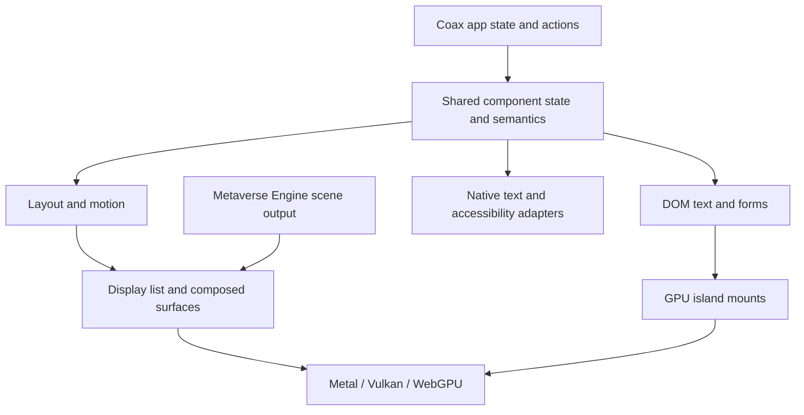

# Coax Native component rendering and composition

2026-11-14. Architecture and implementation requirements, with the mobile
chrome checkpoint below. This is **not a performance result**. Audit baseline:
`96825b529e`. This extends [the component spec](spec.md),
[Coax Native](../coax/native.md) and [Coax Native Web](../coax/web.md).
The [Arcade animation audit](../docs/arcade/06-rendering-and-animation.md)
is the concrete completeness list for the first consumer.

## Implementation checkpoint: component gallery

The first inspectable implementation is `gallery/page.coax`, reachable on web
at `/components-gpu` and inside iOS Settings → Components. It shares the
existing WebGPU/Metal shader and Coax glyph atlas. `core/spring.coax` adds
caller-clock damped motion with interruption and reduced motion;
`kit/animated.coax` paints frame, activity/progress ring, switch and drawer/
reply surfaces. `backend/gpu.coax` now lowers `PRIM_ARC` through bounded
antialiased segments. General image/blur/composition and the full Arcade
catalog are still requirements below, not features of this checkpoint.
The gallery is compiled into the new native runtime and is not an OTA renderer.

## Implementation checkpoint: default iOS chrome (1087)

The default mobile UI now projects its component decorations through
`native/scene.coax` and the existing shared GPU backend. UIKit measures actual
bounds and clips, then provides keys, state and skin roles to one transparent
Metal scene per component surface. The scene retains Coax entry/press/spring
state across updates and order changes; unseen nodes retire, invisible nodes
are excluded and capacity refusals are counted. There are no new app shaders.

All current app-owned control families use it: buttons/icon actions, fields,
multiline fields, composer, messages/code/tables/quotes, tools, headers, rows,
notices, menus, progress and activity. That covers account/login, chat/history,
Projects, Usage, Settings/extras, world library/create/edit and overlay controls,
Updates and gallery navigation. Existing platform text/selection, IME, AutoFill,
scrolling, touch and accessibility nodes remain the semantic adapters. Source
frame-square/line assembly, animated focus/press, activity arcs and spring
progress are shared; plain black replaces the old background grid on iOS.

The production profile is white/grayscale. It caps Arcade's corner squares at
12 points for compact phone controls, retains the existing phone layout and
uses the source's corner origins and centered border-segment scaling. It does
not claim full source-animation parity: blur, all 28 cases, offscreen effects,
the icon morph and shared gesture/layout transitions remain requirements.
AppKit/GTK/Android have not been switched by this iOS release. Authored world
scenes are separate colored producers; only their app chrome uses this skin.

## Recommendation

Use the existing Coax GPU component backend as the default visual target for
the new native component set on iOS and Android. Keep platform adapters for
text entry, accessibility, lifecycle and system presentations. On the web,
keep DOM text/forms and allow GPU components and scene views inside that DOM.
Applications choose presentation at a surface boundary, not inside each button.

This is a shared renderer with native services. It does not mean that app
state, layout, text editing or animation state machines execute in shaders.
Coax on the CPU handles these; the GPU rasterizes, filters and composites.
It also does not introduce Rust GPUI, React Native, Skia or a second kit:
the repository already adapted GPUI's drawing model in `backend/gpu.coax`.

| Approach | Strength | Cost | Assessment |
| --- | --- | --- | --- |
| UIKit/Android widget trees with GPU views for effects | Existing editing, selection, accessibility and platform scrolling; smaller immediate iOS change | Two visual/layout/animation projections to maintain; coordinating a blur, transformed popup and embedded scenes crosses view boundaries | Keep as the shipped compatibility path and for selected native services |
| Every pixel and all interaction implemented by a GPU canvas, including replacing platform editing | Consistent visuals and effects across native targets | IME, selection, AutoFill, accessibility, clipboard and OS integrations still need platform implementations; a canvas does not supply them | Reject the requirement to replace those platform services |
| Shared GPU visuals plus platform input/accessibility; DOM with GPU islands on web | One visual/motion implementation for custom components, natural scene composition, existing platform services retained | Requires a compositor, text/semantic bridges and physical-device qualification | Recommended target; qualify in slices before changing defaults |

Animations alone do not require a GPU UI rewrite. The reason to invest here
is the owner's combined requirement: every Arcade animation, shared iOS and
Android visuals, custom effects, web reuse and several simultaneous scenes.
GPU rendering is not intrinsically faster or lower power than native views.

## What exists, and what does not

These are source observations at the baseline, not device qualifications.

| Existing owner | Reuse | Missing work |
| --- | --- | --- |
| `core/tree.coax`, `core/elements.coax` | Keyed semantic state and element records | One committed bounds/focus/visibility projection across surfaces; complete mobile accessibility |
| `core/edit.coax`, `core/markdown.coax`, `layout/text.coax` | Edit buffer, Markdown and line wrapping | Mobile composition bridge, shaping/fallback and selection qualification; never add parallel parsers or edit buffers |
| `layout/flex.coax`, `layout/measure.coax`, `layout/font.coax` | Portable layout and measured text | Animated layout invalidation, mobile text shaping and visible-row realization |
| `paint/list.coax`, `paint/sheet.coax` | Display lists, selectable text and hit regions | Transform/opacity groups, nested clips, texture/image resources, effect layers and external scene outputs |
| `backend/gpu.coax`, `backend/gpu-shader.coax` | GPUI-style primitives, generated WGSL/MSL/SPIR-V, glyph/icon atlases | Bounded arc lowering now works; `gpu_draws` still returns false for **images**. No complete general transform/effect compositor or backdrop blur path |
| `core/arwes/motion.coax`, `core/arwes/fx.coax`, `core/spring.coax` | Easing, enter/exit, schedules, repeat, text reveals, effect math and damped physical springs | Decay, full gesture arbitration, retained motion bindings and the full Arcade catalog |
| `kit/controls.coax`, `kit/hud.coax`, `kit/markdown.coax` | Display-list components | Adapt the tree-based `kit/frames.coax` family to shared presentation semantics; an existing tree builder is not automatically GPU paint |
| `backend/dom.coax`, `coax/web/dom-host.js` | Working keyed DOM output | GPU-island mount, measurement, resource lifecycle and semantic ownership integration |
| `apps/shared/host/apple/ui-host.m`, `host/linux/ui-host.*`, `host/android/ui-host.c` | Shared Metal/Vulkan carriers and existing atlas/input/driver work | Complete component composition and mobile input; Android has drawing/window support, not a qualified full chat/IME/TalkBack path |
| `native/scene.coax`, `skin/arcade.coax`, `apps/shared/native/NativeArcade.swift`, `NativeChrome.swift` | iOS GPU chrome with keyed Coax motion and native measured text/input/semantics | Complete shared text/semantic layout, Android qualification and full source-animation parity; AppKit retains its legacy frame adapter |
| `metaverse-engine/host/apple/PageHost.m`, `apps/shared/native/NativeWorldHost.swift` | Real streamed Metal world presentation | Several embedded worlds: `phCurrent` explicitly says one page is open at a time; isolate all callback and mutable state first |

The actual shared GPU C face is `apps/shared/host/linux/ui-host.h`, reused by
the Apple and Android hosts. `components/backend/host.h`, named as a future
file in the original spec, does not exist. Extend the existing host contracts;
do not start a second carrier based on that aspirational path.

## One library, several presentations

The layers in `spec.md` remain the owners. Extend them rather than creating a
`native-components/` copy. A reusable component contributes:

- keyed state, actions and semantic children in `core/` and `kit/`;
- measured boxes, text/selection geometry and realization in `layout/`;
- motion bindings with explicit start, interruption and completion rules;
- primitives and effect groups in `paint/`, styled only by `skin/`;
- semantic rows for accessibility, focus, automation and inspection.

GPU, DOM and compatibility native-control adapters consume that description.
Backend-specific work belongs in the backend/host, not in application variants
of the component. One parser, edit buffer and action path remain mandatory.
Browser-native text layout and platform shaping can differ from GPU layout;
one library means shared meaning and state, not a claim of identical glyphs.

The tree-based kit and display-list kit currently expose different entry
points. Reconcile their component state, skin roles and semantic records
incrementally, component by component. Do not claim one already renders the
other. Preserve existing callers with adapters and picture/semantic checks.

New contracts use the root glossary. A **presentation surface** is a region
with one presentation owner, clip, coordinates and input/focus boundary.
A **scene view** is a presentation of an engine-owned world through a camera;
it is not a second engine, a new room or an implicit authorization grant.

## Motion execution

The portable animation evaluator is Coax on the CPU. Reuse the ARWES motion
module and extend it for damped springs, decay, interruption, cancellation,
completion and gesture-driven values. Keep timings/easing and geometry values
in the skin or source-parity fixtures. A render-frame clock supplies monotonic
time; app/network callbacks do not repeatedly restart animations.

On native targets, compile the shared evaluator to C and run it in the
installed presentation runtime. JSC delivers state changes and declarative
motion requests; it must not rebuild every tree or cross into Swift for each
animated property on every frame. This runtime is new work, not a property of
today's synchronous `cnFrame` loop. Layout/gesture jobs have bounded CPU work;
UIKit/platform objects are still touched only on their permitted thread.

On web, use the same evaluator in Wasm. Start with the existing frame host;
move eligible work to a worker only after profiling and capability checks.
A worker does not own DOM layout, focus or input methods. Do not require
OffscreenCanvas or cross-origin isolation for ordinary DOM text pages.

Required semantics:

1. Stable element/surface IDs own animation state. Reordering list rows cannot
   transfer an animation or restart every row's entry fade.
2. Timed animations sample elapsed time, with explicit delay, repeat and
   reverse behavior. Springs preserve position and velocity on retargeting;
   large time gaps use a bounded policy rather than an unbounded catch-up loop.
3. Begin/update/end/cancel gestures use one capture owner. Scroll, drawer,
   swipe-to-reply, text selection and a world's camera cannot all consume the
   same drag. Cancellation never sends a reply or replays a tap underneath.
4. Paint transforms normally avoid relayout. Height changes such as the reply
   bar invalidate only the affected layout and preserve the transcript anchor.
5. Commit draw, hit-test, selection and accessibility geometry together.
   Hit testing uses the presented transforms/clips, not future model bounds.
6. Reduced motion produces a defined static/end-state alternative; reduced
   transparency uses an opaque backdrop. Neither removes actions or labels.
7. A static surface sleeps. A loop wakes only while visible; backgrounding
   suspends presentation and held input. Simulation/network/service lifetimes
   follow their existing policies and are not stopped merely to save redraws.

GPU interpolation/compute may later accelerate a measured large batch. It is
not required for a spring or fade, and never owns application admission rules.

## Drawing and effects

Extend the existing display list and shader source, maintaining old primitive
behavior and vertex compatibility for existing callers. New records require a
new admitted contract/profile before a host consumes them. Needed capabilities:

- arcs/path trim with round caps; image/animated-image sampling;
- affine transforms with explicit origin and nested clips;
- group opacity, isolation and correct premultiplied-alpha composition;
- radial/sweep gradients and mask blur, beyond the existing two-stop gradient;
- offscreen capture, separable blur and compositing with a sharp lifted child;
- external scene output with crop, color-space/alpha/depth ownership declared.

One component shader source remains the source of primitive math. Blur and
scene composition require additional generated entry points/passes, not a
second platform-written shader implementation. Keep all shader arithmetic in
Coax and emit Metal, SPIR-V and WGSL from it. Do not treat a rounded-rectangle
shadow as a general image blur.

Reuse textures and cache unchanged display lists/glyphs. Bound effect extent,
blur radius, render-target dimensions, upload bytes and unfinished frames.
Blur padding must not clip the intended glow. Background capture and blur stay
on the GPU: no screenshot readback/upload loop per frame. Opacity/transform
updates must not rerasterize static text. A display-list pool overflow cannot
silently remove a label or leave an invisible active hit target.

## Native text and system integration

Keep UIKit/AppKit and Android as platform hosts. Use `UITextInput`/existing
native field services on Apple, Android's `InputConnection`/platform editor
integration, and platform accessibility elements/virtual nodes. A GPU canvas
does not implement these by being focusable. Existing Apple IME and text
helpers are a starting point; Android's current host still needs this work.

There is one editing authority at a time. Shared `core/edit.coax` owns the
portable buffer; a platform adapter owns its active composition transaction
and reconciles accepted ranges/versioned edits with that buffer. It must not
overwrite marked text from a stale snapshot. Native proxy/selection UI is
positioned from the same presented geometry as the GPU caret. Native-text
surfaces can remain visible during migration; never draw duplicate glyphs or
two carets. Web DOM fields retain the browser's editing authority.

Secure key input, password/one-time-code AutoFill, selection handles, dictation,
emoji, bidirectional text, CJK composition, hardware keys and large text are
release requirements. Reuse platform shaping/fallback where needed; the
existing Coax font rasterizer's missing glyphs are not an acceptable regression.

Expose one semantic element per action to VoiceOver/TalkBack/keyboard/automation,
including roles, values, disabled/busy states, scroll actions and actual bounds.
A decorative canvas is hidden from accessibility when its semantic projection
already owns those elements. Virtualized lists retain item identity and can
realize an item requested by accessibility. OS permission, biometric, picker,
share and purchase/auth presentations remain OS-owned services.

## DOM pages with GPU components

DOM remains the web default for long text, forms, selectable transcripts and
document structure. A component subtree can mount a GPU island. The outer
DOM box reserves layout space; GPU layout owns that island's interior.
Coax still builds all visible DOM through the existing applier. No authored
JavaScript widget state or ad hoc CSS UI is introduced.

The mount adapter reports resize, DPR, scroll/transform, visibility and clip
facts; Coax decides rendering/input. It tears down the surface on removal and
rejects stale generation callbacks. Honor browser stacking, page zoom,
scrolling, native selection and pointer capture. Do not stretch a low-resolution
canvas instead of resizing its render target.

Use one shared WebGPU device/resource service per compatible trusted host
context and one presentation context per canvas. A canvas is a contiguous
island, not one allocation/device/loop per button. Several islands can share
pipelines, atlases and a scheduler; a DOM page is not forced into one enormous
fixed overlay canvas. Start with normal canvas mounts; workers are optional.

Cross-boundary blur is explicit: an island can sample only its owned/admitted
textures. It cannot capture arbitrary DOM, a protected video or another origin.
For a popup that covers DOM, either use a declared browser backdrop capability
driven by the same motion values, or use a scrim. Report that fallback and test
it; never call it pixel-equivalent GPU blur. The full Arcade blur specimen runs
inside an owned GPU surface, even if its optional DOM placement needs a scrim.

Without WebGPU, DOM pages stay usable; an island shows its declared static/DOM
alternative or an explanatory unavailable state. Interactive realm fallback
remains the existing text/unavailable policy, not a silently invented renderer.

## Several inline worlds

The component kit owns the scene-view rectangle and semantics. The Metaverse
Engine owns simulation, assets, render plans and rooms. Compose them in the
app/host layer: `components/` must not load engine/application modules to draw
a button or gain a world runtime. A plain form still need not link the engine.

For a trusted native surface with three scene views:

1. Retain three explicit view lifetimes: camera, input capture, viewport,
   render state, async callbacks and generation. Sharing an underlying room
   or immutable asset cache is explicit; it does not share mutable camera or
   control state by accident.
2. Render each view to its bounded color/depth targets, then composite those
   textures with component UI into the window. Shared device/queue/resource
   caches are preferred where supported. Synchronize producer and compositor
   use, and retire resources only after GPU completion.
3. Allocate by physical viewport size, sample count and quality tier. Charge
   color, depth, intermediate blur targets, buffering and residency to one
   aggregate host budget, with per-view sub-budgets. Three independent budgets
   must not each assume the whole phone's memory/thermal capacity.
4. Prioritize the focused interactive view, lower preview rates/resolution,
   and stop offscreen presentation. Keep UI/input responsive when a world is
   loading or over budget; show progress/last admitted frame/error explicitly.
5. Route pointer coordinates through the committed clip/transform. Only an
   explicit interaction owns world controls; scrolling over a preview must
   not silently steer it. Audio focus is explicit and a preview is muted by
   default. A modal cancels held controls; dismissing it never repeats a tap.
6. Removing, resizing, losing the device or reopening one view cannot corrupt
   the other two. Recovery recreates GPU resources from retained CPU state
   with fresh generations; stale handles/callbacks stay invalid.

Reuse the engine render ledger, graph, quality governor and frame-pacing work
where it belongs. Factor general UI admission into the lower component layer
if needed; do not create an upward dependency on the engine. Native texture
sharing requires compatible devices/formats and measured host support. It is
not achieved by instantiating today's `NativeWorldHost` three times.

`PageHost.m`'s `phCurrent` and other static per-page data need a full audit and
explicit context ownership before several views can run. Merely swapping a
global before a draw does not fix asynchronous callbacks. Preserve
`aethyr-host-v1`; a changed callback/context ABI gets its own version and
adapter. World-specific native frameworks remain installed capabilities.

On web, trusted views in one host can use several textures in one GPU island,
or several canvas islands sharing a device. **Untrusted/authored realms keep
their existing sandboxed, separate-site frames** and typed `realm-frame.v1`
boundary. They have separate host contexts; no device sharing, raw texture
transfer, cookie access or privileged service bridge is assumed across those
frames. The browser composites their rectangles. The same scene-view
semantics can select this isolated implementation without removing its policy.

## Contracts and Updates

Before runtime implementation, define capability profiles and versioned records
in `proto/` with one codec and registry row for every new cross-module, stored
or wire shape. Specify surface create/update/release, motion submit/cancel,
resource ownership, visibility, input/composition, semantics and errors. Reuse
the current tree, engine and update contracts where unchanged. This document
defines requirements, not an unregistered wire format or assigned op numbers.

A new compositor, shader/effect capability, host op, IME bridge or semantic
adapter changes the installed native runtime and needs a new binary and
fingerprint. Updates can then supply compatible Coax components, motion
descriptions, layouts and assets within admitted capabilities. Do not promise
arbitrary new shaders, native code or scene producers over the air. Native
shader loading/compilation and distribution eligibility require their own
qualification under `coax/native-updates.md`. Browser deployments have their
existing separate delivery path.

Keep 1085's UIKit runtime working during this work. A new runtime's embedded
package must contain its current module; old fingerprints keep compatible
feeds. Switching a subtree's presentation retains keyed app state and IME
ownership; do not replace a focused editor or lose an unresolved command.

## Delivery order and acceptance

These are proposed work packages, not claims that issues were filed.

| Stage | Deliverable | Gate before proceeding |
| --- | --- | --- |
| R0: contracts and reference catalog | Versioned presentation/motion/scene contracts; every Arcade specimen with deterministic clocks | All source rows in audit 06 mapped, including dormant code; known source bugs recorded separately |
| R1: portable paint and motion | Arcs, images, transforms, clips, gradients, blur/composition; springs/decay on existing layers | Numeric/time traces, reference frames and generated shader checks; unsupported primitives cannot silently disappear |
| R2: shared gallery on three pixel targets | Same kit/state/skin/motion on Metal, Android Vulkan and browser WebGPU; DOM island example | Every catalog row exercised, reduced motion, interruptions, cancellation, resource/lifecycle cases |
| R3: production text and semantics | Native editing/accessibility and web semantic ownership, bounded transcript/list realization | Real iOS and Android IME/AutoFill/VoiceOver/TalkBack/selection tests, not screenshots alone |
| R4: scene composition | A page with three independently controlled worlds plus animated components | Multi-view isolation, shared-budget refusal, clipping/input/audio, background/recovery, sandbox boundary tests |
| R5: app migration and release | Incremental chat/drawer/component migration; one new native runtime once capabilities qualify | No login/chat/Projects/Worlds regression; compatible signed Update and rollback on the exact build |

Arcade's Nostr service work may proceed separately, but its new visual controls
target this kit. Do not build an entire parallel Swift and Android widget set
as the supposed permanent library while this renderer remains a paper plan.
Conversely, do not block useful current-app fixes on the whole GPU migration.

Qualification records include:

- deterministic motion values at fixed times, render lists, element trees,
  transformed hit regions and per-platform pictures; reference comparisons
  keep the original timings before optional skin adaptations;
- interrupted springs, fast reversals, duplicate completion suppression,
  long stalls, offscreen/removal, reduced motion/transparency and device loss;
- emoji/fallback, Arabic/bidi, CJK composition, selection, clipboard, secure
  fields, six-digit code AutoFill, large text and accessible list navigation;
- DOM text around two GPU islands and three scene views, scrolling/resize/
  page zoom, modal coverage, pointer routing and a no-WebGPU browser path;
- CPU UI/layout/animation time, GPU UI/effects/world time, input-to-present
  latency, frame intervals, allocations/residency, uploads and battery/thermal
  behavior. Report device, OS, refresh rate, viewport/DPR, scene quality and
  sample duration. Do not infer mobile quality from a desktop screenshot.

Initial targets, to validate rather than advertise: sustain 60 Hz on the
lowest supported test phone (16.7 ms total frame interval), and 120 Hz where
the device exposes it (8.3 ms); retain typing/gesture responsiveness during
scene load and a deliberately stalled app-data task. Measure p50/p95/p99,
missed frames and input latency against the existing native baseline. Capture
a ten-minute three-view thermal run and a static-screen idle run. Require no
continuous GPU submission when all visible content is static and no motion
is due. Numeric memory/resource caps must be chosen and recorded in the new
profile before allocation; these frame targets are not those admission caps.

## Platform references

Reanimated's [3.x glossary](https://docs.swmansion.com/react-native-reanimated/docs/3.x/fundamentals/glossary/)
and [worklets guide](https://docs.swmansion.com/react-native-reanimated/docs/guides/worklets/)
describe CPU UI-thread execution; React Native's
[native-driver explanation](https://reactnative.dev/blog/2017/02/14/using-native-driver-for-animated)
also distinguishes native animation from the app JS thread. These explain the
execution model, not a benchmark of Arcade.

Apple documents [UITextInput](https://developer.apple.com/documentation/uikit/uitextinput)
and [UIAccessibilityElement](https://developer.apple.com/documentation/uikit/uiaccessibilityelement)
for custom presentations. Android documents
[InputConnection](https://developer.android.com/reference/android/view/inputmethod/InputConnection)
and [virtual accessibility nodes](https://developer.android.com/guide/topics/ui/accessibility/views/custom-views).
They are why a GPU visual target retains native input and semantic adapters.

The official [WebGPU multiple-canvas sample](https://webgpu.github.io/webgpu-samples/?sample=multipleCanvases)
demonstrates a shared device and visibility-based rendering. Apple's
[resource synchronization](https://developer.apple.com/documentation/metal/resource-synchronization)
explains dependencies between passes using shared textures. Our budgets,
scheduler and trust-boundary choices above are design recommendations, not
features automatically provided by those APIs.

## Account settings adoption (1088)

The shared account screens use the same scene and skin. `drawer_icon` paints
the hamburger/arrow morph with skin geometry; interactive gestures feed its
progress, and shared springs settle other states. Native toggles use the
shared animated switch. Rail action geometry and profile image sizes come
from the skin. `k_remote_image` accepts explicit caller admission; the native
host reuses the installed Coax URL policy and performs only bounded, anonymous
SDK download/thumbnail effects. No component loads a networking library.
