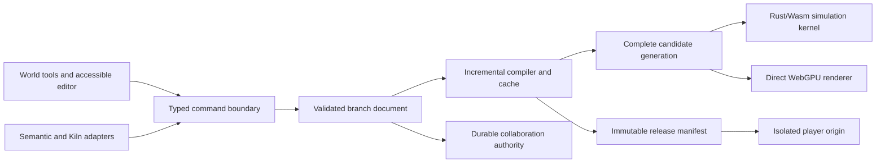

# Engine architecture

Status: selected design, not implemented. Related decisions: [language split](decisions-history/0001-hybrid-engine.md),
[semantic compilation](decisions-history/0002-incremental-world.md),
[authority](decisions-history/0003-authority-and-publishing.md),
[cross-platform core](decisions-history/0006-cross-platform-engine-core.md),
[GPU-driven rendering](decisions-history/0007-gpu-driven-rendering.md), and
[shader toolchain](decisions-history/0008-shader-toolchain.md).

## Purpose and boundary

Aethyrforge owns the creation engine: project meaning, creator tools, compiler,
simulation, graphics, behavior execution, and portable releases. The engine is
browser-first: the web ships first, then mobile, then desktop. One Rust engine
core, including the renderer, runs on all of them
([decision 0006](decisions-history/0006-cross-platform-engine-core.md)). Native parity
must not dictate the browser interaction loop.

The architecture serves indie teams building playable 3D experiences and
connected worlds. A scene edit is a small project transaction; adding a wall does
not require deploying a new server. Published play sessions run exact versions,
while their authors continue editing another revision.

## System view

The diagram is a data flow, not permission delegation. The command service checks
the authenticated principal and grants independently of model output or document
contents. The player receives assets and bounded session grants, never editor
credentials.

## Language and process ownership

| Component | Implementation choice | Boundary |
| --- | --- | --- |
| Trusted editor shell | React DOM, TypeScript, CSS | Hotbar, accessible inspector, diagnostics, account/session controls |
| Reactive UI state | Effect Atom with `@effect/atom-react` | Selection, tool state, derived inspector values, bounded service/runtime summaries |
| Async services | Effect 4 | Commands, bounded imports, compilation jobs, preview lifetime, adapters, cancellation |
| World/domain kernel | Rust, native and Wasm builds | Validation, simulation, spatial structures, physics, navigation, state migration |
| Asset and world compiler | Rust workers and native service | Deterministic transforms, semantic lowering, dependency tracking, target outputs |
| Renderer core | Rust, Wasm and native builds, over a `webgpu.h`-shaped GPU crate | Render graph, GPU-driven visibility, uploads, pipeline creation, command recording, submission |
| Web platform host | Thin TypeScript | Canvas and worker bootstrap, input and lifecycle events, the browser WebGPU import table |
| Native platform host | Host application over a C ABI, Dawn for GPU | Surface, input, and lifecycle on mobile and later desktop |
| GPU programs | Slang compiled to WGSL; creator materials in WGSL | Rendering and selected compute workloads; one WGSL artifact for every platform |
| Behavior toolchain | TypeScript syntax subset to owned bytecode | Fast source iteration, static checks, capability imports, metered execution |
| Behavior VM | Rust/Wasm in isolated worker | Bounded computation and typed state proposals |
| Authoring and session services | Rust | Authoritative commits, persistence, simulation authority, artifact admission |
| Build/dev adapters | Vite and standard language tools initially | Developer convenience, not project semantics or release identity |

Effect owns asynchronous work at useful granularity. It must not allocate an
effect/fiber per entity, vector operation, or draw. Rust modules exchange coarse
buffers with the browser host; object-by-object FFI is not the engine API.
Memory ownership and transferred slabs are defined in [runtime](runtime.md).

The [frontend contract](frontend.md) owns component, atom, and service lifetimes.
React renders DOM controls; Effect Atom connects them to UI state and Effect 4
services. The runtime worker schedules simulation, camera updates, animation, and
GPU submission independently of React renders, hooks, and atom notifications.
Only bounded selected summaries reach the UI; the complete live world is never
mirrored into a reactive component tree. UI actions enter the existing typed
command boundary, and continuous input uses the host input bridge.

The renderer is Rust that calls the standard WebGPU API: the browser's WebGPU on
the web and Dawn natively. Browser Rust does not bypass browser validation or
expose native Metal or Vulkan directly. The current TypeScript renderer remains
the production path until each Rust pass reaches image parity and equal or
better measurements. Rendering architecture follows
[decision 0007](decisions-history/0007-gpu-driven-rendering.md); shader authoring follows
[decision 0008](decisions-history/0008-shader-toolchain.md). Backend choices require
measurements, not a claim that one source language produces faster GPU execution.

## Four states and two authorities

1. **Document:** the valid authored branch revision, saved independently of play.
2. **Candidate:** derived outputs for one document digest, compiler/toolchain,
   target profile, and engine ABI. Compilation may fail or finish out of order.
3. **Active generation:** a compatible candidate installed in one running preview.
   It includes mutually consistent rendering, collision, navigation, and selection.
4. **Release:** an admitted immutable package that can run without its editor.

Authoring authority commits project revisions. Play authority advances gameplay
ticks and validates player input. A collaborative document is not a multiplayer
physics server, and a player action does not implicitly edit the project source.
The same semantic definitions can feed both systems without sharing authority.

An accepted document transaction can outpace compilation. The UI shows that the
saved edit is preparing; the previous working generation continues. Failed
activation cannot silently roll back someone else's committed document. A later
repair is another revision. Compatible activation preserves player and behavior
state; an incompatible change follows a declared migration policy. A wall rebuilt
through the player can hold preview activation until the player moves or agrees
to a safe relocation. See [contracts](contracts.md).

## Work placement

- Keep input and DOM feedback on the editor thread.
- Keep preview simulation and GPU encoding together initially in one runtime
  worker to avoid copying complete world state each frame.
- Run imports, geometry work, and independent compilation on bounded workers.
- Keep untrusted behaviors in a separate metered VM worker. State proposals cross
  a validated bridge; scripts cannot own GPU handles or mutate kernel memory.
- Correctness never depends on shared memory: the transferable-buffer profile
  produces identical results. The cross-origin-isolated shared-memory profile
  is the primary web performance profile, never a hidden prerequisite.
- Stream spatial cells and artifacts according to visibility, relevance, and
  memory budgets. The world can be larger than the resident simulation set.

A worker moves work off a thread; it does not remove its cost or establish an
account-security boundary. Untrusted preview and player pages use isolated origins
and the broker in [security](security.md).

## Proposed repository organization

These paths describe future implementation homes; they do not exist yet.

| Proposed home | Responsibility |
| --- | --- |
| `apps/editor` | Creator shell and contextual controls |
| `apps/player` | Minimal release player and project isolation |
| `packages/web-host` | Web platform host: canvas, input, audio, storage, worker bridges, and the WebGPU import table |
| `packages/editor-services` | Effect services and adapter interfaces |
| `crates/world` | Semantic model and pure transaction validation |
| `crates/runtime` | Scheduler, job system, state, spatial cells, and kernel ABI |
| `crates/gpu` | `webgpu.h`-shaped GPU interface with browser and Dawn backends |
| `crates/render` | Render graph, GPU-driven visibility, and passes |
| `crates/compiler` | Incremental dependency graph and target artifacts |
| `crates/behavior` | Bytecode verifier, VM, and state migrations |
| `crates/services` | Authoring, artifact, publishing, and play hosts |
| `contracts` | Portable wire definitions and compatibility fixtures |
| `conformance` | Future cross-language and host/player conformance suites |

No new application framework, transport, or service may become another owner of
world state. Backend-specific caches and handles must be recoverable from owned
document/artifact data.

## Failure design

Compiler errors preserve active state and point to semantic IDs/source spans.
Stale jobs release resources and cannot activate. Device loss recreates resources
from active artifacts on a new device; an old pipeline cannot survive device loss.
Storage-full conditions retain the in-memory edit and offer export. Disconnection
creates an explicit local branch. Permission revocation ends privileged operations
and removes account authority from a preview. Publishing and play-session migration
are independently recoverable operations.

These behaviors are acceptance obligations in [verification](verification.md),
not guarantees established by this architecture document.
