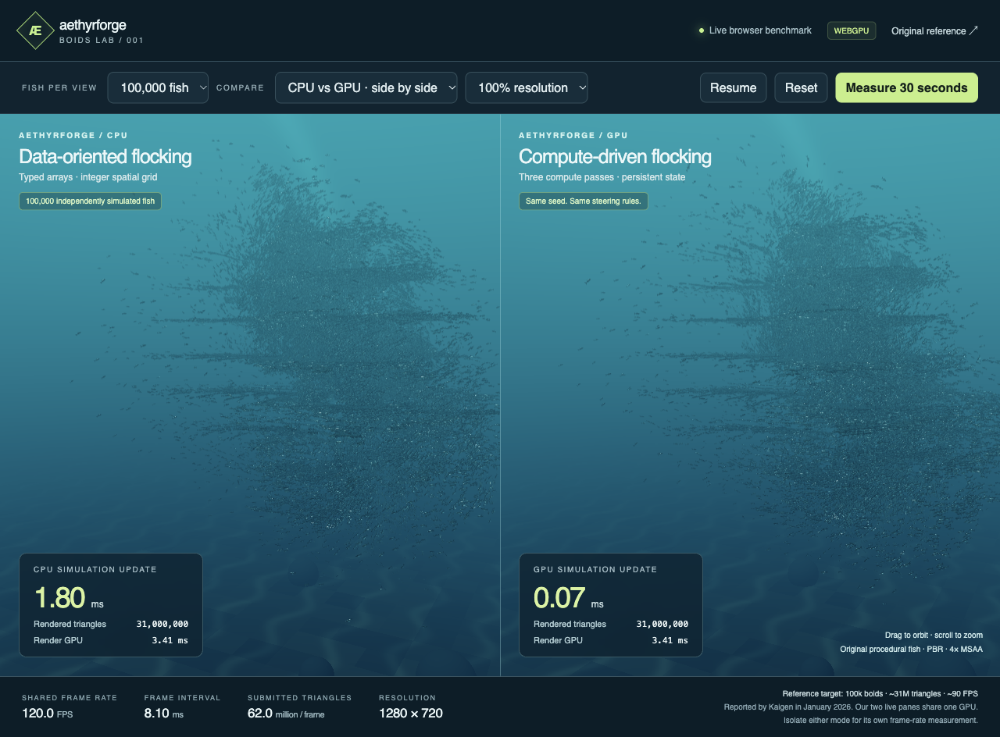

# Aethyrforge Boids Lab

An implemented, asset-free browser workload recreates the underwater schooling
composition and measurement categories from the supplied Kaigen screenshots.
The live comparison is **our CPU simulation versus our GPU simulation**. It does
not label an owned baseline as Unity or present another engine's numbers as our
measurements.



## Run

Use Node 24+ and a WebGPU-capable browser. No Rust build, purchased assets, or
external engine is required for this lab.

```sh
npm ci
npm run dev:boids
```

Open `http://127.0.0.1:55336/boids.html`. Select 1,000, 10,000, 100,000, or
200,000 fish per view. Compare both modes or isolate one. Drag to orbit, scroll
to zoom, pause, or reset the same seed. **Measure 30 seconds** runs a five-second
warmup, records individual frames, and offers a JSON download.

`npm run build:boids` produces the standalone static site in `dist/boids`.
It includes no Town assets, editor bundle, or Wasm kernel. The measured build
contains approximately 46.3 kB of raw JavaScript, or 16.4 kB gzip, plus HTML and CSS.

## Measured production results

Three consecutive 30-second windows, each with five seconds of warmup, used
Chrome 155.0.8059.85 on an Apple M5 Max. The actual rendering surface is
1280 × 720 with 4× MSAA and the complete fish mesh. Each view contains
100,000 simulated fish.

| Mode | Fish / fish triangles per frame | Recorded frames/s | CPU update median | GPU compute median | GPU render median |
| --- | --- | --- | --- | --- | --- |
| Isolated GPU | 100,000 / 31 million | 119.864 | — | 0.131 ms | 4.456 ms |
| Isolated CPU | 100,000 / 31 million | 119.528 | 1.900 ms | — | 3.670 ms |
| Side by side | 200,000 / 62 million total | 119.492 | 3.400 ms | 0.066 ms | 5.177 ms |

The rate is accepted submissions divided by the real recording duration; all
recorded submissions finish during the final queue drain. It is not a count of
physical display presentations. The two simultaneous views share one device and
queue. The GPU-render envelope in the last row covers both views.

The average rates exceed the screenshot's approximately 90 FPS target on this
host. Occasional long intervals remain: maxima are 42.9, 53.3, and 66.2 ms in
the three modes. These results do not establish stutter-free presentation,
cross-device qualification, or Medieval Town performance. No host-wide isolation
was attempted. CPU/GPU timings cover different execution domains, overlap other
work, and must not be added or used as an end-to-end speedup ratio.

GPU timestamps are asynchronous samples, with unique serials and explicit sample
counts. Browser timestamp quantization can round small compute samples to zero.
The recorder omits the unknown first frame interval rather than inventing one.
Raw frames, timings, source/build hashes, capture hashes, and scope are retained
by the [committed measurement summary](data/boids/2026-10-23.json).

## Workload and rendering

- The CPU uses reusable typed arrays; the GPU uses persistent storage buffers
  and three compute passes: clear cells, aggregate, then steer and integrate.
  Both use the same seeded 32-byte state, configuration, target, obstacle, and
  step duration. State is double-buffered.
- Each fish responds to its current cell's heading and position averages, target
  attraction, obstacle avoidance, and spherical bounds. This is a cell-aggregate
  approximation, not an exact-radius or all-pairs neighbor search.
- Integer sums quantize components at 1/128 units. Validated count, radius, and
  speed limits prevent signed integer overflow even when all 200,000 fish occupy
  one cell. Cell assignment uses matching float32 rounding.
- Steering arithmetic uses JavaScript numbers on CPU and float32 on GPU; live
  trajectories are not claimed to be bit-identical. Small independent-reference
  and GPU-readback fixtures check finite movement, cell totals, one-step integer
  aggregates, boundary cases, and bounded numerical error.
- Every fish uses an original 310-triangle indexed mesh: body, fins, and tail.
  One instanced school draw per view submits all fish without LOD or culling.
  A separate two-triangle background supplies the procedural water and seabed.
  GGX lighting, animated tails, depth fog, light shafts, and 4× MSAA are enabled.
- The frame loop runs independently of DOM updates. UI metrics refresh four
  times per second. Two submissions and four timestamp slots bound pending
  graphics work; buffers and replaced render targets are explicitly destroyed.

This reusable simulation/instancing slice lives in `packages/boids`; its thin
lab shell lives in `apps/boids`. It does not run the Town's gameplay kernel or
all of its rendering effects. Matching a fish count and triangle count is not
evidence that those two workloads have equivalent costs.

## Verification and reference boundaries

Thirteen Node tests pass, including an independent cell-gather reference,
deterministic reset, real 100,000-fish movement, maximum-density integer bounds,
and nondegenerate mesh checks. Type checking and the standalone production build
pass. The real-browser check passes five CPU/GPU readback fixtures, real control
clicks, pause/reset state, independent pixel coverage and population contrast,
resize, and all three measurement windows. App, device, page, and cleanup errors
are absent; one resource-404 console warning remains in the raw report.

To reproduce the production verification after building:

```sh
AF_BOIDS_PRODUCTION=1 AF_CAPTURE_DIR="$OPENAGENTS_SCRATCH/boids-check" \
  openagents browser run -- node tools/verify-boids.mjs
```

Use an external output directory. Short preflight windows are available through
`AF_BOIDS_BENCHMARK_MS` and `AF_BOIDS_WARMUP_MS` and are labeled as diagnostics.
The verifier serves exact built bytes and checks the build closure before and
after the run. Original procedural captures can be retained in Git; no Kaigen
or Unity asset bytes are imported.

The [January post](https://x.com/gdechichi/status/2009314635128951170),
[public Kaigen demo](https://kaigen3d.com/demos/boids/), and
[published demo source](https://github.com/Kaigen-Technologies/kaigen-boids/tree/1a1e4fa06da7190245e5973ef6a7ae1c7b346047)
are references. The current source differs from January: its modulo-hashed
buckets cap contributors, and its renderer includes additional effects. Our
owned dense-grid algorithm, generated fish, environment, and hardware differ.
No Kaigen-versus-Aethyrforge or Unity-versus-Aethyrforge performance ratio is
established. See the earlier [Kaigen analysis](kaigen-analysis-2026-10-23.md)
for the distinction between ECS update throughput and displayed frame rate.
