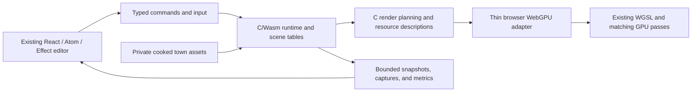

# A C/Wasm Medieval Town experiment

Status: original assessment and experiment proposal, October 23, 2026. The
subsequent [implementation and measured results](c-medieval-town-results-2026-10-23.md)
record the C/Wasm slice, matched controls, browser checks, and remaining limits.
This proposal supplements the [Kaigen research](kaigen-analysis-2026-10-23.md);
its proposed qualification protocol is broader than the completed exploratory run.

## Initial assessment

**A C implementation is worth a serious vertical-slice experiment. Build an owned
C/Wasm runtime and render-preparation core for the real Medieval Town, with a thin
browser host and the existing editor around it.** Its purpose is to find out
whether a more compact, explicit engine makes playing, loading, and creating
better. It should be capable of becoming the engine, rather than being a toy
scene that cannot support our editing model.

The strongest ideas from Kaigen are packed runtime data, explicit memory and
thread ownership, cooked assets, GPU-oriented rendering storage, and reusable
capabilities that agents can compose. C makes that design natural to express;
it does not guarantee it. Rust/Wasm can implement the same layouts and algorithms,
and well-structured JavaScript can remove some current costs too.

I would test the radical design while keeping the comparison disciplined:

- Make the candidate primarily C, including simulation, scene residency, culling,
  light preparation, draw planning, and resource descriptions.
- Preserve the same WGSL, town assets, visible features, and browser target for
  the first full comparison. Change rendering algorithms afterward, one at a time.
- Keep React, Effect Atom, and Effect 4 as the initial external editor. They
  already sit outside the frame loop; replacing them would obscure the runtime
  experiment. A standalone player can omit the editor entirely.
- Compare with a small optimized Rust/TypeScript control, not only today's
  prototype. Otherwise a faster data boundary could be mistaken for a C advantage.
- Make live editing and recovery part of the slice. A fast, immutable town viewer
  would miss the main reason Aethyrforge exists.

The likely best outcome is an engine with fewer runtime representations and
less repeated work. Whether its core should ultimately be C, Rust, or a mixture
is the result to discover. This proposal does not supersede the selected
[language decision](../decisions-history/0001-hybrid-engine.md) or
[frontend contract](../frontend.md).

## Evidence reviewed

### The offline archive

The supplied archive is `~/work/archives/gdechichi-2026/index.html`. Its SHA-256
at review is
`c561f88ff82bcb82b9ecff9922fe7645a925b721645f9e9dee0d9e1ec1cfd026`.
Textual posts and expanded references were reviewed, including the associated
collection metadata. The archive contains:

| Item | Observed scope |
| --- | --- |
| Unique posts | 1,645: 965 by `@gdechichi` within the search interval, 680 expanded posts by others |
| HTML articles | 1,702 occurrences; referenced posts sometimes appear more than once |
| Conversations | 463 entries in `threads.json` |
| Search interval | January 1 through October 23, 2026, 16:18:35 UTC, according to `config.json` |
| Completion | Account search reports `complete: true`; replies from other people are explicitly not exhaustive |
| Missing references | 20 API error records |
| Media | 288 metadata records, 401 download errors, one successfully downloaded file |

Expanded references can fall outside the search interval. These counts describe
this saved collection, not every post or conversation on X. The attached
benchmark videos and technical screenshots were not visually verified from this
archive. Social posts supply author reports and design explanations, not an
independently reproduced performance result.

The earlier research accurately records what was available during its own review.
This later archive provides additional evidence; it does not turn that earlier
targeted lookup into an exhaustive collection.

### Aethyrforge and browser documentation

Committed source and documentation were reviewed at
`3a6026f31257b2e54735ae4574a75a87c11163ee`. Concurrent uncommitted controller
and character work was excluded. Before implementation, choose and record a
fresh stable baseline commit and matching private asset hashes; this analysis
commit is not permission to compare against a moving development checkout.

The review includes [implementation status](../implementation.md), the
[performance targets](../performance.md), [architecture](../architecture.md),
[runtime](../runtime.md), [runtime ABI](../runtime-abi.md), the preview worker,
kernel bridge, culling, light clustering, renderer, and film-capture results.
Broad specification headers that say no runtime exists are older design status;
the implementation document and committed source describe the actual prototype.

The public Kaigen application guide, Emscripten's WebGPU and threading guides,
and Dawn's Emdawnwebgpu documentation were also checked. No Kaigen installer,
engine binary, example application, or benchmark was executed.

## What the archive adds to the Kaigen comparison

### The useful benchmark is the later rematch

The [January 9 correction](https://x.com/gdechichi/status/2009666243096379439)
says the author learned Unity's web Burst path was not working in the tested
version and could not get the newer attempted build to load. That materially
qualifies the January headline. It should not become our expected C speedup.

The [October 1 rematch](https://x.com/gdechichi/status/2105785751904636936)
explicitly revisits the comparison after web Burst support. The author reports
roughly 2 versus 9 ms for ECS work and 3 versus 28 ms for CPU work, with a headline
range of 4.2–8.7×. The displayed numbers are rounded; they do not justify a more
precise ratio. The [configuration](https://x.com/gdechichi/status/2105785757797630180)
and [settings](https://x.com/gdechichi/status/2105785759068504507) identify 100,000
boids, Unity `6000.6.3f1`, Kaigen `0.6.0.001-beta`, Windows 10, Chrome, a Ryzen
7 5800H, an RTX 3060 Laptop GPU, and 32 GB RAM.

This is stronger motivation for an experiment than the original headline.
It still compares complete implementations, not isolated C and Rust compilers.
The linked [boids source](https://github.com/Kaigen-Technologies/kaigen-boids)
is a reproduction lead, not a benchmark run performed here. A 100,000-agent
simulation is also a different workload from a largely static town with expensive
materials and multiple rendering passes.

### The architecture is more specific than “use an ECS”

The [October 2 explanation](https://x.com/gdechichi/status/2105852045911814292)
describes archetype columns, bulk spawning by copying columns, and per-thread
structural command buffers applied together. It explicitly says rendering is
not ECS: graphics has tightly packed, GPU-oriented data and a thin entity bridge.
Physics follows a similar separation. Streaming chunks and prefabs sit over
serialized scene data.

That distinction fits Aethyrforge well. The semantic document describes a room
or doorway. Simulation needs bodies and controller state. Rendering needs bounds,
instances, materials, and draw records. They can share stable identities without
sharing one universal object representation. For the first slice, dense tables
are sufficient; a general archetype migration engine should earn its complexity.

### Other design signals

| Evidence | What to take from it |
| --- | --- |
| [January 15 memory clearing](https://x.com/gdechichi/status/2011855100328005989) | The author reports about 15 ms spent clearing memory every frame on every thread. Profile bytes cleared, copied, allocated, and uploaded before changing languages. C permits the same mistake. |
| [February 22 browser backend](https://x.com/gdechichi/status/2025454841196413436) and [interface discussion](https://x.com/gdechichi/status/2025413028808974481) | The historical browser backend calls TypeScript from C. A mostly C engine still needs a browser interface; a small, explicit interface is the useful goal. |
| [June 4 default-state bug](https://x.com/gdechichi/status/2062541891548401712) and [follow-up](https://x.com/gdechichi/status/2062541893196808218) | Make zero an invalid/default handle, validate offsets, and avoid valid addresses being confused with absent optional data. Explicit memory needs explicit correctness rules. |
| [August 2 asset pipeline](https://x.com/gdechichi/status/2083985719790596398), [format](https://x.com/gdechichi/status/2083985721447321950), and [size tradeoff](https://x.com/gdechichi/status/2083985724232331567) | Reports 3,777 cooked assets in 1.4 s and a 482→98 MB library reduction. Separate general-format parsing, codec unpacking, network transfer, residency, and GPU upload. Those timing boundaries are not independently established. |
| [Parallel unpacking](https://x.com/gdechichi/status/2084032637682032908) and [later work](https://x.com/gdechichi/status/2084050201111900254) | Reported loading improves again after scheduling changes. Asset preparation and parallel decoding may matter more than the runtime source language. |
| [October 7 template](https://x.com/gdechichi/status/2107835826269045156) | A small application composes controller, sky, and editor capabilities already supplied by the engine. The reported 400 lines are application code, not the entire engine. |
| [October 21 modularity](https://x.com/gdechichi/status/2112909845963915626) and [minimal build](https://x.com/gdechichi/status/2112909844084892125) | Measure empty-player bytes and optional-system removal. A minimal stripped engine does not predict first-play bytes for a textured Medieval Town. |
| [October 22 agent experience](https://x.com/gdechichi/status/2113080661989040131) | A tester reportedly used more tokens than for a comparable Three.js project. Agent familiarity and lower cost need their own evidence. |

The archive's [compiler proposal](https://x.com/gdechichi/status/2085380938356425180)
is an aspiration, not measured instant compilation. No reviewed text establishes
state-preserving Wasm code replacement or failed-module rollback. Those are
requirements we must design and test ourselves.

The [SSGI report](https://x.com/gdechichi/status/2014739425939620279), with its
half-resolution profile, is a useful later rendering lead. Replacing our lighting
while porting languages would answer a different question. Keep such experiments
in separately labeled quality profiles.

## What C could improve in our current town

Today's renderer already uses direct WebGPU. The preview worker owns simulation
and GPU submission independently of React renders, atom notifications, and Effect
services. There is no Three.js scene graph to remove from this baseline.

Source inspection does reveal concrete opportunities:

| Current source | Observed work | Hypothesis to measure |
| --- | --- | --- |
| [Kernel host](../../../../apps/aethyr/apps/preview/kernel.ts), [Rust bridge](../../../../crates/aethyr/kernel/src/lib.rs) | Each step stringifies JSON, encodes bytes, allocates and copies request memory, parses in Rust, serializes a response, decodes/parses in JavaScript, and frees slabs. The response is a small player summary, not the entire world. | A packed, reusable input/output boundary could reduce overhead in either Rust or C. Its absolute cost may be small; measure it. |
| [Source submission](../../../../apps/aethyr/packages/renderer/renderer.ts), [culling](../../../../apps/aethyr/packages/renderer/culling.ts) | A moving camera invalidates a string signature, computes visibility, compacts matrices, prepares wind data, and uploads buffers. Some temporary arrays and repeated validation remain. | Validate immutable data once; reuse bounded scratch and packed outputs. Compare the same algorithm in C, Rust, and preallocated TypeScript. |
| [Cluster host](../../../../apps/aethyr/packages/renderer/clustered-lighting.ts), [cluster builder](../../../../apps/aethyr/packages/renderer/clustered-lights.ts) | Camera-dependent JSON signatures, CPU light assignment, storage construction, and GPU uploads. | Cache identity changes explicitly and reuse storage. Changing to GPU clustering is a separate optimization. |
| [Renderer](../../../../apps/aethyr/packages/renderer/renderer.ts) | Real work includes depth, shadows, decals, ambient occlusion, materials, water, reflections, fog, particles, bloom, and display processing. | Determine which passes or CPU preparations limit each route. A cheaper CPU loop cannot remove their GPU cost. |
| [Private asset tools](https://github.com/OpenAgentsInc/aethyrforge/blob/71c19bfe8b5de79811de5ca518e783876650d42f/tools/assets/README.md) | Geometry is already prepared; source manifests and several runtime structures remain JSON, with image decoding and uploads still required. | Test a cooked runtime package and staged loading without rebuilding the source import pipeline first. |

These are candidate costs found in code, not a profile of the running machine.
Removing JSON, strings, and temporary allocations is an architectural change.
It should not be credited to C unless an equivalent Rust/TypeScript control still
loses under the same responsibility, layout, algorithm, and precision.

When the GPU is the limiting stage, substantially reducing CPU preparation may
lower CPU use without increasing presented FPS. Conversely, CPU work that misses
a frame deadline can cause large visible stalls. Measure the actual pipeline and
critical path; neither adding CPU and GPU times indiscriminately nor reading one
FPS counter explains their overlap.

## Proposed C architecture

### Engine core and browser host

Use C17 for the owned experimental CPU core, WGSL for GPU programs, and a small
browser adapter. Do not build a new language, C compiler, browser runtime, or
general plugin system as prerequisites. Pin the compiler, SDK, headers, and
optimization flags before measuring.

C owns active runtime tables, fixed-step movement, spatial queries, animation
state where present, scene residency, visibility, light preparation, render
planning, and accounting. The host owns browser objects and asynchronous
callbacks: canvas attachment, input events, fetching, GPU handles, and device
lifetime. The semantic command/document boundary remains authoritative; dense
runtime indexes are not saved project identities.

First use the existing TypeScript GPU encoder with coarse C-produced frame data.
That isolates CPU implementation changes. Then build the full C-facing rendering
path through Emdawnwebgpu and compare both host paths. Emscripten documents
Emdawnwebgpu as a C API implemented on top of browser WebGPU; it does not expose
native Metal/Vulkan directly from a web page.
[WebGPU support](https://emscripten.org/docs/porting/multimedia_and_graphics/WebGPU-support.html).

Dawn currently documents `--use-port=emdawnwebgpu` for compilation and linking.
Pin the port revision rather than silently tracking its newest release. Its
implementation includes JavaScript and C++ infrastructure even when our engine
source is C. Measure boundary calls, descriptor conversion, string marshaling,
and encoding cost; the C API is not a zero-cost bypass.
[Emdawnwebgpu guide](https://dawn.googlesource.com/dawn/+/refs/heads/main/src/emdawnwebgpu/pkg/README.md).

### Data and memory

- Store repeated static geometry once. Use dense instance, material, light,
  bounds, and dynamic-state tables, connected by stable handles.
- Separate read-mostly scene memory, mutable simulation state, per-frame scratch,
  upload staging, and candidate-build memory. Track each peak, including failure
  and cancellation paths. Reuse scratch instead of clearing its full capacity.
- Make handle zero invalid; include generations for recycled slots. Specify
  checked counts, offsets, lengths, alignment, endianness, and versioning at every
  serialized boundary. Do not serialize native pointers or compiler struct layout.
- Generate typed access and read/write descriptions from one definition. C
  `const` inputs improve the interface but do not prove that aliases, conflicting
  systems, or undeclared writes are safe. Retain debug validation.
- Batch structural edits at a defined safe point. Keep rendering, collision, and
  selection on the same admitted world version when a change becomes active.
- Avoid a Wasm call per entity or vector operation. Use coarse input, step,
  command, and render-preparation batches with reusable memory views.
- Treat Wasm memory and GPU memory as different allocations. Uploads and copies
  remain real costs. Memory growth must invalidate/reacquire borrowed host views
  at a controlled boundary.

Zero engine heap allocations in a steady hot loop is a useful experimental goal.
It does not mean the browser, GPU API, loader, or editor performs no allocation
or garbage collection. Count the complete system rather than only the C heap.

### Scheduling

Start with one runtime worker and a fixed-step serial core. A static town may
have too little simulation work to repay a parallel scheduler. Keep the same
tick rate, catch-up limit, input handling, and dropped-time policy as the baseline.

After profiling, try bounded workers for independent visibility ranges, light
preparation, geometry unpacking, or animation. Use explicit task access, private
scratch, deterministic merge order, and measured barriers. A GPU submission
owner remains explicit. SPMD is one scheduling design to test, not a requirement
to run every small system on every available core.

Kaigen's [application guide](https://kaigen3d.com/docs/writing-applications)
describes application-owned state, a small lifecycle API, and lock-step execution
across configured threads. Borrow the simple library interface and explicit work
ownership; treat automatic parallel scheduling as a separate implementation task.

Emscripten's pthread profile requires shared memory and appropriate COOP/COEP
deployment. Its documentation calls for distinct threaded and nonthreaded
builds, not one pthread binary that automatically becomes serial. Test the actual
editor/preview iframe and asset origins; qualify worker startup, cancellation,
slow workers, and devices without the shared-memory profile. Do not block the
browser main thread waiting for the engine.
[Pthreads guide](https://emscripten.org/docs/porting/pthreads.html).

### Editor and agent interface

Retain the current editor and host adapters for the first slice. Effect services
can still own asynchronous jobs, cancellation, and receipts. They do not need to
own C frame work. An all-C canvas UI would introduce separate accessibility,
text-input, tooling, and iteration questions. Evaluate it later if there is a
measured reason; it is unnecessary to prove a C runtime.

Provide a small versioned interface for agents: inspect the world, send input,
submit supported commands, observe completion, capture a known frame, read
metrics, and close. Results identify request, scene/version, tick, and actual
outcome. A template should give agents working movement, sky, lighting, editing,
and recovery without generating engine plumbing for every game.

Keep Kiln/model interpretation and credentials outside the C runtime. Replay
accepted typed actions for engine latency tests; measure real inference separately.
Replacing a local runtime cannot make remote model latency disappear. Untrusted
game behavior also must not become arbitrary C code sharing the trusted engine
heap merely because the engine is written in C.

## Minimum meaningful vertical slice

The deliverable is a second runnable Medieval Town player/editor backend selected
by deployment configuration. It consumes the same private asset candidate and
can be compared without changing the original runtime. Proposed experiment code
can live under `experiments/c-town/`; that directory is not created by this review.

| Area | Required result before claiming a completed slice |
| --- | --- |
| Town | Load the existing day/night town, preserving source placement, material and environment identities, and its current visible feature set. |
| Movement | Replay the same supported controller and fly-camera routes with the same collision inputs. Include doorway/stair/upper-floor tests only where the frozen baseline actually supports them. |
| Character | If a character/controller update is committed before baseline freeze, include its same model, clips, skinning, and views in both candidates. Uncommitted work is not presumed complete. |
| Editing | Add/move a catalog prop, change a material constant, and remove/undo one supported authored wall or room change through the existing typed path. Imported decorative walls must not be mislabeled as semantic walls. |
| Shader iteration | Apply a valid WGSL change; reject an invalid one while preserving player state, the working shader, and rendering. |
| Code iteration | Change one bounded C gameplay function and demonstrate explicit state transfer and failed-candidate recovery. Measure engine rebuild/reopen separately. |
| Observation | Fixed camera/time captures, independent object/coverage checks, structured diagnostics, and split CPU/GPU/iteration measurements. |
| Delivery | Static browser artifact, hashes and cache behavior, a minimal player without editor imports, and deployment on the existing isolated origins. |

Reuse the existing private source importer initially. Port the runtime consumer,
then test an alternative cooked representation as a separate loading experiment.
Do not spend the first milestone rebuilding Unreal export, every material graph,
the entire semantic compiler, multiplayer, collaboration, or the future behavior
VM. All of those can remain future engine work while the slice tests a complete
local creation loop.

Purchased meshes, textures, generated collision, and reference captures stay
outside Git. Public test fixtures use original or suitably licensed assets.
Kaigen's public design explanations are inspiration; they do not grant rights
to copy a closed engine implementation or distribute its assets.

## Iteration needs several independent paths

| Change | Proposed fast path | What must be timed |
| --- | --- | --- |
| Transform, prop, light, material number | Validated data command and bounded table/buffer updates | Accepted command to observed changed frame; no C compile |
| Room/opening/wall | Validate and derive the affected geometry/collision/selection together | Command, compilation, upload, activation, and usable changed path |
| WGSL | Compile a candidate pipeline while the old one remains active | Save, validation, driver compilation, activation, observed frame |
| Small C gameplay function | Build a bounded module against a narrow API; stage and restore compatible state | Compile/link, transfer, instantiate, state migration, and observed behavior |
| Engine or ABI change | Rebuild the runtime and reopen through a checked checkpoint where compatible | The complete interrupted development loop, including failed restore |
| Publish | Transfer changed content-addressed artifacts and select a release | Build, bytes, upload, admission, discovery, and first reliable input |

For the gameplay-module experiment, define versioned state schemas and bounded
import/export functions. Keep GPU/resource ownership in the resident runtime.
Instantiate a candidate separately, validate its imports and state compatibility,
transfer a checked state snapshot, and switch at a tick boundary. Syntax errors,
failed initialization, incompatible state, traps, and superseded results keep
the last working module running. Do not copy a heap of native pointers into a new
module and call it state preservation.

Replacing the entire renderer module is harder: its internal allocations,
callbacks, and GPU handle wrappers are not automatically compatible. That path
requires resource rehydration or an explicit resident-host registry. It is not
the first hot-reload promise. Measure download and temporary double residency
as well as compilation. Dynamic linking, code splitting, or native DLL reload
must earn their costs on the actual browser workflow.

C might improve warm compilation, but C plus link-time optimization and a large
module may still lose to a TypeScript edit. Shipping optimized builds and editing
development builds are different profiles. The existing desktop targets remain
useful proposed budgets: material/data feedback within 50 ms and WGSL replacement
within 500 ms at p95. They are not results of this review.

## Benchmark design

### Separate the questions

1. Can an equivalent C implementation outperform equivalent Rust/Wasm or
   TypeScript CPU work?
2. Can a new data/layout/loading/render-preparation architecture outperform
   today's prototype, regardless of language?
3. Can creators and agents complete a verified edit sooner and more reliably?

Keep results for all three. A valuable architectural improvement need not be
proof of a language advantage. A language microbenchmark need not improve play.

### Comparison matrix

| Variant | Changes | Question answered |
| --- | --- | --- |
| A0: frozen current | Release build of the current Rust JSON bridge and TypeScript renderer | What does the real current town cost? |
| A1: inexpensive control | Reusable packed Rust input/output bridge; separately tagged TypeScript buffer/cache cleanup | How much gain is available without changing the language split? |
| A2: equivalent C kernel | C behind the same packed boundary, same controller algorithm/state and same TypeScript GPU host | Does C change CPU cost under equivalent responsibilities? |
| K: matched CPU kernels | C/Wasm, Rust/Wasm, and preallocated TypeScript culling, compaction, and light assignment | Which loops benefit from moving or changing implementation? |
| B0: C runtime | C scene and frame preparation with the shared browser encoder; unchanged WGSL/assets | Does the owned C architecture improve the integrated town? |
| B1: C-facing WebGPU | B0 responsibility through Emdawnwebgpu, with identical GPU resources and passes | Is this host path better than coarse frame data plus the existing encoder? |
| P: parallel candidate | Winning serial candidate plus 2/4/8 workers where the device/profile supports them | Does scheduling repay startup, synchronization, memory, and complexity? |
| O: later optimizations | One tagged change at a time: cooked package, compression, scheduling, draw reuse, or new rendering algorithm | Which architectural changes produce each gain and quality tradeoff? |
| N: optional native context | Native C with a separately recorded graphics backend | What overhead belongs to browser/platform delivery? This is not a browser language comparison. |

The matrix is staged, not a demand to implement every permutation before learning
anything. A1/A2 and K prevent attributing a binary bridge or data-layout change
to C. For K, preserve algorithms, precision, conservative bounds, sort/tie rules,
cluster overflow behavior, and output checks. Match SIMD/thread settings or label
them as another variable. Do not turn on relaxed floating-point semantics in one
candidate and silently compare different results.

### Town workloads

| Workload | Recipe and purpose |
| --- | --- |
| Visual checks | The existing 16 scenic references, fixed camera/lens/time, both lighting scenarios, plus near-material and interior views. This is parity with current Aethyrforge, not a claim that current Aethyrforge already matches the vendor's gallery. |
| Live traversal | A recorded 120-second route through plaza, narrow street, shadowed interior, and night lighting; a supported walking/editable-building route and a fly route. Hold input/tick policy and route outcomes constant. |
| CPU isolation | Visibility/compaction and clustered-light inputs taken from those routes, with validated matching outputs and no rendering. Add seeded simulation stress separately; do not use boids alone as the town result. |
| Editing | At least 100 samples per declared edit class across at least three process restarts, including failed, canceled, superseded, and repaired edits. Report cold cases separately. |
| Startup | Empty player, controllable town entry area, and full town residency; cold and warm caches, localhost and the declared constrained network profile. |
| Endurance | Repeated valid/invalid edits, scene switches, close/reopen, and resource cleanup. Check retained bytes, handles, frame stability, and recoverable state. |
| Agent tasks | Same bounded original tasks, starting state, model/tool settings, and success oracle; include one deliberate failure. Record task success, wall time, build/verification failures, source volume, and tokens/cost where available. |

If controller physics or supported topology differs, the run is not movement
parity. Record the actual path and state error; do not let a candidate skip a
wall, use an empty collision scene, or drop ticks to appear faster.

### Quality and correctness gate

Before a performance comparison, freeze a feature manifest with camera, world
time, physical drawing-buffer resolution, DPR, MSAA, texture sizes/mips, material
recipes, lights, shadow resolution/coverage/update policy, lighting probes, sky,
fog, water/reflections, decals, particles, wind/animation, and display transform.
Pin WGSL and input GPU-resource hashes for the first rendering comparison.
Equal pass counts alone are insufficient.

Use fixed-time image comparisons with declared per-feature tolerances, plus
independent object IDs/counts, expected coverage, occlusion, camera, and readiness
assertions. Removing geometry, drawing black, skipping a pass, using a stale
frame, or capturing the wrong camera must fail. Exact output is desirable when
the GPU inputs are identical; declared numerical tolerances are needed where
compiler or operation ordering differs. A newly generated reference is not its
own independent proof.

C additionally needs checked import/command boundaries, allocation-failure tests,
handle lifetime and overflow tests, malformed-asset fuzzing, and native sanitizer
debug tests. Wasm's outer memory boundary does not prevent one bad C write from
corrupting other data within its linear memory. Compare release performance with
release performance; report debug/sanitizer cost separately. The experiment
preserves the existing [authority and activation invariants](../INVARIANTS.md).

### Measurements and execution protocol

Record exact engine/assets/toolchain/SDK/browser/OS/GPU identities, compiler
flags, enabled features, cache state, origin/isolation headers, power mode,
display refresh rate, viewport, drawing resolution, and thermal conditions.
Start on the development Mac, then repeat on an independently selected second
GPU/device profile before generalizing. Browser support is observed qualification,
not inferred from compilation. A physical mobile run is needed for mobile claims.

Use one active rendering test at a time on this machine. Do not run video
encoding, screenshot readback, another game, or a heavy build concurrently with
ordinary frame measurements. Warm up for a declared interval; alternate paired
variant order across at least five fresh browser sessions and record at least
120 seconds per steady run. Preserve raw samples and failures. Report per-run
distributions and uncertainty instead of treating thousands of correlated frames
as independent experiments. Repeat the best candidates in a sustained thermal run.

Collect these separate spans and counters:

- Input sampling, fixed-step simulation, collision, animation, visibility,
  compaction, light assignment, render planning, and WebGPU encoding.
- Host/Wasm call counts and time, JS allocations/GC, bytes cleared/copied,
  upload bytes, draw/bind/pass counts, and pending queue depth.
- GPU pass timestamps when the optional feature is available. Resolve samples
  asynchronously; do not add a blocking readback to every frame.
- Submission cadence, dropped ticks, browser scheduling stalls, and actual
  presentation evidence when available. Distinguish each from input-to-photon
  latency; a screenshot or queue fence is not proof of physical presentation.
- Engine-owned CPU/GPU allocations, Wasm capacity and high water, JavaScript
  buffer residency, browser/process memory, and peaks during candidate replacement.
  Mark unavailable driver/OS memory data unavailable rather than guessing.
- Download/request bytes split into bootstrap JS, Wasm, metadata, geometry,
  textures, lighting, and other assets; decode/unpack, compile/instantiate,
  pipeline compilation, uploads, first reliable input, and stable play.
- Save-to-visible edit stages, warm/cold compilation and linking, transfer,
  migration/activation, cancellation, and rejected-candidate recovery.

Timestamp queries require the WebGPU `timestamp-query` feature. A queue-completion
promise indicates submitted work has been processed, not displayed. If GPU timing
or presentation evidence is unavailable, leave that metric absent and avoid
claiming an independently measured GPU or display speedup.
[Query API](https://developer.mozilla.org/en-US/docs/Web/API/GPUQuerySet),
[queue-completion API](https://developer.mozilla.org/en-US/docs/Web/API/GPUQueue/onSubmittedWorkDone).

The current hotbar FPS counts accepted render submissions and the renderer caps
frames in flight. The [showcase movie](../references/medieval-town-video.md)
uses offline capture, including deliberate 150 ms pacing and readback. Neither
its encoded 60 fps nor its capture durations are a live-game baseline. Vsync can
also make two different implementations both display 60 Hz; preserve CPU/GPU
headroom, stalls, and power data rather than declaring a tie from FPS alone.

## Proposed milestones and decision rules

| Milestone | Deliverable | Exit condition |
| --- | --- | --- |
| M0: freeze and observe | Reproducible current town, asset/quality manifests, separate timing spans, raw baseline report | Reopening reproduces the scene and workload; instrumentation overhead and unavailable metrics are stated. |
| M1: isolate CPU costs | Packed Rust control, equivalent C kernel, and matched hot-loop tests | State/output checks pass; absolute integrated costs show whether there is a worthwhile CPU opportunity. |
| M2: complete the C town | Owned C runtime/frame preparation and selected browser GPU host with existing quality | Visual, movement, resource, and error gates pass on the full selected scene, not a reduced town. |
| M3: prove creation | Supported data/structural/shader edits and one state-preserving C gameplay update | Valid edits become observable; failed/stale candidates preserve state and working rendering; latency distributions exist. |
| M4: improve one bottleneck | Cooked loading, optional workers, or one rendering optimization selected from measured costs | The improvement survives integrated runs; changed quality, memory, startup, and iteration costs are explicit. |
| M5: choose the next scope | Paired report and architecture recommendation | Keep, adopt a subsystem, expand the C engine, or stop, with evidence and costs. |

Set final thresholds after M0 but before candidate results are collected. A useful
initial proposal is a repeatable 20% reduction in the relevant p95 critical-path
cost, first-play time, or verified edit cycle, against the optimized control, on
two representative routes/profiles. That is a decision threshold, not a forecast.
For a broad migration recommendation, require an integrated user benefit and
successful creation/recovery tests, with no unexplained regression above 10% in
other declared startup, memory, or iteration measures. Predeclare any intentional
tradeoff and an absolute budget; do not move the thresholds after seeing a result.

Interpret outcomes according to what they establish:

- If A1 captures most of the improvement, adopt the bridge/buffer design without
  concluding that C is necessary.
- If C wins specific CPU kernels but not the integrated town, consider a small
  compiled subsystem. Keep the result proportional to its actual benefit.
- If the town is GPU-bound, investigate rendering work or asset residency under
  separately matched quality profiles. Porting identical WGSL does not remove it.
- If the C engine improves live play, startup, and reliable creation while keeping
  the codebase understandable, expand it subsystem by subsystem and formally
  revisit the language decision.
- If runtime performance is similar but iteration, memory, and agent success are
  better, report those advantages directly. FPS is not the only valid reason to
  prefer a simpler engine.

The first implementation deliverable should therefore be **a frozen Medieval Town
baseline and a narrow C/Wasm core that can run the same world**, followed by full
render-preparation ownership and the creation loop. No Kaigen comparison number
is an Aethyrforge speedup target, and no production rewrite decision is needed to
run this experiment.
