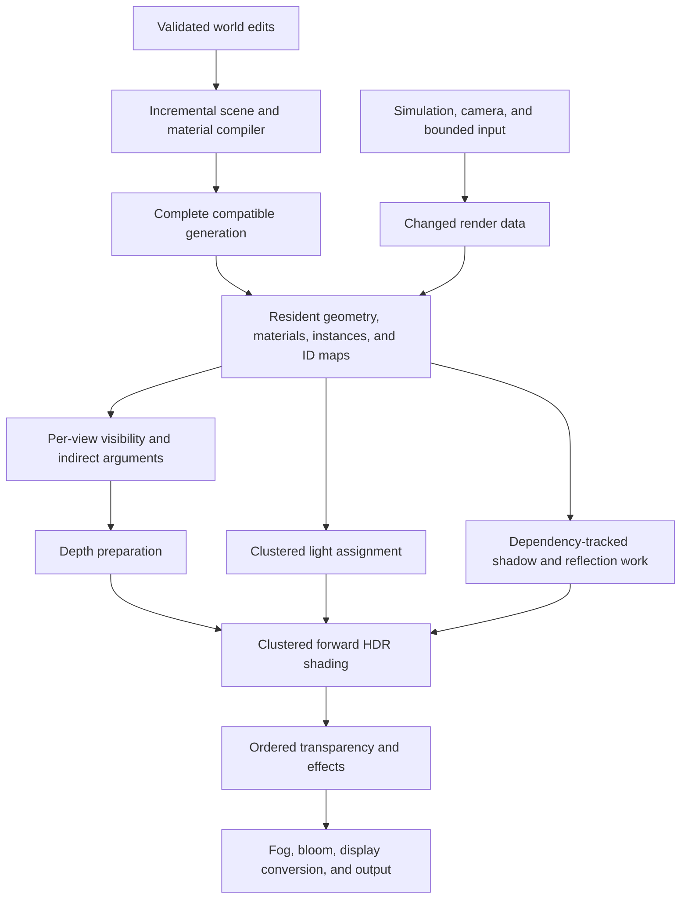

# Medieval Town renderer redesign and implementation plan

Status: Phase 1 diagnostic implementation in progress, October 24, 2026.
[Issue #8](https://github.com/OpenAgentsInc/aethyrforge/issues/8) tracks implementation
and qualification. The [first implementation record](research/town-compiled-batches-2026-10-24.md)
adds opt-in compiled source batches, prepared local-light terms, actual source
command counters, and exact evidence comparison. Neither candidate is promoted;
no phase exit gate is complete. Phases 2–5 remain pending.

The goal is a compact, predictable rendering workload that preserves the Town's
visual quality and live editing. The first implementation phase combines
**compiled rendering batches and specialized materials**. GPU visibility, light
assignment, reusable pass outputs, and frame scheduling follow that foundation.

[Rendering](rendering.md) owns general GPU contracts;
[asset compilation](asset-compilation.md) owns derived artifacts and activation;
[performance qualification](performance-qualification.md) owns acceptance.
This plan implements those contracts for Town without replacing their requirements
or adding another world authority. It refines `AF-GPU` and `AF-COMPILE` under the
[requirements registry](requirements.json).

## Evidence and intended outcome

[Boids Lab](research/boids-lab-2026-10-23.md) demonstrates persistent GPU state,
small compute workloads, and one instanced school draw. It measured about 120
submissions/s with 100,000 creatures and 31 million creature triangles at
1280 × 720 with 4× MSAA. It does not include Town's full material, lighting,
shadow, reflection, and gameplay workload.

The [completed Town phase](research/town-spell-swarm-2026-10-23.md) retains
61.461/s and 60.794/s thirty-second cohorts with the same population. Its final
ten-second diagnostic measured 60.481/s, with one-second accepted counts of
57–64. The final render CPU median was 3.4 ms; the render/compute GPU envelope
was 11.93 ms median and 14.42 ms p95. The main HDR pass was the largest measured
GPU pass. Pacing gates failed. CPU spans overlap each other and GPU execution;
adding them does not produce a frame time.

Those measurements describe their pinned revisions, not a fresh baseline for a
later checkout. Chronological cohorts do not isolate a gain from individual
optimizations. Independent fixed-work CPU execution-rate drift also remains
unexplained. Future comparative evidence must account for it.

The required outcome remains sustained smooth 60 FPS under the existing
qualification contract. Getting closer to Boids Lab is an architectural aim,
not a promised 120 FPS result. A 120 Hz frame period is about 8.33 ms, so reaching
it requires less GPU work as well as predictable CPU preparation and delivery.

## Target architecture

The editable world remains semantic: a wall, room, house, or creature keeps its
stable identity. A compiler separately derives spatially bounded rendering
batches, specialized material programs, and compact instance records. The GPU
keeps those derived tables resident; ordinary frames update changed ranges.

This is a dependency sketch, not a claim that every stage runs concurrently or
that every effect appears only once. The frame graph owns exact pass ordering,
formats, sample counts, resource lifetimes, and per-view inputs.

Rust/Wasm runs simulation and the specified compiler, with WGSL and direct
WebGPU for GPU work. The renderer starts in the TypeScript browser encoder and
moves to the Rust core under [decision 0006](decisions-history/0006-cross-platform-engine-core.md);
this plan's batches and material families are the first step of
[decision 0007](decisions-history/0007-gpu-driven-rendering.md). React DOM, Effect Atom, and Effect 4 remain outside the frame's critical
path. Existing import tools can feed the new compiler outputs incrementally;
this plan does not require replacing every importer before the first slice.

### Compiled batches and material families

Partition opaque geometry by spatial locality and compatible pipeline/resource
state. Repeated meshes share geometry and instance tables; compatible nearby
unique geometry can share bounded mesh pages. Material tables hold parameters
and texture references. Compatible textures can share array pages without
changing resolution, mipmaps, filtering, wrap behavior, alpha, or color space.
Textures that cannot share a page keep a compatible separate binding path.

Batch compatibility includes primitive topology, vertex layout, winding,
depth/stencil and blend state, material interface, resource/sampler requirements,
and pass coverage rules. A batch must retain source-to-triangle/instance mappings
for picking, selection, damage, undo, and edits. Object-space UVs, pivots, wind phases, skinning, normal
frames, mirrored winding, decal filtering, and per-object overrides remain part
of its compatibility rules. Transparent ordering, equal-depth surfaces, and
coverage-sensitive geometry need explicit rules; regrouping them as ordinary
opaque geometry can change the image.

Use a bounded set of specialized material families with unused work removed.
Evaluate surface properties once and share light-independent values across
lighting calculations where the original math permits. Depth and shadow variants
compute the coverage they need; their alpha and deformation must agree with the
color variant. Preserve the existing full shader as a correctness fallback for
unsupported or custom material features, with explicit resource limits.

The portable browser baseline uses predefined pipeline/resource bindings and
bounded indirect draw slots. GPU compute updates visibility, instance lists, and
arguments; it does not generate arbitrary pipelines, bind groups, or unrestricted
command streams. Texture/buffer limits and optional indirect features belong to
the declared adapter profile. A render bundle caches CPU commands; actual draw
and binding reduction requires compiled batches as well.

### Resident scene and GPU preparation

Keep geometry, material records, transforms, animation state, visibility results,
and indirect arguments in owned persistent buffers. Upload bounded changed
ranges. The authored document and simulation retain authority; these tables are
derived rendering state and can be reconstructed after device loss.

GPU compute handles conservative view culling and supported visual animation,
then writes the lists consumed by each view's fixed draw slots. The main camera,
planar reflections, and shadow views have independent visibility. Offscreen
objects may still cast visible shadows or appear in a reflection. Uncertain
occlusion, missing pages, camera cuts, animated bounds, and list overflow must
preserve required work through a declared complete fallback.

Keep depth-first clustered forward shading as the baseline. Assign all potentially
contributing lights to bounded view-space clusters on the GPU, then shade visible
surfaces with their lists. Preserve complete overflow behavior and transparent
lighting coverage. A tighter list may remove only lights proven unable to
contribute; it cannot become an undeclared nearest-light quality cap.

### Dependency-tracked pass results

A pass result records its actual inputs: geometry/material generation, light and
camera state, wind/animation inputs, viewport, and render-profile settings.
Reuse it only while those inputs and relevant bounds remain valid. Moving a
camera usually changes its planar reflection; moving foliage can change a
shadow even when the building is static.

Track static and moving shadow work without showing stale cast or received
shadows. Indirect-light validity includes authored props, rooms, fractured
surfaces, and source geometry. Follow the existing bake activation policy;
stale or missing baked data cannot silently look like completed reference lighting.

The graph can reuse compatible scratch allocations when their use and readback
lifetimes permit. Combine full-screen operations only when filtering, color-space
conversions, and effect order remain equivalent. Keep separate passes where
neighborhood sampling or another dependency requires them.

### Bounded frame delivery

The worker consumes a compact prepared render state independently of DOM and atom
updates. Imports, compiler jobs, pipeline creation, and optional readbacks stay
outside the frame's required waits. Resource replacement respects queued use.

Retain at most two outstanding submissions. A capacity notification may schedule
one coalesced attempt using the latest prepared state; it cannot create an
unbounded render queue, replay old frames, or advance simulation/input twice.
A new camera/state replaces an older pending attempt. Capture, device loss,
project close, and generation replacement cancel obsolete work.

A completion-triggered attempt is not a native animation callback. Record its
origin, actual entry/enqueue time, source callback identity, and accepted frame
separately. Any required metrics/evaluator extension is versioned, keeps the old
results reproducible, and retains the existing quality and pacing thresholds.

## Quality and compatibility requirements

- Keep original Town geometry, textures, material behavior, camera/lens/grade,
  light contributions, shadow detail, reflections, fog, bloom, and 4× MSAA.
  Lower resolution, LOD substitution, reduced effects, lossy texture conversion,
  and less frequent visible updates cannot qualify this same-quality redesign.
- Keep all 100,000 creatures simulated. Retain the full 310-triangle mesh for
  comparable stress rows, and record simulated, visible, and submitted counts
  separately. Visibility reduction cannot be reported as 31 million submitted
  creature triangles when that work was culled.
- Preserve the exact existing source-image controls where arithmetic and coverage
  remain unchanged. Declare any necessary numerical comparison bound before a
  material change; justify it independently and retain both images. Existing
  reference tolerances cannot be widened to hide a regression.
- Preserve visible silhouettes, foliage/alpha coverage, transparent order, normal
  orientation, temporal stability, and lighting during camera motion and edits.
  A matching static screenshot is insufficient.
- Keep one compatible generation for rendering, collision, navigation, and
  selection. A wall edit rebuilds its affected chunks and required neighbor
  outputs. Failed or stale builds retain the working generation and player state
  under `INV-03`, `INV-04`, and `INV-10`.
- Preserve bounded resources, cancellation, last-working shader behavior, and
  device recovery. Current player delivery ceilings remain unchanged. Licensed
  assets and captures stay outside Git; public fixtures use owned content.

## Phased implementation

No phase below is implemented or authorized to start by this documentation-only
change. Dependencies express engineering order, not dates or runtime jobs.
Prepare a matched baseline as part of each phase's future validation; it is not
an independent rewrite or a new acceptance standard.

### Phase 1: Compile rendering batches and specialized materials

**Current implementation:** bounded runtime batch planning/gathering and prepared
BRDF diagnostics are implemented behind separate flags. Sampled day/night source
images match exactly; command reduction is measured, but comparative timings are
inconsistent and pacing gates fail. Durable compiler artifacts, material/resource
pages, useful controlled headroom, and delivery headroom remain required. See the
[implementation and failures](research/town-compiled-batches-2026-10-24.md).

**Dependencies:** existing Town, compiler inputs, material features, and private
quality fixtures. This is the first implementation phase.

**Deliverables:**

- Define a versioned compiled rendering artifact for bounded mesh/instance pages,
  material-family/interface keys, resource pages, bounds, stable source-ID maps,
  per-view draw slots, and target-profile limits. Include source dependencies and
  compiler/settings identity in cache keys under the existing artifact contract.
- Implement the batch compiler and resident loader incrementally. Keep semantic
  editing separate from physical draw layout. Support repeated meshes and bounded
  compatible opaque mesh packing without expanding every instance's geometry.
- Compile specialized material families and matching depth/shadow coverage
  variants. Keep existing custom/unsupported paths and asynchronous compatible
  shader replacement. Share validated parameter/resource layouts across variants.
- Update only affected pages for transforms, material parameters, and structural
  edits. Stage interface/resource changes as a complete compatible candidate.
- Retain the current renderer as a pinned comparison path during development.
  Add counters for real draw slots, pipeline/binding changes, uploads, resource
  bytes, preparation time, and material/HDR GPU cost.

**Exit gate:** reproducible clean/incremental artifacts; exact source controls
where required; correct selection, edits, destruction, undo, and shader failure;
bounded memory and unchanged player ceilings; controlled evidence that actual
command work and relevant rendering cost improve without a material regression.
Record matched CPU/GPU distributions and edit latency. Do not promote a new
baseline solely because its command count or average FPS looks better. If a
material family fails equivalence or cost checks, keep its prior valid path.

### Phase 2: Move visibility and light assignment onto the GPU

**Dependencies:** Phase 1 artifact layouts, stable draw slots, and resource limits.

**Deliverables:** persistent per-view visibility/instance lists, conservative
animated bounds, bounded compaction and indirect arguments, GPU clustered light
assignment, and complete overflow/unsupported-feature fallbacks. Compare list
memberships and compaction order against independent CPU references. Unknown
custom-deformation bounds retain the conservative path. Start with frustum
visibility; add occlusion only after its disocclusion behavior is correct.

**Exit gate:** main/reflection/shadow views retain required objects and lights;
foliage, camera cuts, rapid movement, transparency, and dense-light cases preserve
coverage; all population counters are honest; no per-frame state readback or
unbounded CPU/GPU list growth; isolated stage and end-to-end evidence show useful
headroom at unchanged quality.

### Phase 3: Make pass reuse and lighting validity explicit

**Dependencies:** Phase 1 generations and Phase 2 per-view data.

**Deliverables:** dependency keys and invalidation for shadow partitions/regions,
reflections, baked lighting, and temporal resources; graph-owned scratch reuse;
compatible pass fusion; budgeted rebuilds that preserve complete valid output.

**Exit gate:** moving actors, wind, lights, cameras, spells, damage, rooms, and
restoration cannot expose stale shadows/reflections/GI. Compare source-only and
authored-geometry lighting deliberately. Repeated edits, resize, captures, and
cancellation keep resource counts bounded. Retain equivalent image/filtering
behavior and demonstrate saved work when inputs actually remain unchanged.

### Phase 4: Deliver the latest frame with bounded scheduling

**Dependencies:** stable prepared-state and resource-lifetime contracts from the
preceding phases. Trace scheduling before choosing a retry mechanism.

**Deliverables:** explicit capacity rejection reasons; at most one latest pending
render request and one scheduled retry; generation/lifecycle cancellation;
profiling-independent completion handling; versioned native-callback/retry and
submission/fence observations. Keep simulation and input consumption on their
existing authoritative path.

**Exit gate:** no double stepping, duplicated jump/input, stale camera submission,
extra frame loop, or queue-depth increase. Fault and lifecycle tests preserve
player state and clean shutdown. Correlated traces distinguish CPU, driver,
copy/upload, GPU-pass work, and notification delay. Actual accepted cadence and
latency improve; a freed slot alone is not evidence of GPU idle. Historical
verdicts remain reproducible, and a new event model does not relax thresholds.

### Phase 5: Qualify and adopt the renderer

**Dependencies:** all earlier exit gates and a fixed implementation/profile.

**Deliverables:** audited Empty, Room, Character, and Town builds; repeated editor
and player comparisons; complete private quality and performance evidence;
capability/fallback and resource-endurance coverage; a documented default and
rollback decision.

**Exit gate:** the complete existing matrix passes at 800 × 500 and 1280 × 720,
with two windows of at least 30 seconds and at least five seconds of warmup per
permutation. Include the original day/night source spawn and scenic views,
static/moving cameras, controllers, UI churn, shader failure, native knights,
spells, destruction, restoration, and relevant player rows. Add explicit
100,000-creature rows with the same resolution, quality, count, and triangle
scope. Keep all failed samples, missing capabilities, and unavailable evidence.

All applicable existing strict, application, GPU-budget, image, authority,
resource, and delivery checks must pass. Distinguish queue/GPU qualification from
compositor and physical presentation. An editor-only result, an average above
60, or Boids Lab's rate cannot close #8. The final adoption report records exact
versions, assets, profiles, tolerances, cost changes, and remaining limitations.

## Evidence discipline across phases

Before a future comparative run, pin source, kernel, compiler, shaders, private
asset closure, camera, lighting, native actor pose for image controls, quality,
actual viewport, browser/adapter, and instrumentation mode. Timed windows keep
live native actors and record their state. Keep captures and asset hashing
outside timed windows. Match source and authored-content lighting paths.

Retain every cohort and interval, including failed or short diagnostics. Reverse
comparison order and account for shared-host activity and fixed-work CPU drift
before attributing a difference to a renderer change. Optional profiling-off
cohorts supplement GPU-instrumented evidence and cannot qualify GPU budgets.
CPU, GPU-pass, upload/driver, enqueue, fence, and presentation observations have
different scopes; label unavailable observations and do not add overlapping spans.

The existing [qualification contract](performance-qualification.md) owns numeric
limits and the full matrix. This plan does not lower them or replace unresolved
performance evidence with an architectural claim.

## Technical references

- [WebGPU specification](https://gpuweb.github.io/gpuweb/): device limits,
  resource bindings, render bundles, indirect draws, and asynchronous work.
- [Filament rendering reference](https://google.github.io/filament/main/filament.html):
  clustered forward shading and material/lighting considerations. It is a
  technical reference, not a replacement engine dependency.
- [Aethyrforge runtime ABI](runtime-abi.md), [frontend boundary](frontend.md), and
  [design invariants](INVARIANTS.md): ownership, coarse data updates, activation,
  and independent engine scheduling remain in force.
