# Agent Lab: build, test, and improve your agents

Status: implemented on `main`; iOS 1.0.0 (1010) is available to Internal
Testers. See [qualification and release evidence](qualification.json). The
[custom-agent SDK and mobile flow](../custom-agents.md) provide the execution
path. The [first implementation](#first-implementation) below describes the
shipped provider and its limits; the earlier design sections describe the
broader direction. Shared-platform work remains in the
[Labs roadmap](../labs/README.md#roadmap-and-issues).

Agent Lab lets you create an agent, try it on representative work, inspect what
it did, compare changes, and save the version you want to delegate to. It is an
`agent` kind on the shared Labs platform. It uses the same saved agents and
conversations as the rest of OpenAgents.

Example: “Make a reviewer that finds concurrency bugs.” Create the agent, try
it on a disposable Rust project, inspect its findings and checks, then change
its instructions. Compare both versions on the same cases. Choose **Use agent**
to save the selected version; it appears in the phone's existing agent picker.
Later, assign real work from that picker without opening the Lab.

## Build on the existing Labs

The review covers [Robot Lab](../lab/README.md), its
[LeRobot companion](../lab/lerobot-in-verse.md),
[Video Lab](../video-lab/README.md), the
[shared Labs platform](../labs/README.md), and the
[`lab-kit` contract](../../crates/lab-kit/README.md).

| Existing idea | Agent Lab use |
| --- | --- |
| Typed documents and checked edits | Edit an agent draft and test plan through Rust types; validate before saving a Lab version. |
| Immutable scene or cut versions | Pin the exact agent instructions, runtime settings, task cases, and environment used by an experiment. |
| A bounded render or simulation job | Run a finite set of assignments on an explicitly selected computer, with limits and observed cancellation. |
| Robot episodes and video playback | Open the actual conversation and inspect its outputs, tool activity, failures, and available timing. Replay reads saved work; it never executes it again. |
| Compare versions under the same conditions | Compare agents on the same project snapshot and test cases, including failures and incomplete runs. |
| Notes at a frame or simulation step | Attach feedback to a case, assignment, or result artifact in a particular experiment version. |
| Gym results and held-out checks | Keep development experiments separate from final confirmation; use the existing evidence adapters rather than inventing another leaderboard. |

The existing `lab-kit` standard **Report** view is enough for the first card.
It shows the agent, experiment progress, result counts, and links to evidence.
Use standard **Compare** references for two saved versions, with a report and
page link wherever a richer comparison renderer is unavailable. No new generic
card view or event kind is needed for the first delivery.

## The workbench

The proposed entry points are **Open in Agent Lab** from a saved agent and a
chat request to create or improve an agent. Desktop and web provide the expanded
editor; the phone can create, run a small test, inspect a result, and choose a
saved version through the same Rust state and SDK calls. Do not add these
controls until their operations work.

The expanded workbench has four views:

| View | What you do |
| --- | --- |
| Agent | Edit name, instructions, runtime, model or installed runner name, and supported access settings. See which saved revision the draft came from. |
| Try | Pick an available computer, disposable project, task, and limits. Start one assignment and follow its normal conversation. |
| Compare | Choose candidate versions and a test set. Inspect each case's checks, outputs, duration, and available usage; open failures directly. |
| Versions | Read changes and notes, reopen an experiment, and explicitly save a candidate for future delegation. |

Chat remains the workbench: “Try this case,” “Compare with the previous version,”
and “Explain this failure” operate on the selected version through typed tools.
The assistant adds a short explanation; cards and controls carry the results.
The expanded view and inline card share the same selection and version.

A first experiment might show **3 of 4 checks passed**, **1 run did not finish**,
and **Open failed case**. Keep a valid definition, an available runtime, a
completed assignment, and passing task checks as separate facts. Saving an
agent is not evidence that it works, and a completed run is not a passing test.

## Documents and the source of truth

These are proposed Lab schemas, not additional live SDK endpoints:

| Document or artifact | Contents and owner |
| --- | --- |
| `agent-draft.v1` | A draft of the existing SDK `AgentSpec`, its source agent ID/revision when present, and change summary. Lab versions preserve experiments; the account definitions API owns agents available for delegation. |
| `agent-suite.v1` | Versioned task cases, approved fixture references, project snapshot references, expected outputs or check definitions, partition, and per-case limits. |
| `agent-experiment.v1` | Exact draft/definition versions, suite version, selected host and environment, repetitions, runtime/model/runner identity, scoring policy, concurrency, and finite resource limits. |
| `agent-results.v1` | A bounded result artifact: each case and repetition, assignment and chat references, observed outcome, check results, timings, available usage, and missing-evidence reasons. |

An experiment does not copy a live transcript into a second writable log.
It links the existing assignment, conversation, and immutable result artifacts.
For notes, use the common version reference and `ref` locator to identify a case
or result; opening a transcript resolves the referenced conversation normally.

Keep account agent IDs, Lab document IDs, assignment IDs, computer IDs, and any
Nostr signing keys distinct. A project Lab document does not grant another
member access to an account's private agent or computer. Shared experiments
need readable pinned inputs and outputs, plus separately granted execution
rights. The first delivery uses private personal documents.

## One execution path

```mermaid
flowchart LR
    Editor[Chat or Agent Lab editor] --> Draft[Versioned agent draft]
    Draft --> Experiment[Pinned test plan]
    Experiment --> Job[Bounded Lab job]
    Job --> Assignment[Existing SDK assignment]
    Assignment --> Host[Selected app host]
    Host --> Runtime[Claude Code, Codex, or installed Rust runner]
    Runtime --> Conversation[Existing conversation and result]
    Conversation --> Report[Lab report and comparison]
    Report --> Save[Explicit Use agent action]
    Save --> Catalog[Account agent catalog and mobile picker]
```

The Lab orchestrator uses the deployed
[`agents` assignment methods](../sdk/agents.md#assign-work). It records each
saved request before transmission and binds it to the Lab job and case. Retries
observe the same assignment. After an uncertain launch, record an incomplete
result and inspect the conversation; do not silently run the case again.

Assignments require a saved definition ID and revision, not an unsaved Lab
draft. The first prototype tests explicitly saved private candidate agents.
Testing a new draft must first save its exact spec through the definitions SDK,
with a durable create request, then record that definition reference before
assignment. Today's catalog has no hidden-trial flag: candidate agents are
ordinary private entries and can appear in the picker. Remove disposable trial
definitions only after their assignments settle and their evidence is saved;
their historical revisions remain readable. A separate trial visibility policy
needs an API extension before the polished workbench promises hidden candidates.

For the first prototype, a host operator prepares an isolated fixture project.
General automatic project materialization, checkpoint restoration, and teardown
need a checked host contract before broader experiments. A project ID alone
does not prove that two candidates received the same files. Record the initial
snapshot and verify a fresh working copy for each case; refuse comparisons that
cannot establish their inputs.

Use one Lab job for the experiment and child assignment references for its
cases. The shared Labs scheduler owns admission and placement; the app host owns
native session execution. A Lab worker must not launch a parallel Claude or
Codex session outside that path. Lab job retries and child assignment retries
must preserve both identities. An explicit repeat gets a new recorded trial
identity; cached or replayed output does not count as another observation.

Cancellation requests stop for each active child and observes the host's result.
A stopped request, a reaped SDK runner, and a lost connection are different
outcomes. Bound task count, repetitions, concurrency, wall time, output bytes,
and any supported spend limit before starting. Missing usage remains unknown;
an unavailable cost figure is never shown as zero. An offline host waits within
the declared deadline. Creating or editing a document allocates no computer.

## Runtimes, tools, and agent components

The first editor exposes only the fields implemented by `AgentSpec`. Claude
Code, Codex, and installed Rust runners keep their actual supported behavior.
For example, the current SDK runner accepts text turns and bounded text/results;
it has no general tool-call, interactive approval, or resume protocol. Its name
resolves through the operator's SHA-256-pinned allowlist, not a command supplied
by a Lab document.

Skills, tool sets, memory sources, and multi-step programs are later typed
components with immutable references and separate admission. Existing
[extensions](../extensions/README.md), [programs](../programs.md), and capability
contracts supply their definitions. Do not pack unsupported fields into today's
agent schema or pretend that instructions enforce file, network, tool, or wallet
permissions. Each runtime adapter must demonstrate the requested limit.

Other Labs provide useful future test domains:

| Task | Evidence |
| --- | --- |
| Review a code change | Checked findings against labeled cases, plus the project's actual tests. |
| Fix a Video Lab cut | A valid cut version and the declared media checks; a plausible explanation alone does not pass. |
| Modify a CAD part | The requested geometry and successful rebuild under the CAD checks. |
| Set up a Robot Lab experiment | A valid simulation configuration and recorded task outcome, distinct from a rendered pose or demonstration. |

These integrations use each Lab's typed tools and authority. A simulated robot
task never grants physical robot control. Tools unavailable to the selected
adapter stay unavailable; adding typed tool support is a separate versioned
extension, not a hidden expansion of the current runner port.

## Comparisons and improvement

Start with an agent people already use and a deterministic Rust runner as a
control. Change one dimension at a time: instructions, a model, or a supported
component. Freeze the suite and scoring policy before comparing candidates.
Use separate development and held-out confirmation cases, and never feed final
confirmation answers back into candidate generation.

Record all scheduled cases: passed, failed, stopped, timed out, unavailable, or
unknown. Show attempted and planned totals and distinguish infrastructure errors
from task failures. Compare only matching workloads and environments; report
sample counts and variation rather than calling one favorable reply a winner.
Seeds apply only where the runtime actually supports them. Preserve outputs for
inspection without promising identical future model responses.

Prefer deterministic checks where they establish the task outcome. Human review
or a model judgment is labeled with its reviewer, criteria, and version; it is
not presented as an independently verified fact. Reuse
[Gym evidence](../gym/README.md) and the
[optimization loop](../optimization/README.md) for larger studies. Any automatic
candidate search has its own finite budget and may propose changes, but cannot
save a winner to the agent catalog or widen permissions by itself.

**Use agent** is an explicit save through the definitions SDK. Persist its
request identity, require the expected current revision, and link the saved
revision back to its experiment. A concurrent edit requires review; do not
overwrite it. For an experiment-only candidate, create a new private definition.
Rollback copies a prior spec into a new revision; assignments already in flight
keep the revision they started with. Shared templates, publication, schedules,
and autonomous operation follow their own contracts.

## Privacy, portability, and implementation ownership

Keep credentials and executable paths on the authorized host. The Lab document
contains references and supported settings, not bearer keys or provider tokens.
Tasks, outputs, traces, notes, and exported reports inherit access and asset
restrictions. Private local inputs stay on the eligible host; `no_training`
content must not enter training or Gym datasets through an experiment export.
Preparing a report does not publish it.

Use the existing [NIP-AGENT](../../nips/openagents/NIP-AGENT.md) composition
profile for portable saved definitions, CAP for bindings, SESS/RUN for sessions
and execution evidence, and EVAL/OPT for portable evaluation or optimization
records. No Agent Lab NIP is needed now. NIP-LAB describes agent labor, not this
workbench; its name is not a reason to use it for experiments. The first Lab
flow uses the account SDK and does not automatically publish Nostr events.

Proposed code ownership: `agent-lab` implements the pure `LabKind` checks,
changes, job descriptions, and cards over `agent-contract` and `lab-kit`. The
shared Labs service owns persistence and orchestration; the SDK owns account
calls; the existing app engine owns execution. Rust owns state, validation,
transport, and UI intents. Native shells render Rust Native controls and mount
working transcript/card views. Reuse the common Labs SDK and history work;
do not add an Agent Lab server, transcript protocol, or TypeScript app.

## Delivery slices and exit checks

The custom-agent foundation is tracked in
[#11902](https://github.com/OpenAgentsInc/openagents/issues/11902). Shared
platform dependencies retain their existing issues; the slices below are a
proposed Agent Lab backlog, not claims that new routes or screens already ship.

| Slice | Deliverable | Exit check and dependency |
| --- | --- | --- |
| A1: Kind and documents | Pure Rust draft, suite, experiment, and results contracts; Report/Compare fixtures. | Reuse `lab-kit` (#11872). Check stale edits, valid SDK specs, bounded plans, unknown fields, and cross-document access references without executing work. |
| A2: One local test | One deterministic installed runner, one operator-prepared disposable project, one assignment, and a linked report. | Reuse #11903–#11906; verify exact instructions, saved request recovery, host restart, stop/reaping, and fixture cleanup. A local prototype need not wait for hosted Labs storage. |
| A3: Hosted orchestration | Durable finite experiment jobs through the common Labs API and SDK. | Depends on #11873, #11874, #11876, and #11878. Verify account boundaries, conditional saves, limits, project setup, duplicate delivery, and uncertain launches. |
| A4: Workbench on apps and web | Rust Native editing and result controls, inline reports, saved-history restore, and explicit Use agent. | Depends on shared cards/history #11877 and app views #11883–#11884. Create in one surface, inspect in another, save, and delegate from the existing mobile picker. |
| A5: Measured comparisons | Fixed suites, isolated candidate runs, case notes, human/deterministic checks, and held-out confirmation. | Compare Codex, Claude Code with an approved test login, and a Rust runner without changing cases or hiding failures. Confirm that no search automatically promotes a candidate. |
| A6: Components and other Labs | Explicitly admitted skill/tool/memory bindings and Video/CAD/Robot task adapters. | Add only demonstrated adapter support; qualify component pins, task checks, access, and export restrictions before offering their controls. |

Use dedicated accounts, synthetic cases, disposable host data and homes, and
approved provider credentials. Archive or remove fixture conversations, agents,
assignments, and test computers; stop owned children. Record code/runtime
versions, candidate and suite references, actual outcomes, and cleanup. Device
checks remain explicit, and a clean demonstration is not a claim of general
benchmark performance.

## First implementation

Track delivery in [#11914](https://github.com/OpenAgentsInc/openagents/issues/11914)
and its children: [documents #11915](https://github.com/OpenAgentsInc/openagents/issues/11915),
[trials #11916](https://github.com/OpenAgentsInc/openagents/issues/11916),
[API #11917](https://github.com/OpenAgentsInc/openagents/issues/11917),
[workbench #11918](https://github.com/OpenAgentsInc/openagents/issues/11918),
[comparisons #11919](https://github.com/OpenAgentsInc/openagents/issues/11919),
[components #11920](https://github.com/OpenAgentsInc/openagents/issues/11920), and
[qualification #11921](https://github.com/OpenAgentsInc/openagents/issues/11921).
The first provider implements Agent Lab on the common `/v1/labs/agent` route family;
the broader shared-platform migrations remain separate issues.

[Foreman](foreman.md) is the first ready-made experiment: **Start from Foreman**
loads an agent that reasons over every open issue and active agent.

Open **Agent Lab** from the mobile agent picker, or visit
[/labs/agent](https://openagents.com/labs/agent) from a browser or the desktop
account panel. Save an experiment, choose a connected computer and project,
then select **Run tests**. Reopen saved versions and run reports from the same
account on either surface. **Use agent** explicitly creates or updates a saved
agent. It includes extra guidance and reference notes in the instructions;
a live Lab reference must be removed before promotion because the current
agent definition contract has no dynamic tool binding.

`crates/agent-lab` owns documents, checks, finite plans, reports, and the Rust
Native workbench. `Client::agent_lab(session)` in `crates/openagents-sdk` exposes
account-bound saved requests. See its `examples/agent_lab.rs` example. The web
adapter signs its form state with the existing account CSRF contract. The
native controller saves uncertain requests privately before sending and offers
an explicit retry with the same request identity.

A supporting desktop host copies regular project files into its own Lab trial
directory before creating an ordinary agent assignment. An experiment can
choose no project files. The trial then runs in an empty folder, and the
report says the agent had no project files. Copies are limited to
64 MiB, 5,000 files, and 32 directory levels. Links and `.no-training` inputs
are refused; `.git`, `target`, `node_modules`, `.env*`, private key files, and
credential directories are excluded. Tests still have the selected runtime's
normal permissions; a disposable working directory is not an operating-system
sandbox. Completed trial conversations are archived automatically. Explicitly
archiving a run removes its known-finished trial copies and temporary agent;
unknown execution keeps its copy for investigation.

Hosts may install `agent-lab/tools.json` under their account data directory.
Each `ToolBinding` pins its account, project, name, read-only tool, loopback
origin, arguments, training permission, and `private_local: false`. These local
flags can restrict use; they cannot authorize a source's content for evaluation.
Legacy Video `lab_open`, CAD `cad_check`, and Robot `robot_inspect` replies do
not provide a trusted source-policy contract. The host refuses these references
before calling the tool or adding model text. The workbench hides the add control;
saved references remain removable. Enabling them requires a separate typed source
endpoint and SDK contract that reads the exact pinned source Version and consumed
Artifacts, verifies identity and content hashes, and checks evaluation policy.
Arbitrary tool JSON is not that contract, and this check is not remote attestation.
Experiments without live Lab references continue to run. `components::LabTaskCheck` provides
JSON checks for a Video version, a CAD check result, and Robot joint limits.

Every scheduled trial remains in the report. Text, JSON, and explicit human
checks are supported; answers of 4,096 bytes or more are marked unknown because
the assignment service supplies a bounded summary. Cost remains **Unknown**
when the runtime does not report it. Comparisons require matching project and
reference hashes, complete checked outcomes, and consistent runtime hashes per
candidate. These are reports from the signed-in account's host, not remote
attestation or evidence of general benchmark performance. Development and
confirmation suites are explicitly labeled; no automatic search or promotion
runs in this release.
