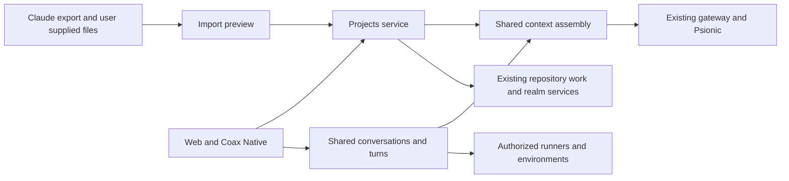

# Claude migration and OpenAgents Projects API plan

Draft, November 14, 2026. Repository baseline: `7d7d9e6f4604`.

Make it easy for someone using Claude to move their work to OpenAgents: bring
instructions, reference material and conversations, recognize the Project
workflow, and start a useful new conversation quickly. OpenAgents owns the
product and its API. Familiar behavior and a good migration experience are
the goal; reproducing Anthropic's platform is not.

Anthropic Compliance/Admin API parity and copying its internal Project fields
are outside scope. An SDK adapter can be added when it helps a named
customer move an integration, without governing the Projects data model or
blocking the product. [api.md](api.md) remains background reference.

The schemas below are concrete proposed OpenAgents contracts, including every
field in this Projects API scope. They are not installed endpoints. Implement
them in `proto/` with their owning Coax codecs and consumers before publication;
this document changes no existing wire shape.

## What we take from Claude and what we add

Claude Projects provide instructions used across project chats, reusable
knowledge, several conversations, view/edit sharing and chat organization.
Those are useful expectations to preserve. [Project workflow](https://support.claude.com/en/articles/9519177-how-can-i-create-and-manage-projects).
A shared project does not automatically share personal conversations, and
organization visibility differs from internet publication.
[Sharing behavior](https://support.claude.com/en/articles/9519189-manage-project-visibility-and-sharing).

| Capability | Decision for OpenAgents | Origin |
| --- | --- | --- |
| Name, description, instructions | Simple project creation; instructions apply to new turns across its conversations | Familiar from Claude |
| Knowledge | Upload files or paste text once, reuse it across chats, show processing failures and let the user remove it | Familiar from Claude |
| Conversations | Personal by default; explicitly shared conversations; attach, move, remove and archive | Familiar from Claude |
| Access | Owner, editor and viewer; viewer can use context in a personal chat without editing shared resources | Familiar roles, our policy |
| Sharing | Private or Workspace audience; public publishing is a separate explicit feature | Familiar privacy, our publication model |
| Pinned projects | Per-account preference, not shared project metadata | Familiar from Claude |
| Model choice | An offered model and effort, with truthful limits; no requirement to use Claude | OpenAgents choice |
| Revisioned context | Inspect which instructions and knowledge revisions a turn used | OpenAgents addition |
| Repositories and work | Link existing repository scope, work documents and task queues; reuse their owning services | OpenAgents addition |
| Realms | Link a Project to its realms and existing authoring tools | OpenAgents addition |
| Agents and environments | Attach explicitly authorized execution targets without giving every project member control of them | OpenAgents addition |
| Import and export | Preview mappings, preserve provenance, continue imported chats, report missing files and export portable bundles | OpenAgents addition |

A Project needs no repository, realm, public slug, roadmap or execution host.
Create one with a name, optionally paste instructions and attach knowledge,
then chat. One canonical Project supports both this simple workflow and our
additional capabilities. Extensions live in our schemas and services; there
is no reduced parallel copy of a Project for another provider.

## Existing protocol and implementation

The [protocol guide](../../proto/README.md),
[registry](../../proto/registry.json) and actual consumers establish the current
baseline. The large [protocol specification](../protocol/openagents-protocol-spec.md)
also contains recovered pre-reset designs: its historical “Implemented” labels
do not establish current runtime support. In particular, account Projects in
section 15.1 and the complete managed-agent platform in section 18.2 are useful
design inputs, not installed services.

| Area | Current evidence | Reuse and missing work |
| --- | --- | --- |
| Provider requests and streams | `provider-request-bodies` is an external registry entry; `coax/lib/gateway/` owns codecs, SSE parsing, usage and rates. `anthropic.coax` sends Messages requests and reads responses. | Reuse this outbound client for model calls. An inbound SDK adapter is optional migration work, not a Projects prerequisite. |
| Normalized model calls | `coax/lib/gateway/types.coax`: `GwMessage` is role plus text; `GwRequest` has tools as raw Chat Completions JSON. | Extend the shared representation for ordered content blocks, tool IDs/results, distinct stop reasons and replayable opaque data. Current Anthropic parsing emits tool input as text and collapses several stop reasons. |
| Hosted inference | `coax/web/api/inference.c` serves Chat Completions at `/api/v1/inference`, with identity, daily caps, credit and metering. `proto/openagents/api/v1alpha1/inference.proto` describes credit/refusal replies. | Extract shared admission and accounting services behind the existing route. These schemas do not define Anthropic Messages. SQL policy touched by the extraction moves into checked Coax policy. |
| Local model serving | `proto/openagents/psionic/responses/v1alpha1/` and `psionic/lib/responses/` describe/implement a bounded Responses profile. Its registry row explicitly says the proto has no consumer. | Reuse serving primitives where appropriate; schema adoption remains work. Neither Responses support nor a model checkpoint establishes Messages feature parity. |
| Account conversations | `proto/coder/account-chat-v1.json`, `proto/coder/chat-history-v1.json`, `account-chat-wire.coax` and `chat-history-wire.coax` back saved chats. | Preserve v1. Its text-only, bounded, no-tools thread is insufficient for a rich Messages transcript; introduce a separate version for richer storage. |
| Project conversations and ownership | `proto/verse/project-chat-v1.json` registers `openagents.chat.project-link.v1`, `project-turn.v1` and `openagents.project.account-owner.v1`; migrations 0198–0200 and `project-chat-policy.coax` enforce ownership and linkage. | Keep exact account ownership and immutable v1 thread links. Extend context assembly and membership without reinterpreting existing IDs. |
| Private Projects and drops | `proto/openagents/api/v1alpha1/private.proto` and `drops.proto` cover current reply shapes. `private.c`, `drops.c`, `coax/lib/project/` and `projects.*`/`drops.*` own documents, review, publication and project-agent turns. | Reuse the document/edit/undo mechanisms and storage. They do not yet provide a common Claude-style Project with revisioned instructions and an indexed knowledge collection. |
| Public Projects | `proto/nostr/block/mp/v1alpha1/project.proto`, NIP-MP and `coax/web/project/` preserve signed project records and repository scope. `openagents.project-work.v1` and its seed remain registered as unaudited local shapes. | Bind existing records to one Project identity. A decoded Nostr projection grants no access; retain original signed bytes and explicit publication. |
| Project and world files | `proto/world/files-v1.json`, `metaverse-engine/editor/file-wire.coax`, `coax/web/api/world-files.coax` and `worlds.c` implement private attachments. | Reuse upload/storage, scan, quotas and authorization. A stored attachment is not automatically searchable knowledge or an Anthropic `file_id`; add explicit references and processing state. |
| Hosted agent execution | `proto/openagents/agent/managed/v1alpha1/session.proto`, `proto/coder/agent-managed-v1alpha1.json` and `coax/web/agent/runner-wire.coax` cover runner lines, event batches, turns and sealed credentials. | Reuse execution and checked tool admission. This is the runner seam, not the complete `/v1/agents` or `/v1/sessions` API. |
| Computer environments | `proto/openagents/environment/access/v1alpha1/runtime.proto`, runtime goldens, `coax/lib/agent/environment/` and `coax/web/api/environment.c` support catalog, sessions, commands and interactions. | Preserve command identity, generations and revision checks. A connected computer is not an Anthropic managed sandbox template. |
| Identity and agent grants | `proto/openagents/account/v1alpha1/agents.proto`, `agent-policy.coax` and `agent-wire.coax` define agent accounts, keys and grants. The current scope enum has profile read and wallet spend. | Reuse key verification, revocation and owner linkage. Add explicit inference/project/file scopes with enforcement; an existing agent key does not acquire them implicitly. |

This inventory does not establish current implementations of general
organization Workspaces, Anthropic-compatible Files, batches, Skills/version
management, deployments, memory stores, vault APIs or user profiles. Implement
and register each selected surface with a real consumer. Existing Claude Code
stream-json and provider account codecs remain external client boundaries,
separate from the new public API.

## Service boundaries and protocol ownership

Use [the context map](../architecture/contexts.md) and
[reuse guide](../reuse.md). Projects owns project metadata, instructions,
knowledge membership, sharing and connections. Chat owns conversations and
turns. Identity owns accounts, Workspace membership, keys and invitations.
Psionic and inference owns model admission, token accounting and charging.
Coder and the existing environment runtime own execution. A decoded record or
imported tool call grants no authority.



`proto/openagents/project/v1alpha1/` will define the new owned project
contracts; new rich chat records belong to Chat, not a second project-specific
transcript format. Imports are external formats with one parser at the import
boundary. Each wire and stored shape gets one registry row, owning Coax codec,
goldens and explicit consumer profile in `proto/modules.json`. Freeze descriptor
baselines before publication. Do not amend account-chat v1, project-link v1,
Nostr signed originals, HOST or environment-runtime identities in place.

Keep the JSON mapper, Markdown parser, upload/scanning/storage code, component
system, repository index and model codecs shared. C and native hosts perform
platform effects; Coax decides validation, access, context, lifecycle and money.
No downloaded export, imported code or source attachment is executed.

## Common API rules and complete shared types

The new API root is `/api/projects/v1`. It is an OpenAgents versioned product
API. Explicitly register its routes before the existing slug-based file route;
`v1` is reserved in that router. Existing private, drops, attachment and chat
routes remain available through adapters.

All field names below are exact proposed JSON names. Fields in response tables
are present unless marked optional; `null` is explicit. `?` on a request field
means it may be omitted. Omission on an update means unchanged; null clears only
a field declared nullable. Reject unknown request fields and duplicate keys;
readers tolerate additive response fields. No arbitrary `metadata` object.

- `Id`: opaque string, 1–80 UTF-8 bytes. New Project IDs are `prj_` plus 32
  lowercase hex digits; other new resource IDs are server-generated opaque IDs.
  Existing account, thread and domain IDs retain their formats.
- `Timestamp`: nonnegative integer milliseconds since Unix epoch, at most
  2^53−1. `Revision`: nonnegative integer in the same exact JSON range.
- `Digest`: 64 lowercase hex characters, SHA-256. `Text`: valid UTF-8 without NUL.
  String limits below count UTF-8 bytes. Timestamps imported from another source
  are converted explicitly, never confused with ingestion time.
- `Reference`: exactly `{contract: string, id: string, revision: string|null}`.
  `contract` is a registered owning contract, at most 128 bytes; `id` is that
  contract's canonical identity, at most 1024 bytes; `revision` is an optional
  immutable pin, at most 128 bytes. Each connection kind has a closed supported
  contract list. Unknown combinations refuse rather than accepting a path or
  inventing a provider-wide identifier.
- `ModelChoice`: exactly `{model_id: string|null, effort_id: string|null}`.
  Each non-null string is at most 128 bytes and must be currently offered.
  Null model uses the account's offered default; effort is validated against
  the resolved model. An unavailable choice is a visible refusal, not fallback.
- `Origin`: exactly `{provider: "openagents"|"claude"|"other",
  source_id: string|null, import_id: Id|null, source_created_at_ms: Timestamp|null,
  source_updated_at_ms: Timestamp|null}`. Source ID is at most 256 bytes and is
  provenance only; it can never become a local owner, signature or grant.

Every mutation body has `operation_id: string` (1–80 bytes, caller retained
across retries), `expected_revision?: Revision`, and `value?:` the exact type
named in the route table. New Project/import jobs and new conversations omit
`expected_revision`; shared child creation checks the existing Project revision.
Updates/actions require their named revision owner, except single-use invitation
acceptance. Action routes with no value accept only operation ID and expected
revision. A missing preference reads as revision zero for its first write.
Operation identity is scoped to principal and route. Same ID and same payload
returns the recorded result; a different payload returns `operation_conflict`.
Keep completed operation results for at least 30 days. After expiry, return
`operation_expired` for a retained expired key; never silently reapply it.

`Project.revision` advances transactionally for each shared project mutation,
including instructions, knowledge, access and connections. A child `revision`
is the project revision at which that child last changed. Processing completion
also advances this revision. Private chat writes, preferences and derived counts
do not advance it. Conversation, invitation, import and export jobs have their
own revisions. Each route declares which revision it checks; stale changes
return 409 with `current_revision`. Never use a UI revision as proof of access.

| Shared response type | Every field |
| --- | --- |
| `ObjectReply<T>` | `schema: "openagents.projects.api.v1alpha1"`, `data: T` |
| `ListReply<T>` | `schema: "openagents.projects.api.v1alpha1"`, `data: T[]`, `revision: Revision|null` (parent revision, null for project/conversation indexes), `next_cursor: string|null` |
| `ActionResult` | `id: Id`, `revision: Revision`, `action: "archived"|"restored"|"removed"|"revoked"|"deleted"|"stopped"`, `completed_at_ms: Timestamp` |
| `Problem` | `code: string`, `message: Text`, `field: string|null`, `current_revision: Revision|null`, `operation_id: string|null` |
| Error response | `schema: "openagents.projects.api.v1alpha1"`, `error: Problem` |

`Problem.code` is one of `invalid_argument`, `not_found`, `unauthorized`,
`forbidden`, `revision_conflict`, `operation_conflict`, `operation_expired`,
`limit_exceeded`, `unsupported_source`, `model_unavailable`, `source_missing`,
`processing_failed`, `insufficient_credit`, `busy`, `unavailable` or `internal`.
Message is at most 1024 bytes; field is a JSON field path of at most 256 bytes.
No secrets or private-resource existence appear in errors.

Successful reads/updates return 200; resource creation returns 201; background
job/turn admission returns 202. Invalid input returns 400, no identity 401,
insufficient funding 402, an explicit access refusal 403, hidden/missing content
404, revision/operation conflicts 409, oversized bodies 413, unsupported source
or unavailable model 422, admission limits 429 and unavailable services 503.
The private-resource hiding rule takes precedence over descriptive errors.

Lists accept `limit?` (1–100, default 40) and `cursor?` (opaque, at most 2048
bytes). Project index additionally accepts `status?: active|archived|all`
(default active), `scope?: mine|shared|all` (default all) and `query?: Text`
(at most 256 bytes). Order projects/conversations by updated time descending,
ID ascending; knowledge/connections/members by creation time ascending, ID
ascending; messages by sequence ascending. Cursors bind filters, sort and caller
and recheck access on every page. A parent list's revision changes invalidate
its cursor with `revision_conflict`; the client restarts the list. Index cursors
pin a bounded ordered cut instead, so new activity does not reorder later pages.

## Project schema

### Project and creation

`Project` contains every field below. It contains summaries and references;
knowledge bytes, messages and memberships are separately paginated.

| Field | Type and meaning | Origin |
| --- | --- | --- |
| `id` | Id; stable Project identity | OpenAgents |
| `revision` | Revision; shared project mutation version | OpenAgents |
| `owner_account_id` | Id; resolved owner account, never an email or Nostr key substitute | OpenAgents |
| `workspace_id` | Id or null; optional tenant Workspace, not a filesystem checkout | OpenAgents |
| `name` | Text, 1–160 bytes, nonblank | Familiar from Claude |
| `description` | Text, 0–4096 bytes | Familiar from Claude |
| `status` | `active` or `archived` | Product lifecycle |
| `sharing` | `Sharing` below | Familiar privacy, our representation |
| `instructions` | `Instructions` below, including empty instructions | Familiar behavior, revision added |
| `model` | ModelChoice | OpenAgents |
| `context_settings` | ContextSettings below | OpenAgents |
| `created_at_ms` | Timestamp; local creation | Common resource metadata |
| `updated_at_ms` | Timestamp; last shared mutation | Common resource metadata |
| `archived_at_ms` | Timestamp or null | Product lifecycle |
| `created_by_account_id` | Id; original local creator | OpenAgents |
| `origin` | Origin | Migration provenance |
| `publication_ref` | Reference or null; existing explicitly published Project record | OpenAgents |
| `url` | Server-generated relative Project URL, at most 512 bytes | Navigation |
| `counts` | ProjectCounts below, filtered for the caller | Product summary |
| `permissions` | Array of Permission values below, caller-specific | OpenAgents policy |

`Sharing` has exactly `audience: "private"|"workspace"` and
`workspace_role: "viewer"|"editor"|null`. Private requires null role; Workspace
audience requires a non-null Workspace and role. Membership policy is checked
by Identity. Ordinary creation is private. Neither value publishes anything
on the internet or the public relay.

`ProjectCounts` has exactly `knowledge: int`, `conversations: int`,
`repositories: int`, `work: int`, `realms: int`, `agents: int` and
`environments: int`, all nonnegative. Conversations counts only those this caller
may read; knowledge counts attached records including processing failures;
the remaining counts are connections of that kind, not the number of tasks,
assets or sessions inside them. Counts never reveal another member's private activity.

`Permission` is one of `read`, `chat`, `edit`, `manage_members`,
`manage_connections`, `archive`, `transfer`, `delete`, `publish`. The server
derives this list on every response; clients cannot submit it as a grant.

`ProjectCreate` accepts `name` (required), `description?` (default empty),
`instructions?` (Text, at most 65536 bytes, default empty), `workspace_id?`
(default null), `model?` (default both null), `sharing?` (default private),
`context_settings?` (defaults below). Owner, IDs, timestamps and provenance
come from the server. `ProjectUpdate` accepts only `name?`, `description?`,
`model?`, `sharing?`, `context_settings?`; at least one is required. Supplied
nested objects replace that setting completely. Instructions have their own
update action. Workspace membership/ownership is not editable through this
body; a later cross-Workspace transfer requires a separate migration design.

For example, the complete create request can be small; all omitted settings
take the documented defaults:

```json
{
  "operation_id": "create-product-research-1",
  "value": {
    "name": "Product research",
    "description": "Research and launch planning",
    "instructions": "Use the attached research and cite the source for claims."
  }
}
```

This creates a private Project owned by the authenticated account with no
repository, realm, execution connection or invitation side effects.

### Instructions and context settings

`Instructions` has exactly `revision: Revision`, `text: Text` (0–65536 bytes),
`sha256: Digest`, `updated_at_ms: Timestamp`, `updated_by_account_id: Id` and
`origin: Origin`. Empty instructions still have a digest. `InstructionsWrite`
has exactly `text: Text`. The revision is the last Project revision that changed
instructions, not a timestamp. Keep prior revisions in the owning service.

`ContextSettings` has exactly `knowledge_mode: "selected"|"retrieval"` and
`max_input_tokens: int|null` (1–1048576 when set). Defaults are selected and
null. Null uses the selected model's admitted limit. A requested limit above
that limit refuses; it does not expand the model. Retrieval is offered only
when a qualified index exists; until then `retrieval` refuses visibly.

The name and description identify the Project in the UI. The model receives
the explicit instructions, selected reference material and conversation, not
an undocumented serialized dump of the entire Project. No implicit cross-chat
or cross-project memory is introduced. Future memory gets its own resource,
consent and scope rather than a reserved field that pretends to work.

### Knowledge and source processing

`Knowledge` has every field below. Only title and selection are editable
in place. Replacing source content creates a new immutable source revision.

| Field | Type and meaning |
| --- | --- |
| `id`, `project_id` | Id; attachment identity and owning Project |
| `revision` | Revision; last Project revision changing this record |
| `title` | Text, 1–256 bytes |
| `source_kind` | `text` or `file` |
| `file_id` | Id or null; original stored file for file sources |
| `content_sha256` | Digest; original accepted source bytes |
| `media_type` | String, 1–128 bytes; verified type |
| `size_bytes` | Nonnegative integer; original source size |
| `selected` | Boolean; included in the default knowledge selection |
| `state` | `pending`, `processing`, `ready` or `failed` |
| `extraction` | Extraction or null |
| `error` | Problem or null; non-null on failed processing |
| `created_by_account_id` | Id |
| `created_at_ms`, `updated_at_ms` | Timestamp |
| `origin` | Origin |

`KnowledgeCreate` has exactly `title: Text`, `source: SourceInput` and
`selected?: bool` (default true). `SourceInput` is either
`{kind: "text", text: Text}` (at most 1 MiB), or
`{kind: "file", file_id: Id}`. File IDs come from the existing checked upload
service after scanning and ownership checks, never from an arbitrary URL.
`KnowledgeUpdate` accepts `title?` and `selected?`, at least one.
`KnowledgeReplace` has exactly `source: SourceInput` and retains attachment ID
while producing a new source revision; old snapshots retain their source pins.

`Extraction` has exactly `extractor_id: string` (1–128 bytes),
`extractor_version: string` (1–128 bytes), `text_sha256: Digest`,
`text_bytes: int`, `tokenizer_id: string|null` (at most 128 bytes),
`token_count: int|null`. Token count is an observation for that tokenizer,
not an estimate valid on every model. `KnowledgeContent` has exactly
`knowledge_id: Id`, `revision: Revision`, `text: Text|null` (extracted reference
text, at most 4 MiB), `file_id: Id|null` (original source). File downloads use
the owning file service and recheck access; no storage credentials appear here.

Reuse current project attachment bounds: 25 MiB per file, 200 attachments and
1 GiB across a Project and its worlds. These are proposed API ceilings, subject
to the existing upload service's stricter bounds and verified media support.
Knowledge selection changes do not detach world assets or publish files. A
failed extraction does not become empty ready knowledge. Detached sources are
removed from new context immediately; physical deletion waits for legitimate
references/retention, with account purge handled by lifecycle policy.

### Members and invitations

`Member` has exactly `id: Id` (membership identity), `project_id: Id`,
`account_id: Id`, `role: "owner"|"editor"|"viewer"`, `revision: Revision`,
`created_at_ms: Timestamp`, `granted_by_account_id: Id`. One owner must remain.
An editor reads/edits metadata, instructions and knowledge, and may create
personal chats. A viewer reads/uses Project context in personal chats. Both
can read deliberately shared chats. Neither gains membership, publishing,
funding, repository writes or computer control merely from that role.
Only owner manages members, connections, archive, transfer, delete and publish.
Existing project agents retain their narrower authority, including their
inability to change titles, members or agreed goals.

`MemberWrite` has exactly `account_id: Id`, `role: "editor"|"viewer"`.
`MemberRoleWrite` has exactly `role: "editor"|"viewer"`.
Ownership changes only through `TransferWrite`, exactly
`{owner_account_id: Id}`; target must be a current person member, and the old
owner becomes editor atomically. Cross-Workspace ownership transfer refuses.
No owner can remove or demote the last owner using member actions.

`Invitation` has exactly `id: Id`, `project_id: Id`, `revision: Revision`,
`email_address: string` (1–254 bytes, private), `role: "editor"|"viewer"`,
`state: "pending"|"accepted"|"revoked"|"expired"`, `created_at_ms: Timestamp`,
`expires_at_ms: Timestamp`, `created_by_account_id: Id`,
`accepted_by_account_id: Id|null`. `InvitationCreate` accepts `email_address`,
`role`, `expires_in_hours?` (1–168, default 72). Creating one explicitly asks the
service to send that invitation; no invitation is sent during import preview.
`InvitationAccept` has exactly `token: string` (at most 256 bytes). Deliver the
single-use token only to the invitee; store a hash; never list it. Acceptance
requires that account's verified matching email. Only owner sees pending
invitation email addresses; ordinary member lists contain no email fields.

### Conversations and messages

Use one Chat-owned rich conversation contract for ordinary and project chats.
`Conversation` has exactly `id: Id`, `revision: Revision`, `project_id: Id|null`,
`owner_account_id: Id`, `title: Text` (1–256 bytes),
`visibility: "personal"|"project"`, `status: "active"|"archived"`,
`created_at_ms: Timestamp`, `updated_at_ms: Timestamp`,
`archived_at_ms: Timestamp|null`, `message_count: int`,
`legacy_thread_ref: Reference|null`, `origin: Origin`.

`ConversationCreate` accepts `title?` (default "New conversation") and
`visibility?` (default personal). A standalone chat has null Project and must
be personal. `ConversationUpdate` accepts only `title?` and `visibility?`, at
least one. Sharing is an explicit owner write: it changes who can read the
entire transcript, including content copied from earlier context. The UI shows
that consequence before the user submits it. Owner-only `ConversationMove`
has exactly `project_id: Id|null`. Moving rechecks source/destination access,
retains personal visibility, records provenance and changes future context;
shared conversations must first be made personal. A project owner cannot move
or read another account's personal chat. Imported chats default to personal.

`Message` has exactly `id: Id`, `conversation_id: Id`, `sequence: int` (>0,
strictly increasing), `role: "user"|"assistant"|"tool"|"notice"`,
`content: ContentPart[]` (1–64 parts), `turn_id: Id|null`,
`author_account_id: Id|null`, `source_author: Text|null` (≤256 bytes; imported
display attribution only), `created_at_ms: Timestamp`, `origin: Origin`.
Only the live service sets a local author from authenticated identity;
imported source authors do not resolve to local accounts. New live messages
are written by Chat; imported messages enter only through the reviewed import
service.

`ContentPart` is one of these closed shapes:

| `type` | Other fields, all present |
| --- | --- |
| `text` | `text: Text`, at most 65536 bytes |
| `file` | `file_id: Id`, `name: Text` (1–256 bytes), `media_type: string` (1–128 bytes) |
| `tool_call` | `call_id: string` (1–128 bytes), `name: string` (1–128 bytes), `arguments_json: string` (valid bounded JSON object, at most 32768 bytes, depth ≤16) |
| `tool_result` | `call_id: string` (1–128 bytes), `content: (text part or file part)[]` (0–64), `is_error: bool` |

Reuse the shared rich inference representation for these parts. A historical
tool call/result is inert transcript data and never dispatched or charged as
new work. Unsupported source blocks stay in the private source archive with an
import warning and a visible notice; do not invent text, signatures, usage or
model outputs. Unresolved file parts remain import warnings until skipped or
reattached, never fabricated file IDs. Cap a message at 256 KiB; paginate long
histories instead of keeping the old 32-message client limit in the new profile.

Existing `openagents.chat.thread.v1` and project-link v1 keep their bytes,
limits and immutable association. Their adapter can expose them read-only and
create a provenance-linked rich continuation; moving the new conversation does
not relink or overwrite the legacy thread. Preserve the existing shared
project-agent thread and label it shared in the UI.

### Turns and context snapshots

`TurnCreate` has exactly `content: (text part or file part)[]` (1–16 parts,
encoded at most 65536 bytes), `knowledge_ids?: Id[]|null` (max 200; null/default
uses selected knowledge, empty uses none), `model?: ModelChoice|null`
(default Project/account model), `execution?: "chat"|"agent"` (default chat),
`connection_id?: Id|null` (default null). Agent execution requires an admitted
agent/environment connection plus a separate execution grant. A chat turn
requires null connection ID. References must be visible, ready and compatible
with the resolved model before admission.

`Turn` has exactly `id: Id`, `revision: Revision`, `conversation_id: Id`,
`requested_by_account_id: Id`,
`status: "queued"|"running"|"needs_input"|"completed"|"failed"|"stopped"|"unknown"`,
`model_id: string`, `context_snapshot_id: Id`, `execution_ref: Reference|null`,
`user_message_id: Id`, `assistant_message_ids: Id[]` (max 64),
`usage: Usage|null`, `error: Problem|null`, `created_at_ms: Timestamp`,
`updated_at_ms: Timestamp`, `completed_at_ms: Timestamp|null`.
Stop requests reconcile with the execution owner; a lost reply is unknown,
not proof that model/tool work stopped.

Only the conversation owner sends personal turns. Project owners/editors may
send turns in explicitly shared conversations; viewers read those and start
their own personal conversations. Meter each live turn to the admitted caller
under existing funding rules, never to an imported author or another member
merely because they own the conversation. Only the requester or an explicitly
authorized execution controller may stop a turn.

`Usage` has exactly `input_tokens: int|null`, `output_tokens: int|null`,
`cache_read_tokens: int|null`, `cache_write_tokens: int|null`,
`charged_msat: int|null`. Counts are nonnegative observed values; null means
unknown/unreported, not zero. Input here is uncached input, with cache fields
separate. Reuse one inference admission/reservation/settlement path, existing
Bitcoin/msat funding and daily limits; retries cannot settle twice. Token
accounting never derives from an imported transcript. Preserve the Spark
receipt and fresh-rate rules in [INVARIANTS.md](../../INVARIANTS.md).

`ContextSnapshot` has exactly `id: Id`, `project_id: Id|null`,
`project_revision: Revision|null`, `conversation_id: Id`, `turn_id: Id`,
`instructions_revision: Revision|null`, `instructions_sha256: Digest|null`,
`knowledge: ContextSource[]` (max 200), `model_id: string`,
`tokenizer_id: string|null`, `input_tokens: int|null`,
`created_at_ms: Timestamp`. `ContextSource` is exactly
`{knowledge_id: Id, revision: Revision, content_sha256: Digest,
text_sha256: Digest|null}`. A standalone chat has null Project/instructions
fields and no project sources. Snapshots are personal conversation records;
the public project view does not expose their source selections.

Replace today's arbitrary `left(doc::text,12000)` prefix with this shared
context service. Pin exact instructions/source versions at admission, count
with the actual model tokenizer or an authorized upstream counter, and refuse
an over-capacity manual selection visibly. Add qualified retrieval afterward,
reusing Psionic and the repository index. Knowledge is reference data, not
instructions that can grant access or tools. Recheck current membership before
queued work dispatches; record a refusal if authorization was revoked. Old
snapshot IDs cannot reopen source bytes after access is removed.

### OpenAgents connections and preferences

`Connection` has exactly `id: Id`, `project_id: Id`, `revision: Revision`,
`kind: "repository"|"work"|"realm"|"agent"|"environment"`,
`label: Text` (1–160 bytes), `target: Reference`,
`path_prefixes: string[]` (0–16, each ≤1024 bytes),
`state: "available"|"unavailable"`, `created_by_account_id: Id`,
`created_at_ms: Timestamp`, `updated_at_ms: Timestamp`.
`ConnectionCreate` accepts `kind`, `label`, `target`, `path_prefixes?`
(default empty). `ConnectionUpdate` accepts `label?`, `target?`,
`path_prefixes?`, at least one; kind is immutable.

Repository paths are canonical relative prefixes, never absolute paths or
`..`; other kinds require an empty list. Connections are references, not
copies: repository reads reuse `coax/lib/repo/`, work reuses the current work
item/document/queue owner, realms reuse Authoring, execution reuses Coder and
HOST/environment admission. A connection may be unavailable without deleting
its identity. Validate a newly submitted target's visibility and its kind's
registered contract. Only enable that kind when its owning consumer exists.
A member can never expand a filesystem or tool grant by editing this record.
Tasks and realm documents keep their own schemas rather than a second CRUD
implementation inside Projects. Budget controls remain in the existing money
and execution services; a future project budget needs a separate checked
contract, not an unimplemented free-form field.

`ProjectPreference` has exactly `project_id: Id`, `revision: Revision`,
`pinned: bool`, `last_opened_at_ms: Timestamp|null`. It is private to the
caller. `PreferenceWrite` has `pinned?: bool` and `mark_opened?: bool`, at least
one; true mark-opened sets server time, false leaves it unchanged. Preferences
never change another account's sort order or the shared Project revision.

## Complete route and mutation map

`P` is a canonical Project ID; `K`, `M`, `I`, `C`, `T`, `L` and `J` are the
knowledge, member, invitation, conversation, turn, connection and job IDs.
All routes use the root above. Responses use ObjectReply except listed lists
and content downloads. Shared mutations compare Project revision unless the
last column names another owner. No GET changes state.

| Method and relative route | `value` type or GET result | Revision owner |
| --- | --- | --- |
| `GET /` | ListReply<Project> | Index |
| `POST /` | ProjectCreate → Project | New Project |
| `GET /P` | Project | Project |
| `POST /P/update` | ProjectUpdate → Project | Project |
| `POST /P/archive`, `/P/restore` | No value → Project | Project |
| `POST /P/transfer` | TransferWrite → Project | Project |
| `POST /P/delete` | No value → ActionResult | Project |
| `GET /P/instructions` | Instructions | Project |
| `POST /P/instructions` | InstructionsWrite → Instructions | Project |
| `GET /P/knowledge`, `GET /P/knowledge/K` | ListReply<Knowledge>, Knowledge | Project |
| `POST /P/knowledge` | KnowledgeCreate → Knowledge | Project |
| `POST /P/knowledge/K/update` | KnowledgeUpdate → Knowledge | Project |
| `POST /P/knowledge/K/replace` | KnowledgeReplace → Knowledge | Project |
| `POST /P/knowledge/K/remove` | No value → ActionResult | Project |
| `GET /P/knowledge/K/content` | KnowledgeContent | Project |
| `GET /P/members` | ListReply<Member> | Project |
| `POST /P/members` | MemberWrite → Member | Project |
| `POST /P/members/M/role` | MemberRoleWrite → Member | Project |
| `POST /P/members/M/remove` | No value → ActionResult | Project |
| `GET /P/invitations` | ListReply<Invitation> | Project; owner only |
| `POST /P/invitations` | InvitationCreate → Invitation | Project |
| `POST /P/invitations/I/revoke` | No value → Invitation | Invitation |
| `POST /invitations/accept` | InvitationAccept → Member | No expected revision; single-use token |
| `GET /P/conversations` | ListReply<Conversation> | Caller-visible conversation index |
| `POST /P/conversations` | ConversationCreate → Conversation | New conversation; current Project access |
| `GET /conversations/C` | Conversation | Conversation |
| `POST /conversations/C/update` | ConversationUpdate → Conversation | Conversation |
| `POST /conversations/C/move` | ConversationMove → Conversation | Conversation |
| `POST /conversations/C/archive`, `/conversations/C/restore` | No value → Conversation | Conversation |
| `GET /conversations/C/messages` | ListReply<Message> | Conversation |
| `POST /conversations/C/turns` | TurnCreate → Turn | Conversation |
| `GET /turns/T` | Turn | Turn |
| `POST /turns/T/stop` | No value → Turn | Turn |
| `GET /turns/T/context` | ContextSnapshot | Conversation access |
| `GET /P/connections`, `GET /P/connections/L` | ListReply<Connection>, Connection | Project |
| `POST /P/connections` | ConnectionCreate → Connection | Project |
| `POST /P/connections/L/update` | ConnectionUpdate → Connection | Project |
| `POST /P/connections/L/remove` | No value → ActionResult | Project |
| `GET /P/preference`, `POST /P/preference` | ProjectPreference; PreferenceWrite → ProjectPreference | Caller preference |
| `POST /imports`, `GET /imports/J` | ImportCreate → ImportJob; ImportJob | New job; then ImportJob |
| `GET /imports/J/items` | ListReply<ImportItem> | ImportJob |
| `POST /imports/J/review` | ImportReview → ImportJob | ImportJob |
| `POST /imports/J/apply` | No value → ImportJob | ImportJob and pinned target Project revision |
| `GET /imports/J/mappings` | ListReply<ImportMapping> | ImportJob |
| `POST /P/exports`, `GET /exports/J` | ExportCreate → ExportJob; ExportJob | Project at capture; then ExportJob |

Polling the typed Turn is the first delivery transport; later event streaming
reuses Chat's registered stream instead of inventing a project-only SSE log.
Model discovery, original file upload/download, work/task edits, realm edits,
agent configuration and execution interactions use their owning service APIs.
They are dependencies, not undefined objects accepted by this Projects API.

Archive is reversible and blocks content edits/new turns until restored;
reads, export and lifecycle actions remain available. Delete is a distinct
explicit owner action:
refuse while admitted work is active/unknown, revoke future admission and
remove project-owned resources through lifecycle cleanup. Personal chats are
retained by their accounts and detached; deliberately shared project chats
are deleted with the Project. The UI names those consequences before submission.
No Anthropic-specific deletion constraints or discriminators are copied.

## Migration schema and experience

### Import sources and review

Start with user-supplied Claude exports, manually copied instructions and
uploaded original knowledge files. Claude's documented export includes
conversation/account data but excludes original uploaded files. Never promise
that an export contains the full knowledge collection or instructions.
[Claude data export](https://support.claude.com/en/articles/9450526-export-your-claude-data).
Manual Project creation and file/text upload remain a complete migration path
when export contents are incomplete. No Compliance key, provider password,
provider OAuth session or private app API is required.

Support a source only after reading a real, consented fixture and recording
its format/version/hash under `proto/external/claude-export/`. Unknown formats
produce a useful unsupported-source report. Never infer a universal undocumented
export schema from one sample. The importer is Coax; use existing bounded
archive/JSON and document modules or extend them in their shared owner.

| Type | Every field |
| --- | --- |
| `ImportCreate` | `source: "claude_export"|"openagents_bundle"`, `file_ids: Id[]` (1–200 caller-owned uploaded inputs), `source_namespace: string` (1–128 bytes, caller-chosen label separating source accounts), `target_project_id?: Id|null` (default create mapped Projects), `target_project_revision?: Revision|null` (required for an existing target) |
| `ImportJob` | `id: Id`, `revision: Revision`, `owner_account_id: Id`, `source: enum above`, `source_namespace: string`, `state: "inspecting"|"review"|"applying"|"completed"|"failed"`, `target_project_id: Id|null`, `target_project_revision: Revision|null`, `source_file_ids: Id[]`, `source_sha256: Digest[]` (same order), `item_count: int`, `warning_count: int`, `error: Problem|null`, `created_at_ms: Timestamp`, `updated_at_ms: Timestamp`, `completed_at_ms: Timestamp|null` |
| `ImportItem` | `id: Id`, `kind: "project"|"instructions"|"knowledge"|"conversation"|"message"`, `title: Text` (1–256 bytes), `parent_item_id: Id|null`, `source_id: string|null` (≤256 bytes), `origin: Origin`, `proposed: ProjectCreate|InstructionsWrite|KnowledgeCreate|ConversationCreate|ImportedMessage|null`, `action: "create"|"attach"|"skip"`, `target_id: Id|null`, `warnings: ImportWarning[]` (≤64) |
| `ImportedMessage` | `role: Message.role`, `content: ContentPart[]`, `source_author: Text|null` (≤256 bytes), `source_created_at_ms: Timestamp|null`; new IDs, sequence, turn linkage and Origin are supplied by the importer; local author is null |
| `ImportWarning` | `code: "missing_file"|"missing_instructions"|"unsupported_block"|"unsupported_source"|"duplicate"|"conflicting_identity"|"access_not_imported"|"limit_exceeded"`, `message: Text` (≤1024 bytes), `source_id: string|null` (≤256 bytes) |
| `ImportReview` | `items: ImportDecision[]` (1–100; omitted items retain their prior decisions) |
| `ImportDecision` | `item_id: Id`, `action: "create"|"attach"|"skip"`, `target_id: Id|null`, `replacement_files: ImportFileMapping[]` (0–64) |
| `ImportFileMapping` | `source_id: string` (1–256 bytes; source file identity or stable source record path), `file_id: Id` (explicitly reattached uploaded file) |
| `ImportMapping` | `item_id: Id`, `source_id: string|null`, `target: Reference|null`, `outcome: "created"|"attached"|"skipped"`, `applied_at_ms: Timestamp` |

The `proposed` union must match `kind`; there is no arbitrary JSON object.
It is null while missing/unsupported content prevents a valid proposal; such
items can be repaired or skipped, never applied as fabricated empty resources.
Project attach can select an existing authorized Project; knowledge attach
can select an existing authorized identical source; conversation/message attach
only deduplicates an existing importer mapping. No merge by title, slug or email.
Instructions changes require an explicit decision and the target revision;
never silently overwrite existing instructions. Missing file replacements must
be readable and pass scanning, size, type and source-mapping checks. Reviewed
file mappings repair knowledge sources and referenced message parts; the
preview is regenerated and its revision advances before apply.

Apply approves the complete reviewed selection at that job revision and starts
one durable background job. The service processes at most 100 items per internal
batch, in dependency order, with per-item mapping records committed atomically
with each created resource; the user does not submit one request per batch.
The deduplication key is local owner, provider/source, source namespace, kind
and source ID; when a
source has no ID, use the pinned source digest and stable record position.
Changed source bytes at the same identity require review. Retrying an applied
item reads its existing mapping; it never appends duplicate messages. Revocation
or a changed target revision stops the next batch with an actionable conflict.
The job advances its pinned target revision after its own writes; only an
unexpected change conflicts. A failed resumable job returns to review after
an explicit review update, retaining all completed mappings; apply resumes it.
The preview clearly shows partially applied work, and recovery resumes from
mappings. Keep source archives private; reject archive traversal, decompression
bombs and records past the announced limits before allocating full output.

The migration flow is: upload → inspect → review names/instructions/knowledge
and chats → replace missing files or explicitly skip them → apply → open a
personal continuation chat. Import preserves history as history; it never
resumes a provider tool call, publishes a Project, sends invitations or imports
access grants. Sharing and execution targets are configured locally afterward.
A user sees a migration summary and each unsupported or skipped item.

### Portable export

`ExportCreate` has exactly `include_conversations?: "mine"|"none"` (default
mine), `include_shared_conversations?: bool` (default false),
`include_original_files?: bool` (default true). Only authorized content can be
exported; project ownership cannot override another account's personal privacy.

`ExportJob` has exactly `id: Id`, `revision: Revision`, `project_id: Id`,
`project_revision: Revision`, `owner_account_id: Id`,
`state: "preparing"|"ready"|"failed"|"expired"`, `file_id: Id|null`,
`sha256: Digest|null`, `size_bytes: int|null`, `warnings: ImportWarning[]`
(max 200), `error: Problem|null`, `created_at_ms: Timestamp`,
`expires_at_ms: Timestamp` (24 hours after creation). The result is a private
file downloaded through the owning service, not a public storage URL.

An OpenAgents bundle manifest has exactly
`schema: "openagents.project.bundle.v1alpha1"`, `project: Project`,
`knowledge: Knowledge[]`, `members: Member[]`, `connections: Connection[]`,
`conversations: Conversation[]`, `messages: Message[]`,
`files: BundleFile[]`, `exported_at_ms: Timestamp`, `warnings: ImportWarning[]`.
`BundleFile` is exactly `{file_id: Id, path: string, sha256: Digest,
size_bytes: int}`; path is a safe bundle-relative path of at most 1024 bytes.
Write large manifests as bounded per-resource pages before final packaging;
the first release caps a bundle at 1 GiB, 200 files, 100 conversations and
100000 messages and refuses rather than truncates. The importer enforces the
same bounds. The shared file service needs a separate private import/export
archive purpose capped at 1 GiB, with streamed bounded upload and archive scan;
this does not increase the 25 MiB knowledge-file limit. Implement that profile
in the existing upload service before offering large bundle transfers.
Export one pinned resource cut, retain referenced source bytes until packaging
finishes, and report unavailable originals. Membership and
connection records are portable descriptions, not authority accepted on import.
The bundle parser maps source records into the create types above and discards
source-owned IDs, permissions, roles and timestamps as local authority; it
retains those values only as provenance where appropriate.
No credentials, provider tokens, email invitations or execution grants enter
the bundle.

## Existing OpenAgents data migration

1. Inventory private documents, drops, public signed project coordinates,
   account-owner handles, attachments and chat links. Assign canonical IDs with
   a rerunnable mapping; conflicting private/public slugs and distinct signers
   do not merge. Retain Nostr originals and account ownership semantics.
2. Add mappings and adapters so old and new routes share one write owner. Keep
   existing structured `rules` as project data until the owner deliberately
   selects them as instructions. Existing uploads can be attached as knowledge
   without duplicating app-private source bytes.
3. Reuse the shared project wire/draft components for new screens. Add simple
   Project creation before the public drop/review/publish path. Keep publication
   explicit and separate from private/Workspace sharing.
4. Keep frozen v1 chats and immutable project links. Rich continuations get new
   records linked by provenance; preserve the existing shared project-agent
   conversation as shared. Changing account clears private caches immediately.
5. Replace prefix-truncated context with snapshot-backed assembly and current
   membership checks. Membership removal prevents new source reads/turns;
   historical personal transcripts retain their separate account lifecycle.
6. Register new mappings, instructions, knowledge/indexes, membership,
   preferences, chats, imports and exports with account export/merge/purge.
   Rollback switches adapters, preserving writes made since cutover and never
   exposing private additions through older public snapshots.

Preserve current route privacy: private Project content keeps indistinguishable
non-member/missing-project 404 responses; current attachments keep their own
401/403 contract. New personal/shared conversation access is checked separately.
A public project publication does not include knowledge bytes, personal chats,
member-only work or private execution connections.

## Delivery order and acceptance

| Phase | Deliverable | Completion evidence |
| --- | --- | --- |
| 0 | Owned schemas from the field catalog, proto registry/profiles, bounds, source fixtures and legacy mapping rules | Every request/response field has a codec owner, fixture and consumer; no frozen identity is widened |
| 1 | Simple private Projects, instructions, knowledge, personal conversations, context snapshots and web/native screens | Create a Project with no repo/realm, paste instructions, attach two sources, start independent chats using that context, inspect the admitted sources |
| 2 | Claude import preview, reviewed apply, missing-file repair, personal chat continuation and portable export | A real supported export plus manual instructions/files migrates with explicit losses, no duplicate imports and no enterprise credentials; exported files/hash round-trip |
| 3 | Sharing, roles, invitations, preferences and explicit conversation moves | Owner/editor/viewer, revocation, private transcripts and Workspace sharing pass; moving a chat changes future context without exposing it |
| 4 | Existing repository/work/realm/agent/environment connections | A supported connection invokes its owning service within existing grants; an ordinary member cannot gain repository writes or computer control |
| 5 | Retrieval and selected integration adapters, driven by customer migrations | Retrieval quality/isolation evidence; any SDK adapter passes the named customer's actual flow with a documented supported subset |

Reserve schema fields for the defined phases, but do not accept an action or
connection kind until its implementation is available. Workspace sharing is
conditional on real tenant membership; personal Projects ship without waiting
for an organization platform. Imported transcripts do not remove existing
funding/model gates on new turns. Publication and account deletion keep their
current explicit user actions.

Success is measured by a former Claude user completing a useful first Project
conversation, accurately understanding what migrated and what needs manual
repair, continuing imported history without redoing setup, and using it on web
and Coax Native. Record time to first useful conversation, mapping success,
missing-source repair and user-visible losses. Endpoint counts, Anthropic
resource names and Compliance API matching are not success metrics.

Write Coax checks before implementation. Scope, membership, context admission,
money, upload limits and execution policy are `#authority`: first mutation
passes have zero survivors or justified equivalents; later changes mutate their
touched procedures. Required checks include:

- Full field/presence/enum/limit round trips; duplicate/unknown request keys;
  null versus omitted updates; revision conflicts; operation replay and expiry;
  pagination changes with current access.
- Private versus shared chats, viewer use without writes, member removal races,
  account switching, owner transfer and immutable legacy links. Invitations
  are single use, expire and cannot bind a mismatched verified email.
- Exact instructions/source pins, overflow without silent truncation, failed
  extraction, source replacement, source removal and cross-project retrieval.
- Import preview without effects; unknown blocks/missing files; historical
  tools never execute; archive attacks; partial-apply recovery; duplicates;
  namespace collisions; source identity changes; no imported grants.
- Export source integrity and pinned cuts; authorized chat selection; limits
  without truncation; account lifecycle cleanup; active/unknown execution
  preventing deletion; legacy adapter rollback preserving new writes.
- Model admission and observed usage, Bitcoin/msat settlement exactly once,
  timeouts/disconnects and authoritative execution state. Never report an
  unknown stopped task or missing usage as confirmed success/zero cost.

Run touched suites with `coax/remote/check.sh only PATH`. API integration tests
run through `coax/remote/remote.sh run --` with selected files, not on the Mac.
Schema changes run `scripts/proto.sh check`; run `wire-check`, `layer-check`,
`components-check` where relevant and `tools-check` before pushing. Keep jobs
under 15 minutes; do not rerun unchanged passing slices. Use the existing muted
headless driver for UI checks. Any non-Coax oracle needs its firm-reason header.

## Optional model API migration work

The existing Anthropic outbound codec, provider gateway, SSE parser and rich
inference work remain useful. When an API customer needs it, offer a bounded
Messages-style adapter over the same inference service so their text/tool
workflow needs few changes. Test their actual requests, streaming and errors;
preserve content identity, tool handoff, observed cache/output usage and model
capability limits. Do not silently imitate a Claude model with another model's
name or fabricate thinking signatures/cache behavior.

Pin only the upstream schemas/SDK versions that this selected adapter consumes.
Do not make full Anthropic Files, batches, Skills, Admin APIs, managed agents,
vaults or telemetry prerequisites for Projects. Build each capability when it
serves an OpenAgents use case, reuse its owning service, and expose it through
our API. The first implementation change is the owned Project/context schema,
legacy-preservation fixtures and a small Project create → knowledge → chat flow.
