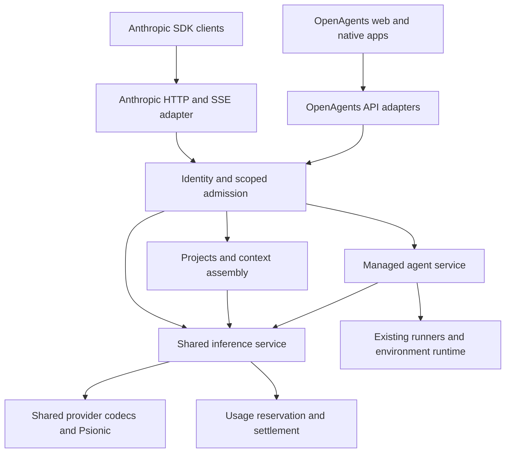

# Anthropic compatible API implementation plan

Draft, November 14, 2026. Repository baseline: `d0da2e450e7d`.

OpenAgents should expose an Anthropic-compatible HTTP API backed by the same
Coax services that its own apps use. Start with Messages, streaming, model
discovery and token counting; bring Projects into line with Claude's shared
instructions, knowledge and private conversations alongside that work. Add
Files, batches, Skills and managed agents as separately qualified capabilities.
Each release must identify the endpoints, API versions and model features it
actually supports.

The starting reference is [api.md](api.md). This plan adds an inventory of the
current protocol and implementation, a Projects migration, and delivery gates.
It proposes implementation work; it changes no published contract.

## Compatibility scope and sources

There are three related targets:

| Target | What OpenAgents should match | Boundary |
| --- | --- | --- |
| Claude API | HTTP paths, headers, JSON, SSE, errors and SDK behavior for supported features | A versioned compatibility adapter over OpenAgents services |
| Claude app Projects | Project instructions, reusable knowledge, several conversations and access roles | An evolution of OpenAgents Projects, with an OpenAgents API |
| Claude Platform Workspaces | Organization resources, API key scope, membership, usage and limits | A tenant and billing boundary, distinct from a Project or a filesystem checkout |

The public Messages API is stateless with respect to application project
context: the caller supplies its conversation and system content. An OpenAgents
project turn can assemble project context before calling the same inference
service. It must not silently inject project material into an ordinary
`/v1/messages` request. [Messages reference](https://platform.claude.com/docs/en/api/http/messages/create).

Use the official [HTTP reference](https://platform.claude.com/docs/en/api/http),
[beta reference](https://platform.claude.com/docs/en/api/http/beta), and generated
SDK resource types. Pin the initial SDK comparison to
[`590783078cd961a0df698d9fddc0275c65ff3afd`](https://github.com/anthropics/anthropic-sdk-typescript/tree/590783078cd961a0df698d9fddc0275c65ff3afd)
and its [API index](https://github.com/anthropics/anthropic-sdk-typescript/blob/590783078cd961a0df698d9fddc0275c65ff3afd/api.md).
Before implementation, record per-file hashes, the selected Python SDK version,
beta headers and fixture provenance in a source manifest under `proto/`.
An endpoint count is not a coverage claim.

Target `anthropic-version: 2026-10-21` first. Keep `2023-06-01` as a separate
compatibility profile if required by clients; the existing outbound gateway
uses that older version. The new version rejects `temperature`, `top_p` and
`top_k`; it also changes several Admin API fields. Test each accepted version
independently rather than treating its header as decoration.
[API versions](https://platform.claude.com/docs/en/api/versioning).

The reviewed SDK has project analytics, and the Enterprise Compliance API can
retrieve and delete project content. These do not establish a general public
Project authoring API. Our Project CRUD, context and conversation endpoints
must be documented as OpenAgents extensions; do not reverse engineer Claude's
private app endpoints to manufacture a compatibility claim.
[SDK API index](https://github.com/anthropics/anthropic-sdk-typescript/blob/590783078cd961a0df698d9fddc0275c65ff3afd/api.md),
[Compliance content API](https://platform.claude.com/docs/en/manage-claude/compliance-content-data).

## Existing protocol and implementation

The [protocol guide](../../proto/README.md),
[registry](../../proto/registry.json) and actual consumers establish the current
baseline. The large [protocol specification](../protocol/openagents-protocol-spec.md)
also contains recovered pre-reset designs: its historical “Implemented” labels
do not establish current runtime support. In particular, account Projects in
section 15.1 and the complete managed-agent platform in section 18.2 are useful
design inputs, not installed services.

| Area | Current evidence | Reuse and missing work |
| --- | --- | --- |
| Provider requests and streams | `provider-request-bodies` is an external registry entry; `coax/lib/gateway/` owns codecs, SSE parsing, usage and rates. `anthropic.coax` sends Messages requests and reads responses. | Reuse and extend this boundary. It is an outbound client, not an Anthropic server. Add inbound admission and outbound response/event writers. |
| Normalized model calls | `coax/lib/gateway/types.coax`: `GwMessage` is role plus text; `GwRequest` has tools as raw Chat Completions JSON. | Extend the shared representation for ordered content blocks, tool IDs/results, distinct stop reasons and replayable opaque data. Current Anthropic parsing emits tool input as text and collapses several stop reasons. |
| Hosted inference | `coax/web/api/inference.c` serves Chat Completions at `/api/v1/inference`, with identity, daily caps, credit and metering. `proto/openagents/api/v1alpha1/inference.proto` describes credit/refusal replies. | Extract shared admission and accounting services behind the existing route. These schemas do not define Anthropic Messages. SQL policy touched by the extraction moves into checked Coax policy. |
| Local model serving | `proto/openagents/psionic/responses/v1alpha1/` and `psionic/lib/responses/` describe/implement a bounded Responses profile. Its registry row explicitly says the proto has no consumer. | Reuse serving primitives where appropriate; schema adoption remains work. Neither Responses support nor a model checkpoint establishes Messages feature parity. |
| Account conversations | `proto/coder/account-chat-v1.json`, `proto/coder/chat-history-v1.json`, `account-chat-wire.coax` and `chat-history-wire.coax` back saved chats. | Preserve v1. Its text-only, bounded, no-tools thread is insufficient for a rich Messages transcript; introduce a separate version for richer storage. |
| Project conversations and ownership | `proto/verse/project-chat-v1.json` registers `openagents.chat.project-link.v1`, `project-turn.v1` and `openagents.project.account-owner.v1`; migrations 0198–0200 and `project-chat-policy.coax` enforce ownership and linkage. | Keep exact account ownership and immutable v1 thread links. Extend context assembly and membership without reinterpreting existing IDs. |
| Private Projects and drops | `proto/openagents/api/v1alpha1/private.proto` and `drops.proto` cover current reply shapes. `private.c`, `drops.c`, `coax/lib/project/` and `projects.*`/`drops.*` own documents, review, publication and project-agent turns. | Reuse the document/edit/undo mechanisms and storage. They do not yet provide a common Claude-style Project with revisioned instructions and an indexed knowledge collection. |
| Public Projects | `proto/nostr/block/mp/v1alpha1/project.proto`, NIP-MP and `coax/web/project/` preserve signed project records and repository scope. `openagents.project-work.v1` and its seed remain registered as unaudited local shapes. | Bind existing records to one Project identity. A decoded Nostr projection grants no access; retain original signed bytes and explicit publication. |
| Project and world files | `proto/world/files-v1.json`, `metaverse-engine/editor/file-wire.coax`, `coax/web/api/world-files.coax` and `worlds.c` implement private attachments. | Reuse upload/storage, scan, quotas and authorization. A stored attachment is not automatically searchable knowledge or an Anthropic `file_id`; add explicit references and processing state. |
| Hosted agent execution | `proto/openagents/agent/managed/v1alpha1/session.proto`, `proto/coder/agent-managed-v1alpha1.json` and `coax/web/agent/runner-wire.coax` cover runner lines, event batches, turns and sealed credentials. | Reuse execution and checked tool admission. This is the runner seam, not the complete `/v1/agents` or `/v1/sessions` API. |
| Computer environments | `proto/openagents/environment/access/v1alpha1/runtime.proto`, runtime goldens, `coax/lib/agent/environment/` and `coax/web/api/environment.c` support catalog, sessions, commands and interactions. | Preserve command identity, generations and revision checks. A connected computer is not an Anthropic managed sandbox template. |
| Identity and agent grants | `proto/openagents/account/v1alpha1/agents.proto`, `agent-policy.coax` and `agent-wire.coax` define agent accounts, keys and grants. The current scope enum has profile read and wallet spend. | Reuse key verification, revocation and owner linkage. Add explicit inference/project/file scopes with enforcement; an existing agent key does not acquire them implicitly. |

This inventory does not establish current implementations of general
organization Workspaces, Anthropic-compatible Files, batches, Skills/version
management, deployments, memory stores, vault APIs or user profiles. Implement
and register each selected surface with a real consumer. Existing Claude Code
stream-json and provider account codecs remain external client boundaries,
separate from the new public API.

## Service and schema design

### One set of services

Use the existing context owners in [the context map](../architecture/contexts.md):
Identity resolves principals and scopes; Projects owns project state and
knowledge membership; Chat owns saved conversations; Psionic and inference
owns model admission and usage; Coder owns agent execution. Protocol owns the
schemas. Coax owns validation, authorization, lifecycle and accounting
decisions; C handles HTTP, sockets, database and storage effects.

Propose `https://api.openagents.com` as the SDK base URL, with canonical relative
paths such as `/v1/messages`. DNS and ingress provisioning are a deployment
task. Retain existing `/api/...` routes as adapters to the shared services.
Avoid parallel inference accounting, project databases or per-app context
builders. Match SDK pagination independently for each resource; resource APIs
do not all use the same cursor shape.

### Protocol work before routes

Add the following narrowly scoped schema families as their consumers land.
Paths and names below are proposed; field numbers, limits and registry IDs
are fixed by the first reviewed schema change.

| Proposed family | Contents and owner |
| --- | --- |
| `proto/external/anthropic-api/` | Source manifest and byte-preserving HTTP/JSON/SSE fixtures, including version and beta selection; referenced by the external codec entry |
| `proto/openagents/inference/v1alpha1/` | Shared lossless content blocks, requests, model capabilities, results and usage; Psionic and inference |
| `proto/openagents/compat/anthropic/v1alpha1/` | Exact consumed external JSON projections, errors and event unions for the advertised compatibility profiles; same service owner |
| `proto/openagents/project/v1alpha1/` | Canonical project references, roles, instructions, knowledge references and context snapshots; Projects |
| New account, file and conversation profiles | Workspace/key scope, file metadata/processing, rich transcript and context references; owning contexts retain their codecs |
| A new managed-agent HTTP profile | Agent configuration/version, session lifecycle and public event projections; Coder, leaving the current runner profile intact |

The boundary is `external JSON → validated Coax domain value → shared service
→ compatibility JSON`. Clients continue speaking Anthropic JSON and SSE;
protobuf is our schema source, not a new requirement on those clients. Reuse
the JSON mapper, SSE and crypto modules from [the reuse guide](../reuse.md).
Extend `coax/lib/gateway/anthropic.coax` into the shared Anthropic codec boundary
without retaining a second body/event parser beside it. Keep domain policy
out of that codec.

Every new wire or stored shape gets one registry row, one owning codec,
goldens, presence/unknown-field rules and explicit bounds. Add its consumed
profile to `proto/modules.json`, generate descriptors, and freeze the baseline
under the existing compatibility process. Any new OpenAgents envelope uses
the protocol specification's common API direction; the Anthropic boundary
must still emit Anthropic's envelope. Do not edit a frozen v1 shape to add
new meanings, or generate the whole upstream SDK surface before consumers
exist.

## Messages compatibility

The first qualified release should allow supported official SDK versions to
change their base URL and credential and perform text generation, streaming
and a client-executed tool round trip. Publish model capability limits beside
the endpoint coverage. API shape compatibility does not imply the same model
behavior, tokenizer or supported modalities.

| Surface | Required implementation |
| --- | --- |
| Authentication and headers | Accept OpenAgents API keys through the pinned SDK's `x-api-key` path and supported Bearer path. Resolve them to our principal; never accept a provider key as an OpenAgents grant. Enforce version, beta and workspace selection. Pin response request IDs and SDK retry headers. |
| Request admission | Model, required output cap, top-level system blocks, ordered user/assistant content, tool definitions/choice and matched tool results. Validate omitted versus null values, nesting, counts, UTF-8, body size and model limits before dispatch. |
| Complete response | Message and block IDs, actual model, ordered content, exact supported stop reasons/sequences and observed usage. Preserve `tool_use` as a distinct completion reason. |
| Streaming | `message_start`, indexed block start/delta/stop, message delta/stop, pings and in-stream errors. Preserve partial tool JSON and block ordering; incremental UTF-8/SSE framing cannot depend on socket chunk boundaries. |
| Tool continuation | Preserve names, IDs, structured arguments, result content and error markers across calls. A model tool request authorizes no effect. Stateless Messages returns client tool calls; server tools require separately admitted execution. |
| Models | List/retrieve only offered models with honest capabilities and pinned SDK pagination. Do not alias a non-Claude model to a Claude model identity. |
| Token counting | Use the selected model's actual tokenizer and request serialization, or an authorized upstream counter. Share context assembly with generation; never substitute a character estimate for an advertised token counter. |
| Errors and limits | Emit Anthropic error types/envelopes and request IDs, including failures before headers and inside an open stream. Keep existing OpenAgents route errors unchanged. Bound queues, deadlines, concurrency and slow readers. |

Use [the streaming specification](https://platform.claude.com/docs/en/build-with-claude/streaming)
and [error contract](https://platform.claude.com/docs/en/api/errors) for the
wire behavior. Disconnection must cancel or reconcile the upstream attempt,
release resources when their owners finish, and retain accurate usage for
work already performed. A broken stream must not become a successful complete
message or cause an automatic replay of tool effects.

Expand capabilities in independently tested steps: images/PDFs and citations;
thinking with signature/opaque block replay; structured output; prompt cache
controls; containers and server tools. Refuse a requested feature when the
selected model cannot provide it. Never synthesize thinking signatures,
pretend to have cached a prompt, ignore a requested tool policy, or silently
translate strict output into best-effort prompting. Document unsupported
beta features and the exact refusal behavior in the compatibility matrix.

Usage needs distinct uncached input, cache reads, cache writes and output
counts. The existing `GwUsage.input_tokens` includes cache components, so
serializing it directly as Anthropic `input_tokens` would be wrong. Preserve
provider observations before normalization and test the inverse mapping.
Reuse reservations, daily limits and settlement with a single attempt owner;
concurrent admission cannot overdraw credit and retries cannot settle twice.
Keep Bitcoin/msat balances authoritative. Any future USD-formatted analytics
is an explicit reporting conversion with a recorded rate, not a new currency
balance. Preserve the existing Spark receipt and fresh-rate requirements in
[INVARIANTS.md](../../INVARIANTS.md).

## Projects alignment

### Target behavior and terminology

Claude Projects apply reusable instructions and knowledge to their chats,
support use/edit permissions, and offer private or organization sharing.
Project sharing does not automatically share personal chat transcripts.
[Project management](https://support.claude.com/en/articles/9519177-how-can-i-create-and-manage-projects),
[visibility and sharing](https://support.claude.com/en/articles/9519189-manage-project-visibility-and-sharing).

OpenAgents should provide that foundation while retaining its repository,
task, realm and publication features. A Project must be usable without a
repository, a realm, a public slug, a drafted roadmap or an agent execution
environment. Those are optional linked capabilities. Creation should allow
a person to supply a name, instructions and knowledge and start a conversation;
the current drop/review/publish flow remains available for public work.

Keep these identities separate:

| Concept | Proposed meaning |
| --- | --- |
| Account | Existing login identity; linked Nostr keys and opaque ownership handles retain their current roles |
| Organization and Workspace | Tenant administration and API resource/cost boundary; an organization's default Workspace and scoped keys follow the selected platform profile |
| Project | Stable ID, owner and optional Workspace, description, instructions revision, knowledge collection, access policy and conversation associations |
| Repository workspace | Authorized filesystem root or checkout used by an execution owner; never the meaning of an API billing Workspace |
| Agent session | One execution lifecycle and event stream; may operate for a Project, but is not the Project or all of its chats |

Anthropic Workspaces group keys, membership and limits within an organization.
Mirror that capability through an explicit tenant mapping; do not rename each
existing Project into a Workspace. A native runtime's `workspace_id` remains
its configured execution workspace identifier.
[Workspaces](https://platform.claude.com/docs/en/manage-claude/workspaces).

### Changes to the current implementation

| Capability | Current behavior | Planned change |
| --- | --- | --- |
| Project identity | Private documents and published drops use slugs; public projects also have signed coordinates. Account ownership has an opaque handle. | Add one canonical Project ID and checked mappings to legacy identities. Detect collisions between private/public records and different signers; never merge by slug alone. |
| Instructions | Structured project rules exist, but no common independently revisioned instruction resource is used by all project conversations. | Add explicit editable instructions with compare-and-swap revision and audit history. Keep reference documents separate from instructions. |
| Knowledge | Drops and private world/project attachments hold source material; world turns can open selected attachments. | Add a Project knowledge collection over those storage primitives, with ready/processing/failed states, content hashes, extraction provenance and source references. Attaching does not imply processing succeeded. |
| Context | `account-chat.c` selects `left(doc::text,12000)` or a published name/line; `pc_completion` builds a system prompt from it. | Replace arbitrary prefix truncation with one bounded context service used by saved chats and agents. Record instructions revision, selected knowledge revisions and tokenizer/model identity for each turn. |
| Conversations | Account-owned threads have immutable v1 project links; the private project agent has a shared conversation. | Preserve both. New personal chats stay private to their account; show the existing project-agent thread explicitly as shared. New rich conversations use a new storage profile, with explicit attach, move and remove operations that recheck both Projects. |
| Access | Private member documents, published drop ownership and account identity mappings have different checks. | Add a common checked policy for owner, editor and viewer/use access, with adapters for the old rules. Viewer/use permits asking, not project edits or arbitrary tool writes. |
| Sharing | Public/unlisted/private Nostr publication and member-only documents have established meanings. | Add organization sharing as a separate audience. Claude's organization “public” must never map to OpenAgents' public internet publication. |
| Lifecycle | Account export, merge and purge already cover project ownership and chat links. | Extend lifecycle registrations to canonical mappings, memberships, instructions, knowledge, indexes and context records; retain referential and ownership consistency. |

The context service should start with explicit, bounded selection and supported
text extraction. Add retrieval when indexing and relevance checks justify it,
reusing `psionic/` and `coax/lib/repo/` where their contracts fit. Do not rebuild
repository search or a document parser locally. Keep raw uploaded bytes,
extracted text and retrieval indexes distinct, and refuse unsupported formats
or over-capacity selections visibly.

Treat knowledge as untrusted reference content. An attachment cannot change
access, grant tools or become a system instruction. Resolve every reference
against current permissions before a model call; source URLs are not permission
to fetch arbitrary network locations. Record the admitted context snapshot
without granting access to the private conversation that used it. Future
project memory is an explicit scoped resource, not implicit copying of every
member's chats into shared knowledge.

### Project API and migration

Use a new OpenAgents versioned API under `/api/projects/v1/` for Project
create/list/read/update/archive, instructions read/update, knowledge
attach/list/status/detach, membership management, and conversation create/list
and turn submission plus explicit attach/move/remove. Specify resource methods
and JSON in `proto/` before
adding routes. Existing `/api/projects/SLUG/files`, `/api/private/...`, drops
and project-chat v1 routes continue through adapters. These routes are our
product API, not invented Anthropic endpoints.

Migrate in this order:

1. Inventory private documents, published drops, signed project coordinates,
   account owner handles, attachment references and thread associations. Produce
   a deterministic, rerunnable mapping report; unresolved identity conflicts
   block only the affected records.
2. Add canonical IDs and mappings without rewriting signed originals, v1
   transcripts or public files. Keep one authoritative write path through
   Projects; old route adapters must not become independently writable stores.
3. Add instructions and knowledge alongside current project data. Keep existing
   `rules` as project data until an owner explicitly promotes selected content
   to instructions. A drop or private attachment never becomes public knowledge
   as a migration side effect.
4. Route new project turns through the context service. Retain the current v1
   thread/link limits and ownership; offer rich threads under a new version.
   Membership removal prevents new context reads and turns, while account-owned
   historical transcripts follow their separate retention/access policy.
5. Add personal Project creation and owner/editor/viewer UI using shared
   `components/` and `coax/lib/project/`. Roll out to web and Coax Native through
   the same API; publication still requires the established explicit action.
6. Verify export, merge, deletion, archive/restore, indexing cleanup and rollback
   before broad migration. Rollback switches adapters/read selection; it must
   not discard canonical writes or expose old public snapshots containing new
   private data.

Keep current privacy boundaries intact. Private project content routes retain
their indistinguishable non-member/missing-project 404 behavior. Existing
attachment routes retain their specified 401/403 behavior. New compatibility
routes translate refusals into their own documented envelopes without leaking
existence. Project membership alone never authorizes reading someone else's
personal chats or controlling their computer environment.

## Remaining platform coverage

Implement the larger surface in useful groups rather than calling the entire
API compatible after Messages works.

| Group | Target resources | Existing base and completion condition |
| --- | --- | --- |
| Files | Upload/list/metadata/content/delete at `/v1/files` | Reuse private blob storage, scanning and quotas through the owning file service. Add opaque file IDs, Workspace isolation, multipart/streamed transfer, reference accounting, processing and retention. A Project knowledge reference is a separate association. |
| Message batches | Create/list/retrieve/cancel/delete/results at `/v1/messages/batches` | Reuse inference admission and execution primitives; add a durable item queue, custom IDs, item outcomes, expiry, JSONL results and per-item usage settlement. Cancellation is not proof of zero usage. |
| Skills | `/v1/skills` and version resources | Reconcile protocol spec section 20.3 and NIP-SKILL first. Add immutable package versions, limits, provenance and safe unpacking. Uploading a Skill grants no execution rights. |
| Workspace administration | Organization identity; scoped keys; Workspaces, members and limits under `/v1/organizations/...` | Extend current Identity/account services. Separate admin credentials from inference keys; enforce actual Workspace isolation before claiming Admin API parity. |
| Usage and analytics | Selected usage/cost reports and limits | Derive reports from the same settled attempts and reservations. Keep token counts, estimates, charged msat and optional currency conversion distinct. |
| Managed agents | `/v1/agents`, versions, `/v1/sessions`, events and `/v1/environments` | Adapt the existing runner/environment services with new public resource schemas, durable event cursors, pinned configuration versions and explicit execution admission. Keep local observed sessions observe-only. |
| Later resources | Deployments/runs, memory stores, vault bindings, webhooks, user profiles, plugins and telemetry | Reconcile the corresponding protocol/NIP designs individually. Require storage, authority, deletion and consumer evidence for each advertised subset. |

Managed-agent compatibility must pin its beta header and event schema separately
from Messages. In the pinned SDK, agent configuration/version resources and
session resources are richer than our hosted runner records.
[Agent resource](https://github.com/anthropics/anthropic-sdk-typescript/blob/590783078cd961a0df698d9fddc0275c65ff3afd/src/resources/beta/agents/agents.ts),
[Session resource](https://github.com/anthropics/anthropic-sdk-typescript/blob/590783078cd961a0df698d9fddc0275c65ff3afd/src/resources/beta/sessions/sessions.ts).
Preserve the environment runtime's generation, command and revision controls
through any HTTP mapping. Define stream catch-up, retention gaps, interrupts,
interaction replies and uncertain completion before presenting resumable
sessions. Never equate an Anthropic sandbox template with a provisioned ENV
lease, a connected desktop, or a login session.

## Delivery sequence and acceptance

| Phase | Deliverable | Exit gate |
| --- | --- | --- |
| 0 | Pinned source manifest, endpoint/field/capability matrix, approved schema boundaries and first fixtures | Every proposed public operation is classified as supported target, later work or OpenAgents extension; existing identities have explicit preservation rules. |
| 1 | Shared rich inference values, Anthropic codec extension, scoped key admission and usage service extraction | Existing outbound provider fixtures and inference/account-chat behavior remain intact; block IDs, tool results, usage and stop reasons survive round trips without loss. |
| 2 | Nonstreaming/streaming Messages, Models and token counting for the first supported models | Pinned Python and TypeScript SDK tests pass with only base URL/credential configuration: text, stream helper, tool round trip, token count, model listing and refusals. |
| 3 | Canonical Project mapping, instructions, knowledge and context service; shared app adoption | Existing public/private Projects migrate without visibility or identity changes. New private Project with instructions and two sources works across independent chats; all permission and lifecycle cases below pass. |
| 4 | Files and batches | File/reference isolation, processing failure and removal pass; batch restart/cancel/retry tests produce one terminal item result and correct settlement. |
| 5 | Workspace/Admin subset and Skills | Revocation, role changes, limits, package/version behavior and tenant isolation pass against the advertised SDK subset. |
| 6 | Managed-agent beta subset, followed by selected additional resources | Configuration version → admitted session → tool/approval → reconnect/catch-up → terminal result works against the pinned SDK and existing execution owners. |

Project schema/mapping work in phase 3 can proceed once phase 0 fixes the domain
boundaries; it does not need to wait for every Messages feature. Workspace
selection and resource isolation are required as soon as a public endpoint
accepts scoped keys, even though broader administration arrives in phase 5.

Write Coax `#test`/`#forall` checks before implementation. Money, membership,
scope, context admission, quotas and tool policies are `#authority`; their
initial mutation passes reach zero surviving mutants or justified equivalents.
Subsequent changes mutate the procedures touched. Essential acceptance cases:

- **Wire fidelity:** official SDK decode/encode, omitted/null fields, arbitrary
  Unicode and socket/SSE splits, partial tool JSON, multiple blocks, malformed
  input, unsupported versions/betas/models, exact error envelopes and bounded
  overflow. Unknown output events remain compatible with the selected profile.
- **Usage:** cached and uncached counts, missing observations, concurrent credit
  reservations, disconnect after partial generation, upstream timeout, retry
  and duplicate finalization. Never invent usage to make a response complete.
- **Projects:** private/use/edit/owner access, immediate revocation, account
  switching, organization sharing without internet publication, immutable v1
  links, shared agent thread versus personal chat, colliding slugs, stale edits,
  knowledge processing failures, file removal and context limits.
- **Context:** repeat the same selection from pinned source/instructions
  revisions, prevent cross-project retrieval and personal transcript leakage,
  and prove that knowledge cannot promote itself into instructions or tool
  grants. Test the turn/read race with membership removal.
- **Lifecycle:** account export/merge/purge, archive and restore, interrupted
  migration/restart, event replay gaps, uncertain mutation replies and rollback
  with writes made after cutover.

Run touched suites with `coax/remote/check.sh only PATH`; run API integration
tests through `coax/remote/remote.sh run --` with selected test files. Run
`scripts/proto.sh check` for schema changes, and `wire-check`, `layer-check`,
`components-check` where applicable, plus `tools-check` before pushing.
SDK conformance tests run on owned build hosts; any new non-Coax SDK harness
must carry the required independent-oracle justification. Keep each job under
the repository's 15-minute limit and do not rerun passing unchanged slices.
Use the existing muted headless driver for UI checks.

## Initial implementation decisions

Use these defaults to make the first phase concrete:

1. Start with `2026-10-21`, text and client tool use, on explicitly listed model
   capabilities. Add the old API version when a named client requires it.
2. Keep Project CRUD and context APIs as OpenAgents extensions. Keep Projects,
   billing Workspaces and execution workspaces separately identified.
3. Preserve v1 saved chats and current shared project-agent conversations.
   Introduce new rich storage rather than widening v1 silently.
4. Select project knowledge explicitly at first; add retrieval after extraction,
   indexing and isolation gates pass. Do not add cross-project memory by default.
5. Treat the complete managed-agent platform as a later product milestone.
   Reuse its existing runner and environment work rather than making Messages
   depend on a replacement orchestration system.

The first implementation change should land the pinned compatibility matrix,
consumed inference/content schema, red codec fixtures and preservation checks.
That gives the Messages adapter and Projects migration a common, reviewable
contract before either changes application behavior.
