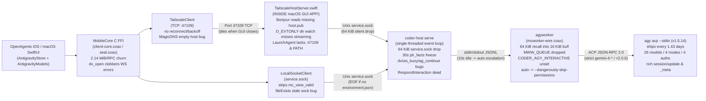

# OpenAgents Antigravity Wrapper — Exhaustive Forensic Audit & Gap Analysis

> **Audit Target:** OpenAgents iOS (Priority #1), OpenAgents macOS (Priority #2), shared Coax/Swift client core, `coder-host`, `agyworker`, ACP client, and NIP-HOST / Tailnet wire protocols against GitHub master issue **`#13993`** (plus **`#13992`** and prior mobile audit `5e9dc70b08`).
>
> **Audited Snapshot:** `origin/main` (`0687e739b7`, Build 1420), audited against live local **`agy v1.5.14`** (CLI help, live `agy acp --stdio` `initialize` & `session/list` JSON-RPC probes, binary symbol inspection), the full **119-page official Antigravity documentation corpus** (`antigravity.google/docs/*`), and **`google-antigravity` Python SDK v0.1.24**.
>
> **Companion Reference Docs in This Folder:**
> - [`cli-and-headless.md`](./cli-and-headless.md) — Every CLI flag, subcommand, headless `stream-json` contract, exit code, `settings.json` / `admin_settings.json` key, env var, slash command, and updater flow.
> - [`acp-and-endpoints.md`](./acp-and-endpoints.md) — Live `agy acp` v1.5.14 JSON-RPC schema, custom `_meta` extensions, `--process-per-session` router, cloud/enterprise/local endpoints, and model/effort/mode/auth matrices.
> - [`sdk-and-ides.md`](./sdk-and-ides.md) — Complete `google-antigravity` Python SDK v0.1.24 API, 9 IDE extension targets, official binary sync pattern, and 226+ release changelog velocity analysis.
> - [`platform-security-and-extensibility.md`](./platform-security-and-extensibility.md) — Permissions, OS terminal sandbox, hooks, MCP & MCP Apps (`ui://`), customization discovery, swarms/workflows/teamwork/boost/automations, Remote Control/SSH/Voice/Browser/Artifacts, and Enterprise/Quotas/ToS.

---

## 1. Executive Summary

Despite passing unit tests and mocked iOS Simulator E2E tests (`apps/openagents-ios/Tests/e2e-host.coax`), end-to-end forensic tracing across every layer (`SwiftUI` → `AntigravityStore` → `MobileCore` Coax C FFI → `TailscaleClient` / `LocalSocketClient` → `TailscaleHostServer` → `service.sock` → `coder-host` → `agyworker` → `agy acp --stdio`) uncovered **7 severe live production breakages**, **2 critical security/data-loss defects**, **zero version/capability negotiation** against an upstream CLI shipping every **1.43 days**, and a **major Terms of Service compliance exposure**.

> [!CAUTION]
> **Critical Terms of Service / Wrapper Compliance Exposure (`antigravity.google/docs/faq`, lines 346–352):**
> Google's Antigravity FAQ explicitly states that **using Antigravity consumer logins inside third-party coding agents or wrapper applications violates Antigravity Terms of Service** and risks account suspension/termination (and explicitly declares wrapping headless `agy -p` or automating consumer accounts unsupported). Google directs third-party wrappers to authenticate through **Gemini Enterprise (`oauth-business`)**, **Google Cloud Vertex AI / Agent Platform PAYG (`agent-platform` / ADC)**, a **Google AI Studio API key (`gemini-api-key`)**, or the official **`google-antigravity` Python SDK**. OpenAgents currently assumes consumer OAuth (`~/.gemini`), silently drops `CODER_AGY_API_KEY` on the phone host (`coder/tui/host-phone.coax:131-191`), and exposes zero commercial/enterprise auth onboarding in iOS or macOS.

### 1.1 The 7 Live Production Breakages (Masked by Mocked `e2e-host.coax`)

| # | Live Production Failure | Root Cause (`file:line`) | Why Tests Missed It |
|---|---|---|---|
| **1** | **Workspace Branches, Worktrees, and PRs tabs are ALWAYS EMPTY on real `coder-host`; `RemoveWorktree` ALWAYS fails (`workspace_refused`)** | `AntigravityStore.swift:1141-1166` hardcodes `page=0, cursor=0, workspace="default"`. Real `ws_snapshot` (`coax/lib/agent/workspace/native.coax:28-43`) only populates `branches` on `page=1`, `worktrees` on `page=2`, `pull_requests` on `page=3`; `RemoveWorktree` requires the 64-hex `tree.id` in `q.workspace` (`workspace/policy.coax:20`). | Mock `apps/openagents-ios/Tests/e2e-host.coax:269-298` returns all 4 tabs on `page=0` and accepts `"default"`. |
| **2** | **Interactive Approvals (`ReviewMode.ask` + `RespondInteraction`) are 100% DEAD across 6 layers** | (a) `host-phone.coax:601-635` never sets `CODER_AGY_INTERACTIVE=1`, so `agyworker.coax:611` auto-approves every tool in `"default"` mode and cancels every `ask_question`; (b) `host-desktop.coax:276-288, 560-606` never parses `MWW_PERMIT` or populates `EaSession.interaction`; (c) `host-desktop.coax:953` (`dk_write`) rejects `RespondInteraction` with `"unsupported_profile"` before dead `ph_write:1016`; (d) `EaRequest` has no `option_id` field (`environment/wire.coax:44-52`), `ph_write:1021` calls `mww_answer` instead of `mww_answer_option`, and `agyworker.coax:647-659` ignores `option` when `allow == false`; (e) `ApprovalBannerView` (`TranscriptComponents.swift:171, 204-231`) never resets `@State busy`. | `e2e-host.coax` synthesizes fake `interaction_id` and accepts `RespondInteraction` directly. |
| **3** | **CRITICAL SECURITY BUG — Silent privilege escalation from `"plan"` / `"default"` to `"auto"` + `--dangerously-skip-permissions` after 10s idle** | `host-phone.coax:542-558` never persists `mode` in `ID.phone`; when a worker is idle-reclaimed (`DR_IDLE_MS = 10000` ms, `host-runs.coax:30`) or restarted, `ph_restart` (`host-phone.coax:727-752`) calls `ph_spec` (`host-phone.coax:599`) hardcoding `"auto"`, which `agyworker.coax:265,276` maps to `--dangerously-skip-permissions` (YOLO, **not** Antigravity's sandboxed Auto reviewer!). Mid-chat mode switches are also completely ignored (`host-desktop.coax:1012-1068`). | Tests run single-turn mock scripts with no idle recycle or real `agyworker`. |
| **4** | **CRITICAL DATA LOSS — Recall > 16 KiB silently truncates away the user's entire prompt** | `ph_recall` (`host-phone.coax:24-25, 450-515`) emits up to ~96 KiB JSON → `agyworker.coax:57, 1844` slices to `AGYW_RECALL = 65536` → `agyw_send_task` (`agyworker.coax:691-699, 1892-1895`) composes `"Previous context..." + recall + "\n\nUser message:\n" + prompt` into `prompt_buf: [CUE_OWED] u8` where **`CUE_OWED = 16384` (16 KiB, `cursor.coax:22`)**! After ~2 normal turns, the user's message is completely cut off. | Unit tests use tiny < 1 KiB recall fixtures. |
| **5** | **macOS Bonjour NEVER advertises, fresh Mac local chat fails, `install.sh` omits `agyworker`, and "Sign in Antigravity" hangs as a zombie** | `TailscaleHostServer.swift:513-520` reads `~/.openagents/coder/host/host.pub` (never written by `coder-host` — key lives in `daemon.json`), so Bonjour never starts; `es_local_tick` (`host-environment.coax:63`) drops local requests with 0-byte EOF until `environment.json` exists; `LocalSocketClient.swift:42-48` checks `fileExists` (stale socket blocks startup); `installLaunchAgent` doesn't stop child `daemonProcess` (`service.lock` exit-4 crash-loop) and lacks Homebrew `PATH`; `apps/openagents-macos/install.sh` never compiles `agyworker`; `TailscaleHostServer.swift:174-197` spawns `agyworker --connect` with discarded stdout/no `--code FILE` and falls back to nonexistent `agy auth login`. | Never tested on a clean macOS profile without prior legacy `/Applications/OpenAgents.app` state. |
| **6** | **Real-Time Push (`runs/` watcher) NEVER fires during streaming & Port 47109 dies when GUI quits** | `LocalSocketClient.swift:67-89` & `TailscaleHostServer.swift:415-456` open the `runs/` **directory** with `O_EVTONLY` (Darwin kqueue directory vnodes do NOT fire when `ID.out` is appended to). `broadcastPush` only ever sends blank `sessions_changed` (triggering 4-RPC full refresh); `session_updated` / `interaction_pending` / `turn_ended` are never emitted. Port 47109 still runs inside `OpenAgentsMac.app` (`#13993` 1.5 unfinished; headless Linux unsupported). | `e2e-host.coax` emits synthetic push frames; tests don't measure live streaming pushes from `coder-host`. |
| **7** | **Image/Photo attachments discard 100% of bytes & sealed requests > 64 KiB silently drop on `service.sock`** | `ChatView.swift:71-78` & `MacRootView.swift:404-411, 846-853` discard photo/binary bytes and append literal `[Attached media: name (mime, size)]`. Text file 4000-byte slice can split UTF-8 and drop the whole file. Meanwhile `MobileCore.sealRPC` outputs up to 131 KiB, but `es_local_tick` (`host-environment.coax:44,47`) caps `input: [65536] u8` and silently drops larger requests! | Tests only attach tiny ASCII text strings. |

---

## 2. Current Architecture & `#13993` Reality Check

### 2.1 End-to-End Topology & Confirmed Fault Lines



### 2.2 `#13993` Phase-by-Phase Reality Check (Claimed Shipped vs. Reality)

| `#13993` Scope / Milestone | Status in `#13993` | Ground-Truth Audit Verdict |
|---|---|---|
| **Phase 0: Antigravity-only, zero-relay shared core** (`client-core.coax`, `AppTailnet.swift`) | Claimed done | **Partially broken.** Relay URLs removed, but `seal.coax` still compiles dead relay/NIP-42 code; `client-core.coax` hard-locks models to `gemini-*` (`[a-z0-9.-]`), `dv_open` clobbers all Workspace refusals to `"forbidden"`, `pa_effort` ignores `model`, and every RPC churns 2.14 MiB heap. |
| **Phase 1.1–1.2: Direct Tailscale grants + TCP multiplexing + push** | Claimed done (Build 1409–1416) | **Broken in production.** Direct grant works initially but leaks 30-day grants into 64-slot lockup (`es_direct_grant`) with lockless `state.json` RMW race; TCP client has zero reconnect/backoff, drops whole connection on one timeout, never resets `livePushConnected`; `runs/` directory `O_EVTONLY` watcher never fires during streaming; only blank `sessions_changed` is ever sent. |
| **Phase 1.3–1.4: Bonjour + Tailscale + Manual MagicDNS/IP** | Claimed done | **Broken on macOS.** Bonjour **never advertises** (`host.pub` does not exist; `queryTailscaleOwner` races). MagicDNS-only dial tries `""` first. `ownerSnapshot` stays `nil` forever if Tailscale starts after app launch. |
| **Phase 1.5: Headless host (`coder-host` owning `:47109` + LaunchAgent + Linux)** | Planned / partially claimed | **Not done.** Port 47109, `tailscale whois`, `direct-grant`, and push broadcasting still live inside `OpenAgentsMac.app` GUI. LaunchAgent only runs `coder-host serve --no-relay` (and crash-loops on `service.lock` if GUI daemon is running). Linux headless hosts cannot accept port 47109 connections at all. |
| **Phase 2: iOS Chat UI (Models, Efforts, Modes, Approvals, Subagents, Workspace, Attachments, Mentions, Slash, Cache)** | Claimed done (Build 1412–1420) | **Severely broken against real `coder-host`.** Workspace Branches/Worktrees/PRs always empty (`page=0`); `RemoveWorktree` always fails (`workspace="default"`); Approvals 100% dead on real host + button latch bug; `Plan`/`Ask` silently escalate to `Auto` + `--dangerously-skip-permissions`; photo attachments discard all bytes; slash commands hardcoded (5 stubs); `@` only completes 24 folders (no files); zero pagination; all tools render as `"Bash"` with no diffs; no artifacts/usage/quotas/voice/notifications. |
| **Phase 3: macOS App (`OpenAgentsMac`)** | Claimed done | **Multiple regressions vs iOS & fresh-install broken.** Fresh Mac local chat fails (`environment.json` absent); `install.sh` omits `agyworker`; "Sign in Antigravity" spawns hung zombie; lacks `@` mentions and session fallback note banner; `⌘K` lacks arrow-key nav/Esc/effort/workspace actions; `.onSubmit` allows duplicate concurrent sends; `MenuBarExtra` badge corrupted by sidebar search filter. |
| **Phase 4 / `#13992`: Right-Pane File Viewer, Artifacts, Review Pane Parity** | Open (`#13992`) / Backlog | **Completely unbuilt.** No workspace file tree / file content RPC, no syntax-highlighted viewer or Markdown/PDF/Notebook renderer, no artifact viewer (Implementation Plans, Walkthroughs, Screenshots, Generative UI), no commit/stage/amend/discard actions, no inline diff commenting. |

---

## 3. Master Forensic Findings Register (Severity-Ranked)

### 3.1 P0 — Critical (Security, Data Loss & Broken Core Flows)

| ID | Finding & Root Cause | Exact Locations | Impact & Required Fix |
|---|---|---|---|
| **P0-01** | **Silent privilege escalation `"plan"`/`"default"` → `"auto"` + `--dangerously-skip-permissions` on 10s idle recycle** | `coder/tui/host-phone.coax:542-558, 599, 727-752`; `coder/tui/host-desktop.coax:1042`; `coder/tui/host-runs.coax:30`; `coder/tui/agyworker.coax:265, 276` | `ID.phone` never persists `mode`; `ph_restart` calls `ph_spec` hardcoding `"auto"`; `agyworker` conflates `"auto"` with `--dangerously-skip-permissions`. **Fix:** Persist `mode` in `ID.phone` + `EaSession`, stop passing `--dangerously-skip-permissions` for `"auto"` (reserve for explicit `"turbo"`/`always-proceed` opt-in), propagate mode changes cleanly via `session/set_mode`. |
| **P0-02** | **64 KiB `MWW_RECALL` stuffed into 16 KiB `CUE_OWED` truncates away the user's prompt** | `coder/tui/host-phone.coax:24-25, 450-515`; `coder/tui/agyworker.coax:57, 691-699, 1844, 1892-1895`; `coax/lib/agent/engine/cursor.coax:22` | `ph_recall` writes up to ~96 KiB JSON → `AGYW_RECALL = 65536` → `agyw_send_task` writes `recall + prompt` into `prompt_buf: [16384] u8`. After 2 turns, the user's prompt vanishes completely. **Fix:** Replace recall-text injection with real ACP `session/load` / `session/resume`; when fallback recall is required, allocate dynamically and budget recall *after* reserving full prompt length. |
| **P0-03** | **Interactive Approvals (`ReviewMode.ask` & `RespondInteraction`) 100% dead across 6 layers** | `coder/tui/host-phone.coax:601-635`; `coder/tui/host-desktop.coax:276-288, 344-382, 560-606, 953, 1016-1027`; `coax/lib/agent/environment/wire.coax:44-52`; `coder/tui/agyworker.coax:611, 647-659`; `apps/shared/antigravity/Swift/TranscriptComponents.swift:171, 204-231` | `CODER_AGY_INTERACTIVE=1` never set; `MWW_PERMIT` never parsed; `dk_write:953` blocks `RespondInteraction` before dead `ph_write:1016`; `EaRequest` lacks `option_id`; `agyworker` ignores `option` on deny; `ApprovalBannerView` permanently locks `@State busy = true`. **Fix:** Wire full interactive pipeline end-to-end with option IDs (`allow_once`/`allow_always`/`reject_once`/`reject_always`), question choices/freeform, and `interaction` object on `EaSession`. |
| **P0-04** | **Workspace Branches / Worktrees / PRs tabs ALWAYS EMPTY & `RemoveWorktree` ALWAYS fails (`workspace_refused`)** | `apps/shared/antigravity/Swift/AntigravityStore.swift:861-873, 893-897, 1141-1166`; `coax/lib/agent/workspace/native.coax:28-43`; `coax/lib/agent/workspace/policy.coax:20`; `apps/openagents-ios/Tests/e2e-host.coax:269-298` | Client always requests `page=0, workspace="default"`. Real host populates branches/worktrees/PRs on `page=1/2/3` and requires 64-hex `tree.id` in `q.workspace` for `RemoveWorktree`. **Fix:** Fetch tab-specific pages (`0..3`) with cursor pagination, pass `tree.id` for `RemoveWorktree`, and align `e2e-host.coax` with real `ws_snapshot`. |
| **P0-05** | **Out-of-workspace path-traversal bypass in `agy_outside`** | `coax/lib/agent/engine/antigravity.coax:1205-1213`; `coax/lib/agent/cursor/client.coax:202-209`; `coder/tui/agyworker.coax:606, 2109-2142` | Only checks 5 PascalCase keys for `'/'`-separated `..`. Bypassed by lowercase keys (`path`, `file_path`, `cwd`), `toolCall.locations[].path`, Windows `\..\`, and **any resolved absolute path outside `cwd`** (proven by `agyworker.coax:2109-2142` approving `/w/outside.txt`!). **Fix:** Canonicalize (`realpath`/lexical normalize) every path in `rawInput` (case-insensitive) + `locations[].path` against `cwd` and rely on Antigravity's OS terminal sandbox rather than ad-hoc string checks. |
| **P0-06** | **`ag_continue` bypasses `command_id` validation, idempotency receipts, and `ea_fresh` expiry** | `coder/tui/host-environment.coax:677` vs `687-696`; `coder/tui/host-agy.coax:185`; `coder/tui/host-phone.coax:713` | `ag_continue` dispatches *before* validation/receipts/expiry and passes `file=""` so no receipt is recorded. Retries create duplicate sessions and double-bill turns; expired requests execute. **Fix:** Move `ag_continue` after validation/receipt/expiry checks and persist receipt atomically. |
| **P0-07** | **`MWW_QUEUE` silently dropped by `agyworker`** | `coder/tui/host-desktop.coax:919-931`; `coder/tui/agyworker.coax:1842-1929` | Phone follow-ups to idle Desktop Antigravity chats emit `MWW_QUEUE` (`open`/`add`/`promote`), which `agyworker`'s stdin loop ignores while `coder-host` returns `command_status: "accepted"`. **Fix:** Implement `MWW_QUEUE` handling in `agyworker.coax` or unify on `MWW_TASK`. |
| **P0-08** | **Workspace git mutations race live `agyworker` turns (`ws_busy` ignores `DrHost`)** | `coder/tui/host-workspace.coax:8` | `ws_busy` only checks legacy Claude slots (`ES_SLOTS`), ignoring `h[0].runs` (`DrHost`). `SwitchBranch`/`RemoveWorktree` corrupts or deletes a worktree while `agyworker` is writing to it. **Fix:** Check active `DrHost` runs matching the target workspace/worktree path. |
| **P0-09** | **Oversized `EaView` silently dropped due to invalid refusal code `"too_large"`** | `coder/tui/host-environment.coax:354, 357, 359`; `coax/lib/nostr/host/browser.coax:108` | On `HB_BODY_MAX` (49,152 B) overflow, `es_handle` calls `hs_refused(..., "too_large")`, which is NOT in `HB_CODES`; `hs_seal_reply` returns `-1` and silently drops the reply (18s client timeout). **Fix:** Add `"too_large"` (or map to `"output_limit"` inside `EaView` / valid `HB_CODES`) and enforce byte-budgeted pagination before serialization. |
| **P0-10** | **Sealed requests > 64 KiB silently dropped by `coder-host` `service.sock`** | `apps/shared/antigravity/Swift/AntigravityCoreBridge.swift:203`; `coder/tui/host-environment.coax:44, 47`; `apps/openagents-macos/Sources/TailscaleHostServer.swift:397-403` | `MobileCore.sealRPC` emits up to 131 KiB (NIP-44 padding + base64); `es_local_tick` caps `input: [65536] u8` and silently drops larger requests; `TailscaleHostServer` returns nothing on failure, triggering 18s client timeout + TCP drop. **Fix:** Raise `service.sock` buffer to `>= 262144` B (`HT_FRAME_MAX`) and emit explicit signed error frame on overflow. |
| **P0-11** | **Image & binary attachments discard 100% of bytes** | `apps/openagents-ios/Sources/ChatView.swift:71-78, 92`; `apps/openagents-macos/Sources/MacRootView.swift:404-411, 846-853`; `apps/shared/antigravity/Swift/AntigravityModels.swift:113-119` | Photos and binary files are reduced to literal `[Attached media: photo.jpg (image/jpeg, 142 KB)]` text. Text files sliced at 4000 raw bytes can split a UTF-8 codepoint and discard the whole file. **Fix:** Add real binary/blob upload + ACP `image` / `resource` content blocks (`cu_session_prompt_blocks` is already stubbed in `cursor/client.coax:497`). |
| **P0-12** | **macOS Bonjour never advertises + Fresh Mac local chat broken + `install.sh` omits `agyworker` + broken Sign-In** | `apps/openagents-macos/Sources/TailscaleHostServer.swift:62-75, 132-143, 147-227, 513-520`; `apps/shared/antigravity/Swift/LocalSocketClient.swift:42-48`; `coder/tui/host-environment.coax:63`; `apps/openagents-macos/install.sh:15-35` | Reads non-existent `host.pub` (key is in `daemon.json`); `service.sock` returns EOF until `environment.json` exists; stale socket blocks startup; `installLaunchAgent` crash-loops on `service.lock` and lacks `PATH`; `install.sh` never builds `agyworker`; Sign-In hangs `agyworker --connect` with discarded stdout or calls invalid `agy auth login`. **Fix:** Read key from `daemon.json`, auto-bootstrap `environment.json`, probe socket with `connect()`, build `agyworker` in `install.sh`, implement real OAuth URL capture + code submission UI (`agy acp --login`). |
| **P0-13** | **Real-time push (`runs/` watcher) never fires during streaming & port 47109 dies on GUI close** | `apps/shared/antigravity/Swift/LocalSocketClient.swift:67-89`; `apps/openagents-macos/Sources/TailscaleHostServer.swift:204-227, 415-456` | Directory `O_EVTONLY` never fires on `ID.out` appends; `broadcastPush` only emits blank `sessions_changed`; port 47109 listener still lives in SwiftUI GUI app (not `coder-host`). **Fix:** Move port 47109 listener + push emitter into `coder-host` itself (also unlocking headless Linux) and emit real `session_updated`/`interaction_pending`/`turn_ended` push frames directly from `dr_drain`. |
| **P0-14** | **Consumer ToS violation risk & dropped `CODER_AGY_API_KEY` on phone host** | `coder/tui/host-phone.coax:131-191, 248-258, 288-290, 616-635`; `antigravity.google/docs/faq` L346-352 | `host-phone.coax` never reads or passes `CODER_AGY_API_KEY`; API-key/enterprise isolated profiles fail probe and silently fall back to consumer `~/.gemini`. **Fix:** Support all 4 ACP auth methods (`oauth-business`, `agent-platform`, `gemini-api-key`, plus enterprise LLM gateway) cleanly in `host-phone.coax`, `agyworker`, and client onboarding UI. |

---

### 3.2 P1 — High (Reliability, Type Safety, Protocol & Sync Defects)

| ID | Finding | Exact Locations | Impact |
|---|---|---|---|
| **P1-01** | **Hardcoded `gemini-4-*` / `gemini-*` model locks + `[a-z0-9.-]` slug filter + broken effort clamping** | `coder/tui/host-phone.coax:212`; `coax/lib/agent/environment/phone-agent-policy.coax:27, 181-188, 204-208, 249-255`; `coax/lib/agent/environment/wire.coax:148-151`; `apps/shared/antigravity/Swift/AntigravityModels.swift:408, 418` | Drops `gemini-3.8-flash` on probe, blocks Claude 5.5 / GPT-OSS / `gemini-5-*` / gateway / local models, drops `"max"` effort, ignores `model` in `pa_effort` (allowing `xhigh` on Flash), and fabricates all 4 efforts when host reports `efforts: []`. |
| **P1-02** | **Zero version/capability negotiation + closed-allowlist forward-break traps** | `coax/lib/agent/workspace/wire.coax:55, 68, 70`; `coax/lib/agent/environment/wire.coax:160-161, 272, 293-330`; `coax/lib/nostr/host/tailnet.coax:80-88, 310-312`; `coax/lib/nostr/host/browser.coax:83` | `ws_view_read` immediately breaks ALL deployed clients if a newer host adds ANY field; `ea_read` breaks older hosts on new request keys; `ea_view_read` breaks clients if host lists > 12 models, > 8 efforts, > 24 folders, > 64 items+thoughts, or a new `notice_kind`. `requires` is hard-enforced `[]`. |
| **P1-03** | **`agy_version_ok` rejects `agy >= 2.0.0` AND date-stamped RCs while allowing broken `1.5.0–1.5.9`** | `coax/lib/agent/engine/antigravity.coax:868-896` vs `1859-1887`; `coder/tui/agyworker.coax:1587`; `coax/lib/agent/engine/antigravity.coax:229, 916, 1898-1906` | `agy_version_ok` breaks on `2.0.0` and `agy_acp_server_YYYYMMDD_*`; `AGY_CLI_DISABLE_AUTO_UPDATE=1` disables native updater while `agyw_connect` never upgrades an existing stale binary; `agy_verify_init_result` is dead code. |
| **P1-04** | **`dv_open` clobbers ALL Workspace refusal codes with `"forbidden"`** | `apps/shared/app/device/seal.coax:176`; `apps/shared/antigravity/Swift/AntigravityStore.swift:870, 947` | Signed `expired`, `revoked`, `rate_limited`, `malformed`, `unsupported` on Workspace RPCs are overwritten with `"forbidden"`, falsely telling users to run `coder host workspace-enable`. |
| **P1-05** | **19+ real host/workspace/tailnet error codes unmapped in UI** | `apps/shared/antigravity/Swift/AntigravityModels.swift:139-154, 223-273`; `apps/shared/antigravity/Swift/WorkspaceInspectorView.swift:487` | Raw tokens (`stale_cursor`, `record_limit`, `discovery_incomplete`, `missing_right`, `stale`, `dirty_worktree`, `workspace_busy`, `workspace_locked`, `github_unavailable`, `github_remote_required`, `invalid_branch`, `detached_head`, `not_serving`, `busy`, etc.) leak directly into user-facing error banners. |
| **P1-06** | **Direct-grant leaks 30-day grants into 64-slot lockup + lockless `state.json` RMW race** | `coder/tui/host-environment.coax:818-870`; `coder/tui/host_grants.coax:36, 135-144` | `es_direct_grant` never checks for an existing active grant for `device` and writes `state.json` without a lock. After 64 calls within 30 days, `HS_GRANTS=64` permanently locks out new grants. |
| **P1-07** | **`DmRequest` & `PaRequest` silently dropped over `tailscale://direct`** | `coder/tui/host-daemon.coax:204`; `coder/tui/host-providers.coax:86` | Compare `r[0].relay != hs_relay_of(h)` directly instead of `hs_relay_matches(h, ...)` — breaking daemon status & provider RPCs over Tailscale. |
| **P1-08** | **`agy_launch_with_skip` leaks 13/19 env vars into isolated profiles & omits `AGY_ACP_FORCE_FILE_STORAGE=1`** | `coax/lib/agent/engine/antigravity.coax:402-431` vs `46-57, 170-250` | Ambient `GEMINI_API_KEY`, `GOOGLE_APPLICATION_CREDENTIALS`, `GOOGLE_GENAI_USE_VERTEXAI`, `AGY_ACCOUNT`, etc. leak across isolated provider profiles; keyring storage can prompt/lock headlessly. |
| **P1-09** | **Native transcript observer blind to `antigravity-acp/brain` & isolated profiles** | `coax/lib/agent/observe/transcripts.coax:26-27, 187-209` | Only scans `~/.gemini/antigravity-cli/brain` and `~/.gemini/antigravity/brain`, missing `~/.gemini/antigravity-acp/brain`, managed runtime profiles, and Desktop provider profiles. |
| **P1-10** | **Detached subagent poll overflows 16 KiB arena, prematurely terminating turns** | `coder/tui/agyworker.coax:517` | Single `ab: [16384] u8` arena parses all detached subagent transcripts; overflow returns `AGR_SUB_UNKNOWN`, dropping `agr_subagents_running` to `0` and releasing `held_bg` while subagents are still running. |
| **P1-11** | **`es_native_list` infinite pagination loop** | `coder/tui/host-environment.coax:648, 678` | When `dk_list` fills `>= 16` sessions on `before == 0` and native sessions exist, returns `next_cursor = "0", complete = false`, causing infinite pagination loops. |
| **P1-12** | **Single-threaded `coder-host` freezes 30+ s on 5-minute `ph_facts` probe** | `coder/tui/host-environment.coax:414`; `coder/tui/host-phone.coax:261, 283-291, 350-395` | Synchronous `claude --version` + up to two 15s `agyworker --probe-json` spawns freeze the entire `coder-host` loop (exceeding clients' 18s RPC timeout!). |
| **P1-13** | **Global `CXPROC_MAX = 16` ceiling shared across 12 `DrHost` runs + Claude + probes** | `coax/platform/process-native.h:30`; `coder/tui/host-runs.coax:25` | 12 worker slots + 1–2 probes + git/gh workspace calls exhaust all 16 OS child slots, causing sporadic spawn failures. |
| **P1-14** | **Client TCP lifecycle defects: no reconnect/backoff, lying `livePushConnected`, MagicDNS `""` dial, single-timeout blast radius** | `apps/shared/antigravity/Swift/TailscaleClient.swift:92-94, 379-388, 426-432, 551-553`; `apps/shared/native/AppTailnet.swift:399, 428-432`; `apps/shared/antigravity/Swift/AntigravityStore.swift:56, 87-89, 966` | Connection drops permanently kill push until manual RPC; `livePushConnected` never resets to `false`; MagicDNS-only dial attempts `NWEndpoint.Host("")` first; one slow RPC timeout kills all concurrent RPCs; `wantsAdmission` auto-renewal is dead code. |
| **P1-15** | **Un-cancelled async task races & destructive `try?` persistence swallows** | `apps/shared/antigravity/Swift/AntigravityStore.swift:284-298, 521-608, 648-651, 721-735`; `apps/shared/antigravity/Swift/DeviceIdentityStore.swift:81-100, 175-193, 244-261`; `apps/openagents-macos/Sources/MacRootView.swift:665-667` | Switching host/session allows stale responses to overwrite active UI & cache; failed `continueFromReadOnly` strands `activeSessionID = nil`; corrupted `pairedComputers` JSON silently wipes all paired hosts on next pairing; macOS `.onSubmit` allows duplicate concurrent `sendMessage()`; v1 host fallback silently downgrades `Ask` → `Auto` with no user warning; `MobileCore.randomHex` falls back to all-zeros on RNG failure (`AntigravityCoreBridge.swift:31-36`). |
| **P1-16** | **2.14 MiB heap `calloc`/`memset` churn per RPC & unvalidated local socket views** | `apps/shared/antigravity/Swift/AntigravityStore.swift:1079, 1104-1105, 1172-1173`; `apps/shared/antigravity/Swift/TailscaleClient.swift:312`; `apps/shared/antigravity/client-core-bridge.c:9-15, 34, 39` | Every 800ms poll allocates & zero-wipes two 1.07 MiB `MobileCoreWork` structs; `mc_view_valid` / `mc_ws_view_valid` are skipped completely on macOS `LocalSocketClient`; `Character` prefix `15_500` can overflow `16_384` UTF-8 bytes and return opaque `-1`. |
| **P1-17** | **`TailscaleHostServer` deadlocks, stale owner, EOF frame drop, `> 80` B hostname failure** | `apps/openagents-macos/Sources/TailscaleHostServer.swift:62-75, 288-314, 376-381, 522-538`; `apps/shared/antigravity/Swift/DeviceIdentityStore.swift:171` | Unbounded `runCommand` can deadlock serial `bgQueue`; `ownerSnapshot` never refreshes if Tailscale starts later (all peers refused `unavailable`); TCP FIN + final line drops last frame; Mac hostnames > 80 UTF-8 bytes silently fail `directGrantRequestLine`. |
| **P1-18** | **Silent fallback drops `activeSessionID` on list truncation & `WsView` silent overflow** | `apps/shared/antigravity/Swift/AntigravityStore.swift:560-563`; `coder/tui/host-workspace.coax:46` | If active session falls off page 1 (48 Desktop / 16 native), refresh wipes `activeSessionID = nil`; if `WsView` JSON exceeds `HB_BODY_MAX` (49,152 B), `ws_handle` returns `0` (silent drop, 18s hang). |

---

### 3.3 P2 — Medium (Dropped Metadata, UX Deficits, Dead Code & Schema Drift)

| ID | Finding | Exact Locations |
|---|---|---|
| **P2-01** | **Silently dropped ACP updates & metadata:** `plan`, `session_info_update`, `config_option_update` (stale `sess_json` after mid-chat model switch), `usage_update` & `result.usage` (no cost/token telemetry), `tool_call_update` `diff` blocks, `_meta.agy.security.warning`, `cursor/ask_question` (always `skipped`), `cursor/create_plan` (always `rejected`) | `coder/tui/agyworker.coax:524-544, 711-777, 1753-1754`; `coax/lib/agent/cursor/client.coax:442, 687-737`; `coax/lib/agent/engine/antigravity.coax:1141` |
| **P2-02** | **Dead `fs/read_text_file` repair handler** (`agyw_handle_fs_read` & `cu_initialize_fs` unreachable because `readTextFile: false` & inbound `fs/*` returns `-32601`) | `coder/tui/agyworker.coax:376-411`; `coax/lib/agent/cursor/client.coax:401-412, 739-743` |
| **P2-03** | **Phone steers invisible in `ReadSession`** (`agyworker` emits `"applied"`, `dk_session` expects `"accepted"`) | `coder/tui/agyworker.coax:1858`; `coder/tui/host-desktop.coax:594-599` |
| **P2-04** | **All Antigravity tools render as `"Bash"` with broken parallel-call scalar index** (drops `path`/`diff`, leaves spinning orphans) | `coder/tui/host-desktop.coax:570-575` |
| **P2-05** | **`ReadSubagent` & `StopSubagent` unplumbed for Antigravity** (emitted as `MWW_ASK`, not `MWW_DELEGATE`; `ph_write:1013` refuses `not_found`) | `coder/tui/host-desktop.coax:1013`; `coder/tui/host-environment.coax:684, 686`; `coder/tui/host-phone.coax:592-595` |
| **P2-06** | **Unchecked `xhigh` override & `"accept-edits"` mode rejected** (`ea_mode_ok` rejects `"accept-edits"`; `agyworker` forces `"xhigh"` even if model doesn't advertise it) | `coder/tui/agyworker.coax:181, 1640-1643, 1680-1683`; `coax/lib/agent/environment/wire.coax:53`; `coder/tui/agy_standin.coax:40` |
| **P2-07** | **`~/.openagents/instructions.md` skipped after `MWW_RECALL`** (`!x[0].live` stays false after `cue_fresh_session`) | `coder/tui/agyworker.coax:1901` |
| **P2-08** | **4 divergent `agy` binary discovery paths** (`availability.coax`, `host-phone.coax`, `TailscaleHostServer.swift` miss `active.json`; `host.coax:711` omits `"antigravity"` from `--engine`) | `coax/lib/agent/engine/availability.coax:32-38`; `coder/tui/host-phone.coax:131-191`; `apps/openagents-macos/Sources/TailscaleHostServer.swift:54-58`; `coder/tui/host.coax:711` |
| **P2-09** | **Installer portability bugs:** Windows `kill -0` lease corruption, `agy_detect_arch` defaults to `arm64` + `musl=false`, `agyw_logout` missing lease, `agyw_login` duplicate `ifx` branch, `install.sh` leaves old `coder-host` running in memory | `coax/lib/agent/engine/agy-install-lib.coax:100-108, 315-325, 361`; `coder/tui/agyworker.coax:1256-1281, 1389-1390`; `apps/openagents-macos/install.sh` |
| **P2-10** | **Transcript observer parser bugs:** `agr_time` ignores colons/seconds; `agr_step` keeps only last tool call & drops `thinking`/`artifacts`/`media`/`ERROR` | `coax/lib/agent/observe/antigravity.coax:45-53, 70-120` |
| **P2-11** | **Probe timeout mismatch & stdout latch bug** (`ph_agy_probe_once` 15s vs worker 45s + 3s/model; latches first > 2B stdout line and still waits to EOF) | `coder/tui/host-phone.coax:261-273`; `coder/tui/agyworker.coax:883, 1203` |
| **P2-12** | **Schema registry drift:** `runtime.proto` missing `RuntimeRequest.mode` & `RuntimeView.workspace_name`; `microcoder-worker-lines-v1.json` missing `permit` & `answer.option`; `proto/registry.json:4169` omits `agyworker.coax` | `proto/openagents/environment/access/v1alpha1/runtime.proto:7-37, 104-126`; `proto/coder/microcoder-worker-lines-v1.json`; `proto/registry.json:4169` |
| **P2-13** | **Client UI/UX gaps & parsing bugs:** `WorkspaceSnapshot.changedFiles` breaks on spaces & renames; `MarkdownContentView` renders inline-only (no headings/lists/tables/blockquotes); `noticeKind`/`startedAtMs` never rendered; `item.text` hidden when `item.diff` present; auto-scroll ignores streaming growth; zero pagination (`before` never sent); `queuedDraft` clobbers live typing & orphans attachments | `apps/shared/antigravity/Swift/AntigravityModels.swift:371, 377, 505, 525`; `apps/shared/antigravity/Swift/TranscriptComponents.swift:128-140, 307-310`; `apps/shared/antigravity/Swift/AntigravityStore.swift:599-605`; `apps/openagents-ios/Sources/ChatView.swift:373`; `apps/openagents-macos/Sources/MacRootView.swift:595` |
| **P2-14** | **macOS parity & usability bugs:** missing `@` folder mentions & fallback note banner; `⌘K` lacks arrow navigation, Esc close, effort, stop turn, workspace actions; `MenuBarExtra` badge filtered by `searchText`; `openagents://` URL scheme has no `.onOpenURL` handler on iOS | `apps/openagents-macos/Sources/MacRootView.swift:369-373, 570-594`; `apps/openagents-macos/Sources/MacCommandPalette.swift:80-85`; `apps/openagents-macos/Sources/OpenAgentsMacApp.swift:74`; `apps/openagents-ios/Info.plist:5-15` |
| **P2-15** | **Untyped JSON & raw strings across Swift models** (`JSONSerialization` + `[String: Any]` instead of `Codable`; raw `String` for `control`, `toolName`, `noticeKind`, `WorkspacePR.state`, `PushEvent.kind`, `ReachabilityState.refused`) | `apps/shared/antigravity/Swift/AntigravityModels.swift:126, 193, 294, 302, 325-441, 460, 540-582`; `apps/shared/native/AppTailnet.swift:301` |
| **P2-16** | **Spurious daemon `MWW_ASK` auto-answers + `StopTurn` conflict on starting run + dead legacy files in `apps/openagents-ios/`** | `coder/tui/host-runs.coax:268, 287-308`; `coder/tui/host-desktop.coax:1029`; `apps/openagents-ios/{app,chat,composer_screen,editor}.coax`, `host.{c,h}`, `core-host.{c,h}`, `check.sh:12-13` |

---

### 3.4 Buffer & Hardcoded Limit Clash Matrix

| Pipeline Boundary | Producer Cap | Consumer Cap | Actual Failure Behavior |
|---|---|---|---|
| `ph_recall` → `agyworker` → `prompt_buf` | ~96 KiB → 65,536 B (`AGYW_RECALL`) | **16,384 B (`CUE_OWED`)** | **Silent data loss:** user prompt completely truncated off after ~2 turns. |
| `MobileCore.sealRPC` → `coder-host` `service.sock` | **131,072 B (`DV_EVENT_MAX`)** | **65,536 B (`es_local_tick`)** | **Silent drop:** 18s client timeout + TCP socket teardown. |
| `AntigravityStore` prompt → `EaRequest.text` | `15,500` Swift `Character`s | **16,384 UTF-8 B** / `24,576` B JSON | Multi-byte UTF-8 or JSON escaping returns opaque `-1`. |
| `WsView` struct (~75 KiB) → `ws_handle` buffer | ~75 KiB (`diff` + `status` + 3 PRs) | **49,152 B (`HB_BODY_MAX`)** | `ws_handle` returns `0` → **silent drop**, 18s timeout. |
| `EaView` serialize → `es_handle` overflow reply | > 49,152 B (`HB_BODY_MAX`) | `"too_large"` not in `HB_CODES` | `hs_seal_reply` returns `-1` → **silent drop**, 18s timeout. |
| `AppTailnet.answerMax` vs Coax `HT_ANSWER_MAX` | 4,096 B (Swift) | **2,048 B (Coax)** | Lines 2049–4096 B fail `ht_grant_answer_read`. |
| macOS `localizedName` → `HtGrantRequest.label` | Unbounded UTF-8 | **80 bytes** (`tailnet.coax:315`) | Silently returns empty `Data()` → `.encodingFailed`. |
| `agyworker` detached subagent transcript poll | Arbitrary JSONL size | **16,384 B** (`agyworker.coax:517`) | Arena overflow → `AGR_SUB_UNKNOWN` → turn ends prematurely. |
| `EaView` arrays (`models`/`efforts`/`folders`/`items+thoughts`) | Live `agy` has **26 models** today! | **`12` / `8` / `24` / `64`** (`wire.coax:66,92,96,136`) | **Hard validation failure** (`mc_view_valid == false`) as soon as `gemini-4-*` filter is lifted! |
| `DrHost` concurrent runs vs OS proc table | `DR_MAX = 12` + Claude + probes | **`CXPROC_MAX = 16`** (`process-native.h:30`) | Process table exhaustion under normal multi-session + workspace load. |
| Direct grants per 30 days vs `HS_GRANTS` | New grant every call (no dedupe) | **`HS_GRANTS = 64`** (`host_grants.coax:36`) | Permanent lockup (`could not allocate grant`) until 30-day expiry. |

---

## 4. Exhaustive "Not Considered in Current Plan (`#13993`)" Blind-Spot Register

This section catalogs every architectural, legal, protocol, operational, and product dimension of Google Antigravity that `#13993` has not yet accounted for.

### Blind Spot 1: Terms of Service, Multi-Auth & Commercial Identity

1. **Consumer ToS Boundary (`faq.md` L346–352):** Wrapping consumer Google accounts in a third-party app violates Antigravity ToS and risks user account bans. OpenAgents **must** make sanctioned credential paths first-class and clearly surface auth tier / compliance status in both apps:
   - `oauth-business` — **Gemini Enterprise** (Standard \$10/mo, Plus \$15/mo, or PAYG edition) and **GCP Pay As You Go** (requires `gcpProject` + `gcpLocation` + `aiplatform.googleapis.com` / `businessaicode.googleapis.com`).
   - `agent-platform` — **Headless ADC** (`gcloud auth application-default login` + `AGY_ADC_AUTH=true`).
   - `gemini-api-key` — **Google AI Studio API key** (`GEMINI_API_KEY` / `CODER_AGY_API_KEY`).
   - `gateway` — **Enterprise LLM Gateway** (`AGY_LLM_GATEWAY_*` / `admin_settings.json`, custom models + `caCertPath`).
2. **Broken Auth Flow on Host & Clients:**
   - `host-phone.coax` drops `CODER_AGY_API_KEY` completely and falls back to `~/.gemini`.
   - `TailscaleHostServer.swift` cannot complete OAuth (`agyworker --connect` stdout discarded, no browser handoff, no `--code` paste UI, wrong fallback `agy auth login` instead of `agy acp --login`).
   - Neither iOS nor macOS can inspect current auth method, signed-in identity, tier (`_meta.antigravity.tier`), GCP project/location, or trigger sign-in / sign-out (`agy acp` `logout` method is already supported by live `v1.5.14`!).
   - Missing error handling for Antigravity-specific auth failures: `Authentication expired`, locked OS keyring (`secret keyring is locked`), `aiplatform.endpoints.predict` IAM denial, missing OAuth scopes (e.g. voice dictation), and regional PSC `x509` cert mismatch (`*.<loc>.rep.googleapis.com`).
3. **Plugin Multi-Account Auth (`AGY_ACCOUNT`):** Installed Antigravity plugins support multiple connected accounts per provider (e.g., personal vs work), selected via `AGY_ACCOUNT=<account-name>`. `AGY_REMOVED_ENV_KEYS` strips `AGY_ACCOUNT`, and OpenAgents has no visibility into plugin auth providers (`list_plugin_accounts`).

---

### Blind Spot 2: Remote Version Syncing, Release Cadence & Capability Negotiation

Google Antigravity moves extraordinarily fast (measured across 226+ changelog releases):
- **`agy` CLI:** new release every **1.43 days** (73 releases in 105 days).
- **Antigravity App:** new release every **1.79 days** (60 releases in 107 days).
- **Default model & catalog:** rotates every **2–5 weeks** (e.g., Gemini 3.1 → 3.6 → 3.7 → 3.8 → 4 Argon/Hydrogen/Neon/Carbon, Claude 4.6 retiring Nov 30, 2026 → Claude 5.5, Orchestrator).
- **ACP safe minimum floor:** `>= 1.5.10` (`1.5.0–1.5.9` had critical ACP regressions: broken `loadSession`, broken `thought_level` resets, broken `authenticate`, broken `session/list` — see [`acp-and-endpoints.md`](./acp-and-endpoints.md)).

OpenAgents currently has **zero version or capability negotiation** and **4 structural traps** that guarantee silent breakages on upstream updates:
1. **`EaView.models` cap = 12 vs. live `agy v1.5.14` returning 26 models** — the moment `host-phone.coax:212`'s `gemini-4-*` filter is removed, `ea_view_read` will hard-fail on every deployed iOS/macOS client!
2. **`ws_view_read` closed key allowlists** — adding *any* new field to `WsView` breaks all already-installed iOS/macOS clients immediately.
3. **`ea_read` closed 17-key allowlist** — adding *any* new request parameter (attachments, `option_id`, `ask_question` answers, pagination, `accept-edits`, `session/fork`) breaks older `coder-host` binaries with `"unsupported"`.
4. **`agy_version_ok` rejects `>= 2.0.0` and date-stamped RCs** while `AGY_CLI_DISABLE_AUTO_UPDATE=1` + `agyw_connect` prevents ever upgrading an installed `agy` binary, and `install.sh` never restarts running `coder-host` after overwriting it on disk.

#### Concrete Blueprint: Remote Version Sync & Capability Negotiation (`v2` Contract)

1. **Open-by-default additive wire schemas (unknown-key tolerant):**
   - Relax `ea_view_read`, `ws_view_read`, `ht_push_read`, and `ea_read` (behind negotiated capability bits) to **ignore unknown fields** and unknown enum variants gracefully (falling back to `.unknown(raw)` in Swift instead of rejecting the entire frame).
   - Lift `EA_MODELS` from `12` → `64`, `EA_LEVELS` from `8` → `16`, `EA_FOLDERS` from `24` → `128`, `EA_ITEMS` from `64` → dynamic/paginated, and `HB_BODY_MAX` / `service.sock` limit to `256 KiB` (matching `HT_FRAME_MAX`).
2. **Version & Capability Handshake in `HtDirectAck`, `HtGrantAnswer`, `DescribeEnvironment`, and Bonjour TXT:**
   ```json
   {
     "host_version": "0.x.y",
     "host_commit": "0687e739b7",
     "wire_min": 1,
     "wire_max": 2,
     "agy_version": "1.5.14",
     "agy_acp_protocol": 1,
     "agy_update_available": "1.5.15",
     "agy_auth": { "signed_in": true, "method": "oauth-business", "tier": "enterprise", "gcp_project": "..." },
     "capabilities": [
       "env.mode.v2",
       "env.approvals.options",
       "env.questions.structured",
       "env.attachments.blob",
       "env.acp.session_list",
       "env.acp.session_resume",
       "env.usage.tokens",
       "env.artifacts.v1",
       "ws.pages.v1",
       "ws.files.v1",
       "push.streaming.v1",
       "host.agy.self_update"
     ]
   }
   ```
3. **Host-side `agy` Version Floor & Official Update Sync:**
   - Replace `agy_version_ok`'s `< 2.0.0` ceiling with semver `>= 1.5.10` (plus RC date-stamp parsing matching `agy_version_label`).
   - Run `agy_verify_init_result` (currently dead code!) **before** atomically flipping `~/.openagents/runtimes/agy/active.json`, verifying `protocolVersion >= 1` and required `sessionCapabilities`.
   - Mirror Google's own IDE binary sync pattern (see [`sdk-and-ides.md`](./sdk-and-ides.md)): query the release manifest (`manifests/<target>.json`), surface `"Update available (1.5.14 -> 1.5.16)"` in Settings and iOS Host Inspector, and expose a `HostUpdateAgy` RPC (plus automatic upgrade when below minimum safe floor `1.5.10`) using PID leases (`leases/<rid>.<pid>.lease`) with native Windows handle checks instead of `kill -0`.
   - Embed a build SHA inside `coder-host` and `OpenAgentsMac.app` so macOS detects binary-vs-running-daemon skew and performs a clean restart on upgrade.
4. **Dynamic Catalog Driven 100% by Live ACP (Zero Hardcoded Model Prefix Locks):**
   - Remove `gemini-4-*` filter (`host-phone.coax:212`) and `gemini-*` prefix lock (`phone-agent-policy.coax:181-183`).
   - Widen `ea_choice` from `[a-z0-9.-]` to `[A-Za-z0-9._:/-]` (up to 128 bytes) so 1P Gemini, Claude 5.5, GPT-OSS, Orchestrator, Vertex/Gateway, and local LiteRT model IDs all pass cleanly.
   - Cache `agyworker --probe-json` asynchronously (never blocking `coder-host`'s event loop!), keyed by `(agy_version, auth_method, gcp_project)`, and capture exact per-model `thoughtLevels` (including `"max"` and empty `[]` for Orchestrator/non-thinking models) directly from ACP `configOptions`.

---

### Blind Spot 3: Type Safety, Error Handling & Codec Hardening

1. **Eliminate untyped JSON & raw strings in Swift:** Replace `JSONSerialization` + `[String: Any]` in `ParsedEnvironmentView.parse` and `WorkspaceSnapshot.parse` with strict `Codable` structs and `RawRepresentable` enums with `.unknown(String)` fallback cases (`SessionControl`, `NoticeKind`, `ToolKind`, `PullRequestState`, `PushEventKind`, `HostRefusalCode`, `TailnetRefusalCode`, `ThinkingEffort` open enum).
2. **Structured C FFI error codes instead of opaque `-1`:** Return a typed `oa_err_t` enum (`OA_ERR_OK`, `OA_ERR_TEXT_TOO_LONG`, `OA_ERR_INVALID_MODEL`, `OA_ERR_INVALID_FOLDER`, `OA_ERR_CRYPTO_FAIL`, `OA_ERR_BUFFER_SMALL`, `OA_ERR_JSON_SYNTAX`, `OA_ERR_SCHEMA_MISMATCH`) from `client-core-bridge.c` so Swift logs and displays exact diagnostics instead of `"Could not build Antigravity request"`.
3. **Reuse a single pooled `MobileCoreWork` buffer per serial actor/queue:** Eliminates 2.14 MiB/RPC `calloc`/`memset` heap churn while keeping zeroization on teardown. Run `mc_view_valid` / `mc_ws_view_valid` identically on both `LocalSocketClient` and `TailscaleClient`.
4. **Fix all silent error drops & code clobbering:**
   - Stop `dv_open` (`seal.coax:176`) from overwriting Workspace refusals with `"forbidden"`.
   - Add `"too_large"` (or map to valid `HB_CODES` + `EaView.error = "output_limit"`) so `es_handle` never drops oversized replies.
   - Map all 19+ unmapped host/workspace/tailnet codes in `HostErrorFormatter` & `humanRefusal`.
   - Replace `try?` in `DeviceIdentityStore` with atomic versioned persistence + backup-on-corrupt (never silently wiping paired computers on decode error).
   - Fail closed on `SecRandomCopyBytes` error in `MobileCore.randomHex` (never returning `"0000..."`).
   - Truncate prompts by **UTF-8 byte count** (never Swift `Character` count) and decode text attachments safely without splitting multi-byte sequences.
5. **Fix transport & UI concurrency:**
   - Add exponential-backoff reconnect + automatic re-subscribe + `wantsAdmission` grant auto-renewal in `TailscaleClient`.
   - Reset `livePushConnected = false` on disconnect/background/host-switch.
   - Isolate per-RPC timeouts from tearing down the multiplexed TCP stream unless heartbeat fails.
   - Cancel and generation-tag all async tasks on `selectComputer` / `selectSession` so stale responses cannot overwrite active state or cache.
   - Move offline cache writes off `@MainActor` and debounce them (not every 800ms on main thread).

---

### Blind Spot 4: Full `agy acp` v1.5.14 Protocol Coverage

Live probing of `agy v1.5.14` (`agy acp --stdio`) revealed an entire layer of native ACP capabilities that OpenAgents currently ignores or reinvents poorly:

| ACP Capability / Method (`agy v1.5.14`) | Live `v1.5.14` Status | OpenAgents Current Implementation | What `#13993` Missed |
|---|---|---|---|
| `session/list` | **Live!** Returned 83 sessions with `{sessionId, cwd, title, updatedAt}` | Not implemented; uses fragile filesystem scan (`observe/transcripts.coax`) that misses `antigravity-acp/brain` & isolated profiles! | Native `session/list` gives authoritative cross-surface history with `cwd`, `title`, and `updatedAt` in one JSON-RPC call. |
| `session/load` / `session/resume` | **Live!** (`loadSession: true`, `sessionCapabilities.load` & `.resume`) | Never used for session continuation! `ag_continue` creates a fresh `session/new` with lossy recall-text JSON (truncated at 16 KiB!). | True native continuation preserves full conversation history, tool state, artifacts, subagents, and syncs bidirectionally with Antigravity App/CLI! |
| `session/close` | **Live!** (`sessionCapabilities.close`) | Not implemented; relies on 10s idle kill of entire `agy` child process. | Cleanly releases session memory without killing a shared/routed ACP process. |
| `additionalDirectories` (`sessionCapabilities`) | **Live!** | Not implemented (`EaRequest.folder` supports single folder only). | Multi-folder Antigravity projects (`--add-dir` / multi-root workspaces). |
| `agy acp --process-per-session` | **Live CLI flag!** (built-in router) | OpenAgents spawns & manages its own `agyworker` + `DrHost` 12-slot process table (hitting `CXPROC_MAX=16`). | `agy` natively ships a multi-session isolating router with `--enable-session-isolation`, `--telemetry`, `--log-file`, `--login`, `--logout`, `--status`. |
| `logout` (`auth.logout`) | **Live!** | Only in `agyworker --logout`; never exposed via RPC or UI. | Allows phone/macOS sign-out & account switching. |
| `session/prompt` `image` & `embeddedContext` blocks | **Live!** (`promptCapabilities: {image: true, embeddedContext: true}`) | Text-only (`cu_session_prompt_blocks` is dead code); photos discarded! | Real multimodal prompts (photos, screenshots, inline file contexts). |
| `session/update`: `config_option_update` | Live | Handled only in `--probe-json`, ignored in chat. | Keeps active model & per-model `thought_level` ladder accurate mid-session. |
| `session/update`: `usage_update` & `result.usage` | Live | Dropped by `agyworker` (`agy_parse_usage` unused there). | Live context-window occupancy, input/output/cached/thought token counts, effective model proof. |
| `session/update`: `plan` | Live | Dropped (never mapped to `MWW_TODOS`). | Live agent task/plan checklist in transcript & inspector. |
| `session/update`: `session_info_update` | Live | Dropped. | Live auto-generated session title updates. |
| `session/update`: `available_commands_update` | Live | Stored internally in `cursor/client.coax`, never forwarded. | **Live dynamic slash command discovery** (built-ins + skills + plugin commands) replacing the 5 hardcoded stubs! |
| `tool_call_update` structured `diff` & `image` outputs | Live | Stripped by `agyw_tool_output`; all tools rendered as `"Bash"`. | Real file edit diffs, tool types (read/edit/search/command/mcp/web/browser/subagent), and generated images/screenshots. |
| `elicitation/create` (interactive form / `ask_question`) | Live in ACP binary | Dropped (`cursor/ask_question` auto-skipped; `interaction_*` auto-cancelled). | Structured multi-choice, multi-select, and freeform user prompts (including `/grill-me` interviews). |
| `fs/read_text_file` & `fs/write_text_file` | Live | Advertised `false` (`agyw_handle_fs_read` is dead code). | Optional client-mediated file reading/repair or workspace file browsing. |
| `_meta.antigravity.tier` & `systemPrompt.append` | **Live!** (`initialize` advertises both!) | `cue_set_system_append` never called by `agyworker` (concatenates instructions into user prompt instead!). | Clean system prompt injection (persisting across turns/recalls) + live tier detection for quota/feature gating. |
| `_meta.antigravity.eagerMcpServers` & `mcpMaxOutputBytes` | Live in ACP binary | Not used. | Controlling eager MCP tool loading and output caps per session. |
| `_meta.agy.enabledTools` / `disabledTools` / `security.warning` | Live in ACP binary | `cu_perm_security_warning` is dead code! | Surfacing security warnings on high-risk permission cards + tool allow/deny scoping. |

---

### Blind Spot 5: Real Execution Modes, Permissions & OS Sandbox Architecture

`#13993` models Antigravity permissions as a 3-item `ReviewMode` (`Auto` / `Ask` / `Plan`) where `Auto` silently passes `--dangerously-skip-permissions`. Real Antigravity has a 4-dimensional security architecture:

1. **Execution Mode (`agentMode`):** `default`, `accept-edits` (currently rejected by `ea_mode_ok`!), `auto` (**sandboxed** + separate LLM reviewer agent for out-of-sandbox commands — **NOT** YOLO!), and `plan`.
2. **Tool Permission Baseline (`toolPermission`):** `request-review`, `proceed-in-sandbox`, `strict`, and `always-proceed` (`--dangerously-skip-permissions` — still honoring `ask`/`deny` and built-in protected commands).
3. **OS Terminal Sandbox (`enableTerminalSandbox` + `sandboxProxy`):** macOS `sandbox-exec` (Seatbelt), Linux kernel namespaces/`bubblewrap`, Windows AppContainer — plus outbound network allowlist compiled from `read_url(...)` rules and custom `sandboxProxy`.
4. **Granular `action(target)` Rules (`Deny > Ask > Allow`):** 8 action namespaces (`read_file`, `write_file`, `read_url`, `execute_url`, `download_url`, `command`, `unsandboxed`, `mcp`) across Project / Shared / Global / Managed (`admin_settings.json`) scopes, with **4-way approval responses** (`allow_once`, `allow_always`, `reject_once`, `reject_always`) and **interactive scope editing** on file/URL/MCP prompts.

**What `#13993` needs:** Decouple `auto` (sandboxed Auto Reviewer) from an explicit danger-badged `turbo` / `always-proceed` mode, support `accept-edits`, surface OS sandbox status & fallback warnings, expose 4-way permission buttons + `_meta.agy.security.warning`, and add a Permissions / Sandbox inspector for viewing and editing `permissions.{allow,ask,deny}` rules.

---

### Blind Spot 6: The Unwrapped Antigravity Universe

Beyond basic chat + git inspection, Antigravity is a full agent platform whose major capabilities are currently **0% represented** in `#13993`:

| Antigravity Surface / Feature | Why It Matters for Mobile & Desktop Wrappers | Current `#13993` Coverage |
|---|---|---|
| **Artifacts & Generative UI** (Implementation Plans with **Proceed** + inline comments, Walkthroughs, Screenshots with region comments, `/generative_ui` sandboxed HTML widgets, Learning Proposals) | Core to Antigravity's planning and verification workflow; `#13992` only covers workspace file viewing, not `<app-data-dir>/brain/<id>/` artifacts. | **0%** — wire has no artifact entity, comment batching, or HTML/Mermaid sandbox renderer. |
| **Multi-Agent Orchestration: Swarms (`/swarm`), Dynamic Workflows (`run_workflow`), Teamwork (`/teamwork`), Boost (`/boost`)** | Swarms are built into both App & CLI (`@coordinator`, `@verifier`, `@monitor`, shared board, member status, mention graph, mid-flight model switch on quota exhaustion). Dynamic workflows emit named `phase()` cards and hidden child agents. | **0%** — even basic `ReadSubagent`/`StopSubagent` is unplumbed for Antigravity! |
| **Schedules (`/schedule`) & Persistent Automations (`/automation` sidecars)** | Users kick off recurring background jobs (`schedule` tool) and persistent cron sidecars (`~/.gemini/config/sidecars/<id>/sidecar.json`) — ideal for monitoring and triggering (**Run Now** / Pause) from iPhone! | **0%** — `coder/tui/host-scheduled.coax` exists on host with zero client RPCs/UI. |
| **MCP Servers, OAuth & MCP Apps (`ui://` SEP-1865 + `com.google.antigravity/ui`)** | Users configure local stdio & remote Streamable HTTP MCP servers (with CIMD/DCR OAuth) and rich interactive MCP App panels (`inline`, `aux_pane`, `global`, `file` custom viewers). | **0%** — no MCP server status, OAuth trigger, tool toggle, or sandboxed `WKWebView` MCP App bridge. |
| **Customizations: Skills, Rules, Custom Agents, Hooks, Plugins, Sidecars** | Antigravity's entire extensibility model lives under `.agents/` & `~/.gemini/config/` (plus Marketplace plugins & `agy plugin` CLI). Mobile/desktop users need to pick custom `--agent` personas, see active skills/rules/hooks, and discover dynamic `/<skill>` slash commands. | **0%** — 5 hardcoded slash command stubs; no custom agent picker; no plugin/skill/hook visibility. |
| **Orchestrator Model, 3P Models (Claude 5.5 / GPT-OSS), Custom/Gateway & Local LiteRT Models** | Pro/Ultra/Enterprise users routinely run `gemini-pro-orchestrator` (planner+executor, effort disabled), `Claude Sonnet/Opus 5.5` (`max` effort), or private gateway/local models. | **Blocked** by `gemini-4-*` host filter, `gemini-*` client lock, and missing `max` / empty effort handling. |
| **Voice Mode (Gemini Live) & Dictation + `agy mic-serve`** | Mobile iOS is the #1 natural surface for voice coding! `agy` natively supports Gemini Live two-way speech, context-aware dictation, and `agy mic-serve` raw PCM streaming (`127.0.0.1:4713`, ~32 kB/s) — which can be bridged over Tailscale directly from iPhone mic/speaker. | **0%** — no mic permission, no dictation, no Live voice bridge. |
| **Browser Use (Built-in Side-Panel & Chrome DevTools MCP)** | Browser subagents produce live screenshots, `.mp4`/`.webm` recordings, URL permission prompts (`execute_url`/`download_url`), and pause-for-human SSO/MFA/CAPTCHA handoffs. | **0%** — no browser preview/screenshot viewer, recording playback, or CAPTCHA takeover alert. |
| **Rich Session Operations (`/btw`, `/rewind`, `/fork`, `/compact`, Edit-and-Resend, Pin/Rename/Archive)** | `host-daemon.coax` already has `UpdateSessionMeta` (pin/rename/archive), and `agy` has `/btw` side questions, `/rewind`, `/fork`, and `/compact`. | **0%** — no edit-and-resend, rewind, fork, `/btw` side-thread, or pin/rename/archive UI. |
| **Workspace File Viewer, Review Pane & Notebooks (`#13992`)** | Antigravity App's Review pane supports Uncommitted (stage/unstage/discard/commit/amend/push), Branch, Agent Edits, For Turn diffs, inline line comments, Quote (`file #L13-17`), PDF viewer, and `.ipynb` notebook viewer. | **Partial** — diff-only on uncommitted changes; broken tabs (`page=0`); no file browser/reader, staging, commit, or inline diff comments. |
| **Quotas, AI Credit Overages & Smart Rate-Limit UX** | Antigravity distinguishes transient 4-minute 429 retries from hard weekly/5h/spend-cap exhaustion, supports optional AI Credit Overages (`useG1Credits`), and pauses Swarm/Browser subagents on exhaustion. | **0%** — `AntigravityUITests.swift:128` explicitly asserts usage/login UI does not exist. |
| **Mobile-Native Background Reliability (APNs / Live Activities / Durable Outbox / Deep Links)** | Remote agents run for minutes; users lock their phones. Need push notifications on turn complete / approval needed / CAPTCHA pause, Live Activity progress on Lock Screen, durable offline prompt outbox, and working `openagents://` QR/deep-link pairing (scheme declared in `Info.plist` with no `.onOpenURL` handler!). | **0%** — zero `UserNotifications`, zero Live Activities, zero `.onOpenURL`. |
| **Strategic Positioning vs. First-Party `agy remote-control`, `Connect over SSH`, and `google-antigravity` Python SDK** | Google now ships its own web PWA Remote Control (`agy remote-control start`, systemd/LaunchAgent/Task Scheduler, WebRTC relay at `antigravity.google.com`), Linux SSH remote server, and official Python SDK. OpenAgents' clear differentiators are **native SwiftUI iOS/macOS UX, private zero-relay Tailscale networking, multi-host/multi-engine orchestration, and full Git/Workspace/PR tooling** — all of which depend on moving `:47109` into headless `coder-host` (macOS + Linux) and achieving full ACP parity. | **Unaddressed** in `#13993`. |

---

### Blind Spot 7: Testing Strategy Masked 4 of 7 Live Production Breakages

`apps/openagents-ios/Tests/e2e-host.coax` currently re-implements a **fake** host protocol that diverges from real `coder-host`:
- Returns all 4 Workspace tabs on `page=0` (masking **P0-04**).
- Accepts `workspace="default"` for `RemoveWorktree` (masking **P0-04**).
- Synthesizes `interaction_id` and accepts `RespondInteraction` (masking **P0-03**).
- Emits synthetic push frames (masking **P0-13**).

**Required Testing Upgrades:**
1. **Real Integration Harness:** Run iOS/macOS integration tests against the **actual compiled `coder-host` + `agyworker` + `agy_standin`** (exercising real `es_local_tick`, `dk_write`, `ph_spec_mode`, `ph_restart`, `ws_snapshot`, `MWW_PERMIT`, `MWW_QUEUE`, and 10s idle recycle).
2. **Protocol Compat & Fuzz Matrix:** Automated cross-version wire tests asserting:
   - Newer host (`EaView` with 30 models, extra fields, new `notice_kind`, `WsView` with extra fields) → older `client-core.coax` succeeds cleanly.
   - Older host (v1 16-key `ea_read`) ← newer client degrades explicitly with visible UI notice (never silent security downgrade).
   - Large UTF-8 prompts (16 KiB CJK/emoji), > 64 KiB sealed envelopes, > 16 KiB recall histories, filenames with spaces/renames, and > 80-byte Mac hostnames.
3. **Live `agy` Canary Smoke Test:** Nightly CI probe against latest `agy` manifest (`manifests/<target>.json`) verifying `agy acp` `initialize`, `session/list`, `session/new`, `configOptions`, and `agy_version_ok` before Google's 1.43-day CLI releases break users in the field.

---

## 5. Prioritized Remediation Roadmap

### Phase P0 — Emergency Production Hotfixes (Fix All 7 Live Breakages)
1. **Fix silent privilege escalation (`P0-01`):** Persist `mode` in `ID.phone` + `EaSession`, preserve `mode` across `ph_restart`, stop mapping `"auto"` to `--dangerously-skip-permissions`, and plumb `mode` on `SendMessage` (`MwwRequest` + `agyw_reconfigure`).
2. **Fix 16 KiB recall truncation (`P0-02`):** Budget `prompt_buf` so recall can never truncate the user prompt (and immediately prefer ACP `session/load`/`session/resume` in P1).
3. **Unbreak interactive approvals (`P0-03`):** Set `CODER_AGY_INTERACTIVE=1` in `ph_spec_mode`, parse `MWW_PERMIT` into `EaSession.interaction`, unblock `RespondInteraction` in `dk_write:953`, add `option_id` to `EaRequest`, pass `mww_answer_option` for both allow & deny, and reset `@State busy` in `ApprovalBannerView`.
4. **Unbreak Workspace tabs & `RemoveWorktree` (`P0-04`, `P0-08`, `P1-04`):** Fetch `page=0..3` in `AntigravityStore`, pass 64-hex `tree.id` in `q.workspace` for `RemoveWorktree`, check `DrHost` in `ws_busy`, fix `dv_open` (`seal.coax:176`) clobbering Workspace refusals, and fix `changedFiles` space/rename parsing.
5. **Fix host security & data-integrity holes (`P0-05`, `P0-06`, `P0-07`, `P0-09`, `P0-10`, `P1-06`, `P1-07`, `P1-08`):** Canonicalize paths + check `locations[].path` in `agy_outside`; move `ag_continue` after validation/idempotency/expiry; handle `MWW_QUEUE` in `agyworker`; fix `"too_large"` refusal code; raise `service.sock` buffer to `262144` B; deduplicate & lock `es_direct_grant`; use `hs_relay_matches` in `host-daemon`/`host-providers`; unset all 19 `AGY_REMOVED_ENV_KEYS` + set `AGY_ACP_FORCE_FILE_STORAGE=1` in `agy_launch_with_skip`.
6. **Fix macOS fresh-install & Bonjour (`P0-12`):** Read host pubkey from `daemon.json`, bootstrap `environment.json` on startup, probe `service.sock` via `connect()`, stop child `daemonProcess` before installing LaunchAgent (with proper `PATH`), compile/install `agyworker` in `install.sh`, and fix `TailscaleHostServer` OAuth sign-in (`agy acp --login` + stdout URL capture + code input).

### Phase P1 — Headless Host (`:47109`), Wire v2, Version Sync & Type Safety
1. **Move Tailscale `:47109` listener + push emitter into `coder-host` (`P0-13`):** Native TCP `:47109` + `tailscale whois` + direct-grant + real streaming push frames (`session_updated`, `interaction_pending`, `turn_ended`) directly from `dr_drain`, supporting headless macOS LaunchAgent and Linux `systemd`.
2. **Ship Version & Capability Handshake v2 (`P1-02`, `P1-03`):** Open-by-default additive `EaView`/`WsView`/`HtPush` codecs; advertise `host_version`, `agy_version`, `agy_acp_protocol`, `agy_auth`, and `capabilities[]`; fix `agy_version_ok` (`>= 1.5.10`, no `< 2.0.0` ceiling, RC support); wire `agy_verify_init_result`; add remote `HostUpdateAgy` upgrade flow; make `ph_facts` probing async (`P1-12`).
3. **Remove hardcoded model/effort locks (`P1-01`, `P0-14`):** Delete `gemini-4-*` / `gemini-*` filters, widen `ea_choice`, raise `EA_MODELS` to 64, respect per-model effort ladders (incl. `"max"` and `[]`), and forward `CODER_AGY_API_KEY` + all 4 ACP auth methods cleanly (addressing consumer ToS compliance).
4. **Client type safety & transport resilience (`P1-14`, `P1-15`, `P1-16`, `P1-05`):** Switch Swift parsers to `Codable` + exhaustive enums, map all 19+ error codes, return typed C FFI errors, reuse pooled `MobileCoreWork`, add reconnect/backoff + grant renewal + task cancellation, fix MagicDNS `""` dial and `DeviceIdentityStore` corruption safety, and replace mocked `e2e-host.coax` with real `coder-host` + `agyworker` integration tests.

### Phase P2 — Full ACP v1.5.14 Parity & Multimodal Media
1. **Native ACP Session Lifecycle:** Use `session/list` (replacing broken filesystem scans), `session/load` / `session/resume` (replacing lossy recall forks), `session/close`, `additionalDirectories`, and evaluate `agy acp --process-per-session`.
2. **Complete ACP Streaming & Tool Fidelity:** Forward `config_option_update`, `usage_update` + `result.usage` (token/context/cost/effective model), `plan` (`MWW_TODOS`), `session_info_update`, `available_commands_update` (live slash commands), structured tool types & `diff` blocks, `_meta.antigravity.systemPrompt.append`, and `_meta.agy.security.warning`.
3. **Real Multimodal Attachments & Interactive Prompts:** Binary upload pipeline + ACP `image` / `embeddedContext` prompt blocks; full `elicitation/create` / `ask_question` multi-choice, multi-select, and freeform UI; 4-way permission cards + scope editing.
4. **Pagination, Full Markdown & Workspace File Viewer (`#13992`):** Transcript & session cursor pagination (`before`), full block Markdown rendering, Workspace file tree + file content reader + syntax/Markdown/PDF/Notebook viewers + Git stage/unstage/commit/amend/discard.

### Phase P3 — Full Antigravity Universe & Mobile-Native Differentiation
1. **Artifacts & Generative UI:** Read and render `<app-data-dir>/brain/<id>/` Implementation Plans (with **Proceed** + inline comments), Walkthroughs, Screenshots (with region annotations), and sandboxed Generative UI HTML artifacts.
2. **Multi-Agent & Automation Surfaces:** Full Antigravity `ReadSubagent`/`StopSubagent`, `/swarm` board/members/graph/model-switch monitoring, Dynamic Workflow phase cards, `/schedule` & `/automation` sidecar management (**Run Now** / Pause).
3. **Extensibility, Permissions & Quotas:** MCP server status & OAuth management, sandboxed `WKWebView` MCP Apps (`ui://`), Skills/Rules/Hooks/Custom Agent picker, granular `action(target)` permissions & OS sandbox panel, and Quota/AI Credits/Tier visibility.
4. **Mobile-First Polish:** APNs push notifications + Lock Screen Live Activities for running turns/approvals, durable offline prompt outbox, `openagents://` QR/deep-link pairing, Voice dictation & Gemini Live (`agy mic-serve` PCM bridge over Tailscale), Browser Use preview/screenshot/CAPTCHA handoff, and `/btw` / `/rewind` / `/fork` / pin-rename-archive.
