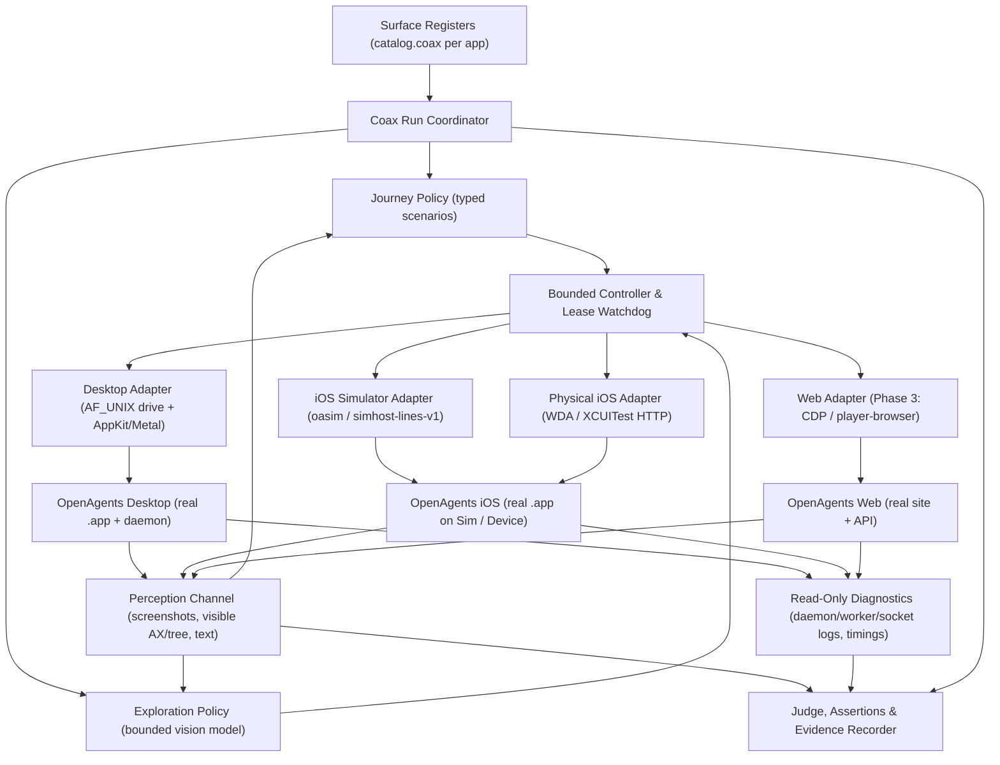

# Simulated App Tester Specification (Desktop, Mobile, and Web)

**Date:** 2026-11-20  
**Status:** Proposed specification (ready for Phase 0/1 implementation)  
**Scope:** `apps/openagents-desktop/`, `apps/openagents-ios/`, `apps/openagents-web/` (Phase 3), `apps/shared/tester/`, `coax/lib/agent/device/`, `proto/tester/`  
**Related docs:**
- [`../audits/2026-11-20-gamebuilder-monorepo-migration-audit.md`](../audits/2026-11-20-gamebuilder-monorepo-migration-audit.md) (one Desktop app, one Mobile app, one Web app)
- [`../desktop/2026-11-20-gamebuilder-3d-worlds-audit.md`](../desktop/2026-11-20-gamebuilder-3d-worlds-audit.md) (GameBuilder CLI/MCP and 3D views in OpenAgents Desktop)
- [`../../gamebuilder/docs/player-testing.md`](../../gamebuilder/docs/player-testing.md) & [`../../gamebuilder/docs/user-testing.md`](../../gamebuilder/docs/user-testing.md) (origin of the simulated player & automated user architecture)
- [`../desktop/macos-drive-and-screenshots.md`](../desktop/macos-drive-and-screenshots.md) (macOS drive socket & 3-tier capture)
- [`../desktop/ios-simulator-spec.md`](../desktop/ios-simulator-spec.md) & [`../desktop/android-emulator-vision.md`](../desktop/android-emulator-vision.md) (`oa-simhost` / `oasim` headless device control)
- [`../coder/desktop-evals-spec.md`](../coder/desktop-evals-spec.md) (complementary coding & worker eval tiers)

---

## 1. Purpose and Lineage

Following the 2026-11-20 monorepo consolidation, OpenAgents ships **one Desktop app** (`apps/openagents-desktop/`), **one Mobile app** (`apps/openagents-ios/`), and **one Web app** (`apps/openagents-web/`), with GameBuilder, Everglade, and Metaverse Engine capabilities folded into those canonical surfaces.

In the GameBuilder repository, we built two complementary simulated-user systems:
- **The automated player** (`gamebuilder/docs/player-testing.md`, `gamebuilder/tests/player/`, `gamebuilder/tools/player-test.coax`): a Coax coordinator driving the real shipped product through real input, separating *tester perception* from *read-only diagnostics*, enforcing input leases and a release watchdog, running both deterministic journeys and a bounded vision-exploration policy, and publishing machine verdicts with video/screenshot/JSONL evidence against a maintained surface register.
- **The automated user** (`gamebuilder/docs/user-testing.md`, `gamebuilder/tests/user/`): end-to-end product-loop journeys with both a hermetic `--local` lane and a `--live` production lane, verified against product source tables so coverage cannot drift.

This specification generalizes and adapts that architecture into **one unified Simulated App Tester** for the OpenAgents apps — starting with **Desktop (`apps/openagents-desktop/`)** and **Mobile (`apps/openagents-ios/`)**, including **paired Desktop ↔ Mobile scenarios**, and extending cleanly to **Web (`apps/openagents-web/`)** in Phase 3.

### 1.1 The Result We Want

A simulated tester launches the compiled OpenAgents app, interacts with it as a person does (clicking, typing, dragging, resizing, tapping, swiping, rotating, backgrounding, switching chats, pairing desktop and phone), exercises concrete scenarios across every shipped screen and workflow, and produces an inspectable verdict with a recording someone can watch.

It catches what unit tests and CLI benchmarks miss:
- a covered or clipped button in a narrow window or behind the iOS software keyboard;
- a streaming reply or code block that stalls, truncates, or breaks layout;
- a background chat whose worker output is dropped when switching tabs;
- a file-pane edit that fails to prompt on close or fails to write back;
- a `/goal` or budget cap that fails to stop, or a local model download/inference flow that lies about readiness;
- a Desktop ↔ iOS paired session that loses sync, drops an activity group, or shows stale workspace state;
- an embedded iOS Simulator or 3D GameBuilder view that steals scroll focus or renders blank.

### 1.2 Core Design Rules

These rules are carried directly from `AGENTS.md` ("Done means the real thing works") and GameBuilder's `player-testing.md`:

1. **Two complementary testers.**
   - **Journey tester:** repeatable, bounded scenarios with explicit preconditions, real UI actions, hard assertions, tolerances, and time/cost budgets.
   - **Exploration tester:** a bounded vision/UI policy model that picks goals and typed actions solely from what is visible (screenshots + visible accessibility/element tree, never hidden internals), backed by a fast local Coax controller, discovering unexpected defects and turning them into reviewed regression journeys.
2. **Real UI only.** Both testers operate the compiled app through real input and accessibility paths. Neither wins by mutating internal Coax state, injecting session cookies/tokens, calling private test hooks to skip flows, or accepting model prose as proof. Model prose never passes a scenario; the observable consequence (rendered UI, accessibility tree, disk/git state, daemon/server state) must match.
3. **Zero disruption to the owner's desktop.** Unattended runs never steal active-app focus, never move the user's cursor, never touch `NSPasteboard.general`, never open `Simulator.app` or a visible browser window, never play audio, and never touch the owner's `~/.openagents/` data, Keychain, chats, or levels.
4. **Honest lanes and verdicts.** Hermetic local runs (`--mode local`, using isolated temp dirs and scripted mock workers or local stand-ins) and live runs (`--mode live`, using real daemon, real models, real accounts/devices) are explicitly labelled and never conflated. Local passes are fast regression checks; they never qualify a release.
5. **Coverage is a maintained contract.** Every app maintains a versioned **surface register** (`catalog.coax`) checked against the app's own screen/route/action tables in CI. The coverage denominator comes from the register, not from whichever tests happened to run.
6. **Coax first (`tools-in-coax`).** The coordinator, surface registers, scenario definitions, controller, watchdog, judge, report builder, and wire codecs are written in Coax (`coax/web/tool.sh`). Platform bridges (Swift/ObjC/JS) stay thin and carry `Firm reason: N (...)` headers.

---

## 2. What Exists Today and What We Reuse

Per `docs/reuse.md`, the simulated tester builds on existing OpenAgents and migrated GameBuilder infrastructure instead of creating parallel drivers.

| Existing Component | Location | How the Simulated Tester Reuses It | Gap to Address |
| --- | --- | --- | --- |
| **macOS Drive & Capture** | `apps/shared/host/drive.c`, `apps/shared/host/apple/ui-host.m`, `docs/desktop/macos-drive-and-screenshots.md` | AF_UNIX `0600` drive socket, `tree`, `ax`, `ax-press`, `ax-key`, `tap`, `drag`, `type`, `key`, `menu`, `choose`, isolated `NSPasteboard`, Tier 0/1/2 PNG capture | Wire `--drive SOCKET`, `--real-time`, Tier 1 composite capture (covering native `NSView` + Metal/Simulator/3D overlays), and continuous frame/video capture into `apps/openagents-desktop/` |
| **iOS Simulator Host (`oasim`)** | `coax/lib/agent/device/`, `coder/tui/oasim.coax`, `docs/desktop/ios-simulator-spec.md` | Headless CoreSimulator boot, `IOSurface` frames, HID tap/swipe/multi-touch/keys/buttons, `describe` AX tree, device logs, video recording, contested-device etiquette | Expose a dedicated tester session mode (isolated simulator UDID, `OA_IOS_BUNDLE_ID`, lease/watchdog, structured `tester.observation.v1` emission) |
| **Web CDP & WebDriver Clients** | `coax/web/player-browser.coax`, `coax/web/player-webdriver.coax`, `coax/lib/net/cdp.coax` | Headless hardware-GPU Chrome over CDP (`chrome-mac`, phone/tablet touch emulation), W3C WebDriver HTTP client | Reuse `player-webdriver.coax` for physical iOS devices via WebDriverAgent/XCUITest; unify `player-browser.coax` under the shared tester adapter interface in Phase 3 |
| **GameBuilder Player & User Harness** | `gamebuilder/tests/player/`, `gamebuilder/tests/user/`, `gamebuilder/tools/player-test.coax` | Coordinator patterns, `mail.coax` paced test-inbox reader, `matrix.coax` merger, `provenance.coax`, `artifacts.coax`, `policy.coax` bounded vision exploration, `report.html`/`report.json`/JUnit writers | Extract generic runner, evidence, mail-lease, matrix, and vision-policy modules into `apps/shared/tester/` so Desktop, iOS, Web, and GameBuilder share one implementation |
| **Shared App Cases & Fakes** | `apps/shared/app/cases/` (`drive.coax`, `fakes.coax`, `run.coax`) | Typed case runner and deterministic local fakes for `apps/shared/app/` | Keep for fast Tier 0/1 local regression; never allow fakes in `--mode live` |
| **Desktop Evals Spec** | `docs/coder/desktop-evals-spec.md` | Tier 1 scripted `mcworker-wire` mock worker (`MWW_READY`, `MWW_REPLY`, `MWW_THOUGHT`, `MWW_COMMAND`, `MWW_DELEGATE`, `MWW_ATTEMPT`, `MWW_ENDED`) | Reuse the scripted mock worker as the backend for Desktop `--mode local` scenarios so UI flows run deterministically in seconds with zero LLM spend |
| **iOS UI Tests** | `apps/openagents-ios/UITests/SidebarTests.swift`, `apps/openagents-ios/dev.sh` | Reference accessibility identifiers and isolated-bundle launch flags (`OA_IOS_BUNDLE_ID`) | Keep `SidebarTests.swift` as fast Xcode smoke; route full scenario suites and cross-device journeys through `oasim` / WDA |

---

## 3. Architecture and Ownership



### 3.1 Coordinator & Multi-Client Synchronization

- The **Coax Run Coordinator** owns device/account/profile leases, target preflight, scenario scheduling, time/cost/token budgets, barrier synchronization, cleanup verification, and final report emission.
- Each app instance under test has its own adapter, observation stream, action ledger, and input lease.
- **Paired Desktop ↔ Mobile scenarios** launch both clients simultaneously in isolated workspaces/simulators and synchronize via explicit observable barriers (e.g., `barrier("desktop_paired")`, `barrier("ios_sees_reply")`) with bounded deadlines — never by freezing app clocks in live mode.

### 3.2 Proposed Repository Layout

| Path | Responsibility |
| --- | --- |
| `apps/shared/tester/schema.coax` | Single codec for `tester.observation.v1`, `tester.action.v1`, `tester.result.v1` |
| `apps/shared/tester/coordinator.coax` | Run loop, target matrix, leases, barriers, budgets, cleanup |
| `apps/shared/tester/controller.coax` | Action resolution, hit-test/occlusion guards, input leases, watchdog |
| `apps/shared/tester/judge.coax` | Hard assertions, relational/visual predicates, verdict classification |
| `apps/shared/tester/evidence.coax` | JSONL writers, screenshot/video capture hooks, redaction, `report.json`, `report.html`, JUnit XML |
| `apps/shared/tester/explore.coax` | Bounded vision-exploration policy adapter (extracted from `gamebuilder/tests/player/policy.coax`) |
| `apps/shared/tester/mail.coax` | Dedicated test-inbox reader & persistent code-request pacing lease |
| `apps/shared/tester/adapter-desktop.coax` | macOS Desktop adapter (`--drive SOCKET`, process/daemon lifecycle, Tier 1 composite capture) |
| `apps/shared/tester/adapter-ios-sim.coax` | iOS Simulator adapter over `oasim` (`simhost-lines-v1`) |
| `apps/shared/tester/adapter-ios-device.coax` | Physical iOS adapter over WebDriverAgent / W3C Actions (`player-webdriver.coax`) |
| `apps/shared/tester/adapter-web.coax` | Phase 3 Web adapter over `coax/web/player-browser.coax` |
| `apps/shared/tester/cli.coax` | CLI entrypoint (`coax/web/tool.sh apps/shared/tester/cli.coax ...`) |
| `apps/openagents-desktop/tests/tester/` | Desktop `catalog.coax`, `journeys/*.coax`, local scripted-worker fixtures |
| `apps/openagents-ios/tests/tester/` | iOS `catalog.coax`, `journeys/*.coax`, paired Desktop↔iOS journeys |
| `apps/openagents-web/tests/tester/` | Phase 3 Web `catalog.coax`, `journeys/*.coax` |
| `proto/tester/` | JSON schema fixtures + `proto/registry.json` entries for `tester.*.v1` |

`contexts.txt` permits `apps/shared/tester/` to load `coax/lib/`, `coax/lib/agent/device/`, `coax/web/` (browser/webdriver), and `proto/`; it never loads app-private mutation internals.

---

## 4. Observe, Act, Verify

All adapters speak three versioned records, registered in `proto/registry.json` with one Coax codec (`apps/shared/tester/schema.coax`), serialized as bounded JSON and retained chronologically as JSONL. Schema mismatches or silent truncation fail the run immediately (`infrastructure-fail`).

### 4.1 `tester.observation.v1`

- `client_id`, `target` (`desktop-mac`, `ios-sim`, `ios-device`, `web-chrome-mac`, `web-chrome-phone`, `web-chrome-tablet`), `mode` (`local` | `live`)
- `seq` (monotonic observation sequence), `ts_ms` (monotonic wall clock), `frame_id` (when available)
- `provenance`: git SHA, app bundle ID & build/version, OS version, GPU/device model, daemon/worker version
- `viewport`: logical `width`, `height`, `scale` (DPR), `orientation`, `safe_area` insets, `keyboard_frame` (iOS)
- `screenshot_ref`: relative path to full-resolution PNG (plus capture latency in ms)
- `elements[]`: visible, non-occluded UI elements from Coax `tree` and platform AX (`NSAccessibility` / iOS `describe` / DOM), each with `id`, `role`, `label`, `value` (redacted for secrets), `bounds` (clipped to viewport), `enabled`, `focused`, `selected`
- `visible_text[]`: bounded visible text runs for fast structural assertions
- `focus`: currently focused element ID and input owner (composer, search, modal, file pane, simulator pane, 3D view)
- `active_sheet_or_modal`: open sheet/dialog/alert identifier, if any

### 4.2 `tester.action.v1`

- `action_id`, `source_seq` (the observation sequence this action was decided from)
- `intent`: human-readable description (e.g. `"tap send button"`, `"swipe open sidebar"`, `"type prompt in composer"`)
- `deadline_ms`, `lease_ms` (maximum duration any input may stay held without renewal; hard cap `1000 ms`)
- `op`: typed action union:
  - **Semantic / Element-targeted:** `tap(target)`, `double_tap(target)`, `long_press(target, ms)`, `right_click(target)`, `type(target, text)`, `clear_and_type(target, text)`, `scroll(target, dx, dy)`, `drag(from_target, to_target | dx, dy)`
  - **Coordinate / Gesture (for canvases, panes, multi-touch, swipes):** `pointer_tap(x, y)`, `swipe(x1, y1, x2, y2, ms)`, `touch_path(points[])`, `two_finger_path(p1[], p2[])`
  - **Keyboard & Hardware:** `key(combo)`, `key_hold(key, ms)`, `hardware_button(home | lock | volume_up | volume_down)`, `menu(title)`
  - **Window & Lifecycle:** `resize(w, h)`, `rotate(portrait | landscape)`, `background(ms)`, `foreground()`, `relaunch()`, `open_url(url)`, `choose_file(path | cancel)`
  - **Wait / Barrier:** `wait_until(predicate, timeout_ms)`, `barrier(name, timeout_ms)`

**Target resolution & anti-cheat rules:**
- Semantic actions resolve `target` (by stable ID or accessible role+label) against the **current** observation, verify it is enabled, inside the viewport, and not occluded by another view/sheet/keyboard, and then deliver real pointer/touch/key input to its hit-tested point.
- If a target moved, became disabled, or is covered (e.g., by a transient banner or the iOS keyboard), the controller **re-observes or fails** — it never forces a click through an occluding layer.
- Actions against stale observations (older than `500 ms` for interactive/animated states, or after a layout shift) are rejected and re-observed.

### 4.3 `tester.result.v1`

- `scenario_id`, `client_id`, `target`, `mode`, `verdict` (`pass`, `product-fail`, `infrastructure-fail`, `blocked`, `inconclusive`, `not-applicable`, `unqualified`)
- `duration_ms`, `steps_run`, `first_failure_step`, `summary` (plain-English description of what a person would see go wrong)
- `assertions[]`: each with `name`, `passed`, `expected`, `actual`, `evidence_ref`
- `coverage_cells[]`: surface-register IDs exercised
- `metrics`: launch latency, p50/p95 frame/capture interval, model turns, token usage, estimated spend
- `cleanup`: explicit cleanup status (`ok` | `failed` | `quarantined`)

### 4.4 Two Strictly Separate Channels

1. **Tester Perception Channel:** screenshots, visible AX/element tree, rendered text, focus, safe-area/keyboard bounds, audio cues. This is the **only** channel the Exploration Policy sees, and every core journey must have visible consequences verifiable on this channel alone.
2. **Read-Only Diagnostics Channel:** allowlisted, redacted telemetry from the app host, `openagents-environment` daemon, worker wire (`mcworker-wire` event counts/states, exit codes), iOS device logs (`oasim logs`), and web console/network status codes. The Judge uses diagnostics to corroborate and explain failures (e.g., distinguishing a UI render freeze from a worker crash or network 503). Diagnostics never mutate state and never grant a pass when the visible UI is broken or blank.

### 4.5 Input Leases and Watchdog

- Every held key, drag, or touch contact carries an explicit lease (`<= 1000 ms`).
- A separate watchdog releases all held inputs within `300 ms` of lease expiry, policy crash, or scenario cancellation.
- Unexpected focus loss, modal sheet appearance, or app crash cancels pending input through the adapter's normal release path and logs an explicit cancellation record.

---

## 5. Platform Adapters

### 5.1 Phase 1 — Desktop Adapter (`apps/openagents-desktop/`, `com.openagents.desktop`)

Builds directly on [`docs/desktop/macos-drive-and-screenshots.md`](../desktop/macos-drive-and-screenshots.md):

- **Transport:** Launches the compiled `OpenAgents.app` binary with `--drive <tmp>/oa-drive-<run>.sock` (`0600` AF_UNIX), isolated `--data-dir <tmp>/data`, `HOME=<tmp>/home`, `CODER_WORKTREES=<tmp>/worktrees`, `OA_SIMHOST_SOCK=<tmp>/simhost.sock`, private `NSPasteboard`, and `NSApp.setActivationPolicy(.prohibited)` (zero focus stealing, offscreen/non-activating window).
- **Two execution modes:**
  - `--mode local`: enables agent clock (`--still-clock`, deterministic `2.0` Retina scale) and points the worker launcher at a deterministic scripted `mcworker-wire` mock worker (from `docs/coder/desktop-evals-spec.md` Tier 1) plus a temp git repository. Runs the full UI/UX scenario suite in seconds with zero LLM spend.
  - `--mode live`: passes `--real-time` (ordinary wall clock), launches the real `openagents-environment` daemon and real workers (Gemini/Claude/local Inkling 2 Mini GGUF) in an isolated temp git repo, and enforces hard wall-time, turn, and dollar budgets.
- **Capture:** Uses Tier 1 in-process composite capture (`--tier=composite`, no Screen Recording TCC required) so the Coax Metal page (`components/app/`, `page/`), native AppKit editor/controls, `SimulatorPaneView`, `PleScenePanelView`, `GymWorkbenchView`, and future GameBuilder 3D panes all appear in screenshots and video recordings (`tester.mp4`). Supports `--tier=window` (`ScreenCaptureKit`) optionally when validating native window chrome/sheets.
- **Observation fusion:** Merges Coax `tree` (every GPU widget's ID, role, label, rect) with macOS `ax` (`NSAccessibility` tree for AppKit text fields, menus, sheets, and native panes) into a single `tester.observation.v1` element list, deduplicated by rect/ID.
- **Conformance self-test (`--selftest desktop`):** Must prove before any desktop run can qualify:
  1. an occluded button is detected and not silently clicked;
  2. typing into the composer never steals macOS frontmost-app focus or mutates `NSPasteboard.general`;
  3. an intercepted `NSOpenPanel` / `NSSavePanel` resolves via `choose` without blocking;
  4. killing the controller mid-drag releases the drag within `300 ms`;
  5. Tier 1 capture produces non-blank pixels for both Metal and native sibling views.

### 5.2 Phase 2 — Mobile Adapter (`apps/openagents-ios/`, `com.openagents.app`)

Mobile has two explicit sub-lanes with distinct qualification roles:

#### A. iOS Simulator Lane (`ios-sim`, fast & unattended)
- **Transport:** Connects to `oa-simhost` via `coax/lib/agent/device/` (`simhost-lines-v1`, `oasim`). Never opens `Simulator.app`.
- **Isolation:** Creates or leases a dedicated tester simulator UDID (respecting `sim-devices.coax` contested-device rules so it never fights `apps/openagents-ios/dev.sh` or the owner's active simulator), installs `OpenAgents.app` built with an isolated `OA_IOS_BUNDLE_ID` (e.g. `com.openagents.app.tester`), and passes clean launch arguments/defaults (`-experimentalFeatures NO|YES`).
- **Perception & Input:**
  - Screenshots & continuous video frames from `oa-simhost` (`IOSurface` / `simctl io` recording).
  - Accessibility tree from `oasim describe` (`AccessibilityPlatformTranslation`), exposing both UIKit controls (active text editor, keyboard, system sheets) and the compiled GPU page's VoiceOver elements (`apps/openagents-ios/App.swift`).
  - Real HID input via `oasim` (`tap`, `swipe`, `touch_path`, `two_finger_path`, `text`, `press_key`, `button`, `rotate`, `set_appearance`, `open_url`, background/foreground/relaunch).
  - Diagnostics via `oasim logs` (filtered to the isolated bundle ID).
- **Qualification boundary:** Simulator proves layout, navigation, GPU component rendering, keyboard/safe-area handling, paired-computer flows, and state persistence, and runs on every PR/nightly. Simulator alone **cannot** qualify TestFlight or physical-device Metal/touch performance.

#### B. Physical iPhone / iPad Lane (`ios-device`, release / TestFlight qualification)
- **Transport:** Reuses `coax/web/player-webdriver.coax` speaking W3C WebDriver / W3C Actions over HTTP to a dedicated WebDriverAgent (XCUITest) runner on a tethered test iPhone/iPad.
- **Coverage:** Real Apple GPU Metal rendering, genuine multi-touch concurrency, real iOS software keyboard & dictation/IME behavior, notch/Dynamic Island safe areas, real background/foreground suspension, real Tailscale pairing to a Mac running `openagents-desktop`, and real TestFlight/signed-build provenance.
- **Android path:** When Android support lands (`docs/desktop/android-emulator-vision.md`), it plugs into the same `coax/lib/agent/device/` wire and `adapter-ios-sim.coax` pattern as `android-emu` / `android-device` with zero changes to the coordinator or scenarios.

### 5.3 Phase 3 — Web Adapter (`apps/openagents-web/` & `gamebuilder/web/`)

- Reuses `coax/web/player-browser.coax` (headless hardware-GPU Chrome over CDP, muted audio, no visible window) across `web-chrome-mac` (`1440×900`), `web-chrome-phone` (`412×915`, DPR 2, touch), and `web-chrome-tablet` (`1024×1366`, DPR 2, touch).
- Migrates GameBuilder's existing `gamebuilder/tests/player/` and `gamebuilder/tests/user/` onto the shared `apps/shared/tester/` coordinator and `tester.*.v1` schema so there is one runner, one report format, and one coverage matrix across Desktop, Mobile, and Web.

---

## 6. Surface Registers and Required Scenarios

Every app maintains a `catalog.coax` surface register enumerating its screens, panes, sheets, routes, roles/modes, and required scenarios. A drift check (`coax/web/tool.sh apps/shared/tester/cli.coax --checks`) verifies that every screen/action in the app's source tables maps to a register entry and that every registered required scenario is present. Features not yet shipped are explicitly marked `planned` or `not-applicable`, never silently skipped.

### 6.1 Desktop Surface Register & Required Scenarios (`apps/openagents-desktop/`)

| Area | Scenario ID(s) | What the Simulated Tester Does & Verifies |
| --- | --- | --- |
| **Cold launch & empty state** | `desktop.launch.cold` | Launches into isolated data dir; verifies non-blank Metal frame, centered composer, working-folder chip, model/effort chips, sidebar visibility (`>= 900 pt`), zero console/crash errors |
| **Composer & streaming reply** | `desktop.chat.send-stream-copy` | Types multi-line prompt (`Shift+Return` / `Option+Return`), presses `Return` to send; verifies user bubble, activity/thought rows, streaming Markdown & code fence, working timer, final reply, code-block Copy & whole-chat Copy (confirming thoughts are excluded on isolated pasteboard) |
| **Steer, queue & stop** | `desktop.chat.steer-queue-stop` | While a turn is running: queues a follow-up (`Shift+Return`), steers mid-turn (`Return`), then presses `Stop`; verifies clean worker termination and composer recovery |
| **Multi-chat & background runs** | `desktop.chat.background-switch` | Starts a slow turn in Chat A, opens New Chat (`Cmd+N`) and sends in Chat B, switches via sidebar and `Cmd+1`/`Cmd+2`; verifies sidebar running indicator, zero dropped output in Chat A, and clean reattachment |
| **Per-chat git worktrees** | `desktop.git.worktree-isolation` | Opens a temp git repo; verifies new chat creates its own `coder/<id>` worktree under `CODER_WORKTREES`, branch chip updates, two chats do not clobber each other, and deleting a clean chat cleans up while a dirty worktree is preserved with a notice |
| **Sub-agents & transcript pane** | `desktop.agents.subagent-pane` | Triggers a turn with sub-agent delegation; verifies sub-agent row, opening the right-hand transcript pane, live streaming rows, drag-resizing the pane (`320..900 pt`), and narrow-window full-width takeover |
| **File pane edit & save** | `desktop.files.open-edit-save` | Clicks a file referenced in a reply/row; verifies right-hand file pane opens with line numbers, edits text, verifies `Edited` badge, attempts close (verifies unsaved-changes guard), saves (`Cmd+S`), and verifies bytes on disk |
| **Goals & budget cap** | `desktop.goal.budget-gate` | Runs a `/goal` chat with a tight test budget; verifies budget auto-stop, explicit approval/increase flow, and that `[GOAL_COMPLETE]` triggers the real verification check |
| **Local models (Inkling 2 Mini)** | `desktop.local.inkling-select` | Opens Local Models UI / model picker; verifies real readiness state (never shows installed without valid weights), selects Inkling 2 Mini when weights exist, and verifies real local token streaming (or explicit blocked verdict when weights are absent) |
| **Embedded iOS Simulator pane** | `desktop.sim.pane-control` | Opens the iOS Simulator right-hand pane; verifies live `IOSurface` rendering (non-blank pixels), click-as-tap forwarding, rotation, device picker, agent grant banner & one-click Stop |
| **GameBuilder 3D cards & pane** | `desktop.world.cards-and-pane` | Exercises `TK_WORLD` tool results (edit/level/play-test cards with before/after stills, Undo, Open in side pane); verifies revision label matches rendered frame and scrolling transcript never steals 3D camera input (marked `planned` until Phase 1/2 of the 3D worlds audit lands) |
| **Layout, zoom & narrow windows** | `desktop.layout.responsive-zoom` | Steps through `Cmd+`/`Cmd-`/`Cmd+0` zoom levels and resizes from `1440×900` down to `760×640`; verifies no clipped/overlapping controls, sidebar auto-hide `< 900 pt`, and readable composer |
| **Persistence & relaunch recall** | `desktop.persist.relaunch-recall` | Creates chats, pins & drag-reorders them, sets zoom/sidebar widths, quits cleanly, relaunches; verifies exact sidebar order, persisted chat history, and recall continuity on the next turn |
| **Experimental features & recovery** | `desktop.experimental.and-crash` | Toggles `experimentalFeatures` off (verifies zero login/Foreman/Gym surfaces) vs on (verifies Foreman `Cmd+\`` and account flow); simulates worker EOF/crash and verifies graceful UI error + retry without app crash |

### 6.2 Mobile Surface Register & Required Scenarios (`apps/openagents-ios/`)

| Area | Scenario ID(s) | What the Simulated Tester Does & Verifies |
| --- | --- | --- |
| **Cold launch & empty state** | `ios.launch.cold` | Launches isolated `com.openagents.app.tester`; verifies Metal canvas non-blank, top nav button, empty-chat options, environment chip, zero crashes |
| **Sidebar drawer & gestures** | `ios.nav.drawer-and-swipe` | Taps nav button to push-open sidebar, verifies New chat, Search, Pinned, Recents, Local/Settings; swipes back from edge to close; repeats 5× without layout drift |
| **Keyboard & safe-area occlusion** | `ios.input.keyboard-safe-area` | Focuses composer, types multi-line text, verifies composer and Send button stay completely above `keyboard_frame` and inside `safe_area` in both portrait and landscape; taps outside to dismiss keyboard |
| **Paired computer & project picker** | `ios.paired.pick-computer-project` | With a paired Desktop/daemon running, opens computer picker & project chip; verifies workspace name and active repositories list; sends a prompt and observes live streaming, working timer, and collapsible `components/app/activity.coax` group (open while working, folded when done) |
| **Conversation actions & Recents** | `ios.library.actions-and-search` | Opens conversation menu: tests Copy messages, Share excerpt, Pin, Rename, Archive/Restore; verifies Recents `All` / `Pinned` / `Archived` filters and title search |
| **Workspace Git / PR view** | `ios.workspace.git-view` | Opens Workspace GPU page for a paired computer; verifies changes, branches, worktrees, and PRs list render cleanly without clipping; verifies confirmation gate before any write op |
| **Experimental features gate** | `ios.experimental.gate` | With `experimentalFeatures` off: verifies no Login, Projects, Foreman, or Nostr surfaces, and sending with no paired computer prompts to pair. With it on: verifies Login screen push, Back button, and Usage sheet |
| **Orientation & lifecycle** | `ios.lifecycle.rotate-background` | Rotates portrait ↔ landscape mid-chat, backgrounds app for 5 s, foregrounds, and force-relaunches; verifies session resume, no stuck input, and intact transcript |
| **Paired Desktop ↔ iOS sync** | `paired.desktop-ios.live-chat` | Coordinator launches Desktop + iOS Simulator together against one isolated local daemon: Desktop starts a chat and streams a reply → barrier → iOS opens that chat, sees the exact reply and activity group → iOS sends a follow-up → barrier → Desktop renders the follow-up and replies → Pin/Rename on iOS reflects on Desktop |

### 6.3 First Concrete Journeys (Vertical Slice Targets)

#### Desktop Vertical Slice: `desktop.chat.edit-and-verify`
- **Preconditions:** Fresh temp `HOME`, temp data dir, temp git repo containing `hello.txt` (`"hello\n"`), isolated `--drive` socket. Runs in `--mode local` (scripted mock worker) and `--mode live` (real worker, 5-minute wall cap, `$0.25` budget cap).

| Step | Tester Action | Required Observable Consequence |
| --- | --- | --- |
| 1 | Launch `OpenAgents.app --drive SOCK --data-dir TMP`, open temp repo via intercepted `choose` | Non-blank Tier 1 composite screenshot; composer focused; folder chip shows temp repo name; `coder/<id>` worktree created |
| 2 | `type` prompt asking to update `hello.txt` to `"hello world\n"` and press `Return` | User message bubble appears; activity row shows running timer; streaming reply completes; `Stop` returns to `Send` |
| 3 | Click `hello.txt` link in the reply/row | Right-hand file pane opens showing `hello.txt` with `"hello world"` on line 1 (and disk file matches) |
| 4 | Click Copy on the reply; read isolated pasteboard | Isolated pasteboard contains reply Markdown and zero thought text; `NSPasteboard.general` is untouched |
| 5 | Quit cleanly, relaunch against same `--data-dir` | Sidebar lists the saved chat at top; opening it renders the exact user prompt, activity group, and reply |

#### Mobile Vertical Slice: `ios.paired.send-and-observe`
- **Preconditions:** Dedicated simulator UDID booted via `oasim`, isolated `com.openagents.app.tester` installed, paired to an isolated local daemon with a temp workspace.

| Step | Tester Action | Required Observable Consequence |
| --- | --- | --- |
| 1 | Launch app via `oasim`, capture initial observation | Non-blank `IOSurface` frame; `describe` AX tree lists nav button, environment chip, and composer |
| 2 | Tap nav button → verify sidebar → swipe back | Sidebar opens with New chat / Recents / Settings; swipe restores chat screen cleanly |
| 3 | Tap composer, type message via HID, verify keyboard layout, tap Send | Composer & Send button remain above `keyboard_frame`; user bubble appears; activity group opens while working and folds when reply finishes |
| 4 | Background app for 3 s, foreground, rotate to landscape and back | Transcript remains intact; zero overlapping controls; zero crash logs in `oasim logs` |

---

## 7. Bounded Exploration Policy

Alongside deterministic journeys, the **Exploration Tester** (`apps/shared/tester/explore.coax`, ported from `gamebuilder/tests/player/policy.coax`) catches unforeseen UX bugs:

- **Inputs:** Only the Tester Perception channel — the current screenshot (downscaled to `<= 1,280 px` longest edge for token efficiency while full-res PNG stays in evidence), compact visible AX/element list, recent action history, current coverage frontier (unvisited screens/controls from `catalog.coax`), and remaining step/time/token budget.
- **Outputs:** One typed `tester.action.v1` from the allowed vocabulary plus an optional candidate defect note (`"send button clipped on right edge"`). Never emits code, shell commands, or verdict overrides.
- **Hard limits:** Default 12 turns per exploration episode, 512 output tokens/turn, 160,000 total tokens including cached input, disabled tool calls, and explicit per-run cost cap.
- **Honest judging:** Every action is executed and checked by the Coax controller and judge (crash detection, blank-frame detection, stuck-state detection, layout overlap/clipping check, console/log error check). Model-flagged visual issues are logged as `inconclusive` / candidate findings with screenshots until corroborated by a hard assertion or promoted by a human into a deterministic journey.

---

## 8. Accounts, Secrets, Verdicts, and Evidence

### 8.1 Account & Secret Isolation
- `--mode local` requires zero credentials and zero network access.
- `--mode live` uses only dedicated test credentials loaded from `OA_TESTER_SECRETS` (never personal accounts, never committed to git). Email-code login reuses `apps/shared/tester/mail.coax` with an atomic single-run lease and persistent 13-minute pacing across restarts.
- Video recording automatically pauses or masks over credential entry and account/key sheets; all JSONL logs scrub tokens, cookies, authorization headers, and Nostr private keys before writing to disk.
- Every run creates a fresh output directory (refusing to overwrite an existing one) and destroys temporary profiles/worktrees on exit; cleanup failure marks the run's cleanup state `failed` and quarantines the account/device lease.

### 8.2 Machine Verdicts & Matrix Qualification

| Verdict | Meaning | Counts Toward Green Matrix? |
| --- | --- | --- |
| `pass` | All hard assertions passed with valid provenance and non-corrupt evidence | Yes |
| `product-fail` | App violated a required behavior, crashed, rendered blank, or clipped/covered a control | No |
| `infrastructure-fail` | Harness, simulator host, capture encoder, or test-model provider failed | No |
| `blocked` | Missing prerequisite (e.g. missing local model weights, missing test secrets, unavailable physical device, or upstream journey failed) | No |
| `inconclusive` | Mixed build provenance during run, or uncorroborated exploration finding | No |
| `not-applicable` | Cell does not apply to target (e.g., macOS window resize on iOS, desktop pointer lock on touch) | Excluded from denominator |
| `unqualified` | Shipped surface/feature lacks a scenario contract in `catalog.coax` | No (fails coverage completeness) |

**Release qualification rule** (carried from `player-testing.md`): A single passing run is diagnostic evidence. Qualifying a release matrix requires **3 consecutive clean full runs** per required target (`desktop-mac`, `ios-sim`, plus `ios-device` for TestFlight releases), with identical build provenance across the batch, zero missing recordings, and zero `unqualified` surfaces.

### 8.3 Evidence Bundle

Every run writes a self-contained private directory (`build/tester-runs/<run-id>/`, gitignored):
- `report.json` — machine-readable summary, provenance, coverage table (`required` / `attempted` / `passed`), verdicts, timings, budgets, cleanup status
- `report.html` — local human-readable report with failure thumbnails, step timeline, and coverage matrix
- `junit.xml` — standard JUnit report for CI/triage tools
- `observations.jsonl`, `actions.jsonl`, `results.jsonl`, `diagnostics.jsonl` — chronological, redacted records
- `screenshots/` — full-resolution PNGs at checkpoints and before/after every failure (plus element-diff / pixel-diff artifacts when comparing baselines)
- `tester.mp4` — real-time recording of the run (missing/corrupt recording fails visual qualification)

---

## 9. CLI Surface

One Coax CLI drives all targets (`coax/web/tool.sh apps/shared/tester/cli.coax ...`, later exposed as `openagents tester ...` in `apps/openagents-cli/`):

```sh
# 1. Static checks: schema round-trips, surface-register drift, controller/judge #tests
coax/web/tool.sh apps/shared/tester/cli.coax --checks

# 2. Adapter conformance self-tests (must pass before any run qualifies)
coax/web/tool.sh apps/shared/tester/cli.coax --selftest --target desktop
coax/web/tool.sh apps/shared/tester/cli.coax --selftest --target ios-sim

# 3. Fast deterministic local regression (no LLM spend, isolated temp state)
coax/web/tool.sh apps/shared/tester/cli.coax --target desktop --mode local --suite critical --out build/tester-runs/desk-local-001
coax/web/tool.sh apps/shared/tester/cli.coax --target ios-sim --mode local --suite full --out build/tester-runs/ios-local-001

# 4. Live end-to-end journeys (real daemon, real models, real paired devices)
coax/web/tool.sh apps/shared/tester/cli.coax --target desktop --mode live --only desktop.chat.edit-and-verify --out build/tester-runs/desk-live-001
coax/web/tool.sh apps/shared/tester/cli.coax --target paired --mode live --only paired.desktop-ios.live-chat --out build/tester-runs/paired-001

# 5. Bounded vision exploration
coax/web/tool.sh apps/shared/tester/cli.coax --target desktop --mode live --suite explore --budget-usd 0.50 --out build/tester-runs/explore-001

# 6. Merge runs into a release qualification matrix
coax/web/tool.sh apps/shared/tester/cli.coax --merge build/tester-runs/run-1 build/tester-runs/run-2 build/tester-runs/run-3 --out build/tester-runs/matrix-001
```

---

## 10. Phased Implementation Plan

Build in small vertical slices, landing Coax `#test` checks and `#authority` mutation coverage (zero surviving mutants on verdict/policy/lease rules) in each phase:

| Phase | Scope | Deliverables | Done When |
| --- | --- | --- | --- |
| **Phase 0: Core & Schemas** | `proto/tester/`, `apps/shared/tester/` | `tester.{observation,action,result}.v1` codecs registered in `proto/registry.json`; coordinator, bounded controller, lease watchdog, judge, JSONL/HTML/JUnit evidence writer; `wire-check` & `tools-check` clean | `--checks` passes; watchdog unit test proves held-input release within `300 ms` on killed policy |
| **Phase 1A: Desktop Foundation** | `apps/openagents-desktop/`, `adapter-desktop.coax` | Wire `--drive SOCKET`, `--real-time`, Tier 1 composite capture, and `tree`+`ax` fusion in `apps/openagents-desktop/`; Desktop `catalog.coax`; first journey `desktop.chat.edit-and-verify` in `--mode local` and `--mode live` | `--selftest --target desktop` passes with zero focus stealing; `desktop.chat.edit-and-verify` produces a valid `report.html`, `tester.mp4`, and `pass` verdict in both local and live modes |
| **Phase 1B: Full Desktop Matrix** | `apps/openagents-desktop/tests/tester/` | All 14 required Desktop scenarios (streaming, steer/queue/stop, background chats, worktrees, sub-agents, file pane, `/goal`/budget, local Inkling model, embedded iOS Simulator pane, zoom/resize, relaunch recall, crash recovery) | Full local suite passes in `< 3 min`; 3 consecutive clean live critical runs pass on a dedicated Mac |
| **Phase 2A: iOS Simulator & Paired** | `coax/lib/agent/device/`, `apps/openagents-ios/`, `adapter-ios-sim.coax` | Dedicated tester simulator lease over `oasim`; `describe` AX tree + `IOSurface` capture + video; iOS `catalog.coax`; all 9 iOS scenarios including `paired.desktop-ios.live-chat` | `--selftest --target ios-sim` passes without opening `Simulator.app`; `ios.paired.send-and-observe` and `paired.desktop-ios.live-chat` pass end-to-end with recordings |
| **Phase 2B: Physical iOS Devices** | `adapter-ios-device.coax` | WDA / XCUITest HTTP adapter reusing `coax/web/player-webdriver.coax`; tethered iPhone/iPad preflight, signed TestFlight provenance, real keyboard/safe-area/Metal/Tailscale pairing scenarios | Physical iPhone completes the critical & paired journeys against a signed build with non-blank capture and verified provenance |
| **Phase 3: Web & Exploration** | `apps/openagents-web/`, `gamebuilder/tests/`, `explore.coax` | Unify `coax/web/player-browser.coax` and GameBuilder's `tests/player/` + `tests/user/` under `apps/shared/tester/`; enable bounded vision exploration across Desktop, iOS, and Web; optional Android emulator adapter | One `openagents tester` CLI runs Desktop, Mobile, and Web into one merged qualification matrix |

---

## 11. Open Risks and Dependencies

- **Desktop Tier 1 composite capture with Metal overlays:** `apps/openagents-desktop/` composites a Coax Metal page with native AppKit editors, `SimulatorPaneView`, and `PleScenePanelView`. Phase 1A must verify that `CAMetalLayer.framebufferOnly = NO` plus `IOSurface` readback captures all layers without Screen Recording TCC and without dropping frames.
- **iOS `oasim describe` latency & GPU element coverage:** `apps/openagents-ios/` renders its main UI via GPU components with VoiceOver bindings in `App.swift`. Any interactive GPU control missing a stable accessibility identifier must be fixed in `apps/openagents-ios/` rather than worked around with hardcoded coordinates.
- **Physical iOS device provisioning:** Phase 2B requires a dedicated tethered test iPhone/iPad with WebDriverAgent signing (tracked in `NEEDS_OWNER.md` when Phase 2B starts). Until provisioned, `ios-device` cells report `blocked` honestly.
- **Model cost & flakiness in live runs:** Live runs enforce strict per-scenario wall-time, turn, and USD caps. A failed live run allows at most one diagnostic rerun while preserving the first failure as a flake — never overwriting a failure into a clean pass.
