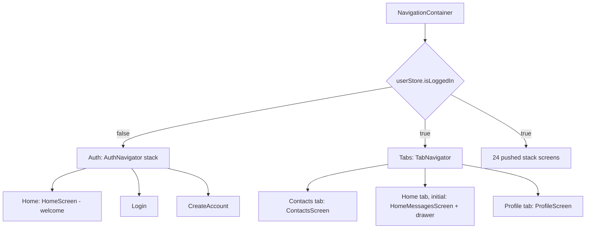

# Arcade audit, part 1: the app and its codebase

Tracking issue: OpenAgentsInc/openagents #13607.

This document describes Arcade (`OpenAgentsInc/arcade`, formerly
`ArcadeLabsInc/arcade`) as a product and as a React Native codebase: its
screens, navigation, flows, state, storage, back ends, dependencies, tests and
defects. It ends with a feature inventory that the port to OpenAgents iOS is
built from.

Two areas belong to other parts of this audit and are only named here:

- Part 2 specifies the Nostr protocol work: event kinds, tags, encryption,
  the `arclib` library, and which current NIPs replace the old ones.
- Part 3 specifies the visual design and the component library.

Source: the read-only clone at `/Users/christopherdavid/work/arcade`, HEAD
`2023-08-05 Improve perf and fix some bugs (#457)`, with the `app/arclib`
submodule at `542ecec` (2023-07-28). All Arcade paths below are relative to
that clone. "Verified" means read in the code. "Inferred" means concluded from
code without running it; such statements say so.

## Contents

1. What Arcade is
2. Architecture at a glance
3. Navigation
4. Screens
5. User flows
6. State and storage
7. Services and back ends (non-relay)
8. Dependencies
9. Platform configuration
10. Tests
11. Quality notes
12. Mapping to OpenAgents iOS
13. What the port must carry over
14. Files read
15. Open questions

---

## 1. What Arcade is

### 1.1 Product idea

Arcade is "a Nostr & AI chat app for Android & iOS" (`README.md`). The v0.1.0
release notes ("Oslo", 2023-06-12) state the goal: "the first cross-platform
mobile app intended to be a drop-in replacement for Telegram and other popular
chat apps", with "no proprietary back-end: only Nostr relays". The audience
was people who want censorship-resistant chat; the release names the Oslo
Freedom Forum and "people fighting for freedom around the globe". From v0.3.0
("Zero-One", 2023-07-10) the app adds AI chat, pitched as "easy access to the
latest AI models right from the chat app you use every day".

The product combines, in one inbox:

- public channels (NIP-28),
- encrypted direct messages (NIP-04), plus Arcade's own "blinded" DMs,
- encrypted private groups (Arcade's draft "NIP-112", never merged),
- AI chat with a bot persona called "Faerie", served by Arcade's own API.

Around that inbox: Nostr key login, a contact list with public, private
("secret") and "legacy" follows, relay management, profile editing with
avatar upload, NIP-05 names under `@arcade.chat`, Android push notifications,
link previews, inline images and video, swipe-to-reply, and a reputation score
shown next to each sender. A peer-to-peer marketplace (listings, offers,
"comment to trade") exists in code but is unreachable in the shipped app.

### 1.2 Feature list as shipped

The in-app changelog (`app/screens/ChangelogScreen.tsx`) and GitHub releases
give the shipped features. The code is at version 0.3.1 (`package.json`,
Android `versionName "0.3.1"` code 1044, iOS `CFBundleShortVersionString
0.3.1` build 13). GitHub has a later tag, v0.3.2-beta (2023-07-25), and HEAD
has one more commit after it (2023-08-05). The changelog screen stops at 0.3.1.

| Version | Date | Shipped (changelog and release notes) |
| --- | --- | --- |
| v0.1.0 "Oslo" | 2023-06-12 | Log in with nsec or create account; unified chat list of public channels, DMs and private groups; contacts; create public or private channel; invite contacts; view a member's profile, follow or message them; add and remove relays; edit name, username, bio, avatar and cover |
| v0.1.1 | 2023-06-13 | Fix DM view not showing the recipient's messages; nsec export on profile; changelog screen |
| v0.1.2 | 2023-06-14 | Image uploads; DM reliability |
| v0.1.3 | 2023-06-16 | Add contact by npub or from nostr.band suggestions; chat UI and loading indicator redesign |
| v0.2.0 "Upgrades" | 2023-07-03 | Blinded DMs; avatar upload; video player; link preview; privacy settings screen; NIP-05 names; push notifications (Android only); secret follows; private chat groups |
| v0.2.1 | 2023-07-05 (tag) / 6 Jul (changelog) | Channel members screen |
| v0.2.2 | 6 Jul 2023 | Faster contacts screen; better user profile screen |
| v0.3.0 "Zero-One" | 2023-07-10 | AI chat channels (GPT-3.5) |
| v0.3.1 | 2023-07-19 (tag) / 12 Jul (changelog) | Chat replies |
| v0.3.2 | 2023-07-25 | Relay rate-limit disconnect fix (#401); reputation shown in chats (#422); long messages grow the text box |
| HEAD | 2023-08-05 | Performance and bug fixes; blinded DMs appear on the home screen (#457) |

AI voice input (record, transcribe with OpenAI Whisper on Arcade's API, send
the transcript) landed 2023-07-13 (#368, #383) and is in v0.3.1 onward,
though no changelog entry names it.

### 1.3 Feature list as intended

The earliest roadmap (README at commit "Add initial feature list & roadmap
(#24)", 2023-01-05, then named "Arc") lists, in priority order: NIP-28 chat,
account creation, nsec login, key backup, UI theme picker, kind-0 profiles,
NIP-02 contacts, NIP-05, muting, global feed, NIP-25 reactions, clickable
links, images from follows, NIP-08 mentions, NIP-07 web login, relay
management, unread counts, Lightning invoices, create channels, pinned
messages, NIP-04 DMs, push notifications, reposts, emojis, LNbits wallets,
paid DMs, channel moderators, private group chats, per-note web URLs,
reputation (NIP-32), a UI theme marketplace, marketplace listings, voice
messages, audio rooms, video chat, e-commerce shops, bots and a developer API.

Code also shows intent that never shipped:

- Marketplace: `ListingScreen`, `ListingDetailScreen`, `OfferForm`,
  `arclib/src/listing.ts` and `arclib/src/comment_to_trade.ts`. Removed from
  the UI on 2023-06-05 ("temp remove listing").
- AI model choice: `app/screens/AI/TrainAI.tsx` offers GPT-3.5, GPT-4 and
  Claude; the selection is local state only and the entry point is commented
  out. The API README lists `model` values `gpt3.5`, `gpt4`, `claude`.
- Paid plans: `app/hooks/usePlan.ts` returns the constant `"pro"`.
- Unread badges: commented out in `ChannelItem.tsx` and `AIChannelDetail.tsx`.
- Discover hub: `DiscoverScreen` exists but no control opens it.

### 1.4 Timeline from the git log

436 commits from 2022-12-26 to 2023-08-05. Authors: Christopher David (147),
Ren Amamiya (120), erik aronesty (118 + 45 as "earonesty"), Enzo Manuel
Mangano (3), Rafael Saes (2), arkin0x (1). Commits per month: Dec 17, Jan 27,
Feb 2, Mar 21, Apr 26, May 59, Jun 221, Jul 62, Aug 1.

| Phase | Dates | What happened |
| --- | --- | --- |
| 1. "Arc" Nostr client prototype | 2022-12-26 to 2023-01-29 | Kind-1 feed, crypto shims, first chats UI, send "Hello world" to a channel, Tamagui monorepo with web, NIP-06 key generation, login/logout with device storage, list and switch NIP-28 channels, onboarding, key backup, theme picker, kind-0 names, Twitter-style profile, relays add/remove, SQLite event store (#38), NIP-25 reactions (#41), a react-three-fiber 3D scene (#43), DM inbox start (#44). Tags v0.0.1 (01-08), v0.0.2 (01-13). |
| 2. API and zaps detour | 2023-02-24 to 2023-03-30 | NIP-26 via Nostr Connect (#46), API handshake with a secp256k1 nonce signature (#50), channels and messages via an API (#53-#56), zaps from web, mobile and desktop (#60-#62, #67), conversion to create-universal-app. Tags v0.0.3 to v0.0.5. All later removed. |
| 3. Restart and redesign | 2023-04-02 to 2023-05-08 | Fresh Expo 48 project, Stream Chat SDK trial (#71-#74), black and cyan redesign (#75), mock wallet, splash flow, MVP screens and navigation (#83, #84), Telegram-like nav bar (#85), expo-router migration (#87, #91), Alby and Nostr Wallet Connect tests (#94, #96). |
| 4. Ignite rebuild | 2023-05-09 to 2023-06-12 | Convert to Infinite Red Ignite (#101), home messages screen and drawer (#108, #109), integrate `arclib` (#112, then as a submodule 05-30), NIP-28 (#116), NIP-04 (#143), encrypted group chat (05-31), contacts (#159), secure storage (#163), settings, channel manager, push notification pipeline (06-07), HUD frame tab bar and demo AI screen (#186-#189). Ships v0.1.0 "Oslo" 06-12. |
| 5. Beta iteration | 2023-06-13 to 2023-07-07 | Backup screen, image upload, nostr.band suggestions, new message screen, blinded DM checkbox, privacy settings, content parser, video, top channels first, private messages on home, NIP-05 generation, joined channels saved as private data (#296). Ships v0.1.1 to v0.2.2. |
| 6. AI and replies | 2023-07-09 to 2023-08-05 | Swipeable reply (#320), new message form (#319), AI chat (#323), replies (#338), AI voice via Whisper (#368, #383), batched metadata fetch, close-on-EOSE subscriptions, reputation display (#422), perf fixes (#457). Ships v0.3.0 to v0.3.2. |

Dropped along the way: the web and desktop targets, Tamagui, expo-router,
Stream Chat, the Arcade API for Nostr data, zaps, wallets (NWC, Alby, LNbits),
the 3D scene, NIP-26 delegation, NIP-25 reactions, the theme picker and the
kind-1 feed. None of these are in HEAD.

---

## 2. Architecture at a glance

Verified in `index.js` and `app/app.tsx`.

- `index.js` loads `text-encoding-polyfill`, `react-native-url-polyfill/auto`
  and `isomorphic-webcrypto`, then registers `App` as `"arcade"` with
  `hideSplashScreen = RNBootSplash.hide`.
- `app/app.tsx` imports i18n and the warning filter, starts Reactotron (dev
  only), creates one `QueryClient` with default options, and renders:

```
SafeAreaProvider
  ErrorBoundary (catchErrors: "always")
    QueryClientProvider
      RelayProvider            (Nostr pool and managers, app/components/RelayProvider.tsx)
        GestureHandlerRootView
          AppNavigator         (NavigationContainer + BlurredPopupProvider + AppStack)
```

- Render waits for three things: MST root store rehydration, navigation state
  restore, and font loading. It returns `null` until all three finish, then
  hides the boot splash after 500 ms.
- `RelayProvider` (verified) builds, once per app run:
  - `db = connectDb()`: the arclib SQLite event cache (database name
    `arcade.1`).
  - `ident = new ArcadeIdentity(privkey)` when `userStore.privkey` is set.
  - `pool = new NostrPool(ident, db, { skipVerification: true })`.
  - `ChannelManager`, `ContactManager`, `ProfileManager`,
    `PrivateMessageManager` and `ArcadeSocial` (the last only with an
    identity), all over that one pool.
  - On `ident` or relay-list change: `pool.ident = ident`, then
    `pool.setRelays(getRelays)`; cleanup calls `pool.close()`.
  - Exposes `{ pool, channelManager, contactManager, profileManager,
    privMessageManager, social }` as `RelayContext`.
- Screens read app state from MobX-State-Tree (`useStores()`), Nostr data
  through `RelayContext` managers, and profile and AI data through React Query.

---

## 3. Navigation

Files: `app/navigators/AppNavigator.tsx`, `AuthNavigator.tsx`,
`TabNavigator.tsx`, `TabBar.tsx`, `HudNavigator.tsx`,
`navigationUtilities.ts`, `app/components/ScreenWithSidebar.tsx`. Library:
React Navigation 6 (native stack, bottom tabs). All verified.

### 3.1 Structure



- Root: one native stack, `headerShown: false`, animation
  `slide_from_right`. Each screen sets its own header with
  `navigation.setOptions({ headerShown: true, header: () => <Header …/> })`.
- Auth gating: the stack renders one of two screen sets based on the MobX
  observable `userStore.isLoggedIn`. Logging in or creating an account flips
  it to `true`, and React Navigation swaps the tree; no explicit navigate call
  happens. Logout flips it back.
- Tabs: bottom tabs with labels hidden, `tabBarHideOnKeyboard: true`, tab bar
  height `bottom inset + 40` (iOS) or `+ 60` (Android), 1 px top border in
  palette `cyan800`. Order left to right: Contacts (icon `profile.svg`), Home
  (icon `chat.svg`, initial route), Profile (icon `settings.svg`). Icons 30 px,
  inactive colour `colors.palette.cyan800`, active `colors.tint`.
  `TabBar.tsx` (an animated HUD-frame tab bar) is not wired in: dead code.
- Drawer: only the Home tab has one, built by `ScreenWithSidebar` with
  `react-native-gesture-handler`'s `DrawerLayout`: width 70, type `slide`,
  left (right in RTL), overlay `palette.overlay50` when open, open/close
  speed 2, progress animation 250 ms. It holds two icon buttons: Compass opens
  `Channels`; LayoutList opens `ChannelManager`. Home, Contacts and
  CreateChannel buttons are commented out. The header's left button
  (`DrawerIconButton`) toggles the drawer; the right "+" opens `NewMessage`.
  The drawer closes when the screen loses focus.
- `HudNavigator.tsx` shows a 2 s Skia blur-out splash then renders nothing.
  Nothing imports it: dead code, kept "to show how to transition".

### 3.2 Route table

Logged-in stack (`AppStackParamList`). "Params" are what callers pass; the
param list declares most as `undefined`, so routes are effectively untyped.

| Route | Component | Params passed by callers | Opened from |
| --- | --- | --- | --- |
| Tabs | TabNavigator | none | root when logged in |
| AIChannel | AI/AIChannel | `{ id? }` (conversation id) | NewMessage "New AI chat"; AI rows on Home |
| TrainAI | AI/TrainAI | none | nothing (button commented out in AIChannel) |
| Discover | DiscoverScreen | none | nothing (drawer entry commented out) |
| Chat | ChatScreen | `{ id }` or a whole `ChannelInfo` | ChannelItem, ChannelManagerItem, Channels, CreateChannel, Invite |
| Changelog | ChangelogScreen | none | Profile "Changelog" |
| Listing | ListingScreen | none | nothing |
| ListingDetail | ListingDetailScreen | `{ channelId, listingId, listingDetail }` | Listing (unreachable) |
| Channels | ChannelsScreen | none | drawer Compass; Discover |
| CreateChannel | CreateChannelScreen | `{ isPrivate }` | NewMessage (two rows); Channels "+" |
| User | UserScreen | `{ id }` (hex pubkey) | User avatar in chat, ContactItem, UserOffer, UserFeed |
| EditProfile | EditProfileScreen | none | Profile |
| DirectMessage | DirectMessageScreen | `{ id, name, legacy }` | DirectMessageItem, ContactItem (`dm`), User "Message" |
| AddContact | AddContactScreen | none | Contacts "+" |
| Contacts | ContactsScreen | none | also the Contacts tab |
| Invite | InviteScreen | `{ id, name, privkey }` | CreateChannel (private), ChannelManager, ChannelMembers |
| ChannelManager | ChannelManagerScreen | none | drawer LayoutList |
| RelayManager | RelayManagerScreen | none | Profile "Manage Relays" |
| NotificationSetting | NotificationSettingScreen | none | Profile "Notifications" (Android only) |
| PrivacySetting | PrivacySettingScreen | none | Profile "Privacy" |
| Backup | BackupScreen | none | Profile "Backup" |
| NewMessage | NewMessageScreen | none | Home header "+" |
| ChannelMembers | ChannelMembersScreen | `{ id, name, privkey }` | Chat header Users icon (private channels) |
| Demos | DemoScreen/index (nested stack) | none | nothing |

Declared but not registered on the root stack: `Auth` children `Home`,
`Login`, `CreateAccount` (they live in `AuthNavigator`), `Hud`,
`HomeMessages` and `Profile` (tabs). `navigate("Profile")` from `User.tsx`
resolves to the Profile tab.

Logged-out stack (`AuthNavigator`): `Home` (initial) → `Login` or
`CreateAccount`.

`Demos` nests its own stack: `Main`, `ActivityIndicatorDemo`, `FrameDemo`,
`ButtonDemo`, `TextInputDemo`. These are Arcade's own HUD component demos
(not Ignite boilerplate), but no UI opens them.

### 3.3 Deep links and persistence

- `app.json` sets URL scheme `arcade`. `app.tsx` builds
  `prefixes: [Linking.createURL("/")]` and a `config` mapping `Login: ""`,
  `Welcome: "welcome"` and Ignite demo paths (`showroom/...`, `debug`,
  `podcast`, `community`). None of `Welcome` or the demo routes exist, so deep
  links are dead Ignite leftovers. No universal links, no `nostr:` handler.
- Android `AndroidManifest.xml` has only the launcher intent filter plus a
  `<queries>` entry for `https` (lets `Linking.canOpenURL` see browsers).
- Navigation state persists under storage key `NAVIGATION_STATE`, but
  `persistNavigation: "dev"` (`app/config/config.base.ts`) means only debug
  builds restore it.
- Android back button: `exitRoutes: ["Welcome"]`, a route that does not
  exist, so back never exits from a named route; it pops the stack or falls
  through to the system default.

---

## 4. Screens

Every file in `app/screens/`. Each subsection gives purpose, what the user
sees and does, data read and written, navigation out, and states. "Header"
means the shared `Header` component (part 3) with a cyan back chevron unless
noted. Nostr feature names point to part 2.

### 4.1 HomeScreen (welcome) — `app/screens/HomeScreen.tsx`

- Purpose: logged-out landing page.
- Shows: `CityBackground` (city skyline image), the wordmark text "arcaDE"
  (heading preset), and two buttons: "Create Account" (main style) and
  "Login". A `Spotlight` effect is commented out.
- Data: none.
- Navigates: `CreateAccount`, `Login`.
- States: static.

### 4.2 LoginScreen — `app/screens/LoginScreen.tsx`

- Purpose: log in with an existing Nostr private key.
- Shows: title "Enter access key"; a secure text field, placeholder "nsec or
  hex private key", autofocus, no autocapitalise; an eye toggle to show or
  hide; an "Enter" button.
- Logic (`login`, lines 32-78):
  1. Reject input shorter than 60 characters: alert "Access key as nsec or
     hex private key is required".
  2. If it starts with `nsec1`, decode with `nip19.decode`; derive pubkey.
  3. Set `pool.ident = new ArcadeIdentity(privkey)`.
  4. Fetch the latest kind 0 profile and the latest kind 3 contact list for
     the pubkey from relays (`useProfile` in `app/utils/profile.tsx`; contacts
     come back as `{ pubkey, secret: false, legacy: true }`).
  5. Read the joined-channel list (`channelManager.listJoined()`, Arcade's
     encrypted addressable list; part 2), and add a placeholder
     `channelStore` entry for each id.
  6. Fetch DMs for those contacts (`userStore.fetchPrivMessages`).
  7. `userStore.loginWithNsec(...)`: write the key to SecureStore, then
     `applySnapshot` with pubkey, privkey, `isLoggedIn: true`, profile,
     contacts and channels (or the three default channels if none).
- States: idle; loading spinner with step text ("Fetch user's metadata",
  "Found N joinded channels. Rejoining..." [sic], "Loading..."). The
  "Fetching private messages.." step never shows because `steps.messages` is
  never set. Any thrown error: alert "Invalid key. Did you copy it
  correctly?".
- Navigates: none explicitly; the auth gate swaps to Tabs.

### 4.3 CreateAccountScreen — `app/screens/CreateAccountScreen.tsx`

- Purpose: create a new Nostr identity with a profile and an `@arcade.chat`
  NIP-05 name.
- Shows: header "Create account"; an avatar (default
  `https://void.cat/d/HxXbwgU9ChcQohiVxSybCs.jpg`) with an image-plus button;
  Formik form: "Username *" (autofocus) with a fixed "@arcade.chat" suffix
  label, "Display Name", "About"; "Continue" button.
- Logic:
  - Avatar: `react-native-image-picker` library pick (one photo), multipart
    POST to `https://nostrimg.com/api/upload` (field `image`), use
    `imageUrl` from the response.
  - Validation: username required; must match `/^[0-9a-zA-Z_.-]+$/`.
  - `userStore.signup` (`app/models/UserStore.ts` line 216): generate a key
    with `generatePrivateKey()`; set `pool.ident`; register the NIP-05 name
    with Arcade's AWS Lambda (section 7.2); publish kind 0 with `{ picture,
    display_name, username, about, nip05 }`; join the three default channels;
    `applySnapshot` logged in; store the key in SecureStore under `privkey`;
    save `meta` to encrypted AsyncStorage.
- States: picker loading spinner; submit spinner; errors are alerted (the
  Lambda's `error` string, or "Log in with your private key instead" if the
  username contains `@`).
- Note: signup fails entirely if the Lambda is unreachable, because
  `registerNip05` throws before the profile is published (inferred from
  control flow).

### 4.4 HomeMessagesScreen — `app/screens/HomeMessagesScreen.tsx`

- Purpose: the unified inbox; the Home tab.
- Shows: `ScreenWithSidebar` with title "Home", drawer, and "+" (to
  NewMessage). A `FlashList` (estimated item size 50) of rows, each fading in
  with delay `100 ms × index` over 800 ms. Pull to refresh.
- Data: merges three sources, sorted by `lastMessageAt` descending:
  - `userStore.getChannels`: joined channels (public and private), rendered
    by `ChannelItem`.
  - `userStore.getChats`: one latest DM per counterparty, rendered by
    `DirectMessageItem` (`kind === 4`).
  - `useConversations()`: AI conversations from `api.arcade.chat`, tagged
    with the sentinel `kind: 10101010` and rendered by `AIChannelDetail`.
- Refresh: `fetchPrivMessages(privMessageManager)` only; channels and AI
  conversations do not refresh.
- States: empty text "No data..."; no loading or error state.
- Row content (verified in components): avatar, name, time
  (`formatCreatedAt`: `h:mm A` if under 12 hours old, else `MMM DD`), sender
  name and last message for channels; name plus " (you)" and decrypted
  content for DMs; "AI Chat" with the Faerie image and the latest message for
  AI rows.

### 4.5 ContactsScreen — `app/screens/ContactsScreen.tsx`

- Purpose: list and remove contacts; the Contacts tab.
- Shows: header "Contacts" with "+" (to AddContact). Rows: `ContactItem`
  (avatar, name, shortened npub), a Globe icon when the contact is "legacy"
  (tapping explains: "You're using legacy direct message for this contact,
  all messages are encrypted, but everyone can see you interact with this
  contact"), and a UserMinus icon to remove.
- Data: reads `userStore.getContacts`; refresh calls
  `fetchContacts(contactManager)` (reads the public and private contact
  lists; part 2). Remove asks "Confirm to remove this contact / Are you
  sure?", then `removeContact`, which republishes both lists.
- Navigates: row → `User`; "+" → `AddContact`.
- States: empty: "You have no contacts on Arcade yet", "- Invite friends to
  try Arcade", "- Search people by public key or npub". Pull to refresh.

### 4.6 AddContactScreen — `app/screens/AddContactScreen.tsx`

- Purpose: find people to follow.
- Shows: header "Add contact" with "+" that opens a bottom sheet (snap points
  36%, 50%) titled by a "Public key or npub" input (placeholder "npub...")
  and an "Add" button that appears when the field is not empty. The body is
  "Suggestions": trending profiles with Add or Remove per row.
- Data:
  - GET `https://api.nostr.band/v0/trending/profiles` on mount.
  - Custom add: `resolvePubkey(input)` accepts npub, 64-hex, `name@domain`
    NIP-05, or `@name` (tries `_@domain`, then suffixes `@arcade.chat`,
    `@damus.io`, `@iris.to`, `@nostrplebs.com`, `@nip05.social`). Then
    `addContact({ pubkey, legacy: true, secret: false })` and go back.
  - Duplicate: alert "Contact has been added already". Invalid: alert
    "Invalid contact, please make sure you enter valid public key or npub".
- States: list empty shows "Loading..."; on error shows "Can't fetch trending
  profiles, service temporarily unavailable". The success test is inverted
  (`if (!data.ok)` sets profiles), so the error branch runs only when the API
  returns `ok: true` (verified line 105).

### 4.7 NewMessageScreen — `app/screens/NewMessageScreen.tsx`

- Purpose: start any conversation.
- Shows: header "New Chat"; three rows: "New channel" (Users2 icon), "New
  private channel" (FolderLock icon), "New AI chat" (Bot icon); then the
  contact list (`ContactItem` with `dm`).
- Navigates: `CreateChannel { isPrivate: false | true }`, `AIChannel`,
  contact row → `DirectMessage { id, name, legacy }`.
- States: same empty contact text as ContactsScreen.

### 4.8 DirectMessageScreen — `app/screens/DirectMessageScreen.tsx`

- Purpose: one-to-one encrypted chat.
- Params: `{ id: counterparty pubkey, name, legacy }`.
- Shows: header with the name (truncated to 20 chars + "...", default
  "Direct Message"). Inverted `FlashList` of messages (estimated size 120).
  Own messages on the right (`User reverse`), others on the left. Each
  message: avatar with a VenetianMask badge when `blinded`, name, reputation,
  optional quoted reply (`Reply`), parsed content (`MessageContent`: text,
  inline images, video player, one link preview), time. Swipe a message
  (left for own, right for others) to reply. A reply preview bar
  (`DirectMessageReply`) sits above the composer (`DirectMessageForm`).
- Data:
  - `privMessageManager.list({ limit: 100 }, true, id, handleNewDM)`: last 100
    DMs with the counterparty plus a live subscription; newest first;
    entries without content dropped.
  - Sender info for the reply preview: latest kind 0 of `id`.
  - Send: `legacy` true → `dms.send(recipient, content, replyTo)` (NIP-04
    kind 4); false → `dms.send44X(recipient, content, replyTo, [["p",
    recipient]])` (Arcade's blinded DM). Reply adds `["e", replyTo, relay,
    "reply"]` (part 2).
  - Attach: image picked and uploaded to nostrimg.com; its URL is appended to
    the text with a space.
- States: loading spinner (small); empty "No messages"; send failure is only
  logged ("Failed to publish").

### 4.9 ChatScreen — `app/screens/ChatScreen.tsx`

- Purpose: a channel conversation, public (NIP-28) or private (Arcade
  encrypted group).
- Params: `{ id }` (plus optional extra fields).
- Shows: header with channel name (20-char truncation, default "No name").
  Right actions: Users icon (private channels only, when `channel.privkey` is
  set) → `ChannelMembers`; LogOut icon → confirm "Confirm leave channel / Are
  you sure?" → `leaveChannel` and go back. Same message list, swipe-to-reply,
  reply bar and composer pattern as DMs, using `ChannelMessageForm`.
- Data:
  - `channel.fetchMessages(queryClient, pool, channelManager)`
    (`app/models/Channel.ts` lines 63-100): messages from the last 72 hours
    (`since: nHoursAgo(72)`); once the channel has been loaded before
    (`db: true`), the call returns cached rows at once instead of waiting for
    relays (`db_only`, section 6.3), decrypting with `privkey` for
    private channels; live callback `handleNewMessage`; batch-fetch kind 0
    for all authors and seed React Query keys `["user", pubkey]`; coerce
    non-string `content` to string; de-duplicate.
  - Reply target is the tag whose 4th element is `"reply"`.
  - Send: `channelManager.send({ channel_id, content, replyTo, is_private:
    !!privkey })`.
  - On leave: `clearReply`, `updateLastMessage` (sets `lastMessage`,
    `lastMessagePubkey`, `lastMessageAt` for the inbox row), `reset` (clears
    messages, sets `loading`).
- States: spinner while `channel.loading`; "No messages" when empty.
  Header renders once (`useLayoutEffect` with `[]`), so a channel name loaded
  later does not update the title (inferred).

### 4.10 ChannelsScreen — `app/screens/ChannelsScreen.tsx`

- Purpose: discover and join public channels.
- Shows: header "Channels" with "+" (CreateChannel, public). Cards: image
  (FastImage, default avatar), bold name, about; a "Join" button or a
  "Joined" button.
- Data:
  1. GET `https://raw.githubusercontent.com/ArcadeLabsInc/arcade-static/main/top.json`:
     a map of `{ ev, up, cnt, msg }`; each `ev` is a channel creation event
     whose JSON content gives name, about, picture. A copy of the format is
     in `assets/top.json`.
  2. `channelManager.listChannels(true)`: channels known in the local cache;
     private ones filtered out.
  3. Merge by id, top list first.
  - Join: `channelStore.create(item)`, `userStore.joinChannel(channelManager,
    item)` (adds to the joined list and republishes it), then open `Chat`.
- States: list empty shows a spinner indefinitely (no empty or error text).
  Tapping an unjoined card does nothing; only the Join button joins.

### 4.11 DiscoverScreen — `app/screens/DiscoverScreen.tsx`

- Purpose: a hub with one "Channels" button (User2 icon) → `Channels`.
- Status: unreachable (its drawer entry is commented out). Placeholder.

### 4.12 CreateChannelScreen — `app/screens/CreateChannelScreen.tsx`

- Purpose: create a public or private channel.
- Params: `{ isPrivate }`.
- Shows: header "New Channel" or "New Private Channel" with a check button
  that submits. Avatar picker (nostrimg.com upload), "Channel name" field,
  "Description" field with helper "You can provide an optional description
  for your channel", and a "Private channel" switch (initial value from the
  param; the user can flip it).
- Logic: name required ("Channel name is required"). `channelManager.create`
  then `channelManager.setMeta(id, is_private, data)`; add to `channelStore`;
  `userStore.joinChannel`. Private → replace with `Invite { id, name,
  privkey }`; public → replace with `Chat { id }`.
- States: avatar spinner; `creating` flag (no visible spinner); error alert
  "Error, please check information again: …".

### 4.13 ChannelManagerScreen — `app/screens/ChannelManagerScreen.tsx`

- Purpose: manage joined channels.
- Shows: header "Channel Manager". Rows: `ChannelManagerItem` (image, name,
  about or "No description"; tap → Chat), UserPlus (→ Invite), UserMinus
  (confirm "Confirm leave channel" → `leaveChannel`).
- Data: `userStore.getChannels`. Pull to refresh: re-read the joined list,
  fetch each channel's metadata, add store entries (as public, `privkey: ""`
  for new ones), `updateChannels(ids)`.
- States: empty "No channels".
- Note: Invite is offered for public channels too; the invite path uses the
  encrypted-group invite (`EncChannel.invite`) with an empty `privkey` for
  public channels (inferred to be meaningless for them).

### 4.14 ChannelMembersScreen — `app/screens/ChannelMembersScreen.tsx`

- Purpose: list members of a private channel.
- Params: `{ id, name, privkey }`. Header "Members" with "+" → Invite.
- Data: `channel.members` from the MST store, which only holds pubkeys this
  device invited (`addMembers` in InviteScreen). It does not read membership
  from relays (verified: no fetch in this screen).
- States: empty "Private channel has no members" and "- Click Plus button
  above to invite".

### 4.15 InviteScreen — `app/screens/InviteScreen.tsx`

- Purpose: invite contacts to a private channel.
- Params: `{ id, name, privkey }`. Header "Invite" with "+" opening a bottom
  sheet (snap 35%, 50%) "Invite by pubkey" (`resolvePubkey`, same rules as
  AddContact).
- Shows: contacts plus ad-hoc pubkeys; tap toggles a check; members already
  in `channel.members` show "Added". A floating arrow button finishes.
- Logic: with no selection, confirm "You have not invited anyone yet. / Are
  you sure you want to skip this step?"; otherwise "Confirm choosing those
  selected contacts". Both call `new EncChannel(pool).invite({ members, id,
  privkey, name, about: "", picture: "" })` (sends the channel key to each
  member; part 2), then `channel.addMembers(selected)` (second branch only)
  and replace with `Chat`.
- States: empty contact text as above.

### 4.16 UserScreen — `app/screens/UserScreen.tsx`

- Purpose: another person's profile with follow and DM controls.
- Params: `{ id }`.
- Shows: banner (default `https://void.cat/d/2qK2KYMPHMjMD9gcG6NZcV.jpg`),
  avatar, name (`username || name || display_name || "No name"`), NIP-05 or
  short npub, about. Buttons: "Message", "Follow"/"Unfollow", and, when not
  followed, "Private follow"/"Stop private follow" with note "Nobody can see
  your private follow". "Contact settings" section: "Use legacy, unblinded
  DM's" switch (disabled with a help icon when secret: "Blinded DM
  automatically enabled when you use private follow") and, when followed,
  "Hide this contact (private follow)" switch.
- Data: latest kind 0 for `id`; contact flags from
  `contactManager.contacts`. Follow writes `{ pubkey, legacy, secret }`
  through `addContact` (republishes lists). Errors: alert "Cannot save to
  network: …".
- Navigates: `DirectMessage { id, name, legacy: secret ? false : legacy }`.
- States: no loading state; fields show defaults until the profile arrives.

### 4.17 ProfileScreen — `app/screens/ProfileScreen.tsx`

- Purpose: own account and settings hub; the Profile tab.
- Shows: banner, avatar, display name, short npub (tap copies the full npub,
  shows "Copied" for 500 ms). "Account" section with an edit icon that also
  has a long-press blurred popup menu ("Edit Profile", "Just a demo" with an
  Axe icon that does nothing); rows Username, NIP-05, About (each opens
  EditProfile). "Settings": Manage Relays, Notifications (hidden on iOS),
  Privacy, Backup. "Resources": Changelog, Twitter
  (`https://twitter.com/TheArcadeApp`), GitHub
  (`https://github.com/ArcadeLabsInc/arcade`). "Logout" button.
- Data: `userStore.metadata`, `pubkey`. Logout: `userStore.logout(pool,
  contactManager, channelManager)` with no confirmation.
- States: "No name", "No username", "No nip-05", "No about" fallbacks.

### 4.18 EditProfileScreen — `app/screens/EditProfileScreen.tsx`

- Purpose: edit own kind 0 profile.
- Shows: header "Edit profile"; avatar with picker; fields Display Name,
  Username, NIP-05, About; "Update". Banner is not editable (passed through).
- Logic: `updateMetadata(values, profileManager)` → `updateProfile`
  (`app/utils/profile.tsx`): `profileManager.save(profile, [the four
  *_push_enabled keys])` puts those keys in an encrypted `other` field of the
  kind 0 content (part 2). If any push flag is on, it also registers for push
  (section 7.4). Then seeds React Query `["user", pubkey]`, writes MST
  metadata, navigates to Profile.
- Defect: initial values for `buyoffer_push_enabled` and
  `selloffer_push_enabled` copy `channel_push_enabled` (lines 143-144), so
  saving the profile overwrites those two flags.
- States: avatar spinner; error alert "Failed to save settings: …".

### 4.19 RelayManagerScreen — `app/screens/RelayManagerScreen.tsx`

- Purpose: choose relays.
- Shows: header "Relay Manager" with "+" (bottom sheet, snap 35%, "Add custom
  relay", input "Relay URL" placeholder `wss://`, "Add"). A section list:
  "Connected" ("You always need at least one relay to use Arcade") with an X
  per relay (hidden when only one remains), and "Suggested relays" with a
  plus per relay.
- Data: `userStore.relays` (default `wss://relay.arcade.city`,
  `wss://arc1.arcadelabs.co`, `wss://relay.damus.io`; `UserStore.ts` line 98).
  Suggestions: GET `https://api.nostr.watch/v1/online`, minus connected.
  Custom URL validation: strip spaces, parse as URL, host must match
  `/^([a-z0-9]+(-[a-z0-9]+)*\.)+[a-z]{2,}$/`, protocol `wss:` or `ws:`; store
  `relay.origin` (so any path, such as `/all`, is dropped). Add and remove
  confirm with "Are you sure?".
- Effect: the change re-runs `RelayProvider`'s effect, which calls
  `pool.setRelays`. The list is local only; it is not published as a relay
  list event (verified: no send in the screen or store).
- States: a section with no rows shows "Loading..." (also when the Connected
  list is empty, which the UI prevents).

### 4.20 NotificationSettingScreen — `app/screens/NotificationSettingScreen.tsx`

- Purpose: push notification preferences (Android only; the Profile row is
  hidden on iOS).
- Shows: "Notifications for chats": "Private Chats" and "Channels" switches;
  "Update". Buy and sell offer flags exist in the form but have no switches.
- Data: `profileManager.load()` (own kind 0 with decrypted `other`); save
  via `updateProfile` (section 7.4), then go back.
- States: switches default off until the profile loads; error alert.

### 4.21 PrivacySettingScreen — `app/screens/PrivacySettingScreen.tsx`

- Purpose: default DM mode.
- Shows: heading "Blinded (unleak metadata)", one switch "Direct message",
  note "Currently, this feature only supported by Arcade and not it
  compatible with other clients." [sic], "Update".
- Data: reads and writes `prefersLegacyDMs` as a private (encrypted) kind 0
  field. Nothing else in the app reads `prefersLegacyDMs` (verified by
  search), so the setting has no effect. The switch label and the stored
  name are also inverted in meaning (switch "Direct message" under
  "Blinded" sets `prefersLegacyDMs`).

### 4.22 BackupScreen — `app/screens/BackupScreen.tsx`

- Purpose: export the private key.
- Shows: header "Backup"; two read-only secure fields "Private Key (Hex)" and
  "Private Key (Nsec)", each with a Copy button (label becomes "Copied");
  "Safety Tips": "Your account is secured by a secret key. This key gives
  full access to your account, never share it to anyone."
- Data: `userStore.privkey` (from MST state), `nip19.nsecEncode`. Copies to
  the system clipboard with `expo-clipboard`; nothing clears it later.

### 4.23 ChangelogScreen — `app/screens/ChangelogScreen.tsx`

- Purpose: static release notes v0.1.0 to v0.3.1 (content in section 1.2).
  The v0.1.0 entry repeats the "Oslo" announcement text.

### 4.24 ListingScreen — `app/screens/ListingScreen.tsx` (unreachable, broken)

- Intended: list marketplace listings from a fixed channel
  `d4de13fde818830703539f80ae31ce3419f8f18d39c3043013bee224be341c3b`
  ("#TODO: replace with real channel id"), cards rendered by `ListingItem`
  (Action, Item, Currency, Price, Amount, Min. amount, Expiration, Payment
  from the event's `["data", json]` tag, shown only when it has `["x",
  "listing"]`), tap → ListingDetail. Empty "No listings...".
- Broken: it calls `channelStore.fetchMessages`, `channelStore.listing` and
  `channelStore.reset`, which do not exist on `ChannelStoreModel`, and casts
  the whole `RelayContext` value to a pool (verified). Opening it would
  throw. No control opens it.

### 4.25 ListingDetailScreen — `app/screens/ListingDetailScreen.tsx` (unreachable)

- Intended: show one listing, its offers, an offer form and an accept action.
- Data: `new ArcadeListings(new Nip28Channel(pool), channelId)`;
  `listings.listOffers(listingId)`. Accept publishes a kind 42 with content
  `"accepted"` and tags `["e", channelId, "", "root"]`, `["e", listingId,
  "", "reply"]`, `["e", offerId, "", "accepted"]`, `["p", ownerPubkey, ""]`.
  The Accept button shows on offers whose author is the current user, which
  is the reverse of the intended "listing owner accepts" (inferred).
- `OfferForm` (bottom sheet, snaps 50/75/100%, "Create a offer" [sic]):
  Price (placeholder 29000), Currency ("USD, EUR, etc."), Amount, Payment
  Methods ("PayPal, Venmo, Cash App,..."), Expiration (default "1 hour"),
  Geohash ("testing only, will be removed"), Message ("Yo"); posts
  `listings.postOffer({ type: "o1", listing_id, item: "bitcoin", ... })`.
  `UserOffer` shows the offerer with a hardcoded "Rep.: 90%".
- Same broken pool cast as ListingScreen.

### 4.26 AIChannel — `app/screens/AI/AIChannel.tsx`

- Purpose: chat with the AI ("Faerie").
- Params: `{ id? }`. Without one, it generates a conversation id with
  `randomUUID()` from `isomorphic-webcrypto`.
- Shows: header "AI Chat"; an inverted FlashList of `Faerie/Message` rows
  (user rows transparent with `images.face`; AI rows `#1C1C1D` with
  `images.faerie`; a message whose text is `"LOADING"` shows a typing GIF);
  composer `Faerie/MessageInput` with a mic button (left) and send arrow
  (right), placeholder "Write your message here".
- Data: `useConversationMessages(conversationId)` and `useSendMessage()`
  (section 7.1); voice through `useRecording` (section 7.1).
- States: spinner while loading; input validation alerts "Couldn't find your
  user ID - try reopening the app" and "Message too short / What is that, a
  message for ants?"; send failure goes back and alerts "There was an error
  sending your message. Please try again later."

### 4.27 TrainAI — `app/screens/AI/TrainAI.tsx` (unreachable)

- Header "AI Settings"; "MODEL" list: GPT-3.5 ("The default model of
  ChatGPT", "Free during beta"), GPT-4 ("Smarter but slower & more
  expensive", "Free for this version"), Claude ("100K token context; good
  for long documents", "Free for this version"). Selection is component
  state only; nothing is sent.

### 4.28 SplashScreen — `app/screens/SplashScreen/SplashScreen.tsx`

- A Skia canvas drawing `bootsplash_logo.png` at 212 × 212 px, centred, whose
  blur grows by 2 every 20 ms from 500 ms until 300. Used only by the dead
  `HudNavigator`. The real launch splash is `react-native-bootsplash` (native,
  black background), hidden 500 ms after rehydration.

### 4.29 ErrorScreen — `app/screens/ErrorScreen/ErrorBoundary.tsx`, `ErrorDetails.tsx`

- Ignite's error boundary, enabled always. Shows a ladybug icon, "Something
  went wrong!", the friendly subtitle, the error and component stack
  (selectable), and "RESET APP", which only clears the boundary state.
  `reportCrash` is commented out.

### 4.30 DemoScreen — `app/screens/DemoScreen/`

- A nested stack of HUD component demos (Frame, ArwesButton, TextInput,
  ActivityIndicator, expanded button). Unreachable. Part 3 covers the
  components.

---

## 5. User flows

### 5.1 First launch

1. Native boot splash (black).
2. `useInitialRootStore` creates the root store; `UserStore.afterCreate`
   reads SecureStore `privkey`. If present it sets pubkey, privkey,
   `isLoggedIn` and loads `meta` from storage.
3. `setupRootStore` loads `root-v1` from AsyncStorage (decrypting it) and
   applies it, then saves every later snapshot back.
4. Fonts load; boot splash hides after 500 ms.
5. Not logged in: welcome screen. Logged in: Tabs on Home; `RelayProvider`
   connects to the stored relays.

### 5.2 Create account

Welcome → Create Account → optional avatar upload → username, display name,
about → Continue. Key generated on device, NIP-05 name `<username>@arcade.chat`
registered with Arcade's Lambda, kind 0 published, three default channels
joined (and the joined list published), state saved, key stored in
SecureStore. The app lands on Home. No backup prompt follows; Backup is only
reachable from Profile.

### 5.3 Log in with an existing key

Welcome → Login → paste nsec or hex → Enter. The app reads the profile, the
public contact list, the encrypted joined-channel list and DMs, then logs in.
It does not read the private (secret) contact list at login; `fetchContacts`
reads it later when the Contacts tab refreshes (inferred from call sites).

### 5.4 Back up

Profile → Backup → copy hex or nsec.

### 5.5 Edit profile

Profile → Edit (or tap a field) → change avatar, display name, username,
NIP-05, about → Update. Publishes kind 0 (with encrypted private settings);
may register for push.

### 5.6 Contacts

- List: Contacts tab.
- Add: Contacts "+" → suggestions (nostr.band trending) with Add/Remove, or
  "+" sheet → npub, hex or NIP-05 → Add.
- Follow from a profile: User → Follow, Private follow, legacy DM switch.
- Remove: Contacts → UserMinus → confirm.
- Each change republishes the public contact list (only non-secret contacts,
  as `p` tags, empty content) and an encrypted private list holding every
  secret or legacy contact with its flags (part 2).

### 5.7 Public channels

- Discover: Home drawer → Compass → Channels (curated `top.json` plus cached
  channels) → Join → Chat.
- Create: Home "+" → New channel, or Channels "+" → name, description,
  picture → check → Chat.
- Read and post: Chat; swipe to reply; attach an image.
- Manage: Home drawer → LayoutList → Channel Manager → open, invite, leave.
- Leave: Chat header LogOut, or Channel Manager UserMinus.
- Joined channels sync across devices through an encrypted addressable event
  (`d` = `arcade-channels`; part 2).

### 5.8 Private (encrypted) channels

Home "+" → New private channel (or the switch on the create form) → create →
Invite (pick contacts or add by pubkey) → confirm → Chat. In Chat, the Users
icon opens Members; Members "+" opens Invite again. Members are only the ones
invited from this device.

### 5.9 Direct messages

- Start: Home "+" → contact; or a profile → Message; or a Home DM row.
- Mode: per contact, `legacy` (NIP-04, visible metadata) or blinded
  (Arcade's own scheme, hides sender metadata; part 2). Private follow forces
  blinded. The privacy setting does not change this.
- Home shows one row per counterparty with the latest message. The DM screen
  loads the last 100 and subscribes for new ones.

### 5.10 AI chat

Home "+" → New AI chat → type or hold the mic → Faerie answers. Conversations
appear on Home as "AI Chat" rows. All AI traffic goes to
`https://api.arcade.chat` keyed by the user's npub with no authentication
(section 7.1).

### 5.11 Marketplace

Not reachable in the shipped app. The intended flow, from code: browse
listings in a trade channel → open one → see offers → create an offer (price,
currency, amount, payment methods, expiration, message) → the listing owner
accepts with a kind 42 "accepted" reply. `arclib/src/comment_to_trade.ts`
adds a text command syntax for buy and sell posts ("comment to trade"),
covered by arclib tests but not called by the app. Part 2 specifies the
event formats.

### 5.12 Relays

Profile → Manage Relays → add suggested, add custom, remove (at least one
must remain). Takes effect at once; local only.

### 5.13 Notifications and privacy

- Notifications (Android): Profile → Notifications → toggle Private Chats,
  Channels → Update. Registers an Expo push token and publishes it,
  encrypted, to Arcade's push service account (section 7.4).
- Privacy: Profile → Privacy → toggle → Update (no effect; section 4.21).

### 5.14 Log out

Profile → Logout (no confirmation). Clears the identity, contact and joined
maps, deletes SecureStore `privkey`, and resets `userStore`. It does not clear
the channel store, the SQLite cache, the `meta` key or the app encryption key
(section 11.3).

---

## 6. State and storage

### 6.1 MobX-State-Tree models (`app/models/`)

All verified.

**RootStore** (`RootStore.ts`)

| Field | Type | Default |
| --- | --- | --- |
| `channelStore` | ChannelStore | three seeded channels (below) |
| `userStore` | UserStore | `{}` |

Seeded channels (also `DEFAULT_CHANNELS` in `UserStore.ts` line 35):

| Id | Name | About | Picture |
| --- | --- | --- | --- |
| `8b28c7374ba5891ea65db9a2d1234ecc369755c35f6db1a54f18424500dea4a0` | The Lobby | Chat about anything | `https://void.cat/d/H8BPzRDCHbrM4giCU1LbWT.jpg` |
| `5b93e807c4bc055693be881f8cfe65b36d1f7e6d3b473ee58e8275216ff74393` | Global Trade | Buy, sell, trade | `https://void.cat/d/4frNw1KEwKr3YWfT22mJqj.jpg` |
| `3ff1f0a932e0a51f8a7d0241d5882f0b26c76de83f83c1b4c1efe42adadb27bd` | Arcade Feedback | What can we improve? | `https://void.cat/d/8bL65ayHJEsZfehewzmRq3.jpg` |

**ChannelStore** (`ChannelStore.ts`)

- Props: `channels: ChannelModel[]`.
- Views: `getChannel(id)` (`resolveIdentifier`).
- Actions: `create(meta: ChannelInfo)`: push `{ id, name, picture, about,
  privkey, lastMessageAt: now, is_private }` if the id is new; `setProp`.

**Channel** (`Channel.ts`)

| Prop | Type | Default | Meaning |
| --- | --- | --- | --- |
| `id` | identifier | | channel id (event id or encrypted-group pubkey) |
| `name`, `about` | string | `""` | metadata |
| `picture` | string or null | `""` | metadata |
| `is_private` | boolean | false | encrypted group |
| `privkey` | string | `""` | encrypted group key (persisted) |
| `lastMessage`, `lastMessagePubkey` | string | `""` | inbox row |
| `lastMessageAt` | number | module-load time (s) | inbox sort key |
| `loading` | boolean | true | chat spinner |
| `db` | boolean | false | true after the first full load; later loads return cached rows without waiting for relays |
| `memberList` | string[] | [] | invited pubkeys (local) |
| `messages` | Message[] | [] | loaded messages |

- Views: `allMessages` (sorted newest first), `members`, `listing` (messages
  with `["x", "listing"]`).
- Actions: `handleNewMessage(event)` (prepend unless duplicate),
  `fetchMessages(queryClient, pool, channel)`, `updateLastMessage()`,
  `fetchMeta(channelManager)`, `addMembers(list)` (replaces the list),
  `reset()`, `setProp`.

**Message** (`Message.ts`): `id` (identifier), `pubkey`, `content`, `sig`,
`tags: string[][]`, `kind?`, `blinded` (false), `created_at` and
`lastMessageAt` (default module-load time). No views or actions besides
`setProp`.

**Contact** (`Contact.ts`): `pubkey`, `secret` (false), `legacy` (true),
`metadata: string | null`.

**UserStore** (`UserStore.ts`)

| Prop | Type | Default |
| --- | --- | --- |
| `pubkey`, `privkey` | string or null | null |
| `metadata` | `{ picture, banner, username ("-"), nip05, display_name, about, privchat_push_enabled, channel_push_enabled, buyoffer_push_enabled, selloffer_push_enabled }` or null | null; picture and banner default to the void.cat images |
| `isLoggedIn` | boolean | false |
| `channels` | references to ChannelModel | [] |
| `contacts` | Contact[] | [] |
| `privMessages` | Message[] | [] |
| `relays` | string[] | `wss://relay.arcade.city`, `wss://arc1.arcadelabs.co`, `wss://relay.damus.io` |
| `replyTo` | string or null | null |

- Views: `getChannels`, `getContacts`, `getRelays`, `getChats` (one entry per
  counterparty; own sent messages are re-keyed to the `p` tag),
  `findContact(pubkey)`.
- Actions: `fetchJoinedChannels(mgr)`, `handleNewDM(ev)` (append),
  `fetchPrivMessages(mgr, contacts?)` (list DMs for all contact keys,
  subscribe, keep the latest per counterparty), `joinChannel(mgr, info)`
  (add and `mgr.joinAll(all ids)`), `leaveChannel(mgr, id)`, `afterCreate()`,
  `signup(...)`, `loginWithNsec(...)`, `logout(...)`, `fetchContacts(mgr)`,
  `addContact(contact, mgr)`, `removeContact(pubkey, mgr)`, `addRelay(url)`,
  `removeRelay(url)`, `updatePrivMessages(data)`, `updateChannels(ids)`,
  `updateMetadata(data, profmgr?)`, `addReply(id)`, `clearReply()`.
- Helpers in the file: `secureSet/Get/Del` (expo-secure-store),
  `registerNip05` (section 7.2).

### 6.2 Persistence

| Store | Key | Content | Written by |
| --- | --- | --- | --- |
| SecureStore (Keychain / Android Keystore-backed) | `privkey` | hex private key | signup, login; deleted on logout |
| SecureStore | `appk` | base64 32-byte AES key for AsyncStorage | `utils/storage/storage.ts` on first use |
| SecureStore | `ARCADE_ANON_USER_ID` | random UUID | `useAnonUser` (unused hook) |
| AsyncStorage (encrypted) | `root-v1` | full MST snapshot, including `userStore.privkey`, all channel `privkey`s, contacts, DM previews, relays | `onSnapshot` on every change |
| AsyncStorage (encrypted) | `meta` | profile metadata at signup | signup |
| AsyncStorage (encrypted) | `NAVIGATION_STATE` | navigation state | every navigation change (restored only in dev) |
| SQLite `arcade.1` | table `posts` | every Nostr event the pool saw: `id` (PK), `content`, `kind`, `pubkey`, `sig`, `tags` (JSON), `p1`, `e1` (first p and e tag), `created_at`, `verified` (always 0) | arclib pool, batched every 500 ms |

AsyncStorage encryption (`app/utils/storage/storage.ts`, verified): AES-CBC
with the `appk` key; IV = first 16 bytes of SHA-256(storage key name). The IV
is fixed per key, so equal plaintexts give equal ciphertexts (section 11.3).
Read failures return `null` silently.

SQLite access goes through `any-sqlite` with the driver
`react-native-quick-sqlite` (configured in `package.json` `"any-sqlite"`
block); tests use `better-sqlite3`. The cache is never pruned or cleared; the
`reset()` method exists but nothing calls it.

### 6.3 React Query

One `QueryClient` with v4 defaults (stale time 0, cache time 5 minutes, three
retries). Keys in use (verified):

| Key | Fetches | Options |
| --- | --- | --- |
| `["user", pubkey]` | latest kind 0 content (own metadata for self); seeded by `Channel.fetchMessages` and EditProfile | defaults; `initialData` from cache in `User` |
| `["event", id]` | one event by id, decrypting kind 4 | defaults (used by `Reply`) |
| `["og", url]` | `link-preview-js` `getLinkPreview(url)` | `staleTime: Infinity`, no refetch on focus, reconnect or mount |
| `["conversations"]` | AI conversation list | defaults |
| `` [`conversation-${id}`] `` | AI messages | `enabled: !!conversationId` |
| mutation `["user", id]` | sender profile for DM reply preview | |

Nothing persists the query cache; profile lookups repeat each launch. Most
lookups call `pool.list(filters, true)`. With `db_only = true`, arclib returns
what the SQLite cache holds at once and starts a background subscription
(from the newest cached `created_at`) that fills the cache; it does not wait
for relays (`app/arclib/src/pool.ts` lines 86-135). A profile that is not
cached yet therefore shows fallbacks ("No name", default avatar) until a
later query runs (inferred). With `db_only = false` it waits for EOSE and
then reads the cache.

---

## 7. Services and back ends (non-relay)

No file in the app holds an API key for these services; they are called
without credentials. Firebase config lives in `android/app/google-services.json`
(section 9).

### 7.1 Arcade AI API — `https://api.arcade.chat`

Design note: `docs/api/api-readme.md` (Python/Flask, Postgres via Supabase,
hosted on Railway; client via React Query). The API source is not in this
repo. Calls are plain `axios` (not the Ignite `apisauce` client in
`app/services/api/`, which is unused boilerplate pointing at
`api.rss2json.com` in dev and `"CHANGEME"` in prod).

| Call | File | Request | Response used |
| --- | --- | --- | --- |
| `GET /user/{npub}/conversations` | `app/hooks/useConversations.ts` | none | `{ conversations: [{ id, latest_message: { message, timestamp }, … }] }`; client adds `lastMessageAt` (epoch s) and `kind: 10101010` |
| `GET /conversation/{conversationId}` | `app/hooks/useConversationMessages.ts` | none | `{ messages: [{ conversationId, sender: "user" \| "faerie", message, timestamp, userId }] }`; sorted newest first (the README says "50 latest") |
| `POST /message` | `app/hooks/useSendMessage.ts` | JSON `{ message, npub, conversationId, conversationType: "dialogue" }` | ignored; on settle the client invalidates both queries |
| `POST /recording` | `app/hooks/useRecording.ts` | multipart, field `audio`, the `expo-av` HIGH_QUALITY recording file (m4a on iOS, inferred) | `{ success: true, transcript: { text } }`; the text is sent as a message |

- Authentication: none. The npub is the only key, so anyone who knows an npub
  can list and read that user's AI conversations. The v0.3.0 release notes
  say so ("please assume your AI chat conversations could be read by anyone
  who knows your npub key").
- Optimistic update: `useSendMessage.onMutate` prepends the outgoing payload
  to the conversation cache, rolls back on error, invalidates on settle, and
  fires a medium haptic. The server's reply arrives on the next refetch;
  there is no streaming.
- Conversation ids are client-generated UUIDs.
- `usePlan()` returns `"pro"`; nothing reads it.
- Voice: `useRecording` requests microphone permission, sets
  `allowsRecordingIOS` and `playsInSilentModeIOS`, records with
  `Audio.RecordingOptionsPresets.HIGH_QUALITY`, uploads with
  `FileSystem.uploadAsync`, and calls the send function with the transcript.
  The commit title (#368) names OpenAI Whisper as the transcriber. A
  commented-out block references RapidAPI Shazam headers; it holds no key.

### 7.2 NIP-05 registration — AWS Lambda

- URL: `https://uzxdj4za3vfn7czid274iwqvwq0kukze.lambda-url.us-east-2.on.aws/`
  (`app/models/UserStore.ts` line 60).
- Request: `GET ?name=<username>&pubkey=<hex>&sig=<hex>`, where `sig` is a
  BIP-340 Schnorr signature over hex(SHA-256(JSON `[0, pubkey, name]`)).
- Response: JSON; `error` string on failure. On success the app sets
  `nip05 = <name>@arcade.chat`. The service presumably serves
  `arcade.chat/.well-known/nostr.json` (inferred; not in this repo).

### 7.3 Image upload — nostrimg.com

- `POST https://nostrimg.com/api/upload`, multipart field `image` (`name`,
  `type`, `uri` with `file://` stripped on iOS), header `accept:
  application/json`. Response `{ success, imageUrl }`.
- Used by CreateAccount, EditProfile, CreateChannel, ChannelMessageForm and
  DirectMessageForm (five copies of the same function). No size limit, no
  compression, no progress. Images are public URLs, also for DMs and private
  channels.

### 7.4 Push notifications — Expo push plus a Nostr event

`app/utils/profile.tsx` `updateProfile` and `app/utils/notification.ts`:

1. If any `*_push_enabled` flag is on, request notification permission (on a
   physical device only; simulators alert "Must use physical device for Push
   Notifications") and get an Expo push token
   (`Notifications.getExpoPushTokenAsync()`). Android creates channel
   `default` (importance MAX, vibration `[0, 250, 250, 250]`, light
   `#FF231F7C`).
2. Build `{ pubkey, token, privchat_push_enabled, channel_push_enabled,
   buyoffer_push_enabled, selloffer_push_enabled }`.
3. Encrypt it with NIP-04 to Arcade's service pubkey
   `c4899d1312a7ccf42cc4bfd0559826d20f7564293de4588cb8b089a574d71757`.
4. Publish kind 30199 with tags `["d", "arcade-push"]`, `["p",
   ARCADE_PUBKEY]` through a temporary pool on `wss://relay.arcade.city`,
   `wss://arc1.arcadelabs.co`, `wss://relay.nostr.band/all`,
   `wss://relay.damus.io`, `wss://nos.lol`.

A separate Arcade service (not in this repo) watches relays and sends
pushes through Expo. There is no notification handler, tap routing or badge
code in the app (verified: `expo-notifications` is used only in
`notification.ts`). Expo's push service uses FCM on Android, configured by
`google-services.json`. iOS hides the setting; no APNs entitlement exists.

### 7.5 Discovery and metadata services

| Service | URL | Used by | Response used |
| --- | --- | --- | --- |
| nostr.band trending | `GET https://api.nostr.band/v0/trending/profiles` | AddContact | `profiles[]` with `pubkey` and `profile.content` (kind 0 JSON) |
| nostr.watch | `GET https://api.nostr.watch/v1/online` | RelayManager | array of relay URLs |
| Curated channels | `GET https://raw.githubusercontent.com/ArcadeLabsInc/arcade-static/main/top.json` | Channels | map of `{ ev, up, cnt, msg }` |
| NIP-05 lookups | `https://<domain>/.well-known/nostr.json` via `nostr-tools` `nip05.queryProfile` | `resolvePubkey` (AddContact, Invite) | pubkey |
| Link previews | the linked page itself, via `link-preview-js` | `LinkPreview` | title, description, images[0], url |
| Images and video | any URL in message content; void.cat defaults | `MessageContent`, avatars | |
| External links | `https://twitter.com/TheArcadeApp`, `https://github.com/ArcadeLabsInc/arcade` | Profile | |

### 7.6 Crash reporting and analytics

None. `app/utils/crashReporting.ts` is the Ignite stub (empty
`initCrashReporting`, `reportCrash` logs in dev only). Reactotron and Flipper
are dev tools (`app/services/reactotron/`, `basil-ws-flipper` commented out in
`index.js`). No analytics SDK is installed.

---

## 8. Dependencies

From `package.json` (verified) and a search for each import. "Port" says what
OpenAgents iOS needs: Coax Native and our libraries replace the React Native
stack, so most rows need only the capability, not the package.

### 8.1 Runtime and framework

| Package | Version | Used for | Port |
| --- | --- | --- | --- |
| react, react-native | 18.2.0, 0.71.8 | app runtime | replaced by Coax Native |
| expo, expo-modules-core | ~48.0.18, ~1.2.3 | native module host | replaced |
| hermes (jsEngine) | | JS engine | n/a |
| react-native-screens, react-native-safe-area-context | ~3.20.0, 4.5.0 | native screens, insets | Coax Native / UIKit |
| @react-navigation/native, native-stack, bottom-tabs | ^6 | navigation | Coax Native navigation (`apps/openagents-ios/home/navigation.coax`) |
| react-native-gesture-handler | ~2.9.0 | drawer, swipe-to-reply, popup | native gestures |
| react-native-reanimated | ^3.3.0 | fades, swipe, drawer progress | native animation |
| @shopify/react-native-skia | ^0.1.193 | splash blur, glow, swipe, blurred popup | part 3 |
| react-native-svg, react-native-svg-transformer | 13.4.0, 1.0.0 | SVG icons (`app/components/icons/*.svg`) | `components/icons` |
| lucide-react-native | 0.214.0 | most icons | `components/icons` |
| @expo-google-fonts/space-grotesk, expo-font | | Space Grotesk font | part 3 (`components/fonts`) |
| react-native-bootsplash, expo-splash-screen | 4.5.0, ~0.18.2 | launch splash (bootsplash used; expo-splash-screen unused) | native launch screen |
| expo-status-bar | ~1.4.4 | light status bar | native |
| @shopify/flash-list | ^1.4.3 | all long lists | native list |
| @gorhom/bottom-sheet | ^4.4.7 | add contact, invite, add relay, offer form | kit sheet |
| formik | ^2.2.9 | forms | Coax state |
| react-native-fast-image, react-native-auto-height-image | ^8.6.3, ^3.2.4 | cached images, auto-height inline images | native image cache |
| react-native-image-picker | ^5.4.2 | photo picking | PHPicker |
| expo-av | ~13.2.1 | video playback, audio recording | AVKit, AVAudioRecorder |
| expo-file-system | ~15.2.1 | recording upload | URLSession |
| expo-clipboard | ~4.1.2 | copy npub, keys | UIPasteboard |
| expo-haptics, react-native-haptic-feedback | | haptics (two libraries) | UIFeedbackGenerator |
| expo-notifications, expo-device | ~0.18.1, ~5.2.1 | push token | APNs |
| expo-secure-store | ~12.1.1 | key and app-key storage | Keychain (our vault) |
| @react-native-async-storage/async-storage | 1.17.11 | encrypted key-value store | app storage |
| react-native-quick-sqlite, any-sqlite | ^8.0.2, ^1.0.4 | event cache | our Nostr store (`coax/lib/nostr/store.coax`) |
| expo-linking | ~4.0.1 | deep-link prefix | URL handling |
| expo-localization, i18n-js | ~14.1.1, 3.9.2 | locale, RTL, strings (en, ar, ko are Ignite boilerplate; app strings are hardcoded English) | English strings |
| expo-application, expo-constants, expo-crypto | | not imported by app code | none |
| expo-build-properties, @expo/config-plugins, @expo/webpack-config | | build config, unused web | none |

### 8.2 Data, network and Nostr

| Package | Used for | Port |
| --- | --- | --- |
| nostr-tools ^1.11.1 | keys, nip19, nip05 queries, parseReferences, SimplePool (in arclib) | `coax/lib/nostr` |
| @noble/curves, @noble/hashes (transitive) | Schnorr signature for NIP-05 registration | our crypto |
| isomorphic-webcrypto (fork `github.com/earonesty/isomorphic-webcrypto`), text-encoding-polyfill, react-native-url-polyfill, assert | Web Crypto, TextEncoder, URL polyfills | none |
| lru-cache ^10 | arclib caches | none |
| @tanstack/react-query ^4.29.19 | profile, event, preview, AI queries | Coax data layer |
| react-query ^3.39.3 | not imported (duplicate) | none |
| axios (not declared; resolved transitively) | AI API calls | URLSession / our API client |
| apisauce 2.1.5 | unused Ignite API client | none |
| uuid (not declared; only `@types/uuid`) | `useAnonUser` (unused) | none |
| mobx 6.6.0, mobx-react-lite 3.4.0, mobx-state-tree 5.1.5 | app state | Coax state |
| link-preview-js ^3.0.4 | OpenGraph previews (fetches arbitrary pages from the device) | server-side preview or native fetch |
| extract-urls, react-string-replace | message parsing | Coax parser |
| dayjs, date-fns | time formatting (date-fns only in unused `formatDate`) | Coax time formatting |
| basil-ws-flipper, react-native-flipper, reactotron-* | dev tools | none |

### 8.3 Dev and build

Babel 7 with `babel-plugin-root-import` (`app/` and `assets/` prefixes),
decorators, flow-strip, Reanimated plugin; Metro 0.75 with
`@rnx-kit/metro-config` and symlink resolver; Jest 29 with `jest-expo`,
`ts-jest`, `@testing-library/react`, `better-sqlite3` (built in `prepare`),
`mocha`; ESLint 8 (`standard`, `react-native/all`, arclib ignored); Prettier
(width 100, no semicolons, double quotes, trailing commas); TypeScript 4.8;
`patch-package`; `sharp`. `postinstall` (`bin/postInstall`) inits and
updates the `app/arclib` submodule (`--remote --merge`, so it tracks arclib's
latest commit, not a pin), runs `patch-package`, kills Metro, runs
`pod-install`.

### 8.4 Patches

One: `patches/@react-native-community+cli-plugin-metro++metro-file-map+0.73.9.patch`
makes Metro's `NodeWatcher` ignore `EPERM` from `lstat`. Build tooling only;
the port needs nothing.

---

## 9. Platform configuration

Verified in `app.json`, `ios/`, `android/`.

| Item | Value |
| --- | --- |
| Display name | Arcade |
| Bundle id / application id | `arcade.labs.arc` (iOS and Android) |
| Versions | `package.json` 0.3.1; Android versionName 0.3.1, versionCode 1044; iOS 0.3.1 build 13; `app.json` still says 0.1.0 |
| Expo | owner `arcadelabs`, slug `arc`, scheme `arcade`, EAS project id set (EAS build itself removed 2023-06-11, #187) |
| Orientation | portrait; iPad supported |
| Appearance | `userInterfaceStyle: "dark"`, background `#000000`, splash background `#000` |
| iOS permissions | `NSMicrophoneUsageDescription` "For voice chat with AI"; `NSPhotoLibraryUsageDescription` "Open photo library"; `NSLocationWhenInUseUsageDescription` empty string (no location use found) |
| iOS entitlements | none (no `.entitlements` file); an Apple development team id is set in the project |
| iOS pods | Hermes, Flipper on, new architecture off (`ios/Podfile.properties.json`) |
| Android permissions | `INTERNET`, `RECORD_AUDIO` |
| Android SDK | min 21, target and compile 33, Kotlin 1.6.10, `pickFirst **/libc++_shared.so` |
| Android extras | `google-services.json` (Firebase project config, contains a Firebase Android API key; value not reproduced); `debug.keystore` committed; launch mode `singleTask`, `adjustResize` |
| CI | `.github/workflows/main.yml` (on PR: build, lint, test) and `apk.yml` (`yarn test`, `yarn release:apk`, upload `app-release.apk`) |
| Distribution | Android APKs on GitHub releases; iOS through TestFlight |

---

## 10. Tests

Verified in `test/`, `app/**/*.test.ts`, `app/arclib/test/`.

| File | What it checks |
| --- | --- |
| `test/render.test.tsx` | `App` renders without throwing (mocks in `test/setup.ts`: react-native, expo-linking, AsyncStorage, i18n-js, expo-secure-store; Skia jest setup) |
| `test/i18n.test.ts` | every `tx=` key used in `app/` exists in `en.ts` (Ignite) |
| `app/models/{Channel,ChannelStore,Contact,Message}.test.ts` | each model can be created |
| `app/utils/storage/storage.test.ts` | encrypted save/load of objects and strings; clear; remove |
| `app/services/api/apiProblem.test.ts` | Ignite apisauce error mapping (unused code) |
| `app/arclib/test/*.test.ts` (run in arclib's own repo; excluded by the app's Jest config) | `chanmgr` (private and public create, meta, join), `comment_cmd` (parse and format buy/sell commands), `contact` (basic, secret, legacy, NIP-05 resolver), `db` (write and read events), `encchannel` (create, meta), `ident` (custom encrypt, self-encrypt, "44x" encrypt, event validity), `listing` (create public and private listing), `nip28channel` (create), `pool` (send/receive, storage integration, notifications, cache-only queries, incremental queries, sub limit of 3), `private` (simple DM, directed 44x DM, subscription), `profile` (load), `social` (graph build, ratings, pause/resume). `social.test.ts` names live public relays. |

There are no screen tests, no navigation tests, no end-to-end tests. The
`test:maestro` script points at `.maestro/FavoritePodcast.yaml`, which does
not exist (Ignite leftover).

---

## 11. Quality notes

### 11.1 TODO and FIXME comments (all meaningful ones)

- `app/screens/ListingScreen.tsx:16` "#TODO: replace with real channel id".
- `app/components/ChannelMessageForm.tsx:121` "todo: put failed publish event
  to queue for resend". There is no outbox; failed sends are only logged.
- `app/screens/ListingDetailScreen.tsx:65`, `app/components/OfferForm.tsx:55`
  "log, todo: remove".
- `app/models/UserStore.ts` `fetchPrivMessages`: "this doesn't work... you get
  mobx errors" above a commented-out in-place update.
- `app/arclib/src/ident.ts` (blinded DM sealing): a comment says the
  sent-message recovery mechanism "probably needs a bit more review before
  it's used for real". Part 2 reviews it.
- The rest (`AutoImage.tsx`, `theme/colors.ts`, `theme/typography.ts`) are
  Ignite documentation TODOs.

### 11.2 Bugs found by reading (not run)

1. Add-contact suggestions: success test inverted
   (`AddContactScreen.tsx:105`).
2. Edit profile overwrites buy and sell offer push flags with the channel
   flag (`EditProfileScreen.tsx:143-144`).
3. Privacy setting `prefersLegacyDMs` is stored but never read.
4. ListingScreen calls methods that do not exist on `ChannelStore`, and both
   listing screens and `UserOffer`, `UserFeed` cast the whole `RelayContext`
   object to a `NostrPool` (`useContext(RelayContext) as NostrPool`).
5. Logout clears `contactManager.contacts` and `channelManager.joined` but
   not their `hasRead` flags, and the managers live as long as the app
   (`RelayProvider` keeps one pool). Logging into a second account in the
   same run would skip reading that account's lists and could publish
   lists built from an empty set, overwriting its real contacts and joined
   channels (inferred from `contacts.ts` and `channel.ts` control flow).
6. Contact list writes replace kind 3 with `p` tags only and empty content,
   dropping relay hints, petnames and anything other clients stored there.
   Login seeds contacts from kind 3 alone, so the first write after login
   can also drop secret contacts that were not read yet (inferred).
7. The reputation lookup in `User.tsx` runs a kind 1985 query for every
   rendered message row, with no cache (`useEffect` with `[]`).
8. Channel history is limited to 72 hours; there is no paging. After the
   first load, `db: true` makes later loads show the local cache at once and
   rely on the background subscription for anything newer (inferred from
   `Channel.fetchMessages` and `pool.list`). Profile, reply and sender
   lookups also use `db_only = true`, so uncached profiles render as "No
   name" on first view (section 6.3).
9. ChatScreen's header is set once and does not update when the channel
   name loads.
10. Login's "Fetching private messages" step is never shown.
11. ChannelsScreen spins forever when both sources are empty or fail.
12. `RelayManager` drops relay URL paths (`relay.origin`), so a relay such as
    `wss://relay.nostr.band/all` cannot be added as typed.
13. Members of a private channel are only those invited from this device.
14. Invite with zero members still calls `EncChannel.invite`.
15. The ListingDetail Accept button shows for the wrong party.
16. `lastMessageAt` defaults to the module-load time, so new channels sort to
    the top until a message loads.
17. Deep-link config, `exitRoutes` and the Maestro script reference routes
    and files that do not exist.
18. `axios` and `uuid` are imported but not declared in `package.json`.
19. `app.json` version (0.1.0) disagrees with the shipped 0.3.1.

### 11.3 Security and privacy

1. Private key at rest: the hex key is in SecureStore under `privkey`
   (`expo-secure-store` defaults; no access-control or biometric option), and
   a second copy is in the MST snapshot (`userStore.privkey`) written to
   AsyncStorage `root-v1` on every state change. That copy is encrypted with
   AES-CBC under `appk` (also in SecureStore), with a deterministic IV per
   key name. It is unauthenticated (no MAC), and the whole snapshot,
   including every private channel key, is rewritten on each change.
2. Logout leaves data behind: the channel store (with private channel keys)
   stays in `root-v1`; the SQLite event cache (all fetched events, including
   encrypted DMs and anything decrypted that the store kept), the `meta` key
   and `appk` remain. A second user on the device inherits the cache
   (inferred).
3. Event signatures are not verified: `new NostrPool(ident, db, {
   skipVerification: true })` (`RelayProvider.tsx:40`), and cached rows are
   stored with `verified = 0`. Any relay can inject forged events, including
   forged channel messages, profiles and reputation labels.
4. AI chats are unauthenticated and readable by npub (section 7.1). Voice
   recordings go to the same server.
5. Private settings in kind 0: push flags and `prefersLegacyDMs` are
   self-encrypted into an `other` field inside the public profile, a
   non-standard field other clients will show or strip.
6. Push registration sends the Expo token and the user's notification
   preferences to Arcade's service key; the service learns who wants
   notifications for which chat types.
7. Images attached to DMs and private channels are uploaded to a public host
   (nostrimg.com) and the plain URL is placed in the message.
8. Link previews fetch arbitrary URLs from the device as soon as a message
   renders, exposing the user's IP to any linked site.
9. The key export copies to the clipboard and never clears it.
10. Login accepts the key in a plain text field (masked by default) with no
    paste-only guard or warning.
11. NIP-05 registration takes any free username first-come; the Lambda's
    checks are not visible.
12. `google-services.json` with a Firebase API key and a debug keystore are
    committed (normal for Android projects but worth noting; no values here).

### 11.4 Dead code and leftovers

- Ignite template: `docs/ignite/`, `ignite/templates/`, `app/services/api/`
  (apisauce client, rss2json types), `app/config/config.{dev,prod}.ts`
  API_URL, `app/i18n/ar.ts`, `ko.ts`, the `welcomeScreen` strings,
  `app/utils/crashReporting.ts`, `useHeader`, `formatDate`,
  `openLinkInBrowser`, the deep-link config, the Maestro script. Boilerplate;
  nothing to port.
- Arcade's own dead code: `HudNavigator`, `TabBar`, `SplashScreen` (Skia
  blur), `DiscoverScreen`, `TrainAI`, `ListingScreen`,
  `ListingDetailScreen`, `OfferForm`, `DemosScreen` stack, `UserProvider` /
  `useUser` / `useAnonUser`, `usePlan`, `utils/nip02.tsx`, `utils/isImage.tsx`,
  `utils/useUserContacts.tsx` (its managers are created on the context
  object, not the pool), `components/ContactPicker`, `ChannelDetail`,
  `TextWithImage`, `UserFeed`, `BackgroundGradient`, `Spotlight`.
- Half-built: marketplace, AI model choice, unread counts, private channel
  member sync, notification taps, privacy setting, reputation (display only;
  no way to rate).

---

## 12. Mapping to OpenAgents iOS

This section describes our side. It names destinations; parts 2 and 3 own
the Nostr and design specifics, and the port plan decides order.

### 12.1 Where things go

| Arcade area | OpenAgents iOS destination |
| --- | --- |
| App shell, tabs, drawer, stack | `apps/openagents-ios/home/` (`app.coax`, `navigation.coax`, `shell.coax`), built on Coax Native (`coax/native/`) with UIKit controls |
| Screens and components | `components/kit` on the mono skin, white and grayscale, looking like the web `/chat` (`components/spec.md`, `docs/reuse.md`); part 3 maps each Arcade component |
| MobX-State-Tree stores | Coax application state in the app module; no MST |
| SecureStore key | our Keychain-backed key handling (`coax/lib/nostr/keys.coax`, `vault.coax`); never a second copy in app storage |
| AsyncStorage snapshot | app storage for non-secret state only |
| SQLite event cache | our verified event store (`coax/lib/nostr/store.coax`) with signature checks |
| Relay pool and outbox | `coax/lib/nostr/relay.coax`, `outbox.coax`, relay lists via `nip65.coax` |
| Profiles, NIP-05, bech32 | `metadata.coax`, `profiles.coax`, `nip05.coax`, `nip19-core.coax` |
| Follows, private follows | `follows.coax` (NIP-02) and `nip51-private.coax` for the secret list |
| DMs (NIP-04 and blinded) | current private DM modules: `nip17.coax`, `nip44*.coax`, `nip59*` (part 2 decides) |
| Public channels | our library has no `nip28.coax` (verified by listing `coax/lib/nostr/`); `nip29.coax` exists; part 2 decides |
| Private groups ("NIP-112") | part 2 decides a current replacement |
| Joined-channel list, private settings | `nip78.coax` app data or `nip51-private.coax` lists instead of kind 30040 and the `other` field |
| Reputation | `nip32.coax` labels |
| Marketplace listings | `nip99.coax` classified listings |
| Image upload | `nipb7.coax` (Blossom) and `nip94.coax` metadata instead of nostrimg.com |
| AI chat | the OpenAgents agent chat the app already lists (`GET /api/chat/history/v1` in `home/README.md`), authenticated by the account session, not by npub |
| Voice input | native AVAudioRecorder plus a transcription endpoint we own (the app keeps its existing voice stance; to be decided in the port plan) |
| Push | APNs through our service, not Expo or FCM |
| Login | email code plus Nostr ("Log in"), never phone numbers or SMS |
| Payments in listings | Bitcoin and Lightning only; drop PayPal, Venmo, Cash App, fiat currency fields |

### 12.2 Things not to carry over

Ignite boilerplate; the HUD splash and Arwes-style demos except as part 3
decides; `skipVerification`; the duplicated key copy; unauthenticated AI
endpoints; nostrimg.com; Expo push; the `@arcade.chat` Lambda; the
`arcade.labs.arc` identity (OpenAgents iOS keeps `com.openagents.app`).

---

## 13. What the port must carry over

Each row stands alone. "Complete" rates Arcade's implementation: Done (works
as shipped), Partial (ships with gaps), Stub (UI or code without effect),
Unreachable (code exists, no UI path), Dead (removed or never wired).

| # | Feature | Where it lives in Arcade | Complete | Notes for the rebuild |
| --- | --- | --- | --- | --- |
| 1 | Welcome screen with Create account and Log in | `screens/HomeScreen.tsx` | Done | Our login is email code plus Nostr; "Log in" wording. |
| 2 | Create a Nostr identity on device | `models/UserStore.ts` `signup` | Done | Generate in our key module; store once in Keychain. |
| 3 | Profile setup during signup: avatar, username, display name, about | `screens/CreateAccountScreen.tsx` | Done | Username rule `^[0-9a-zA-Z_.-]+$`. Upload through Blossom. |
| 4 | Free NIP-05 name at signup | `UserStore.ts` `registerNip05`, AWS Lambda | Done (service likely gone) | Needs our own `nostr.json` service and domain; signup must not fail if it is down. |
| 5 | Publish kind 0 profile | `signup`, `utils/profile.tsx` `updateProfile`, `arclib/src/profile.ts` | Done | Use standard fields (`name`, `display_name`, `picture`, `banner`, `about`, `nip05`); Arcade also wrote non-standard `username` and `other`. |
| 6 | Log in with nsec or hex key | `screens/LoginScreen.tsx` | Done | Show load steps; read all lists (public and private) before first write. |
| 7 | Restore state on login: profile, contacts, joined channels, DMs | `LoginScreen.tsx` `login` | Partial | Secret contacts are read later; fix ordering. |
| 8 | Auto-join default channels on new account | `DEFAULT_CHANNELS`, `RootStore.ts` seeds | Done | Decide our default rooms; Arcade's ids are The Lobby, Global Trade, Arcade Feedback. |
| 9 | Key backup: show and copy hex and nsec | `screens/BackupScreen.tsx` | Done | Clear the clipboard after a timeout; consider a backup prompt after signup. |
| 10 | Log out | `UserStore.ts` `logout`, `ProfileScreen.tsx` | Partial | Must wipe all per-account data: keys, channel keys, event cache, previews; add confirmation. |
| 11 | Unified inbox of channels, DMs and AI chats sorted by last activity | `screens/HomeMessagesScreen.tsx`, `ChannelItem`, `DirectMessageItem`, `Faerie/AIChannelDetail` | Done | Add unread counts (Arcade had them commented out); refresh all sources, not only DMs. |
| 12 | Inbox row content: avatar, name, last sender, last message, relative time | `components/ChannelItem.tsx`, `DirectMessageItem.tsx`, `utils/formatCreatedAt.tsx` | Done | Time format `h:mm A` under 12 hours, else `MMM DD`. |
| 13 | Pull to refresh on lists | Home, Contacts, ChannelManager | Done | |
| 14 | Side drawer with Channels and Channel Manager | `components/ScreenWithSidebar.tsx` | Done | The web `/chat` layout may replace the drawer; part 3. |
| 15 | New conversation sheet: new channel, new private channel, new AI chat, contacts | `screens/NewMessageScreen.tsx` | Done | |
| 16 | Contact list with remove | `screens/ContactsScreen.tsx` | Done | |
| 17 | Add contact by npub, hex or NIP-05 (`@name` with suffix search) | `screens/AddContactScreen.tsx`, `arclib/src/contacts.ts` `resolvePubkey` | Done | Drop the fixed suffix list or make it ours. |
| 18 | Suggested people (trending) | `AddContactScreen.tsx`, nostr.band API | Partial (inverted check) | Choose a source we control or the follow graph. |
| 19 | Public follow | `UserScreen.tsx`, `arclib/src/contacts.ts` | Done | Preserve existing kind 3 tags, relays and petnames when writing. |
| 20 | Private (secret) follow, invisible to others | `UserScreen.tsx`, encrypted list (kind 10003 in arclib) | Done | Use NIP-51 private items; part 2. |
| 21 | Per-contact DM mode: legacy versus blinded | `UserScreen.tsx`, `Contact.legacy` | Done | Current DMs replace both modes; keep the per-contact concept only if part 2 needs it. |
| 22 | User profile view: banner, avatar, name, NIP-05 or npub, about, Message, Follow | `screens/UserScreen.tsx` | Done | Add loading state. |
| 23 | Own profile screen with settings hub, copy npub | `screens/ProfileScreen.tsx` | Done | Remove "Just a demo" menu item. |
| 24 | Edit profile: avatar, display name, username, NIP-05, about | `screens/EditProfileScreen.tsx` | Partial (flag bug) | Add banner editing. |
| 25 | Public channel chat: read and post | `screens/ChatScreen.tsx`, `models/Channel.ts`, `components/ChannelMessageForm.tsx` | Done | Add history paging beyond 72 hours; verify signatures. |
| 26 | Channel discovery list (curated plus cached) with Join | `screens/ChannelsScreen.tsx`, `top.json` | Done | Replace the GitHub-hosted curated list with ours; add empty and error states. |
| 27 | Create public channel with name, about, picture | `screens/CreateChannelScreen.tsx` | Done | |
| 28 | Join and leave channels, synced across devices | `UserStore.joinChannel/leaveChannel`, `arclib/src/channel.ts` (kind 30040 `arcade-channels`) | Done | Use a current list kind; part 2. |
| 29 | Channel manager: list joined, open, invite, leave, refresh metadata | `screens/ChannelManagerScreen.tsx` | Done | Invite only for private groups. |
| 30 | Create private encrypted group | `CreateChannelScreen.tsx` with `isPrivate`, `arclib/src/encchannel.ts` | Done | Draft NIP-112 never merged; part 2 picks the replacement. |
| 31 | Invite members to a private group (contacts or pubkey) | `screens/InviteScreen.tsx` | Done | Skip the empty invite. |
| 32 | Private group member list | `screens/ChannelMembersScreen.tsx` | Partial (local only) | Read membership from the protocol. |
| 33 | Direct messages: list, read last 100, live updates, send | `screens/DirectMessageScreen.tsx`, `components/DirectMessageForm.tsx`, `arclib/src/private.ts` | Done | Current private DM NIP; part 2. |
| 34 | Blinded (metadata-hiding) DMs with a mask badge | `arclib/src/ident.ts`, `User.tsx` badge | Done (Arcade-only format) | Replace with a standard metadata-hiding DM; keep a visible indicator if useful. |
| 35 | Swipe to reply with quoted reply preview | `components/SwipeableItem`, `DirectMessageReply.tsx`, `Reply.tsx`, `UserStore.replyTo` | Done | Reply tag formats per part 2. |
| 36 | Message rendering: text, hashtags, npub and note mentions, links | `utils/parser.tsx`, `components/MessageContent.tsx` | Done | Mentions are styled but not tappable; make them open profiles and notes. |
| 37 | Inline images | `MessageContent.tsx` (auto-height) | Done | Extensions jpg, jpeg, gif, png, webp, avif. |
| 38 | Inline video player | `MessageContent.tsx` (`expo-av`) | Done | Extensions mp4, webm, mov, ogv, avi, mp3. |
| 39 | Link preview card for the first link | `components/LinkPreview.tsx` | Done | Fetch previews server-side or on tap, not from the device on render. |
| 40 | Attach an image to channel and DM messages | `ChannelMessageForm.tsx`, `DirectMessageForm.tsx` | Done | Encrypted upload for private chats; one shared upload helper. |
| 41 | Reputation shown next to sender | `components/User.tsx`, `arclib/src/social.ts` `getReputation` (kind 1985) | Partial (display only) | Cache per pubkey; add a way to rate; part 2. |
| 42 | AI chat ("Faerie") with conversation list and history | `screens/AI/AIChannel.tsx`, `hooks/useConversations.ts`, `useConversationMessages.ts`, `useSendMessage.ts` | Done (insecure) | Use the OpenAgents agent chat under the account session; streaming replies. |
| 43 | AI voice input: record, transcribe, send | `hooks/useRecording.ts`, `components/Faerie/MessageInput.tsx` | Done | Needs a transcription endpoint we own and microphone permission text. |
| 44 | AI model picker | `screens/AI/TrainAI.tsx` | Stub, unreachable | Decide whether model choice is shown. |
| 45 | Optimistic send with rollback for AI messages | `useSendMessage.ts` | Done | Apply the same pattern to Nostr sends with an outbox (Arcade's TODO). |
| 46 | Relay manager: list, add suggested, add custom, remove, at least one | `screens/RelayManagerScreen.tsx`, `UserStore.relays` | Done (local only) | Publish a NIP-65 relay list; keep URL paths. |
| 47 | Default relays | `UserStore.ts` line 98 | Done | Arcade's own relays are gone; choose ours. |
| 48 | Push notification preferences: private chats, channels (buy and sell offer flags hidden) | `screens/NotificationSettingScreen.tsx`, `utils/profile.tsx` | Partial (Android only) | APNs; no tap routing existed. |
| 49 | Push registration via encrypted Nostr event to a service key | `utils/profile.tsx` (kind 30199 `arcade-push`) | Done | Rebuild with our push service and a current event or API. |
| 50 | Privacy setting for default DM mode | `screens/PrivacySettingScreen.tsx` | Stub (never read) | Fold into the DM decision. |
| 51 | Private settings stored encrypted in the profile | `arclib/src/profile.ts` `other` field | Done (non-standard) | Move to NIP-78 or NIP-51 private data. |
| 52 | Local event cache for fast loads | `arclib/src/db/base.ts` (SQLite `posts`) | Done | Our verified store; prune and wipe on logout. |
| 53 | Batched profile fetch for chat authors | `models/Channel.ts` `fetchMessages` | Done | |
| 54 | In-app changelog | `screens/ChangelogScreen.tsx` | Done | Our app has `release-notes/`. |
| 55 | Links to social and source | `ProfileScreen.tsx` Resources | Done | Point at OpenAgents. |
| 56 | Marketplace: listings in a trade channel | `screens/ListingScreen.tsx`, `components/ListingItem.tsx`, `arclib/src/listing.ts` | Unreachable, broken | NIP-99 listings; Bitcoin and Lightning only. |
| 57 | Marketplace: offers on a listing and accept | `screens/ListingDetailScreen.tsx`, `components/OfferForm.tsx`, `ListingOfferItem.tsx`, `UserOffer.tsx` | Unreachable, broken | Fix who may accept; drop fiat payment methods. |
| 58 | "Comment to trade" text commands | `arclib/src/comment_to_trade.ts` | Library only (tested) | Part 2 specifies; decide whether to keep text commands. |
| 59 | Geohash on listings (5-digit precision for privacy) | `arclib/src/listing.ts`, `OfferForm` | Unreachable | Keep the precision cap if location returns. |
| 60 | Discover hub | `screens/DiscoverScreen.tsx` | Unreachable | Merge into channel discovery. |
| 61 | Error boundary with reset | `screens/ErrorScreen/` | Done (Ignite) | Use our crash handling. |
| 62 | Haptic on AI send and popup menus | `utils/haptics.ts`, `TouchablePopupHandler` | Done | |
| 63 | Long-press blurred popup menu | `components/BlurredPopup/` | Done (one demo use) | Part 3. |
| 64 | Animated list entry, HUD frame visuals, splash | many components | Done | Part 3 decides in white and grayscale. |
| 65 | Dark-only appearance | `app.json` | Done | Our skin rules apply (part 3). |

---

## 14. Files read

All in `/Users/christopherdavid/work/arcade` unless noted.

- Root: `README.md`, `package.json`, `app.json`, `index.js`, `babel.config.js`,
  `jest.config.js`, `metro.config.js`, `.gitmodules`, `bin/postInstall`,
  `patches/*.patch`, `.github/workflows/*.yml`, `docs/api/api-readme.md`
  (the `docs/ignite/` files are Ignite docs, listed only).
- `app/app.tsx`; `app/navigators/*` (all 7); `app/config/*` (all 4);
  `app/models/*` and `app/models/helpers/*` (all); `app/hooks/*` (all 8);
  `app/services/api/*` (all), `app/services/reactotron/reactotron.ts`
  (searched); `app/utils/*` and `app/utils/storage/*` (all); `app/i18n/en.ts`,
  `i18n.ts`.
- `app/screens/*` (all files, including `AI/`, `SplashScreen/`,
  `ErrorScreen/`, `DemoScreen/index.tsx`); style blocks skimmed only, as part
  3 owns them.
- `app/components/`: logic of `RelayProvider`, `ScreenWithSidebar`,
  `ChannelItem`, `DirectMessageItem`, `ChannelManagerItem`, `ContactItem`,
  `ContactPicker`, `User`, `UserOffer`, `UserFeed`, `Reply`, `MessageContent`,
  `LinkPreview`, `TextWithImage`, `ChannelDetail`, `ChannelMessageForm`,
  `DirectMessageForm`, `OfferForm`, `ListingItem`, `ListingOfferItem`,
  `Faerie/AIChannelDetail`, `Faerie/MessageInput`, `Faerie/Message`; others
  checked for usage only.
- `app/arclib/src/index.ts`, `db/index.ts`, `db/base.ts`, `profile.ts`;
  targeted reads of `contacts.ts`, `channel.ts`, `private.ts`, `ident.ts`,
  `social.ts`; kind and method search across all `src/*.ts`; test names in
  `app/arclib/test/*`.
- `test/*`, `app/**/*.test.ts`.
- `android/app/src/main/AndroidManifest.xml`, `android/app/build.gradle`,
  `android/build.gradle`, `ios/arcade/Info.plist`,
  `ios/arcade.xcodeproj/project.pbxproj` (searched), `ios/Podfile.properties.json`.
- Git history: full `git log`, tags, `git show` of HEAD, the README at #24;
  GitHub release notes for v0.1.0, v0.2.0, v0.3.0, v0.3.2 (`gh release view`).
- Target side: `apps/openagents-ios/README.md`, `apps/openagents-ios/home/README.md`,
  `apps/openagents-ios/home/` and `coax/lib/nostr/` listings, headers of
  `nipb7`, `nip99`, `nip29`, `nip17`, `nip65`, `nip51-private`, `follows`,
  `nip05`, `keys`, `vault`, `nip78`, `nip32`, `nip94`, `store`, `outbox`.

## 15. Open questions

1. Is `api.arcade.chat` still running, and does its source (Flask, Supabase)
   exist anywhere we can read? Its exact response fields beyond those the
   app reads, its model, and its Whisper settings are unknown.
2. Is the NIP-05 Lambda or `arcade.chat/.well-known/nostr.json` still live,
   and should existing `@arcade.chat` names carry over?
3. Are `wss://relay.arcade.city`, `wss://arc1.arcadelabs.co` and the three
   default channels still reachable? Their history may matter for migration.
4. What service consumed the kind 30199 `arcade-push` events and sent
   pushes? Not in this repo.
5. What did the curated `top.json` ranking (`up`, `cnt`, `msg`) mean, and who
   maintained it?
6. Was the blinded DM mode ever used by enough people to need a migration
   path for old messages?
7. The local canonical NIP clone named in the brief
   (`/Users/christopherdavid/work/projects/repos/nips`) is not present on this
   machine, so this part states no NIP status beyond Arcade's own claims and
   our module headers; part 2 must check NIP texts.
8. Whether the app ever ran the iOS push path: no APNs entitlement exists,
   and the setting is hidden on iOS, so iOS users likely never had pushes.
9. Whether the "Faerie" persona name and imagery should survive the port.
