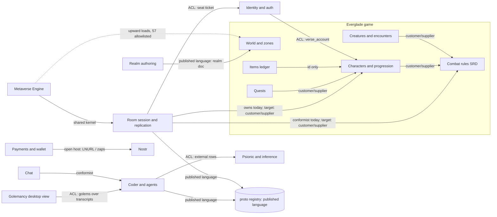

# Bounded contexts and context map

This page names the repository's bounded contexts, the folder each owns, its
classification (core, supporting or generic), what each may depend on, and the
relationship kind on every edge between them. Derived from section 2 of the
[domain-driven design audit](../audits/2026-11-11-domain-driven-design-audit.md)
(tracker #13311, under #13257).

For shared domain words and their owning contexts, see the
[glossary](../books/glossary.md). When `ARCHITECTURE.md` lands (#13273), it
links here.

## Bounded contexts

Every context is classified as **Core** (why someone uses the product),
**Supporting** (needed for our product, not sold on its own) or **Generic** (a
solved problem or external standard). Each row names both where the code lives
today and the folder it owns as the layout settles (#13270, DDD.6).

| Context | Folder owned (target) | Where it lives today | Class | What it may depend on | Notes |
| --- | --- | --- | --- | --- | --- |
| **Combat rules (SRD)** | `rules/srd/` (moved out of `metaverse-engine/rules/srd/`, #13270) | `rules/srd/` (27,889 lines of `.coax`) | Core | Engine core (`metaverse-engine/` value types and math), `coax/lib/` | Everglade's pitch is "the SRD's rules decide the outcome" (`everglade/README.md`). Shared across Everglade II, Experimental and 5E Lab; language tied to SRD 5.2.1 ([compliance ledger](../dnd/srd-compliance-ledger.md)). |
| **Characters and progression** | `everglade/model/` | The aggregate and its rules: `everglade/model/character.coax` (profile `everglade-character-v1`, #13290); its live fields still scattered: room seat state, `metaverse-engine/session/character-checkpoint.coax`, `coax/web/room/room-checkpoint.coax`, `coax/web/room/room-events.coax`, SQL `verse.character_*` | Core | Combat rules, Items (by ID only), Engine, Protocol (`proto/`) | Workstream P4 ("a character worth keeping", #13290). Rooted at `CharacterId` with one `#authority` owner of level-from-XP and slot limits. |
| **World and zones** | `everglade/world/` (plus `everglade/server/`, `everglade/client/`) | `everglade/world/` (the land, planting, ground and light, moved from `verse/everglade2/` in #13268), `metaverse-engine/world/` | Core | Engine, Realm authoring (`metaverse-engine/editor/`), Room session, Combat rules and Characters (the page in `everglade/client/` shows them), `components/` | The place the player is in (#13280). |
| **Creatures and encounters** | `everglade/model/` and `everglade/server/` | `everglade/server/creatures.coax`, `everglade/server/guard.coax`, `coax/web/room/room-events.coax` | Core | Combat rules, World and zones, Engine | Creature templates and encounter logic (#13293). |
| **Items and economy** | `everglade/model/` and `metaverse-engine/session/ledger.coax` | `metaverse-engine/session/ledger.coax`, SQL `verse.items`, `verse.item_*` | Core | Characters (by `CharacterId` only), Engine (the typed IDs), Protocol (`proto/`), `coax/lib/` | Built in Coax and SQL. A room writes loot, rewards and what is worn through it (`coax/web/room/room-items.coax`, `everglade/model/item-op.coax`; #13291, DDD.7). Items are never money. |
| **Quests** | `everglade/model/` | `everglade/model/content.coax` (what a quest asks next), the record's `quests` (`everglade/model/character.coax`), `coax/web/room/room-items.coax` | Core | Characters, World and zones, Items, Combat rules | Quest stages live in the character record and change by a claim with a ledger operation (#13292). |
| **Room session and replication** | `metaverse-engine/session/`, `metaverse-engine/net/`, `coax/web/room/` | `coax/web/room/`, `metaverse-engine/net/`, `metaverse-engine/session/` (control, travel, party, region, compat) | Supporting | Engine, Protocol (`proto/`); Everglade rooms additionally depend on Combat rules, Characters, World, Creatures, Items, Identity (seat ticket ACL) | Authoritative simulation hosting, seat admission, checkpoints and travel sagas. |
| **Realm authoring** | `metaverse-engine/editor/` (adapters in `apps/metaverse-engine-desktop/`, `apps/openagents-web/worldbuilder*.coax`, `coax/web/api/worldbuilder.c`, `coax/web/api/realms.c`) | Same, plus SQL `verse.realm_*`, `worldbuilder.*` | Supporting | Engine, Protocol (`proto/`), Chat and Coder (the desktop app embeds the chat), `components/` | WorldBuilder edits through `metaverse-engine/editor/edit.coax` (#13226); `metaverse-engine/editor/doc.coax` owns the realm document format (#13249). |
| **Identity and auth** | `coax/web/api/auth*` (`auth*.c`, `auth-*-policy.coax`) and `coax/web/api/agent-wire.coax` (the account's agents and devices on the wire) | `coax/web/api/auth*.c`, `coax/web/api/auth-*-policy.coax`, SQL `auth.*` and legacy `signin.*`, `docs/auth/` | Generic (built in-house) | `coax/lib/` (crypto, web), Nostr (NIP-42/key auth) | Accounts, authenticators and sessions (`0142_auth_accounts.sql`), built in-house with no phone or third-party identity provider. |
| **Payments and wallet** | `pay/` (DDD.9, #13320) | `pay/` (the money rules, below), adapters `coax/web/api/wallet.c`, `lnaddr*.c`, `makers.c` and the iOS wallet, SQL `pay.*`, `makers.*`, `auth.wallet_*`, `auth.credit_spends`, the NIP-KEYS treasury files (`coax/lib/nostr/nipkeys*.coax`, `nostr/tools/treasury.coax` and chapter 104's example: they sign and spend Bitcoin, #13369), libraries `coax/lib/bitcoin/`, `coax/lib/lightning/`, `coax/lib/lnaddr/` | Supporting | `coax/lib/bitcoin/`, `coax/lib/lightning/`, `coax/lib/lnaddr/`, Nostr, Identity | Bitcoin-only rails ([`docs/lightning/`](../lightning/README.md)); money policy files are `#authority`. |
| **Coder and agents** | `coder/`, `coax/lib/agent/`, `coax/lib/boat/` and `coax/web/boat.coax` (the boat SDK and its tool for dev boxes, #13474), `coax/lib/microcoder/`, `coax/lib/gateway/`, `coax/lib/repo/` and `coax/web/repo/` (indexed repos, #13326), `coax/web/agent/` (the hosted runner) | Same, plus `apps/everglade-desktop/` (Golemancy view) | Core | `coax/lib/gateway/`, Psionic (via ACL), Nostr, Protocol (`proto/`), `coax/lib/` | Coding agent harness, session logs (`openagents.session.v1`), Router and Workers (`coder/book/`). |
| **Chat** | `components/zeron/`, `apps/openagents-web/chat.coax`, `coax/web/api/chat.c` | Same, plus SQL `chat.*` | Supporting | Coder, Identity, Protocol (`proto/`), `components/` | Web and desktop chat surfaces over agent and user threads. |
| **Projects** | `coax/web/api/` (`private.c`, `drops.c`), `coax/web/project/` (the landing page) | `coax/web/api/private.c`, `coax/web/api/drops.c`, `coax/web/project/`, SQL `projects.*`, `drops.*` | Supporting | Identity, Payments, Nostr and Psionic (the landing page reads their published events), `coax/lib/` | Private project pages and drops. |
| **Nostr** | `nostr/`, `coax/lib/nostr/` | `coax/lib/nostr/`, `nostr/` | Generic | `coax/lib/` (crypto, net, TLS) | External protocol implementation and OpenAgents NIPs (`nostr/nips/`). |
| **Psionic and inference** | `psionic/`, `coax/lib/systemone/` (with `google.coax`, Google's Decisions API wire), `coax/web/api/inference.c`, `coax/web/api/mesh*` (`/api/v1/systemone` and its Gemini door, #13469) | Same, plus SQL `inference.*`, `mesh.*` | Core (separate product) | `coax/lib/`, Nostr (Pylon announcements), Protocol (`proto/`) | Tensors, decision models, `/v1/systemone`, Pylon and Mesh serving (`psionic/`). |
| **Engine (the OpenAgents Metaverse Engine)** | `metaverse-engine/` | `metaverse-engine/` | Supporting kernel | `coax/lib/` only (strictly downward; zero loads into `metaverse/`, `everglade/`, `apps/` or `coax/web/` once #13270 burns down `metaverse-engine/layer-allowlist.txt`) | Frame loop, ECS world, rendering, physics and deterministic replay shared by every realm. |
| **Splice Bots** | `metaverse/splice-bots/` (moved out of `apps/openagents-web/splice*`, #13404) | `metaverse/splice-bots/` (the game, its page frame, shaders, content tables and edit layer) | Supporting (a world on the engine) | Engine, Realm authoring (`metaverse-engine/editor/edit.coax`, the edit log its layer is applied from), `coax/lib/` | An unlisted Metaverse Engine game at `/worlds/splice` and the first world with an edit layer: placed pieces are content rows, World entities and typed edits, checked so the run still plays. |
| **Realm seat** | `coax/lib/media/realm_seat.coax` | Same (the driver of an agent's seat in a running realm: `openagents realm play`, the hosted seat's process `coax/web/agent/seat.coax` and the tool `coax/web/realm-seat.coax`) | Supporting | Realm authoring (`metaverse-engine/editor/spec.coax`, the realm spec's one reader), `coax/lib/` | One file with its own line in `contexts.txt`, so it reads a realm's spec through the spec's codec instead of a second parser (#13250). Coder may load it. |
| **Realm import tools** | `metaverse/tools/` | `metaverse/tools/` (the Valley, Kokiri, Slay and Ocarina importers and packers, moved out of `metaverse-engine/tools/`, #13270) | Supporting | Engine, Realm authoring (`metaverse-engine/editor/pack.coax`), `coax/lib/` | Offline tools that turn a realm's source assets into its packs. They own the `valley.*` and `kokiri.*` record families (`proto/registry.json`, owner `realm-tools`). Never shipped or loaded by a page. |
| **Protocol (published language)** | `proto/` | `proto/` (`proto/registry.json`, `.proto` schemas, wire profiles) | Supporting (published language) | None (schemas and catalogue; codecs live in their owning contexts, DDD.5) | Canonical protobuf schemas and wire shape registry ([`proto/README.md`](../../proto/README.md)), gated by `coax/web/tool.sh wire-check`. |
| **Coax toolchain** | `coax/` | `coax/` (`coax/bin/`, `coax/lib/`, `coax/web/`) | Supporting | Host C11 toolchain | Compiler, standard libraries, mutation tester, compat checker and Coax Native Web runtime (formerly Coaxial). |
| **Anime Lab's API rules** | `coax/web/api/anime-*` | Same | Supporting (a realm on the engine) | Engine, `coax/lib/` | The words-to-catalogue rules of Anime Lab (`metaverse-engine/anime/`). A context so its API rules are not judged as toolchain code. |
| **Analytics, email, jobs, access** | `coax/web/api/` (`analytics.c`, `email.c`, `jobs.c`, `access.c`) | Same, plus SQL `analytics.*`, `email.*`, `jobs.*`, `access.*` | Generic | `coax/lib/`, Identity (where route access applies) | Operational plumbing routes and background queues. |

Three contexts are the product's core for the game and agent lines today:
**Combat rules**, **Characters and progression**, and **Coder** (with
**Psionic** as a separate core product line). **Engine (the Metaverse Engine)** is a
supporting shared kernel, not the game's domain model.

## Context map

Arrows point from downstream to upstream (`DOWNSTREAM --> UPSTREAM`), except
where labeled to show a leak being removed.

## Relationships by edge

DDD relationship kinds used here:

- **Shared kernel:** two contexts compile the same small, checked module and
  change it together; dependencies point strictly downward into the kernel.
- **Customer / supplier:** downstream depends on an explicit `#export` surface
  owned by upstream; upstream evolves its internals freely behind that surface.
- **Anticorruption layer (ACL):** one boundary module translates an external,
  legacy or foreign-context representation into the local context's own types.
- **Published language ( / Open host service):** contexts share a versioned,
  registered schema (`proto/registry.json`, `coax compat` or realm document
  version) rather than internal structs.
- **Conformist:** downstream uses upstream's model as-is with no translation
  layer because both belong to the same product line and upstream's model fits.

| Edge (between contexts) | Relationship today | Kind it should be | Notes and tracking |
| --- | --- | --- | --- |
| **Combat rules -> Room session** | Conformist / unsealed: `coax/web/room/room-everglade.coax` calls `rs_*` and reads `RsCreature` fields directly (`v[0].eg[k].rules[0].b[0].c[...]`) | **Customer / supplier** (with **shared kernel** execution in client and room) | Expose a sealed `#module` / `#export` surface and `world-profile.coax` so #13285 can rewrite `RsCreature` into `Ability` and `Aura` records without breaking room callers. |
| **Combat rules -> Characters** | No standalone character context yet; the room holds both creature state and checkpoint arrays | **Customer / supplier** | `everglade/model/` (#13290) consumes the rules' level-from-XP, class and slot tables from one `#authority` source instead of duplicating XP tables. |
| **Combat rules -> Creatures and encounters** | Monster and guard scripts in `everglade/server/*.coax` construct `RsCreature` slots by index | **Customer / supplier** | Creature templates reference content IDs (#13286, #13293) and call the sealed rules surface. |
| **Characters -> Room session** | Room owns live fields and emits positional `n[17]` checkpoint captures (`metaverse-engine/session/character-checkpoint.coax`) | **Customer / supplier** (via `#persisted` aggregate at seat admission, checkpoint and travel) | Room steps columns during the tick (#13274); capture and restore in `everglade/model/` (#13290) own the persistent `Character` record. |
| **Characters <- Items and economy** | `metaverse-engine/session/ledger.coax` and `verse.items` key inventory by player/character ID string; a room writes them through `coax/web/room/room-items.coax` (#13291) | **ID-only reference + published domain events** | Items reference `CharacterId` by nominal ID only and publish `items.item.granted.v1` through an outbox (#13291, DDD.8). |
| **Characters <- Quests** | Quest stages live in the character record; a room advances them from its own events (`coax/web/room/room-items.coax`) | **Customer / supplier** | Server-owned quests (#13292) reference `CharacterId` and content IDs (#13286). |
| **Identity and auth -> Game (Characters)** | `auth.accounts.verse_account` maps login accounts to `verse.accounts.id` (`0142_auth_accounts.sql`) | **Anticorruption layer (ACL)** (keep) | Keeps login authenticators and sessions (`auth.*`) decoupled from game accounts (`verse.*`). |
| **Identity and auth -> Room session** | Seat ticket proves seat identity, while the client hello still supplies class and level | **Anticorruption layer (ACL)** | The signed seat ticket (#13248, #13259) carries identity plus the character context's class and level; the room never trusts the hello for rules facts. |
| **Engine (the Metaverse Engine) -> World, Room and apps** | Shared code, but with 57 `engine-up` upward loads in `metaverse-engine/layer-allowlist.txt` into `apps/openagents-web/` and `metaverse/` | **Shared kernel** (strictly downward) | `coax/web/tool.sh layer-check` (#13264) blocks new upward loads; #13270 removes the remaining allowlisted ones. |
| **Realm authoring -> World and zones** | Versioned realm document read by `metaverse-engine/editor/doc.coax` and written through `metaverse-engine/editor/edit.coax` (`realms.c` still holds separate SQL rules) | **Published language** | The versioned realm document (#13249) is the contract between authoring tools and world loaders. |
| **Payments and wallet -> Nostr and callers** | Wallet logic in `pay/wallet.coax`, maker pay in `pay/makerpay-policy.coax`, LNURL in `coax/lib/lnaddr/` | **Open host service + published language** | One payments context folder, `pay/` (DDD.9, #13320), exposing an `#authority` policy API internally and LNURL / Nostr zaps externally. |
| **Coder <- Psionic and third-party agents** | `proto/registry.json` holds 12 `external` rows (Claude Code, Codex, Cursor, ACP, MCP, LNURL, Nostr NIPs) alongside `coax/lib/gateway/` and `psionic.*` | **Anticorruption layer (ACL)** (keep and name) | Each `external` row's codec folder is the sole parser for that third-party format and outputs our own record types. |
| **Coder -> Chat** | `apps/openagents-web/chat.coax` and `components/zeron/` render Coder threads and turns directly | **Conformist** | Same product family; Chat conforms to Coder's thread and turn model rather than translating it. |
| **Coder -> Golemancy (`apps/everglade-desktop/`)** | `coder/golemancy/golems.coax` reads Coder session transcripts and presents agents as golems | **Anticorruption layer (ACL)** | Game terminology ("golem") over agent session records (`openagents.session.v1`) is an explicit view/translation layer. |
| **Coder, Room session, Psionic -> Protocol (`proto/`)** | 98 rows in `proto/registry.json` checked by `coax/web/tool.sh wire-check`, with allowlist burn-down in progress | **Published language** | Every wire shape, persisted save and cross-context domain event has one registry row, an `owner` context (DDD.5) and one codec file. |

## Dependency direction rules

1. **Kernel and libraries at the bottom.** `coax/lib/` depends on no product
   context. `metaverse-engine/` (minus `rules/`) depends only on `coax/lib/`. `proto/`
   holds schemas and metadata only.
2. **Rules depend on no room, page or database.** `rules/srd/` declares pure
   procedures (`#effects(reads, writes, traps)` or narrower, DDD.3) and loads
   nothing from `everglade/`, `coax/web/` or `apps/`.
3. **Game models sit above rules and below rooms/pages.** `everglade/` may
   depend on `rules/srd/`, `metaverse-engine/`, `metaverse-engine/session/`, `metaverse-engine/editor/`,
   `proto/` and `components/`, never on `apps/` (`everglade-up` in
   `layer-check`).
4. **Cross-context communication uses sealed exports, nominal IDs or registered
   shapes.** Contexts do not reach into another context's internal structs, SQL
   tables or `tests/` fixtures (DDD.4, DDD.6).

## Open decisions

The audit leaves three context-boundary questions to decide explicitly as the
AAA layout (#13257) lands:

1. **Are SRD rules their own root context at `rules/srd/`, or owned by
   Everglade?**
   - *Decided (#13270):* a root context. The rules moved from
     `metaverse-engine/rules/srd/` to `rules/srd/`.
   - *Audit recommendation:* a separate root context at `rules/srd/` (#13270,
     D7), because Experimental and 5E Lab also use the SRD engine and the
     rules are not part of the rendering/simulation engine (`metaverse-engine/`).
   - *Alternative:* move SRD rules under `everglade/` once non-Everglade
     consumers leave the build (#13269), and keep the Everglade book's current
     statement without moving the root folder.
2. **Is Golemancy its own bounded context or a view (ACL) over Coder?**
   - *Decided (#13311, 2026-11-12):* a view over Coder, as the audit
     recommends. It gets a context of its own only if golems gain durable
     game-world state that is not a Coder transcript.
   - *Audit recommendation:* a view and **anticorruption layer** over Coder in
     `coder/golemancy/golems.coax`, translating `openagents.session.v1`
     transcripts and agent tasks into golem words without introducing a second
     agent state store.
   - *Alternative:* promote Golemancy to a separate game context if golems
     acquire durable game-world state independent of Coder transcripts.
3. **What does "zone" mean?**
   - *Decided (#13311, 2026-11-12):* the audit's recommendation below, which
     the [glossary](../books/glossary.md) already follows. New code and docs
     use **zone** only for a named area of one realm's world.
   - Today "zone" is used four ways in the codebase and audits: (a) a named
     area of a realm's world (`docs/books/glossary.md`), (b) a separately
     compiled Wasm page (`EfZone` in `everglade/features.coax`), (c) a server
     simulation process in the AAA audit ("150 players in one zone process"),
     and (d) a cloud availability zone.
   - *Audit recommendation:* reserve **zone** for (a) a named area of one
     realm's world loaded as cells; call (b) a **page**, (c) a **room** (or
     **shard** for the process hosting rooms), and qualify (d) as **cloud
     zone** / **GCP zone**.

## Decisions on the seeded cross-context loads

DDD.6 (#13317) seeded `metaverse-engine/layer-allowlist.txt` with every load
that crossed a context line `contexts.txt` did not allow. 26 of them load
Nostr's JSON, hex and base64 helpers (they go when those helpers move to
`coax/lib/json/` and `coax/lib/text/`). The other 30 were questions about the
policy itself. Each one is decided here (#13311, 2026-11-12). A decision that
changes the policy is in `contexts.txt`, and its allowlist lines are gone. A
decision that the load is wrong keeps its line until the code moves.

**The policy changes: 19 loads allowed, their lines removed**

| Load | Decision | Why |
| --- | --- | --- |
| `everglade/client/` loads the SRD's conditions (2 lines) | World may load Combat rules | Everglade's page sits in World's folders. It shows the rules' conditions and predicts with the rules the room runs: the shared-kernel edge in the map above. |
| `everglade/client/bag.coax` loads `everglade/model/content.coax` | World may load Characters (the context `everglade/model/` resolves to) | The page words your quests and items from the content tables. It shows the record; the room and the ledger decide it. |
| `metaverse-engine/session/ledger.coax` loads `core/ids.coax` | Items may load Engine | The typed IDs are engine value types. Every context that names a character or an item uses them. |
| The ledger loads `session/control.coax` | Characters owns `metaverse-engine/session/control.coax` | The file decides who may act for a character. Items may load Characters by ID, which is this: the ledger is fenced by the character's owner generation. |
| `host/lifecycle.coax` loads `session/lifecycle.coax` | Engine owns `metaverse-engine/session/lifecycle.coax` | It is the client's lifecycle profile, the same on every host. Hosts are engine code; it carries no room state. |
| `coax/web/api/ticket-sign.coax` loads the seat ticket, seat class, room writes and the crash report (4 lines) | Room session owns `ticket-sign.coax` | The API signs the tickets and reads the reports rooms define. The file is the API's adapter for Room session, as `character-policy.coax` is for Characters. |
| `checkpoint-policy.coax`, `checkpoint-resume-policy.coax` and `coax/web/compat/character-checkpoint.coax` load the session's checkpoint files (3 lines) | Room session owns them, and `progress-policy.coax`, which loads both | The checkpoint and the resume ticket are Room session's shapes; these files are their API side and their compatibility pin. |
| `coax/web/map-points.coax` loads `world/points.coax` | Engine owns `coax/web/map-points.coax` | It is the tool side of the engine's named points and says so in its first line. |
| `anime-director-policy.coax` loads `anim/direction-select.coax` | A new context, `anime-lab`, owns `coax/web/api/anime-*` and may load Engine | Anime Lab is a realm on the engine. Its API rules are not toolchain code, and no other context fits them. |
| `coax/lib/crypto/bip32.coax` loads `coax/lib/bitcoin/base58.coax` and `hash160.coax` (2 lines) | Toolchain owns `base58.coax`, `hash160.coax` and `hash.coax` | They are encodings and hashes with no money rule in them. BIP-32 derives Nostr keys (NIP-06) as well as wallet keys, so it stays a library. |
| `apps/metaverse-engine-desktop/chat-run.coax` loads the agent engine; `chrome.coax` loads `components/zeron/gpui.coax` (2 lines) | Realm authoring may load Chat and Coder | The editor's desktop app embeds the chat and runs the agent in it. It draws with the chat set until the component layers replace it (#13153). |
| `coax/web/project/landing-nostr.coax` loads Psionic's Pylon beacon (and 5 Nostr files) | Projects owns `coax/web/project/` and may load Nostr and Psionic | The project landing page reads Nostr events and Pylon announcements to show them. It reads them as published; it decides nothing about either. |

**The load is wrong: 11 lines stay until the code moves**

| Load | Decision | What removes the line |
| --- | --- | --- |
| `metaverse-engine/fx/battle.coax` and `fx/spell-light.coax` load `rules/srd/battle.coax` (2 lines) | Engine must not load Combat rules | The two effects take plain values (who, what, where), or move to `everglade/client/`. |
| `host/pack-stream.coax`, `host/page-stream.coax` and `world/resource-cost.coax` load `editor/pack.coax`, `page-pack.coax` and `vertices.coax` (3 lines) | Engine must not load Realm authoring. The pack formats stay Realm authoring's (`asset-pack-v2`, `aethyr-paged-pack-vpk3`) | The read half every host needs finishes moving to `host/pack-table.coax`, where the table read already is (#13304). |
| `audio/host-convolution.coax` loads `psionic/lib/spectral.coax`; `core/decision-trace.coax` loads `psionic/lib/game/decision.coax` (2 lines) | Engine must not load Psionic | The Fourier transform moves to `coax/lib/`. The decision record becomes a registered shape the engine reads. |
| `coax/lib/systemone/answers.coax` and `transport.coax` load `coax/lib/agent/claude/fields.coax` and `transport.coax` (2 lines) | Psionic must not load Coder (Coder loads Psionic) | The JSON field reader and the process transport move to `coax/lib/json/` and `coax/lib/sys/`, with the Nostr JSON helpers they sit on. |
| `coax/lib/media/media.coax` loads `metaverse-engine/ui/font.coax` | Toolchain loads no product context | The stroke font becomes a library file, or the deck tool draws with `components/`. |
| `apps/metaverse-engine-desktop/scene-policy.coax` loads `everglade/world/edits.coax` | Realm authoring must not load World (World loads it) | Everglade's edit codec goes with v1 (#13269); the editor reads edits through `metaverse-engine/editor/edit.coax`. |

`coax/web/tool.sh layer-check` counts 31 context lines after these decisions
(56 before): these 11 and the 20 that load a Nostr helper.

These ownerships are for the load rule. Where a registry row's codec may sit
(`wire-check`, [proto/README.md](../../proto/README.md) "Owning contexts") is
unchanged: no row's codec is in a file whose owner changed here.

## Tracking notes

- **#13273 (`ARCHITECTURE.md`):** when root `ARCHITECTURE.md` lands, link
  `docs/architecture/contexts.md` from its architecture map section (this page
  does not block on #13273, and `ARCHITECTURE.md` is not created here to avoid
  conflicting with #13273).
- **DDD.1 (`docs/books/glossary.md`):** links to this page.
- **DDD.5 and DDD.6:** enforce context ownership in `proto/registry.json`
  (`wire-check`) and per-context `#load` rules (`contexts.txt` in
  `layer-check`).

## The Payments folder (DDD.9, #13320)

Every file that decides money, and where it lives:

| Rule | File |
| --- | --- |
| The Spark wallet's payment rules (send, receive, buy) | `pay/wallet.coax` |
| The wallet's backup card and daily limit, in the app | `pay/wallet-backup.coax`, `pay/wallet-vault.coax` |
| The wallet's daily limit, backup and service credit, on the server | `pay/wallet-policy.coax`, `pay/wallet-vault-store.coax` |
| Lightning Addresses | `pay/lnaddr-policy.coax` |
| Tips and upgrades paid to a maker's own address | `pay/makerpay-policy.coax` |
| Speech metering: free tier and prices | `pay/voice-meter.coax` |

They stay elsewhere, on purpose:

- Adapters stay with their host: `coax/web/api/wallet.c`, `lnaddr.c`, `makers.c`
  and `inference.c` gather facts and answer HTTP; the iOS wallet and the web
  settings page draw and call.
- Libraries stay in `coax/lib/`: `bitcoin/`, `lightning/` and `lnaddr/` (already
  this context's), `x402/` (a wire codec that `coax/lib/nostr/` loads for NIP-47
  and NIP-57, so it stays below Nostr) and `nostr/vault-wallet.coax` (the backup
  record's codec, `proto/wire-allowlist.txt`).
- Model-call prices belong to the contexts that charge them: the gateway's rates
  card (`coax/lib/gateway/rates.coax`, Coder) and the inference debit
  (`inference.finish` in SQL, Psionic and inference).

Why root `pay/` and not `coax/lib/pay/`: these are product rules, not Coax
libraries. Root folders already hold the other contexts' rules (`rules/`,
`nostr/`, `psionic/`), and `coax/` is the toolchain's context, so a rule under
`coax/lib/` would sit inside another context's folder. `layer-check`'s tests rule
covers `pay/` as it covers `coax/web/api/`.
