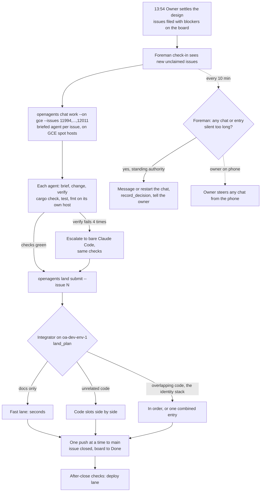

# Nostr identity issues: timeline from filing to close (2026-10-17)

This audit covers the 11 issues closed by `a4735eba5c`: #11994, #11995,
#11996, #11997, #11998, #12000, #12001, #12006 (epic), #12007, #12010, and
#12011. It records when each was filed, claimed, finished on its branch,
and closed, and where the time between went. All times are Central
Daylight Time (UTC−5), taken from GitHub's issue and comment timestamps,
commit dates, and the coordinator session's tool log.

## Summary

- Filed: 13:54–14:52.
- Agents claimed them: 13:59–14:53.
- Agents finished the code on their branches: 14:35–15:06. Every issue was
  code complete on its branch within 52 minutes of its claim.
- Merged to `main` and closed: 19:51–19:54.

About **4 hours 45 minutes** passed between the last branch finishing
(15:06) and the close (19:51). None of that time was agent coding. All of
it was coordinator integration: building, testing, and merging, done
serially in one session. In that window:

| Cause | Time lost (approx.) |
| --- | --- |
| The coordinator ended its turn waiting for the owner while a rebase sat on a conflict, then the session hit its context limit and resumed late (18:25–19:37). Nothing ran. | 71 min |
| Merging branches one at a time, each with its own 5–15 minute cold build and test, until the owner ordered one combined pass at 16:54. | about 60 min |
| `main` itself already had 21 failing tests, so each branch's failures had to be compared against a `main` baseline before merging (#12012). | about 50 min |
| Agent branches had never been compiled (the 19:33 rule was "agents write code, the coordinator builds"), so integration found compile errors, stale generated files, and a broken SDK reference test one at a time. | about 55 min |
| The disk filled to 0 bytes. The coordinator could not run any command until the owner deleted a build folder by hand. | 16 min dead, about 35 min total |
| Other agents pushed to `main` during integration, which caused rebase conflicts. | about 5 min |

The 71-minute stall and the one-at-a-time merging were the coordinator's
mistakes. The coordinator should have combined the branches as soon as
they were done, and it should never have ended a turn with integration
unfinished.

## Per-issue record

| Issue | Filed | Claimed | Code complete on branch | Closed | Branch done → closed |
| --- | --- | --- | --- | --- | --- |
| #11994 abuse limits | 13:54 | 14:26 | 14:47 | 19:51 | 5 h 04 min |
| #11995 identity from 12 words | 13:54 | 14:27 | 14:42 (updated 14:52) | 19:52 | 5 h 00 min |
| #11996 phone onboarding, backup | 13:54 | 14:03 | 14:35 (tutorial on `main`) | 19:52 | 5 h 17 min |
| #11997 desktop identity | 13:54 | 14:27 | 14:42 (updated 14:55) | 19:52 | 4 h 57 min |
| #11998 Connect your phone QR | 13:54 | 13:59 | 14:35 | 19:52 | 5 h 17 min |
| #12000 phone QR scanner, pairing | 13:55 | 14:27 | 14:50 (updated 15:05) | 19:52 | 4 h 47 min |
| #12001 website sign-in | 13:55 | 14:27 | 14:43 | 19:53 | 5 h 10 min |
| #12006 epic | 13:56 | — | — | 19:54 | — |
| #12007 SDK docs site | 14:02 | 14:07 | 14:40 | 19:53 | 5 h 13 min |
| #12010 desktop in Design Lab | 14:47 | 14:47 | 15:04 | 19:53 | 4 h 49 min |
| #12011 exit demo mode | 14:52 | 14:53 | 14:59 | 19:53 | 4 h 54 min |

Several branches were stacked on others: #11995 on #11994 on #11993, #11997
on #11995 and #11998, and #12000 and #12001 on #11993. Each change lower in
the stack forced a rebase of everything above it, which is why #11995,
#11997, and #12000 were updated after they were first finished.

## Timeline

### 13:51–14:53: filing and claiming

- 13:51: The owner settles backup and recovery (12 words for both identity
  and wallet).
- 13:54–13:56: The coordinator files #11994–#11998, #11999 (wallet),
  #12000–#12005, and epic #12006, and adds them to the board.
- 13:59: An agent claims #11998.
- 14:02: #12007 (SDK docs) filed; claimed 14:07.
- 14:03: An agent claims #11996.
- 14:26: The owner says "start all now". 14:26–14:27: agents claim #11994,
  #11995, #11997, #12000, #12001.
- 14:33: The owner rules that agents write code only and the coordinator
  does every build. From here on, every compile and test for every branch
  goes through the coordinator's two build lanes.
- 14:47: #12010 filed and claimed. 14:52: #12011 filed; claimed 14:53.

### 14:35–15:06: agents finish their branches

- 14:35: #11998 code complete. #11996's tutorial lands on `main` (c08d15a9bb).
- 14:40: #12007 complete. 14:42: #11995 and #11997. 14:43: #12001.
  14:47: #11994. 14:50: #12000. 14:59: #12011. 15:04: #12010.
- 15:06: The last update (#12000) is pushed. **From here on, all the
  remaining time is integration.**

### 14:35–15:22: one branch at a time

The coordinator rebases, builds, and tests each branch separately in two
lanes: #11996 and #11998 first, then #12008, #12009, #12003, the wallet
#11999 (merged 15:00), and #11993 (merged 15:22). Each cold build or test
run takes 5–15 minutes.

- 14:50–14:54: #11993 fails a gateway audience test. The coordinator
  declares the new routes' audiences and regenerates the first-party API
  document.
- 15:02–15:22: #11993 still shows failures. The coordinator runs the same
  tests on `main` and finds `main` already has 21 failing tests. Comparing
  each failure against `main` takes about 20 minutes. #12012 is filed at
  15:23 for the tests that fail on `main`.
- 15:05–15:07: #11998 fails to compile (missing `Arc` import, a theme
  borrow). Fixed by the coordinator.

### 15:26–16:00: disk crisis

- 15:26–15:28: The disk is low. The coordinator deletes DerivedData,
  incremental caches, and merged worktrees.
- 15:29: Three build lanes start at once (#12005, #11998, the identity
  stack).
- 15:30–15:32: The identity stack fails to resolve dependencies: `sync`
  pulled in `coder-computers`, which pulled in tree-sitter highlighting.
  The coordinator inlines the one function it needed (65d5594976).
- 15:40: 18 GB free and falling.
- 15:42–15:43: The disk reaches 0 bytes. Every command fails with
  `ENOSPC`, including the coordinator's own shell. The coordinator stops
  both builds and can do nothing else.
- 15:59: The owner deletes `~/work/openagents-target-app` by hand.
  89 GB free.
- 16:00: The coordinator starts a disk guard that pauses builds below
  20 GB free and resumes them above 30 GB, and drops to two lanes.

### 16:00–16:54: still one branch at a time

- 16:03–16:19: The coordinator fixes #12012's remaining `main` test
  failures (a private-folder fixture, per-request addresses in the visitor
  test).
- 16:08: The identity stack fails to compile in the phone core (identity
  borrow). Fixed.
- 16:22–16:24: Root tests on the stack fail (missing config field path).
  Fixed.
- 16:28: The owner asks why 15 issues are still open.
- 16:29: #12004 closed. 16:38: #12005 merged and closed. 16:41: #12002
  merged and closed.
- 16:40–16:49: Rebasing the stack onto the new `main` runs into conflicts
  (`oa-auth`, the phone account module, the login page), a stale SDK
  `visitor` module, and a deleted `close_clients` method. Each is fixed
  and rebuilt in turn.
- 16:53: The owner asks why it is taking so long.
- 16:54: #12012 merged and closed.

### 16:54–18:22: one combined branch

- 16:54: The owner orders every remaining branch combined into one pass.
  The coordinator merges #12007, #12010, and #12011 into the identity stack
  (`build-stack`) and compile-checks both workspaces at once.
- 17:00–17:05: The desktop UI crate fails to compile (a struct field in the
  wrong place, a theme borrow in the capture code). Fixed.
- 17:12–17:44: The root test run fails on stale generated files (the app
  and Computers contracts, the SDK reference) and the SDK docs tests. The
  SDK reference extractor could not see calls made through generated
  request types; the coordinator rewrites it with a `syn` visitor. Two
  module descriptions trip the copy guard and are reworded. 32 minutes.
- 17:47–17:48: The coordinator opens the desktop app and Design Lab at the
  owner's request.
- 17:53–18:08: The pairing test and the desktop identity tests fail
  (a signed refusal for refused reads, a test deployment address). Fixed.
- 18:08–18:21: The iOS build takes 13 minutes, then fails on a Swift call
  missing `deviceName`. Fixed and rebuilt.
- 18:21: The coordinator restarts the owner's desktop app while the owner
  is using it. This is a mistake: it interrupts the owner's conversation
  and leaves the computer "Tron" showing offline. 18:22–18:25 goes to
  diagnosing that.
- 18:22: Rebasing `build-stack` onto `main` stops on a conflict in
  `MoreViewController.swift` caused by another agent's #12015.

### 18:25–19:37: nothing ran

- 18:25: The coordinator answers the owner about Tron and **ends its
  turn**, leaving the rebase stopped on its conflict and no build running.
- 19:21: The session reaches its context limit and is summarized.
- 19:37: The coordinator resumes on a background notification.

For 71 minutes, every branch was finished and tested but one conflict
short of `main`, and nothing was working on it.

### 19:37–19:55: push and close

- 19:37–19:38: The coordinator resolves the remaining conflicts in about
  90 seconds: `MoreViewController.swift`, the wallet tests (against
  #12013's restyle), the delegation doc, the deleted SDK `visitor` module,
  the downstream-patches doc, the phone FFI module list, and the generated
  Swift bindings.
- 19:38: Two lanes start. Lane B tests the web (904 passed), the SDK,
  `oa-auth`, and `coder-access`; all pass by 19:49. Lane A rebuilds the
  phone core and its bindings (unchanged), then compiles the phone and
  sync tests from cold.
- 19:51: Pushed to `main` as `a4735eba5c`.
- 19:51–19:54: All 11 issues closed.
- 19:55: Phone (108) and sync (84) tests pass.

## What changes

- **Combine finished branches right away.** When several agent branches
  are done, merge them into one integration branch and run one build and
  one test pass, not one per branch.
- **Agents compile before they hand off.** "The coordinator builds" put
  every compile error on the serial path. An agent runs `cargo check` on
  the crates it touched, within the disk rules, before it reports code
  complete.
- **Never end a turn with integration unfinished.** If the owner asks
  about something else mid-integration, answer and keep going in the same
  turn.
- **Keep `main` green.** A failing `main` cost about 50 minutes of
  baseline comparisons. A `main` test failure gets fixed when it is found.
- **Don't stack branches unless they have to be.** Each change low in the
  stack forced rebases of everything above it.
- **Disk.** The disk guard now runs for the whole session, builds need
  30 GB free to start, and there are never more than two lanes (see the
  disk-full memory note). A build sweep that keeps 100 GiB free landed on
  `main` in 58559c745b.
- **Never restart the owner's running desktop app.**

## Addendum: what our own system should have done

The 4 hours 45 minutes above happened because one bare Claude Code session
in a terminal on the owner's Mac did all the coordination itself. It held
every build, every merge, and the only copy of the plan. Nothing outside it
could see it, steer it, or take over. Nearly every primitive that would
have stopped the waste already exists in this repository. This session used
none of them.

### What went wrong, and the primitive that covers it

| What went wrong | Primitive that covers it | Used today? |
| --- | --- | --- |
| Every build ran on the owner's Mac, filled the disk to 0 bytes, and was limited to two lanes. | **GCE pool** (`openagents cloud up`, `chat work --on gce`, [gce-pool.md](../cloud/gce-pool.md)): spot `c3-standard-8` hosts from the daily `oa-coder-host` image, two slots each, hosts delete themselves after 10 idle minutes. "Nothing is built on" the orchestrating computer. The pool grant `gce:pb22a59` (epoch 4) was live all day with 0 hosts. | No |
| The coordinator rebased, tested, and merged branch after branch by hand, one at a time. | **Landing queue** (`openagents land submit --issue N`, [land-queue.md](../cloud/land-queue.md)): one integrator on `oa-dev-env-1` (22 vCPUs, shared build cache). Documents land in seconds; unrelated code lands side by side; overlapping code lands in order; `main` moves one push at a time; `--issue N` closes the issue and moves the board. Measured 2026-10-10: a docs entry in 38 s, code entries in 10–28 min side by side. | No |
| Agent branches arrived never compiled, so their errors turned up during integration. | **Briefed agent with `verify`** ([work-on-issues.md](../cloud/work-on-issues.md), `scripts/work/work_issue.py`): the agent compiles, tests, and formats its own change, and the driver replays `cargo fmt` and `cargo test` on the real diff. A run passes only with every check green. Bare Claude Code is the fallback, and it is judged the same way. | No. Agents were bare Claude Code subagents told *not* to build (the 14:33 rule). |
| The session stopped for 71 minutes with a rebase half done, and nothing noticed. | **Foreman** ([foreman.md](../agent-lab/foreman.md)): check-ins every 10 minutes, a status even when nothing changed, `record_decision` into a decision log, and with **standing authority** it messages, starts, steers, and stops chats on the owner's computers. | Partly. Foreman flagged that nothing had happened for a while, but it could only see the session's claim markers. A terminal session is not a chat in the app, so Foreman had nothing to message and nothing to restart. |
| The owner could not nudge the session from the phone. | **App chats on `coder-sync`**: chats that run in the desktop app's engine show up on the phone, the website, and Foreman's agent tools, and the phone can send to them. NIP-HOST grants decide which device may join. | No. The session ran in a terminal, outside the app. |
| Whether a branch was "really done", or whether a red `main` mattered, was the coordinator's guess. | **System One decisions** (`POST /v1/systemone`, Jev): typed judgments over a state, cheap and fast, with receipts. Questions such as "is this failure also on `main`?", "does this entry overlap that one?", and "has this session made progress since its last check-in?" are exactly what it is for. `coder::permit` and `land_plan` already decide from typed state, not from what a model says. | No |
| The disk-full event, and the third lane that caused it. | **Host broker and build sweep** ([leases.md](../coder/runtime/leases.md), the `build` and `disk` counted leases, and the build sweep that keeps 100 GiB free, `58559c745b`). | Afterward. The session wrote its own disk guard script instead. |
| Nobody could take over the work when the session ran out of context. | **Coder task inbox** (`coder task`, [tasks.md](../coder/guides/tasks.md)) and **runs** (`agent-run.py`): durable, inspectable records any host or agent can pick up, independent of one session's memory. | No. The plan lived only in the session's context and a summary. |

### The path that should have been taken

The same afternoon, on that path:

| Time (CDT) | Should have happened |
| --- | --- |
| 13:54–14:00 | Issues filed with their native blockers. Foreman's issue-opened check-in lists them as can-start or waiting. |
| 14:00 | `openagents cloud up --hosts 4` and one `chat work --on gce` for every can-start issue. The Mac only orchestrates, so its disk is not touched. |
| 14:35–15:06 | Agents finish as they actually did, but each change is compiled and tested on its own host before it is handed off. The compile errors found at 15:05, 16:08, 16:22, 17:00, 17:12, and 17:53 are fixed here, by the agent that wrote them, in parallel. |
| 14:35–15:10 | Each finished branch is submitted to the landing queue. Docs-only and independent changes (#12007's site, #12010, #12011, the Design Lab work) land side by side. The overlapping identity stack goes in as one entry, or in order. |
| By about 15:45 | The identity stack's one code run finishes on the 22-vCPU integrator; at the measured 10–28 minutes an entry, and with nothing on the Mac's disk, it lands by about 15:45. `--issue N` closes each issue and moves the board. |
| Whenever silent | Foreman's check-in sees a chat or a queue entry with no progress, and, with standing authority, messages or restarts it. The owner sees the same from the phone and can steer any chat directly. A 71-minute stall cannot happen without someone being told within 10 minutes. |

So the 11 issues close about **four hours earlier**, the owner's Mac stays
free for the owner's own work (no disk-full event, and no restart of the
owner's desktop app for a capture), and the owner can steer from the phone
at any time.

### Why it didn't happen, and what to switch over

These pieces exist, but the work today went around them. To use them by
default:

1. **No coordinating sessions outside the app.** A coordinator runs as an
   app chat (Foreman, or a chat Foreman starts) so the phone, the website,
   and Foreman can all see and steer it. A terminal Claude Code session is
   for one-off local work, not for coordinating issues.
2. **Issues are worked through `chat work`, not ad hoc subagents.** The
   briefed agent with `verify` is already the default "work on an issue"
   engine. Subagents launched from a terminal session bypass it.
3. **Every code change lands through `openagents land submit`.** No hand
   rebases and pushes of agent branches from the Mac.
4. **Builds go to the GCE pool or `oa-dev-env-1`.** The Mac builds only what
   the owner runs on it, such as the desktop app.
5. **Turn on Foreman's standing authority with check-ins**, and finish its
   live check (#11965 in After-close checks). Add a stall rule: a claimed
   issue whose chat or queue entry has shown no progress for 20 minutes gets
   a message. If that doesn't move it, Foreman restarts the chat and tells
   the owner.
6. **Ask System One, not a model's guess**, for the typed judgments
   integration needs: whether a failure is on `main` too, whether two entries
   overlap, and whether a session has made progress since the last check-in.
