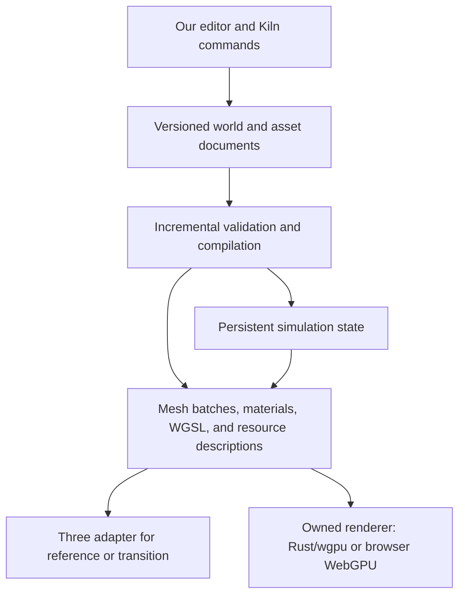

# An owned game engine: WebGPU, Effect, and three-effect

Date: 2026-10-22. OpenAgents snapshot: `e0cc395c78`.
Status: architecture assessment; no implementation or new performance measurements.
The owner's clarified requirement is to build and own the editor, runtime, and services. Three.js may supply rendering, but an upstream editor is not the product foundation.

## Recommendation

**Build our editor and game runtime around our own versioned world data, commands, and asset pipeline. Make the renderer replaceable. For control over rendering performance, target an owned renderer with explicit GPU buffers, passes, and WGSL shaders.**

For OpenAgents' existing Rust and native/browser architecture, the first custom-renderer path to investigate is the Rust/`wgpu` renderer already in the repository. For a browser-only renderer, a small JavaScript WebGPU encoder is also credible. Effect can manage browser-side jobs and resource lifetimes around either approach; it does not determine the GPU architecture.

Use `three-effect` as an existing rendering adapter and source of reusable interaction/lifecycle patterns if a browser TypeScript boundary is adopted. Do not make Three scene objects, Foldkit state, or Effect values the persistent format of a game. Do not build and maintain three production renderers by default: use the existing paths to compare one representative scene, then choose the supported path.

This changes the [earlier editor comparison](2026-10-22-browser-game-editor-comparison.md). Babylon's collection of authoring tools no longer earns it first place when the requirement is to build those authoring systems ourselves. The relevant comparison becomes the cost and capability of the rendering boundary.

There is no demonstrated “absolute fastest” language or renderer here. The fastest route to an existing browser scene, the shortest edit loop, and the lowest frame time are different choices. Our architecture should let us improve each independently.

## What three-effect actually contains

Reviewed public repository: [`OpenAgentsInc/three-effect` at `714c37edf650258a767ae3fe0d98b6499acadd95`](https://github.com/OpenAgentsInc/three-effect/tree/714c37edf650258a767ae3fe0d98b6499acadd95), whose latest commit is dated 2026-07-14. Inspection covered its package manifests, implementation audit, rendering and resource helpers, frame clock, scene updates, instance helpers, performance sampling, and selected host lifecycle code. Examples and tests were not executed.

| Evidence | Meaning for this decision |
| --- | --- |
| [Core package manifest](https://github.com/OpenAgentsInc/three-effect/blob/714c37edf650258a767ae3fe0d98b6499acadd95/packages/core/package.json) pins Three `0.184.0` and Effect `4.0.0-beta.94` | This is a concrete existing stack; current Effect documentation is not evidence that this beta already has every current API |
| [Mount code](https://github.com/OpenAgentsInc/three-effect/blob/714c37edf650258a767ae3fe0d98b6499acadd95/packages/core/src/index.ts#L106) creates a `WebGLRenderer`; [render helpers](https://github.com/OpenAgentsInc/three-effect/blob/714c37edf650258a767ae3fe0d98b6499acadd95/packages/core/src/renderPrimitives.ts) use WebGL targets and `EffectComposer` | Effect currently surrounds Three rendering; it has not replaced its rendering backend |
| [Shader helpers](https://github.com/OpenAgentsInc/three-effect/blob/714c37edf650258a767ae3fe0d98b6499acadd95/packages/core/src/shaderMaterialPrimitives.ts) create Three `ShaderMaterial` classes | These are useful GLSL/uniform conveniences, not a portable WGSL shader compiler |
| [Resource scopes](https://github.com/OpenAgentsInc/three-effect/blob/714c37edf650258a767ae3fe0d98b6499acadd95/packages/core/src/resourceScopePrimitives.ts) and [managed frame clock](https://github.com/OpenAgentsInc/three-effect/blob/714c37edf650258a767ae3fe0d98b6499acadd95/packages/core/src/frameClockPrimitives.ts) provide explicit cleanup, subscriptions, and demand/manual rendering | Useful foundations for an owned runtime that should not render an idle editor unnecessarily |
| [Scene update helpers](https://github.com/OpenAgentsInc/three-effect/blob/714c37edf650258a767ae3fe0d98b6499acadd95/packages/core/src/sceneNodeReconcilerPrimitives.ts) retain compatible instances by ID and kind | A starting point for incremental scene changes, with Three-specific runtime handles |
| [Foldkit host](https://github.com/OpenAgentsInc/three-effect/blob/714c37edf650258a767ae3fe0d98b6499acadd95/packages/foldkit/src/index.ts#L576) captures a local pose and stages a replacement before disposing the old scene | Useful continuity work already exists; this is not a generic last-working-shader transaction |

The [implementation audit](https://github.com/OpenAgentsInc/three-effect/blob/714c37edf650258a767ae3fe0d98b6499acadd95/docs/2026-06-14-implementation-audit.md) explicitly separates application state from imperative Three resources. Preserve that separation. Its Foldkit app assumptions come from a different repository shape; importing the library does not authorize replacing today's Rust Native interfaces or domain crates.

Source search of the reviewed core and Foldkit packages found no `WebGPURenderer`, `navigator.gpu`, or `createRenderPipeline` implementation. Moving this library to direct WebGPU would be new renderer work. Even moving its materials and postprocessing to Three's WebGPU backend requires adaptation: the [Three migration guide](https://threejs.org/manual/pages/webgpurenderer.html) distinguishes the older custom-material/composer paths from node materials, TSL, and the WebGPU postprocessing stack.

## Where Effect belongs

[Effect](https://effect.website/docs/v4/onboarding) provides typed errors, structured concurrency, resource management, services, and observability. These fit an editor that coordinates imports, compilation, worker jobs, previews, and agent edits.

Use Effect, if adopted, to organize:

- Asset fetch, decode, conversion, and cache work with bounded concurrency.
- An edit's validation and compilation, including stale-result rejection.
- Preview lifetime, device-loss handling, and cleanup when a project closes.
- Kiln commands, progress, diagnostics, and traces of edit-to-visible latency.
- Service dependencies such as asset storage, compiler workers, and the selected renderer adapter.

Keep the frame loop allocation-conscious and synchronous where practical: update changed arrays, run simulation, prepare visible draw batches, encode passes, and submit. Do not require an Effect fiber, observable update, or cross-language message for every entity, vector operation, or draw. A coarse frame operation can still be exposed through Effect; its cost should be measured.

Effect does not accelerate a shader or select better GPU layouts by itself. [Scopes](https://effect.website/docs/v4/resource-management/scope) help release successfully acquired resources when closed, but the integration must register the right cleanup. Interrupting an editor task also does not imply that an already submitted GPU compilation has stopped. Late results still need revision checks and appropriate cleanup.

“Direct WebGPU using Effect” is therefore a reasonable composition: Effect coordinates the editor and asynchronous work; our renderer makes WebGPU calls. It is not a separate GPU technology that is inherently faster than Three or Rust.

## The radical change: compile the game incrementally from owned data

The important boundary is between what a game means and how one backend draws it.

This is proposed architecture, not a claim that an interchangeable backend contract already exists. Keep it small enough for the first authored game; do not design a universal renderer interface before comparing a representative scene.

The persistent document describes stable entities, components, asset references, behavior parameters, and material sources. The simulation keeps the player's current state separately. The renderer builds disposable GPU resources from those inputs. A new renderer must not require editing every saved world.

Prefer packed component arrays, dirty ranges, mesh/material batches, and explicit streaming cells where they fit the workload. Authoring can retain a friendly hierarchy while the compiled runtime representation uses a different layout. That lets a performance change replace a batch builder or GPU pass without changing the editor's project format.

Shader source, material graphs, scene changes, and tuning can be data updates. Keep WGSL editable outside the Rust binary. A developer changing Rust algorithms or host-side buffer layouts still needs a build; this design does not make arbitrary compiled code changes instantaneous.

The existing [Verse Engine architecture](../verse/engine/architecture.md) already establishes ownership of the runtime schedule, renderer, shaders, content compiler, and world authority while permitting platform libraries such as `wgpu`. This proposal develops that direction for browser authoring.

## Three routes to the GPU

| Route | Strength | Cost or limit | OpenAgents fit |
| --- | --- | --- | --- |
| Three through our adapter | Existing loaders, materials, scene interactions, and `three-effect` work get a representative scene running sooner | Three's objects, material system, and renderer conventions shape the adapter; custom internals may need a fork | Useful baseline and possible production renderer if it meets measured needs |
| Our JavaScript renderer using browser WebGPU | Direct control over browser buffers, bindings, shaders, passes, and submission with a small browser integration | We build and maintain rendering systems and asset adapters; native reuse needs another boundary | Credible if browser-only iteration takes precedence and a JS/TS product boundary is explicitly adopted |
| Our Rust renderer using `wgpu`, WGSL, and Wasm in browsers | Own the same rendering decisions while reusing Rust systems and native GPU targets | Rust implementation changes compile; browser API crossings, uploads, and Wasm startup still need measurement | First custom path to evaluate given the renderer and contract we already have |

[`wgpu`](https://docs.rs/wgpu/30.0.1/wgpu/) is a GPU API library, not a scene engine. It targets native graphics APIs and browser WebGPU/WebGL2. The current [Verse renderer](../../crates/verse/src/render.rs) already owns a device, queue, targets, scene resources, and async browser surface initialization; [its manifest](../../crates/verse/Cargo.toml) pins `wgpu` 30.0.1. Starting here is materially different from beginning a renderer from zero.

Raw JavaScript WebGPU and Rust/`wgpu` in a browser both ultimately use the browser's GPU implementation and its validation. Raw calls offer no automatic escape from driver compilation or browser limits. Rust may help CPU-heavy transforms and simulation; JavaScript may simplify browser integration. Neither establishes lower GPU time for equivalent shaders and draw work without measurement.

A maintained fork or vendored copy of an open-source Three renderer also permits local changes without waiting for upstream. Complete ownership is compatible with explicit, replaceable dependencies. Direct WebGPU is justified when owning the renderer's architecture improves our workload, rather than by the number of dependencies removed.

## How we could outperform a general-purpose renderer

**Specialize around our worlds and measure the limiting work.** More control enables these experiments; it does not guarantee they win:

| Measured bottleneck | Candidate experiment |
| --- | --- |
| CPU traversal and allocation | Compile authored hierarchy into packed active arrays; cache unchanged transforms and draw lists |
| Too many draw submissions | Instance compatible meshes; batch by material; evaluate cached render bundles where reuse fits |
| CPU visibility work | Compare cell/cluster culling on CPU with compute-generated visibility and indirect draws |
| Large uploads | Keep buffers resident and upload changed ranges; separate static geometry from moving instance records |
| GPU bandwidth or residency | Pack vertices, stream nearby detail, compress textures, and cap transient resources |
| Fragment cost | Reduce overdraw, expensive materials, shadow work, and unnecessary full-resolution passes |
| Compile stalls | Cache bounded pipeline variants, compile candidates asynchronously, and warm likely variants |

The [WebGPU bundle-culling sample](https://webgpu.github.io/webgpu-samples/?sample=bundleCulling) demonstrates indirect instanced draws and render bundles. Those features offer options for our renderer; required device features and limits still need checks. GPU culling adds compute and synchronization work and can lose on small scenes. A WebGL2 fallback also cannot be assumed to run the same compute path.

Our own [rendering-scale record](../verse/rendering-scale.md#measurements) is a useful caution. Instancing and a compact layout reduced Everglade's recorded GPU storage from 208.7 MiB to 116.6 MiB. The same record contains mixed frame-time results under contention and calls for GPU timestamps. A memory improvement did not establish a universal frame-rate improvement. Keep that distinction when comparing Three and a custom renderer.

For `three-effect`, source inspection suggests smaller experiments first:

- Its frame clock copies and sorts subscribers on every tick. Cache the order until the subscriber list changes, then compare CPU time and allocation.
- Its instance helpers create matrices and temporary math objects for each supplied transform. Compare reusable scratch objects, packed input, and partial instance updates for frequently changing scenes.
- Its performance monitor samples frame cadence. Add separate CPU preparation/submission timing and GPU pass timing where supported; FPS alone cannot identify the bottleneck.
- Its game-screen helper uploads a canvas-backed texture when updated. Measure the cost of showing another full renderer on an in-world screen before assuming that composition is free.

These are inspection findings, not confirmed production bottlenecks or implemented fixes. Source references: [frame clock](https://github.com/OpenAgentsInc/three-effect/blob/714c37edf650258a767ae3fe0d98b6499acadd95/packages/core/src/frameClockPrimitives.ts#L71), [instance updates](https://github.com/OpenAgentsInc/three-effect/blob/714c37edf650258a767ae3fe0d98b6499acadd95/packages/core/src/instancePrimitives.ts#L87), [performance sampling](https://github.com/OpenAgentsInc/three-effect/blob/714c37edf650258a767ae3fe0d98b6499acadd95/packages/core/src/performancePrimitives.ts), [canvas screens](https://github.com/OpenAgentsInc/three-effect/blob/714c37edf650258a767ae3fe0d98b6499acadd95/packages/core/src/gameScreenPrimitives.ts).

## The shortest safe shader edit loop

The target is a direct path from a shader edit to a candidate GPU pipeline, independent of model inference, remote Rust builds, PR creation, and public publishing.

1. Assign the edit a revision and keep the running game and working material.
2. Validate shader source and resource interfaces against the active material contract.
3. Create a candidate module and pipeline asynchronously; collect diagnostics.
4. If a newer edit has arrived, discard the result. Otherwise, switch at a frame boundary after successful creation.
5. Preserve player position, view, and simulation state. Release obsolete resources at the appropriate lifetime boundary.

WebGPU exposes [`getCompilationInfo`](https://gpuweb.github.io/types/interfaces/GPUShaderModule.html) and [`createRenderPipelineAsync`](https://gpuweb.github.io/types/interfaces/GPUDevice.html). Successful module creation alone is not proof that a compatible render pipeline exists. Resource layout changes need validation or an explicit migration. If the device is lost, recover GPU resources from the project/runtime state; the previous pipeline belongs to the lost device and cannot be the recovery mechanism.

The same lifecycle can sit behind the Rust runtime or a browser JavaScript adapter. Effect can coordinate it if adopted. The current [Haunted House shader/Kiln issue](https://github.com/OpenAgentsInc/openagents/issues/12500) remains a focused first test of continuity and error recovery; it does not require a WebGPU rewrite.

## Kiln and retained Rust

Kiln should submit typed project commands: change a property, replace an asset draft, compile a material, inspect a preview, undo a transaction, or publish a selected snapshot. The renderer is an implementation detail of the receiving editor. A renderer rewrite should not require Kiln to learn a different project's object model or edit generated engine internals.

Keep the existing Rust identity, permissions, Nostr, wallet, inference, Kiln, runner, and publishing services. Keep Loro/`coder-sync` collaboration and NIP-HOST grants. Preserve one simulation state owner and batch any JS/Wasm exchange. Effect services can call bounded Rust capabilities without becoming a duplicate account, session, or authorization system.

The current Rust-only contract still governs implementation. Effect and `three-effect` are TypeScript libraries; investigating them does not create an exception. The relevant prospective exception would be a narrow browser orchestration/renderer adapter, with application and domain state remaining in Rust. No code or policy change is part of this audit.

## A decision that can be tested

- **Own now in the design:** project schema, command history, asset sources, simulation state, shader/material contracts, and the preview/publish boundary.
- **First custom-renderer candidate:** existing Rust/`wgpu` plus editable WGSL, with incremental scene updates.
- **Browser-first alternative:** a small raw WebGPU encoder behind the same project contract, with Effect for surrounding work if the language boundary is adopted.
- **Existing comparison path:** `three-effect`, with targeted allocation and update experiments before a broad rewrite.
- **Choose on evidence:** identical visuals, simulation, resolution, and devices; compare CPU time, GPU time, p95 frame time, memory, initial load, and edit-to-visible latency. Include a real authored game slice as well as a scale workload.

Use [GPU timestamp queries](https://webgpu.github.io/webgpu-samples/?sample=timestampQuery) where available, with a CPU-only measurement fallback. Promote a custom path when it demonstrates a meaningful workload advantage and usable authoring, or when a required feature cannot be added cleanly to the existing renderer. No speedup factor or migration deadline is established by this research.
