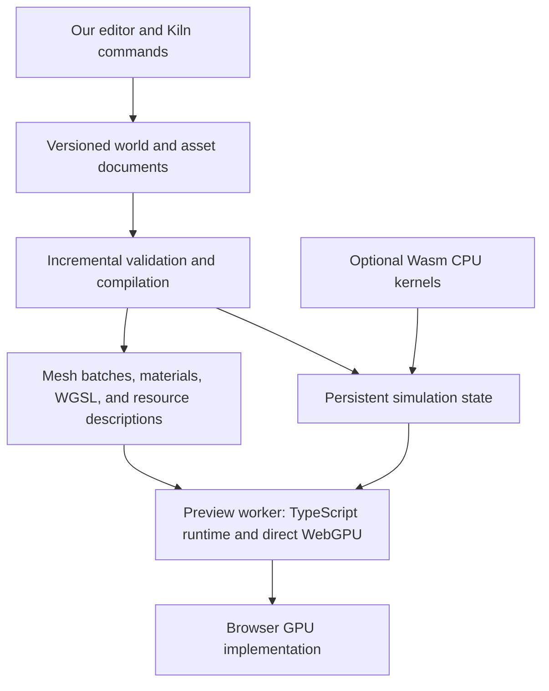

# An owned game engine: WebGPU, Effect, and three-effect

Date: 2026-10-22. Updated at OpenAgents snapshot: `2ae6722ad5`.
Status: architecture assessment; no implementation or new performance measurements.
Decision assumptions: browser-first, designed from scratch, complete ownership of the editor/runtime/services, and no Rust-only constraint. Existing Rust investment and native reuse do not determine the choice.

## Recommendation

**Choose TypeScript + Effect for the editor and asynchronous orchestration, an allocation-conscious TypeScript runtime and direct WebGPU renderer, and editable WGSL shaders. Use Rust/Wasm selectively for measured CPU bottlenecks.** This is the recommended default under the stated assumptions, rather than a choice deferred between two equal candidates.

This choice favors the shortest integrated browser development loop while preserving direct control of GPU layouts, pipelines, and passes. The editor, behavior modules, renderer, browser APIs, and diagnostics share JavaScript tooling. Rust/`wgpu` adds a compiled Wasm artifact and a language boundary without establishing a GPU-throughput advantage for equivalent work. A workload dominated by CPU simulation can justify Rust kernels; it does not require making the entire renderer Rust.

Own the versioned world data, commands, asset compiler, material contracts, and simulation state. Keep Effect outside per-entity and per-draw work. Three.js and `three-effect` remain references or comparison adapters; direct WebGPU is the selected production direction. Avoid making Three adoption a prerequisite or maintaining multiple production renderers from the outset.

This replaces the previous recommendation to investigate the existing Rust renderer first. That recommendation weighted native reuse and the repository's language policy; the owner explicitly removes both from this assessment. It also updates the [earlier editor comparison](2026-10-22-browser-game-editor-comparison.md): upstream authoring tools do not determine an editor we are building ourselves.

This is an architecture decision, not a measured claim that TypeScript produces faster frames. Iteration favors the browser-native tooling path; GPU performance depends on the work submitted; CPU performance remains workload-specific. No comparative speedup factor has been established.

## The architecture to build from scratch

| Part | Default design | Purpose |
| --- | --- | --- |
| Editor | Our DOM-based TypeScript interface, with accessible controls | Direct browser integration for code, hierarchy, properties, assets, and diagnostics; no UI framework choice is required by this audit |
| Project model | Versioned serializable data, stable IDs, typed commands, and explicit transactions | Manual edits and Kiln share undo, validation, and conflict handling; runtime handles never become saved project data |
| Orchestration | Effect services, scopes, bounded jobs, and typed failures | Coordinate compilation, imports, preview lifetime, storage, and observability |
| Incremental compiler | Worker-based scene/material/behavior compilation with revision tracking | Rebuild only affected outputs and reject stale results |
| Preview runtime | Dedicated worker owning simulation, persistent runtime state, and the renderer | Keep frame work off the editor's UI thread and avoid sending every object's state across threads each frame |
| Renderer | Our TypeScript WebGPU encoder over packed arrays, cached resources, and explicit passes | Control batching, uploads, visibility, memory, and GPU work without an intermediate scene-engine dependency |
| Materials | Editable WGSL and an optional owned graph that produces WGSL | Compile a candidate pipeline while the last working material continues rendering |
| CPU extensions | Wasm modules, including Rust, behind coarse buffer-oriented APIs when profiling warrants them | Accelerate geometry processing, physics, or simulation without rebuilding the whole browser application |
| Storage and publishing | Owned project storage, asset sources, content-addressed outputs, and explicit release snapshots | Keep immediate private preview independent of deployment |

Use an OffscreenCanvas transferred to the preview worker where supported. The [WebGPU worker sample](https://github.com/webgpu/webgpu-samples/blob/main/sample/worker/main.ts) demonstrates this browser boundary. Send input, resize, and edit commands in batches; return selected values and diagnostics. Keep simulation and rendering together initially, then split work only when measurements justify the extra scheduling and transfer costs. Workers protect UI responsiveness; they do not reduce the amount of computation or guarantee lower input latency.

The editor holds account authority; the user-game preview runs in a separate origin with a bounded command bridge and its own workers. A worker alone is not the account-security boundary. Require the selected browser capabilities at startup and keep a main-thread rendering accommodation only where required by the supported browser matrix. Do not make a shared-memory deployment configuration or a second WebGL renderer prerequisites for the first WebGPU product.

## What three-effect actually contains

Reviewed public repository: [`OpenAgentsInc/three-effect` at `714c37edf650258a767ae3fe0d98b6499acadd95`](https://github.com/OpenAgentsInc/three-effect/tree/714c37edf650258a767ae3fe0d98b6499acadd95), whose latest commit is dated 2026-07-14. Inspection covered its package manifests, implementation audit, rendering and resource helpers, frame clock, scene updates, instance helpers, performance sampling, and selected host lifecycle code. Examples and tests were not executed.

| Evidence | Meaning for this decision |
| --- | --- |
| [Core package manifest](https://github.com/OpenAgentsInc/three-effect/blob/714c37edf650258a767ae3fe0d98b6499acadd95/packages/core/package.json) pins Three `0.184.0` and Effect `4.0.0-beta.94` | This is a concrete existing stack; current Effect documentation is not evidence that this beta already has every current API |
| [Mount code](https://github.com/OpenAgentsInc/three-effect/blob/714c37edf650258a767ae3fe0d98b6499acadd95/packages/core/src/index.ts#L106) creates a `WebGLRenderer`; [render helpers](https://github.com/OpenAgentsInc/three-effect/blob/714c37edf650258a767ae3fe0d98b6499acadd95/packages/core/src/renderPrimitives.ts) use WebGL targets and `EffectComposer` | Effect currently surrounds Three rendering; it has not replaced its rendering backend |
| [Shader helpers](https://github.com/OpenAgentsInc/three-effect/blob/714c37edf650258a767ae3fe0d98b6499acadd95/packages/core/src/shaderMaterialPrimitives.ts) create Three `ShaderMaterial` classes | These are useful GLSL/uniform conveniences, not a portable WGSL shader compiler |
| [Resource scopes](https://github.com/OpenAgentsInc/three-effect/blob/714c37edf650258a767ae3fe0d98b6499acadd95/packages/core/src/resourceScopePrimitives.ts) and [managed frame clock](https://github.com/OpenAgentsInc/three-effect/blob/714c37edf650258a767ae3fe0d98b6499acadd95/packages/core/src/frameClockPrimitives.ts) provide explicit cleanup, subscriptions, and demand/manual rendering | Useful foundations for an owned runtime that should not render an idle editor unnecessarily |
| [Scene update helpers](https://github.com/OpenAgentsInc/three-effect/blob/714c37edf650258a767ae3fe0d98b6499acadd95/packages/core/src/sceneNodeReconcilerPrimitives.ts) retain compatible instances by ID and kind | A starting point for incremental scene changes, with Three-specific runtime handles |
| [Foldkit host](https://github.com/OpenAgentsInc/three-effect/blob/714c37edf650258a767ae3fe0d98b6499acadd95/packages/foldkit/src/index.ts#L576) captures a local pose and stages a replacement before disposing the old scene | Useful continuity work already exists; this is not a generic last-working-shader transaction |

The [implementation audit](https://github.com/OpenAgentsInc/three-effect/blob/714c37edf650258a767ae3fe0d98b6499acadd95/docs/2026-06-14-implementation-audit.md) explicitly separates application state from imperative Three resources. Preserve that separation. Its Foldkit app assumptions come from a different repository shape; they are reference material, not the from-scratch editor architecture selected here.

Source search of the reviewed core and Foldkit packages found no `WebGPURenderer`, `navigator.gpu`, or `createRenderPipeline` implementation. Moving this library to direct WebGPU would be new renderer work. Even moving its materials and postprocessing to Three's WebGPU backend requires adaptation: the [Three migration guide](https://threejs.org/manual/pages/webgpurenderer.html) distinguishes the older custom-material/composer paths from node materials, TSL, and the WebGPU postprocessing stack.

## Where Effect belongs

[Effect](https://effect.website/docs/v4/onboarding) provides typed errors, structured concurrency, resource management, services, and observability. These fit an editor that coordinates imports, compilation, worker jobs, previews, and agent edits.

Use Effect to organize:

- Asset fetch, decode, conversion, and cache work with bounded concurrency.
- An edit's validation and compilation, including stale-result rejection.
- Preview lifetime, device-loss handling, and cleanup when a project closes.
- Kiln commands, progress, diagnostics, and traces of edit-to-visible latency.
- Service dependencies such as asset storage, compiler workers, and the selected renderer adapter.

Keep the frame loop allocation-conscious and synchronous where practical: update changed arrays, run simulation, prepare visible draw batches, encode passes, and submit. Do not require an Effect fiber, observable update, or cross-language message for every entity, vector operation, or draw. A coarse frame operation can still be exposed through Effect; its cost should be measured.

Effect does not accelerate a shader or select better GPU layouts by itself. [Scopes](https://effect.website/docs/v4/resource-management/scope) help release successfully acquired resources when closed, but the integration must register the right cleanup. Interrupting an editor task also does not imply that an already submitted GPU compilation has stopped. Late results still need revision checks and appropriate cleanup.

“Direct WebGPU using Effect” is therefore a reasonable composition: Effect coordinates the editor and asynchronous work; our renderer makes WebGPU calls. It is not a separate GPU technology that is inherently faster than Three or Rust.

## The radical change: compile the game incrementally from owned data

The important boundary is between what a game means and how one backend draws it.

This is proposed architecture, not a claim that an interchangeable backend contract already exists. Keep it small enough for the first authored game; do not design a universal renderer interface before comparing a representative scene.

The persistent document describes stable entities, components, asset references, behavior parameters, and material sources. The simulation keeps the player's current state separately. The renderer builds disposable GPU resources from those inputs. A new renderer must not require editing every saved world.

Prefer packed component arrays, dirty ranges, mesh/material batches, and explicit streaming cells where they fit the workload. Authoring can retain a friendly hierarchy while the compiled runtime representation uses a different layout. That lets a performance change replace a batch builder or GPU pass without changing the editor's project format.

Shader source, material graphs, scene changes, and tuning can be data updates. Keep WGSL editable outside the host bundle. TypeScript behavior and renderer implementation changes still need transformation and an explicit replacement boundary; selecting TypeScript does not make arbitrary state or resource-layout changes safe to swap. Optional Rust kernels still need compilation when their implementation changes.

The existing [Verse Engine architecture](../verse/engine/architecture.md) establishes ownership of the runtime schedule, renderer, shaders, content compiler, and world authority. Preserve those ownership goals while changing the language and browser runtime recommendation under this assessment's assumptions.

## Why choose this over Rust/wgpu

| Criterion | TypeScript + Effect + direct WebGPU | Rust/wgpu in the browser | Decision |
| --- | --- | --- | --- |
| Editor and engine implementation iteration | One browser module/tooling environment; smaller modules can have explicit hot replacement boundaries | Rust changes require compilation, Wasm packaging, and integration with browser-facing modules | Prefer TypeScript for the whole editor/engine iteration loop |
| Shader, scene, and tuning updates | Runtime data and pipeline replacement | Can use the same runtime data and pipeline replacement | Comparable capability; shader hot reload alone is not a language advantage |
| GPU execution | Browser compiles WGSL and executes submitted passes | Browser compiles WGSL and executes submitted passes | No inherent Rust advantage for equivalent GPU work |
| CPU simulation and data processing | Typed arrays and low-allocation loops; JIT/GC behavior needs profiling | Linear-memory data structures and explicit CPU-oriented implementations may win for suitable workloads | Begin in TypeScript; move substantial measured CPU work to Wasm kernels |
| Browser API integration and debugging | Direct objects, browser tooling, and shared TypeScript contracts | Wasm/JS interop and a second runtime/tooling boundary | Prefer the simpler default boundary; this is not a measured per-call speedup claim |
| Startup | Download and parse the selected JS modules and dependencies | Download/instantiate Wasm plus the browser integration | Measure bytes and startup; neither is universally smaller or faster |
| Native portability | Additional host/rendering integration if later required | A strong reason to choose wgpu when native rendering is a primary requirement | Native parity is outside the assumptions driving this decision |

These comparisons are architectural judgments. They are not results from a side-by-side implementation. The iteration advantage concerns changing browser application and engine code; both designs still pay the GPU's compilation cost for a shader edit.

[`wgpu`](https://docs.rs/wgpu/30.0.1/wgpu/) is a portable GPU API library, not a scene engine. Its [browser backend](https://github.com/gfx-rs/wgpu/blob/v30.0.1/wgpu/src/backend/webgpu.rs) uses Wasm/JavaScript bindings to browser WebGPU objects. A browser build does not bypass browser validation or gain native Metal/Vulkan submission by choosing Rust. Direct TypeScript avoids needing that language boundary in our default renderer; whether the removed boundary materially affects frame time is workload-specific.

The current [Verse renderer](../../crates/verse/src/render.rs) and [its wgpu manifest](../../crates/verse/Cargo.toml) remain valuable implementation references. Their existence is a migration consideration, not a reason to select Rust in a from-scratch comparison. Reuse existing server services where useful without making the browser editor, simulation state, or rendering schedule depend on Rust.

Memory discipline is required in either design. Reuse typed arrays and scratch objects, keep GPU buffers resident, bound caches, and avoid allocations in steady-state inner loops. Rust helps control CPU allocations, but neither Rust nor TypeScript removes explicit GPU resource lifetime and device-loss work. Effect scopes belong around jobs and scene lifetimes, not individual vector updates.

Choose a Rust kernel when representative profiling demonstrates a material CPU benefit after accounting for serialization, copying, scheduling, and integration costs. Keep data on one side during a batch and return compact results. Do not move per-draw API submission through Wasm to obtain a hypothetical GPU improvement.

A maintained fork or vendored copy of an open-source Three renderer also permits local changes without waiting for upstream. Complete ownership is compatible with explicit, replaceable dependencies. Direct WebGPU is justified when owning the renderer's architecture improves our workload, rather than by the number of dependencies removed.

## Iteration is a product capability

Use browser development HMR for the editor implementation, and a separate owned revision protocol for creator previews. [Vite's HMR API](https://vite.dev/guide/api-hmr) supplies acceptance, disposal, and persistent-data hooks; it does not define game-state migration or a deployed creator's preview service.

| Edit | Preview action | State to preserve |
| --- | --- | --- |
| Transform, tuning, or uniform | Apply a validated delta at the next safe tick/frame | Same simulation, player, and active resources |
| Geometry, texture, or material source | Build candidate outputs, then replace affected resources | Same run; keep the previous resource if the candidate fails |
| TypeScript behavior module | Transform/import a new revision, validate its lifecycle, and replace the behavior | Compatible external state; dispose old listeners, timers, and subscriptions |
| Renderer module or resource layout | Replace only behind an explicit compatibility boundary | Keep compatible state/resources, otherwise perform a visible controlled restart or migration |
| Optional Rust kernel | Compile and instantiate the changed module behind its versioned API | Compatible state supplied by the runtime, not hidden in the old module |

For in-browser TypeScript transformation, [esbuild's browser API](https://esbuild.github.io/api/#browser) is a concrete worker/Wasm option; package/version selection remains implementation work. A bundler's Wasm implementation is compatible with this architecture. Multi-file resolution, project virtual files, module loading, source maps, and replacement are still our product integration. Run type checking as a separate diagnostic job where safe, rather than blocking every visible draft update on a full-project check; validate runtime contracts before accepting a replacement.

Keep simulation state outside replaceable behavior modules. Validate candidates before granting live effects. A thrown error after executing arbitrary behavior cannot be undone merely by restoring a function reference; mutations need bounded commands, a transaction, or a checkpoint/restart policy. Shader failure can preserve the previous pipeline, but arbitrary script edits need their own failure semantics. Replacing revisioned ESM modules also needs a bounded lifecycle: the [HTML module map](https://html.spec.whatwg.org/multipage/webappapis.html#module-map) associates loaded modules with their environment and URLs. Plan controlled preview restarts with state restoration rather than assuming unlimited revision imports are free.

## How we could outperform a general-purpose renderer

**Specialize around our worlds and measure the limiting work.** More control enables these experiments; it does not guarantee they win:

| Measured bottleneck | Candidate experiment |
| --- | --- |
| CPU traversal and allocation | Compile authored hierarchy into packed active arrays; cache unchanged transforms and draw lists |
| Too many draw submissions | Instance compatible meshes; batch by material; evaluate cached render bundles where reuse fits |
| CPU visibility work | Compare cell/cluster culling on CPU with compute-generated visibility and indirect draws |
| Large uploads | Keep buffers resident and upload changed ranges; separate static geometry from moving instance records |
| GPU bandwidth or residency | Pack vertices, stream nearby detail, compress textures, and cap transient resources |
| Fragment cost | Reduce overdraw, expensive materials, shadow work, and unnecessary full-resolution passes |
| Compile stalls | Cache bounded pipeline variants, compile candidates asynchronously, and warm likely variants |

The [WebGPU bundle-culling sample](https://webgpu.github.io/webgpu-samples/?sample=bundleCulling) demonstrates indirect instanced draws and render bundles. Those features offer options for our renderer; required device features and limits still need checks. GPU culling adds compute and synchronization work and can lose on small scenes. A WebGL2 fallback also cannot be assumed to run the same compute path.

Our own [rendering-scale record](../verse/rendering-scale.md#measurements) is a useful caution. Instancing and a compact layout reduced Everglade's recorded GPU storage from 208.7 MiB to 116.6 MiB. The same record contains mixed frame-time results under contention and calls for GPU timestamps. A memory improvement did not establish a universal frame-rate improvement. Keep that distinction when comparing Three and a custom renderer.

For `three-effect`, source inspection suggests smaller experiments first:

- Its frame clock copies and sorts subscribers on every tick. Cache the order until the subscriber list changes, then compare CPU time and allocation.
- Its instance helpers create matrices and temporary math objects for each supplied transform. Compare reusable scratch objects, packed input, and partial instance updates for frequently changing scenes.
- Its performance monitor samples frame cadence. Add separate CPU preparation/submission timing and GPU pass timing where supported; FPS alone cannot identify the bottleneck.
- Its game-screen helper uploads a canvas-backed texture when updated. Measure the cost of showing another full renderer on an in-world screen before assuming that composition is free.

These are inspection findings, not confirmed production bottlenecks or implemented fixes. Source references: [frame clock](https://github.com/OpenAgentsInc/three-effect/blob/714c37edf650258a767ae3fe0d98b6499acadd95/packages/core/src/frameClockPrimitives.ts#L71), [instance updates](https://github.com/OpenAgentsInc/three-effect/blob/714c37edf650258a767ae3fe0d98b6499acadd95/packages/core/src/instancePrimitives.ts#L87), [performance sampling](https://github.com/OpenAgentsInc/three-effect/blob/714c37edf650258a767ae3fe0d98b6499acadd95/packages/core/src/performancePrimitives.ts), [canvas screens](https://github.com/OpenAgentsInc/three-effect/blob/714c37edf650258a767ae3fe0d98b6499acadd95/packages/core/src/gameScreenPrimitives.ts).

## The shortest safe shader edit loop

The target is a direct path from a shader edit to a candidate GPU pipeline, independent of model inference, remote Rust builds, PR creation, and public publishing.

1. Assign the edit a revision and keep the running game and working material.
2. Validate shader source and resource interfaces against the active material contract.
3. Create a candidate module and pipeline asynchronously; collect diagnostics.
4. If a newer edit has arrived, discard the result. Otherwise, switch at a frame boundary after successful creation.
5. Preserve player position, view, and simulation state. Release obsolete resources at the appropriate lifetime boundary.

WebGPU exposes [`getCompilationInfo`](https://gpuweb.github.io/types/interfaces/GPUShaderModule.html) and [`createRenderPipelineAsync`](https://gpuweb.github.io/types/interfaces/GPUDevice.html). Successful module creation alone is not proof that a compatible render pipeline exists. Resource layout changes need validation or an explicit migration. If the device is lost, recover GPU resources from the project/runtime state; the previous pipeline belongs to the lost device and cannot be the recovery mechanism.

The selected TypeScript/Effect runtime coordinates this lifecycle directly. Rust can implement the same mechanism; it is not exclusive to this recommendation. The current [Haunted House shader/Kiln issue](https://github.com/OpenAgentsInc/openagents/issues/12500) remains a focused existing test scope; this audit does not start, implement, or expand it.

## Kiln and retained Rust

Kiln should submit typed project commands: change a property, replace an asset draft, compile a material, inspect a preview, undo a transaction, or publish a selected snapshot. The renderer is an implementation detail of the receiving editor. A renderer rewrite should not require Kiln to learn a different project's object model or edit generated engine internals.

Existing Rust identity, permissions, Nostr, wallet, inference, Kiln, runner, and publishing services can remain behind bounded APIs. Their reuse does not require the new browser runtime's domain and simulation state to be Rust. Keep Loro/`coder-sync` collaboration and NIP-HOST grants. Preserve one simulation state owner and batch any JS/Wasm exchange. Effect services must not become a duplicate account, session, or authorization system.

The owner explicitly removes the Rust-only constraint for this architecture assessment. The TypeScript recommendation is therefore not conditional on retaining Rust browser application state. This update changes documentation only; it does not modify `AGENTS.md` or implement a language migration.

## A decision that can be tested

- **Own now in the design:** project schema, command history, asset sources, simulation state, shader/material contracts, and the preview/publish boundary.
- **Selected architecture:** TypeScript editor and runtime, Effect orchestration, direct WebGPU, and editable WGSL; preview simulation and rendering share a worker by default.
- **Selective acceleration:** Rust/Wasm or other Wasm libraries for measured CPU workloads through coarse data APIs. Rust/wgpu is not the default renderer under these assumptions.
- **Reference paths:** `three-effect` and the existing Rust renderer supply comparison workloads and design references. A Three adapter is optional, not a required production phase.
- **Choose on evidence:** identical visuals, simulation, resolution, and devices; compare CPU time, GPU time, p95 frame time, memory, initial load, and edit-to-visible latency. Include a real authored game slice as well as a scale workload.

Use [GPU timestamp queries](https://webgpu.github.io/webgpu-samples/?sample=timestampQuery) where available, with a CPU-only measurement fallback. Validate the selected architecture's frame budget, authoring continuity, and error recovery before migration. Revisit the language choice if measured CPU work dominates despite targeted kernels, or if native rendering becomes a primary requirement. No speedup factor or migration deadline is established by this research.
