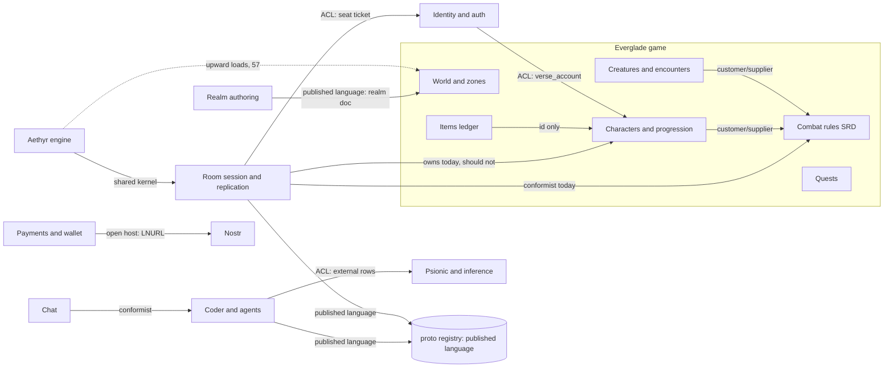

# Domain-driven design: what it is and how this repository should use it

Date: 2026-11-11 (Chicago). Code read at `ee0e80bc35`.
Written by agent `ddd-audit`. Read-only: this document is the only change.

This audit explains domain-driven design (DDD), maps the domains this
repository actually has, shows where the code follows or breaks DDD's rules,
and proposes how to adopt the useful parts in Coax. It fits the AAA program in
[Everglade and Aethyr against AAA MMORPG practice](2026-11-11-everglade-aethyr-aaa-audit.md)
(tracker [#13257](https://github.com/OpenAgentsInc/openagents/issues/13257),
issues #13258 to #13306) and the
[protocol compliance plan](../protocol/2026-11-11-compliance-plan.md)
(tracker #13250). Where those draw a boundary, this audit names the issue and
builds on it.

## Summary and verdict

**The repository already practises half of DDD without using the name, and
the missing half is mostly vocabulary and boundaries, not code.**

- Already good: `#authority` policy files are invariant owners. `metaverse-engine/ids.coax`
  gives nominal IDs. `proto/registry.json` is close to a published-language
  catalogue. The item ledger (`metaverse-engine/session/ledger.coax`) is a textbook
  aggregate with operation IDs, version guards, fencing and an outbox.
- Missing: one meaning per word. "Room", "zone", "seat", "session", "event",
  "account", "profile" and "engine" each mean two to six things in the code
  and its tables (section 3.1).
- Missing: one owner per invariant. Level comes from XP in two copies of
  `300`/`900`, and from a class string in the client's hello (section 3.3).
- Missing: the character aggregate. Today a character is 17 positional
  integers in a capture plus a class bit (section 3.4).
- Missing: context boundaries a tool can check. `layer-check` checks three
  layers. Nothing checks that the payments rules stay out of `metaverse/`, or that
  the API's rules live in one place (SQL or Coax, not both).

**Take** DDD's strategic half: a ubiquitous language, bounded contexts with a
context map, one owner for each invariant, and domain events. **Leave** its
object-oriented tactical ceremony: no class per aggregate, no repository per
aggregate, and no aggregate objects inside the 30 Hz tick.

The adoption plan (section 5) is two documents, two small checks, and a set
of rules that ride on issues already filed in #13257. It needs no rewrite and
no renaming sweep before the P1 moves land.

## How this was done

I read the files the brief lists, the migrations' headers, the API route
headers, and the AAA audit and compliance plan. I counted with `git grep` and
`wc` and read the cited lines. Nothing was built, run or deployed. No GitHub
issue was filed or edited.

Marking used below:

- **Verified**: I read it in the source at `ee0e80bc35`, with the path given.
- **From the AAA audit**: a claim that audit marks checked; I cite it and did
  not read it again.
- **Inference**: my judgement from the evidence, labelled as such.

## 1. The concept, briefly

Eric Evans named domain-driven design in *Domain-Driven Design: Tackling
Complexity in the Heart of Software* (2003). Vaughn Vernon's *Implementing
Domain-Driven Design* (2013) and *Domain-Driven Design Distilled* (2016) made
it practical, especially the rules for aggregates.

### Strategic design

| Term | Meaning |
| --- | --- |
| Ubiquitous language | The words domain experts and code share. One word, one meaning, inside one context. A class, table or message is named in that language |
| Subdomain | A part of the problem. **Core**: where the product wins; build it yourself, best people. **Supporting**: needed and specific to us, but not the reason anyone comes. **Generic**: a solved problem; buy, adopt or keep thin |
| Bounded context | The boundary inside which one model and one language hold. The same word may mean different things in two contexts. That is allowed if the boundary is explicit |
| Context map | The contexts and how each pair relates |

Relationship kinds on a context map:

| Kind | Meaning |
| --- | --- |
| Shared kernel | Two contexts share a small model and change it together |
| Customer/supplier | The downstream context's needs drive the upstream's plan |
| Conformist | Downstream adopts upstream's model as is |
| Anticorruption layer (ACL) | Downstream translates upstream's model at the edge so it doesn't leak in |
| Open host service | Upstream offers a protocol for any consumer |
| Published language | A documented, versioned exchange format, often used by an open host |

### Tactical design

| Term | Meaning |
| --- | --- |
| Entity | Has identity that outlives changes to its attributes |
| Value object | Defined by its values; immutable; no identity |
| Aggregate | A cluster of entities and values with one root. Its invariants hold after every transaction. One transaction changes one aggregate. Refer to other aggregates by ID (Vernon's four rules) |
| Domain event | A record that something happened, named in the past tense, owned by the context that raised it |
| Repository | Loads and saves whole aggregates |
| Domain service | Domain logic that belongs to no one aggregate |
| Factory | Builds a valid aggregate |
| Application service | Coordinates a use case: loads, calls the domain, saves, emits events. Holds no rules |

### Where the usual advice doesn't fit

Most DDD writing assumes request/response business software in an
object-oriented language. Two parts of this repository are not that.

- **The fixed-step simulation.** The room steps every entity at 30 Hz
  (`coax/web/room/room-everglade.coax:58`, `EG_HZ :: 30`, verified). The AAA
  audit's target is a `World` of structure-of-arrays columns and an ordered
  system list (G6, #13274). An aggregate-as-object with methods, loaded by a
  repository and saved per transaction, fights that layout and that tick.
  A repository per aggregate would mean a database round trip per entity per
  tick.
- **Coax has no classes.** It has structs, procedures, nominal IDs,
  `#authority` files, `#effects` bounds, `#transaction` blocks, `#persisted`
  records and sealed modules (`coax/spec.md` sections 6.3, 17.1;
  `coax/checked-state.md`). DDD must be expressed in those.

What to take and what to leave:

| Take | Leave |
| --- | --- |
| One word, one meaning, per context, written down | Naming every concept as a class |
| Bounded contexts and a context map a tool can check | Layers inside every module ("domain", "infrastructure" folders for 50-line files) |
| Each invariant owned by one `#authority` unit | Aggregates as objects with private state in the tick |
| The aggregate as a transaction and consistency boundary at the persistence edge | A repository per aggregate in the simulation |
| Domain events with versioned names, registered like wire shapes | Event sourcing everywhere |
| ACLs for third-party formats and legacy code | Generic "domain model" frameworks |

## 2. The domains we actually have

### 2.1 Subdomains and bounded contexts

Derived from the folders, the SQL schemas (17 `CREATE SCHEMA` statements in
`coax/web/api/migrations/`, verified), the API route headers and the registry.

| Context | Where it lives today | Class | Evidence and reasoning |
| --- | --- | --- | --- |
| **Combat rules (SRD)** | `metaverse-engine/rules/srd/` (27,837 lines of top-level `.coax`, verified) | Core | Everglade's pitch is "the SRD's rules decide the outcome" (`everglade/README.md`). Several worlds share it (Everglade II, Experimental, 5E Lab). It has its own language tied to a source text |
| **Characters and progression** | Scattered: room seat state, `metaverse-engine/session/character-checkpoint.coax`, `coax/web/room/room-checkpoint.coax`, `room-events.coax`, SQL `verse.character_*` | Core | "A character worth keeping" is workstream P4. No single home today (section 3.4) |
| **World and zones** | `verse/everglade2/`, `everglade/world/`, `metaverse-engine/world/` | Core | The place the player is in; G7 (#13280) |
| **Creatures and encounters** | `coax/web/room/room-e2-monsters.coax`, `room-e2-guard.coax`, `room-events.coax`, `metaverse-engine/actors/` (unused) | Core | G10, #13293 |
| **Items and economy** | `metaverse-engine/session/ledger.coax`, SQL `verse.items`, `verse.item_*` | Core (dormant) | Built; nothing calls it (AAA G3; I found no caller of `item_outbox_since` or `ledger_consume` outside tests, verified) |
| **Quests** | The page and the browser save (AAA G3) | Core (missing) | #13292 |
| **Room session and replication** | `coax/web/room/`, `metaverse-engine/net/`, `metaverse-engine/session/` (control, travel, party, region, compat) | Supporting | Hard, ours, and specific to how we host. Players don't come for it |
| **Realm authoring** | `metaverse-engine/editor/`, `apps/metaverse-engine-desktop/`, WorldBuilder (`apps/openagents-web/worldbuilder*.coax`, `coax/web/api/worldbuilder.c`), Realm Builder (`coax/web/api/realms.c`), SQL `verse.realm_*`, `worldbuilder.*` | Supporting | Three tools edit realms. WorldBuilder already goes through `metaverse-engine/editor/edit.coax` (#13226, verified at `worldbuilder-plan.coax:10`); Realm Builder keeps its rules in SQL (`realms.c:1-4`) |
| **Identity and auth** | `coax/web/api/auth*.c`, `auth-*-policy.coax`, SQL `auth.*` (29 tables), `docs/auth/` | Generic, built in-house | Accounts, authenticators, sessions. Built here by owner choice (no phone, no identity provider, `0142_auth_accounts.sql:1-2`), but the problem is a solved one |
| **Payments and wallet** | `metaverse/wallet.coax`, `coax/web/api/lnaddr*.c`, `makerpay-policy.coax`, SQL `pay.*`, `makers.*`, `coax/lib/bitcoin/`, `coax/lib/lightning/`, `coax/lib/lnaddr/` | Supporting | Bitcoin-only rails are an owner rule. Money rules must be `#authority` (`AGENTS.md`, Rules) |
| **Coder and agents** | `coder/`, `coax/lib/agent/`, `coax/lib/microcoder/`, `coax/lib/gateway/`, `apps/everglade-desktop/` (Golemancy) | Core | A product line with its own book and registry rows (C1 to C13) |
| **Chat** | `apps/openagents-web/chat.coax`, `coax/web/api/chat.c`, SQL `chat.*`, `components/zeron/` | Supporting | Being rebuilt ([chat zero-base audit](2026-11-11-chat-zero-base-audit.md)) |
| **Projects** | `coax/web/api/private.c`, `drops.c`, SQL `projects.*`, `drops.*` | Supporting | Private project pages and drops |
| **Nostr** | `coax/lib/nostr/`, `nostr/` | Generic | An external protocol; we implement it faithfully |
| **Psionic and inference** | `psionic/`, `coax/web/api/inference.c`, `coax/lib/systemone/`, SQL `inference.*`, `mesh.*` | Core (separate product) | Its own book, registry family `psionic.*` |
| **Engine (Aethyr)** | `metaverse-engine/` minus `rules/` | Supporting kernel | Shared by every realm. Generic in shape (any engine has a loop and a renderer), specific in its verification |
| **Coax toolchain** | `coax/` | Supporting | The language everything is written in |
| **Analytics, email, jobs, access** | SQL `analytics.*`, `email.*`, `jobs.*`, `access.*` | Generic | Plumbing |

Inference: three contexts are the product's core today: combat rules,
characters and progression, and Coder. The engine is a supporting kernel, not
the core. That matters for where effort goes: the AAA audit grades the engine
kernels A and the character D.

### 2.2 Context map



| Upstream to downstream | Today (verified unless marked) | Should be | Why |
| --- | --- | --- | --- |
| Rules to room | Room calls `rs_*` and reads `RsCreature` fields directly; the room holds rules state as `v[0].eg[k].rules[0].b[0].c[...]` (`room-everglade.coax:873`) | Customer/supplier through a declared surface (`world-profile.coax`, a sealed `#export` list) | The AAA plan rewrites `RsCreature` into Ability and Aura records (#13285). A sealed module lets that happen without the room breaking |
| Rules to characters | No character context exists; the room plays both parts | Customer/supplier | Characters need the rules' level, slot and feature tables |
| Auth to game | `auth.accounts.verse_account` maps a login account to the game's `verse.accounts.id` (`0142_auth_accounts.sql:11-13`) | Keep: this is an ACL | It is the clearest translation layer in the repo |
| Auth to room | The seat ticket carries identity; the room trusts the hello for class and level (AAA W2, checked) | ACL: the ticket carries what the character context says, signed (#13259) | An invariant crossed the boundary in the wrong direction |
| Engine to game | 57 `aethyr-up` loads in `metaverse-engine/layer-allowlist.txt` (verified) | Shared kernel, strictly downward | #13264, #13270 |
| Authoring to world | Realm document v-N read by `metaverse-engine/editor/doc.coax`; E6 (#13249) packages it | Published language | Already planned |
| Coder to third-party agents | `external` rows for Claude Code, Codex, Cursor, ACP, MCP (`proto/registry.json`, verified) | ACL (keep) | These rows are ACLs in all but name |
| Payments to the rest | Wallet rules in `metaverse/wallet.coax`; maker pay in `coax/web/api/makerpay-policy.coax`; SQL `pay.*`, `makers.*` | Its own context folder with an open host API | Money rules sit in the realms folder today |
| Golemancy to Coder | `apps/everglade-desktop/golems.coax` reads agent transcripts and shows them as golems (`golems.coax:1-3`) | ACL, named as one | Game words over agent records is a translation. Say so in both glossaries |

## 3. Where the code follows DDD, and where it breaks it

### 3.1 One word, many meanings

Counts are whole-word, case-insensitive `git grep` hits in `*.coax` (verified;
rough, they include comments).

| Word | Meanings found | Evidence |
| --- | --- | --- |
| **room** (7,003) | (a) one simulated instance of up to 16 seats; (b) the shard's URL path; (c) the room server binary | `EG_ROOMS :: 16; // simulated rooms at once` (`room-everglade.coax:56`); `/api/room/s1/` is a shard (`docs/verse/everglade-domain.md`, matcher table) |
| **instance** (848) | The same thing as (a) above | SQL `verse.room_instances`, "which oa-room shard holds each instance" (`0115_room_directory.sql:1-2`) |
| **zone** (845) | (a) a named place in a realm (books glossary); (b) a separately built Wasm page (`everglade/features.coax:66-81`, `EfZone` with `paths` and `entries`); (c) the AAA audit's server unit, "150 players in one zone process" (G4); (d) a GCP zone (G11) | Four meanings, two in the same audit |
| **seat** (2,987) | (a) a player's place in a room (`SeatId`); (b) an agent's place in a made realm | `seats.c:1-2`, "an agent's place in a made realm", SQL `verse.seats` (`0110_realm_seats.sql`) |
| **session** | Six SQL tables named `sessions` in six schemas (`analytics`, `projects`, `drops`, `signin`, `auth`, plus `verse.pack_sessions`); `metaverse-engine/session/` (room lifecycle); `openagents.session.v1` (the transcript log) and the spec's NIP-SESS (compliance plan, row 3) | Verified by grep of `CREATE TABLE` |
| **event** | Domain events (`RsEvent`, `metaverse-engine/rules/srd/engine.coax:938`); world events, a raid (`room-events.coax:1-3`, SQL `verse.room_events`); analytics events; Nostr events; `chat.events`, `projects.events` | |
| **account** | `auth.accounts` (login identity) and `verse.accounts` (the game's account); `inference.account_day` | `0142_auth_accounts.sql:11` names the mapping |
| **player** | A browser key ("A player key is a random secret minted for one browser", `0004_verse_players.sql:6-7`); a person; the engine's `Player` body-plus-camera struct (AAA G6) | |
| **character** | A seat's rules creature; a checkpoint capture; an `metaverse-engine/character/` rig runtime; a Character Create appearance; a talk persona (`metaverse-engine/talk/character.coax`) | "A character is a player's `coalesce(account, id)`" (`0130_item_ledger.sql:9`) |
| **class** | Spelled `class`, `klass` and `kind` for the same thing in one function: `kind := cast(string)h.kind…`, `st[0].klass_n = eg_word(kind, …)` (`room-everglade.coax:789, 867`) | A string like `srd-fighter-5` also carries the level |
| **profile** | Wire profile (`proto/verse/*.json`), world combat profile (`world-profile.coax`), timing profile, character checkpoint profile 2 and 3, execution profile, `coax.compat.v1` profile, a book chapter's profile | Seven meanings |
| **engine** | Aethyr; the SRD rules' `engine.coax` ("The SRD 5.2.1 rules engine", line 1); a Coder engine (books glossary) | |
| **Verse** | "the engine and the world/product layer" (`proto/README.md`, line 6) versus "the world that Aethyr runs" (`docs/books/glossary.md:16`) | Direct contradiction |
| **Everglade** | v1 (`everglade.wasm`), Everglade II (`everglade-ii`, `everglade2`, the `.e2` flag, 61 `e2` words in `room-everglade.coax`), the game as a whole, and `everglade.world` | `docs/verse/everglade-domain.md` is about the **web domain**, not DDD |
| **receipt** | Signed proof of work or payment (books glossary); a checkpoint write's exact acknowledgement (AAA "Receipts are exact") | |

The books already have a shared glossary (`docs/books/glossary.md`, 79 lines,
verified). It defines Room, Seat, Shard and Zone, but the code doesn't follow
it: SQL calls a room an instance, and `features.coax` calls a page a zone.

### 3.2 Models leaking across contexts

| Leak | Evidence | Note |
| --- | --- | --- |
| Engine loads app and realm code | 57 `aethyr-up` lines, 23 of them into `apps/openagents-web` and 20 into `metaverse/gpu` (`metaverse-engine/layer-allowlist.txt`, verified) | #13264 stops new ones; #13270 removes them |
| Game rules inside the engine directory | `metaverse-engine/rules/srd/` | The AAA audit says move it to root `rules/srd/` or `everglade/rules/` (G6). The Everglade book says SRD rules "stay in Aethyr" (`everglade/book/README.md:291`). They disagree. DDD answer: the rules are their own context, used by several worlds, so root `rules/srd/`, not inside the engine and not inside one game |
| Rules emit display text | `RsEvent` has `text: [RS_EV_TEXT] u8` (`engine.coax:943`) | A domain event carries words for a log. Presentation belongs downstream |
| Room is game logic plus host plus transport | `room-everglade.coax` holds seat admission, class choice, HP rescale, ticket pins and kick (`:780-873`) | #13267 extracts `everglade/server/` |
| Payments rules in the realms folder | `metaverse/wallet.coax` ("The wallet's payment rules", line 1) | Wrong folder for a money context |
| One aggregate, two implementations | The item ledger in Coax (`metaverse-engine/session/ledger.coax`) and in plpgsql (`verse.item_apply`, `0130_item_ledger.sql:54`). The SQL header says it is "the Postgres form" of the Coax model (`:1-2`). Keep times differ: Coax counts ticks (`LEDGER_KEEP :: 1000`, `ledger.coax:40`), SQL a day in ms (`:24`). Character identity differs: `CharacterId` int in Coax, `coalesce(account, id)` text in SQL | I found no check that runs one against the other. The Coax one is mutation-tested; the SQL one is what production would call |
| API rules in two homes | Nine route files say their rules are in SQL (`access.c`, `chat.c`, `drops.c`, `makers.c`, `player.c`, `private.c`, `realms.c`, `rooms.c`, `villa.c`); 17 `*-policy.coax` files hold rules as `#authority` Coax (verified). 396 plpgsql functions in migrations | Two patterns for one job. The newer one (auth, lnaddr, seats) is Coax policy plus a thin C adapter |
| Production code loads test fixtures | `coax/web/api/checkpoint-policy.coax:6` and `room-checkpoint.coax:5` load `tests/checkpoint-fixture.coax` (verified) | `layer-check`'s `tests` rule covers `metaverse-engine/` and `everglade/` only |

### 3.3 Invariants owned in several places, or none

| Invariant | Where it is enforced | Problem |
| --- | --- | --- |
| Level follows XP | `EV_XP2 :: 300; EV_XP3 :: 900` and `ev_level_of` in `coax/web/room/room-events.coax:53, 207`; the same constants as `EGE_XP2`, `EGE_XP3` in `apps/openagents-web/everglade-events.coax:27` (verified) | Two copies. The owner is the world-events file, not a character or rules unit. No SRD XP table exists in `metaverse-engine/rules/srd/` (grep for the SRD's 2700/6500 found none) |
| Class and level come from the server | The hello's class string seats the class and level (`room-everglade.coax:862-873`, `fb_cl_level_of_kind`); the checkpoint keeps one class bit, Warlock or not (`room-checkpoint.coax:144`) | Three sources: hello, capture bit, XP. #13259 and #13290 fix it |
| Item cannot be spent twice | Coax ledger and SQL ledger, separately | See 3.2 |
| Inventory, gold, equipment, quests | None on the server (AAA G3) | #13290 to #13292 |
| Ticket fields | Written by `player.c` with `snprintf`, read by `room-ticket.coax` and `metaverse-engine/session/resume-payload.coax` (compliance E5) | #13248 makes one writer |
| Monster kind | Position: `e2mo_kind :: (m) -> ifx m < 8 then E2M_WOLF else E2M_GOBLIN` (`room-e2-monsters.coax:73`, verified) | An index is the identity. #13286 and #13293 |
| Ability on the wire | Bar position: slot `XK_SLOT0 + c * XK_PER + i` (`apps/openagents-web/class-kit.coax:8-9`, verified) | #13286 |

### 3.4 The missing aggregate: the character

Verified in `coax/web/room/room-checkpoint.coax:141-148`: a saved character is
`CharacterCapture` with `n: [17]int` filled positionally (owner, generation,
pins, HP, HP max, XP, wanted, position times 1000, yaw) and `state[]` filled
positionally (class bit, admin demo flag, temp HP, repair ticks, cast gap,
downs, ten slot counts, use counts). Profile 3 appends rest state.

In DDD terms this is an anemic, positional data transfer shape, not an
aggregate. There is no character ID in it as a typed field, no named fields,
and no unit that owns "a valid character". `CharacterId` exists
(`metaverse-engine/ids.coax:7`) but the capture keys on `pid` text.

Proposal (builds on #13290, doesn't replace it): the server character record
**is** the Character aggregate. Root: `CharacterId`. Inside: class, level, XP,
known abilities, slots and uses, rest, position at save. Referenced by ID only:
items (the ledger is its own aggregate, keyed by `CharacterId`), party, account.
One `#authority` unit owns its invariants: level from XP through the rules'
table, class fixed after creation, slots within the class table.

### 3.5 Typed IDs: used and not used

`metaverse-engine/ids.coax` declares seven nominal IDs (`SeatId`, `SeatGeneration`,
`EntityId`, `EntityGeneration`, `CharacterId`, `ItemId`, `OwnerGeneration`,
verified). They are the only product `@id` types; the others in the repo are
in Coax tests and book examples. The room uses `SeatId`/`CharacterId` 465
times (verified count).

Raw integers still stand for identities in:

- creature references in the rules: `RsEvent.by`, `.to`, `.spell` are `int`
  (`engine.coax:939`);
- ledger fields: `LedgerOp.id`, `.op`, `.kind` and `LedgerItem.kind` are `int`
  (`ledger.coax:54-56`): the operation ID and the item's content kind have no
  type;
- monsters by index and abilities by bar position (3.3).

### 3.6 Domain events: present and missing

| Present | Where | DDD fit |
| --- | --- | --- |
| Rules event log | `RsEvent`, `RsLog` ring (`engine.coax:938-946`) | Real domain events, but with display text and untyped participants |
| Item outbox | `LedgerEntry` with `seq` (`ledger.coax:56`); SQL `verse.item_outbox` | A transactional outbox. Correct pattern |
| Replay envelopes | `metaverse-engine/replay.coax`: "one envelope for every accepted external event" (`metaverse-engine/README.md`) | Input events, not domain events. Keep separate |
| Checkpoint journal | `metaverse-engine/checkpoint.coax` | State snapshots, not events |

Missing: character-level events (levelled up, learned ability, died,
respawned), encounter events (creature defeated, loot dropped), and any
registry entry for an event. None of the 96 registry rows is a domain event
(verified: kinds are `local` 51, `proto` 26, `external` 12, `profile` 7).

### 3.7 What is already good DDD practice

| Practice | Evidence | DDD name |
| --- | --- | --- |
| `#authority` files: every procedure checked, zero surviving mutants | 533 in `metaverse-engine/`, 536 in `coax/`, 477 in `psionic/` (verified file counts) | Invariant owner, one per rule |
| `metaverse-engine/session/*`: control fencing, travel in five repeatable steps, party, region epochs, ledger | All `#authority`, most sealed with `#module` (verified headers) | Aggregates and a saga (travel) with explicit invariants |
| Nominal IDs with no arithmetic | `metaverse-engine/ids.coax`; `coax/spec.md` "Nominal integer IDs" | Identity as a value type |
| The wire registry and `wire-check` | `proto/registry.json`, 96 rows; `proto/README.md` | Published language catalogue |
| `external` registry rows for third-party formats | 12 rows: Claude Code, Codex, Cursor, ACP, MCP, LNURL, Nostr NIPs | Anticorruption layers |
| Shared rules compiled into page and room | AAA "Shared simulation" | Shared kernel |
| The SRD ledger tied to a pinned source text | `docs/dnd/srd-compliance-ledger.md`; AAA "The SRD import" | Ubiquitous language with a source of truth |
| `world-profile.coax`: one declaration of how a world departs from the SRD | `#authority`, lines 1-5 | An explicit context boundary for house rules |
| `auth.account_of` mapping login accounts to game accounts | `0142_auth_accounts.sql:11-13` | ACL |
| Coax policy plus thin C adapter | `seats.c:1-4`: "seat-policy.coax (#authority) decides…; this file moves the facts in and the answers out" | Domain model plus adapter (ports and adapters) |
| `coax compat` gate on persisted records | `coax/checked-state.md`, Persisted values | Versioned published language for saves |

## 4. How to incorporate it in Coax and this repository

### 4.1 One folder per bounded context, four kinds of file

A convention, not a framework. Each context folder holds:

| Kind | Rule | Coax mechanism |
| --- | --- | --- |
| **Model** | Records, IDs and pure procedures. No I/O, no clock, no host calls | `#effects(reads, writes, traps)` or narrower on every procedure. The compiler refuses I/O through any callee (`checked-state.md`, Effects) |
| **Invariant owners** | One `#authority` unit per invariant family; zero mutants | `#authority;`, `#forall`, `coax mutate` |
| **Application** | One procedure per use case: admit, call the model, return facts to persist and events to publish | `#transaction` around the model call; sealed `#module` with an `#export` list as the context's public surface |
| **Adapters** | Wire codecs (the registry's one codec file), SQL, C host, HTTP | Registry `codec` rows; generated C units; `#foreign` |

Today 0 of the procedures in `metaverse-engine/session/`, `metaverse-engine/rules/srd/`,
`coax/web/api/*.coax` and `metaverse/wallet.coax` declare a bound narrower than
`#effects(all)` (115, 529, 325 and 28 `all` declarations, verified). Only
`apps/openagents-web` has narrow bounds (59). Narrowing the model files is the
cheapest step in this plan: it turns "the domain has no I/O" into a compile
error, and it costs no move.

Proposed homes, reusing the AAA layout (#13270) where it exists:

| Context | Folder | Note |
| --- | --- | --- |
| Combat rules | `rules/srd/` at the root | Several worlds use it; not engine, not one game |
| Everglade game (characters, world, creatures, items, quests) | `everglade/` with `server/`, `client/` (#13267, #13268) and `model/` for character, quest, encounter records | `everglade/model/` is new; it is where #13290's record lives |
| Room session | `metaverse-engine/net/` and `metaverse-engine/session/` | Already there |
| Realm authoring | `metaverse-engine/editor/` | Already there |
| Payments | `pay/` or `coax/lib/pay/` | Move `metaverse/wallet.coax` and the pay policies |
| Identity | `coax/web/api/auth*` for now | Leave until the API is split |
| Coder | `coder/`, `coax/lib/agent/` | Already there |

### 4.2 Aggregates in Coax

**(a) Request/response services: the API, the ledger, auth.**

The aggregate is a `#persisted` record with a typed root ID and a version
field marked `#counter`. One application procedure:

1. The adapter loads the record (SQL row) and the caller's operation ID.
2. A `#transaction` block runs the `#authority` model procedure. A refusal
   (`none` or `Result.err`) undoes every change.
3. The model returns the new record and a list of events. The adapter writes
   both in one database transaction, with the version guard (`WHERE version = $v`),
   and appends events to an outbox table.

`metaverse-engine/session/ledger.coax` already has steps 2 and 3 in memory. The gap is
that SQL re-implements step 2 in plpgsql. Pick one owner:

- **Preferred (inference):** SQL keeps storage, the version guard, the
  operation-ID uniqueness and the outbox insert, which need the database's
  transaction. The Coax model decides the rest. The adapter calls it.
- **If plpgsql must stay** (one round trip, lock scope), add a differential
  check: the same `LedgerAsk` sequence through `ledger_apply` and through
  `verse.item_apply` on a test database gives the same statuses and outbox.
  `coax/web/api/tests/room_checks.coax:729-786` already posts to the route and
  is the place for it.

The same choice applies to the nine SQL-rules route files. New rules go in a
`*-policy.coax`; existing SQL rules move when their route is next changed.

**(b) The tick-driven simulation.**

Don't model each entity as an aggregate. Use these instead:

- **The aggregate boundary is the persistence and authority boundary, not
  the tick.** In the room, the Character aggregate exists at three moments:
  seat admission (load from ticket and checkpoint), checkpoint (save), and
  travel (hand-off). Between those, its live fields are columns in the
  `World` (#13274), owned by systems.
- **Invariants run as systems or as `#authority` procedures the systems
  call.** "HP stays within 0 and max", "level follows XP", "a slot is spent
  once" are checks in rules units that columns pass through, not methods.
- **Capture and restore are the factory and the repository.** A capture
  procedure builds the aggregate from columns; a restore procedure writes it
  back into columns. Both live in `everglade/model/`, both `#authority`.
- **`#transaction` for multi-entity actions** is already in use: a refused
  third target restores the earlier ones (`checked-state.md`, Transactions).
  That is the right unit of consistency inside a tick.

### 4.3 Repositories

| Aggregate | Repository today | Proposal |
| --- | --- | --- |
| Character | The checkpoint lane: room outbox, signed POST, `verse.room_vital_apply` with owner fence (`0135_character_checkpoints_v2.sql:25`) | Keep the lane. Change the payload from positional `n[17]` to the `#persisted` character record (#13290), checked by `coax compat` |
| Items | `ledger_apply` in memory; `verse.item_apply` in SQL; route `POST /api/playtest/room-items` (`player.c:705-730`) | One model owner (4.2a); the room's outbox mirrors the checkpoint lane (#13291) |
| Realm document | `metaverse-engine/editor/doc.coax` reader; SQL `verse.realm_revisions` with revision check (409) | Already a repository with optimistic concurrency. E6 (#13249) packages it |
| Party, travel, region | `metaverse-engine/session/*` with SQL `verse.parties`, `verse.region` | Already shaped right |

### 4.4 Glossaries

Extend `docs/books/glossary.md` into the root glossary rather than adding a
second root file (it exists and the books link it). Rename it to
`docs/glossary.md` with a redirect line left behind, or keep the path; either
works. Each context with more than a handful of terms gets `GLOSSARY.md` in
its folder (`rules/srd/`, `everglade/`, `coder/`, `metaverse-engine/session/`), and the
root glossary links them. Each row names its owning context.

Initial root entries. "Conflict" names what the code does today.

| Term | One meaning | Context | Conflict today |
| --- | --- | --- | --- |
| Aethyr | The engine | Engine | `proto/README.md` calls the Verse the engine |
| Verse | The set of realms on the open web | Realms | See Aethyr |
| Realm | One world: a document and a link | Authoring | |
| Zone | A named area of one realm's world, loaded as cells | Everglade | Also a Wasm page (`features.coax`) and a GCP zone |
| Page | A Wasm module the browser loads | Web client | "Zone" in `features.coax` |
| Room | One server-owned simulation of a zone or instance with its seats | Room session | SQL says "instance" |
| Instance | Don't use. Say room | Room session | `verse.room_instances` |
| Shard | One room server process | Room session | |
| Host (VM) | A machine that runs shards | Operations | |
| Seat | A player's slot in a room, proved by a seat ticket | Room session | `verse.seats` is an agent's place in a made realm |
| Agent seat | An agent's place in a made realm | Authoring | Rename target for `verse.seats` |
| Seat ticket | Signed admission to one seat: identity, character, class and level | Room session | Class and level not in it yet (#13259) |
| Account | A login identity with authenticators (`auth.accounts`) | Identity | `verse.accounts` |
| Game account | The game's owner of characters and realms (`verse.accounts`) | Everglade | |
| Player key | A browser's random secret for a guest | Identity | "Player" also means a person and the engine's body |
| Player | A person playing. Not a key, not a struct | Everglade | |
| Body | The server-owned movable entity of a player (#13271) | Engine | Today part of `Player` |
| Character | The persistent hero: class, level, XP, abilities, items by reference | Everglade | Rig runtime, appearance, persona, capture all use the word |
| Appearance | A character's look from Character Create | Everglade | |
| Rig | An animated skeleton and its parts (`metaverse-engine/character/`) | Engine | Called "character" |
| Persona | An NPC's identity for talk | Talk | `metaverse-engine/talk/character.coax` |
| Class | An SRD class. Spelled `class` in code | Rules | `klass`, `kind`, and level folded into the string |
| Level | Derived from XP by the rules' table | Rules | Two copies of the table; hello sets it |
| Ability | One action a character can take: spell, class feature, attack | Rules | #13285 defines it |
| Aura | A lasting effect on a creature, with stacking rules | Rules | #13285 |
| Creature | Any rules participant: character, monster, NPC | Rules | |
| Creature template | A stat block by content ID | Rules | Monsters by index today |
| Content ID | Stable ID of an ability, spell, template or spawn | Rules | #13286 |
| Combat profile | A world's declared departures from the SRD (`world-profile.coax`) | Rules | "Profile" has seven meanings |
| Wire profile | A JSON file pinning a hand-packed frame's bytes | Protocol | |
| Checkpoint | A durable save of a character or a realm's simulation | Room session | Two different things today; qualify it |
| Item | A game object in the ledger. Never money | Items | |
| Operation ID | A caller-chosen key that makes a write idempotent | Items, Room session | Raw `int` in Coax, text in SQL |
| Domain event | A past-tense fact a context publishes | All | |
| World event | A scheduled in-world happening, such as a raid | Everglade | `verse.room_events` |
| Session (login) | An authenticated browser or app session (`auth.sessions`) | Identity | Six `sessions` tables |
| Transcript log | Coder's JSONL log, id `openagents.session.v1` | Coder | Clashes with NIP-SESS (C1) |
| Engine (Coder) | What runs a Coder task | Coder | Also Aethyr and `engine.coax` |
| Golem | A Coder agent session, shown in the Everglade desktop | Golemancy (ACL over Coder) | |
| Everglade | The game. Today Everglade II | Everglade | v1, `everglade2`, `e2`, `everglade-ii` |

Rule for new code: a new identifier, table, registry ID or wire field uses
the glossary's word. Old names are not swept (section 5, "Not to do").

### 4.5 Context-map rules a tool can enforce

Both checks extend tools that exist and keep their style: a seeded allowlist
that only shrinks, each new line needing a reason and an issue.

1. **`layer-check` gains contexts.** Add a file `contexts.txt` at the root:
   one line per context with its folders and the contexts it may load. For
   example:

   ```text
   rules      rules/srd/                     -> engine-core
   everglade  everglade/                     -> rules engine session forge components
   session    metaverse-engine/session/ metaverse-engine/net/    -> engine-core
   pay        pay/ coax/lib/bitcoin/ ...     -> crypto net
   coder      coder/ coax/lib/agent/         -> gateway nostr proto
   ```

   A `#load` from one context into another not on its line fails, with the
   allowlist pattern. The `tests` rule extends to `coax/web/api/` and
   `coax/web/room/` (3.2 found two production loads of test fixtures there).
2. **Registry rows name their owner.** Add `owner` (a context name from
   `contexts.txt`) to every row in `proto/registry.json`; `wire-check` fails
   on a row without one, and on a row whose `codec` file is outside its
   owner's folders unless allowlisted. None of the 96 rows has an `owner`
   field today (verified).
3. **Model files declare narrow effects.** A check (or `#authority` policy)
   that fails when a file listed as a context's model declares
   `#effects(all)`. Start with `metaverse-engine/session/ledger.coax` and
   `rules/srd/world-profile.coax`.

### 4.6 Domain events: naming and versioning

- **Name:** `<context>.<aggregate>.<past-tense-verb>.v<N>`, for example
  `everglade.character.levelled.v1`, `items.item.granted.v1`,
  `rules.creature.defeated.v1`. Past tense, because an event is a fact.
- **Register** each event as a registry row with `kind: "event"` (a new kind),
  its `owner`, its schema and one codec, exactly like a wire shape. The
  compliance rules (registered, one codec, pinned, schema) apply unchanged.
- **Version** by a new ID, never in place (`AGENTS.md`, Protocol changes).
- **Carry IDs, not text.** Typed participants (`CharacterId`, a content ID),
  no display strings. The client words them. This changes `RsEvent` when
  #13285 rewrites the creature model, not before.
- **Publish through an outbox** in the same transaction as the state change,
  like `verse.item_outbox`. Consumers skip a sequence number already seen
  (`ledger_consume`, `ledger.coax:175`).
- **Inside the tick**, the rules' ring log stays. Events cross a context
  boundary only at the checkpoint or outbox flush.

### 4.7 Anticorruption layers

- **Third-party formats:** the 12 `external` rows are ACLs. Make it a rule:
  an `external` row's `codec` folder is the only place that parses that
  format, and its output is our own record type. Name them "ACL" in the
  registry `note`.
- **Legacy v1 code:** while v1 stays buildable by name (#13269), anything
  Everglade II needs from v1 goes through one adapter file in
  `everglade/server/legacy/` that the context check allows, rather than 18
  scattered loads (AAA G1). Delete the adapter with v1.
- **Seat ticket:** the ticket is the ACL between identity and the room.
  E5 (#13248) and #13259 make it carry the character context's facts, signed.
- **SQL-held rules** (the nine route files): treat the plpgsql as an adapter
  that will shrink, not as a second model.

## 5. Adoption plan

The plan rides on #13257. It adds no workstream; it adds vocabulary,
two checks and acceptance rules for issues already filed.

### 5.1 Steps in order

| # | Step | Kind | Rides on | Done when |
| --- | --- | --- | --- | --- |
| D1 | Root glossary: extend `docs/books/glossary.md` with section 4.4's table and a Conflicts column | Doc only | — | Every term in 4.4 has one row; `proto/README.md` and the glossary agree on Aethyr and the Verse |
| D2 | Context map page: section 2's tables and diagram as `docs/architecture/contexts.md`, linked from #13273's `ARCHITECTURE.md` | Doc only | #13273 | The page exists and `ARCHITECTURE.md` links it |
| D3 | Narrow `#effects` on model files: `metaverse-engine/session/ledger.coax`, `party.coax`, `control.coax`, `travel.coax`, `world-profile.coax`, `timing-profile.coax` | New, small | — | Each declares `reads, writes, traps` or narrower and still has zero mutants |
| D4 | `tests` rule of `layer-check` extended to `coax/web/api/` and `coax/web/room/` | New, small | #13264 | The two fixture loads in 3.2 are allowlisted with an issue or removed |
| D5 | Registry `owner` field and `wire-check` rule | New, small | Compliance S1 (#13236) tooling | All 96 rows have an owner; a row without one fails |
| D6 | `contexts.txt` and the per-context load rule in `layer-check` | New | #13264, #13270 | The check runs in seconds and the allowlist is seeded |
| D7 | SRD rules move to root `rules/srd/` as their own context | Rides on | #13270 | Resolve the book's "stays in Aethyr" sentence in the same commit |
| D8 | Character aggregate: #13290's record is a `#persisted` struct with `CharacterId` root, named fields, one `#authority` owner of level-from-XP, class-fixed and slot limits; capture and restore in `everglade/model/` | Rides on | #13290, #13259 | No positional `n[]` capture; one XP table, in the rules; the hello carries no level |
| D9 | One owner of the item ledger's rules: Coax model with SQL storage, or a differential check | Rides on | #13291 | Either `verse.item_apply` calls no rule the Coax model doesn't hold, or the differential check runs in `room_checks.coax` |
| D10 | Content IDs as `@id` types; `ItemKind`/`AbilityId`/`TemplateId`; ledger `kind` and `op` typed | Rides on | #13286 | No identity is a bar position or array index on the wire or in saves |
| D11 | Domain events: `kind: "event"` in the registry; first events `everglade.character.levelled.v1`, `items.item.granted.v1` | Rides on | #13285, #13291 | Both registered, pinned, published through an outbox |
| D12 | Ability and Aura records drop display text from rules events | Rides on | #13285 | `RsEvent` (or its successor) has no text field |
| D13 | Payments context folder: `metaverse/wallet.coax` and the pay policies move together | New | — | `metaverse/` holds no money rules |
| D14 | New API rules go in `*-policy.coax`; a SQL-rules route moves when next changed | Rule | — | The rule is in `coax/web/api/COAX.md` |
| D15 | Rename in new code only: `verse.seats` to agent seats, `room_instances` to rooms, `features.coax` zones to pages | Rides on | #13267 to #13269, #13280 | Each rename lands with the move that already touches the file |

Order: D1 to D5 now (each is under a day; none blocks P0). D6 after #13264's
seeded allowlist settles. D7 with #13270. D8 to D12 inside P3 and P4, as
acceptance criteria of those issues. D13 any time. D14 now. D15 never alone.

### 5.2 Not to do

- **No big-bang rewrite into layers.** Folders move one commit at a time with
  the AAA moves (#13270). A context folder appears when its first file moves.
- **No class-per-aggregate ceremony in the tick.** No per-entity aggregate
  objects, no repository calls in a system, no event per entity per step.
- **No renaming sweep before P1 lands.** Renames collide with the moves of
  #13267 to #13270 and cost rebase rounds. Rename only in files a move
  already touches, and in new code.
- **No second glossary at the root.** Extend the books' glossary.
- **No generic DDD framework, base types or code generators.** Coax already
  has what is needed (section 4.1).
- **No event sourcing for characters.** Snapshots plus an outbox are enough.
- **Don't import SRD spells past 90 to "fill the language".** #13257 already
  holds that import until #13285.

### 5.3 Proposed issues

For the coordinator to file under #13257 or a new tracker. Titles only.

1. DDD.1: Root glossary: one meaning for each shared term, with today's conflicts listed (docs/books/glossary.md)
2. DDD.2: Context map page linked from ARCHITECTURE.md (with #13273)
3. DDD.3: Model files declare `#effects(reads, writes, traps)`: metaverse-engine/session and the rules profiles
4. DDD.4: layer-check: production files in coax/web/api and coax/web/room load no tests/ file
5. DDD.5: Every proto/registry.json row names its owning context; wire-check fails without one
6. DDD.6: layer-check: per-context allowed dependencies from contexts.txt; the allowlist only shrinks
7. DDD.7: The item ledger has one rules owner: SQL stores, Coax decides, or a differential check proves them equal
8. DDD.8: Domain events are registry rows (`kind: "event"`): naming, versioning and the outbox rule
9. DDD.9: Payments context: move metaverse/wallet.coax and the pay policies into one folder
10. DDD.10: New API rules go in `*-policy.coax`; SQL-rules routes move when next changed

Acceptance notes to add to existing issues, not new issues:

- #13290: the record is `#persisted`, rooted at `CharacterId`, with one
  `#authority` owner of level from XP; delete `EV_XP2`/`EGE_XP2` copies.
- #13286: content IDs are `@id` types; the ledger's `kind` uses one.
- #13285: rules events carry typed IDs and no display text.
- #13270: the rules move to root `rules/srd/`; update the Everglade book's
  sentence that says they stay in Aethyr.
- #13248 / #13259: the ticket is the ACL; it carries the character context's
  class and level.

## 6. Risks and open questions

**Risks.**

- **Vocabulary churn.** Renames across a repo with about 400 commits a day
  cause rebase conflicts. Mitigation: 5.2's rename rule.
- **Two model homes for the ledger.** Until D9 lands, a fix to one copy
  silently diverges from the other.
- **Over-application.** Folders called `model/` and `application/` everywhere
  would add ceremony with no gain. The convention is for context roots only.
- **Checks that slow the push.** `layer-check` and `wire-check` run in
  seconds today; a per-context rule must stay under that budget (#13265's
  two-minute pre-push).

**Open questions.**

1. Is SRD rules a separate context at root `rules/srd/`, or Everglade's? This
   audit says root, because Experimental and 5E Lab use it. The owner may
   prefer Everglade owning it once those leave the build (#13269).
2. Should the API's rules live in Coax or SQL by default? This audit says
   Coax policy plus SQL storage; the nine SQL-rules routes suggest an earlier
   choice the other way.
3. Does "zone" mean an area of one world, or a server unit? The AAA audit
   uses both. The glossary needs one; this audit picks "area" and leaves the
   server unit as "room" or "zone server".
4. Is Golemancy a context of its own or a view over Coder? This audit treats
   it as an ACL over Coder.
5. Does `everglade.world` as a web domain need its own entry? It is a
   hostname, not a DDD domain; `docs/verse/everglade-domain.md` could be
   renamed `everglade-hostname.md` to avoid the word.

## What this audit did not check

- No build, test, mutation run or deploy. Effect and file counts are from
  `git grep`; they include comments and may be off by a few.
- The bodies of most `metaverse-engine/rules/srd/` units, `room-events.coax` beyond its
  header and level function, `metaverse-engine/talk/`, and the Coder TUI internals.
- Whether the Coax and SQL ledgers actually behave the same; I compared
  headers, constants and identity types only.
- The 396 plpgsql functions individually, and which of them hold rules a
  Coax policy also holds, beyond the item ledger.
- Live database state and whether the older `signin.*` tables are still read beside `auth.*`.
- Psionic, Nostr and Bitcoin internals beyond their folders and registry rows.
- The iOS, Android and desktop apps' own models.
- Claims marked "from the AAA audit" were not re-read.
