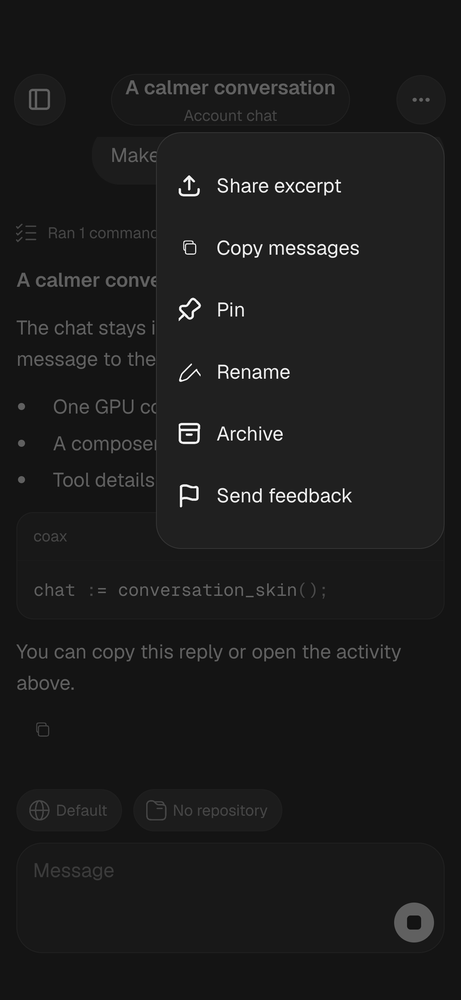
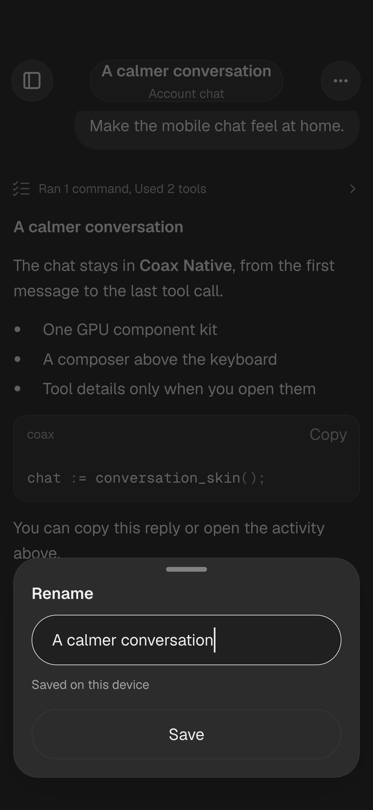
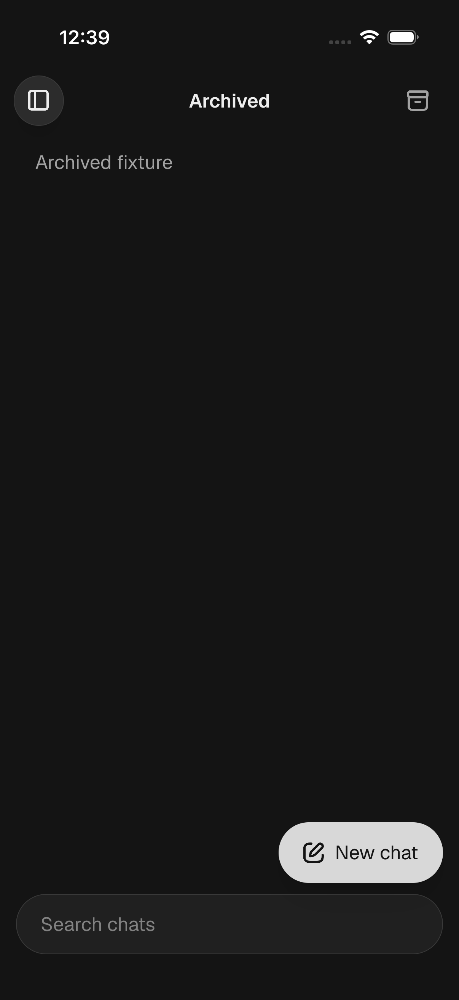

# Claude chat follow-up — builds 1405–1406

This extends [1404's audit](2026-11-16-claude-gpu-chat-1404.md) against the
[Claude iOS captures](../research/claude-ios/screen-index.md). The owner keeps
model/effort, attachments and mic hidden and chose connected computers and
their GitHub repositories rather than new hosted runners.

## Implemented behavior

| Audit gap | OpenAgents behavior |
| --- | --- |
| C21 conversation menu | Contextual GPU menu: Share excerpt, Copy messages, Pin/Unpin, Rename, Archive/Unarchive, feedback; Workspace appears for a connected computer. Empty drafts offer computer choice and Recents. Navigation and New chat stay in the drawer. |
| Sharing | An explicit action opens the iOS system chooser. The exported text identifies itself as a loaded conversation excerpt. It includes loaded user/assistant messages, refuses buffer overflow, and publishes no public link or tool log automatically. Cancellation is quiet; unsupported/failing effects report failure. |
| Pin, rename, archive | Durable local aliases and flags in a separate partition for each authenticated account and for guests. Full computer identity plus session ID prevents cross-computer collisions. Archive hides a chat from normal Recents; it neither deletes a transcript nor stops an agent. |
| C23/C24 library | All/Pinned/Archived filter menu, single-line titles, pinned-first ordering, and direct reopening of locally saved identities even when absent from the current history page. The existing authentication/pairing checks still admit reopening. |
| Archived transcript | Fixed Restore action replaces an idle composer. A running turn or permission request retains its controls. Observed sessions remain read-only. |
| Older history search | Title search walks existing account and computer history pages. It skips nonmatches, fences changed-query responses, and retries failed reads on the foreground timer. Empty results are distinguished from incomplete/unavailable discovery. |
| Connected workspace/GitHub flow | Workspace prepares reviewable Claude requests for changes, branches, switching branches, preparing a PR, and creating/removing worktrees. The selected computer keeps execution and GitHub credentials. Opening a shortcut sends nothing, preserves an existing draft, and refuses observed sessions. Send and the existing Claude permission flow remain explicit. |
| Feedback | Opens the repository's GitHub issue form for the person to submit; conversation contents and credentials are not attached. |

The library is **local to this installation**, not a cross-device metadata
service. Rename is a display alias, not a write to a native Claude history
file. Search covers titles, not message bodies. Account results have windows
of 60 matches and preserve the unconsumed source page; computer search holds
512 matches. Both stop explicitly at their scan bounds (1,000 source pages),
and inherited source discovery limits remain visible. Completed search
results are snapshots; normal non-search history retains automatic sync.

Workspace actions are **agent-assisted**, not direct native branch/PR
selectors or an ENV/NIP-WS control plane. A worktree request does not switch
this session's approved workspace. Machine enrollment and adopted workspace
roots remain the existing desktop/CLI service's responsibility. No new
hosted infrastructure or execution RPC is implied by these controls.

## Shared implementation

- `coax/lib/agent/chat-library.coax` owns identity, preference changes and the
  atomic bounded codec. `proto/coder/chat-library-local-v1.json` registers the
  new local shape; published chat/environment contracts keep their bytes.
- `apps/shared/app/history/` owns paged search over the existing codecs.
  Only read requests repeat; query changes cancel and fence held responses.
- `apps/shared/app/environment/workspace-actions.coax` owns the closed set
  of draft requests. It adds no credential transport or command executor.
- `apps/shared/app/view/page.coax` owns the archived footer; shared GPU kit
  rows, sheets, icons, Markdown and text layout remain the rendering path.
- The platform stores opaque preference bytes under an account-specific key.
  Partition changes clear old menus, aliases and editor state even when the
  next file is corrupt. A record is staged before replacement, preserving an
  alias when flags change. Capacity refusal preserves existing entries.
- `FX_SHARE` is an additional in-process effect ABI kind. UIKit supplies
  `UIActivityViewController`; the shared bridge carries completion or
  cancellation exactly once. This adds no network wire shape.

## Qualification

The first whole-app run qualified 1,501 of 1,502 checks. Its one new failing
organization flow exposed aliasing during a flag update; staging the record
fixed it. The focused organization rerun passes. A subsequent shared-footer
regression brings the linked inventory to **1,503 checks** (1,510 after the additional codec boundary checks); it verifies that
an archive never hides an active Stop control. The rename regression also verifies that its editor and Save button sit above the keyboard. Final conversation selection:
**20 passed**. The library codec passes 101 checks; library partition checks pass. The generic field/view selector has no registered suites; the explicit app and field runs supply their verification.
The changed editor authority kills **17 mutants, zero survivors**. The new library authority qualifies **371 mutants: 366 killed, zero survivors, five marked equivalents**. Those five retain byte-count and delimiter/digit guards already enforced by the admitted record bounds and flag policy; the inline reasons identify them.

Account and computer search each pass four native cases in optimized mode,
with and without AddressSanitizer/UndefinedBehaviorSanitizer. They cover
paging beyond the first page, retained result windows, automatic failed-read
retry, cancellation, and late-query fencing. Earlier debug/sanitized runs
also pass; final retry coverage uses the optimized runs.
The shared Swift service suite passes, including native share dispatch and
quiet chooser cancellation. The core Copy/Link/Share batch also passes, including cancellation releasing its outbox reservation without an error notice. Structural gates pass without allowlist growth.

The actual UIKit cases pass drawer/login/Usage, renderer and composer/
Recents/keyboard regressions. The new library test verifies filters and
reloads persisted preferences after terminating the app. XCTest truncated a
multiline launch-default fixture to its first line; the Debug-only fixture
now seeds the standard preferences store from base64 and then uses the normal
Coax restore path. Both launches restore the complete 159-byte fixture. The final menu/keyboard and persisted-library rerun passes both cases (22.970 s and 17.505 s).
This fixture path is absent from Release. Tests use a disposable simulator,
a separate bundle ID and a loopback API, with public synthetic content.

Physical-phone share destinations, VoiceOver and largest text remain owner
smoke checks. No real branch, worktree, PR, feedback submission or credential
ceremony was executed during qualification.

Local evidence: `/tmp/oa-chat-gaps-*` logs, preview trees and UIKit results
under `/tmp/oa-chat-gaps-ui-tests/Logs/Test/`. Screenshots below use synthetic
messages, not the owner's private Claude captures.

## Pictures

## Release

Feature source landed as `16947a2a7a42098fc7379ff291fdc05205133194`.
Its pre-push gates pass, including the shared library suite on a build host.

Build 1405 archived and uploaded successfully at 2026-11-16 13:01:34 CST,
delivery `3d2146e6-5647-4312-8901-0c8c42b39e78`. A final performance review
caught per-frame Keychain reads in partition selection. The follow-up caches
that selection and rereads only on launch, foreground and account-session
changes, with session notifications delivered on the main thread. The final UIKit library case passes in 20.222 s, including background/resume and a cold restart.

**1406 supersedes 1405**; 1405 is not assigned to Owner. Version `1.0.0`,
bundle `com.openagents.app`, signing identity and existing Keychain records
remain. Final receipt, frozen source and Owner TestFlight membership follow
when the revised archive/upload finishes.
