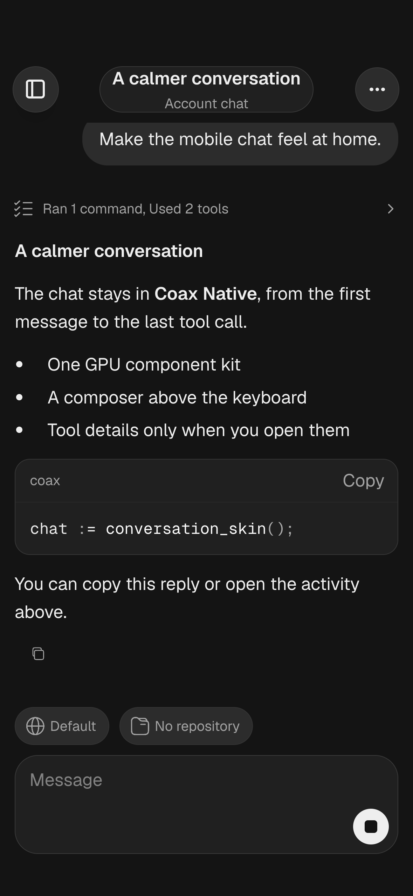
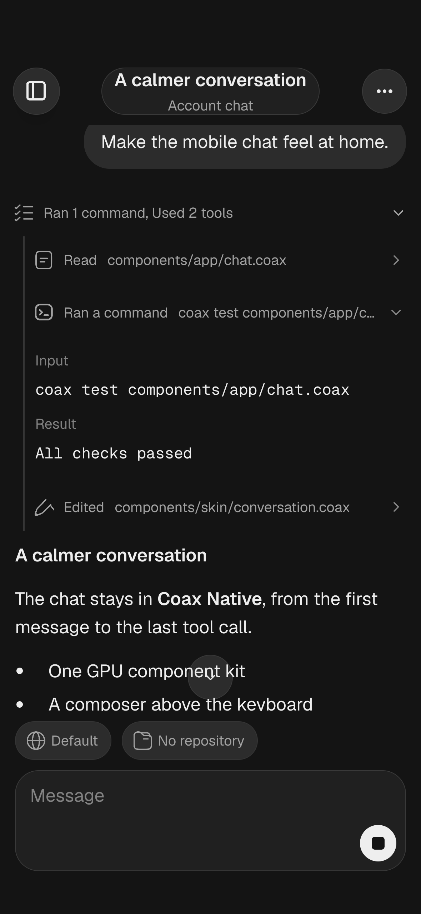
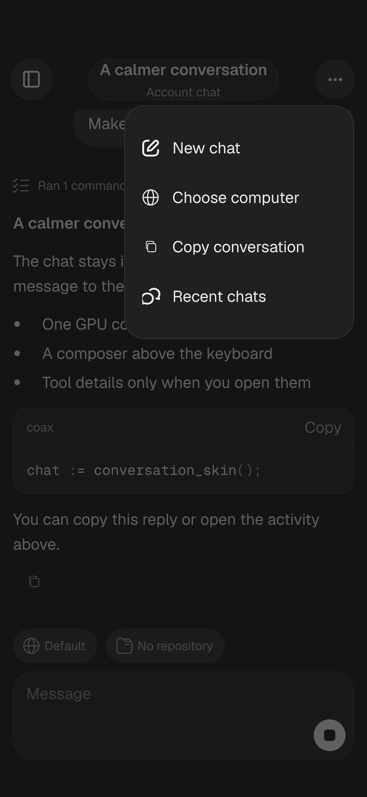
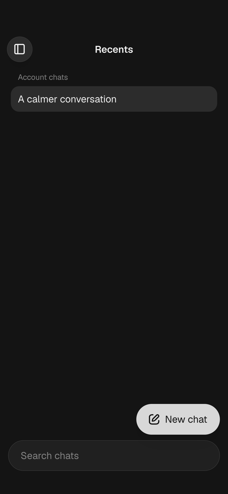
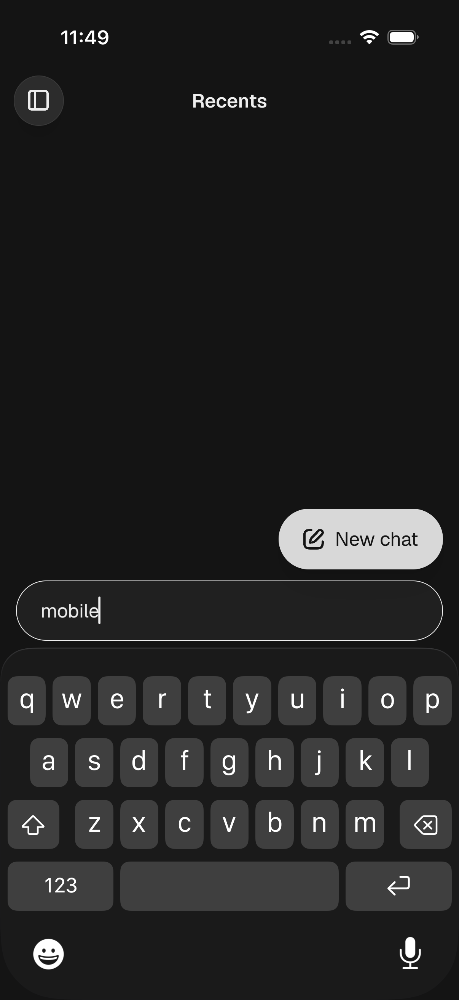
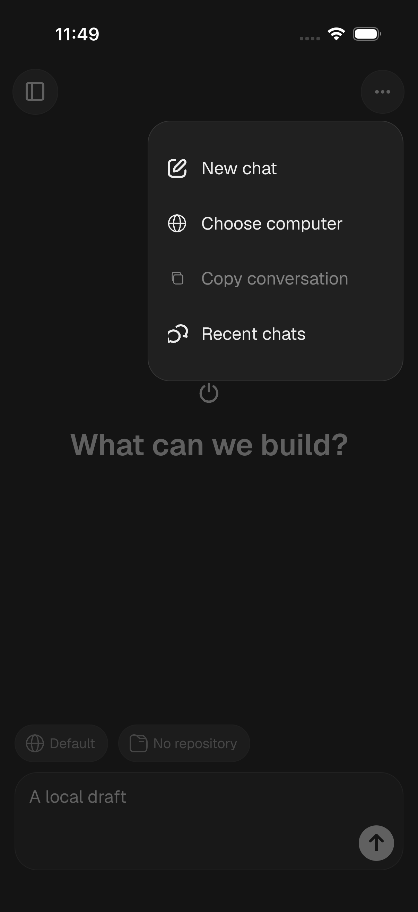

# Claude-reference GPU chat — build 1404

Follow-up: [conversation library and connected-workspace actions, build 1405](2026-11-16-claude-chat-library-1405.md).

Source landed on `main` as
[`64ce5bd43f`](https://github.com/OpenAgentsInc/openagents/commit/64ce5bd43f4987925439b322d7c6ff66f4c41f8b).

The chat presentation uses the owner's Claude iOS captures indexed in
[`docs/research/claude-ios/`](../research/claude-ios/screen-index.md).
The private source screenshots remain on the owner's Desktop; none are
copied into the repository. Pictures below contain synthetic public data.

The owner's explicit follow-up keeps model/effort, attachments and the
microphone hidden. OpenAgents branding and grayscale colors remain. This
port matches the conversation presentation and uses live OpenAgents actions;
it does not copy Claude's provider-specific cloud services or branding.

## Reference mapping

| Captures | OpenAgents implementation |
| --- | --- |
| C05, C37 | Dark reading canvas, centered greeting/mark, rounded bottom composer, context pills and Send/Stop. Excluded controls stay hidden. |
| C20, C43, C46, C49, C50 | Floating centered title/subtitle pill; full-width Markdown responses, right-aligned user bubbles, inline code, fenced code and reply/code Copy. |
| C43, C48 | Quiet one-line tool rows with icons, arguments, state and disclosure. Consecutive calls collapse into activity summaries; opening the group exposes calls with independent input/result pages. |
| C21 | Rounded icon menu: New chat, Choose computer, Copy conversation and Recent chats. These are working OpenAgents actions. |
| C22 | Session details links to the existing provider Usage screen and returns to chat. No fabricated context percentage. |
| C23 | Recents with loaded account and computer chats, bottom search and New chat. Titles stay one line and retain their full accessible labels. Existing pagination and automatic sync remain. |
| C06, C11, C41 | GPU sheets for the existing computer/repository choices, current checks, loading/error facts and scrollable choices. Read-only discovery refreshes while visible and sleeps when hidden/backgrounded. |
| C43–C51 | An observed native transcript has a fixed read-only footer. An owned managed session retains its composer. An observed session is not falsely labeled archived. |

The reference's cloud-environment CRUD, branch/PR operations, feedback,
sharing, pin/archive and rename services are not fabricated by the visual
port. Their corresponding unavailable actions are not shown. Search filters
the currently loaded history page, not an unbounded server archive. The
existing API/protobuf contracts, authentication and Nostr custody remain.

## Shared implementation

`components/skin/conversation.coax` owns the palette and measures.
`components/app/conversation.coax` supplies chrome, greeting, icon menu rows
and reply actions. `components/app/base.coax` now keeps plain menu titles on
one line; rows with descriptions still use the shared wrapper.
`components/app/task.coax` supplies compact tool/group presentation. The
existing tool-icon mapping, Markdown parser, line wrapper, composer and
virtualized transcript are reused.

`apps/shared/app/view/` groups adjacent tools in bounded chunks under stable
identities. Measuring copies only the relevant keyed state, preserving child
expansion without ticking the live animations. Message and code Copy use the
existing clipboard outbox. Copy refuses overflow rather than publishing a
truncated conversation. The UI's normal history bounds still apply.

Recents reuses account and device history codecs/services. Literal filtering
was extracted from the existing model picker into `components/core/text.coax`;
the picker delegates to that same function. ASCII letters fold case;
non-ASCII UTF-8 bytes match exactly.

The iOS product deletes `GlassChrome.swift` and its menu/picker projection.
Coax paints navigation and sheets; UIKit supplies active text entry,
accessibility, scroll physics and system presentations. The native editor
uses the one declared field contract, including Recents search and Usage
fields. A shared field-capture rule preserves a stationary touch when the
keyboard moves its field, while a real drag releases capture. Tapping outside
the input dismisses the keyboard. Menus scroll when large text exhausts a
small viewport.

## Pictures

The fixture root `apps/shared/app/preview/conversation-fixture.coax` builds
the actual app and supplies disposable messages. It is absent from the
installed library. The optional native preview carrier macro is
`OA_CONVERSATION_FIXTURE`; recorded `.ops` cases exercise real page actions.








## Verification and release

The current complete app suite passes **1,494 checks, zero failures**.
It covers full Markdown Copy, grouped/child expansion through measurement,
read-only versus managed sessions, Recents editing/draft retention,
single-line menu geometry and maximum-text-size menu scrolling on a small
phone. The changed field authority kills **16 mutants, zero survivors**.
Tools, components, wire and layer gates pass without allowlist growth.

The selected field/view gate passes through `coax/remote/check.sh only`.
The current checked compiler is `6c6b10ed0a8e`; binary SHA-256
`7747b31e74841bc6c170e89aafb741ed59392beb22e730378318f8b118954f1e`.

The UIKit suite passes sidebar/login/Usage navigation, the Renderer
specimens and the conversation menu/search/editor flow. Visual QA then
corrected menu wrapping; the final menu-flow rerun passes in **22.436 s**,
zero failures, in
`/tmp/oa-claude-ui-tests/Logs/Test/Test-OpenAgentsSidebar-2026.11.16_11-48-54--0600.xcresult`.
The API origin is an isolated loopback fixture, not the owner's
production identity. Physical-phone VoiceOver, largest text and credential
ceremonies remain owner checks.

Local evidence is retained under `/tmp/oa-claude-*`: app checks
`app-candidate2.log`, authority `fields-mutation-final.log`, selected gate
`selected-gate-final.log`, structural gates, native `.tree` files and UIKit
result bundles under `/tmp/oa-claude-ui-tests/Logs/Test/`.

Build **1404**, `com.openagents.app`, version `1.0.0`, archived and exported
from a separate frozen checkout of the landed source. The actual archive's
`CFBundleVersion` is 1404. The package audit passes: no JavaScriptCore,
WebKit, JavaScript, Wasm or HTML. Its arm64 dSYM UUID is
`55AD496A-FCE2-376C-B2B3-BDF54C7D6139`, preserved at
`gs://openagentsgemini-oa-symbols/app/55ad496afce2376cb2b3bdf54c7d6139.dSYM.zip`.
IPA SHA-256:
`6f820280a1a38fcaf58c29769b5d3b615fef75e8e020e10a5697047e01061b34`.
Archive and IPA: `/tmp/oa-claude-chat-1404-frozen`; release log:
`/tmp/oa-claude-chat-1404-release.log`. Apple accepted the upload with no
errors at **2026-11-16 11:53:04 CST**, delivery UUID
`2957d9d2-8fc2-40e2-ae05-f8f3f00655b8`. **1404 is VALID,
IN_BETA_TESTING and verified in the Owner TestFlight group** (2026-11-16
11:55 CST). The Owner group is internal and does not automatically include
all builds; this exact build was explicitly assigned and membership verified.
The commands used were:

```sh
python3 apps/openagents-ios/tools/app_store.py status --build 1404
python3 apps/openagents-ios/tools/app_store.py testflight --build 1404 --group Owner --notes-file /tmp/oa-claude-chat-1404-notes.txt
```

Load the existing ASC credentials from the local secrets file, never into a
document or log. The tool verifies exact Owner membership after assignment.
The accepted build does not need a second upload. Documentation and cleanup
continued during processing; there was no idle wait on Apple's queue.

The source pre-push hook passes all structural gates. It selects no registered
Coax suite for this app change; the explicit whole-app check run above supplies
the test evidence. No full-repository after-landing green claim is made.
The broader GPU epic #13645 remains open for its other host and composition
exits.
