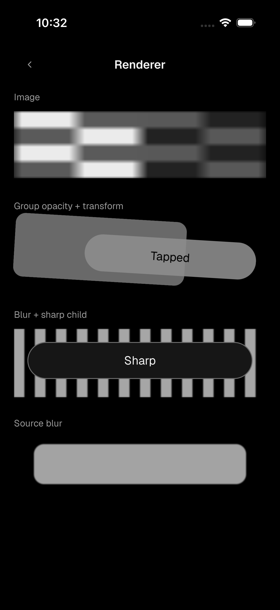
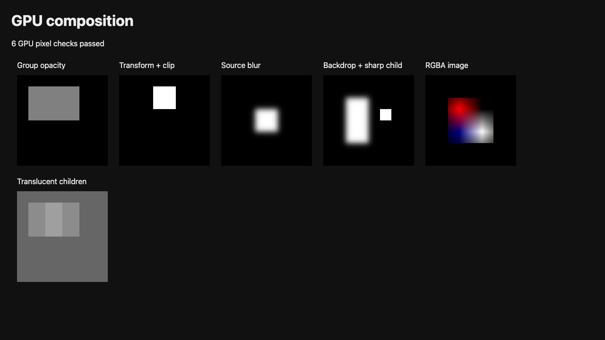

# GPU composition delivery — #13645

The renderer-gap change landed on `main` as
[`082b990808`](https://github.com/OpenAgentsInc/openagents/commit/082b99080838bf170b1c962b363c953641035c96).
This completes the bounded v1 image, affine-transform, isolated-opacity and
source/backdrop-blur compositor. The larger
[#13645](https://github.com/OpenAgentsInc/openagents/issues/13645) remains open.

## Installed surface and shared implementation

Open **Settings → Renderer**, including while logged out. Its grayscale
specimens exercise an RGBA image, an animated transformed group with a real
button, backdrop blur behind a sharp button, and source blur. Reduce Motion
settles the animation; Reduce Transparency disables blur and makes groups
opaque. The existing login, Nostr identity, Projects and Usage paths remain
on the shared GPU kit.



The planner is `coax/native/gpu-composition.coax`; shader arithmetic is in
`components/backend/composition-shader.coax`, generated for Metal, WebGPU
and Vulkan. Adapters allocate resources and execute the admitted pass plan.
No interactive pass reads pixels back to the CPU. Images use generation-based
uploads and premultiply before interpolation. Isolated groups fade once,
including overlapping children. Nested affine clips and hit polygons share
geometry; accessibility uses the clipped visible boxes.

The existing generic GPU frame, types and resource ledger moved from
`metaverse-engine/render/` into `coax/lib/gpu/`. Logical module/type identities
remain unchanged, with old source-path compatibility wrappers. Engine
consumers now use canonical imports. This avoids a second ledger or an
upward component/toolchain dependency on the engine.

The host reserves presentation before producing a frame and permits one
immutable submission in flight. Allocation/refusal retains the previous
frame. The phone publishes its candidate semantic generation only after GPU
completion, keeping input and accessibility paired with presented pixels.

The pinned in-process ABI is
[`proto/components/composition-v1.json`](../../proto/components/composition-v1.json).
The old flat vertex/shader profile and world AFP1 contract are unchanged.
See [the component contract and inspector instructions](../../components/backend/composition.md).

## Verification

All results below passed before landing; unchanged results were not rerun
solely for rebasing. Compiler binary SHA-256:
`fe55089f1f8ea297bbd137e3bcd33538f66671da11978cf70289dcdcc0c2c5b3`.

| Check | Result |
| --- | --- |
| iOS Coax app dependency checks | 1,053 passed, 0 failed |
| Shared compositor checks | 88 passed |
| Engine old-path registry / resources / resource-cost consumers | 35 / 79 / 291 passed |
| Primitive-list checks | 7 passed |
| Resource-policy mutation | 14 killed, 0 survivors |
| Shared frame / registry mutation | 360 / 206 killed, 0 survivors |
| Metal SDK pixels | Six cases passed |
| WebGPU on Apple Metal-3 hardware | Six cases passed; no validation errors |
| Vulkan on Linux Lavapipe | Six cases passed; software Vulkan qualification |
| Metal and Vulkan failure/lifecycle checks | Four refusals preserve pixels; resize and device-host recreation recover |
| UIKit Renderer flow | Settings → Renderer; transformed button → Tapped; Back → Settings passed |
| ABI golden profile | Exact records agree |
| Tools, components, wire and layer gates | Passed, no allowlist growth |

The six shared pixel fixtures cover isolated overlap opacity, rotation with
clipping, source-blur halo, backdrop blur with a sharp child, transparent
image interpolation, and translucent overlap over gray. Test-only SDK
readback is an independent oracle, not the interactive rendering path.



The selected touched-suite gate passed locally:

```sh
OA_REMOTE=0 coax/remote/remote.sh run -- coax/remote/check.sh only coax/native/gpu-composition.coax,metaverse-engine/examples/admit-a-frame.coax,metaverse-engine/state/fixture.coax
```

The compositor suite also passed through `check.sh only` on Linux. The
landing hook passed all structural gates; its duplicate Coax suite exceeded
the explicit 30-second hook limit and was reported skipped. This is covered
by the completed selected-suite run above, not claimed as a hook test pass.

Local evidence is retained under `/tmp/oa-compose-*`, notably
`local-gate.log`, `chat-tests-final.log`, `metal-final.log`,
`linux-final.log`, `shot-final.log`, `ui-final2.log`, and
`push-land.log`. The UIKit result bundle is
`/tmp/oa-gpu-composition-debug/Logs/Test/Test-OpenAgentsSidebar-2026.11.16_10-31-45--0600.xcresult`.

## Release

Build **1403**, bundle `com.openagents.app`, version `1.0.0`, is archived from
a separate frozen checkout of the landed source commit. Release output:
`/tmp/oa-gpu-composition-1403-frozen`; log:
`/tmp/oa-gpu-composition-1403-release.log`.
Archive and export passed. The package audit found no JavaScriptCore,
WebKit, `.js`, `.wasm` or `.html`. Upload has started; acceptance and
TestFlight status will be recorded after the release command returns.
The archived app's actual `CFBundleVersion` is 1403. Its arm64 dSYM UUID is
`C7DAB034-8A42-322F-B318-92F6C159FA15`, preserved at
`gs://openagentsgemini-oa-symbols/app/c7dab0348a42322fb31892f6c159fa15.dSYM.zip`.
Exported IPA SHA-256:
`83eab5e1024e6636a90a0649a0affb983da8736ac5032c5080c47434a702ee17`.

## Limits and remaining work

This is a bounded local-viewport compositor: at most 4096 pixels per side,
16 targets/images, 4096 passes, 64 binding sets, a 32-device-pixel blur radius,
and 128 MiB for effect targets, source images and vertex buffers. The
established output drawable and glyph atlases remain separately owned. Those
limits are admission bounds, not a performance promise at all maxima.

Active native text fields support translation; rotating/scaling/shearing
them refuses. Selectable text inside an isolated layer also refuses until
its overlay contract exists. Arbitrary off-canvas retained scenes, animated
image playback, radial/sweep gradients and masked blur are not included.
Backdrop sampling is qualified on the app's opaque canvas.

External world texture/depth borrowing, production desktop migration,
Android qualification and the rest of the screen/host port remain separate
exits of #13645. This change does not close the epic.

Physical-iPhone appearance, VoiceOver and passkey/biometric ceremonies still
need owner testing. The native test used an isolated logged-out simulator,
not the owner's production identity. Existing key custody and API contracts
were not replaced.

The general gallery's hit-count assertion at `page.coax:673` also fails on
clean baseline `0816bd53ff`; the feature uses its standalone inspector and
SDK oracles. The main-green watcher is independently stopped under #13637.
Neither a full-repository green run nor a physical Linux GPU result is claimed.
