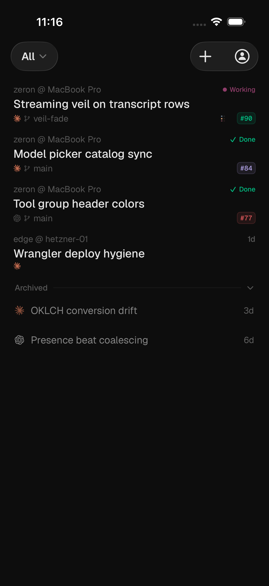
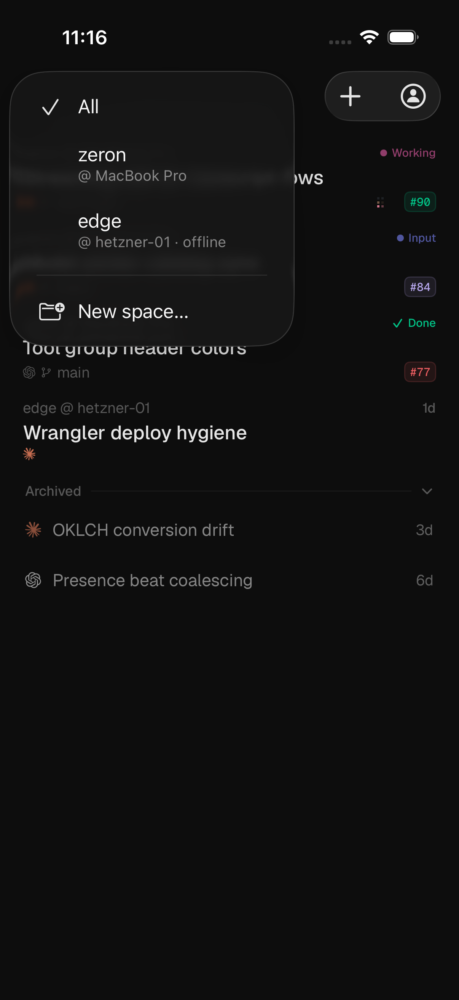
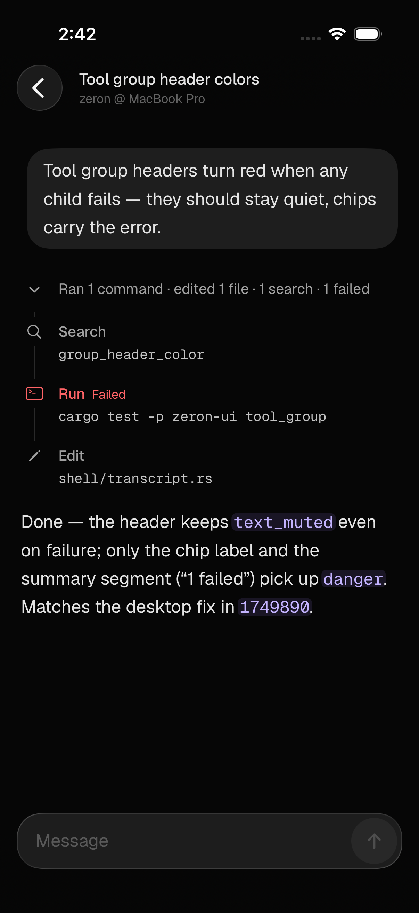
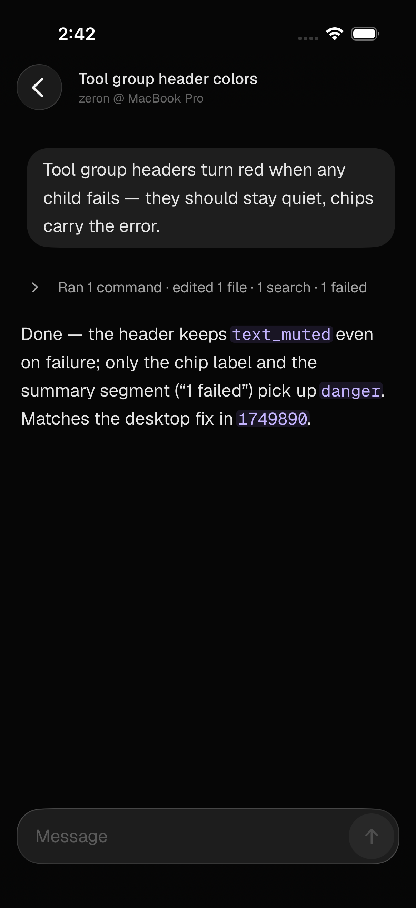

# Mobile UI gap analysis: OpenAgents iPhone vs Zeron iOS

Date: 2026-11-20. Scope: the phone UI of the OpenAgents iPhone app compared with
the Zeron iOS app, surface by surface, and what to bring over.

## Sources

| | Ours | Zeron |
|---|---|---|
| Code | `openagents` `origin/main` at `bdd1a6a4bc`. iOS build 1412 (`5deba5a4f4`); Experimental flag `42b0b0b799` | `projects/repos/zeron` at `e393c4a84` (2026-11-19). The other clone, `/Users/christopherdavid/work/zeron`, stops at `a7947b72` (2026-11-02) |
| App | `apps/openagents-ios/` (`chat.coax`, `App.swift`, `host.c`), `apps/shared/app/*`, `components/app/*`, `components/kit/*`, `components/skin/noir-phone.coax` | `apps/ios/Zeron/*` (UIKit), `crates/mobile` (UniFFI facade and transcript layout), `crates/client`, `crates/text`, `crates/markdown` |
| Docs | `apps/openagents-ios/README.md`, `apps/shared/app/README.md` | `apps/ios/README.md`, `docs/mobile-rewrite.md`, `docs/mobile-polish.md`, `docs/design/relay-mobile.md` |

Zeron paths below are relative to `projects/repos/zeron/`. Ours are relative to
the `openagents` repo root.

**Screenshot caveat.** The `docs/screenshots/mobile-*` captures date from
2026-09-06. That is before Zeron's Rust-core UIKit rewrite (#570, 2026-09-26).
They still show the visual target: palette, tool rail, glass chips. The rewrite
changed the home chrome, though. The "All" project menu at the top became a Liquid
Glass bottom toolbar (`apps/ios/Zeron/Shell/MainTabController.swift:3-7`).
`docs/mobile-polish.md` also describes the older SwiftUI/`UITableView`
transcript. The current pipeline is in `docs/mobile-rewrite.md`.

The four screenshots next to this doc are copied from Zeron (MIT License,
Copyright (c) 2026 Wing, `LICENSE`). Each is under 300 KB.

| Home (sessions list) | Project menu | Tool group, expanded | Tool group, collapsed |
|---|---|---|---|
|  |  |  |  |

These Zeron captures are too large to copy, so this doc only references them:

- `docs/screenshots/mobile-stream-keyboard/streaming-keyboard.png`: the composer card with PR, branch and model chips and Stop, a "Percolating… 12s" status, and the keyboard up.
- `docs/screenshots/mobile-transcript-recovery/*`: the header fade, the 5-line user fold, and the back swipe.
- `docs/screenshots/mobile-polish/multiline-keyboard.png`, `send-runway.png`, `warm-600-turns.png`.

**Known open bugs in ours.** Another session is fixing these, so this doc does not count them as design gaps:

1. The transcript does not scroll.
2. There is a large gap above the composer.
3. The Folder chip browses subfolders instead of picking top-level projects ("openagents" plus "Add new").

The sections below note where each bug's code sits.

**Severity**, for a phone user:

- **P0**: blocks a core task.
- **High**: daily friction or missing core capability.
- **Med**: noticeable polish or feature gap.
- **Low**: nice to have.

## 1. Tech stack and rendering

| Aspect | Zeron | Ours |
|---|---|---|
| Shell | UIKit view controllers: `UINavigationController` stack, `UISplitViewController` on iPad and unfolded Duo (`Shell/SplitRootController.swift:12-18`), sheets, `UIMenu`, `UICollectionView` lists | One Metal view running compiled Coax. `ChatScreen` is the root VC (`apps/openagents-ios/App.swift:18-22`). Coax draws all chrome, including navigation and pickers (`App.swift:85-87`, `oc_native(owner,0)`) |
| Logic core | Rust `zeron-mobile` over UniFFI (`crates/mobile/src/client_ffi/*`, generated `Core/Generated/zeron_core.swift`). The same library is planned for Android (`docs/mobile-rewrite.md`) | Coax compiled to C (`generate.sh`), plus `host.c` / `host.h` as the `oc_*` ABI. The app logic is shared with desktop through `apps/shared/app/*` |
| Text | `zeron-text` measures with rustybuzz on the bundled Geist bytes, and CoreText paints runs at the positions Rust computed. "Measurement and rendering can't disagree" (`apps/ios/README.md`, Transcript pipeline) | Coax lays out text (`components/layout/text.coax`). CoreText only rasterizes glyphs into an atlas (`apps/shared/host/apple/ct-atlas.m`), and the GPU draws them |
| Native controls | Everywhere: `UITextView` composer, `UIMenu` chips, system search field in the toolbar, swipe actions, context menus, drag-and-drop, `UIDatePicker`, `ASWebAuthenticationSession` | `UITextView`/`UITextField` editors only (`apps/shared/native/KitEditor.swift`). `UIScrollView` only drives scroll physics (`App.swift:215-230`). There is no SwiftUI and no `UIMenu` |
| Build | Xcode build phase `scripts/ios/build-core.sh` builds Rust for the platform and refreshes the bindings. CI fails on binding drift. TestFlight comes from a GitHub workflow | XcodeGen `project.yml`, `generate.sh` (remote Coax→C/Metal), `build.sh`, `dev.sh` fast loop, `release.sh` + `tools/app_store.py` |
| Tests | Rust layout tests (paint/measure at 7 widths, streaming ≡ full parse), `LineBreakAccuracyTests`, `SessionFlowTests`, `ScrollPerformanceTests` (hitch ratio), `LiveStackTests` against wrangler and a headless engine | Coax `#test` blocks in `chat.coax` (for example `chat.coax:1159-1238`), `Tests/IdentityTests.swift`, `UITests/SidebarTests.swift` |

**Takeaway.** The stacks are opposites. Zeron puts geometry in Rust and paints in
UIKit, so it gets every system affordance for free. Ours draws everything on the
GPU, so each system affordance has to be rebuilt in Coax or bridged. Most gaps
below come from that one choice: menus, swipe actions, glass, haptics, search
field, sheets.

## 2. App structure and navigation

| Surface | Zeron | Ours | Gap | Sev |
|---|---|---|---|---|
| Root model | Sessions list is the home. A pushed session uses a real nav stack with swipe-back (`Shell/MainTabController.swift:3-7, 149-160`). iPad and unfolded Duo show a sidebar, session and inspector (`SplitRootController.swift:12-30`) | One screen per frame, chosen by `ch_layout` (`chat.coax:265-379`): Workspace, Sub-agent, Foreman, Usage, Settings, Projects, Recents, Chat. There is no back stack, and every page draws its own Back | No system back gesture or nav history. Back from a sub-agent or workspace page is a button only **Mostly done** (6ef8294100, bd68f5e6c2): an interactive edge swipe on a pushed page follows the finger and goes back past a third of the page. Still no back stack, and the chat is not drawn under the moving page. | High |
| Primary nav chrome | Liquid Glass bottom toolbar: Settings · Search (system toolbar field) · Voice · New session (`MainTabController.swift:73-90`, `updateBottomBar`) | Left drawer, 78% width capped at 360 (`components/app/sidebar.coax:23-24`). Opens with an edge swipe from 18 units (`chat.coax:63-64, 732-733`) or the menu button (`chat.coax:375-378`). Rows: New chat, Search, Projects/Foreman (experimental), history, account row with gear (`chat.coax:450-480`) | Different model, but ours is coherent and close to the Claude iOS pattern. No gap to close beyond polish | Low |
| Chat list rows | Two-line fixed-height cell (`Threads/SessionCell.swift:56-61`). Line 1: harness mark, title, status ("Working", "Done", "Input", or time). Line 2: project tile, project, branch, PR badge (`#90`). Desktop precedence: failed send > live state > unseen-done > time (`SessionCell.swift:107-108`). See `home-glass.png` | One line: title, plus " · computer" when more than one is paired (`chat.coax:178`). State is CURRENT/BUSY only, and BUSY is a dot (`components/app/nav.coax:40-54`). `AppSideRow.detail` exists (`nav.coax:99`) but the window draws `""` (`nav.coax:126`) | No time, status word, needs-input flag, done-unseen flag, branch or PR. The user can't tell which chat needs them **Mostly done** (837ee77c14, 9e2469a705): "Needs you" with the accent dot, the activity mark, or a short age at the right; a subline with the project, then the computer when several are paired. Branch and PR are not in the session catalog the computer sends. | High |
| Sections | Pinned plus user sections as foldable groups, then Recent. Archived is a folded shelf with "Show N more". Long-press a header for its actions. Drag sessions between sections (`Threads/SessionListController.swift:593-595, 36-42, 492-590`). Optional "Group by Project" (`Shell/MoreViewController.swift:249`) | Pinned, then Recents, per paired computer, plus a "More" row per computer (`chat.coax:159-210`). Recents page filter is All/Pinned/Archived (`chat.coax:392-397`) | No user sections, no folding, no project grouping, no drag | Med |
| Activity view | "Activity" mode: one list of chats that need you, plus Working, Asleep and Archived shelves. Sleep a chat until a time, and auto-archive idle chats (`Threads/ActivityList.swift:3-14`, `ActivityViews.swift:95-100`) | None | No triage view and no sleep/snooze | Med |
| Row actions | Leading and trailing swipe (pin, archive, sleep, delete, move), context menu, rename (`SessionListController.swift:294-353, 433-472`) | Options live inside the open chat's ⋯ menu: Share excerpt, Copy messages, Pin, Rename, Archive, Workspace (`chat.coax:414-433`). The list has no swipe and no long-press | Every list action costs open → ⋯ → act **Partly done** (c831e14543, 037da968c7): on a computer chat in the drawer, hold for Pin/Rename/Archive, swipe right to pin or unpin. No delete, sleep or move, and no Undo toast. | High |
| Search | System toolbar search field. Search results are a session list with the same row cells (`MainTabController.swift:80-83`; `SessionListController.swift:597`) | A Recents page with the search field pinned at the bottom (`chat.coax:351-357`). Title-only ASCII match (`text_contains_ascii`, `chat.coax:164,176`) | Title-only and ASCII-only. No message-body search and no non-ASCII titles | Med |
| New chat | "Ask anything" composer-first canvas. The project, branch/worktree, model and effort menus load lazily, and the keyboard is up at once (`Session/NewSessionViewController.swift:53-55`). A draft handoff animates the canvas into the chat (`MainTabController.swift:85-88`; `Session/DraftHandoff.swift`). A closed draft is kept for next time (`NewSessionViewController.swift:97-98`) | `ACT_NEW` dispatch, then the drawer closes (`chat.coax:630-635`). The empty state is "What can we build?" (`apps/shared/app/view/page.coax:455-456`). The environment and folder chips sit above the composer | No context menus on the new-chat page and no handoff motion. The keyboard does not come up by itself | Med |
| Conversation header | Title over "project @ device" (`SessionViewController.swift:857`). Glass back button. Text fades out under the transparent bar (`docs/mobile-polish.md`, header fade; `mobile-transcript-recovery/header-fade.png`) | Centred pill with title and subtitle (computer or "Account chat"), ⋯ and spinner (`components/app/conversation.coax:5-29`; `chat.coax:376-377`) | Comparable. Ours has no fade under the header **Done** (2c55b9843e, fa8b0b0697, 789723641b): title over computer on glass circles at Zeron's metrics; nothing draws behind the bar, and the transcript fades in below its bottom edge. | Low |
| Experimental gating | n/a | `ChatPage.experimental` (`chat.coax:111-113`), persisted in UserDefaults (`AppCore.swift:66-72`). It hides login, Projects, Foreman, Nostr keys and account chats (`chat.coax:196, 290, 312-320, 335, 459-471`) | Our own scoping, not a gap | — |

## 3. Chat screen

| Surface | Zeron | Ours | Gap | Sev |
|---|---|---|---|---|
| Scroll container | `TranscriptListView`: a virtualized host over a Rust `LayoutFrame` with exact heights and prefix-sum offsets. `rowsIn(y0,y1)` is a binary search (`Transcript/TranscriptListView.swift:82-85`; `crates/mobile/src/layout/mod.rs`). Display models are prefetched off-main (README step 4) | `VList` with an anchor row and offset (`apps/shared/app/view/list.coax:36-55, 117-142`). Overscan 400, estimate 48 for unmeasured rows (`page.coax:59-61`). Rows are measured off-screen (`page.coax:388-399`). `UIScrollView` drives physics via `syncScroll` / `scrollViewDidScroll` → `oc_scroll_to` → `chat_scroll_to` (`App.swift:215-230`; `chat.coax:853-888`). Cap 384 rows (`apps/shared/app/view/model.coax:39`) | **Known bug: does not scroll.** The chain is listed above. `vlist_scroll` returns early when `n==0` (`list.coax:175`), and `isScrollEnabled` needs max > 0 (`App.swift:220`). Design gap: ours estimates heights, so the content size jumps as rows are measured; Zeron's heights are exact before display **Checked 2026-11-20:** the transcript scrolls on main (XCUITest drags on a simulator); the P0 is not present. | P0 (bug) / Med (design)  |
| Follow / tail | Follow re-engages only when momentum carries the list into the last 70pt, never while the finger is down (`TranscriptListView.swift:333-366`). Status-bar tap goes to the top (`:368`) | Follow-end flag in `VList` (`list.coax:129,171`). `vlist_pin` (`:185-191`) | Ours has no momentum-aware re-latch rule and no status-bar tap to top | Med |
| Send runway | A local send reserves one viewport below the prompt, and the reply fills it. Short replies keep it on warm reopen (`TranscriptListView.swift:149-190`; `docs/mobile-polish.md`; `send-runway.png`) | None. The new prompt lands at the bottom and the reply pushes it up | The prompt jumps on every send | Med |
| Jump to latest | 40pt glass circle with "arrow.down", shown when more than 140pt from the tail and not following, with a scale-in (`SessionViewController.swift:27, 117, 221-238`) | Round chevron when not following (`page.coax:464`; `components/app/chat.coax:430-443`). The richer `app_jump_pill` ("New reply" plus working dot, `chat.coax:445`) is unused | Parity on the basic button. Wiring `app_jump_pill` would beat Zeron | Low |
| User message | Bubble with 22pt continuous corners. 5-line / 400-char fold with Show more / Show less; expansion is kept in the warm store and preserves the anchor (`crates/mobile/src/layout/rows.rs:661`; `docs/mobile-polish.md`). Inline atomic chips for file, skill and image links (`rows.rs:687-760`) | Right-aligned bubble, radius 24, 86% width (`components/app/chat.coax:79-81`; `components/skin/conversation.coax:12`). The fold component exists (`components/app/chat.coax:89-128`) but iOS calls the non-folding `app_message_user` (`page.coax:359`) | A long paste fills the screen. The fold is built but not wired **Done** (b8e8ee7d4e): the 5-line fold with Show more / Show less is wired on computer chats. | High |
| Agent reply | Full-width markdown. One row per top-level block, so a long reply virtualizes block by block (`docs/mobile-rewrite.md`, Layers) | Full-width markdown, no bubble (`page.coax:352-354`). Copy button under each reply (`page.coax:355-358`). The whole reply is one row | A long reply is one huge row. Our measure and paint cost grows with reply length | Med |
| Markdown / code | Incremental reparse of the streaming tail only (`IncrementalParser`). Headings 22/19.5/17.5/16.5, body 16.5/25, code 13.5/20 (`crates/mobile/src/layout/style.rs:104-110`). Horizontal scrollers for code and tables (display list "scrollers"). LaTeX math with a font and size setting (`TranscriptListView.swift:4-44`; `MoreViewController.swift:238-242`) | `components/kit/markdown.coax`: lists, quotes, fenced code with a language header plus Copy/wrap, GFM tables (`:8-14, 209-330`). Syntax colours from `components/core/syntax.coax` | Ours re-parses the whole message on every row paint (`view_parse`, `page.coax:117-121, 352`). No math. Code wraps or toggles instead of scrolling sideways | Med |
| Streaming veil | Only newly appended text fades in, on a separate layer split at the glyph offset. Text already on a reattached row starts fully visible (`docs/mobile-rewrite.md`, Data path; `Transcript/RowView.swift:52`) | `MdVeil` exists (`components/kit/markdown.coax:22-30`) but is not used on iOS | Text pops in per chunk | Low |
| Tool calls | Desktop activity rail. The group header is a quiet summary ("Ran 1 command · edited 1 file · 1 search · 1 failed"). Only the failing chip turns red. Icon per tool. Chevron flips on a 140ms ease-out. New rows draw in with a 480ms phased connector, staggered 65ms. A title shimmer runs while live (`Transcript/ToolViews.swift:3-71, 231-233`; `crates/mobile/src/layout/tools.rs:114-150`; `tool-group-*.png`). Tap a row for inline detail: full invocation, mono output scrolling sideways, diff (`tools.rs:196-365`) | One activity group per turn: summary head (`components/app/activity.coax:318`), rows (`:478`). Open while live, folds when done, user choice kept (`page.coax:210-215, 306-308`). At most 16 rows (`page.coax:298`) | Ours has the same structure. Missing: per-tool icons and failure labels on the rail, the connector animation, and the shimmer. A group past 16 rows is truncated | Med |
| Thinking | Thought markdown flattened into styled lines, capped at `MAX_LINES` with a fade, byte-clipped so streaming cost stays flat (`tools.rs:366-420`) | Thoughts render as markdown inside the activity group (`page.coax:314`) | Ours renders full markdown, which costs more per delta. There is no line cap or fade | Low |
| Diffs | Tool detail: a diff wins over stats and output (`tools.rs:267-365`). File badge with file-type icon (`tools.rs:50`; `layout/file_icons.rs`) | Inline diff on device edits and writes (`page.coax:260-265`; `activity.coax:347-368`). Full unified diff via `components/app/diff.coax`. Tapping the file opens the Workspace Diff tab (`chat.coax:512-516, 613`) | Ours goes further: it has a workspace diff tab. No file-type icons | Low |
| Sub-agents | Bordered spawn card with model label; it opens a read-only child transcript, live or uploaded (`tools.rs:57-80`; `Companions/SubagentViewController.swift`). A Companions panel holds sub-agents, side chats and terminals: a sheet on iPhone, an inspector on iPad (`Companions/CompanionsViewController.swift`; README, Companions) | A sub-agent row with call count and newest call opens its own transcript page (`page.coax:266-272, 543-549`; `chat.coax:282-289, 518-524`) | Ours has no side chats, no fork, no terminals, and no single place listing what runs alongside | Med |
| To-do / plan | Todo tool row with a checklist icon. Detail is `[x]` / `[ ]` lines (`tools.rs:145, 217-221`). No pinned plan panel on mobile (desktop has `docs/todo-panel.md`) | The verb "Updated todos" and a count only (`page.coax:228`; `activity.coax:67,89`) | Ours never shows the items | Med |
| Questions / permissions | `QuestionPanel` replaces the composer: one glass card per question, large option rows, "Other…", and 220ms auto-advance for single-select (`Composer/QuestionPanel.swift:3-6`) | Permission prompt rows in the transcript (`page.coax:368,372`) | No structured multi-question answer UI | Med |
| Working status | Glass `StatusPill` above the composer: working with elapsed time, offline, retry (`SessionViewController.swift:1038-1060`; "Percolating… 12s" in `streaming-keyboard.png`) | "Working" line with seconds in the transcript (`page.coax:361`; `activity.coax:542`). Header spinner (`chat.coax:377`). "Reconnecting" banner (`page.coax:463`) | Comparable | Low |
| Error cards | A red-wash card, with a sign-in button when signing in fixes it (`rows.rs:98-99`). A refused send shakes, with a warning haptic (`SessionViewController.swift:1027`) | Retry/Reconnect notices (`page.coax:377-381`) | No shake and no haptic | Low |
| Copy / select | Copy actions on rows. Per-link accessibility elements | Copy per message, per code block and whole-thread (`page.coax:556-575`; `chat.coax:557-558`) | Parity | — |
| Visuals (agent UI) | `show_visual` Luau scripts run on a worker thread: canvases, charts, wgpu scenes (`crates/mobile/src/visual/*`; `Transcript/VisualView.swift`) | None on iOS | Not a phone-user priority | Low |

## 4. Composer

| Surface | Zeron | Ours | Gap | Sev |
|---|---|---|---|---|
| Shape | One glass surface, two states that morph on a spring. At rest: a one-line capsule, `[+] Message… [↑]`. Active (focused, or holding a draft or photos): a card with photos, full-width text, and a toolbar row inside (`Composer/ComposerBar.swift:32-40, 308-309`; `tool-group-expanded.png` vs `streaming-keyboard.png`) | Always a two-row pill. **One line is 94pt** (test at `components/kit/composer.coax:205-210`, `row_y = 46`). Grows to a 4-line cap on a spring (`composer.coax:26, 124-128`). The action row's left side is empty because `AppComposer.model` is never set on iOS (`page.coax:422`) | **Known bug: gap above composer.** Contributors: the 94pt box with its empty left row, the chip slot plus gap (`chat.coax:364`; `page.coax:428-432`), and the bottom maths (`chat.coax:270-271`). Design gap: no resting capsule, so the composer takes about 50pt more than Zeron at rest **Done** (2c55b9843e): a 52pt one-line capsule at rest that springs into the card when focused or holding a draft; the gap above the composer is gone. | P0 (bug) / High |
| Chips | Inline in the card toolbar: model (harness mark), effort, branch, PR. Native glass `UIMenu`s that load lazily (`ComposerBar.swift:22-31, 75`) | Environment and Folder chips in a separate row above the composer, 36 units high (`components/app/chat.coax:67-73`; `chat.coax:368-372`; `conversation.coax:15`) | Ours spends a full row on chips. There are no model, effort, branch or PR chips **Done** (2c55b9843e): Environment and Folder chips sit inside the card's action row; no separate row. | High |
| Model picker | Glass sheet sized to its list. Provider switcher with swipeable pages. Search once the list is long. A notice for what switching does. Breathing loading bars (`Session/ModelPickerViewController.swift:3-37, 259-261, 524-568, 624-630`) | Hidden by owner choice (`apps/openagents-ios/README.md:92`) | Product decision; noted only | — |
| Attachments | Photos / Camera / Files / Paste menu. HEIC→JPEG, long side ≤ 2560px, ≤ 24MB (`Composer/AttachmentPicker.swift:5-6`). Upload rings on thumbnails (`TranscriptListView.swift:111`). Image chips open full size (`:130`) | Hidden by owner choice (README:92). There is no PHPicker code. Desktop and Microcoder just gained images (`2528158a6c`) | The protocol supports images now, so the phone is the gap | Med |
| Voice | Toolbar voice button: tap to call, long-press to pick host and style (`MainTabController.swift:53-60`). Live Activity in the Dynamic Island (`ZeronLiveActivity/VoiceLiveActivity.swift`). Orb (`Voice/OrbView.swift`) | Hidden. No mic or dictation code. The system keyboard mic still works in the `UITextView` | Product decision | — |
| Steer / queue / stop | One action button: Send, a labelled Queue/Steer pill while an agent works, or Stop. `DeliveryMode` is queue (default), steer (inject mid-turn), or interrupt (`ComposerBar.swift:12-20, 39-40`). A queue panel stacks waiting messages above the composer; queued items are editable (`QuestionPanel.swift:258`; `SessionViewController.swift:687-695`) | Send becomes Stop while running (`page.coax:403-408, 503`; `composer.coax:107-118`). You cannot send while a turn runs (`page.coax:404`) | The phone user must stop or wait to add context mid-turn **Done** (350d3fd861, faf3d581f8): a labelled Steer (Coder Desktop chats) or Queue (others) pill while a turn runs; a queue panel over the composer holds the queued message with × to take it back, and it sends once the turn ends. One message queues at a time; it is not editable in place. | High |
| Mentions | `@` file search with accented live tokens (`ComposerBar.swift:66, 383`; `Composer/Mentions.swift`) | None | No way to point the agent at a file | Med |
| Draft | Per-session drafts kept across navigation and launches (`SessionViewController.swift:1122`). Send clears the same `UITextView` storage synchronously (`docs/mobile-polish.md`, draft clearing) | One draft in UserDefaults (`App.swift:317-324`) | No per-chat drafts | Med |
| Keyboard | Composer pinned 8pt above the keyboard, resting a gap above the safe area (`SessionViewController.swift:943-963`). The runway and transcript follow the keyboard's own spring (`docs/mobile-polish.md`, keyboard motion) | `keyboardWillChangeFrame` → `chat_env` (`App.swift:93-94, 343-348`; `chat.coax:648-654`). A tap outside dismisses (`chat.coax:26-29, 720-727`). Interactive dismiss (`KitEditor.swift`) | Ours has no measured spring sync. Check against the gap bug | Med |

## 5. Connecting to the computer

| Surface | Zeron | Ours | Gap | Sev |
|---|---|---|---|---|
| Identity | WorkOS sign-in via the system web auth sheet, with an organization picker (`Shell/SignInViewController.swift:117-160`). Welcome page with "Get started" (`:46-47`) | No account needed for your own computers. Pairing grants a 7-day key in the Keychain (`apps/shared/app/README.md`). Login is experimental-only (`chat.coax:465-471`) | Ours is lighter by design | — |
| Pairing | Account-scoped: every host in the org registry shows up. A new project means picking a host and browsing its folders over the relay (`Threads/NewProjectViewController.swift:3-4`) | `openagents://pair?host=&relay=&code=` deep link (`apps/shared/native/AppDeviceLink.swift:145-176`). Zero-config over Bonjour `_openagents-coder._tcp` and Tailscale (`AppTailnet.swift:4-22`; `AppTailnetLink.swift:18-110`) | No in-app QR scanner. The user needs the link from the host | High |
| Transport | Relay-only room per chat over the Cloudflare edge: journal, outbox, catch-up by version exchange, checkpoints. Phone never hosts (`docs/design/relay-mobile.md`, In one paragraph; `crates/client`) | Nostr relay WebSocket with NIP-42 AUTH and sealed events (`AppDeviceLink.swift:1-14, 198-290`). Direct TCP over the tailnet, falling back to the relay (`AppTailnetLink.swift:151-162`) | Ours has a direct path Zeron parked. Zeron has a durable journal and outbox | Med |
| Offline / suspended | Journal replayed on open. A send waiting on a host is not marked "Not delivered" (`relay-mobile.md` table, `derive_pending`). `-network-offline` test flag. Pill names the failed machine (`SessionViewController.swift:787-789`) | Sockets torn down on background and resumed on return (`AppDeviceLink.swift:57-92`). Spinner, "Reconnecting" banner, retry notices (`chat.coax:377`; `page.coax:377-381, 463`) | No durable outbox: a send made offline is not queued for later | Med |
| Host status | Settings → Devices: each host with an Online/Offline dot (`MoreViewController.swift:215`). The project menu shows "@ hetzner-01 · offline" (`project-menu.png`). The row subline is "project @ device" (`home-glass.png`) | Header subtitle is the computer name (`chat.coax:376`). Picker words: "Paired with this phone" or reachability (`apps/shared/app/environment/view.coax:68, 99-111`) | No online/offline indicator in the drawer or the chat list | Med |

## 6. Projects, folders and workspaces

| Surface | Zeron | Ours | Gap | Sev |
|---|---|---|---|---|
| Picker | Project menu: each project as "name @ device", with offline marked, a check on the current one, and "New space…" (`project-menu.png`). Projects group checkouts of one repository across devices, with a colour tile (`NewSessionViewController.swift:27-34, 361`; `Design/Palette.swift:33-36`) | Folder chip opens "Workspace (the folder your computer shares)" plus `folders[]` (`environment/view.coax:113-119`). The host offers up to 24 relative paths (`coax/lib/agent/environment/wire.coax:64, 263-268`) | **Known bug:** lists subfolders under `--workspace` instead of top-level projects plus "Add new". The folder sent is `eu_folder` (`apps/shared/environment-app.coax:59-62, 189`). Design gap: no project identity (colour, repo), no cross-device grouping, no create-project browser | P0 (bug) / Med |
| New project | Host picker, then browse folders over the relay with git repos badged, then "Use this folder" (`Threads/NewProjectViewController.swift:3-16`) | None on the phone. The host runs `openagents-environment pair --workspace FOLDER` (`environment/view.coax:37,102`) | Phone can't add a project | Med |
| Branch / worktree | Branch chip with a windowed list: "Dropdown builds only the rows in view" (`e393c4a84`, desktop `apps/zgx/ui/ds/dropdown.luau`; 2,000 items, 10 rows built) | None | No branch choice on the phone | Low |

## 7. Settings

| Zeron (`Shell/MoreViewController.swift`) | Ours (`chat.coax:306-334`) |
|---|---|
| Account (`:198`), Providers (agents and accounts per device, `:203`), Cloud and Billing (`:208-211`), Devices with online dots (`:215`), Voice (`:218`), Appearance: System/Light/Dark (`:225-227`), Wallpaper and effect (`:230-234`), Math render, font and size (`:238-242`), Activity (`:247`), Group by Project (`:249`), Archived Sessions (`:250`), Notifications with per-kind toggles (`:138-146`), Sign Out (`:253`) | Back, "Settings", Log in (experimental), Usage (`apps/shared/app/usage/view.coax`), Experimental features switch (`:326-330`), Nostr keys (experimental, logged in, `:312-315`) |

| Gap | Sev |
|---|---|
| No paired-computers list with status, rename or unpair | High |
| No notification settings (there are no notifications at all) | High |
| No appearance choice: ours is dark-only Noir (`components/skin/noir-phone.coax`) | Low |
| No archived-chats entry point outside the Recents filter | Low |

## 8. Notifications and system integration

| Surface | Zeron | Ours | Sev |
|---|---|---|---|
| Push | The edge pushes via APNs when a run finishes, waits for input, or fails. Permission is asked on the first phone-started session. The app stays quiet while open, and a tap opens the session (`apps/ios/README.md`, Session notifications; `App/PushNotifications.swift`; `edge/src/push-notify.ts`) | None. No `UNUserNotificationCenter`, no APNs entitlement (`apps/openagents-ios/OpenAgents/OpenAgents.entitlements` holds webcredentials only) | **High.** A phone that can't tell you a run finished or needs you misses the main reason to carry it |
| Live Activity | Voice call in the Dynamic Island and Lock Screen, with mute and end App Intents (`ZeronLiveActivity/`, `ZeronShared/`) | None. No WidgetKit or ActivityKit target in `project.yml` | Med: a "run in progress" Live Activity fits us even without voice |
| Toasts / undo | Glass toast with an action, for example "Archived · Undo" (`Design/Toast.swift:3-11`) | None | Med |
| Deep links | `-route chat:<id>`, push taps open sessions | `openagents://pair` only | Low |

## 9. Visual system

| Aspect | Zeron | Ours | Gap | Sev |
|---|---|---|---|---|
| Palette | Light (warm paper grey) and dark (true black). Teal/violet accent `#8B7CF6` dark. Semantic danger, success and warning. Project tones (`Design/Palette.swift:3-43`). Status colours in rows: Working magenta, Done green, Input indigo (`home-glass.png`) | Monochrome Noir: canvas `#0a0a0a`, surface `#1e1e1e`, ink `#ededed`, muted `#818181`, accent = ink, danger `#ff4d42` (`components/skin/noir.coax:103-118`; `noir-phone.coax:11-54`) | Monochrome is our brand choice. With no status colour, though, row state relies on one dot | Low |
| Type | Geist and Geist Mono bundled, with the same bytes measured and painted. Chat body 16.5/25 (17pt in the SwiftUI pass), code 13.5/20, small 13.5 (`style.rs:104-110`) | zeron-skin units × 1.2 (`components/skin/arcade.coax:26`): body 14→16.8pt, mono 12.5→15, small 11→13.2, title 14 bold, display 24/30 (`components/skin/zeron.coax:449-487`) | Close. Our mono is larger than Zeron's code (15 vs 13.5). Check density | Low |
| Spacing / shape | 44pt targets. 22pt continuous-corner bubbles. Glass capsules for chips, back and jump | 44 controls, radius 22, bubble radius 24, chip 36, inset 14 (`conversation.coax:10-15`; `arcade.coax:30-41`) | Parity | — |
| Material | Liquid Glass everywhere: bottom toolbar, back button, chips, composer, pills, menus, sheets (`Design/Glass*`). Wallpaper behind home and new chat, fading as the list scrolls (`Design/Wallpaper.swift`; `SessionListController.swift:600-601`) | Flat GPU fills. `UIGlassEffect` exists only in `apps/shared/native/NativeChrome.swift:224-269`, which is not in the iOS target | Ours looks flat next to iOS 26 system apps | Med |
| Motion | Desktop curves ported: 140ms ease-out folds, 360ms expo row reveal, 480ms quint connector (`ToolViews.swift:3-16`). Send glide 15%/frame (`TranscriptListView.swift:151-152`). Composer capsule↔card spring. Draft handoff. Respects Reduce Motion (`TranscriptListView.swift:452`) | Sidebar ease (`sidebar.coax:45-58`), composer spring and Send→Stop morph (`composer.coax:107-131`), message rise (`components/app/chat.coax:441`), fold ease, typing dots. Respects Reduce Motion and Reduce Transparency (`App.swift:198-199`). Idle frames sleep (`App.swift:177-184, 212`) | Fewer transitions: no push or pop, no tool connector, no runway glide | Low |
| Haptics | Selection, impact and notification generators on chips, sends, refusals, folds, drags and question picks (`ComposerBar.swift:373, 644, 655`; `RowView.swift:300-333`; `SessionListController.swift:228, 541`; `QuestionPanel.swift:189, 245`) | **None** in `apps/openagents-ios`, `apps/shared` or `components`. The only hit is the icon name `IC_HAPTIC_FEEDBACK` | No tactile confirmation of send, stop or toggles | Med |
| Safe areas | Native layout guides. Composer rest gap measured against the toolbar per device (`SessionViewController.swift:958-963`). Landscape and Duo camera-edge insets (`TranscriptListView.swift:300-302`) | `chat_env` feeds the insets (`App.swift:197-198`), `top = safe_top/u` (`chat.coax:268`) | Ours has no landscape-specific layout. Zeron uses a horizontal composer in compact landscape (`docs/mobile-polish.md`) | Low |
| Overflow fades | Text that doesn't fit fades at its edge instead of clipping. Multi-line slots fade the last line (`Design/EdgeFade.swift`; `rows.rs:1119-1122`) | `sheet_single_line` truncation (`nav.coax:126`) | Low |

## 10. Performance approach

| Aspect | Zeron | Ours |
|---|---|---|
| Per streamed token | Only the touched entry is re-decoded. Rows for pointer-equal entries are reused. Only the tail block is re-parsed and re-measured. Swift gets one coalesced "frame ready" per display frame (`docs/mobile-rewrite.md`, Data path). Measured: token 0.19 ms; cold layout of 3,300 rows 30 ms; 0 hitches flinging 3,300 rows while streaming | The whole message is re-parsed per row paint (`page.coax:117-121, 352`). Rows are re-measured off-screen on height change, plus one extra frame (`page.coax:449-453`). There are no published numbers |
| Virtualization | Exact prefix sums, binary-search visible range, prefetch off-main (`TranscriptListView.swift:108`) | Anchor and offset, 400-unit overscan, estimated heights (`list.coax`; `page.coax:59-61`). Drawer rows are windowed (`nav.coax:119-128`) |
| Lists | Fixed-height cells skip Auto Layout self-sizing (`SessionCell.swift:56-58, 101`). Diffable reconfigure in place (`SessionListController.swift:3-5`). Dropdowns build only the rows in view (`e393c4a84`: 2,000 items, 57→1.1 ms open) | Fixed capacities: 8192 over-prims, 262144-byte pool, 512 semantic rows, 160k vertices (`chat.coax:52-57`). Overflow refuses the frame (`chat.coax:688-689`). Transcript capped at 384 rows (`model.coax:39`). Environment folders capped at 24 (`wire.coax:64`) |
| Bench harness | `-lab -bench` fling benchmark, `-measureopen`, `ScrollPerformanceTests` hitch ratio, on-screen hitch meter (`apps/ios/README.md`, Launch arguments) | None for iOS |

**Gaps:**

- No incremental markdown. Med; the cost grows with reply length.
- No hitch benchmark. Med; regressions like the scroll bug ship unseen.
- Hard caps of 384 transcript rows and 24 folders. Med; long chats or many folders are cut.

## 11. Accessibility

| Aspect | Zeron | Ours | Gap | Sev |
|---|---|---|---|---|
| Transcript | One text element per row, plus per-link elements, controls first (`Transcript/RowView.swift:58-70`). VoiceOver page scrolling and Earlier/Later actions that build only adjacent pages (`docs/mobile-polish.md`) | `KitAccess` builds `UIAccessibilityElement`s from committed semantic rows, with button, header and toggle traits (`apps/shared/native/KitAccess.swift:225-263`). Live announcements (`:145-180`). VoiceOver page scroll (`App.swift:400-405`). Escape gesture (`App.swift:407-411`) | Close to parity. Ours has no per-link elements inside markdown | Low |
| Dynamic Type | Per-text scaling via `UIFontMetrics` (`TranscriptListView.swift:314, 822`). A factor per content size category keeps fixed-height lists cheap (`Palette.swift:113-114`). Code line heights and list markers scale | Whole-page zoom from 1× to 2.5× (`App.swift:353-364`; `chat.coax:62, 929-934`) | At large sizes, our zoom scales chrome too, so less content fits | Med |
| Targets / labels | 44pt. Explicit labels and identifiers ("Jump to latest", "bottom-settings") | 44pt (`arcade.coax:36-41`) | Parity | — |

## Top 10 gaps

| # | Gap | Sev |
|---|---|---|
| 1 | Transcript doesn't scroll (known bug). Not present on main (checked 2026-11-20). | P0 |
| 2 | Composer: 94pt two-row box with an empty model slot, plus a separate chip row, causing the big gap (known bug). Zeron's resting capsule ↔ card with inline chips **Done** (2c55b9843e). | P0/High |
| 3 | Folder chip lists subfolders, not projects (known bug). No project identity **Done** on main (bc5d4bce66). | P0 |
| 4 | No push notifications: run finished, needs input, failed | High |
| 5 | No steer/queue while a turn runs. Send only becomes Stop **Done** (350d3fd861). | High |
| 6 | Chat list rows show only a title: no status, time, needs-input, branch or PR **Mostly done** (837ee77c14, 9e2469a705): status, age and project subline; no branch or PR. | High |
| 7 | No list swipe or long-press actions. Everything goes through the open chat's ⋯ **Partly done** (c831e14543): hold and swipe on the drawer's computer chats. | High |
| 8 | Long user messages don't fold. The component exists but is unwired **Done** (b8e8ee7d4e). | High |
| 9 | No QR pairing, and no paired-computers screen with online status | High |
| 10 | No haptics and no Liquid Glass. The app looks and feels flat next to iOS 26 | Med |

## What to bring over, in priority order

The first three items are the bugs another session is fixing now. They are listed
so their follow-up design work is clear.

1. **Composer capsule ↔ card, chips inside** (gap 2). Rest as a one-line capsule; morph to a card with the chips in its toolbar row when focused or holding a draft. Retire the separate chip row.
   - Files: `components/kit/composer.coax` (`composer_box`, `nc_layout` use, the 94pt test at `:205-210`), `components/layout/native-composer.coax`, `components/app/chat.coax` (`app_composer`, `app_composer_chips`), `apps/shared/app/view/page.coax:420-436`, `apps/openagents-ios/chat.coax:362-372`, `components/skin/conversation.coax:15`.
2. **Projects picker** (gap 3). Top-level projects (name, colour tile, "@ computer", offline mark) plus "Add new" with a host folder browser.
   - Files: `apps/shared/app/environment/view.coax:113-119`, `apps/shared/app/environment/select.coax:271-288`, `apps/shared/environment-app.coax:59-64, 189, 220-231`, `coax/lib/agent/environment/wire.coax:64, 263-268` (raise `EA_FOLDERS`; mark projects vs subfolders).
3. **Exact-height, block-per-row transcript with incremental parse.** Split agent replies into one row per top-level block, cache parses, and re-parse only the streaming tail. This also removes estimate jumps behind the scroll bug.
   - Files: `apps/shared/app/view/page.coax:117-121, 344-399`, `apps/shared/app/view/model.coax:39, 103-118`, `apps/shared/app/view/list.coax`, `components/kit/markdown.coax`.
4. **Push notifications** (gap 4). Notify on run finished, needs input or failed. Add a Settings toggle per kind. A tap opens the chat. The host or relay has to send them; the phone registers a token over the pairing link.
   - Files: `apps/openagents-ios/App.swift`, `apps/openagents-ios/AppCore.swift`, `apps/openagents-ios/OpenAgents/OpenAgents.entitlements` (aps-environment), `apps/openagents-ios/project.yml`, `apps/shared/native/AppDeviceLink.swift`, `apps/openagents-ios/chat.coax:306-334` (Settings rows), and the host side under `apps/shared/app/device/`.
5. **Steer / queue while running** (gap 5). The action button becomes a Queue/Steer pill while a turn runs, with a queue stack above the composer.
   - Files: `apps/shared/app/view/page.coax:403-408, 503`, `components/kit/composer.coax:107-118`, `components/app/chat.coax`, `apps/shared/app/core/dispatch.coax`.
6. **Two-line chat list rows** (gap 6). Status word (Working, Needs you, Done, Failed) or time; second line with folder, branch, computer and PR.
   - Files: `components/app/nav.coax:40-54, 99, 119-128` (draw `detail`), `apps/openagents-ios/chat.coax:159-210` (`ch_history` fills detail and state), `apps/shared/app/history/index.coax` (chat library flags) for the unseen-done flag.
7. **List row actions** (gap 7). Swipe to pin or archive; long-press for rename, archive, delete; toast with Undo.
   - Files: `components/app/nav.coax`, `components/app/sidebar.coax`, `apps/openagents-ios/chat.coax:414-433, 720-740` (move the ⋯ actions onto rows and the gesture handling), plus a new toast in `components/app/`.
8. **Wire the user-message fold** (gap 8). Call the folding variant (5 lines / 400 chars, Show more / Show less, keep the expansion per chat).
   - Files: `apps/shared/app/view/page.coax:359`, `components/app/chat.coax:89-128`.
9. **Pairing and Computers screen** (gap 9). In-app QR scan of the pair link. A Settings → Computers list with an online dot, rename and unpair. Online dots in the drawer.
   - Files: `apps/shared/native/AppDeviceLink.swift:145-176`, `apps/openagents-ios/App.swift` (AVCapture scanner), `apps/openagents-ios/project.yml` (camera usage string), `apps/shared/app/environment/view.coax:68-111`, `apps/openagents-ios/chat.coax:306-334, 450-480`.
10. **Haptics** (gap 10). Selection on chips and toggles, medium impact on send and stop, warning on a refused send.
    - Files: `apps/openagents-ios/host.c` / `host.h` (an `oc_haptic(kind)` call), `apps/openagents-ios/App.swift`, the dispatch points in `apps/openagents-ios/chat.coax` and `apps/shared/app/view/page.coax:503-575`.
11. **Send runway and momentum-aware follow.** Reserve a viewport under a fresh prompt. Re-latch follow only on momentum into the last 70pt. Status-bar tap to top.
    - Files: `apps/shared/app/view/list.coax:117-196`, `apps/openagents-ios/App.swift:215-230` (`scrollViewShouldScrollToTop`, drag and decelerate callbacks), `apps/openagents-ios/chat.coax:853-888`.
12. **Tool rail polish.** Per-tool icons, red failure label on the failing row only, 140ms fold, connector draw-in, live-title shimmer. Lift the 16-row cap behind "Show N more".
    - Files: `components/app/activity.coax:318-478`, `apps/shared/app/view/page.coax:210-319`.
13. **To-do checklist.** Render Todo tool items as a checklist row, and optionally a pinned plan strip above the composer.
    - Files: `components/app/activity.coax:67-89`, `apps/shared/app/view/page.coax:228`.
14. **Question panel.** A structured multi-question answer card that replaces the composer.
    - Files: `apps/shared/app/view/page.coax:368-372`, `components/app/chat.coax`.
15. **Per-chat drafts.** Key the UserDefaults draft by chat id.
    - Files: `apps/openagents-ios/App.swift:317-324`, `apps/openagents-ios/chat.coax`.
16. **Durable send outbox.** Queue sends made offline and deliver them on reconnect. Don't mark a send failed while it only waits on a host.
    - Files: `apps/shared/app/device/lane.coax`, `apps/shared/native/AppDeviceLink.swift:57-92`, `apps/shared/app/view/page.coax:377-381`.
17. **Liquid Glass chrome.** Bring `NativeChrome.swift`'s `UIGlassEffect` into the iOS target, or add a glass material to the GPU skin, for the composer, chips, header pill and jump button.
    - Files: `apps/shared/native/NativeChrome.swift:224-269`, `apps/openagents-ios/project.yml`, `components/skin/noir-phone.coax`.
18. **iOS hitch benchmark.** A `dev.sh` lab mode that flings a 600-turn fixture and reports the hitch ratio, plus a UI test.
    - Files: `apps/openagents-ios/dev.sh`, `apps/shared/app/preview/loop.coax`, `apps/openagents-ios/UITests/`.
19. **Run Live Activity.** Show a running turn's state and elapsed time in the Dynamic Island.
    - Files: new widget target in `apps/openagents-ios/project.yml`, `apps/openagents-ios/App.swift`.
20. **Windowed pickers.** When pickers grow (branches, many folders), build only the rows in view, following Zeron's `e393c4a84`.
    - Files: `apps/shared/app/environment/view.coax`, `components/app/nav.coax` (reuse its windowing).

Out of scope by owner choice (`apps/openagents-ios/README.md:92`): model/effort
picker, attachments, microphone. Reconsider attachments now that desktop and
Microcoder send images (`2528158a6c`).
