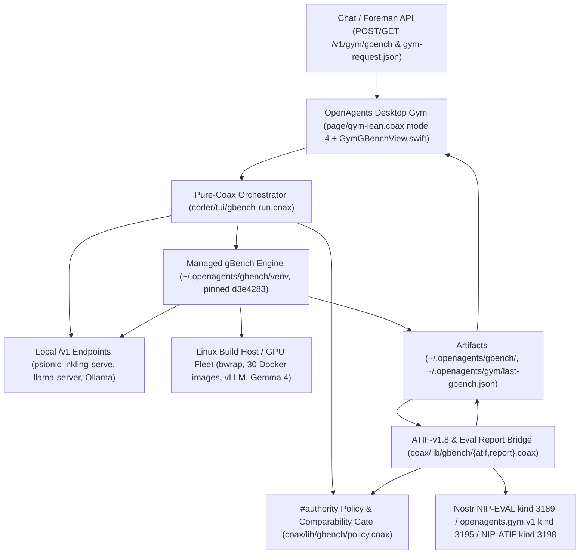

# gBench (`google-deepmind/gbench`) Research & OpenAgents Gym Integration Audit

**Date:** 2026-11-23  
**Audited External Repo:** `https://github.com/google-deepmind/gbench` (`v0.5.0.post1`, commit `d3e4283`, tag `v0.5.0` at `c44210a`), cloned locally at `~/work/projects/repos/gbench`  
**Audited OpenAgents HEAD:** `origin/main` @ `def7c6ddc5`  
**Scope:** Forensic architectural teardown of Google DeepMind's open-source **gBench** framework (all 4 measurement pillars, 86+2 eval suites, 16-case Golden Set + chat-template checks, GemmaClaw 60-scenario agentic QA, OpenAI `/v1` client contract, sandboxing/Docker/Gemini dependencies, and third-party dataset licensing), gap analysis against OpenAgents' current Gym (`Benchmarks`, `Terminal-Bench`, `PLE 3D`, `Lean · RH`) and Psionic serving stack (`psionic-inkling-serve`, `responses-server`), and an exact phased engineering plan for folding gBench into the OpenAgents Gym.

---

## 1. Executive Summary & Architectural Verdict

### Bottom-Line Recommendation

**Fold `gbench` into the OpenAgents Gym strictly out-of-process as a managed external evaluation engine — never port or vendor it into Coax.**

This mirrors the proven boundary already established in `openagents` for **Harbor** (`coder/tui/tbench-run.coax` + `coax/lib/tbench/`) and **PLE (`ple-kit`)** (`apps/openagents-desktop/ple-run-kit.coax`):

1. **Why out-of-process:** `google-deepmind/gbench` (`Apache-2.0`) is **222 Python files / 163,463 LOC** (`gbench/`), **344 test files / 153,179 LOC** (`tests/`), and **30 Dockerfiles** (`13` in `docker/` + `17` in `gbench/docker/`) wrapping pinned upstream evaluators (Harbor `0.20.0` & `0.22.0`, MathArena, Lean `v4.33.1` + Mathlib, BFCL `2026.3.23`, SWE-bench v4/v5/Live/Pro, Multi-SWE-bench `1.1.2`, tau2-bench, Meta ARE / GAIA-2, MCP-Atlas, MCP-Bench, MobileGym, SkillsBench, WildClawBench, GemmaClaw). Under `coax/tools-in-coax.md`, gBench is an external reference evaluator / independent oracle (Firm reasons `2` and `3`). Porting it would create massive unmaintainable drift; driving it out-of-process from a managed `uv` Python `3.12` venv (`~/.openagents/gbench/venv`) pinned to a release commit keeps `openagents` clean and preserves upstream comparability.
2. **What stays 100% pure Coax inside OpenAgents:** All orchestration, environment discovery (`doctor`), server lifecycle (`psionic-inkling-serve`, `llama-server`, Ollama, vLLM/Pylon), `#authority` comparability & promotion policy (`coax/lib/gbench/policy.coax`, 0 surviving mutants), wire schemas (`proto/coder/gbench-gym-v1.json`), result ingestion, `ATIF-v1.8` trajectory conversion, `openagents.eval-report.v1` / `openagents.gym.v1` publication, and Desktop Gym UI state (`page/gym-lean*.coax`).
3. **Why gBench is high leverage for our Gym right now:** It closes four structural gaps in our active 4-mode Gym (`Benchmarks`, `Terminal-Bench`, `PLE 3D`, `Lean · RH`):
   - **Chat-template correctness & token-leak verification:** The Golden Set's two sensitivity pairs (`template_tool_response` / `_twin`, `template_multi_turn` / `_twin`) plus runtime tokenizer special-token leak detection and the standalone 48-check Gemma 4 Jinja suite (`tools/template_checks/test_chat_template_gemma4.py`) directly validate Psionic's custom prompt renderers (`format_inkling_prompt`, future Gemma 4 / Qwen / Harmony renderers) against `llama.cpp` and vLLM.
   - **Standardized serving performance & open-loop Poisson stress knee certification:** Fixed workload campaigns (`agentic` 8000→400, `chat-like`, `prefill-heavy`, `decode-heavy`, `mixed`, `long-decode`), repeatability checks (`CV <= 5%`), and statistically certified P99 TTFT/ITL sustainable QPS (`>= 1099`-request cohorts) upgrade our Psionic vs `llama.cpp` benchmarking from 4 ad-hoc prompts to industry-comparable service telemetry.
   - **86 canonical capability benchmarks (+2 named-only) with strict honesty guarantees:** gBench enforces the exact anti-gaming philosophy codified in OpenAgents' historical `AGENTS.md` (*"Done means the real thing works"*) and Era 3/4 Terminal-Bench guardrails — hard-erroring `infra_required` instead of emitting fake `0%`, withholding pass rates (`null`) on unattributed harness errors, stamping every result with `(subject_id, scaffold_id)` + `canonical_sync` AST fingerprints + `leaderboard_comparable`, and supporting custom plugins (`--eval-plugins-dir`) and JSONL suites (`--eval-custom-jsonl`).
   - **Hardened agentic QA security model (`--quality-only`):** GemmaClaw's 60-scenario multi-turn QA suite runs in a `--network none --read-only --cap-drop ALL --security-opt no-new-privileges` Docker container whose only egress is a Unix-socket credential relay held in the host process — zero keys ever enter the container or model environment.

### Four Immediate Blockers to Address First

Before `gbench --remote-endpoint` can produce clean, uncorrupted verdicts against `psionic-inkling-serve` on Apple Silicon or Linux, four concrete blockers must be resolved:

1. **`psionic/platform/inkling-serve.c` `/v1` API gaps (4 P0, 4 P1):** On `origin/main` (`def7c6ddc5`), `inkling-serve.c` already supports sampler-level `tool_choice` and `stop` sequences, **but** still (a) returns HTTP `200` instead of `400`/`422` when given `image_url`/`input_audio` parts (causing gBench's `probe_multimodal` to misclassify text-only Inkling-2-Mini as a multimodal vision model!), (b) ignores `chat_template_kwargs.enable_thinking` (leaving default `effort = "0.7"` active during thinking-off runs), (c) omits `max_model_len` from `/v1/models` and hardcodes `"inkling-2-mini"`, and (d) lacks `/tokenize`, `/detokenize`, `return_token_ids`, `/metrics`, and opt-in Docker bridge `Host` support (`http_loopback_host` returns HTTP `403` to `host.docker.internal`).
2. **Missing HuggingFace tokenizer metadata for `inkling-2-mini`:** Golden Set's 4 `chat_template` cases load the served model's tokenizer via `transformers` to compute `forbid_chat_template_tokens`, and hard-error (`GoldenHarnessError`) if the tokenizer cannot be loaded. Local Inkling weights are shipped as a standalone GGUF (`~/.openagents/models/inkling-2-mini/Inkling-2-Mini-IQ4_NL.gguf`) without a HuggingFace `tokenizer_config.json` + `tokenizer.json` + `config.json` directory.
3. **macOS platform mismatches (`Python 3.15`, no `bwrap`, Colima networking):** This workstation runs Python `3.15.1` while gBench targets `3.11–3.13` (requiring `uv venv --python 3.12`); Linux `bubblewrap` (`bwrap`) does not exist on macOS (blocking Golden Set `code_canonical` and 6 code-exec eval suites under default `GBENCH_SANDBOX=required`); and Colima's `--network host` targets the Lima VM rather than macOS `127.0.0.1` while bind-mounting `$HOME` rather than `/tmp`.
4. **External key coupling & dataset licensing:** **26 eval suites** + `--quality-only` require `GEMINI_API_KEY` (hardwired to Google's Gemini API cascade); **3 suites** need third-party API keys (`complexfuncbench`, `mcp_atlas`, `mcp_bench`); **4 suites** use gated HuggingFace repos (`gpqa`, `gpqa_diamond`, `humanitys_last_exam`, `gaia`); and **18+ datasets** carry Non-Commercial (`CC BY-NC`), GPL (`ChartQA`), or undeclared/all-rights-reserved terms that must be blocked from commercial Psionic W3.2 distillation and clearly gated on public `openagents.gym.v1` leaderboards.

---

## 2. Forensic Breakdown of `google-deepmind/gbench` (`v0.5.0.post1`)

### 2.1 Repository & Runtime Inventory

| Dimension | Measured Fact (`~/work/projects/repos/gbench` @ `d3e4283`) |
| --- | --- |
| **Version / License** | `0.5.0.post1` / `Apache-2.0` (`LICENSE`, `NOTICE`, `pyproject.toml:21,27`) |
| **Python Package** | `222` `.py` files (`163,463` LOC) under `gbench/`; CLI entrypoint `gbench = "gbench.cli:main"` |
| **Unit Tests** | `344` `.py` files (`153,179` LOC) under `tests/` (`pytest`, `ruff`, `mypy`) |
| **Container Toolchains** | `30` Dockerfiles (`13` in `docker/`, `17` in `gbench/docker/`) + pinned `.constraints.txt` / `.pins.txt` |
| **Python Requirement** | `>=3.11` (classifiers & CI: `3.11`, `3.12`, `3.13`; exact `uv.lock` checked in, `1.31 MB`) |
| **Base Dependencies** | `pandas`, `pyarrow`, `numpy`, `huggingface-hub`, `datasets`, `requests`, `pydantic>=2,<3`, `Pillow`, `aiohttp`, `tqdm` |
| **Serving Stack Policy** | Intentionally omits `vllm`, `torch`, `transformers` from base deps (`pyproject.toml:68-75`). `--remote-endpoint` needs neither `vllm` nor `torch`; `transformers` is needed for prompt sizing (`--tokenizer`), Golden Set `chat_template` checks, and `mmlu`/`wmdp`/`ruler`/`longbench_v2_code`. |
| **`[evals]` Extra** | `google-genai`, `tiktoken`, `openai>=2.31`, `pycocoevalcap`, `pycocotools==2.0.11`, `sacrebleu==2.6.0`, `swebench>=4.1,<5`, `pytest`, `docker`, `multi-swe-bench==1.1.2`, `mini-swe-agent>=1.15,<2`, `litellm`, `h5py`, `scipy`, `sympy`, `math-verify`, `pyyaml`, `rapidfuzz`, `tree-sitter==0.21.3`, `tree-sitter-python==0.21.0`, `scikit-learn`, `openpyxl`, `pymupdf`, `xlrd`, `python-pptx`, `python-docx`, `soundfile`, `json_repair`, `langdetect`, `nltk`, `jsonschema`, `loguru`, `networkx`, `regex`, `portalocker`, `latex2sympy2_extended`, `matplotlib`, `agentdojo==0.1.35` |

### 2.2 The Four Measurement Pillars

All pillars talk to the model under test over a single OpenAI-compatible `/v1` HTTP interface (`--remote-endpoint <URL>/v1`, validated on vLLM and Ollama) or auto-start a local vLLM server on NVIDIA GPUs:

1. **Pillar 0 — Serving Performance & Stress Certification (`gbench/runners/{serving,stress,throughput}.py`)**
   - **Serving (`serving.py`):** Measures TTFT, TPOT, ITL, E2E latency, and throughput across batch sizes and 6 predefined `--campaign` workload shapes:
     - `chat-like` (ShareGPT V3 first-turn prompts; requires `vllm` dataset loader even with `--remote-endpoint`)
     - `agentic` (`random`, **8,000 in / 400 out** — models long-context agent step; no tools sent)
     - `prefill-heavy` (`random`, 8,192 in / 128 out)
     - `decode-heavy` (`random`, 128 in / 2,048 out)
     - `mixed` (`random`, 4,096 in / 1,024 out)
     - `long-decode` (`random`, 8,192 in / 8,192 out)
   - Every prompt carries a fresh per-run random nonce so prefix caches cannot skew serving numbers. Repeatability checks run `--num-iterations` after `--warmup-iterations` and gate `CV <= --max-cv-percent` (default `5.0%`).
   - **Open-Loop Stress Sweep (`stress.py`, `--stress-test`):** Merged Poisson schedules stepping QPS by `2x` across `--stress-reps`, then certifying the median repeat's limit with P99-sized cohorts (`>= 1,099` planned requests, ~1,400 sent) against per-campaign SLOs (default 5,000 ms P99 TTFT, 200 ms P99 ITL, `< 2%` errors, non-growing queue, `>= 90%` completion). Reads `/metrics` server-side P99 ITL when available; degrades to client-side ITL otherwise.
   - **Offline Throughput (`throughput.py`):** Drives `vllm bench throughput` directly — **automatically skipped under `--remote-endpoint`** (`reason: "remote_endpoint"`).

2. **Tier 1 — Academic & Domain Evaluation Suites (`gbench/runners/evals.py`, `--evals`)**
   - **88 built-in suites across 6 capability pillars** (`BUILTIN_PILLARS`, `gbench/runners/evals.py:86-205`): `86` run under `--evals all`, while `swe_lancer` (edits host `DOCKER-USER` iptables + pulls ~1.3 TB of images) and `ui_control_osworld` (needs `/dev/kvm`) are `NAMED_ONLY_SUITES` (`evals.py:214`). Two former names (`lmarena_web_agent`, `cybergym`) are deregistered roadmap-only stubs that hard-error if requested.
   - **Extensibility:** Dynamic Python plugins (`--eval-plugins-dir` / `GBENCH_EVAL_PLUGINS_PATH` via `gbench/runners/eval_suites/loader.py`) and zero-code JSONL datasets (`--eval-custom-jsonl` supporting `contains`, `exact`, `numeric`, `multiple_choice`).
   - **Large-Sweep Operations (`gbench/smoke.py`, `gbench/pool.py`, `gbench/merge.py`):**
     - `--preflight`: Runs every selected suite's prerequisite check + disk (`>= 100 GB` default) + Docker + host/bridge `/v1/models` check in ~30 s without calling the model; exits `2` on any FAIL.
     - `--smoke`: Runs `--preflight` then 1 sample per suite (`--eval-limit 1`, pool of 12) behind a recording tap (`smoke_tap.jsonl`) and smoke relay (`GBENCH_SMOKE_RELAY_REPLIES=1` ending agent episodes after 1 action), verifying reply arrival, request shape (`temperature`, `enable_thinking`, `max_tokens`), follow-up tool execution, and scorer execution — with accuracy withheld (`null`).
     - `--parallel-suites N`: Longest-first subprocess pool respecting 14 conflict `FAMILIES` (shared images, ports `18789–18795`, KV-heavy long context, Gemini search rate splitting) and a `/metrics` admission gate (`GBENCH_POOL_MAX_INFLIGHT=48`).
     - `--shard I/N` + `--merge`: Distributed multi-node execution and exact shard recombination.

3. **Tier 2 — Golden Set & Chat-Template Checks (`gbench/runners/golden.py`, `tools/template_checks/`)**
   - **16 deterministic deployment smoke cases (`--golden-only`, `SCORING_VERSION = 4`):** Covers code (`code_canonical` via `python_exec` in `bwrap`), tool calling (`function_call_single`, `tool_call_minimal`), structured output (`structured_json`), math (`math_canonical`), safety refusal (`safety_boundary`), knowledge (`identify_person`, `location_identification`, `two_rivers_zurich`), translation (`translation_romance`), vision (`multimodal_vision_landmark`), audio (`audio_transcription_smoketest`), and **4 chat-template sensitivity cases**:
     - `template_tool_response` + `template_tool_response_twin`: Isolates assistant `tool_calls` + `tool` (`tool_call_id`) serialization bugs from base model comprehension.
     - `template_multi_turn` + `template_multi_turn_twin`: Isolates 5-turn role-alternation bugs from base model comprehension.
   - **Runtime Template Leak Guard (`forbid_chat_template_tokens`):** Loads the served model's tokenizer via `transformers` and forbids every special/added chat-template delimiter token (plus literal `tool_call_id` and `<tool_response>`) in visible answers. If the tokenizer cannot be loaded, all 4 cases return **harness errors** (never silent passes).
   - **Modality Capability Gating:** Cases whose modality the model lacks are marked `not_applicable` and excluded from the denominator rather than scored `0`.
   - **Offline Gemma 4 Jinja Conformance Suite (`tools/template_checks/test_chat_template_gemma4.py`):** 48 GPU-free unit checks comparing a `chat_template.jinja` file against `google-deepmind/dialog` (29 currently passing on shipped Gemma 4 templates, 19 `xfail(strict=True)` tracking known gaps).

4. **Tier 3 — Agentic Quality Suite (`gbench/runners/quality.py`, `--quality-only`)**
   - Runs **GemmaClaw / OpenClaw's** live-frontier QA suite at pinned commit `DEFAULT_GEMMACLAW_COMMIT = "d8bc6989133e0e93535b5ad84e6acda019642839"` (`gemmaclaw-v2026.8.3`, 60 scenarios) testing multi-turn tool calling, session memory, plugin routing, and browser Control UI (Playwright Chrome).
   - **Hardened Sandbox (`docker/quality.Dockerfile`):** Builds `gbench-quality:<commit12>-<digest12>` (~8 GB) with offline npm cache and two audited source edits (switching OpenAI helper defaults to Gemini API and allowing the local relay URL). Runs with `--network none --read-only --cap-drop ALL --cap-add SETUID --cap-add SETGID --security-opt no-new-privileges --pids-limit 8192`, dropping from `root` to separate UIDs `gbrelay` (10002) and `qa` (10001).
   - **Host-Side Key Relay:** All credentials (`GEMINI_API_KEY[S]`, `VLLM_API_KEY`) remain strictly in gBench's host process behind a Unix socket (`/run/gbench-relay`); the container receives only placeholder `"gbench-relay"` and a per-run token piped over stdin to `gbrelay`. Every external call is allowlist-filtered (only 4 Gemini models & 4 methods; only `/chat/completions`, `/completions`, `/models` to the model endpoint) and counted in `gemini_calls` / `model_endpoint_calls`.

### 2.3 Complete 88-Suite Prerequisite Matrix

Verified directly against `gbench/runners/evals.py`, `gbench/smoke.py`, `docs/evals/toolchains.md`, and `docs/THIRD_PARTY_DATASETS.md`:

| Pillar | Total | Suites |
| --- | ---: | --- |
| **1. General Knowledge & Scientific Reasoning** | 21 | `arc_agi`, `causalbench`, `cimemories`, `cyberseceval`, `frames`, `gpqa`, `gpqa_diamond`, `healthbench`, `humanitys_last_exam`, `i18n_translate`, `ifeval`, `lab_bench`, `livebench`, `medxpertqa`, `mmlu`, `mmlu_pro`, `mmlu_redux`, `multilingual_mmlu`, `simpleqa`, `wildbench`, `wmdp` |
| **2. Mathematics & Proofs** | 7 | `aime`, `amc_aime`, `gsm8k`, `hmmt`, `imo_answer_bench`, `putnam`, `putnam_formal` |
| **3. Coding & Algorithmic Design** | 14 | `aider_polyglot`, `bigcodebench`, `codeforces`, `copilot_bench_swe`, `cruxeval`, `lcb`, `multi_swe_bench`, `multipl_e`, `ojbench`, `scicode`, `swe_bench_live`, `swe_bench_multilingual`, `swe_bench_pro`, `swe_lancer`\* |
| **4. Long Context & Retrieval** | 6 | `aa_lcr`, `beam_128k`, `loft_scifact`, `longbench_v2_code`, `mrcr`, `ruler` |
| **5. Tool Use & Agentic Workflows** | 29 | `acebench`, `agent_dojo`, `api_bank`, `bfcl`, `bfcl_live`, `bfcl_v4_agentic`, `browsecomp`, `complexfuncbench`, `deepsearch_qa`, `gaia`, `gaia2`, `gdpval`, `gorilla_apibench`, `mcp_atlas`, `mcp_bench`, `mobilegym`, `mobilegym_pp`, `nestful`, `nexusraven_api_eval`, `seal_tools`, `skillsbench`, `spider2`, `t_eval`, `tau2`, `tau3`, `terminal_bench`, `toolbench`, `ui_control_osworld`\*, `wildclawbench` |
| **6. Multimodal Vision & Grounding** | 11 | `bundled_detection`, `chartqa`, `charxiv`, `coco_caption`, `docvqa`, `infographicvqa`, `mmmu_pro`, `omnidocbench`, `screenspot`, `screenspot_pointing`, `textvqa` |
| **Total Built-In** | **88** | **86 in `--evals all`** + 2 named-only (`swe_lancer`, `ui_control_osworld`) |

Grouped by operational infrastructure required:

| Execution Tier | Count | Exact Suites | Where It Can Run |
| --- | ---: | --- | --- |
| **A. Zero-Infra Pure-HTTP Text** (no Docker, no `bwrap`, no Gemini, no gated HF, no logprobs, no Java/torch/local DB) | **16** | `agent_dojo`, `amc_aime`, `arc_agi`, `causalbench`, `gorilla_apibench`, `gsm8k`, `i18n_translate`, `ifeval`, `loft_scifact`, `longbench_v2_code`, `mmlu_pro`, `mmlu_redux`, `mrcr`, `multilingual_mmlu`, `nexusraven_api_eval`, `seal_tools` | **macOS Desktop Gym** & Linux immediately (once P0 `/v1` gaps fixed) |
| **B. Zero-Infra Pure-HTTP Vision/Mixed** | **10** | `bundled_detection`, `chartqa`, `docvqa`, `infographicvqa`, `lab_bench`, `medxpertqa`, `mmmu_pro`, `screenspot`, `screenspot_pointing`, `textvqa` | macOS & Linux against **vision-capable** endpoints (e.g., Gemma 4 VLM; N/A for text-only Inkling) |
| **C. Pure-HTTP + Gated HF or Local Non-Docker Tool** | **6** | `gpqa` (gated HF), `gpqa_diamond` (gated HF), `coco_caption` (Java JRE), `t_eval` (`sentence-transformers` + `torch`), `spider2` (local SQLite DBs), `ruler` (`git-lfs` checkout) | macOS & Linux with light one-time provisioning |
| **D. `/v1/completions` Logprob Suites** | **2** | `mmlu` (`logprobs=100`), `wmdp` (`echo=True, max_tokens=0, logprobs=1`) | vLLM / `llama-server` today; Psionic after P2 `/v1/completions` |
| **E. Non-Docker Gemini-Key Judged / Grounded Suites** | **16** | `aa_lcr`, `beam_128k`, `browsecomp`, `charxiv` (MM), `cimemories`, `complexfuncbench` (+ `RAPID_API_KEY`), `deepsearch_qa`, `frames`, `gaia` (+ gated HF), `gdpval`, `healthbench`, `humanitys_last_exam` (+ gated HF, MM), `imo_answer_bench`, `putnam`, `simpleqa`, `wildbench` | macOS & Linux with `GEMINI_API_KEY` (budget-capped!) |
| **F. Linux `bubblewrap` (`bwrap`) Code-Exec Suites** | **6** | `acebench` (+ Gemini for `agent_multi_turn`), `codeforces`, `cruxeval`, `lcb`, `nestful`, `scicode` (+ 1 GB `test_data.h5`) *(plus Golden Set `code_canonical`)* | **Linux host only** (unless wrapped in Docker `--network none` on macOS) |
| **G. Docker Containerized / Harness Suites** | **32** | `aider_polyglot`, `aime`, `api_bank`, `bfcl`, `bfcl_live`, `bfcl_v4_agentic`, `bigcodebench`, `copilot_bench_swe`, `cyberseceval`, `gaia2`, `hmmt`, `livebench`, `mcp_atlas` (keys), `mcp_bench` (5 keys), `mobilegym`, `mobilegym_pp`, `multi_swe_bench`, `multipl_e`, `ojbench` (7.85 GB data), `omnidocbench`, `putnam_formal` (25 GB Lean 4.33.1), `skillsbench`, `swe_bench_live`, `swe_bench_multilingual`, `swe_bench_pro` (Harbor 0.22.0), `tau2`, `tau3`, `terminal_bench` (Harbor 0.20.0), `toolbench`, `wildclawbench`; plus named-only `swe_lancer` (1.3 TB + iptables) & `ui_control_osworld` (`/dev/kvm`) | **Linux Docker build host** (most); select `--network none` evaluators (`putnam_formal`, `cyberseceval`, `multipl_e`, `ojbench`, `bfcl_live`) can also run on macOS Colima |

*(Note: 16 + 10 + 6 + 2 + 16 + 6 + 32 = 88 suites exactly. `GEMINI_SUITES` in `gbench/smoke.py:83-89` totals 26 across Tiers E, F, and G, plus `bfcl`'s optional web_search setting and `--quality-only`.)*

### 2.4 Provenance, Scaffold Contract & Output Schema

Every gBench run writes a timestamped folder under `--results-dir` (guarded by `.gbench-run.lock`) containing:

- `metadata.json`: Run timestamp, models, `model_metadata` (`metadata_source`, `revision`), `serve_settings`, `gbench` git SHA, and **`conditions[]`** recording `(pillar, model, format, subject_id, scaffold_id, covers, unpinned)`.
  - **`subject_id` vs `scaffold_id` (`gbench/core/scaffold.py`, `CONTRACT_VERSION = 2`):** Holding `scaffold_id` constant while varying `subject_id` (or backend serving environment) defines a valid like-for-like comparison. Changing decoding, prompt, attempts, dataset snapshot, `canonical_sync` anchors, judge cascade, or any declared `RUN_SHAPING_*` env var moves `scaffold_id`.
- `summary.json` & `eval_summary.csv`: All pillar results and failures (`eval_*.json` keeps `sample_traces[]` out of `summary.json` via `sample_traces_omitted`).
- `eval_<suite>_<model>_<fmt>.json`: Includes `eval_name`, `accuracy` (`float | null`), `accuracy_withheld_reason`, `headline_metrics`, `category_accuracy`, `status` (`success | completed_with_errors | error | failed | timeout | skipped`), `leaderboard_comparable` (`bool`), `leaderboard_comparable_reason`, `served_model_id`, `run_shape`, `scaffold_id`, `subject_id`, `canonical_sync` (with AST `code_fp`), `harness_errors`, `answer_in_thinking`, and `sample_traces[]` (each holding `sample_idx`, `sample_key`, `attempt_idx`, `category`, `messages`, `gold_answer`, `response_text`, `reasoning`, `tool_calls`, `emitted_function_calls`, `finish_reason`, `health`, `completion_tokens`, `decode_tok_s`, `is_correct`, `verification`, `judge_grade`).
- `performance/{serve,throughput,stress}_*.json` and `quality/quality_*.json`.
- **Deterministic Exit Codes (`docs/results.md:68-77`):** `0` = all pillars succeeded; `1` = model verdict failed (Golden Set failing cases); `2` = harness/infra/config error (always outranks exit `1`).

---

## 3. Current State of OpenAgents Gym (`origin/main` @ `def7c6ddc5`)

### 3.1 Active 4-Mode Gym Architecture

OpenAgents Desktop's Gym (gated behind `Experimental.on` + `DC_FLAG_GYM`) renders a shared 36pt Coax mode bar (`apps/openagents-desktop/page/gym-lean.coax:16`) switching across four lanes:

| Mode ID | Label | UI Host | Backend Orchestrator | Protocol Profile (`proto/`) | Persistence / Live Stream |
| ---: | --- | --- | --- | --- | --- |
| `0` | **Benchmarks** | `GymBenchmarkView.swift` (AppKit + 2× `GymChatSurfaceView` Coax GPU chat panes) | In-process Swift SSE client driving local `psionic-inkling-serve` (`:18445`) vs `llama-server` (`:18446`) over 10 Desktop coding tasks + 15 Lean tasks | None (`GymBenchSavedRun` Swift Codable) | `~/.openagents/gym/last-benchmark.json` |
| `1` | **PLE 3D** | `GymWorkbenchView.swift` + Metal 3D `PleScenePanelView` + `GymDiscovery.swift` | Out-of-process `ple-run-kit.coax` (`uv run python eval/run.py`) + `ple-run-gym.coax` | `ple-gym-request.v1` / `ple-gym-state.v1` (`coax/lib/agent/desktop/gym.coax`) | `~/.openagents/ple/{runs,gym-request.json,gym-state.json}` + `POST/GET /v1/gym` |
| `2` | **Lean · RH** | Pure-Coax GPU views (`page/gym-lean*.coax`, 7 sub-views) + `RhFlythroughView` | Pure-Coax `coder/tui/lean-run.coax` + `coax/lib/lean/{gym,atif,wire,policy}.coax` | `proto/coder/lean-gym-v1.json` (8 schemas in `proto/registry.json`) | `~/.openagents/lean/{gym-request.json,gym-state.json,index/rh-atlas.json}` + `POST/GET /v1/gym/lean` |
| `3` | **Terminal-Bench** | `GymTerminalBenchView.swift` (AppKit + 2× `GymChatSurfaceView`) | Pure-Coax `coder/tui/tbench-run.coax` + `coax/lib/tbench/{policy,suites,runner,hillclimb,agent,wire}.coax` + thin Python Harbor adapter (`evals/terminal-bench/harbor_adapter/openagents_coax_agent.py`, `Firm reason: 6`) | `proto/coder/tbench-gym-v1.json` (4 schemas in `proto/registry.json`) | `~/.openagents/tbench/{live-status.jsonl,runs/,hillclimb/}` + `~/.openagents/gym/last-tbench.json` |

*(Minor bug found during audit: `apps/openagents-desktop/Window+Gym.swift:380,394` maps modes in `gymStateForProgram` as `0 -> "benchmarks"`, `1 -> "ple"`, else `"lean"` — omitting `"tbench"` for mode `3`, whereas `page/gym-lean-state.coax:532` already returns `"tbench"`. Fix this when adding mode `4`.)*

### 3.2 Shared Protocol & Verification Backbone Ready for Reuse

Every new Gym lane must plug directly into these existing verified primitives rather than hand-rolling new ones:

- **Canonical Trajectories (`ATIF-v1.8`):** `coax/lib/nostr/atif/{log,digest,chunks}.coax` implements append-only `.atif.jsonl`, sorted-key UTF-8 SHA-256 `steps_digest`, `openagents.atif-manifest.v1` (Nostr kind `3198`), and chunk verification (kind `3199`), consumed directly by Desktop's Trace Drawer and mobile proof views.
- **`#authority` Evaluation Verification & Admission:** `coax/lib/nostr/eval/report.coax` validates `openagents.eval-report.v1` (kind `3189`, requiring `suite`, `partition`, `runs`, `limitations` `ArtifactRef`s + `coverage` counts + `measurements` + `verdict`) and `openagents.eval-admission.v1`.
- **Gym Protocol (`docs/protocol/openagents-protocol-spec.md` §21.2, `openagents.gym.v1`):** Defines `GymSuite`, `Leaderboard` (`openagents.gym.leaderboard.v1`), `ResultsPublication` (kind `3195`), `EvalRow` (`openagents.gym.eval-row.v3`), `GymRequest`, `GymReply`.
- **`#authority` Mutation-Tested Promotion Gate Pattern:** `coax/lib/tbench/policy.coax` + `coax/lib/tbench/hillclimb.coax` establish the exact pattern: integer Wilson 95% CI in basis points (`tb_wilson_95`), `#authority` promotion gating with 0 surviving mutants (`coax mutate --root-only`), and Ch 247 redacted, train-only distillation (`redact-trajectory.coax`).
- **Pre-Push & Wire Gates:** `coax/web/prepush.coax` enforces `tools-check` (`Firm reason:` on non-Coax files), `wire-check` (`proto/registry.json` goldens + adversarial refusals), `layer-check`, and `#authority` mutation checks on `main`. *(Note: root `AGENTS.md` is currently 0 bytes due to accidental truncation in `cca95dcf9c`; its rules remain actively enforced by `prepush.coax` and `coax/tools-in-coax.md`.)*

### 3.3 Overlap Analysis: Existing Gym Lanes vs gBench

| Domain | Existing OpenAgents Gym | gBench Equivalent | Relationship / Decision |
| --- | --- | --- | --- |
| **Terminal-Bench** | `tbench-run` runs **our custom agent** (`OpenAgentsCoaxAgent`: Microcoder + W2.2 Class-E Executor guards + train/heldout hillclimbing) via host Harbor CLI over TB 2.0 / 2.1 / 4.0 | `terminal_bench` runs upstream **Terminus-2** inside pinned Docker image `gbench-terminal-bench:harbor-0.20.0` against TB 2.1's content-hashed 89-task manifest (`-k 5` = 445 trials) | **Keep both, clearly separated.** Use `tbench-run` to hillclimb OpenAgents' agent harness & Executor Network; use `gbench --evals terminal_bench` for canonical Terminus-2 model-checkpoint leaderboard comparability. |
| **Lean 4 Proofs** | `lean-run` provides 175k-module RH atlas, `lean-core-smoke` (5) / `lean-algebra-logic` (10), and `lean-psionic-w32.v1` distillation on `leanprover/lean4:v4.33.1` | `putnam_formal` runs 672 Putnam problems (`lean-wsolution` + `lean-nosolution`) on the **exact same `leanprover/lean4:v4.33.1` + Mathlib** with a hardened 4-container anti-cheat kernel replay checker (`Lean.Environment.replay`, 128-bit nonce verdict, unfolded theorem type equality, binder-sanitized faithfulness printer) | **High-value synergy.** Run `putnam_formal` via gBench (permitted for W3.2 distillation — Apache-2.0!) **and** port gBench's kernel-replay + nonce-verdict hardening patterns into `coax/lib/lean/` (`lean-run verify`). |
| **Desktop Coding Benchmarks** | `GymBenchmarkView.swift` + `evals/openagents-desktop/` Tier 2 (15) / Tier 4 (29) + `evals/session-history/` (27 ATIF tasks) | 86 external benchmarks + 16 Golden Set + 6 serving perf campaigns + 60 GemmaClaw scenarios | **Complementary.** Keep Tier 2/4 and Session-History to test OpenAgents' own app/worker (`mcworker`/`inky`); add gBench for standardized model serving, template health, and external capability coverage. Optionally expose Tier 4 / Session-History as a gBench `--eval-plugins-dir` plugin so external models can be scored on our tasks too. |
| **Local Serving Benchmarks** | `psionic/docs/targets/inkling-benchmark.md` (4 fixed prompts comparing `psionic-inkling-serve` vs `llama-server`) | `serving.py` (6 campaigns, CV repeatability) + `stress.py` (open-loop Poisson P99 TTFT/ITL knee certification) | **Upgrade to gBench.** Keep the 4-prompt fast inner-loop microbench for kernel sprints, and use `gbench --campaign agentic|mixed --stress-test` as the official Gym service-level comparison between Psionic Metal/CUDA and `llama.cpp` / vLLM. |

---

## 4. Exact Serving Compatibility Gap Audit (`psionic-inkling-serve` & OpenAgents Endpoints vs `gbench --remote-endpoint`)

Every line number below was verified against `origin/main` (`def7c6ddc5`) in `psionic/platform/inkling-serve.c` (3,465 LOC) and `~/work/projects/repos/gbench` (`d3e4283`).

### 4.1 What Already Works on `origin/main:psionic/platform/inkling-serve.c`

Recent upgrades on `origin/main` already give `psionic-inkling-serve` a strong OpenAI `/v1` foundation:
- `GET /health`, `GET /v1/models`, `POST /v1/chat/completions` (SSE + non-streaming JSON), `POST /v1/responses`.
- Multi-turn `tools`, `tool_calls` (including incremental streaming argument deltas, `L1831–1905`), `role: "tool"` with `tool_call_id` resolution (`L1216–1233`), and **sampler-level `tool_choice`** (`auto`, `none`, `required`, named function, `L650–651, L1226–1268, L2561–2589`).
- **Up to 4 OpenAI `stop` sequences** with streaming holdback (`L652–654, L1284–1306, L2058–2064, L2715–2733`).
- `reasoning_content` emission (both SSE delta and non-stream JSON, `L2091, L3048`), `usage` with `cached_tokens` & `reasoning_tokens`, `response_format` (`json_object` and RFC 8259 constrained `json_schema`), `temperature`, `top_p`, `top_k`, `seed`, `max_tokens`/`max_completion_tokens`, client disconnect abort, and thinking/output loop breakers.

### 4.2 The 11 Remaining Compatibility Gaps

| # | Priority | Gap & Exact Code Location | What Breaks in `gbench` Today | Concrete Fix Needed |
| ---: | :---: | --- | --- | --- |
| **1** | **P0** | **Multimodal parts silently skipped -> HTTP 200** (`psionic/platform/inkling-serve.c:711–756`, `parse_content_value`) | `gbench/utils/endpoint.py:187–278` (`probe_multimodal`) sends a 1×1 PNG in `image_url` and classifies a model as text-only **only** on HTTP `400`/`415`/`422`. Returning HTTP `200` causes gBench to treat text-only `inkling-2-mini` as vision-capable, running `multimodal_vision_landmark`, multimodal serving/stress, and all 11 Pillar-6 vision suites and recording bogus `0%` scores instead of `not_applicable`. | In `parse_content_value`, detect `"type": "image_url"`, `"image_url"`, `"type": "input_audio"`, or `"input_audio"` when the loaded model has no vision/audio tower and return HTTP `400` (`{"error":{"message":"model does not support image/audio inputs","type":"invalid_request_error"}}`). |
| **2** | **P0** | **`chat_template_kwargs.enable_thinking` ignored** (`inkling-serve.c:1159–1330`, skipped by `j_skip`) | `gbench/runners/eval_suites/base.py:2422–2431, 3438–3447` sends `chat_template_kwargs: {"enable_thinking": true\|false}` on **every** chat request. Because `inkling-serve.c` defaults `effort` to `"0.7"` and skips `chat_template_kwargs`, thinking-OFF runs still think and emit `reasoning_content`, breaking no-think accuracy, triggering server-parser recovery, and failing `--smoke` shape verification. | Parse `chat_template_kwargs` in `parse_request_json`: when `enable_thinking` is explicitly `false` (and no explicit `reasoning_effort` overrides it), set `effort = "0"`; when `true`, keep default `"0.7"` (or explicit effort). |
| **3** | **P0** | **Missing `/tokenize` & `/detokenize` + missing local Inkling HF tokenizer dir** (`inkling-serve.c:3249–3271`; `apps/openagents-desktop/LocalModels.swift:19–30`) | (a) Golden Set's 4 `chat_template` cases (`golden.py:_template_leak_tokens`) **hard-error (`GoldenHarnessError`)** unless `--tokenizer` loads via `transformers` and yields special tokens; (b) `serving.py` / `stress.py` / `base.py` need either server `/tokenize` or `--tokenizer` for exact prompt sizing; (c) `base.py` needs `/detokenize` or `--tokenizer` to recover text from `return_token_ids`. Local `~/.openagents/models/inkling-2-mini/` has only the `.gguf` + `manifest.json`. | **Both:** (1) Add `POST /tokenize` and `POST /detokenize` to `inkling-serve.c` directly over `sv->sess` / `vocab_table` (returning vLLM-compatible `{"count": N, "tokens": [...]}` and `{"prompt": "..."}`); (2) Ship/generate a lightweight HuggingFace metadata bundle at `~/.openagents/models/inkling-2-mini/hf-tokenizer/` (`config.json` with `max_position_embeddings: 32768`, `vocab_size`, MoE params, no `vision_config`; plus `tokenizer_config.json` / `special_tokens_map.json` / `tokenizer.json` listing Inkling's real delimiters `<\|message_user\|>`, `<\|message_model\|>`, `<\|content_thinking\|>`, `<\|content_invoke_tool_json\|>`, etc.) so `--tokenizer` passes Golden Set leak checks offline. |
| **4** | **P0** | **`/v1/models` omits `max_model_len` & hardcodes `"inkling-2-mini"`** (`inkling-serve.c:3258–3263`) | `endpoint.py:88`, `quality.md:13–15`, `mrcr.py`, and `base.py` context clamping read `max_model_len` from `/v1/models`. Without it, `quality` hard-errors (`infra_required`) when config isn't read, and `mrcr` cannot gate context bins. Hardcoded `"inkling-2-mini"` prevents clean checkpoint comparison across fine-tunes / future models. | Emit `"max_model_len": sv->max_ctx` in `GET /v1/models` and add `--model-id NAME` CLI flag (defaulting to `"inkling-2-mini"`). |
| **5** | **P1** | **Loopback-only `Host` check blocks Docker containers** (`inkling-serve.c:299–311, 3223–3226`) | `http_loopback_host` permits only `localhost`, `127.0.0.1`, `[::1]`. Containerized gBench suites (`--preflight` bridge check, keyless `bfcl`, `livebench`, `aider_polyglot`, `tau2/3`, `gaia2`, `toolbench`, SWE harnesses) reach host servers via `host.docker.internal:<port>` or the Docker bridge IP (`172.17.0.1:<port>`), receiving HTTP `403 forbidden host or origin`. | Keep strict loopback default for Desktop safety; add explicit opt-in `--allow-docker-host` flag (used only by `gbench-run` / `tbench-run`) that additionally admits `host.docker.internal` and the configured bind IP while continuing to enforce `http_origin_ok`. |
| **6** | **P1** | **`return_token_ids` silently ignored** (`inkling-serve.c:1159–1330, 3040–3060`) | `base.py:3446, 3534` sends `"return_token_ids": true` to recover parser-stripped replies; if a server silently ignores it, gBench cannot do exact token-ID recovery (only `reasoning_then_content` fallback). | Record `r->return_token_ids` in `parse_request_json` and emit `"token_ids": [...]` on the choice when requested (already available in `inkling-serve.c`'s decode loop). |
| **7** | **P1** | **No Prometheus `/metrics` endpoint** (`inkling-serve.c:3249–3271`) | Without `/metrics` (`vllm:generation_tokens_total`, `vllm:prompt_tokens_total`, `vllm:num_requests_running`, `vllm:num_requests_waiting`, `vllm:kv_cache_usage_perc`, ITL histogram), `--stress-test` falls back to jittery client-side P99 ITL and fixed cooldown, `EndpointRelay` loses non-streamed stall detection (`docs/relay.md:58–83`), and `--parallel-suites` admission gate stays open. | Add lightweight `GET /metrics` text handler exposing the 6 `vllm:*` counters/gauges + ITL histogram buckets tracked atomically in `Server`. |
| **8** | **P1** | **`4 MiB` HTTP request cap & `32K` default context** (`inkling-serve.c:3119, 3309`) | Long-context suites (`mrcr` 64K–1M, `ruler` 64K–128K, `aa_lcr` ~100K, `beam_128k`) exceed 32K tokens and can exceed 4 MiB request bodies. | Add `--max-body-mb` (default `4`, raiseable to `32` for Gym runs); accept `32K` context ceiling honestly via `/v1/models` `max_model_len` (gBench automatically filters `mrcr` bins to the served window and records `leaderboard_comparable: false` with the window reason). |
| **9** | **P2** | **No `/v1/completions` (`logprobs=100`, `echo=True, max_tokens=0`)** (`inkling-serve.c:3249–3271`) | Blocks the 2 `LOGPROB_SUITES` (`mmlu`, `wmdp`) and local-style raw completion serving tests. | Implement `POST /v1/completions` with `echo`, `max_tokens=0`, and top-`logprobs` extraction from `ink_logits()` (already accessible on CPU in `inkling-serve.c:1410`). |
| **10** | **P2** | **Single-slot serialized inference mutex** (`inkling-serve.c:2246`, `ink_mutex_lock(&sv->sess_mu)`) | Concurrent sweeps (`--eval-concurrency > 1`, `--batch-sizes 16,32`, `--parallel-suites N`, high-QPS `--stress-test`) queue behind 1 active sequence. | Short term: `gbench-run` defaults `--eval-concurrency 1` and `--batch-sizes 1` for `psionic-inkling-serve` (honestly pinned in `scaffold_id`). Long term: continuous batching in Psionic unlocks multi-QPS stress knee competition with vLLM. |
| **11** | **P2** | **Model breadth (`responses-server.c` GPT-OSS-20B & future Gemma 4)** | `psionic/platform/responses-server.c` serves `/v1/responses` only (no `/v1/chat/completions`), so gBench cannot target GPT-OSS-20B directly. Psionic has no Gemma 4 engine yet (`psionic/book/PLAN.md` Appendix B / `Bolt-E4B` only). | For Gemma 4 today, drive external `llama-server` / `ollama` / Linux `vLLM` through `gbench-run`. When Psionic brings up Gemma 4 (or adds `/v1/chat/completions` to GPT-OSS), gate bring-up on `test_chat_template_gemma4.py` + `gbench --golden-only` + `oa-local-core`. |

---

## 5. Platform, Security, Runtime & Licensing Constraints

### 5.1 macOS Desktop Gym vs Linux Build Hosts (Two-Tier Execution Topology)

Testing this workstation's environment (`Python 3.15.1`, `/Users/christopherdavid/.local/bin/uv`, `/usr/local/bin/docker`, `/opt/homebrew/bin/colima`, `bwrap not found`) reveals a clean split between what belongs on a developer Mac vs a Linux Docker/GPU host:

1. **Managed Python `3.12` venv (never host Python, never bundled in `OpenAgents.app`):**
   - `gbench-run install` provisions `~/.openagents/gbench/venv` via `uv venv --python 3.12` and installs pinned `google-deepmind/gbench` (`d3e4283`) with `.[evals]` + `transformers` + `nltk` (`punkt`, `punkt_tab`). This keeps `OpenAgents.app` strictly compliant with `v1-bundle-policy.coax` and avoids breaking on macOS's system Python `3.15`.
2. **`bubblewrap` (`bwrap`) is Linux-only:**
   - Golden Set `code_canonical` and the 6 Tier-F suites (`acebench`, `codeforces`, `cruxeval`, `lcb`, `nestful`, `scicode`) hard-error on macOS under default `GBENCH_SANDBOX=required`.
   - **Security invariant:** Never silently set `GBENCH_SANDBOX=none` for untrusted model code on developer Macs holding credentials/keys. Instead:
     - **Option A (recommended default):** `gbench-run doctor` reports `bwrap_ok: false` on macOS, restricts local macOS runs to Tiers A/B/C/E + non-`bwrap` Golden cases (15/16) or routes `bwrap` + heavy Docker suites to a Linux build host over SSH/Tailscale.
     - **Option B (optional macOS Colima bridge):** For `code_canonical` and local code-exec suites, provide a Colima Docker `--network none --read-only --cap-drop ALL` sandbox adapter (never unsandboxed host `exec()`).
3. **macOS Colima path-mount and `--network host` pitfalls:**
   - Colima mounts `$HOME` into the Linux VM, **not `/tmp`**. Just as `coax/lib/tbench/runner.coax` roots Harbor jobs under `~/.openagents/tbench/jobs`, `gbench-run` must export `TMPDIR=$HOME/.openagents/gbench/tmp`, `GBENCH_CACHE_DIR=$HOME/.openagents/gbench/cache`, and auto-discover `DOCKER_HOST=unix://$HOME/.colima/oa-agent0/docker.sock` (falling back to `~/.colima/default/docker.sock` and `/var/run/docker.sock`).
   - On Colima, Docker `--network host` attaches to the **Colima VM**, not macOS's `127.0.0.1`. Containerized gBench suites targeting a macOS-hosted `psionic-inkling-serve` or `llama-server` must use `http://host.docker.internal:<port>/v1` (with `--host 0.0.0.0` or Colima gateway binding + Gap #5 `--allow-docker-host`).
4. **Cloud VM Metadata Guard & Disk Footprint (Linux Hosts):**
   - Any GCE/cloud Linux host running Docker suites must install the DNS-preserving `DOCKER-USER` iptables rule (`sudo iptables -I DOCKER-USER -d 169.254.169.254/32 -p tcp ! --dport 53 -j DROP`) verified by `gbench/runners/eval_suites/container_guard.py`.
   - Provisioning all 30 Docker images + datasets requires substantial disk: `putnam_formal` (~25 GB), `bfcl` (~14 GB), `quality` (~8 GB), `ojbench` testdata (7.85 GB), `scicode` (1 GB), plus SWE instance images (tens of GB; `swe_lancer` alone pulls ~1.3 TB and remains opt-in/excluded from `all`).

### 5.2 External API Keys & Cost Discipline

- **`GEMINI_API_KEY` / `GEMINI_API_KEYS`:** Required by all 26 `GEMINI_SUITES`, `bfcl` web_search, and `--quality-only`. Unlike our Desktop Tier 2/4 evals (`$0.00` local default), running judged gBench suites incurs Gemini API spend. `gbench-run` must **never** silently invoke judged suites without explicit opt-in (`--allow-paid-judge`) and a hard per-run / monthly USD budget guard (`OA_GBENCH_MAX_JUDGE_CALLS` / `OA_DESKTOP_EVALS_MONTHLY_USD`).
- **Additional opt-in credentials:** `HF_TOKEN` (for gated `gpqa`, `gpqa_diamond`, `humanitys_last_exam`, `gaia`), `RAPID_API_KEY` (`complexfuncbench`), `NPS_API_KEY` / `NASA_API_KEY` / `NCI_API_KEY` / `GOOGLE_MAPS_API_KEY` (`mcp_bench`), and MCP-Atlas server credentials. Missing keys cleanly fail at `--preflight` without burning inference.

### 5.3 Third-Party Dataset Licensing & Distillation Gate

`gbench` code is `Apache-2.0`, but **each benchmark's dataset retains its own upstream license** (`docs/THIRD_PARTY_DATASETS.md`). Our `#authority` policy module (`coax/lib/gbench/policy.coax`) must enforce a hard static license classification table per suite:

| License Class | Suites (from `docs/THIRD_PARTY_DATASETS.md`) | Internal Eval | Public `openagents.gym.v1` Board | Psionic W3.2 Distillation |
| --- | --- | :---: | :---: | :---: |
| **Permissive (`Apache-2.0` / `MIT` / `CC-BY-4.0` / `CC-BY-SA-4.0`)** | `arc_agi`, `aa_lcr`, `acebench`, `agent_dojo`, `amc_aime`, `api_bank`, `beam_128k`, `bfcl*`, `bigcodebench` (prompts), `browsecomp`, `charxiv`, `codeforces`, `complexfuncbench`, `cruxeval`, `cyberseceval`, `deepsearch_qa`, `docvqa`, `frames`, `gorilla_apibench`, `gsm8k`, `healthbench`, `ifeval`, `imo_answer_bench`, `infographicvqa`, `lab_bench`, `lcb`, `longbench_v2_code`, `mcp_atlas`, `medxpertqa`, `mmlu`, `mmlu_pro`, `mmlu_redux`, `mmmu_pro`, `mrcr`, `multilingual_mmlu`, `multipl_e`, `nestful`, `putnam_formal`, `scicode` (prompts), `screenspot*`, `seal_tools`, `simpleqa`, `t_eval`, `tau2` (code), `toolbench` (baselines), `wmdp` | Yes | Yes (with attribution) | **Train-split / non-canary only** (explicitly forbid held-out test leakage) |
| **Gated + Anti-Training Canary** | `gpqa`, `gpqa_diamond` (CC-BY-4.0 + canary terms forbidding training/leakage), `humanitys_last_exam` (MIT, gated) | Yes (with `HF_TOKEN`) | Scores only (never raw prompts/traces) | **HARD BLOCKED** |
| **Non-Commercial (`CC-BY-NC*`)** | `aime`, `hmmt`, `cimemories`, `nexusraven_api_eval`, `mobilegym`, `mobilegym_pp` (data bundle) | Research only | Flagged `non_commercial` (counsel check before commercial marketing) | **HARD BLOCKED** |
| **Copyleft (`GPL-3.0`)** | `chartqa` | Yes | Scores only | **HARD BLOCKED** |
| **No License Declared / All-Rights-Reserved / Contested** | `gaia`, `wildbench`, `livebench`, `ojbench`, `putnam` (informal MAA), `causalbench`, `bundled_detection` (Flickr ToS), `coco_caption`, `textvqa`, `omnidocbench`, `i18n_translate` (WMT19), `gdpval`, `bigcodebench-hard`, `ShareGPT` (`--campaign chat-like`) | Internal only | **Blocked until cleared** | **HARD BLOCKED** |

---

## 6. Target Integration Architecture: Folding `gbench` into OpenAgents Gym

### 6.1 System Topology

### 6.2 New Contracts, Coax Modules & Desktop Touchpoints

Following `proto/coder/tbench-gym-v1.json` and `coax/lib/tbench/` 1-to-1:

1. **Wire Profile (`proto/coder/gbench-gym-v1.json` + `proto/registry.json`):**
   - `gbench-doctor.v1`: `ok`, `gbench_ok`, `gbench_commit`, `python_ver`, `transformers_ok`, `docker_ok`, `docker_host`, `bwrap_ok`, `psionic_ok`, `llama_ok`, `ollama_ok`, `ink_tokenizer_ok`, `gemini_key_set`, `hf_token_set`, `disk_free_gb`, `built_images_count`.
   - `gbench-golden.v1`: `run_id`, `timestamp`, `subject_id`, `scaffold_id`, `served_model_id`, `scoring_version`, `status`, `applicable`, `passed`, `failed`, `errors`, `not_applicable`, `template_pair_ok`, `template_leak_tokens_checked`, `cases[]`.
   - `gbench-perf.v1`: `run_id`, `campaign`, `subject_id`, `scaffold_id`, `batch_size`, `ttft_p50_ms`, `ttft_p99_ms`, `itl_p99_ms`, `tpot_ms`, `tok_per_s`, `cv_percent`, `cv_valid`, `stress_knee_qps`, `stress_certified`.
   - `gbench-eval.v1`: `suite`, `pillar`, `subject_id`, `scaffold_id`, `accuracy_bps` (`-1` when `null`/withheld!), `withheld_reason`, `status`, `leaderboard_comparable`, `comparable_reason`, `total`, `correct`, `harness_errors`, `answer_in_thinking`, `license_class`, `atif_verified`, `atif_digest`, `atif_path`.
   - `gbench-compare.v1`: Arm A vs Arm B snapshot persisted to `~/.openagents/gym/last-gbench.json`, strictly carrying `scaffold_match: bool` (refusing delta computation when `arm_a.scaffold_id != arm_b.scaffold_id`).
   - `gbench-gym-request.v1` / `gbench-gym-state.v1`: Programmatic steering matching `lean-gym-request.v1` and `ple-gym-request.v1`.

2. **`#authority` Policy Module (`coax/lib/gbench/policy.coax`, 0 surviving mutants):**
   - `gb_admit_compare(a, b)`: Refuses any comparison where `scaffold_id` differs, either arm is `smoke: true`, or accuracy is withheld (`accuracy_bps < 0`).
   - `gb_admit_golden(g)`: Deployment gate requiring `errors == 0`, `failed == 0`, `applicable > 0`, `template_pair_ok == true`, and `template_leak_tokens_checked > 0`.
   - `gb_admit_perf(p)`: Repeatability gate requiring `cv_valid == true` (`cv_percent <= 500` bps) and zero request error rate above `200` bps (`2%`).
   - `gb_distill_allowed(suite_id, split, is_verified)`: Hard allowlist blocking all `NC`, `GPL`, `undeclared`, and `canary` (`gpqa*`, `hle`) suites from ever emitting W3.2 distillation rows.
   - `gb_classify_exit(exit_code, status, withheld)`: Enforces gBench's `0 / 1 / 2` hierarchy so harness errors (`2`, `infra_required`, `withheld`) are never downgraded to model failures.

3. **Curated Gym Profiles (`coax/lib/gbench/suites.coax`):**
   - `oa-template-smoke` (~30–60 s, `$0.00`): Golden Set (16 cases, incl. 4 chat-template pairs) + offline `test_chat_template_gemma4.py` when evaluating Gemma 4 templates.
   - `oa-perf-agentic` (~3–5 min, `$0.00`): `--campaign agentic` (`8000 -> 400`) + `--campaign mixed` (`4096 -> 1024`) at `--preset quick` (or `--stress-test` full knee certification).
   - `oa-local-core` (`$0.00`, zero Docker / zero `bwrap` / zero Gemini / zero HF token): All 16 Tier-A pure-HTTP text suites (with `--eval-limit 20` fast slice or full canonical run).
   - `oa-coding-linux` (Linux + `bwrap` + Docker): `codeforces`, `cruxeval`, `lcb`, `scicode`, `bigcodebench`, `multipl_e`, `aider_polyglot`, `swe_bench_pro`, `terminal_bench`.
   - `oa-formal-math` (Docker + Lean `v4.33.1`): `putnam_formal`, `aime`, `hmmt`, `imo_answer_bench`.
   - `oa-agentic-full` (Linux Docker + `GEMINI_API_KEY`): `bfcl`, `bfcl_v4_agentic`, `tau2`, `tau3`, `skillsbench`, `wildclawbench`, `mcp_atlas`, `mcp_bench`, `gaia2` + `--quality-only` (GemmaClaw 60 scenarios).
   - `oa-multimodal` (vision-capable endpoints): All 10 Tier-B vision suites + `omnidocbench` + `mobilegym` / `mobilegym_pp`.

4. **Pure-Coax CLI Runner (`coder/tui/gbench-run.coax` + `coax/lib/gbench/{runner,wire,atif,report}.coax`):**
   - Bundled beside `tbench-run`, `lean-run`, `ple-run` inside `OpenAgents.app/Contents/Resources/gbench-run`.
   - Verbs: `doctor [--json]`, `install [--pin SHA]`, `suites [--json]`, `golden`, `template-check`, `perf`, `eval`, `quality`, `compare --arm-a ... --arm-b ... --profile ...`, `export-atif`, `publish-report`, `status [--json]`, `stop`, `gym [...]`.
   - Manages local server lifecycle (`psionic-inkling-serve` vs `llama-server`) identically to `coax/lib/tbench/runner.coax:478–572`, streams live progress JSONL to `~/.openagents/gbench/live-status.jsonl`, and writes `ATIF-v1.8` logs (`coax/lib/nostr/atif/log.coax`, `derivation.kind = "converted"`) plus `openagents.eval-report.v1` artifacts (`coax/lib/nostr/eval/report.coax`).

5. **Desktop Gym UI (`apps/openagents-desktop/`):**
   - Extend `page/gym-lean-state.coax` & `page/gym-lean.coax:16` from 4 to 5 mode pills: `["Benchmarks", "Terminal-Bench", "gBench", "PLE 3D", "Lean · RH"]` (`CP_GYM_GBENCH :: 4`).
   - Fix `Window+Gym.swift:380,394` (`"tbench"` and `"gbench"` in `gymStateForProgram`), add `POST/GET /v1/gym/gbench` in `Window+ForemanAPI.swift`, and poll `~/.openagents/gbench/gym-request.json`.
   - Add `GymGBenchView.swift` (`Firm reason: 6`, mirroring `GymTerminalBenchView.swift`) with:
     - Top bar: Profile picker (`oa-template-smoke`, `oa-perf-agentic`, `oa-local-core`, etc.), Arm A / Arm B pickers (`psionic-metal`, `llamacpp-metal`, `ollama`, `remote-vllm`), Thinking toggle, Limit selector, `Preflight`, `Run`, `Stop`.
     - **Scaffold Lock Banner:** Displays `subject_id` / `scaffold_id` and turns red/refuses delta math if scaffolds diverge.
     - **4 Sub-Panels:** (1) Golden Set & Chat-Template Pair Matrix (Pass/Fail/N/A/Error + leak tokens checked), (2) Serving Perf & Stress Knee Cards (TTFT / TPOT / P99 ITL / CV% / QPS), (3) 6-Pillar Eval Scoreboard (with `leaderboard_comparable` badge & license tag), and (4) Live / Saved Trace Inspector reusing `GymChatSurfaceView` over converted `ATIF-v1.8` trajectories.

6. **Optional Bidirectional Bridge (`evals/gbench-plugins/`):**
   - A thin Python plugin (`Firm reason: 3`, <120 LOC) registered via `--eval-plugins-dir` exposing `evals/openagents-desktop/tier4/slice.json` and `evals/session-history/tasks/` as custom gBench suites so external endpoints (Gemma 4 on vLLM/Ollama, cloud models) can be evaluated on OpenAgents' own tasks inside gBench sweeps.

---

## 7. Phased Implementation Plan & Verification Gates

### Phase 0 — Psionic `/v1` Readiness & Inkling Tokenizer Bundle (1–2 days)
- **Files:** `psionic/platform/inkling-serve.c`, `psionic/tests/` (add C/Python wire tests), `apps/openagents-desktop/LocalModels.swift` (or `psionic/tools/` HF tokenizer metadata generator).
- **Deliverables:**
  1. Reject `image_url` / `input_audio` with HTTP `400` in `parse_content_value` (Gap #1).
  2. Parse `chat_template_kwargs.enable_thinking` -> `effort = "0"` when `false` (Gap #2).
  3. Add `"max_model_len": sv->max_ctx` to `/v1/models` + `--model-id` CLI flag (Gap #4).
  4. Implement `POST /tokenize`, `POST /detokenize`, and `return_token_ids` on `inkling-serve.c` (Gaps #3, #6), plus cache a minimal offline HF tokenizer dir at `~/.openagents/models/inkling-2-mini/hf-tokenizer/` carrying Inkling's real special tokens.
- **Verification Gate (Real End-to-End):**
  - Run `gbench --golden-only --remote-endpoint http://127.0.0.1:18794/v1 --models inkling-2-mini --tokenizer ~/.openagents/models/inkling-2-mini/hf-tokenizer` against live `psionic-inkling-serve`:
    - `probe_multimodal` logs `unsupported` (HTTP `400`); vision & audio cases report `not_applicable`.
    - `chat_template_leak_check` loads Inkling's special tokens (`<|message_user|>`, `<|content_thinking|>`, etc.) with `error: null`.
    - Zero harness errors on all non-`bwrap` cases; `--eval-thinking` vs no-think produces `reasoning_content` vs `0` reasoning tokens respectively.

### Phase 1 — Wire Profile, `#authority` Policy & Pure-Coax `gbench-run` CLI (2–3 days)
- **Files:** `proto/coder/gbench-gym-v1.json`, `proto/registry.json`, `coax/lib/gbench/{policy,suites,wire,wire-checks,runner,atif}.coax`, `coder/tui/gbench-run.coax`.
- **Deliverables:**
  1. Register all 6 `gbench-*.v1` contracts with goldens and adversarial refusals (`wire-check` green).
  2. Implement `#authority coax/lib/gbench/policy.coax` (`coax mutate --root-only` -> 0 surviving mutants).
  3. Build `gbench-run` (`doctor`, `install`, `suites`, `golden`, `perf`, `eval`, `compare`, `export-atif`) managing `~/.openagents/gbench/venv` (`uv` Python `3.12`, pinned `d3e4283`), launching `psionic-inkling-serve` vs `llama-server` sequentially, ingesting `metadata.json` / `summary.json` / `eval_*.json`, and converting `sample_traces[]` to verified `ATIF-v1.8` logs.
- **Verification Gate:**
  - `coax/web/tool.sh wire-check`, `tools-check`, `layer-check`, and `coax mutate coax/lib/gbench/policy.coax --root-only` all pass.
  - Real `gbench-run compare --profile oa-template-smoke --arm-a psionic-metal --arm-b llamacpp-metal` and `--profile oa-perf-agentic` and `--profile oa-local-core --eval-limit 5` produce `~/.openagents/gym/last-gbench.json` with identical `scaffold_id`, verified `ATIF-v1.8` `steps_digest`, and honest metrics.

### Phase 2 — OpenAgents Desktop Gym `gBench` Workbench & Chat Steering (2–3 days)
- **Files:** `apps/openagents-desktop/page/gym-lean{,-state}.coax`, `Window+Gym.swift`, `Window+ForemanAPI.swift`, `GymWorkbenchView.swift`, `GymGBenchView.swift`, `apps/openagents-desktop/build.sh` (bundle `gbench-run` alongside `tbench-run`), `evals/openagents-desktop/tier1/` checks.
- **Deliverables:**
  1. Add 5th Gym mode `CP_GYM_GBENCH = 4` (`gBench`) and fix mode `3` (`tbench`) in `Window+Gym.swift`.
  2. Build `GymGBenchView.swift` with Golden/Template matrix, Perf/Stress cards, 6-pillar eval table, `scaffold_id` lock indicator, live JSONL tailing, and embedded `GymChatSurfaceView` trace replay.
  3. Wire `POST/GET /v1/gym/gbench` and `gbench-run gym` chat steering.
- **Verification Gate:**
  - `evals/openagents-desktop/run.sh --tier all` + `--tier 3` UI flow green; live Desktop Gym launches and renders real `gbench-run` artifacts.

### Phase 3 — Docker Bridge, `/metrics`, Remote Linux Fleet & Containerized Suites (3–5 days)
- **Files:** `psionic/platform/inkling-serve.c` (`--allow-docker-host`, `GET /metrics`, `--max-body-mb`, optional `POST /v1/completions`), `coax/lib/gbench/runner.coax` (SSH/Tailscale remote Linux dispatch), `coax/lib/lean/` (borrow `putnam_formal` kernel-replay + nonce-verdict hardening).
- **Deliverables:**
  1. Add `--allow-docker-host`, Prometheus `GET /metrics`, and configurable `--max-body-mb` to `psionic-inkling-serve` (Gaps #5, #7, #8).
  2. Provision a Linux Docker + `bwrap` build/GPU host with the `DOCKER-USER` metadata firewall rule and pre-built local images (`gbench-terminal-bench:harbor-0.20.0`, `gbench-putnam-formal:97b5e945`, `gbench-bfcl:2026.3.23`, `gbench-tau2:b7ea9074`, `gbench-quality:*`).
  3. Add `--remote-runner <ssh-or-tailscale-host>` to `gbench-run` so Desktop Gym can dispatch Tiers F & G (`bwrap` + 32 Docker suites + `--quality-only`) to Linux while displaying live results on macOS.
  4. Harden `lean-run verify` using `putnam_formal`'s `Lean.Environment.replay` + 128-bit nonce verdict design.
- **Verification Gate:**
  - `gbench --preflight` and `gbench --smoke` pass on the Linux host for all selected suites; real `putnam_formal`, `terminal_bench`, `bfcl`, and `--quality-only` runs produce verified `gbench-eval.v1` + `ATIF-v1.8` receipts.

### Phase 4 — Nostr `NIP-EVAL` / `openagents.gym.v1` Boards, Nightly Gates & Gemma 4 Bring-Up (2–3 days)
- **Files:** `coax/lib/gbench/report.coax`, `evals/openagents-desktop/nightly.sh`, `coax/lib/nostr/eval/report.coax` integration tests.
- **Deliverables:**
  1. Emit `openagents.eval-report.v1` (kind `3189`) and `openagents.gym.v1` `Leaderboard` / `ResultsPublication` (kind `3195`) from `gbench-run publish-report`, attaching `scaffold_id` + `canonical_sync` as the pinned `suite` artifact and `leaderboard_comparable_reason` as `limitations`, enforcing the license gate.
  2. Add `gbench-run golden` + `gbench-run perf --profile oa-perf-agentic` (free local Inkling on Psionic Metal) to `evals/openagents-desktop/nightly.sh` regression tracking.
  3. Establish `test_chat_template_gemma4.py` + `gbench --golden-only` + `oa-local-core` as the day-0 bring-up gate when Psionic adds Gemma 4 / multi-model serving.
- **Verification Gate:**
  - Emitted `openagents.eval-report.v1` passes `#authority eval_report(...) == EV_VERIFIED`; license-blocked suites are refused for distillation and public board export; nightly trend log records Golden + Perf regressions cleanly.

---

## 8. Key Risks, Gotchas & Open Owner Decisions

### Concrete Risks & Mitigations

| Risk / Gotcha | Impact | Mitigation |
| --- | --- | --- |
| **Silent `probe_multimodal` false positive on `inkling-serve.c`** | Text-only Inkling scored 0% on vision suites | Fix P0 Gap #1 (`400` on `image_url`/`input_audio`) before any gBench run |
| **`enable_thinking: false` ignored by `inkling-serve.c`** | Thinking-OFF benchmarks run with `effort=0.7` | Fix P0 Gap #2 before recording any baseline |
| **macOS Python `3.15` & missing `bwrap`** | Wheel/install failures and `code_canonical` harness errors | Pin `uv venv --python 3.12`; never silently set `GBENCH_SANDBOX=none`; route `bwrap` suites to Linux host or Colima `--network none` sandbox |
| **Colima `--network host` & `/tmp` isolation on macOS** | Docker suites fail to bind-mount or reach `127.0.0.1` | Root all cache/tmp under `~/.openagents/gbench/`; route via `host.docker.internal` + `--allow-docker-host` |
| **Uncapped Gemini API spend on 26 judged suites + `--quality-only`** | Surprise bill on `--evals all` | Require `--allow-paid-judge` + hard call/USD ceiling; default Desktop presets to `$0.00` Tier-A/Golden/Perf suites |
| **Dataset license contamination in W3.2 distillation** | Legal exposure from `CC-BY-NC`, `GPL-3.0`, `gpqa` canary, or undeclared datasets | Enforce static `#authority` allowlist in `coax/lib/gbench/policy.coax` (`gb_distill_allowed`) |
| **Disk exhaustion from 30 Docker images + `swe_lancer` (1.3 TB)** | Host `ENOSPC` during parallel sweeps (historical Era 4 failure) | Keep `swe_lancer` / `ui_control_osworld` opt-in; enforce `--preflight` disk check (`GBENCH_PREFLIGHT_MIN_DISK_GB`) |
| **Empty `AGENTS.md` on `HEAD`** | Future agents may miss repo-wide rules | Restore `AGENTS.md` from `cca95dcf9c~1` in a separate hygiene commit |

### Open Decisions Needed from Owner

1. **Gym Navigation Layout:** Add `gBench` as a **5th top-bar pill** (`Benchmarks | Terminal-Bench | gBench | PLE 3D | Lean · RH`), or fold Golden Set / Serving Perf / 6-Pillar Evals into sub-tabs inside the existing **`Benchmarks`** mode (`mode 0`) to keep the top bar at 4 items? *(Recommendation: 5th pill `gBench` during active build-out, mirroring `Terminal-Bench`'s clean separation from Desktop's local coding arena, then optionally merge `Benchmarks` + `gBench` once unified.)*
2. **macOS `bwrap` Policy:** On developer Macs, should `gbench-run` strictly mark `bwrap` suites (`code_canonical` + 6 coding/tool suites) as Linux-host-only, or also invest ~1 day in a Colima Docker `--network none` sandbox shim so `16/16` Golden Set cases run locally on macOS?
3. **Gemini API Judge Budget:** Should we provision a dedicated `GEMINI_API_KEY` secret + monthly cap for the 26 judged suites and GemmaClaw `--quality-only` on our Linux Gym host, or restrict Phase 1–2 strictly to `$0.00` deterministic/local-verifier suites?
4. **Psionic Gemma 4 Priority:** Now that `gbench` ships native Gemma 4 chat-template checks (`tools/template_checks/test_chat_template_gemma4.py`) and Gemma 4 campaigns, should Gemma 4 support in Psionic move ahead of GPT-OSS `/v1/chat/completions` bridging?
