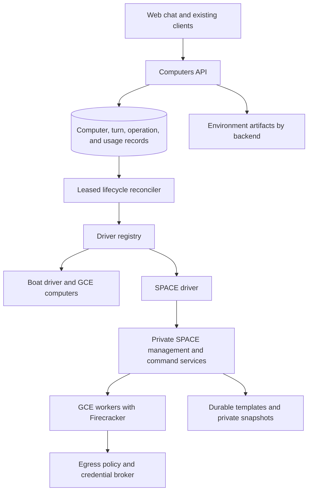

# First-class SPACE support in the Computers API

2026-10-15. Status: implementation roadmap, following the completed
[SPACE spike](space.md) in
[#11728](https://github.com/OpenAgentsInc/openagents/issues/11728).
Documentation issue:
[#11777](https://github.com/OpenAgentsInc/openagents/issues/11777).
SDK delivery umbrella:
[#11800](https://github.com/OpenAgentsInc/openagents/issues/11800); see the
[SDK issue directory](../sdk/delivery-plan.md#issue-directory).

The goal is a supported SPACE backend behind the existing Computers API:
a person starts work in a chat, gets a computer with the right development
environment, and returns to the same workspace and running processes after
suspension. Backend selection, credentials, resource limits, recovery, and
accounting stay in our services. SPACE supplies the isolated microVMs.

This document describes remaining work. It does not report a production
deployment or change the default backend. Boat continues serving existing
computers. Proposed fields and endpoints below are design examples, not
implemented API contracts. Public clients express needs and placement intent;
exact driver/deployment selection stays internal. The first public Boat SDK
flow ships independently of production SPACE support.

## Starting point and measured limits

The [spike evidence](evidence/2026-10-space-spike.json) pins SPACE to
`de87b436c35dac056564bdd5b2a113c9046e189b` and records the actual boot
mode, guest shape, sample count, and timing boundary. Each completed timing
arm has twenty sequential samples with cached template artifacts.

| Path | Guest | p50 | p90 | What the timer measures |
| --- | --- | --- | --- | --- |
| HTTP cold | 2 vCPU, 1 GiB | 2,045.8 ms | 2,095.2 ms | Create through first successful command |
| Node cold | 2 vCPU, 2 GiB | 1,673.9 ms | 1,721.6 ms | Node CLI invocation through guest readiness |
| Node snapshot | 2 vCPU, 2 GiB | 319.0 ms | 344.8 ms | Node CLI invocation through guest readiness |

The two node arms are comparable. Their timings are not HTTP command or
complete Coder turn timings. Perplexity's production latency claims are not
our acceptance evidence.

What exists:

- An optional Rust `SpaceDriver`, selected with
  `OA_COMPUTERS_DRIVER=space` when built with the `space` feature.
- Core and Suspend support, ten passing live conformance cases, mock wire
  tests, and targeted Computers API tests against disposable PostgreSQL.
- An isolated GCE setup with nested virtualization and a template containing
  Coder and Claude executables.
- A same-host suspend/wake test that preserved one process and the hash of
  its full 1 GiB buffer. Wake-to-answer took 9.293 seconds in a 4 GiB guest.
- An egress test allowing GitHub and blocking another reachable destination
  even when the guest bypassed DNS.
- Complete spike teardown. The estimated list-price resource cost was
  $0.82; this is neither a production cost model nor an actual billing total.

What remains unproved or unavailable:

- The pinned Kind HTTP create path chooses a cold boot even with a ready
  base snapshot. The fast node snapshot result does not meet the HTTP
  driver's adoption gate.
- The service selects one driver at process startup. It does not yet serve
  Boat and SPACE computers together through a driver registry.
- The template contains runtime executables, not the full development
  toolchain or a verified project environment.
- The public API used by this driver has no supported Snapshot/Fork
  creation path and no billable-seconds counter.
- Cross-host restore, durable recovery after worker loss, sustained
  concurrency, and a real web-chat task on SPACE remain untested.
- Secrets sent through stdin avoid SPACE's saved command environment, but
  this does not establish that credentials are absent from guest RAM,
  memory snapshots, application files, or logs.

## Architecture and ownership

Keep one Computers API and its existing PostgreSQL lifecycle records.
SPACE stays a separately deployed service. Do not embed its control plane,
vendor its repository, or add another product implementation language.



| Area | Implementation owner | Responsibility |
| --- | --- | --- |
| Driver contract and SPACE adapter | `crates/computer-driver` | Capabilities, effects, observations, bounded transports, and honest unknown outcomes |
| Driver qualification | `crates/computer-conformance` | Shared behavior checks and backend-specific refusal checks |
| Lifecycle decisions | `crates/coder-working-computer` | Turn ordering, checkpoint completion, stop/wake, and recovery rules |
| API, dispatch, and storage | `crates/oa-computers` | Account checks, backend binding, leases, operation records, limits, and usage |
| Environment artifacts | `crates/coder-environment-build` and existing environment owners | Build and verify compatible immutable artifacts per backend |
| Chat integration | Existing web Computers API client | Submit and observe real work without handling provider credentials |
| Infrastructure | `deploy/space-host/` and `deploy/oa-computers/` | Reproducible GCloud deployment, service configuration, upgrades, and rollback |

The [Coder 1.0 binary freeze](../coder/1.0-freeze.md) applies. Deliver this
through server and web changes compatible with released Coder 1.0.0. Keep
existing routes, required fields, error codes, and addresses working. Do not
require a new CLI flag or Coder release. If a proposed capability requires a
new frozen binary, record that portion in the existing next-release list.

## 1. Select snapshots through the supported driver path

The first technical dependency is getting fast snapshots through the same
interface that production Computers API requests use.

1. Evaluate SPACE's documented Direct deployment against the required
   management, command, template, network, and operation APIs. Do not assume
   it selects snapshots or is production-ready because the node CLI does.
2. If that path cannot provide the required behavior, maintain the smallest
   attributed upstream patch needed to select a compatible snapshot through
   the management API. Pin the source commit, patch, container digests, and
   migration procedure. Keep changes outside our product source tree.
3. Make template, shape, runtime, kernel, and snapshot compatibility explicit.
   Define whether an unavailable snapshot permits a cold boot. Record that
   fallback as cold; never label it a snapshot measurement.
4. Prebuild base snapshots for each admitted template and size. The spike's
   `small` shape uses backend defaults, while explicit `medium` and `large`
   shapes cold-boot on the pinned version. Resolve this before promising
   snapshot startup across sizes.
5. Keep upstream node CLIs as diagnostic tools. Do not implement customer
   creates by shelling out to those CLIs from the API.

Acceptance:

- Exercise create through the deployed Computers API and Rust driver, not
  only through SPACE's node interface.
- Record at least twenty cold and twenty verified snapshot creates with the
  same actual guest CPU, memory, and template. Record cached and uncached
  artifact conditions separately.
- Preserve the original target of snapshot create-to-first-command p50
  under two seconds. Report p90 and failures without discarding slow or
  failed attempts. This target excludes model inference and repository setup.
- Record API acceptance, reconciler dispatch, guest readiness, command attach,
  and first successful command separately. Tune the current polling delays
  if they dominate the result; do not spin on provider operations.
- Verify actual boot mode using provider evidence or host inspection. A
  missing or mismatched mode fails the snapshot claim.
- Exercise missing, incompatible, and corrupt snapshots, and demonstrate
  the documented fallback or refusal without duplicate computers.

## 2. Serve multiple backends through one API

Replace the single process-wide driver choice with a registry. Use the
existing stored driver identity to dispatch each computer to its backend;
add a stable deployment identity if more than one SPACE installation is
configured. A resource ID is meaningful only within that binding.

### Create and capability behavior

- Accept requirements and placement intent at the public boundary, such as
  memory-preserving suspension and `fast-sandbox`. Translate them to an admitted
  internal backend/deployment. Exact driver selection is an operator/internal
  option. An explicit fast-sandbox request either succeeds on a compatible
  sandbox backend or refuses; it must not silently create a whole GCE VM.
- Keep requests that omit the new field compatible. Start with Boat as their
  default. Enable SPACE defaults only for accounts admitted to a later rollout.
- Validate account access, backend availability, declared capabilities, size,
  environment artifact, network policy, and quota before provisioning.
- Preserve the existing capability response for older callers. Add an
  explicit way to discover per-backend capabilities and current size shapes;
  do not replace a single-driver response with a breaking collection shape.
- Report requested size and actual vCPU/memory. A backend default must not
  quietly turn a promised 2 GiB computer into a 1 GiB guest.
- Persist the chosen backend, deployment, resolved artifact, and policy with
  the computer. Reject attempts to change that binding through create retry.

A proposed additive public create request could look like this:

```json
{
  "chat": "chat-example",
  "environment": "environment-example",
  "version": "version-example",
  "size": "small",
  "placement": "fast-sandbox",
  "needs": {"memory_suspend": true},
  "egress_profile": "repository-development",
  "idempotency_key": "create-example"
}
```

These field names need validation against the existing request types and
[public Computers contract](../sdk/computers.md) before implementation. They
do not add a new required field to old requests. Retain `driver` and deployment
on internal records and authorized diagnostics, not as public create requirements.

### Persistence and recovery

- Keep create identities and backend selection stable across HTTP retries,
  account-scoped chat deduplication, reconciliation, and service restarts.
  A retry with conflicting immutable settings must not alter a live computer.
- Preserve known Boat bindings during migration. Backfill only where the
  old schema needs it; never interpret all existing rows using a new default.
- Dispatch observe, turns, files, stop, wake, meter, and delete using the
  stored binding. Never route an old computer using today's placement choice.
- If a deployment is disabled or missing, keep its records visible and
  actionable. Do not declare its computers gone or recreate them elsewhere.
- Namespace provider operation IDs and resource IDs by deployment. Preserve
  account filtering, leased work, and revision checks across every driver.

Acceptance: run Boat and SPACE computers in one service and database, restart
the service, change the default, and confirm both computers keep their original
backend and workspace. Exercise conflicting retries, an unavailable backend,
and account isolation. If automatic placement later uses a model decision,
use the existing typed Decisions API; do not route by matching chat keywords.

## 3. Build and verify backend-specific environments

Extend the existing environment build record to describe compatible artifacts
per backend. Reuse the current setup, clean-build, verification, and Save flow;
do not introduce a parallel environment product.

For a SPACE artifact, record:

- Immutable template/root filesystem identity and resolved content digest.
- Recipe revision, source pin, architecture, guest platform, and inventory.
- Released Coder runtime identity, execution harness, and required tools.
- Guest daemon version, kernel, Firecracker/runtime compatibility, and boot
  profile needed to admit or regenerate its base snapshot.
- Supported sizes, actual shapes, verification result, and snapshot readiness.
- Build and verification evidence without credentials or private command output
  leaking into reusable artifacts.

Build the full development environment needed by the selected recipe, including
compilers, package managers, Git, trusted CAs, and repository dependencies.
Preserve SPACE's required guest services. Verify a fresh computer made from the
published artifact by checking out the pinned source and doing useful work,
not just printing runtime versions.

Create must resolve a version to the selected backend's artifact before any
provider effect. An environment with only a GCE image cannot be used as a
SPACE template. Mutable tags may be an operator input, but a computer and its
base snapshot must retain the resolved immutable identity.

Reusable base snapshots must contain no customer checkout, account login,
command history, per-turn credential, or customer RAM. A private suspended
computer is a different object: it stays bound to its account and computer,
cannot seed a warm pool, and cannot become a shared environment image.

Acceptance: build and verify one real repository environment for Boat and SPACE;
refuse a missing or incompatible SPACE artifact before allocation; prove that
moving a template tag does not change existing computer identities. Exercise
version withdrawal, old guest-version refusal, and template/snapshot cleanup.

## 4. Define memory-preserving lifecycle behavior

Extend the capability declaration additively to distinguish disk-only stop
from suspension that preserves running processes. Do not redefine the existing
Suspend profile in a way that makes Boat's current behavior incorrect.

| Event | Required behavior |
| --- | --- |
| Turn completes | Keep its result and complete the configured checkpoint/stop policy before starting the next turn |
| Idle bound expires | Suspend only when no admitted activity requires the computer to stay awake |
| New turn on suspended computer | Complete wake, verify guest and command readiness, refresh credentials, then dispatch once |
| Stop during a turn | Confirm process termination or preserve an explicit unknown result; an abandoned stream alone is not cancellation |
| Service restarts | Recover operations using stored identities and observations without replaying an uncertain command |
| Worker disappears | Restore only from a verified durable checkpoint under exclusive ownership, or report the loss explicitly |
| Retention expires | Delete the computer and its private snapshots, then verify remaining resource and storage ownership |
| Absolute lifetime expires | Stop or delete according to policy; a later reconcile pass must not undo the bound by waking it |

The spike fixed an operation-ordering race: a sandbox reported its next state
before the preceding suspend teardown finished. Keep waiting for operation
completion as well as observing readiness. A failed lookup after an accepted
mutation remains unknown until inspection resolves it.

Further work:

- Define whether initial chat policy suspends after every turn or uses a bounded
  idle window. Measure that choice; 319 ms initial snapshot boots do not imply
  fast restores of a customer's large memory image.
- Treat turns, admitted detached commands, terminals, and previews as explicit
  activity sources when those features exist. A browser disconnect alone must
  neither kill work nor keep a computer awake forever.
- Set bounded restore and operation deadlines, then let the reconciler continue
  observation after a request times out. Show an actionable failure when recovery
  cannot complete; do not leave a computer appearing ready.
- Prove that cancellation terminates the command and its child processes. Record
  partial output and final state without rerunning side effects after a lost
  attachment. Qualify detached execution separately before advertising it.
- Refresh expired grants and external connections after restore. Time, DNS,
  sockets, and application services may need recovery even when RAM is intact.
- Fence worker ownership during relocation. A network partition must not let two
  restored copies execute one computer's commands at the same time.

Acceptance: preserve a process, workspace, and full 1 GiB buffer through the
Computers API stop/wake path; verify the identity and hash after wake; measure
several memory sizes. Exercise stop/wake races, queued turns, cancellation,
API process death, duplicate reconciliation, and worker loss. Cross-host restore
must pass before it is advertised. Until then, document host-loss behavior and
limit rollout accordingly.

## 5. Integrate credential references and egress policies

### Credential boundary

The current stdin transport avoids saving secret values in SPACE's command
environment. It does not prevent an agent process from holding a secret, writing
it to a file, or leaving it in pages captured by a memory snapshot. Treat private
snapshots as sensitive account data.

For general customer use, extend the driver/turn credential contract with scoped
references. The egress gateway resolves them through Google Secret Manager or
our existing credential broker and injects credentials only for authorized
destinations and operations. Qualify the Google provider; SPACE's AWS reference
integration is not evidence that this works on GCloud.

- Bind a reference to the account, computer, turn/grant, allowed host, allowed
  credential placement, and expiry. Public callers use authorized scoped handles;
  arbitrary Google Secret Manager names are not trusted authority. Check account,
  source connection, and current grant before secret resolution and at use.
  A guest cannot request arbitrary references.
- Keep real keys out of command arguments, provider session records, reusable
  templates, logs, error bodies, and measurement artifacts.
- Validate actual Claude/model and GitHub clients against the proxy, including
  TLS trust, streaming, redirects, subdomains, and Git authentication. Do not
  assume every client can use placeholder credentials transparently.
- Deny credential forwarding to redirected or mismatched origins. Define TLS
  interception exceptions explicitly; an exception cannot gain secret injection
  merely by sharing an allowed hostname pattern.
- Renew references on wake and revoke them on stop, deletion, account removal,
  or loss of permission. Test a suspended guest containing an expired handle.
- For a client that truly requires a real guest credential, document and approve
  that exception, minimize its scope and lifetime, and protect private snapshots
  accordingly. Do not claim the guest never sees secrets for that path.
- Scan fixtures, provider metadata, and test snapshots using synthetic canaries.
  An absence scan supplements the architecture; it is not proof that RAM was
  scrubbed after a secret-bearing process exited.

### Network policy

Add named egress profiles at create time, immutable for that computer. Start
with default deny and explicit development destinations. Include DNS resolution,
Git hosting, dependency registries, and chosen inference endpoints only where
the environment requires them. Record the resolved policy version with the
computer, rather than allowing edits to a shared profile to silently broaden
an existing computer's access.

Test denied literal IPs, DNS bypass, redirects, IPv6 where enabled, private
address ranges, cloud metadata, and access to other computers and management
services. A failed DNS lookup is not sufficient evidence of egress enforcement.
Keep a host-side reachable control for the denied-destination test.

Acceptance: run useful repository and agent work with real credentials remaining
outside the guest on supported paths; verify destination and account separation,
expiry, revocation, and denial bypass cases. The proxy must fail closed when its
credential provider is unavailable. Complete this before general customer access.

## 6. Operate SPACE on GCloud

The disposable Kind scripts are a reproducible experiment, not an operated
service. Create separate deployment resources with explicit ownership, budgets,
and teardown. Do not remove the spike's six-hour deletion protection and call
that a production rollout.

### Initial deployment

- Use `openagentsgemini` and initially the measured `us-central1` region, with
  nested-virtualization-capable workers and verified KVM/CPU compatibility.
  Benchmark capacity before committing to a worker shape or fleet size.
- Keep management, worker, storage, and command services private. Configure
  Cloud Run connectivity to the private service endpoints, authenticated TLS,
  and the command streaming path. Preserve the driver's origin checks and
  separate management and scoped command credentials.
- Enable the `space` feature in the production `oa-computers` image build;
  its current Dockerfile builds without that feature. Supply endpoints and
  credentials through deployment configuration and Secret Manager.
- Use dedicated service identities with minimum storage and secret permissions.
  Guests must not inherit worker credentials or reach GCE metadata. Do not reuse
  the owner's login or a broad automation key inside a worker.
- Put SPACE control data in a durable database with a backup and restore
  procedure. Decide and document its isolation from the Computers API database;
  do not treat control-plane database durability as snapshot durability.
- Keep local SSD as disposable working storage. Store templates and required
  private checkpoints durably before declaring them recoverable. Qualify the
  chosen GCloud/object-storage interface end to end; GCS compatibility with the
  selected SPACE storage API is unproved by this spike.
- Define snapshot encryption, access control, retention, deletion, and restore
  ownership. Account deletion must cover objects as well as live microVMs.

### Capacity and upgrades

- Establish CPU, memory, local disk, snapshot I/O, command-stream, and concurrent
  restore limits. Reserve headroom so a wave of wakes cannot exhaust a worker.
- Bound base-snapshot preparation and any ready pool per template and size.
  Refill gradually, limit idle spend, and retire withdrawn versions. Use only
  clean base state; never recycle a customer's suspended computer into a pool.
- Queue or refuse excess work according to policy. Publish unavailable capacity
  honestly instead of repeatedly creating resources or waiting without a bound.
- Pin SPACE and all runtime images. Drain workers for upgrades, validate guest
  and snapshot compatibility, and keep the previous deployment available until
  existing computers have a supported recovery path.
- Support disabling new SPACE creates independently of stop, wake, and delete
  for existing computers. Rolling back the default must not strand those rows.
- Record orphan ownership and periodically compare database records, SPACE
  resources, workers, disks, and objects. Unknown ownership requires inspection;
  it does not justify deleting unrelated infrastructure.

Acceptance: deploy from a commit rebased on current `origin/main`; verify running
revisions; restore the service database from backup; lose and replace a worker;
exercise storage failure, credential-provider failure, capacity exhaustion, and
an upgrade/rollback. Prove cleanup for all resources created by these checks.
Initial restricted testing can use one worker with explicit loss limitations;
general availability requires the supported durability and recovery claims to
pass, not a particular number of hosts by itself.

## 7. Add durable usage accounting and limits

`Meter.seconds` is absent for the current SPACE API. Do not substitute zero,
infer free service from a stopped guest, or charge from a single wall-clock
timer inside the API process.

Define usage events in PostgreSQL with computer, account, deployment, shape,
operation identity, observed transition time, and observation source. Retain
unknown intervals explicitly after outages. Make event insertion and settlement
idempotent across retries and restarts.

Track the costs separately:

- Running guest CPU and memory, and any reserved capacity charged by policy.
- Private snapshot and filesystem storage while suspended.
- Template/base-snapshot and ready-pool costs shared by the service.
- Worker idle capacity, network/NAT transfer, and storage operations.

Choose and document the customer-facing unit and price separately from the
provider-cost estimate. A billing boundary needs observed evidence; an accepted
stop request alone does not prove resources stopped consuming capacity. Keep
uncertain usage out of final charges until the stated settlement rule resolves
it, and do not silently free an uncertain budget reservation.

Enforce account and service quotas for computers, running capacity, stored
snapshots, turn duration, retention, and total spend. Admission must reserve
capacity or budget before a provider create. Release reservations only after
the corresponding cleanup or settlement evidence, including partial failures.

Integrate the existing plan usage and compute ledger when retail billing is
enabled. Keep existing Bitcoin payment rails. A restricted, budgeted operator
rollout can precede retail pricing; general paid persistent computers require
an explicit entitlement and billing contract.

Acceptance: reconcile observed usage through create, suspend, wake, failure,
restart, and delete; prove no duplicate settlement; test exhausted quotas and
orphan cleanup. Report both the cost per useful completed task and idle fleet
cost. The spike's $0.82 total is not an estimate of either production metric.

## 8. Qualify the complete product path

Keep driver conformance, service integration, and product checks distinct.
Passing one does not establish the others.

| Layer | Required evidence |
| --- | --- |
| Driver contract | Core/Suspend conformance; explicit Snapshot/Fork refusal; deadlines, origin checks, secret-safe errors, unknown outcomes |
| Lifecycle and PostgreSQL | Mixed backend dispatch, stable create identity, fenced effects, restart recovery, turn ordering, cleanup, usage, account isolation |
| Real SPACE service | Correct boot mode and shape, command streaming, files, process termination, suspend/wake, storage and worker failures |
| Environment | Fresh verified project build, actual tools, immutable identity, compatible base snapshots, no shared customer state |
| Web chat | A real task, visible result, follow-up on the same computer, stop/wake, and deletion |
| Released clients | Existing Coder 1.0.0 request shapes and affected commands continue working against staging |
| Operations | Capacity limits, monitoring, resource inventory, upgrade/rollback, backup restore, and cost accounting |

Run future production smokes only as the dedicated test account. Read its token
from the configured secret file without printing it. Use synthetic credentials
for leakage checks. Remove every chat, computer, project, and infrastructure
resource created by a test. Do not use the owner's account or computers.

Capture latency from the user's request through the first useful agent output,
while also reporting provisioning, repository setup, wake, command attach, and
model time separately. Retain sample counts, failures, actual boot modes, guest
shapes, concurrency, cache conditions, and p50/p90. Set additional p90, wake,
error-rate, and capacity thresholds from this evidence before broad rollout;
they are not established by the twenty-sample spike.

Monitor create/wake success and latency, operation age, unknown states, queue
depth, command disconnects, worker saturation, storage growth, cleanup backlog,
credential failures, denied egress, and account usage. Logs and metrics must
exclude secrets, private command text, and workspace contents.

Use targeted crate checks and disposable infrastructure for each implementation
change. Required affected-crate tests and formatting are enough for ordinary
issue delivery; the full release gate is not a prerequisite. Run the explicit
live scenarios above as their implementation milestones become ready. Add no
GitHub workflows or GitHub-billed automation.

## Delivery order and completion criteria

Implementation is tracked by the [SDK delivery plan](../sdk/delivery-plan.md).
Claim each issue before development and keep native blockers and project boards
current. The documentation issue tracks this roadmap only; it does not close the
remaining production work. The public Boat/client milestone is independent;
Solver/Environment migrations and deferred publication/provider/language/payment
work do not become universal SPACE prerequisites.

| Milestone | Scope and dependency | Done when |
| --- | --- | --- |
| A. Driver-path snapshot proof | Section 1; prerequisite for the startup claim | Actual Computers API snapshot creates meet the measured target at a fixed shape, with failure behavior recorded |
| B. Backend registry | Section 2; can proceed alongside A | Boat and SPACE coexist, survive restart/default changes, and preserve account and backend binding |
| C. Real environment | Section 3; uses A's chosen deployment contract | A fresh SPACE computer performs useful work from a verified environment artifact using released Coder 1.0.0 |
| D. Lifecycle and credential boundary | Sections 4–5; uses B and C | Consecutive turns, memory restore, cancellation, credential expiry/revocation, and network policy pass through the API |
| E. Restricted deployed chat | Initial section 6 deployment plus A–D and bounded usage from section 7 | The dedicated test account completes the end-to-end scenario below with Boat still available |
| F. Production qualification | Remaining sections 6–8 | Recovery, durability, capacity, accounting, rollout controls, and supported-client checks pass with recorded limits |
| G. Broader access | F plus the intended entitlement/billing contract | Account rollout expands under monitored limits with a tested rollback and support procedure |

### Implementation issue mapping

| Workstream | Issue |
| --- | --- |
| Supported driver-path snapshot boots | [#11810](https://github.com/OpenAgentsInc/openagents/issues/11810) |
| Persistent backend registry and placement | [#11809](https://github.com/OpenAgentsInc/openagents/issues/11809) |
| Verified backend-specific environment artifacts | [#11811](https://github.com/OpenAgentsInc/openagents/issues/11811) |
| Memory lifecycle, cancellation, and recovery | [#11812](https://github.com/OpenAgentsInc/openagents/issues/11812) |
| Authorized credential references and egress | [#11813](https://github.com/OpenAgentsInc/openagents/issues/11813) |
| Private maintained GCloud deployment | [#11814](https://github.com/OpenAgentsInc/openagents/issues/11814) |
| Durable usage, quotas, and uncertainty | [#11815](https://github.com/OpenAgentsInc/openagents/issues/11815) |
| Public SDK/web qualification and rollout | [#11816](https://github.com/OpenAgentsInc/openagents/issues/11816) |

The [public API/client issues](../sdk/delivery-plan.md#first-public-boat-delivery)
ship the Boat flow first. The SPACE qualification issue depends on that working
flow and the SPACE foundations; individual completed issues close independently.

### First delivery: one real chat on SPACE

1. Start a web chat as the dedicated test account and select an admitted
   repository and verified environment. The server selects SPACE explicitly.
2. Submit a real development task through the existing Computers API. Observe
   verified snapshot creation, checkout/setup, agent output, and a useful result.
3. Complete the turn and suspend according to the configured policy. Confirm
   the operation completes and accounting records the transition.
4. Send a follow-up, wake the same computer, verify its files and expected
   process state, refresh credentials, and execute the new turn once.
5. Interrupt a command and restart the Computers API service during a separate
   controlled case. Recover without duplicate side effects or a replacement
   computer silently taking the original's identity.
6. Delete the computer and test chat. Verify provider deletion, private snapshot
   cleanup, final usage, and absence of orphan resources. Remove any other test
   records and infrastructure.
7. Retain a scrubbed evidence report containing commits, runtime/template
   identities, actual shapes and boot modes, timings, outcomes, usage, and
   cleanup inventory. Record any supported limits prominently.

### Rollout and rollback

Start with explicit test-account access, then a small named account group. Keep
Boat as the default until the supported path meets the agreed acceptance
criteria. Increase admission and capacity in bounded steps using observed
latency, error rate, restore success, and cost.

Rollback disables new SPACE placement and restores the previous default. It
continues observing and serving existing SPACE computers until they are
intentionally deleted or migrated through a separately qualified process.
Changing the default is not migration. Keep storage, required credentials,
compatible worker versions, and deletion support available throughout rollback.

## Deferred capabilities and open decisions

Snapshot and Fork remain explicitly unsupported until a supported provider API
and ownership checks pass conformance. Core plus memory-preserving Suspend can
be a first-class backend without them. Interactive terminals, previews, scheduled
wake, customer-selected hosts, and a customer-facing provider picker each require
their own authorization, activity, transport, and product work; selecting SPACE
does not implicitly ship those features.

Resolve these decisions in the relevant implementation issue and record the
chosen behavior with its evidence:

- Direct deployment or a pinned minimal upstream patch for HTTP snapshot boots.
- Exact per-size template shapes, snapshot eligibility, and cold-fallback policy.
- Additive API fields and capability discovery compatible with existing clients.
- Durable storage implementation, tested recovery boundary, and acceptable
  recovery time and data loss for each advertised feature.
- Suspend-after-turn versus an idle window, and the measured wake latency target.
- Credential-provider integration and any explicitly scoped guest-secret exception.
- Capacity, queue bounds, account quotas, retention, and production latency limits.
- Accounting units, uncertainty settlement, entitlement, and retail pricing.

## Related documents

- [SPACE driver, measured results, and disposable setup](space.md).
- [Computers API and lifecycle service](computers.md).
- [Cloud computers and repository environments](managed-computers.md).
- [SPACE assessment](../research/perplexity/2026-10-15-space-assessment.md).
- [Factory plan and driver-neutral environment design](../research/factory/README.md).
- [Coder 1.0 binary freeze](../coder/1.0-freeze.md).
- [Verification scope](../verification.md).
- [SDK delivery and issue directory](../sdk/delivery-plan.md).
- [Public Computers contract](../sdk/computers.md).
