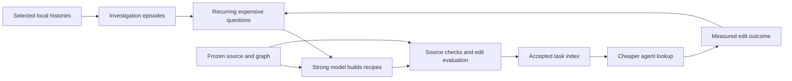

# A task index built from agent navigation

Date: 2026-10-15. Status: experimental implementation. The local history
pipeline, recipe builder, bounded lookup, optional Coder integration, edit
evaluation, and candidate selector are implemented in `crates/code-index`.
The [first edit pilot](evaluation-2026-10-15.md) passed 12/12 independent
checks and replays but found no quality or cost improvement over the cheaper
baseline. Usefulness and selector promotion gates remain unmet. Both features
stay off by default.

Implementation issues, in dependency order: #11711 (episodes), #11712
(demand), #11713 (recipes), #11714 (builder), #11715 (lookup), #11716
(freshness and publication), #11717 (Coder), #11718 (evaluation), and
#11719 (feedback and distillation). Each issue ships separately. The
[crate guide](../../crates/code-index/README.md) documents the repeatable
commands. The sections below describe the design, evidence, and conditions
for broader use; shipping the machinery does not establish its usefulness.

Build an index that answers **how to extend a capability**, alongside the
existing graph of what calls what. A strong model does the expensive work
ahead of time: it identifies extension points, distinguishes similar tasks,
connects required changes, and explains which existing implementation to
follow. A cheaper agent retrieves a short, source-backed recipe, checks its
conditions, and writes the change. When the recipe does not fit, it falls
back to exploration.

The valuable unit is a task such as “add an authored 3D primitive,” rather
than a summary of a file. Previous traces show which tasks deserve that
investment. Source and verified outcomes determine what the index teaches.

## What the existing work establishes

Three results constrain this design:

- [Code Graph](README.md) reduced total tokens for direct-caller questions
  by 63% in its [A/B](ab-2026-10-14.md), with the same file-level correctness.
  It did not measurably improve localization from issue text. The missing
  connection is from a person's task to the relevant symbols and obligations.
- [File finding](../inference/file-finding-bench.md) already combines
  identifiers, embeddings, interface strings, co-change, and similar fixes.
  Its model-written file cards and distilled tower
  [failed promotion](../inference/file-finding-bench.md#file-cards-at-index-time-and-a-distilled-tower-11249-2026-10-10).
  More summaries and a stronger encoder alone are not an established win.
- The [Haiku briefer](../inference/haiku-briefer.md) improved file recall,
  but its end-to-end pilot accepted 2/12 changes, against 6/12 with the
  existing briefing. Its shorter lists omitted needed sibling files.
  An index must preserve required companion work and measure completed edits.

Keep these three systems as baselines and reusable components. Avoid
replacing them with one unconstrained model-written graph.

## What the local histories show

The [retained census](navigation-census-2026-10-15.json) counts saved tool
calls in explicitly selected local OpenAgents histories. Its exclusive
record cutoff is `2026-10-15T00:00:00Z`, before this investigation. Repository
path filtering uses tracked paths at `59e445d5b5686f45c52ddb4e126835fef93db3d4`.

| Observation | Claude | Codex |
| --- | ---: | ---: |
| Source files with eligible calls | 194 | 28 |
| Parent / subagent source files | 25 / 169 | 28 / 0 |
| Counted operations | 23,132 | 9,942 |
| Searches | 7,266 | 2,742 |
| Reads | 5,816 | 2,213 |
| Listings and Git inspection | 427 | 423 |
| Navigation operations | 13,509 (58.4%) | 5,378 (54.1%) |
| Median navigation before first detected edit, among sources with one | 21 | 16.5 |
| Repeated navigation with the same whitespace-normalized operation text, within a source | 91 | 163 |

Claude's accepted records span September 22 through October 14; Codex's
span September 23 through October 14. The Claude root contains 208 source
files; 14 have no eligible calls. The Codex tree contains 139: 105 name
another repository, and six have no eligible calls. These are source files,
not independent tasks or successful changes.

The census recognizes Claude tool blocks and Codex function/custom-tool
records. It extracts literal shell command fields from orchestration code
without executing that code. One wrapper can contain several operations.
Shell classification uses ordered token-pattern rules; a mixed shell
command gets one category. Dynamic commands can be missed, and 364 Codex
wrappers contain no recognized literal operation. Malformed and undated
records are counted separately. No token usage or elapsed effort is
estimated. “First edit” means the first edit-like operation the heuristic
recognizes; it is not a validated first patch or a task boundary.

The high navigation share identifies an opportunity, not a waste rate.
Reading a contract, checking a change, or searching after a failed test can
be essential. Exact repeated operations account for only 0.7% of Claude
navigation and 3.0% of Codex navigation. A useful index must recognize the
same underlying question across different searches and sessions.

The workloads also differ. Frequently mentioned public paths in Claude
navigation include `crates/coder-one/src/micro.rs`, `policy.rs`, and
`micro/lean.rs`; Codex frequently mentions `crates/verse-world/src/play.rs`,
`service/net.rs`, and `service/wire.rs`. The retained artifact gives operation
counts and source-file support. These are leads for finding recurring
investigations, not evidence that any particular read was unnecessary.
Do not compare the providers' competence from these numbers.

Reproduce the census with the read-only
[`code-graph-navigation.py`](../../scripts/bench/code-graph-navigation.py):

```sh
python3 scripts/bench/code-graph-navigation.py \
  --repo "$PWD" \
  --claude-project "$HOME/.claude/projects/-home-christopherdavid-openagents" \
  --codex-sessions "$HOME/.codex/sessions" \
  --before 2026-10-15T00:00:00Z \
  --out "$(openagents scratch)/navigation-census.json"

python3 -m unittest discover -s scripts/bench -p test_code_graph_navigation.py
```

The script exports aggregate counts and paths already tracked in this
repository. It exports no prompts, command text, outputs, session IDs, or
private history paths. Its literal decoder and counting rules are research
infrastructure. Production ingestion belongs in Rust and should reuse the
existing history readers.

## The index should answer tasks at several levels

| Layer | Question | Evidence |
| --- | --- | --- |
| Structural graph | Who calls this function? | Current syntax graph |
| Capability map | Where does 3D asset authoring live? | Source, docs, and validated model annotations |
| Extension recipe | What must change to add a primitive shape? | Entry points, existing examples, companion roles, and checks |
| Investigation history | What did earlier agents search before finding this? | Local trace observations, with outcome and revision status |

The important new relationships are `implements_capability`,
`extension_point_for`, `requires_companion`, `example_of`, `verified_by`,
and `applies_when`. A recipe groups several roles into one change pattern:
the data definition, implementation, registration, consumers, and tests.
Pairwise “these files changed together” edges cannot express that all five
roles are required under a particular condition.

Separate observed facts from model suggestions. A source definition, an
observed read, a merged diff, a replayed test, and a teacher's explanation
are different evidence. A model may propose “this is the registration
point”; accepting that claim requires a source reference and an appropriate
check. Frequent reads indicate demand, not correctness.

## Worked example: registering a 3D model

“How do I register 3D models?” should return an answer even if the user
does not know the name `Pack` or `Catalog`. It also has several meanings:
introduce model data into a pack, create an authored primitive, place an
existing model, or obtain a runtime handle. Registering an inference model
is a separate task and a useful negative retrieval case.

Current source provides concrete anchors:

| Role | Existing source | What it establishes |
| --- | --- | --- |
| Model data and placement | [`Pack` and `Placement`](../../crates/verse-engine/src/assets.rs) | Models are keyed in `Pack.models`; placements name a model and transform. |
| Runtime lookup | [`Catalog::new`, `model`, and `model_asset`](../../crates/verse-engine/src/residency.rs) | The catalog validates the pack and resolves names or persistent asset IDs into runtime handles. |
| Authoring data | [`Document` and `ModelEdit`](../../crates/verse-content/src/authoring/document.rs) | Primitive geometry and edits to an existing model have different fields. |
| Authoring assembly | [`authoring::admit`](../../crates/verse-content/src/authoring/mod.rs) | Primitives compile into a cloned pack; placement, inventory, and catalog checks apply. |
| Existing example and checks | [`authored_geometry_has_world_scale_outward_faces_and_stable_identity`](../../crates/verse-content/src/authoring/tests.rs) | Existing authored geometry has a focused behavior test. |

An initial answer can present those distinct operations with their entry
points, then request a choice only if the next action depends on it. The
“add a primitive kind” recipe should identify the geometry representation
and compiler, the authoring document boundary, inventory identity behavior,
and relevant tests. The “place an existing model” recipe should point to
placement data and validation instead of telling the agent to change the
renderer. Adding a model does not by itself establish a need for a renderer
change; shader, material, or format changes need a different recipe.

These are source-grounded starting points, not a measured complete recipe.
The strong builder still needs to follow the relevant graph, inspect the
geometry implementation, and verify a representative change before the
index can claim completeness. This investigation did not identify a saved
trace of that exact user question.

## A repeatable build process



Feedback proposes the next candidate. It does not bypass validation or
turn an agent's success claim into an accepted recipe.

### 1. Freeze inputs and read histories locally

Start with explicit history roots and repository identities. Reuse
[`coder-history`](../../crates/coder-history/README.md) for bounded source
access and [`atif`](../coder/runtime/traces.md) for normalized call and
observation records. The readable history preview contains only the first
recognized tool block; mining must decode complete bounded records and
enumerate every block. Preserve unknown records and partial-tail status.

Record the source incarnation, observed byte cut, record identity, parent
session, turn, tool call ID, repository root, and base commit when known.
Deduplicate streamed/replayed calls and link subagents to their parent
task. Track tool-working-directory changes and explicit worktree identities;
a directory's name alone cannot establish repository membership. Branch
names and timestamps cannot reconstruct an exact historical tree. Unknown
revisions remain usable demand observations, not historical correctness
labels.

Keep raw histories and extracted episodes local. The user has authorized
this investigation, but a future collector still needs an explicit set of
roots and a separate disclosure choice before sending trace excerpts to a
hosted teacher. Trace text and saved shell commands are untrusted data;
never execute them to reconstruct a task.

### 2. Turn navigation into investigation episodes

Split sessions around user turns, delegated tasks, first patches, failed
checks, and explicit completion. Compaction and idle gaps alone do not mean
a new task. Keep navigation before the first edit separate from searches
after a test failure. Do not count waiting for a build as repository search.

Each episode should retain the question, searches, inspected spans,
candidate paths, first relevant hit when independently known, patch,
checks, and outcome. Mark missing fields instead of guessing them. Separate
tool execution time, model-response time, queue time, and human idle time.
Measure tokens from provider usage records with their actual cumulative or
per-call semantics; never sum a repeated cumulative counter.

Use deterministic features first: distinct paths, repeated searches,
directory switches, source bytes, broad-to-narrow search sequences,
read-to-edit distance, and navigation outside the supplied briefing.
A later semantic pass groups variants such as “add a new model,” “where
are meshes listed,” and “register GLB content,” while retaining separate
operations when their answers differ.

Ask a strong model to explain a bounded episode's task and useful discovery,
not to summarize every conversation. Extract the shortest supported route
from the question to the useful entry points. Preserve failed approaches
as dated observations; promote a warning about them only when the relevant
failure is verified.

### 3. Rank questions worth compiling

Prioritize recurring tasks with high measured navigation cost, stable
extension points, a plausible reusable answer, and an affordable verification
path. Group near duplicates across parent and delegated sessions before
counting support. One 100-agent experiment must not appear as 100 independent
requests. Keep rare tasks involving broad companion changes in the candidate
set even if frequency is low.

An initial priority calculation can use estimated future demand multiplied
by avoidable cost per use and probability of a valid reusable answer,
minus build, verification, and expected refresh cost. Every estimate needs
its observation window and uncertainty. First measure the small top group;
do not run a strong model over the entire repository because it is available.

The initial census does not estimate avoidable cost or semantic clusters.
Those are the first measurements this stage must add.

### 4. Have the strong model compile source-backed recipes

Give the builder a frozen repository snapshot, the task cluster, graph
results, file-finder candidates, current docs, and a bounded reading budget.
It can explore more deeply than the serving agent. Require structured
output whose paths and symbols come from supplied candidates or separately
validated source reads.

Each recipe needs:

- A capability, operation, description, aliases, and explicit exclusions.
- Applicability conditions and bounded questions that distinguish variants.
- Required change roles, optional roles, and conditions for companion work.
- Symbol and source-span references, with the repository and content digests.
- Existing examples, including which behavior makes each example relevant.
- Suggested new-file locations and their module/export integration points.
- Relevant checks, what they establish, and what remains unverified.
- Evidence class, builder inputs, model revision, prompt version, and dependencies.

The strong model's reasoning becomes a reusable explanation of relationships
and conditions. It should not become a rigid patch template or a copied
transcript of the original agent's route.

### 5. Validate and compile the candidate

Resolve every cited path, item, and span against the frozen tree. Verify
the quoted evidence and reject invented symbols. Use source-backed rules to
check that declared role relationships exist. A second model can challenge
semantic claims, but agreement between models does not replace source or
behavior checks.

For reusable edit recipes, run a representative change in an isolated
worktree and check its behavior with the affected crates' targeted tests.
Only replay commands from an explicit check specification; never execute
shell text recovered from a conversation. Reuse the distinctions in
[verify-replayed traces](../coder/traces.md): reported success and teacher
opinions stay separate from diff- and test-backed labels. A merged patch
is a useful example, not proof that its listed files are a minimal or
complete recipe for every similar task.

Compile accepted records into a versioned typed artifact and search indexes.
Use deterministic sorting, schema validation, and immutable object storage.
Record source, dependency, vocabulary, prompt, model, and response digests.
The model extraction itself is not guaranteed deterministic: rebuilding
from the same frozen model responses must give the same artifact bytes;
fresh model responses create a new candidate to evaluate.

### 6. Serve a bounded lookup to the cheaper agent

Retrieve candidates with lexical search, embeddings, known identifiers,
and existing file-finder results. Query the capability map and extension
recipes before expanding the structural graph. Return a small set of
applicable recipes with their required roles, examples, and source spans.
Budget results by rendered tokens and required-role coverage, rather than
forcing every task into a fixed number of files.

The first implementation should use one typed lookup, conceptually
`code_lookup(question, operation, revision, budget)`. Its result includes
`matched`, `ambiguous`, `stale`, or `no_match`; candidates; resolved roles;
evidence references; omitted roles; and a recommended next lookup. These
names and fields are proposed, not existing tools.

An optional decision step can rank the retrieved candidates, select an
operation, or check whether the available evidence covers it. TypeSafe's
[reranking](https://docs.typesafe.ai/cookbooks/rerank_typesafe),
[hierarchical classification](https://docs.typesafe.ai/cookbooks/hierarchical_classification),
and [citation checks](https://docs.typesafe.ai/cookbooks/citation_check)
provide relevant patterns. These are design references, not measurements
on this workload. Keep candidate generation in code; a model cannot select
an omitted answer. Include no-match behavior, batch independent judgments,
and choose confidence thresholds on development data.

The cheaper coding model reads the resolved source, implements the change,
and runs appropriate checks. It still needs programming ability. The index
is intended to remove repeated repository discovery and wiring inference.
Recipe mismatch, incomplete role coverage, stale dependencies, and failed
checks trigger graph exploration or a stronger-model escalation. Measure
these fallbacks instead of hiding them as lookup successes.

### 7. Refresh only affected knowledge

Use content-addressed semantic records alongside the deterministic graph;
do not bake model calls into the graph extractor. Graph node numbers are
local to a build. Bind references through repository identity, qualified
item, kind, path, source digest, and an explicit resolution check. Keep
line numbers as display locations. A rename can propose a successor match,
but cannot silently preserve a semantic claim.

Track dependencies for every claim and applicability condition: referenced
items, schemas, registration containers, sibling-discovery queries, examples,
and checks. A new implementation or companion file can invalidate a recipe
even when its cited function did not change. Re-run discovery queries and
compare their results; negative claims need a defined search scope. Changes
to crate structure, docs, feature flags, and test specifications can matter
without changing a cited Rust body.

On each main revision, carry forward claims whose dependencies still
validate, queue affected recipes for repair, and mark pending ones stale.
For dirty worktrees, invalidate impacted semantic results using changed
paths and graph impact. Return the usable partial answer and its coverage,
or fall back. Do not rebuild the entire semantic index on the query path.

The existing graph publisher can later publish a separately versioned
semantic artifact, with one writer and a last-known-good pointer. Keep the
original deterministic graph independently usable. No GitHub workflows are
needed. Roll back by restoring the previous admitted semantic artifact.

## Separate private discovery from public repository knowledge

Maintain a local trace overlay and a public source-backed index. The local
overlay can retain private task phrasing and episode references under the
owner's selected roots. A public recipe must be independently supported by
public source, docs, and publishable examples. Rebuild its explanation from
that evidence; removing names from a private conversation is insufficient.

Do not publish raw prompts, commands, outputs, reasoning, private repository
paths, or credential-bearing trace fragments. Keep private object identifiers
and their maps local. Repository identity and workspace scope must be part
of every cache and retrieval key. Removing a selected history source must
remove its private derived records and queue dependent claims for review.

The committed census is deliberately narrower: aggregate counts and tracked
public paths. No raw history or private episode dataset belongs in this repo.

## Evaluate cheaper-agent capability before promotion

Freeze task-family groups and chronological cutoffs before mining or
building recipes. Parent sessions, delegates, retries, paraphrases, and
related issues belong to the same group. Index construction cannot read
evaluation traces, later fixes, later docs, or future commits. Historical
evaluation must build from the information available at that historical
cutoff. If a trace cannot be bound to a revision, use it for demand analysis
outside that replay rather than inventing a base commit.

Use two distinct evaluations:

1. **Previously seen operation, new task.** Can a recipe built from older
   examples help with a new instance of that operation?
2. **Unseen operation.** Does the capability map help discover a new pattern,
   or does the system abstain and fall back appropriately?

Include explanation-only questions and actual coding tasks: adding a
registry entry, an asset type, a CLI operation, a protocol field with several
consumers, a new file with module wiring, and a changed registration API.
Include ambiguous “model” queries, removed examples, stale recipes, absent
capabilities, and instructions embedded in traces. For each coding task,
define required behavior and checks independently of the recipe builder.

| Arm | Purpose |
| --- | --- |
| Strong agent with current tools | Quality and cost reference |
| Cheaper agent with current finder and graph | Deployment baseline |
| Cheaper agent plus file summaries/cards | Does task structure add value beyond summaries? |
| Cheaper agent plus capability map | Value of semantic localization |
| Cheaper agent plus verified recipes | Value of companion roles and examples |
| Cheaper agent plus human-reviewed complete recipe | Diagnostic upper bound when automatic construction fails |

The same cheaper agent needs enough tool access to recover in every arm.
Keep model, task snapshot, limits, context budget, and check specification
fixed within comparisons. Record seeds, repeated trials, and all failures.
Use paired uncertainty estimates grouped by task family, not by tool call.

Primary measures are accepted behavior, missing companion changes, and total
cost per accepted task. Report navigation tokens and source bytes, time to
first useful edit, total latency, citation validity, stale-answer rate,
abstention coverage, and escalation rate. Account for new-file placement
separately; existing-file recall cannot score a file that does not yet exist.
Fewer reads or a convincing answer are insufficient promotion criteria.

Count the strong builder, verification, embeddings, serving, refresh, and
escalation in the economics. The amortized cost per accepted task is total
build and refresh cost plus all serving and fallback cost, divided by
accepted tasks. Use measured future reuse to estimate break-even; do not
assume every historical read disappears. A cheaper model with frequent
escalation can cost more than the strong baseline.

Distillation comes after this comparison succeeds. Train a small retriever
or role selector on training-group questions and verified targets, with
teacher judgments stored separately from outcome labels. First establish
that complete recipes help; then establish that automatic building produces
them; only then optimize selection or teach a smaller model to reproduce
parts of the lookup.

## Delivery roadmap

These are sequential deliverables, not promised durations. Keep each
candidate off by default until its own checks and measurements pass.

| Step | Deliverable | Exit condition |
| --- | --- | --- |
| 0. Establish a baseline | The retained census, synthetic parser checks, and a frozen measurement definition | Counts are reproducible within the declared history cut; limitations are explicit. This investigation supplies the initial version. |
| 1. Mine episodes | Rust extraction over `coder-history`/ATIF, local episode store, task grouping, and complete usage accounting | Sampled episodes match raw records; missing revisions and unknown records are explicit; delegates do not inflate task support. |
| 2. Test recipe usefulness | A small human-reviewed set across 3D authoring, registry/CLI wiring, and cross-client changes; approximately 20 recipes is a pilot size | The cheaper agent completes representative edits; omissions and ambiguity are measured against current tools and a strong reference. |
| 3. Automate construction | A strong-model builder with bounded reads, source validators, versioned outputs, and replayable frozen responses | Automatically built recipes approach the reviewed pilot on held-out tasks; invented references are rejected. |
| 4. Serve and invalidate | A Rust typed lookup, Coder integration, private overlay, public artifact, and dependency refresh | New code, moved symbols, changed examples, and dirty worktrees produce correct refresh or visible fallback. |
| 5. Gate deployment | Chronological paired end-to-end trials with complete build/refresh cost | Predeclared quality tolerance and cost targets pass with uncertainty reported; failures remain available; rollback works. |
| 6. Improve incrementally | New task clusters from lookup misses and expensive fallbacks; optional distilled selector | Each promoted candidate passes the same held-out gate; locked evaluation groups never become learning feedback. |

Use a separate Rust build/serving crate for the proposed semantic index so
the deterministic `code-graph` crate remains usable without model calls or
private history access. Reuse existing graph queries, repository identity,
file-finding candidates, history readers, and trace replay contracts. Python
can remain measurement infrastructure; application behavior belongs in Rust.

The first substantive experiment should be the reviewed-recipe arm. It
isolates the central hypothesis: whether moving a strong model's repository
understanding into a reusable, complete task recipe lets a cheaper model
make the same correct change. If that fails, a larger automatic knowledge
graph is not the next investment.
