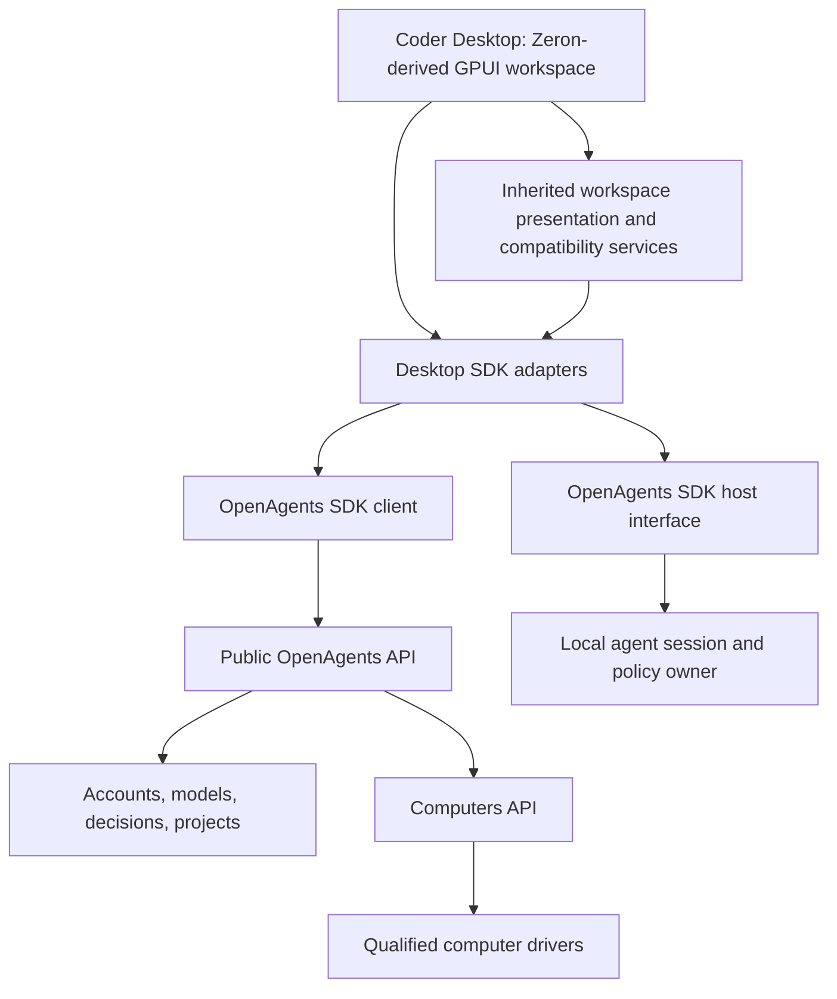

# Coder Desktop: a Zeron fork and the first OpenAgents SDK reference client

2026-10-15. Status: owner-directed product and integration plan. The fork
exists at [OpenAgentsInc/coder-desktop](https://github.com/OpenAgentsInc/coder-desktop),
with Zeron as its `upstream` remote; SDK integration is pending. Coder
Desktop is the first external reference application for the OpenAgents SDK.
This document records the direction and delivery criteria. It does not report
a published SDK package, working integration, or released application. The
owner's decisions and local setup are in the [folder index](README.md).

The owner selected the product name **Coder Desktop**, a separate repository,
and permission to use languages other than Rust there. The OpenAgents SDK is
Rust first, with TypeScript when a real consumer needs it. The existing
OpenAgents repository keeps its Rust-only product contract.

Read this with the [SDK overview](../sdk/README.md), [Computers contract](../sdk/computers.md),
and [SDK delivery plan](../sdk/delivery-plan.md). Those documents own the shared SDK
and service work, tracked under
[#11800](https://github.com/OpenAgentsInc/openagents/issues/11800). This document
owns the desktop's use of those contracts and its migration from Zeron.

## Product direction

Use Zeron's integrated coding workspace as the desktop foundation: conversation
navigation, file exploration and editing, Git and pull-request views, terminals,
browser previews, media, provider controls, and appearance settings. Preserve
working upstream features while connecting OpenAgents through the SDK.

The result should demonstrate how an independent developer builds a complete
agent application on OpenAgents. Another developer must be able to reproduce
the integration from the SDK, public contracts, and example code without
access to our monorepo internals, service credentials, or private endpoints.

This changes the proposed implementation route for the new coding desktop.
The earlier [Zeron gap analysis](../research/zeron/README.md) remains a useful
workflow and verification checklist. Reimplementing every Zeron surface in the
existing OpenAgents desktop renderer is no longer this project's default path.
This decision does not retire the existing OpenAgents desktop, migrate its
users, or replace the phone apps; those need their own delivery decisions.

## Why a fork fits

The inspected upstream baseline is Zeron `v0.2.113`, commit
`6ac8859998909bc5afd55838afb0635c281f31c3`. Its application license is
[MIT](https://github.com/zeronsh/zeron/blob/6ac8859998909bc5afd55838afb0635c281f31c3/LICENSE).
Keep copyright, permission, and applicable third-party notices with the fork.
Review the selected dependency and asset versions before distribution; the
application's license does not replace their terms.

Zeron supplies a Rust desktop and engine, GPUI-based workspace surfaces, typed
RPC, provider adapters, and local profiles that can operate without a Zeron
account. These are substantial reusable application foundations. Its UI also
depends directly on engine, protocol, document, and harness types: replacing
the engine is a migration project, not a base-URL change.

The separate repository can retain useful upstream TypeScript services,
JavaScript helpers, and Luau visual support. There is no requirement to rewrite
them in Rust to satisfy this repository's contract. That permission does not
require a TypeScript desktop rewrite or a second implementation of SDK policy.
The GPUI application should consume the Rust SDK first. Any TypeScript client
uses the same public schema and supported behavior.

Source review and Cargo workspace metadata validation establish a plausible
integration path. They do not establish a successful application build, native
feature coverage, live-provider compatibility, or a delivery-time estimate.

## Repositories, languages, and dependencies

| Area | Home and responsibility |
| --- | --- |
| Coder Desktop | [`OpenAgentsInc/coder-desktop`](https://github.com/OpenAgentsInc/coder-desktop), forked 2026-10-15. Owns the Zeron fork, GPUI application, product branding, packaging, native integration, and SDK adapters. |
| OpenAgents SDK and public services | This repository initially owns the Rust API/client work, public schema, service implementations, and existing host/provider components. Keep reusable behavior here and application behavior in the fork. |
| Rust SDK dependency | Consume a documented exported boundary at an immutable revision or version. Before package publication, a pinned Git dependency or versioned source release is acceptable if a clean outside checkout can build it. |
| TypeScript SDK | Generate the HTTP bindings from the same OpenAPI when a concrete desktop helper, service, example, or other client needs them. Repository/package location and publication remain the decisions in [#11821](https://github.com/OpenAgentsInc/openagents/issues/11821). |
| Upstream dependencies | Pin Zeron, its GPUI fork, component library, native runtimes, and provider integration versions. Keep a small patch log and repeatable update procedure. |

The SDK's `openagents` facade and module names remain packaging goals until
[#11805](https://github.com/OpenAgentsInc/openagents/issues/11805) resolves naming
and dependencies. Do not promise a crates.io or npm package that does not exist.
The desktop must not depend on a sibling checkout, private Rust modules, or an
unpublished developer-only patch. Implementation crates may remain internal
dependencies of the SDK; the application imports the documented SDK surface.

## One SDK family, three different roles

| SDK part | Coder Desktop's use | Boundary |
| --- | --- | --- |
| Client | Authenticate, discover supported resources, use models and decisions, manage computers, transfer files, and observe commands. Add projects and other domains as their public contracts become ready. | Public, account-authorized API at `https://api.openagents.com/v1`; no internal lifecycle or provider credentials. |
| Host | Run local agent sessions with shared hooks, capabilities, observations, input requests, cancellation, and resource handling. This is the evolution of today's Coder SDK. | A documented SDK interface for embedded/local execution, with its own version and capability policy. A network client is not automatically a session host. |
| Provider | Usually no direct desktop role. A selected computer may be served by Boat, SPACE, or an enrolled machine. | Drivers, deployment configuration, and conformance stay behind the Computers API. A desktop must not call Boat or SPACE directly to fill a public API gap. |

OpenAPI describes the network client. It does not generate Rust host callbacks,
provider traits, or a TypeScript implementation of execution policy. If an
additional language needs host bindings, specify and test that boundary
separately instead of claiming generated HTTP bindings provide it.

Coder Desktop is the first application deliberately developed as an external
reference consumer of the unified SDK. The already-tracked web migration and
Boat proof in [#11806](https://github.com/OpenAgentsInc/openagents/issues/11806)
remain required SDK validation. Desktop integration can start against the client
from #11805 without waiting for the web migration, SPACE, all-route OpenAPI,
or package publication. It does not add a new desktop-release blocker to the
existing SDK M1 milestone.

## Integration architecture

Use Zeron's engine/RPC boundaries as migration seams. Initially keep its
workspace services and explicitly identified native-provider mode working.
Add an OpenAgents adapter rather than replacing every engine handler at once.
For each migrated feature, the adapter becomes the sole route to its SDK
operation. Inventory remaining upstream paths so the application cannot claim
SDK coverage for functionality that still bypasses it.

Local workspace presentation, text editing, layout, and native capture remain
application concerns. OpenAgents-backed operations use the SDK. Remote file
bytes, commands, and session controls always go to the selected owner; a path
that happens to exist on the viewing machine is never a remote fallback.

### Ownership decisions before the first agent integration

| Concern | Required owner and desktop behavior |
| --- | --- |
| Account and workspace | The SDK/public service resolves current authority. The desktop stores the selected account/workspace and invalidates old asynchronous results when either changes. |
| Computer allocation | The public Computers service owns allocation, placement, operations, and usage. The desktop keeps resource/operation handles and displays accepted versus ready state. |
| Repository and checkout | Assign one checkout owner per execution mode. Zeron and Coder must not both create a worktree for one send. File, Git, and terminal views bind to the checkout that actually runs the task. |
| Agent session and turn | The selected host/session service owns execution. The desktop records the mapping between its conversation and the SDK's session/task/turn identities. A model response is not by itself a durable coding session. |
| Queue and delivery | Choose one authoritative command queue for an OpenAgents-managed conversation. A Zeron document can cache display state, but cannot independently dispatch the same accepted message. Persist retry handles across restart. |
| Questions and approvals | The execution owner creates and validates requests. The UI presents and answers them through SDK controls; it does not recompute permission policy or treat an unanswered request as approval. |
| Transcript and child activity | The execution owner supplies ordered observations and replay. The desktop derives presentation with stable item/child identities, bounded caches, and explicit history gaps. |
| Files, artifacts, and saves | The owning workspace service validates paths, references, revisions, and writes. The editor retains dirty text and uses expected-content checks; a failed or uncertain save cannot discard newer edits. |
| Review and publication | Preserve exact reviewed revisions and existing publication checks. General Git actions and pull-request comments need their own authority and explicit user actions. |
| View lifetime | The desktop owns focus, selection, rendering, media capture, and view disposal. Closing a view detaches observation; stopping a command or agent is a separate operation. |

An SDK-backed `Harness` adapter is a useful initial Zeron integration point,
but it is not the complete migration. Check the engine worktree creation,
command ledger, resume, attachment, and shutdown behavior around that adapter.
Mapping a prompt and text stream alone does not satisfy the ownership table.

## Public contracts the desktop will exercise

The first useful target is SDK authentication, existing account chats in the
sidebar, and complete saved-history loading (#11824). The account-authorized
computer workflow follows. Broader agent, editor, and remote workspace parity
follows as the corresponding SDK contracts become available.

| Desktop workflow | Existing work or dependency | Remaining desktop/SDK requirement |
| --- | --- | --- |
| Sign in and discover the account/workspaces | Existing website/device auth; #11825, #11826, #11829 | Export the public Rust SDK, isolated OS credential storage, restart validation, expiry/revocation, account switch, and typed refusals. Key prefixes alone never grant compute access. |
| List and open previous chats | Existing `/v1/threads` and message reads; #11827, #11828, #11830, #11831 | Complete paging, saved files/tool/thinking content, archive/shared-project access, and read-only GPUI presentation without creating execution state. |
| Create/list/stop/wake/delete a computer | [#11801](https://github.com/OpenAgentsInc/openagents/issues/11801), Rust client [#11805](https://github.com/OpenAgentsInc/openagents/issues/11805) | Retained request identities, bounded waits, readiness/error UI, and deletion confirmation. |
| Execute and follow a command | [#11802](https://github.com/OpenAgentsInc/openagents/issues/11802) | Identified command creation, attachment/replay, bounded output, explicit cancellation, and recovery from uncertain dispatch. |
| Read and write computer files | [#11803](https://github.com/OpenAgentsInc/openagents/issues/11803) | Owner-routed transfer and editor-safe concurrency. Generic upload/download does not by itself supply listings, indexed search, watches, atomic save, or conflict handling. |
| Understand capabilities and placement | [#11809](https://github.com/OpenAgentsInc/openagents/issues/11809) | Requirements and meaningful availability; refuse unsupported placement before effects. Typed placement judgments follow deterministic eligibility checks. |
| Run a local agent with SDK controls | Completed Coder integration [review](../research/zeron/coder-sdk-integration.md); host boundary [#11819](https://github.com/OpenAgentsInc/openagents/issues/11819) | External packaging plus complete session, observation, approval, resource, and cleanup mapping. Existing internal crates are reuse evidence, not a stable public SDK. |
| Use models and general OpenAgents chat | Existing compatible model API; broader SDK client domains | Add a reference use of the SDK where appropriate. Distinguish model streaming from proposed durable messages/sessions; do not assume proposed chat APIs are live. |
| Use projects, Git, PRs, PTYs, or previews remotely | Existing application-specific services and Zeron UI; broader API work [#11818](https://github.com/OpenAgentsInc/openagents/issues/11818) | Document and implement reusable public capabilities before migrating each workflow. A command output stream is not an interactive PTY or an HTTP/WebSocket preview tunnel. |
| Choose SPACE or an enrolled own machine | SPACE qualification [#11809](https://github.com/OpenAgentsInc/openagents/issues/11809)–[#11816](https://github.com/OpenAgentsInc/openagents/issues/11816); own machines [#11817](https://github.com/OpenAgentsInc/openagents/issues/11817) | Consume actual declared capabilities. Boat works first; neither path blocks the initial desktop integration. Own-machine delete detaches access rather than deleting the person's files or stopping their computer. |
| Inspect cost or answer a payment request | Usage [#11815](https://github.com/OpenAgentsInc/openagents/issues/11815); optional payments [#11822](https://github.com/OpenAgentsInc/openagents/issues/11822) | Show unknown cost honestly. Default clients return typed 402 results without spending; payment requires explicit opt-in and caps. |

If a workflow lacks a public contract, record a narrowly scoped SDK/API
requirement in the shared delivery backlog. Do not add a desktop-only private
endpoint or embed a provider/service bearer as a shortcut. Retain a working
upstream local workflow when appropriate, or leave the unsupported action
unavailable with useful feedback.

## Local use, remote use, and identity

Keep a local coding workspace useful without an OpenAgents account when the
selected local provider permits it. Public OpenAgents resources require the
supported account authentication and current grants. A local profile does not
silently become a synced account profile on sign-in.

Replace Zeron production defaults for authentication, hosted sync, telemetry,
release feeds, and external product links in the fork's own operating mode.
An upstream sync backend can remain reference or compatibility code; it must
not become a second authority for OpenAgents computers, sessions, or billing.
There is no requirement to deploy Zeron's TypeScript edge service to reach the
first public SDK milestone.

Own the application's data root, IPC identity/port, bundle/application IDs,
URL scheme, keychain entries, device identity, and update channel separately
from both installed Zeron and the current OpenAgents desktop. Do not
automatically adopt another application's login, session database, or running
daemon. Any later import is an explicit, versioned operation with a rollback
and attachment/session identity checks.

Never ship internal lifecycle tokens, cloud-provider credentials, or test
credentials in the desktop. Credential handles must carry actual account and
destination authority. The SDK and UI must describe guest credential limits
honestly: passing a key in memory does not prevent an agent, log, file, or
memory snapshot from retaining it.

## Preserve and reuse existing work

The seven completed [Coder SDK integration slices](../research/zeron/coder-sdk-integration.md#small-implementation-slices)
and [conversation file tabs](../research/zeron/delivery-plan.md#conversation-file-tabs)
remain implemented work in this repository. Reuse their domain contracts,
owner checks, observation fixtures, retry tests, resource identities, and
document-state lessons where they fit the exported SDK boundary.

Their Rust Native views do not render directly in GPUI. Retain the Zeron
presentation that already supplies the target workflow, then map SDK data and
actions into it. Do not move the whole `openagents-desktop` application into
the SDK or count a monorepo-only integration as an external consumer.

Preserve OpenAgents behavior that the fork does not supply automatically:
general chat and coding handoff, durable task controls, execution policy,
trace access, exact-review publishing, and existing host authority. Broader
OpenAgents-only surfaces and phone interoperability need explicit product and
contract milestones; a desktop fork does not migrate them by implication.

## Delivery sequence and exit criteria

These are desktop implementation slices. Track shared and desktop issues in
`OpenAgentsInc/openagents` (owner, 2026-10-15); implement application changes
in the fork. #11824 and its children track the first authentication/history
milestone. The later D2–D6 slices retain their existing delivery criteria.

| Stage | Work | Exit criterion |
| --- | --- | --- |
| D0: establish the fork | Pin upstream, preserve notices, establish Coder Desktop identity, separate local state and update settings, and document the inherited platform matrix. | A development build opens a synthetic local workspace on the first supported OS without touching Zeron/OpenAgents user state or relying on Zeron's production services. Record which upstream features actually work. |
| D1: consume the Rust SDK externally | Start with auth/history exports in #11826/#11828, independently of Computers #11804/#11805. Use a pinned dependency in the separate checkout and test public reads with fixtures. | A clean checkout builds without sibling paths, server internals, provider credentials, or private patches. The application uses actual exported SDK types and typed errors. |
| D1a: sign in through the SDK | #11825, #11826, #11829: browser-approved device login, isolated account/session storage, restart validation, and sign-out. | The existing account is visible in an independent macOS development build, with expiry/revocation and account switching handled. |
| D1b: browse existing chats | #11827, #11828, #11830–#11832: sidebar and complete saved transcript reads. | Existing account chats, including long histories, saved files/tool details, archive and authorized shared-project access, load through the SDK; no execution starts. |
| D2: prove one computer workflow | Create a Boat computer, upload a fixture, create/attach a command, inspect its output and file, stop/wake, and delete through the SDK. | One independent client completes the public workflow. Response loss, reconnect, conflicting retry, account isolation, and cleanup are checked. The existing web proof remains independently required for SDK M1. |
| D3: integrate one agent session | Choose one exercised host/backend, settle the ownership table, and map configuration, streaming, questions/approvals, continuation, stop, children, and resources into the inherited UI. | One task runs end to end with the intended checkout and session identity. Stale approvals, lost acknowledgments, stop cleanup, resume failure, and late old-account events are handled without duplicate execution or lost drafts. |
| D4: connect the coding workspace | Route editor, search, Git/review, terminal, PR, and preview operations through the supported owner services one workflow at a time. Retain inherited local functionality during migration. | Each claimed SDK-backed surface has a documented contract and negative-case evidence. Saves retain edits through conflicts; publication checks the reviewed revision; hidden surfaces release work. |
| D5: expand backends and language examples | Repeat supported scenarios on qualified SPACE and enrolled machines; add a TypeScript example only when a concrete consumer needs it. | Capability refusals are accurate, own-machine detach is non-destructive, and Rust/TypeScript network clients agree on the same schema, retries, streams, and errors. |
| D6: qualify distribution and maintenance | Establish native platform checks, upstream update procedure, migration behavior, signing, and the fork's own update path. | Install/update/reopen/sign-out and representative workspace journeys pass for each claimed OS/provider combination, with bounded resource use and recorded limitations. |

D0 and fixture-driven SDK adapter preparation can proceed while the public
API/client is built. D2 requires the relevant public lifecycle, commands,
files, and specification work; it does not wait for SPACE or a stable host SDK.
D3 requires the needed host/session contract, but does not require all nine
upstream providers to be migrated first. Publication and broad production
access retain their existing activation conditions.

## First reference scenario

The first externally reproducible SDK example is authentication and history
(#11832): approve device sign-in in the website's system-browser flow,
discover the existing account, list every available chat page, open a saved
chat and page its messages/files, then sign out. Reopen the app to verify
session restoration before sign-out, and use another synthetic account to
check isolation. This example is independent of GPUI, Computers, host execution,
and package publication. The SDK delivery plan records current route limits
and the eight implementation issues. App/session expiry has no refresh-token
promise; transient outages are distinct from invalid credentials.

The next example is the D2 computer workflow, followed by D3 agent execution.
Keep each example independent of GPUI so developers can understand SDK use
without reading the desktop application.

1. Select an authorized account/workspace and an immutable environment.
2. Request a supported computer with one retained logical create identity.
   Show allocation progress separately from readiness.
3. Upload a small source fixture, create an identified command, and attach
   without losing early output. Reconnect to that same command after a forced
   stream interruption.
4. Read the resulting file through the owner, stop/wake the computer, and
   confirm the file still belongs to the same workspace.
5. Repeat the user-visible agent flow on one supported session path: stream,
   answer input, stop, continue, inspect changed files, and review the result.
   Report D2 and D3 evidence separately until both are supported.
6. Delete the test computer and confirm guest, disk, process, account-record,
   and private-state cleanup applicable to that backend.

Retain the SDK revision, schema revision, application revision, environment,
backend capabilities, outcomes, and cleanup inventory. Use fixtures and fake
providers first; live checks use dedicated test accounts and disposable
computers, never the owner's production account or personal machines.

## SDK quality demonstrated by the client

- **An external build:** SDK use succeeds outside this workspace and does not
  compile host harnesses, provider services, or database code for a client-only
  dependency.
- **One network contract:** generated types match implemented OpenAPI;
  ergonomic Rust helpers add waits, streaming, and recovery without inventing
  unserved fields. Later TypeScript clients share the same fixtures.
- **Stable effects:** creates, commands, and any paid operation retain logical
  identities across retries and restart. A disconnected stream does not mean
  execution stopped, and an unknown result does not justify another send.
- **Account isolation:** reads, output attachment, resources, credentials, and
  callbacks respect the current account/workspace and grants. A second test
  account cannot reuse another account's IDs or attach handles.
- **Usable desktop behavior:** conversation switches, dirty files, queue edits,
  permissions, child views, and reconnect preserve the intended draft, task,
  checkout, and focus. Unsupported controls are not exposed as placeholders.
- **Independent documentation:** a small example and supported API reference
  reproduce the integration without undocumented desktop privileges.

## Release and maintenance boundaries

Keep the [Coder 1.0 freeze](../coder/1.0-freeze.md) intact. Creating this plan
does not authorize a new `coder`, `openagents`, `microcoder`, or
`coder-boundary` release. Client/desktop development and compatible server work
can progress independently. Changes requiring new installed host/CLI behavior
remain with [#11823](https://github.com/OpenAgentsInc/openagents/issues/11823)
and the next-release process.

The separate desktop provides the first planned external host consumer. It
does not by itself establish both non-Coder consumers required by
[#11819](https://github.com/OpenAgentsInc/openagents/issues/11819), establish
a stable public host API, or authorize package publication. Version-pinned
development consumption and publication are different milestones.

Keep application release decisions separate from SDK publication and backend
activation. Rust package publication, TypeScript package/repository choice,
retail compute pricing, automatic payments, external providers, and migration
of existing desktop users retain the decisions recorded in the shared SDK plan.

Maintain a small downstream change set and review upstream changes against
the SDK adapters, account boundaries, and application identity. Reproduce
native failures rather than assuming an inherited feature works on every OS.
Run relevant Rust, TypeScript, native, and packaging checks in the fork's own
toolchain. Add no GitHub workflows or GitHub-billed automation as part of this
work; use contributor or other non-GitHub infrastructure.

## Immediate next work

Deliver #11824 first: D0 isolation, D1 external SDK packaging, D1a sign-in,
and D1b previous chats in the sidebar with complete saved-history loading.
Start #11825/#11827 for public auth/history contracts, then the SDK and fork
adapters. Reuse `openagents-login`, the account service, and the existing chat
store; preserve the same account/chat IDs. Keep all tracking issues here and
application patches in the fork. After that milestone, use #11801–#11805 for
the D2 Computers prerequisites and #11819 for host-boundary preparation.

The prototype should answer whether the exported SDK can power a useful
desktop workflow with a small adapter while preserving Zeron's workspace.
Judge that result from an external build and the complete user journey, not
from a rebranded screenshot or a successful login call alone.
