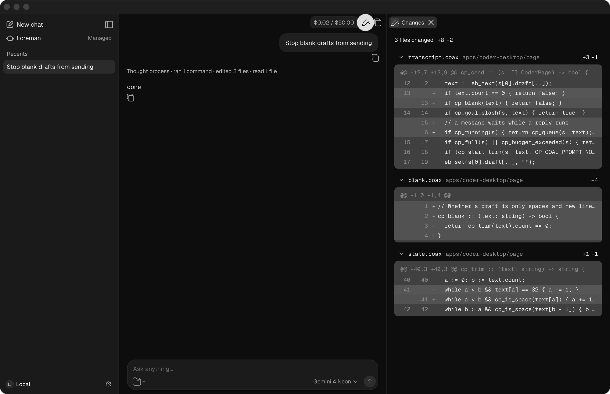

# Diffs and the code review (#13696)

Coder Desktop shows each edit as a structured diff, and lists the chat's changed files in a
Changes pane beside the conversation.

- **Edit rows.** In a message's activity group, an edit reads "Edited" or "Wrote", then the file's
  name (a link to the file) and its lines added and removed. A press opens the diff: hunk headers,
  old and new line numbers, the sign, and the added and removed lines on their washes.
- **Changes pane.** The pen button in the top-right corner shows once an edit has changed a file. It
  opens the pane: how many files and lines changed, then each file's row over the hunks of each of
  its edits. A press on a file's row folds or opens it. When a sub-agent's transcript is open, tabs
  in the pane header switch between the two.
- **Shared drawing.** `components/app/diff.coax` reads a unified diff into files and hunks and draws
  them with Zeron's measures (`apps/zgx/ui/ds/tool_detail.luau`, `git.luau`, `git_changes.luau`;
  MIT, ported here, not copied). Activity rows, tool rows (`app_tool`) and the mobile workspace's
  Diff tab (`apps/shared/app/workspace/view.coax`) all use it.

The capture is the built app on the Tier 3 mock worker, in a temp `HOME`, at 1440x900.
